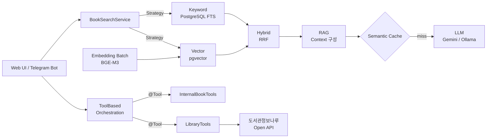

# AI Library Platform

[](https://www.oracle.com/java/technologies/downloads/#java21)
[](https://spring.io/projects/spring-boot)
[](https://spring.io/projects/spring-ai)
[](https://github.com/pgvector/pgvector)
[](.github/workflows/maven.yml)

> 공공 도서 데이터 약 15만 건을 출발점으로, 키워드 검색 → 벡터 검색 → RAG → Tool Calling 순으로 진화하는 AI 백엔드를 Spring AI로 단계별로 구현한 프로젝트이자 교재입니다.

- Demo: [https://library.java21.net](https://library.java21.net)
- 교재 목차: [`docs/index.md`](docs/index.md)

---

## 프로젝트 소개

AI 기능을 처음부터 붙이지 않습니다. 전통적인 검색 시스템을 먼저 만들고, 한계를 직접 측정한 뒤 그 한계를 해결하는 기술을 하나씩 도입합니다.

```text
데이터 → 검색 → 의미 → 생성 → 판단 → 도구 활용
```

각 단계는 "무엇을(What) · 어떻게(How) · 왜(Why)"를 설명하는 문서와 실제로 동작하는 코드로 구성되어 있습니다.

## 핵심 구현 포인트

| 영역 | 구현 내용 | 관련 코드 |
|---|---|---|
| 하이브리드 검색 | 키워드(PostgreSQL FTS) + 벡터(pgvector) 결과를 RRF(Reciprocal Rank Fusion, k=60)로 결합 | `core.book.service.search` (Strategy 패턴) |
| 임베딩 파이프라인 | BGE-M3 임베딩을 스케줄러 기반 배치로 생성·저장 | `batch.embedding`, `core.book.service.embedding` |
| RAG | RRF 점수 임계값으로 노이즈를 거르고, 관련도순으로 정렬한 컨텍스트로 LLM 답변 생성 | `RagSearchStrategy`, `AiRecommendationService` |
| 시맨틱 캐싱 | 질의 벡터의 코사인 유사도로 유사 질문을 캐시 적중 처리해 LLM 호출 비용 절감 | `core.book.service.cache` |
| 리뷰 요약 | Map-Reduce 방식 요약, RabbitMQ 큐 기반 비동기 처리 | `core.review.service` |
| 대화형 UI·피드백 | Telegram Bot 검색 + 피드백(좋아요/싫어요) 수집 | `external.telegram` |
| 개인화 | 피드백 기반 사용자 선호 벡터와 개인화 랭킹 | `core.book.service.personalization` |
| Tool Calling | Spring AI `@Tool` 기반 11개 도구(내부 DB + 도서관정보나루 Open API), `ChatClient.defaultTools()`로 LLM이 도구를 선택·조합 | `ai.function`, `ToolBasedAiOrchestrationService` |

## 아키텍처



## 기술 스택

| 구분 | 기술 |
|---|---|
| Language / Framework | Java 21, Spring Boot 3.5, Spring Data JPA, QueryDSL 5 |
| AI | Spring AI 1.1.2, Google Gemini 2.0 Flash, Ollama (qwen2.5), BGE-M3 임베딩 |
| Database | PostgreSQL + pgvector, H2 (테스트) |
| Cache / Messaging | Caffeine, Redis, RabbitMQ |
| Interface | Thymeleaf + Tabler, Telegram Bot API |
| 외부 연동 | 도서관정보나루 Open API |
| CI | GitHub Actions (Maven) |

## 학습 로드맵

| Step | 주제 | 주요 내용 |
|---|---|---|
| [1](docs/step-1/01.csv-batch-load.md) | 데이터 구축과 전통적 검색 | CSV 배치 적재, QueryDSL 동적 쿼리, B-Tree/GIN 인덱스, 전문 검색 |
| [2](docs/step-2/01.search-quality-limitations.md) | 벡터 검색 | 키워드 검색의 한계 분석, pgvector, 임베딩 배치, 하이브리드 검색(RRF) |
| [3](docs/step-3/01.understanding-rag.md) | RAG | 환각 문제, 컨텍스트 구성, LLM 연동 |
| [4](docs/step-4/README.md) | AI 성능·비용 튜닝 | Top-K 최적화, 시맨틱 캐싱, 리뷰 요약(Map-Reduce) |
| [5](docs/step-5/README.md) | Telegram Bot | 대화형 검색 UI, 피드백 수집, 프롬프트 가이드라인 |
| [6](docs/step-6/README.md) | 개인화 | 사용자 선호 벡터, 개인화 랭킹, 콜드 스타트 |
| [7](docs/step-7/README.md) | LLM 오케스트레이션 | MCP·A2A·Agent 이론, Function Calling, `@Tool` 애노테이션, 외부 API 연동 |
| [8](docs/step-8/README.md) | 워크플로우 자동화 | n8n 연동 |

## 프로젝트 구조

```text
src/main/java/com/nhnacademy/library
 ├─ batch
 │   ├─ init          # 공공 도서 CSV 파싱 및 적재 (이벤트 기반)
 │   └─ embedding     # 도서 임베딩 생성 스케줄러
 ├─ core
 │   ├─ book          # 도서 도메인, 검색 전략(Keyword/Vector/Hybrid/RAG), 캐시, 개인화
 │   ├─ review        # 리뷰 도메인, AI 요약
 │   └─ config        # QueryDSL, AI, 캐시, Redis, RabbitMQ 설정
 ├─ ai
 │   ├─ function      # @Tool 기반 도구 (LibraryTools, InternalBookTools)
 │   ├─ agent         # Agent 및 오케스트레이터
 │   └─ service       # AI 도서관 도우미 서비스
 ├─ external
 │   ├─ opennaru      # 도서관정보나루 Open API 클라이언트
 │   └─ telegram      # Telegram Bot, 피드백
 └─ front.web         # 웹 컨트롤러
```

개발·테스트 가이드라인은 [`.junie/guidelines.md`](.junie/guidelines.md)를 참고하세요.

## 실행 방법

### 요구 사항
- JDK 21, Maven
- Docker (PostgreSQL + pgvector 실행용)
- LLM 및 임베딩 API 접근 정보 (Gemini API 키 또는 Ollama 서버, OpenAI 호환 임베딩 엔드포인트)

### 로컬 실행
1. DB 실행: pgvector가 포함된 PostgreSQL 이미지를 실행합니다.
   ```bash
   docker run -d --name pgvector -p 5432:5432 -e POSTGRES_PASSWORD=postgres pgvector/pgvector:pg16
   ```
2. 설정: `src/main/resources/application.properties`에서 DB 연결 정보와 API 키를 설정합니다. (`spring.ai.selected-model`로 Gemini/Ollama 선택)
3. 실행:
   ```bash
   mvn spring-boot:run
   ```
4. 데이터 초기화: 애플리케이션이 시작되면 `src/main/resources/data/init/`의 CSV 파일이 자동으로 적재됩니다.

## 향후 계획

- Spring AI MCP Server로 `@Tool` 도구를 노출해 Claude Desktop 등 외부 MCP 클라이언트에서 사용
- RAG 품질 평가(Evaluation) 자동화

---

NHN Academy AI Library Project
