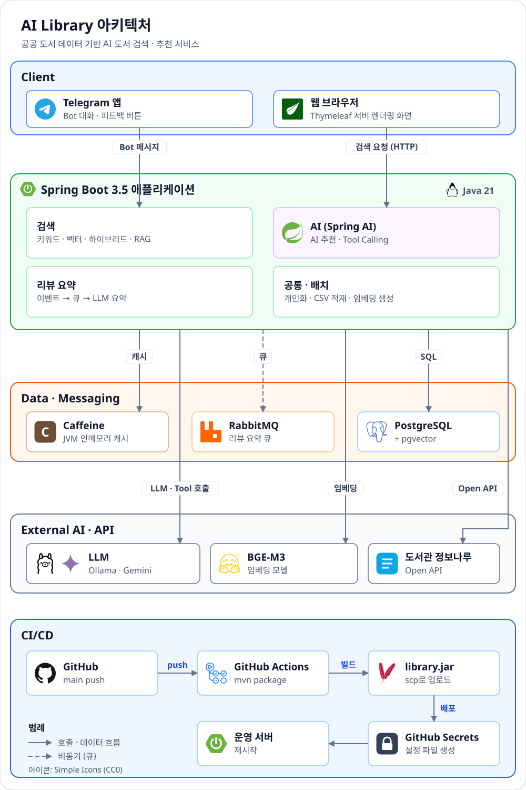
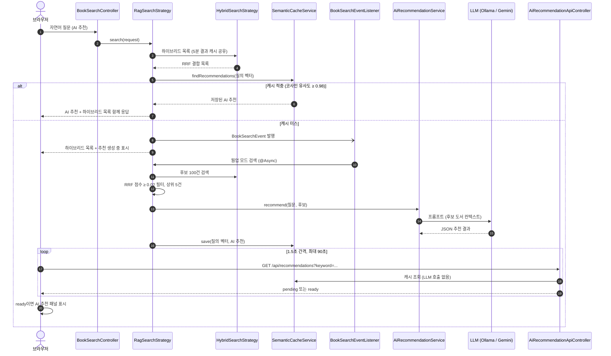
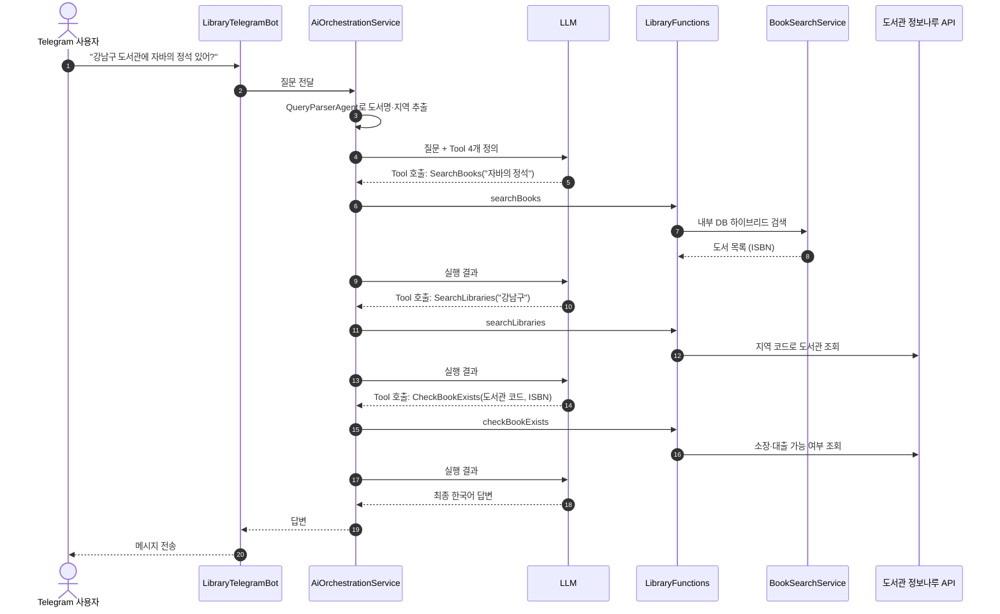

# AI Library

[](https://www.oracle.com/java/technologies/downloads/#java21)
[](https://spring.io/projects/spring-boot)
[](https://spring.io/projects/spring-ai)
[](https://github.com/pgvector/pgvector)
[](https://library.java21.net/)

> 공공 도서 데이터 약 15만 건으로 만든 AI 도서 검색 서비스입니다. 키워드 검색에서 출발해 벡터 검색, RAG 추천, LLM이 외부 API를 스스로 호출하는 Tool Calling까지 Spring AI로 단계별로 구현했고, 그 과정을 AI 입문 개발자를 위한 9단계 교재로 정리했습니다.

| | |
|---|---|
| 데모 | [https://library.java21.net/](https://library.java21.net/) |
| 교재 | [docs/index.md](docs/index.md) — Step 0~8, 용어집 |
| ERD | [데이터 모델 (Crowfoot)](https://crowfoot.java21.net/share/3LZoyyvhkS2CiMAAlvGNkN) |
| 외부 데이터 | [도서관 정보나루 Open API](https://www.data4library.kr/) (전국 공공도서관 소장·대출 정보) |

## 한눈에 보기

- 같은 질문을 **키워드 · 의미(벡터) · 하이브리드 · AI 추천(RAG)** 네 가지 방식으로 검색해 결과를 비교할 수 있습니다.
- AI 추천은 검색 결과를 근거로 LLM이 책을 고르고 추천 사유를 씁니다. 비슷한 질문은 시맨틱 캐시로 LLM 호출 없이 응답합니다.
- 리뷰가 쌓이면 RabbitMQ 큐를 거쳐 LLM이 장점·단점·추천 대상·총평으로 요약하고, 이 요약을 다시 추천 근거로 씁니다.
- Telegram Bot에서 검색하고 남긴 피드백으로 사용자별 취향 벡터를 만들어 검색 순위를 개인화합니다.
- "강남구 도서관에서 이 책 빌릴 수 있어?" 같은 질문에 LLM이 내부 검색과 도서관 정보나루 API 호출을 조합해 답합니다.

## 검색 방식

| 방식 | 동작 | 잘 맞는 질문 | AI 사용 |
|---|---|---|---|
| 키워드 | 제목·저자·출판사·소개를 `LIKE`와 PostgreSQL 전문 검색으로 찾음 | 정확한 제목, 저자명, ISBN | 없음 |
| 의미(벡터) | 질문을 BGE-M3 임베딩으로 바꿔 pgvector에서 코사인 유사도로 찾음 | 단어는 달라도 뜻이 같은 표현 | 임베딩 모델 |
| 하이브리드 | 키워드 순위와 의미 순위를 RRF(Reciprocal Rank Fusion, k=60)로 합침 | 키워드와 맥락이 섞인 질문 | 임베딩 모델 |
| AI 추천(RAG) | 하이브리드 상위 후보를 LLM이 읽고 골라 추천 사유와 함께 제시 | "~한 사람에게 맞는 책" 같은 추천 요청 | 임베딩 + LLM |

임베딩 서버에 연결할 수 없으면 의미·하이브리드·AI 추천 검색은 키워드 검색 결과로 대체하고 화면에 안내합니다.

## 아키텍처

<p align="center"></p>

데이터 모델(테이블과 관계)은 [ERD](https://crowfoot.java21.net/share/3LZoyyvhkS2CiMAAlvGNkN)에서 볼 수 있습니다. 그림의 아이콘은 [Simple Icons](https://simpleicons.org/)(CC0)를 사용했습니다.

### 구성 요소

| 계층 | 구성 | 역할 |
|---|---|---|
| Client | 웹 브라우저, Telegram 앱 | 웹 화면은 Thymeleaf + Tabler로 서버에서 그립니다. Telegram은 롱 폴링 Bot으로 검색, AI 질의, 피드백 버튼을 제공합니다. |
| Interface | `BookSearchController`, `AiRecommendationApiController`, `BookReviewController`, `LibraryTelegramBot` | 화면 요청을 서비스로 넘깁니다. `GET /api/recommendations`는 AI 추천이 준비됐는지 캐시만 조회하고 LLM을 호출하지 않습니다. |
| 검색 | `BookSearchService`, `KeywordSearchStrategy`, `VectorSearchStrategy`, `HybridSearchStrategy`, `RagSearchStrategy`, `RrfService` | `SearchType`에 따라 전략을 고릅니다. 하이브리드는 키워드·벡터 후보를 병렬로 조회해 RRF(k=60)로 합치고, RAG는 하이브리드 목록에 AI 추천을 더합니다. |
| AI | Spring AI `ChatClient`, `AiRecommendationService`, `AiOrchestrationService`, `LibraryFunctions` | LLM은 `spring.ai.selected-model`(ollama \| gemini)로 고릅니다(`AiConfig`). Tool Calling은 단일 LLM이 Tool 4개를 조합하는 방식입니다. |
| 리뷰 | `ReviewService`, `ReviewSummaryQueueService`, `ReviewSummaryQueueProcessor`, `ReviewSummarizer` | 리뷰 저장 후 이벤트로 통계를 갱신하고, RabbitMQ 큐를 거쳐 LLM이 Map-Reduce 방식으로 요약합니다. |
| 개인화 | `PersonalizationService`, `UserPreferenceVectorCalculator` | Telegram 피드백으로 사용자 선호 벡터를 만들어 검색 결과를 재정렬합니다. |
| 배치 | `BookBatchService`(CSV 적재), `BookEmbeddingScheduler` | 공공 도서 CSV를 이벤트 기반으로 적재하고, 임베딩이 없는 도서를 5초마다 32건씩 임베딩합니다. |
| 표지 보강 | `BookCoverService`, `BookCoverEventListener` | 화면에 노출된 도서 중 표지가 없는 도서를 도서관 정보나루 API로 비동기 보강합니다. |
| Data | PostgreSQL + pgvector, RabbitMQ, Caffeine | 도서·임베딩(`vector(1024)`)·리뷰·피드백은 PostgreSQL, 리뷰 요약 작업은 RabbitMQ, 캐시는 JVM 안의 Caffeine에 둡니다. |
| External | Ollama(qwen2.5) / Google Gemini 2.0 Flash, BGE-M3 임베딩, 도서관 정보나루 Open API | 임베딩은 OpenAI 호환 API로 호출합니다. 기본 설정의 LLM은 Ollama qwen2.5입니다. |

### 요청 흐름

| 검색 방식 | 거치는 단계 |
|---|---|
| 키워드 | 결과 캐시 확인 → `KeywordSearchStrategy` → PostgreSQL(`LIKE` + 전문 검색, trigram·FTS GIN 인덱스) |
| 의미(벡터) | 결과 캐시 확인 → 질의 임베딩(임베딩 캐시 또는 BGE-M3) → `VectorSearchStrategy` → pgvector HNSW |
| 하이브리드 | 결과 캐시 확인 → 질의 임베딩 → 키워드·벡터 후보 각 100건을 `hybridSearchExecutor`에서 병렬 조회(제한 10초) → RRF 결합 |
| AI 추천(RAG) | 하이브리드 목록(결과 캐시 공유) + 시맨틱 캐시의 AI 추천. 추천이 없으면 이벤트로 LLM 웜업을 시작하고 화면이 폴링 |

임베딩 서버에 연결할 수 없으면 의미·하이브리드·AI 추천은 키워드 검색 결과로 대체합니다.

#### AI 추천(RAG) 흐름

목록은 항상 하이브리드 검색 결과입니다. 시맨틱 캐시에는 AI 추천만 저장하고, 캐시 미스이면 목록을 먼저 보여 준 뒤 추천이 준비되면 패널에 채웁니다.



#### Tool Calling 흐름 (Telegram AI 질의)

`AiOrchestrationService`는 `ChatClient`에 Tool 4개(`SearchBooks`, `SearchLibraries`, `GetLibrariesWithBook`, `CheckBookExists`)를 등록합니다. 어떤 Tool을 어떤 순서로 부를지는 LLM이 정하고, 애플리케이션은 요청받은 Tool을 실행해 결과를 돌려줍니다.



`GetLibrariesWithBook`은 ISBN과 지역으로 소장 도서관을 한 번에 찾을 때 씁니다. `@Tool` 애노테이션 기반의 대체 구현은 `ToolBasedAiOrchestrationService`(`LibraryTools`, `InternalBookTools`)에 있습니다.

### 비동기 처리와 메시징

- RAG 웜업: `BookSearchEvent`를 `@Async` 리스너가 받아 LLM 추천을 만들고 시맨틱 캐시에 넣습니다. 실패하면 캐시에 저장하지 않으므로 다음 검색이 다시 시도합니다.
- 리뷰 요약: 리뷰 커밋 후(`AFTER_COMMIT`) `@Async`로 통계를 갱신하고, `ReviewAiSummaryEvent`로 direct exchange에 요약 작업을 발행합니다. 같은 도서의 요청은 5초 안에 한 번만 발행합니다.
- 큐 소비: `ReviewSummaryQueueProcessor`가 Consumer 3~5개로 처리합니다. LLM 호출은 DB 트랜잭션 밖에서 하고, 실패하면 3회(1초부터 2배, 최대 10초) 재시도한 뒤 DLQ(`<queue>.dlq`)로 보냅니다.
- 전용 스레드 풀: 하이브리드 후보 조회(`hybridSearchExecutor` 8스레드), 표지 보강(`coverEnrichmentExecutor` 2스레드), 그 밖의 `@Async`(`taskExecutor` 5~10스레드)를 분리합니다.

### 캐시 계층

모두 JVM 안의 Caffeine 캐시입니다. 값은 `application.properties`와 `CacheConfig`의 기본값입니다.

| 캐시 | 키 | 만료 · 크기 | 위치 |
|---|---|---|---|
| 검색 결과 캐시 | 정규화한 검색어 + 방식 + 페이지 | 5분 · 500건 | `SearchResultCache` (키워드·벡터·하이브리드, RAG 목록) |
| 시맨틱 캐시 | 질의 벡터 (코사인 유사도 ≥ 0.98) | 30분 · 1,000건 | `SemanticCacheService` (AI 추천만 저장) |
| 질의 임베딩 캐시 | 정규화한 검색어 | 1시간 · 10,000건 | `EmbeddingService` |
| 개인화 선호 벡터 | 사용자 chatId | 24시간 · 1,000건 | `UserPreferenceVectorCalculator` (`@Cacheable`) |
| 표지 조회 기록 | ISBN | 7일 · 100,000건 | `BookCoverService` (정보나루 재호출 방지) |
| 도서관 정보나루 API | 요청 파라미터 | 30분 · 500건 | `LibraryInfoNaruApiClient` (`@Cacheable`) |

### 데이터와 인덱스

검색 인덱스는 [`db/search-indexes.sql`](src/main/resources/db/search-indexes.sql)로 운영 DB에 `CREATE INDEX CONCURRENTLY`로 적용합니다(애플리케이션이 자동 실행하지 않음).

| 인덱스 | 대상 | 용도 |
|---|---|---|
| HNSW (`vector_cosine_ops`) | `books.embedding` | 벡터 근사 최근접 검색. 조회 시 `hnsw.ef_search`를 트랜잭션 범위로 120까지 올려 후보 100건을 모두 받음 |
| trigram GIN ×5 (`pg_trgm`) | `title`, `author_name`, `publisher_name`, `subtitle`, `volume_title`의 `lower()` | `LIKE '%검색어%'` 부분 일치 |
| FTS GIN | `to_tsvector('korean', book_content)` | 도서 소개 전문 검색 ([Step 1-04](docs/step-1/04.search-optimization.md)) |

측정 결과 하이브리드의 키워드 후보 조회는 648ms에서 14ms로, 벡터 후보 조회는 734ms에서 15ms로 줄었습니다.

### 장애 대응

- 임베딩 서버 장애: 질의 임베딩에 실패하면 키워드 검색 결과로 대체하고 화면에 안내합니다. 추천 폴링 API는 `unavailable`을 돌려줘 화면이 기다리지 않게 합니다.
- Spring AI 재시도 축소: 기본값(최대 10회, 지수 대기) 대신 2회, 500ms부터 최대 2초로 줄여 빠르게 실패합니다.
- 하이브리드 타임아웃: 키워드·벡터 후보 조회가 10초 안에 끝나지 않으면 `SearchTimeoutException`으로 끊고 안내 화면을 보여 줍니다.
- 커넥션 풀: 검색 서비스는 바깥 트랜잭션을 열지 않고, DBCP2 풀은 최대 20개, 대기 상한 5초, 유휴 커넥션 30초 주기 검사로 둡니다.

### 배포와 테스트

- 배포: `main`에 push하면 GitHub Actions가 JDK 21로 `mvn package`(테스트 생략)를 실행하고, `library.jar`를 scp로 올린 뒤 ssh로 서버에서 재시작합니다.
- 비밀값: GitHub Secrets에서 받은 값으로 서버에 `~/library/secrets.properties`(권한 600)를 만들고, 애플리케이션은 `spring.config.import`로 읽습니다.
- 테스트: DB·RabbitMQ를 쓰는 Spring Context 테스트는 Testcontainers로 일회용 `pgvector/pgvector:pg16`, `rabbitmq:3.13` 컨테이너에서 실행합니다. 원격 DB·운영 큐에는 연결하지 않습니다.

## 기술적 도전과 해결

교재 흐름(검색 → RAG → 리뷰 → 개인화 → 운영·테스트) 순서로 정리했습니다. 원인을 찾은 과정은 [실전 트러블슈팅 사례집](docs/troubleshooting.md)에 자세히 있습니다.

### 의미 검색 도입

- 문제: "위로가 필요할 때 읽을 책" 같은 질문에 키워드 검색이 답하지 못했습니다.
- 원인: 키워드 검색은 글자가 일치하는지만 비교합니다.
- 해결: BGE-M3 임베딩과 pgvector 코사인 유사도로 의미 검색을 만들고, 키워드 순위와 RRF(k=60)로 합쳤습니다. ([Step 2](docs/step-2/README.md))

### 하이브리드 결과가 매번 달라짐

- 문제: 같은 검색어로 하이브리드 검색을 반복하면 1페이지 도서와 순서가 조금씩 달랐습니다.
- 원인: 키워드 후보 조회가 정렬 없이 `LIMIT`을 걸었고, 벡터 유사도와 RRF 점수가 같은 도서끼리의 순서가 정해져 있지 않았습니다.
- 해결: 모든 단계에 결정적 정렬(제목 일치 → 최신 출간 → ID, 거리 → ID, RRF 동점 처리)을 두었습니다. ([사례 11](docs/troubleshooting.md#사례-11-같은-하이브리드-검색인데-결과가-매번-다름))

### 하이브리드 검색 속도

- 문제: 새 검색어의 하이브리드 검색이 느렸습니다.
- 원인: `LIKE '%검색어%'`와 벡터 거리 계산이 인덱스 없이 실행됐고, 후보 조회마다 count 쿼리(벡터만 약 380ms)를 실행했으며, 키워드·벡터 조회와 질의 임베딩을 매번 순서대로 처리했습니다.
- 해결: HNSW·trigram GIN 인덱스를 추가하고, count를 없애고, 키워드·벡터 후보를 병렬로 조회하고, 질의 임베딩을 캐시했습니다.
- 결과: 키워드 후보 648ms → 14ms, 벡터 후보 734ms → 15ms, 새 질의 전체 약 0.2초. ([사례 13](docs/troubleshooting.md#사례-13-운영-db에-hnsw-인덱스를-만들다-공간-부족으로-실패함))

### RAG 추천의 지연과 비용

- 문제: AI 추천을 요청할 때마다 LLM을 호출해 응답이 느리고 비용이 들었습니다.
- 원인: 비슷한 질문에도 매번 LLM 추천을 새로 만들었습니다.
- 해결: 질의 벡터의 코사인 유사도가 0.98 이상이면 시맨틱 캐시의 추천을 씁니다. 캐시 미스이면 하이브리드 목록을 먼저 응답하고, LLM 추천은 이벤트로 비동기 웜업한 뒤 화면이 폴링해 표시합니다. ([Step 4](docs/step-4/README.md))

### AI 추천 재검색 시 목록이 1~5권으로 줄어듦

- 문제: 같은 질문을 다시 검색하면 목록이 AI가 고른 1~5권만 남았습니다.
- 원인: 시맨틱 캐시가 AI가 고른 도서 목록을 검색 결과처럼 저장하고 돌려줬습니다.
- 해결: 캐시에는 AI 추천만 저장하고, 목록은 항상 하이브리드 결과(페이징 포함)를 보여 줍니다.

### 리뷰 등록이 19초 멈춤

- 문제: 리뷰를 등록하면 10~20초 멈추고 통계 갱신이 실패했습니다.
- 원인: AI 요약이 DB 트랜잭션 안에서 LLM을 호출하는 동안 요약 행을 잠갔습니다.
- 해결: LLM 호출을 트랜잭션 밖으로 빼서 짧은 트랜잭션 2개로 나누고, 통계 갱신은 커밋 후 비동기로 실행하며 낙관적 락 충돌 시 재시도합니다. ([사례 2](docs/troubleshooting.md#사례-2-리뷰-등록이-19초-멈춘-이유))

### 개인화 캐시가 동작하지 않음

- 문제: 사용자 선호 벡터를 검색할 때마다 다시 계산했습니다.
- 원인: 같은 클래스 안에서 호출해 Spring 프록시를 거치지 않았고, `@Cacheable`이 적용되지 않았습니다.
- 해결: 선호 벡터 계산을 별도 빈(`UserPreferenceVectorCalculator`)으로 분리했습니다. ([사례 6](docs/troubleshooting.md#사례-6-cacheable이-동작하지-않음))

### 임베딩 서버 장애 시 검색 지연

- 문제: 임베딩 서버가 응답하지 않으면 검색이 수십 초 걸렸습니다.
- 원인: Spring AI 기본 재시도(최대 10회, 2초부터 5배씩 대기)가 요청을 붙잡았습니다.
- 해결: 재시도를 2회, 최대 2초 대기로 줄이고, 실패하면 키워드 검색 결과로 대체합니다. ([사례 4](docs/troubleshooting.md#사례-4-임베딩-서버-장애로-검색이-수십-초-지연됨))

### 간헐적 7.7초 지연

- 문제: 검색 응답이 가끔 7초 넘게 걸렸습니다.
- 원인: 검색 메서드의 바깥 트랜잭션이 커넥션을 쥔 채 병렬 후보 조회가 2개를 더 빌리고, RAG 웜업까지 겹쳐 커넥션 풀(5개)이 고갈됐습니다. 풀은 무기한 대기하도록 설정돼 있었습니다.
- 해결: 바깥 트랜잭션을 없애고, 풀 최대 20개, 대기 상한 5초, 유휴 검사 방식으로 바꿨습니다.

### 테스트가 공용 DB 스키마를 지움

- 문제: 테스트를 실행하자 공용 개발 DB 스키마가 지워지고 운영 큐에 연결됐습니다.
- 원인: 테스트 설정이 원격 DB(`create-drop`)와 운영 RabbitMQ를 가리켰습니다.
- 해결: 모든 Spring Context 테스트를 Testcontainers의 일회용 pgvector·RabbitMQ 컨테이너에서 실행합니다. ([사례 8](docs/troubleshooting.md#사례-8-테스트가-공용-개발-db-스키마를-지움))

### 설정 파일에 비밀값이 커밋됨

- 문제: API 키와 비밀번호가 properties 파일에 커밋됐습니다.
- 원인: 비밀값을 설정 파일에 직접 적었습니다.
- 해결: `${ENV_VAR:}` 플레이스홀더와 커밋하지 않는 `secrets.properties`를 쓰고, 배포 시 GitHub Secrets로 서버에 파일을 만듭니다. ([사례 10](docs/troubleshooting.md#사례-10-설정-파일에-api-키와-비밀번호가-커밋됨))

### 그 밖의 사례

- 첫 화면 목록이 새로고침마다 바뀌고 5페이지에서 끝남: 검색어가 없으면 최근 출간·리뷰 많은 순 둘러보기로 전환 ([사례 5](docs/troubleshooting.md#사례-5-첫-화면-목록이-새로고침마다-바뀌고-5페이지에서-끝남))
- 리뷰가 늘어도 AI 요약이 갱신되지 않음: 요약되지 않은 리뷰가 있으면 다음 요약 대상으로 표시 ([사례 3](docs/troubleshooting.md#사례-3-리뷰가-늘어도-ai-요약이-갱신되지-않음))
- 개인화 점수가 검색할 때마다 커짐: 캐시된 객체 대신 복사본에 점수 적용 ([사례 12](docs/troubleshooting.md#사례-12-개인화-점수가-검색할-때마다-커짐))
- 도서의 37%(58,781권)에 표지가 없음: 노출된 도서부터 도서관 정보나루 API로 비동기 보강, 없으면 생성 표지 ([사례 9](docs/troubleshooting.md#사례-9-도서-10권-중-4권에-표지가-없음))
- 리뷰 요약에 Markdown 기호와 인사말이 보임, 시스템 프롬프트가 등록하지 않은 Tool을 안내함 ([사례 1](docs/troubleshooting.md#사례-1-리뷰-요약에-markdown-기호와-인사말이-그대로-보임), [사례 7](docs/troubleshooting.md#사례-7-시스템-프롬프트가-등록하지-않은-tool을-안내함))

## 교재

이 저장소의 `docs/`는 Java·Spring 경험은 있지만 AI는 처음인 대학생·신입 개발자를 위한 실습 교재입니다. 각 문서는 왜 필요한가 → 핵심 개념 → 따라 하기 → 직접 해 보기 → 자주 하는 실수 → 정리 → 확인 문제 순서로 구성되어 있습니다.

| 단계 | 주제 | 핵심 개념 |
|---|---|---|
| [Step 0](docs/step-0/README.md) | 시작하기 전에 | LLM, 토큰, 임베딩, RAG, Tool Calling, 개발 환경 |
| [Step 1](docs/step-1/README.md) | 데이터 구축과 전통적 검색 | 이벤트 기반 배치 적재, QueryDSL, 인덱스, 전문 검색 |
| [Step 2](docs/step-2/README.md) | 벡터 검색 | 임베딩, pgvector, 코사인 유사도, RRF |
| [Step 3](docs/step-3/README.md) | RAG | 환각, 컨텍스트 구성, ChatClient |
| [Step 4](docs/step-4/README.md) | 성능 최적화와 리뷰 시스템 | Top-K, 시맨틱 캐시, Map-Reduce 요약, RabbitMQ·DLQ |
| [Step 5](docs/step-5/README.md) | Telegram Bot과 피드백 | Bot API, Callback, 피드백 데이터 |
| [Step 6](docs/step-6/README.md) | 개인화 추천 | 사용자 선호 벡터, 재정렬, 콜드 스타트 |
| [Step 7](docs/step-7/README.md) | Tool Calling 도서관 도우미 | Function Calling, `@Tool`, MCP, 외부 API |
| [Step 8](docs/step-8/README.md) | n8n 자동화 (보너스) | 노드 기반 워크플로우 |

전체 목차와 학습 방법은 [docs/index.md](docs/index.md), 용어는 [용어집](docs/glossary.md)을 참고하세요.

## 기술 스택

<p>
  
  
  
  
  
</p>
<p>
  
  
  
  
  
</p>
<p>
  
  
  
</p>
<p>
  
  
  
  
  
</p>

| 구분 | 기술 |
|---|---|
| Language / Framework | Java 21, Spring Boot 3.5, Spring Data JPA, QueryDSL 5 |
| AI | Spring AI 1.1.2, Google Gemini 2.0 Flash, Ollama (qwen2.5), BGE-M3 임베딩(OpenAI 호환 엔드포인트) |
| Database | PostgreSQL + pgvector |
| Cache / Messaging | Caffeine (시맨틱·개인화·표지 조회 캐시), RabbitMQ (리뷰 요약 큐 + DLQ) |
| Interface | Thymeleaf + Tabler, Telegram Bot API |
| 외부 연동 | [도서관 정보나루 Open API](https://www.data4library.kr/) |
| Test | JUnit 5, Mockito, Testcontainers (pgvector, RabbitMQ) |
| CI/CD | GitHub Actions (Maven 빌드 → 서버 배포, GitHub Secrets로 비밀값 주입) |

## 프로젝트 구조

```text
src/main/java/net/java21/library
 ├─ batch
 │   ├─ init          # 공공 도서 CSV 파싱 및 적재 (이벤트 기반)
 │   └─ embedding     # 도서 임베딩 생성 스케줄러
 ├─ core
 │   ├─ book          # 도서 도메인, 검색 전략(Keyword/Vector/Hybrid/RAG), 캐시, 개인화, 표지 보강
 │   ├─ review        # 리뷰 도메인, AI 요약
 │   └─ config        # QueryDSL, AI, 캐시, Redis, RabbitMQ 설정
 ├─ ai
 │   ├─ function      # Function·@Tool 도구 (LibraryFunctions, LibraryTools, InternalBookTools)
 │   ├─ agent         # Agent 및 오케스트레이터
 │   └─ service       # AI 도서관 도우미 서비스
 ├─ external
 │   ├─ opennaru      # 도서관 정보나루 Open API 클라이언트
 │   └─ telegram      # Telegram Bot, 피드백
 └─ front.web         # 웹 컨트롤러
```

개발 규칙과 작업 가이드는 [`CLAUDE.md`](CLAUDE.md)를 참고하세요.

## 실행 방법

자세한 과정은 [Step 0. 개발 환경 준비](docs/step-0/02.environment-setup.md)에 정리되어 있습니다.

### 요구 사항
- JDK 21, Maven
- Docker (로컬 PostgreSQL + pgvector, 테스트 컨테이너)
- LLM·임베딩 접속 정보 (Gemini API 키 또는 Ollama 서버, OpenAI 호환 임베딩 엔드포인트)

### 로컬 실행
1. 비밀값 설정: 템플릿을 복사해 DB 비밀번호와 API 키를 채웁니다. `secrets.properties`는 커밋되지 않으며, 같은 이름의 환경 변수로 대신할 수 있습니다.
   ```bash
   cp secrets.properties.example secrets.properties
   ```
2. DB 준비: 로컬 DB를 쓰려면 pgvector 이미지를 실행하고 `application.properties`의 접속 주소를 바꿉니다. 빈 DB라면 처음 한 번 스키마 생성과 CSV 적재가 필요합니다(Step 0 문서 참고, 기본 설정은 `ddl-auto=validate`, `init.enable=false`).
   ```bash
   docker run -d --name pgvector -p 5432:5432 -e POSTGRES_PASSWORD=postgres pgvector/pgvector:pg16
   ```
3. 실행 후 `http://localhost:8080`에 접속합니다. LLM은 `spring.ai.selected-model`(gemini | ollama)로 고릅니다.
   ```bash
   mvn spring-boot:run
   ```

### 테스트
```bash
mvn test
```
DB·RabbitMQ를 쓰는 테스트는 Testcontainers가 일회용 컨테이너를 띄우므로 Docker가 실행 중이어야 합니다. 실제 LLM을 호출하는 테스트는 기본적으로 건너뜁니다.

## 향후 계획

- Spring AI MCP Server로 `@Tool` 도구를 노출해 Claude Desktop 등 외부 MCP 클라이언트에서 사용
- RAG 품질 평가(Evaluation) 자동화
- 검색 품질 지표(정밀도·재현율) 측정과 하이브리드 가중치 튜닝
