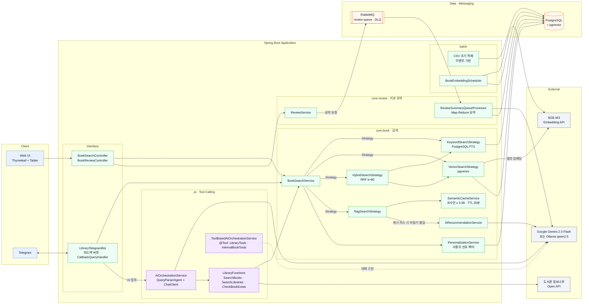
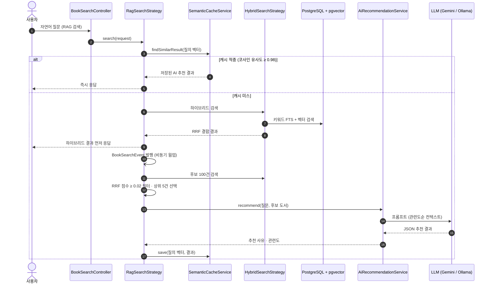
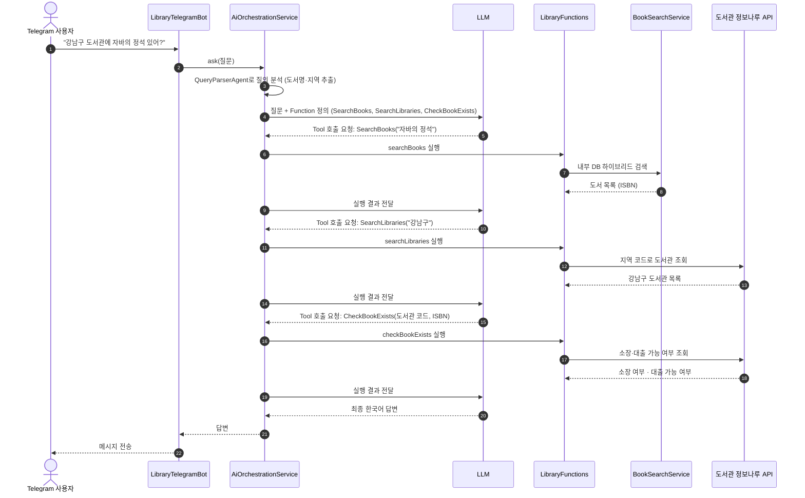

# AI Library

[](https://www.oracle.com/java/technologies/downloads/#java21)
[](https://spring.io/projects/spring-boot)
[](https://spring.io/projects/spring-ai)
[](https://github.com/pgvector/pgvector)
[](https://library.java21.net/)

> 공공 도서 데이터 약 15만 건을 출발점으로, 키워드 검색 → 벡터 검색 → RAG → Tool Calling 순으로 진화하는 AI 백엔드를 Spring AI로 단계별로 구현한 프로젝트이자 교재입니다.

- Demo: [https://library.java21.net/](https://library.java21.net/)
- 교재 목차: [`docs/index.md`](docs/index.md)
- 외부 데이터: [도서관 정보나루 Open API](https://www.data4library.kr/) (전국 공공도서관 소장·대출 정보)

---

## 프로젝트 소개

AI Library는 공공 도서 데이터 약 15만 건으로 만든 도서 검색 서비스입니다. 평범한 키워드 검색에서 출발해 의미 검색, RAG 기반 추천, LLM이 외부 API를 스스로 호출하는 도서관 도우미까지 같은 코드베이스 위에서 단계적으로 확장했습니다. 각 단계의 설계 의도와 구현 과정은 8단계 교재(`docs/`)로 함께 정리했습니다.

### 왜 이렇게 만들었나

AI 기능을 처음부터 붙이지 않습니다. 단계마다 기존 방식의 한계를 먼저 측정하고, 그 한계를 해결하는 기술만 도입합니다.

```text
데이터 → 검색 → 의미 → 생성 → 판단 → 도구 활용
```

| 단계 | 부딪힌 문제 | 도입한 해결책 |
|---|---|---|
| 키워드 검색 | `LIKE` 검색이 느리고, "자바 입문서"처럼 의미로 찾는 질문에 답하지 못함 | GIN 인덱스·전문 검색, 이후 BGE-M3 임베딩 + pgvector 의미 검색 |
| 의미 검색 | 벡터 검색만으로는 저자명·정확한 제목 같은 키워드 질의에 약함 | 키워드와 벡터 결과를 RRF로 결합한 하이브리드 검색 |
| 답변 생성 | 검색 결과 목록만으로는 "왜 이 책인가"를 설명하지 못하고, LLM 단독 답변은 환각이 생김 | 검색 결과를 컨텍스트로 넣는 RAG 추천 |
| 운영 비용 | 비슷한 질문마다 LLM을 호출해 응답이 느리고 비용이 큼 | Top-K·임계값 조정, 시맨틱 캐시와 비동기 웜업 |
| 사용자 경험 | 웹 검색창만으로는 대화형 질의와 피드백 수집이 어려움 | Telegram Bot, 피드백 기반 개인화 랭킹 |
| 외부 정보 | 대출 가능 여부처럼 DB에 없는 실시간 정보에 답하지 못함 | LLM이 도서관 정보나루 API를 Function으로 호출하는 Tool Calling |

### 무엇을 할 수 있나

- 키워드·벡터·하이브리드·RAG 네 가지 방식으로 도서를 검색하고, RAG 검색에서는 추천 사유와 관련도를 함께 보여 줍니다.
- 리뷰가 쌓이면 RabbitMQ 큐를 거쳐 LLM이 리뷰를 요약하고, 요약을 RAG 검색 컨텍스트에 반영합니다.
- Telegram에서 자연어로 검색하고, 결과에 남긴 피드백으로 사용자별 선호 벡터를 만들어 검색 순위를 개인화합니다.
- "강남구 도서관에 이 책 있어?" 같은 질문에 LLM이 내부 DB 검색과 도서관 정보나루 API 호출을 조합해 답합니다.

각 단계는 "무엇을(What) · 어떻게(How) · 왜(Why)"를 설명하는 문서와 실제로 동작하는 코드로 구성되어 있습니다.

## 기술 스택

<p>
  
  
  
  
  
</p>
<p>
  
  
  
  
  
</p>
<p>
  
  
  
</p>
<p>
  
  
  
  
  
</p>

| 구분 | 기술 |
|---|---|
| Language / Framework | Java 21, Spring Boot 3.5, Spring Data JPA, QueryDSL 5 |
| AI | Spring AI 1.1.2, Google Gemini 2.0 Flash, Ollama (qwen2.5), BGE-M3 임베딩(OpenAI 호환 엔드포인트) |
| Database | PostgreSQL + pgvector, H2 (테스트) |
| Cache / Messaging | Caffeine (시맨틱·개인화 캐시), RabbitMQ (리뷰 요약 큐 + DLQ), Redis (설정) |
| Interface | Thymeleaf + Tabler, Telegram Bot API |
| 외부 연동 | [도서관 정보나루 Open API](https://www.data4library.kr/) |
| CI/CD | GitHub Actions (Maven 빌드 → 서버 배포) |

## 아키텍처

### 시스템 구성



### RAG 검색 흐름 (시맨틱 캐시 + 비동기 웜업)

캐시에 비슷한 질문이 있으면 LLM을 호출하지 않고 바로 응답합니다. 캐시 미스일 때는 하이브리드 검색 결과를 먼저 돌려주고, LLM 추천은 이벤트로 비동기 실행해 다음 질문을 위해 캐시를 채웁니다.



### Tool Calling 흐름 (Telegram AI 질의)

LLM은 등록된 Function 정의를 보고 어떤 Function을 어떤 순서로 호출할지 스스로 정합니다. 애플리케이션은 요청받은 Function을 실행해 결과를 돌려줄 뿐입니다.



## 핵심 구현 포인트

| 영역 | 구현 내용 | 관련 코드 |
|---|---|---|
| 하이브리드 검색 | 키워드(PostgreSQL FTS) + 벡터(pgvector) 결과를 RRF(Reciprocal Rank Fusion, k=60)로 결합 | `core.book.service.search` (Strategy 패턴) |
| 임베딩 파이프라인 | BGE-M3 임베딩을 스케줄러 기반 배치로 생성·저장 | `batch.embedding`, `core.book.service.embedding` |
| RAG | RRF 점수 임계값으로 노이즈를 거르고, 관련도순으로 정렬한 컨텍스트로 LLM 답변 생성 | `RagSearchStrategy`, `AiRecommendationService` |
| 시맨틱 캐싱 | 질의 벡터의 코사인 유사도로 유사 질문을 캐시 적중 처리, 캐시 미스는 비동기 웜업 | `core.book.service.cache` |
| 리뷰 요약 | Map-Reduce 방식 요약, RabbitMQ 큐 기반 비동기 처리, 재시도 3회 후 DLQ | `core.review.service` |
| 대화형 UI·피드백 | Telegram Bot 검색 + 피드백(좋아요/싫어요) 수집 | `external.telegram` |
| 개인화 | 피드백 기반 사용자 선호 벡터와 개인화 랭킹 | `core.book.service.personalization` |
| Tool Calling | LLM이 도서 검색·대출 가능 도서관 조회 등 Function을 스스로 선택·조합 (`FunctionToolCallback` 방식과 `@Tool` 애노테이션 방식 모두 구현) | `ai.function`, `ai.agent.orchestrator` |

## 학습 로드맵

| Step | 주제 | 주요 내용 |
|---|---|---|
| 1 | [데이터 구축과 전통적 검색](docs/step-1/01.csv-batch-load.md) | [CSV 배치 적재](docs/step-1/01.csv-batch-load.md), [QueryDSL 동적 쿼리](docs/step-1/02.basic-search-implementation.md), [검색 UI](docs/step-1/03.search-ui.md), [인덱스와 전문 검색](docs/step-1/04.search-optimization.md) |
| 2 | [벡터 검색](docs/step-2/01.search-quality-limitations.md) | [키워드 검색의 한계](docs/step-2/01.search-quality-limitations.md), [pgvector](docs/step-2/02.pgvector-setup.md), [임베딩 배치](docs/step-2/03.embedding-generation.md), [자연어 검색](docs/step-2/04.natural-language-search.md), [하이브리드 검색(RRF)](docs/step-2/05.hybrid-search.md) |
| 3 | [RAG](docs/step-3/01.understanding-rag.md) | [RAG와 환각 문제](docs/step-3/01.understanding-rag.md), [컨텍스트 구성](docs/step-3/02.context-construction.md), [LLM 연동](docs/step-3/03.llm-integration.md) |
| 4 | [AI 성능·비용 튜닝](docs/step-4/README.md) | [성능과 비용](docs/step-4/01.performance-cost.md), [Top-K 최적화](docs/step-4/02.topk-optimization.md), [시맨틱 캐싱](docs/step-4/03.semantic-caching.md), [리뷰 요약(Map-Reduce)](docs/step-4/04.review-summarization.md), [리뷰 RAG 반영](docs/step-4/05.review-rag-integration.md) |
| 5 | [Telegram Bot](docs/step-5/README.md) | [Bot 설정](docs/step-5/01.telegram-bot-setup.md), [Telegram RAG 검색](docs/step-5/02.rag-search-via-telegram.md), [피드백 수집](docs/step-5/03.feedback-entity-repository.md), [피드백 루프](docs/step-5/05.feedback-search-integration.md), [피드백 기반 검색 개선](docs/step-5/06.llm-prompt-guidelines.md) |
| 6 | [개인화](docs/step-6/README.md) | [임베딩과 코사인 유사도](docs/step-6/01.vector-embedding-basics.md), [사용자 선호 벡터](docs/step-6/02.user-preference-vector.md), [개인화 랭킹](docs/step-6/03.personalized-ranking.md), [콜드 스타트](docs/step-6/04.cold-start-and-optimization.md), [통합 가이드](docs/step-6/05.integration-guide.md) |
| 7 | [LLM 오케스트레이션](docs/step-7/README.md) | [MCP·A2A·Agent 이론](docs/step-7/00.theory.md), [단일 Function](docs/step-7/02.single-function.md), [복수 Function 조합](docs/step-7/03.multiple-functions.md), [외부 API 연동](docs/step-7/04.external-api.md), [`@Tool` 애노테이션](docs/step-7/05.tool-annotation.md), [실습 가이드](docs/step-7/06.practice-guide.md) |
| 8 | [워크플로우 자동화](docs/step-8/README.md) | [n8n 연동](docs/step-8/01.n8n-integration.md) |

## 프로젝트 구조

```text
src/main/java/net/java21/library
 ├─ batch
 │   ├─ init          # 공공 도서 CSV 파싱 및 적재 (이벤트 기반)
 │   └─ embedding     # 도서 임베딩 생성 스케줄러
 ├─ core
 │   ├─ book          # 도서 도메인, 검색 전략(Keyword/Vector/Hybrid/RAG), 캐시, 개인화
 │   ├─ review        # 리뷰 도메인, AI 요약
 │   └─ config        # QueryDSL, AI, 캐시, Redis, RabbitMQ 설정
 ├─ ai
 │   ├─ function      # Function·@Tool 도구 (LibraryFunctions, LibraryTools, InternalBookTools)
 │   ├─ agent         # Agent 및 오케스트레이터
 │   └─ service       # AI 도서관 도우미 서비스
 ├─ external
 │   ├─ opennaru      # 도서관 정보나루 Open API 클라이언트
 │   └─ telegram      # Telegram Bot, 피드백
 └─ front.web         # 웹 컨트롤러
```

개발 규칙과 작업 가이드는 [`CLAUDE.md`](CLAUDE.md)를 참고하세요.

## 실행 방법

### 요구 사항
- JDK 21, Maven
- Docker (PostgreSQL + pgvector 실행용)
- LLM 및 임베딩 API 접근 정보 (Gemini API 키 또는 Ollama 서버, OpenAI 호환 임베딩 엔드포인트)

### 로컬 실행
1. DB 실행: pgvector가 포함된 PostgreSQL 이미지를 실행합니다.
   ```bash
   docker run -d --name pgvector -p 5432:5432 -e POSTGRES_PASSWORD=postgres pgvector/pgvector:pg16
   ```
2. 비밀값 설정: `secrets.properties.example`을 복사해 DB 비밀번호와 API 키를 채웁니다. `secrets.properties`는 커밋되지 않으며, 같은 이름의 환경 변수로 대신할 수도 있습니다.
   ```bash
   cp secrets.properties.example secrets.properties
   ```
   DB 접속 주소 등 나머지 설정은 `src/main/resources/application.properties`에 있습니다. (`spring.ai.selected-model`로 Gemini/Ollama 선택)
3. 실행:
   ```bash
   mvn spring-boot:run
   ```
4. 데이터 초기화: 애플리케이션이 시작되면 `src/main/resources/data/init/`의 CSV 파일이 자동으로 적재됩니다.

## 향후 계획

- Spring AI MCP Server로 `@Tool` 도구를 노출해 Claude Desktop 등 외부 MCP 클라이언트에서 사용
- RAG 품질 평가(Evaluation) 자동화

