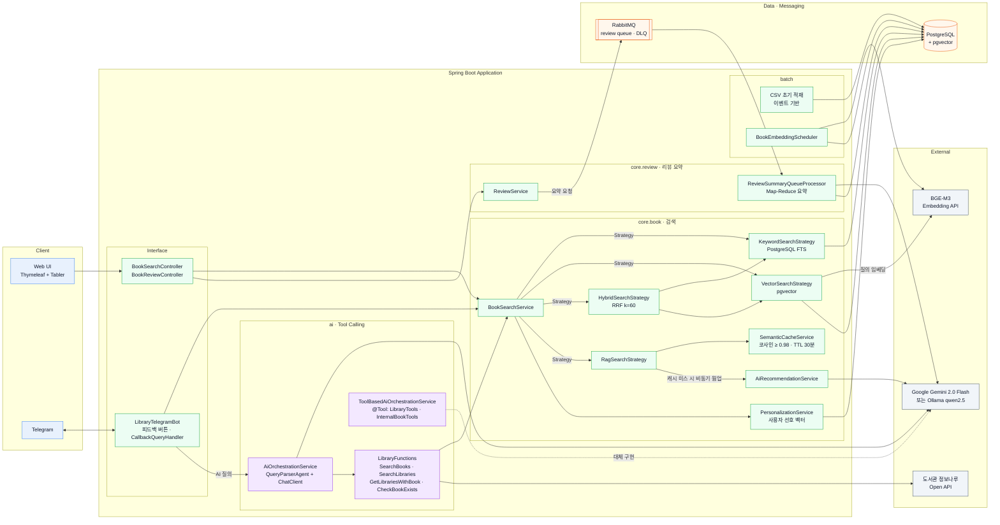
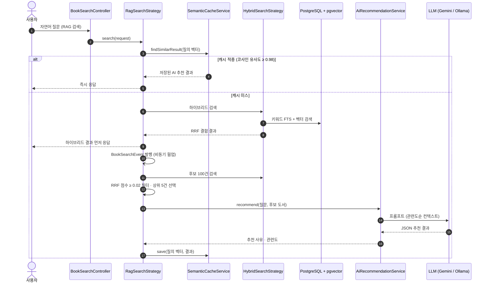
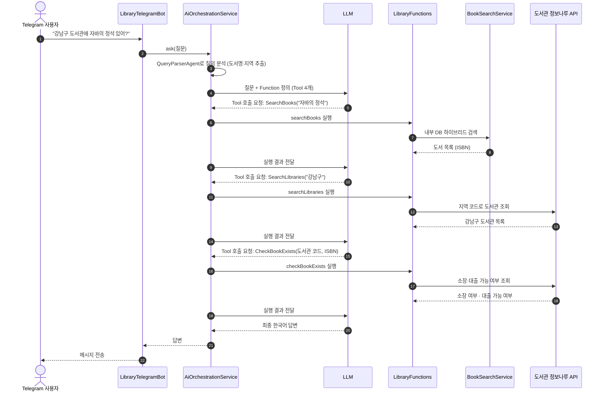

# AI Library

[](https://www.oracle.com/java/technologies/downloads/#java21)
[](https://spring.io/projects/spring-boot)
[](https://spring.io/projects/spring-ai)
[](https://github.com/pgvector/pgvector)
[](https://library.java21.net/)

> 공공 도서 데이터 약 15만 건으로 만든 AI 도서 검색 서비스입니다. 키워드 검색에서 출발해 벡터 검색, RAG 추천, LLM이 외부 API를 스스로 호출하는 Tool Calling까지 Spring AI로 단계별로 구현했고, 그 과정을 AI 입문 개발자를 위한 9단계 교재로 정리했습니다.

| | |
|---|---|
| 데모 | [https://library.java21.net/](https://library.java21.net/) |
| 교재 | [docs/index.md](docs/index.md) — Step 0~8, 용어집 |
| 외부 데이터 | [도서관 정보나루 Open API](https://www.data4library.kr/) (전국 공공도서관 소장·대출 정보) |

## 한눈에 보기

- 같은 질문을 **키워드 · 의미(벡터) · 하이브리드 · AI 추천(RAG)** 네 가지 방식으로 검색해 결과를 비교할 수 있습니다.
- AI 추천은 검색 결과를 근거로 LLM이 책을 고르고 추천 사유를 씁니다. 비슷한 질문은 시맨틱 캐시로 LLM 호출 없이 응답합니다.
- 리뷰가 쌓이면 RabbitMQ 큐를 거쳐 LLM이 장점·단점·추천 대상·총평으로 요약하고, 이 요약을 다시 추천 근거로 씁니다.
- Telegram Bot에서 검색하고 남긴 피드백으로 사용자별 취향 벡터를 만들어 검색 순위를 개인화합니다.
- "강남구 도서관에서 이 책 빌릴 수 있어?" 같은 질문에 LLM이 내부 검색과 도서관 정보나루 API 호출을 조합해 답합니다.

## 검색 방식

| 방식 | 동작 | 잘 맞는 질문 | AI 사용 |
|---|---|---|---|
| 키워드 | 제목·저자·출판사·소개를 `LIKE`와 PostgreSQL 전문 검색으로 찾음 | 정확한 제목, 저자명, ISBN | 없음 |
| 의미(벡터) | 질문을 BGE-M3 임베딩으로 바꿔 pgvector에서 코사인 유사도로 찾음 | 단어는 달라도 뜻이 같은 표현 | 임베딩 모델 |
| 하이브리드 | 키워드 순위와 의미 순위를 RRF(Reciprocal Rank Fusion, k=60)로 합침 | 키워드와 맥락이 섞인 질문 | 임베딩 모델 |
| AI 추천(RAG) | 하이브리드 상위 후보를 LLM이 읽고 골라 추천 사유와 함께 제시 | "~한 사람에게 맞는 책" 같은 추천 요청 | 임베딩 + LLM |

임베딩 서버에 연결할 수 없으면 의미·하이브리드·AI 추천 검색은 키워드 검색 결과로 대체하고 화면에 안내합니다.

## 아키텍처

### 시스템 구성



### RAG 검색 흐름 (시맨틱 캐시 + 비동기 웜업)

캐시에 비슷한 질문이 있으면 LLM을 호출하지 않고 바로 응답합니다. 캐시 미스일 때는 하이브리드 검색 결과를 먼저 돌려주고, LLM 추천은 이벤트로 비동기 실행해 다음 질문을 위해 캐시를 채웁니다.



### Tool Calling 흐름 (Telegram AI 질의)

LLM은 등록된 Function 정의를 보고 어떤 Function을 어떤 순서로 호출할지 스스로 정합니다. 애플리케이션은 요청받은 Function을 실행해 결과를 돌려줄 뿐입니다.



## 기술적 도전과 해결

| 문제 | 원인 | 해결 |
|---|---|---|
| 키워드 검색은 "위로가 필요할 때 읽을 책" 같은 질문에 답하지 못함 | 글자 일치만 비교 | BGE-M3 임베딩 + pgvector 의미 검색, 키워드 순위와 RRF로 결합 |
| RAG 추천이 느리고 질문마다 LLM 비용 발생 | 매 요청 LLM 호출 | 질의 벡터 코사인 유사도 0.98 이상이면 캐시 적중, 캐시 미스는 하이브리드 결과를 먼저 응답하고 LLM 추천은 이벤트로 비동기 웜업 |
| 리뷰를 등록하면 10~20초 멈추고 통계 갱신이 실패 | AI 요약이 DB 트랜잭션 안에서 LLM을 호출해 요약 행을 잠금 | LLM 호출을 트랜잭션 밖으로 분리(짧은 트랜잭션 2개), 통계 갱신은 비동기 + 낙관적 락 충돌 시 재시도 |
| 첫 요약 이후 리뷰가 늘어도 요약이 바뀌지 않음 | 통계 갱신 시 재생성 플래그를 켜지 않음 | 요약되지 않은 리뷰가 있으면 다음 요약 대상으로 표시, LLM 호출 중 추가된 리뷰도 보존 |
| 개인화 캐시가 동작하지 않음 | 같은 클래스 내부 호출이라 Spring 프록시를 거치지 않아 `@Cacheable` 미적용 | 선호 벡터 계산을 별도 빈(`UserPreferenceVectorCalculator`)으로 분리 |
| 임베딩 서버 장애 시 검색이 수십 초 지연 | Spring AI 기본 재시도(최대 10회, 지수 대기) | 재시도를 2회·짧은 대기로 줄이고 키워드 검색으로 대체 |
| 테스트가 공용 개발 DB 스키마를 삭제하고 운영 큐에 연결 | 테스트 설정이 원격 DB(`create-drop`)·운영 RabbitMQ를 사용 | Testcontainers로 모든 Spring Context 테스트를 일회용 pgvector·RabbitMQ 컨테이너에서 실행 |
| 도서의 37%(58,781권)에 표지 이미지가 없음 | 원천 CSV에 이미지 URL 누락 | 노출된 도서부터 도서관 정보나루 API로 표지를 비동기 보강, 없거나 깨진 표지는 제목·저자로 만든 생성 표지로 대체 |
| 첫 화면이 새로고침마다 바뀌고 5페이지에서 끝남 | 검색어 없이 하이브리드 검색(상위 후보만)을 정렬 없이 수행 | 검색어가 없으면 최근 출간·리뷰 많은 순 둘러보기로 전환, 전체 페이징 |
| 설정 파일에 API 키·비밀번호가 커밋됨 | 비밀값을 properties에 직접 기록 | `${ENV_VAR}` 플레이스홀더 + `secrets.properties`(커밋 제외), 배포 시 GitHub Secrets로 서버에 생성 |

## 교재

이 저장소의 `docs/`는 Java·Spring 경험은 있지만 AI는 처음인 대학생·신입 개발자를 위한 실습 교재입니다. 각 문서는 왜 필요한가 → 핵심 개념 → 따라 하기 → 직접 해 보기 → 자주 하는 실수 → 정리 → 확인 문제 순서로 구성되어 있습니다.

| 단계 | 주제 | 핵심 개념 |
|---|---|---|
| [Step 0](docs/step-0/README.md) | 시작하기 전에 | LLM, 토큰, 임베딩, RAG, Tool Calling, 개발 환경 |
| [Step 1](docs/step-1/README.md) | 데이터 구축과 전통적 검색 | 이벤트 기반 배치 적재, QueryDSL, 인덱스, 전문 검색 |
| [Step 2](docs/step-2/README.md) | 벡터 검색 | 임베딩, pgvector, 코사인 유사도, RRF |
| [Step 3](docs/step-3/README.md) | RAG | 환각, 컨텍스트 구성, ChatClient |
| [Step 4](docs/step-4/README.md) | 성능 최적화와 리뷰 시스템 | Top-K, 시맨틱 캐시, Map-Reduce 요약, RabbitMQ·DLQ |
| [Step 5](docs/step-5/README.md) | Telegram Bot과 피드백 | Bot API, Callback, 피드백 데이터 |
| [Step 6](docs/step-6/README.md) | 개인화 추천 | 사용자 선호 벡터, 재정렬, 콜드 스타트 |
| [Step 7](docs/step-7/README.md) | Tool Calling 도서관 도우미 | Function Calling, `@Tool`, MCP, 외부 API |
| [Step 8](docs/step-8/README.md) | n8n 자동화 (보너스) | 노드 기반 워크플로우 |

전체 목차와 학습 방법은 [docs/index.md](docs/index.md), 용어는 [용어집](docs/glossary.md)을 참고하세요.

## 기술 스택

<p>
  
  
  
  
  
</p>
<p>
  
  
  
  
  
</p>
<p>
  
  
  
</p>
<p>
  
  
  
  
  
</p>

| 구분 | 기술 |
|---|---|
| Language / Framework | Java 21, Spring Boot 3.5, Spring Data JPA, QueryDSL 5 |
| AI | Spring AI 1.1.2, Google Gemini 2.0 Flash, Ollama (qwen2.5), BGE-M3 임베딩(OpenAI 호환 엔드포인트) |
| Database | PostgreSQL + pgvector |
| Cache / Messaging | Caffeine (시맨틱·개인화·표지 조회 캐시), RabbitMQ (리뷰 요약 큐 + DLQ) |
| Interface | Thymeleaf + Tabler, Telegram Bot API |
| 외부 연동 | [도서관 정보나루 Open API](https://www.data4library.kr/) |
| Test | JUnit 5, Mockito, Testcontainers (pgvector, RabbitMQ) |
| CI/CD | GitHub Actions (Maven 빌드 → 서버 배포, GitHub Secrets로 비밀값 주입) |

## 프로젝트 구조

```text
src/main/java/net/java21/library
 ├─ batch
 │   ├─ init          # 공공 도서 CSV 파싱 및 적재 (이벤트 기반)
 │   └─ embedding     # 도서 임베딩 생성 스케줄러
 ├─ core
 │   ├─ book          # 도서 도메인, 검색 전략(Keyword/Vector/Hybrid/RAG), 캐시, 개인화, 표지 보강
 │   ├─ review        # 리뷰 도메인, AI 요약
 │   └─ config        # QueryDSL, AI, 캐시, Redis, RabbitMQ 설정
 ├─ ai
 │   ├─ function      # Function·@Tool 도구 (LibraryFunctions, LibraryTools, InternalBookTools)
 │   ├─ agent         # Agent 및 오케스트레이터
 │   └─ service       # AI 도서관 도우미 서비스
 ├─ external
 │   ├─ opennaru      # 도서관 정보나루 Open API 클라이언트
 │   └─ telegram      # Telegram Bot, 피드백
 └─ front.web         # 웹 컨트롤러
```

개발 규칙과 작업 가이드는 [`CLAUDE.md`](CLAUDE.md)를 참고하세요.

## 실행 방법

자세한 과정은 [Step 0. 개발 환경 준비](docs/step-0/02.environment-setup.md)에 정리되어 있습니다.

### 요구 사항
- JDK 21, Maven
- Docker (로컬 PostgreSQL + pgvector, 테스트 컨테이너)
- LLM·임베딩 접속 정보 (Gemini API 키 또는 Ollama 서버, OpenAI 호환 임베딩 엔드포인트)

### 로컬 실행
1. 비밀값 설정: 템플릿을 복사해 DB 비밀번호와 API 키를 채웁니다. `secrets.properties`는 커밋되지 않으며, 같은 이름의 환경 변수로 대신할 수 있습니다.
   ```bash
   cp secrets.properties.example secrets.properties
   ```
2. DB 준비: 로컬 DB를 쓰려면 pgvector 이미지를 실행하고 `application.properties`의 접속 주소를 바꿉니다. 빈 DB라면 처음 한 번 스키마 생성과 CSV 적재가 필요합니다(Step 0 문서 참고, 기본 설정은 `ddl-auto=validate`, `init.enable=false`).
   ```bash
   docker run -d --name pgvector -p 5432:5432 -e POSTGRES_PASSWORD=postgres pgvector/pgvector:pg16
   ```
3. 실행 후 `http://localhost:8080`에 접속합니다. LLM은 `spring.ai.selected-model`(gemini | ollama)로 고릅니다.
   ```bash
   mvn spring-boot:run
   ```

### 테스트
```bash
mvn test
```
DB·RabbitMQ를 쓰는 테스트는 Testcontainers가 일회용 컨테이너를 띄우므로 Docker가 실행 중이어야 합니다. 실제 LLM을 호출하는 테스트는 기본적으로 건너뜁니다.

## 향후 계획

- Spring AI MCP Server로 `@Tool` 도구를 노출해 Claude Desktop 등 외부 MCP 클라이언트에서 사용
- RAG 품질 평가(Evaluation) 자동화
- pgvector HNSW 인덱스 적용과 검색 성능 측정
