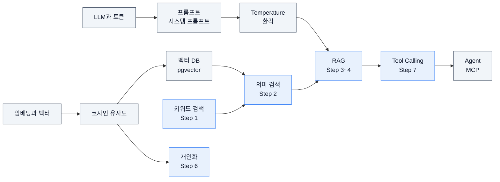
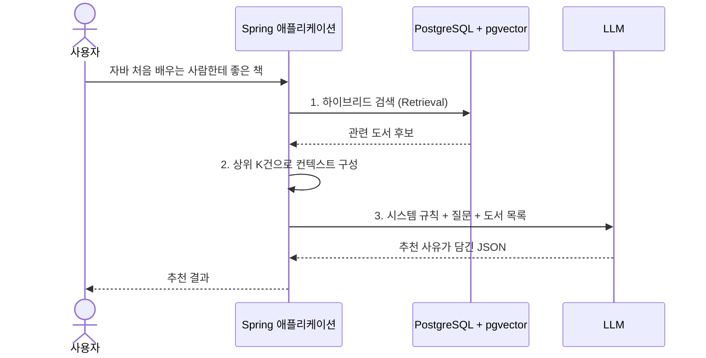
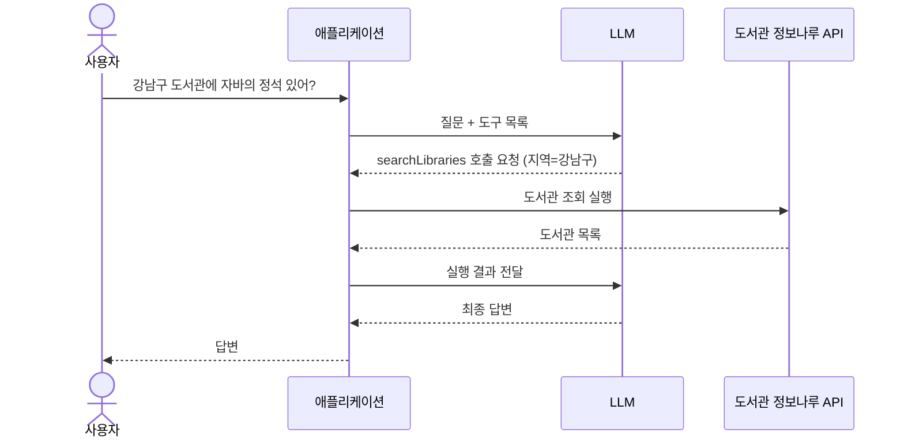
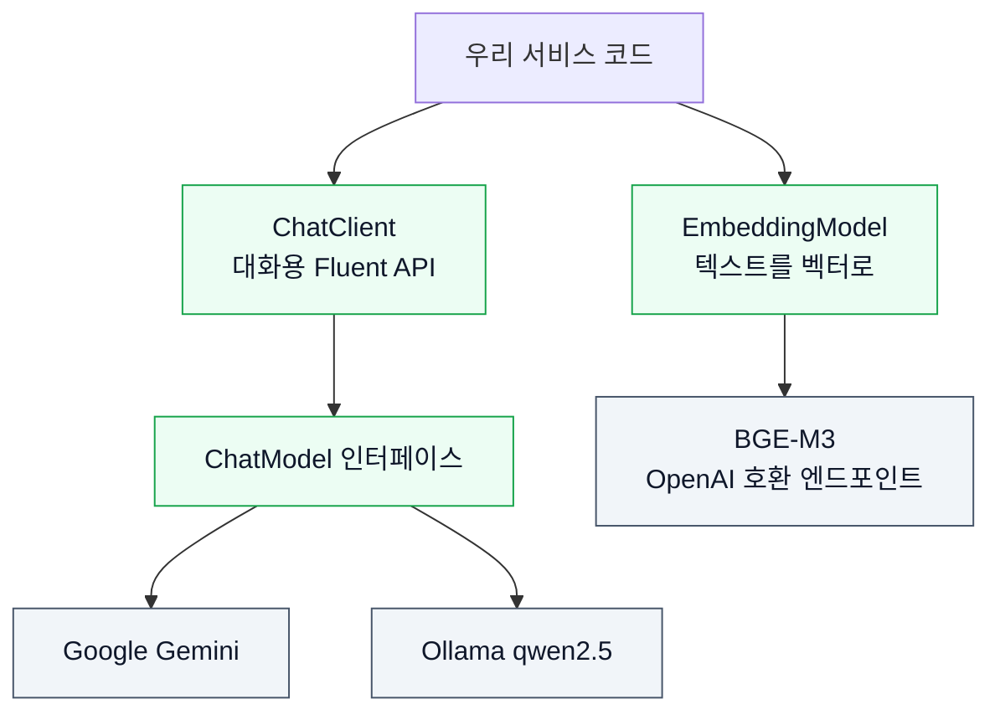

# 01. AI 백엔드 개발을 위한 기초 개념

> 이 교재 전체에서 쓰는 AI 용어(LLM, 토큰, 임베딩, 벡터 검색, RAG, Tool Calling, MCP, Agent)를 비유와 그림으로 익히고, 각 개념을 어느 Step에서 직접 구현하는지 연결합니다.
>
> 예상 소요 시간: 1.5시간 · 난이도: 입문

## 학습 목표

- LLM이 토큰 단위로 문장을 만든다는 것과, 그 때문에 생기는 비용·길이 제한·환각(Hallucination)을 설명할 수 있다.
- 임베딩, 벡터, 코사인 유사도를 이용해 "의미가 비슷한 글"을 찾는 원리를 설명할 수 있다.
- 키워드 검색과 의미 검색의 차이를 예시로 비교할 수 있다.
- RAG와 Tool Calling이 각각 LLM의 어떤 약점을 보완하는지 구분하고, MCP·Agent와의 관계를 설명할 수 있다.
- Spring AI의 `ChatClient`와 `EmbeddingModel`이 무엇을 추상화하는지 설명할 수 있다.

## 시작하기 전에

- Java와 Spring Boot(MVC, JPA)로 간단한 CRUD 서비스를 만들어 본 경험이 있으면 충분합니다. AI나 머신러닝 지식은 필요 없습니다.
- 이 문서는 개념 지도입니다. 모든 내용을 외우려 하지 말고, 이후 Step에서 해당 용어를 만났을 때 돌아와 다시 읽으면 됩니다.
- 모르는 용어는 [용어집](../glossary.md)에서 찾아볼 수 있습니다.

## 1. 왜 필요한가

이 교재의 프로젝트는 공공 도서 데이터 약 15만 건으로 도서 검색 서비스를 만듭니다. 처음에는 평범한 `LIKE` 검색으로 시작하지만, 사용자가 실제로 입력하는 검색어는 이런 모습입니다.

```text
"자바 처음 배우는 사람한테 좋은 책"
"요즘 많이 빌려 가는 소설 추천해 줘"
"강남구 도서관에 '자바의 정석' 빌릴 수 있는 곳 있어?"
```

첫 번째 문장에는 책 제목에 들어 있을 만한 단어가 거의 없습니다. 두 번째는 "추천"이라는 판단이 필요하고, 세 번째는 우리 DB에 없는 실시간 대출 정보가 필요합니다. 기존 백엔드 기술만으로는 셋 다 답하기 어렵습니다.

| 질문 유형 | 필요한 능력 | 이 교재에서 쓰는 기술 | Step |
|---|---|---|---|
| 단어가 달라도 뜻이 비슷한 책 찾기 | 의미 이해 | 임베딩 + 벡터 검색 | 2 |
| 검색 결과를 읽고 추천 사유 설명하기 | 문장 생성 | LLM + RAG | 3 |
| DB에 없는 실시간 정보 조회하기 | 외부 시스템 호출 | Tool Calling | 7 |

이 문서는 위 표의 오른쪽 기술들이 무엇인지 미리 살펴보는 지도입니다.

## 2. 핵심 개념

개념이 많으므로 네 묶음으로 나눕니다.

1. **LLM 다루기**: LLM, 토큰, 프롬프트, Temperature, 환각
2. **의미를 숫자로 다루기**: 임베딩, 벡터, 코사인 유사도, 벡터 데이터베이스, 키워드 검색과 의미 검색
3. **LLM에 지식 주기**: RAG
4. **LLM에 손발 주기**: Tool Calling, MCP, Agent

먼저 전체 지도를 봅니다. 화살표는 "앞의 개념을 알아야 뒤의 개념을 이해할 수 있다"는 뜻입니다.



### 2.1 LLM 다루기

#### LLM과 토큰

- **비유**: 아주 많은 글을 읽은 "다음 단어 맞히기 선수"입니다. "오늘 날씨가 정말"이라는 말을 들으면 "좋네요"가 이어질 확률이 높다는 것을 압니다.
- **정의**: **LLM(Large Language Model, 대규모 언어 모델)**은 방대한 텍스트로 학습해, 주어진 입력 다음에 올 내용을 확률적으로 생성하는 모델입니다. 이 교재에서는 Google Gemini(`gemini-2.0-flash`)와 Ollama로 실행하는 `qwen2.5`를 사용합니다.
- LLM은 글자나 단어가 아니라 **토큰(Token)** 단위로 읽고 씁니다. 토큰은 모델이 쓰는 텍스트 조각으로, 영어는 대략 단어 일부, 한국어는 음절이나 형태소 일부 정도의 크기입니다. 같은 뜻이라도 한국어 문장이 영어보다 토큰을 더 많이 쓰는 경향이 있습니다.

토큰이 중요한 이유는 세 가지입니다.

| 관점 | 의미 | 교재에서 다루는 곳 |
|---|---|---|
| 비용 | 유료 LLM API는 입력·출력 토큰 수로 요금을 매깁니다. | Step 4 |
| 속도 | 출력 토큰을 하나씩 생성하므로, 길게 답할수록 느립니다. | Step 4 |
| 길이 제한 | 한 번에 넣을 수 있는 토큰 수(**컨텍스트 윈도우**, Context Window)가 정해져 있습니다. | Step 3, 4 |

#### 프롬프트와 시스템 프롬프트

- **비유**: 새로 온 아르바이트생에게 주는 업무 지시서입니다. "너는 도서관 사서야. 반드시 존댓말로, 목록에 있는 책만 추천해"처럼 역할과 규칙을 먼저 알려 주고, 그다음 손님의 질문을 전달합니다.
- **정의**: **프롬프트(Prompt)**는 LLM에 보내는 입력 전체입니다. 보통 두 부분으로 나눕니다.
  - **시스템 프롬프트(System Prompt)**: 역할, 규칙, 출력 형식 같은 고정된 지시
  - **사용자 메시지(User Message)**: 매번 달라지는 실제 질문
- 원하는 답을 얻도록 프롬프트를 설계하는 일을 **프롬프트 엔지니어링(Prompt Engineering)**이라고 합니다. Step 3에서 추천 결과를 순수 JSON으로만 받도록 지시하고, Step 5에서 응답 규칙을 정리합니다.

#### Temperature

- **비유**: 요리사의 "즉흥성 다이얼"입니다. 낮추면 레시피대로, 높이면 매번 새로운 맛을 시도합니다.
- **정의**: **Temperature**는 LLM이 다음 토큰을 고를 때 얼마나 무작위로 고를지를 정하는 값입니다. 0에 가까우면 가장 확률 높은 답을 반복적으로 내고, 높을수록 다양하지만 엉뚱한 답이 늘어납니다.
- 이 프로젝트는 추천 사유처럼 사실에 기반한 답이 중요하므로 `temperature=0.3`으로 낮게 설정합니다(`application.properties`의 `spring.ai.google.genai.chat.options.temperature`, `spring.ai.ollama.chat.options.temperature`).

#### 환각(Hallucination)

- **비유**: 모르는 문제를 만나도 빈칸으로 두지 않고 그럴듯하게 지어내는 수험생입니다.
- **정의**: **환각(Hallucination)**은 LLM이 사실이 아닌 내용을 자신 있게 생성하는 현상입니다. LLM은 "사실을 찾는" 것이 아니라 "그럴듯한 다음 토큰을 만드는" 모델이기 때문에 생깁니다. 존재하지 않는 책 제목이나 ISBN을 지어내는 것이 대표적인 예입니다.
- 이 교재는 환각을 줄이기 위해 두 가지 방법을 씁니다. 실제 DB 검색 결과만 근거로 답하게 하는 RAG(Step 3), 그리고 "입력 데이터에 없는 필드는 추측하지 마세요" 같은 프롬프트 규칙입니다.

### 2.2 의미를 숫자로 다루기

#### 임베딩과 벡터

- **비유**: 모든 책에 "지도 좌표"를 붙이는 작업입니다. 내용이 비슷한 책끼리는 지도에서 가까운 곳에 놓입니다. "자바 입문"과 "Java 기초 프로그래밍"은 글자는 달라도 같은 동네에 있습니다.
- **정의**: **임베딩(Embedding)**은 텍스트를 의미를 담은 숫자 배열로 바꾸는 일, 또는 그렇게 만든 결과입니다. 이 숫자 배열을 **벡터(Vector)**라고 부르고, 숫자의 개수를 **차원(Dimension)**이라고 합니다.
- 이 프로젝트는 임베딩 모델로 **BGE-M3**를 사용하며, 결과는 1024차원 벡터입니다. 도서 엔티티에는 `vector(1024)` 타입 컬럼으로 저장합니다.

```text
"자바 입문서"        → [0.021, -0.113, 0.087, ..., 0.045]   (숫자 1024개)
"Java 기초 프로그래밍" → [0.019, -0.108, 0.091, ..., 0.040]   (비슷한 숫자들)
"한국 요리 레시피"     → [-0.150, 0.072, -0.033, ..., 0.210]  (전혀 다른 숫자들)
```

- 15만 건 도서의 임베딩을 미리 만들어 두는 배치는 Step 2에서 구현합니다.

#### 코사인 유사도

- **비유**: 두 화살표가 "같은 방향을 가리키는 정도"를 재는 각도기입니다. 길이는 상관없고 방향만 봅니다.
- **정의**: **코사인 유사도(Cosine Similarity)**는 두 벡터 사이 각도의 코사인 값으로, 1에 가까울수록 의미가 비슷하고 0에 가까울수록 관련이 없습니다.

작은 2차원 예시로 감을 잡아 봅니다.

| 벡터 | 값 | A와의 코사인 유사도 | 해석 |
|---|---|---|---|
| A: 자바 입문 | (1, 1) | 1.00 | 자기 자신 |
| B: Java 기초 | (2, 2) | 1.00 | 길이는 다르지만 방향이 같음 |
| C: 파이썬 입문 | (1, 0.5) | 0.95 | 꽤 비슷함 |
| D: 요리책 | (1, -1) | 0.00 | 관련 없음 |

계산식은 `cos(A, B) = (A·B) / (|A| × |B|)`이지만, 직접 계산할 일은 거의 없습니다. 이 프로젝트에서는 다음 세 곳에서 씁니다.

- Step 2: pgvector의 코사인 거리 연산자 `<=>`로 질문과 가까운 책 찾기(`1 - 거리 = 유사도`)
- Step 4: 새 질문이 예전 질문과 유사도 0.98 이상이면 저장해 둔 답을 재사용하는 **시맨틱 캐시(Semantic Cache)**
- Step 6: 사용자 선호 벡터와 책 벡터를 비교하는 개인화 랭킹

#### 벡터 데이터베이스(pgvector)

- **비유**: 좌표가 붙은 책을 꽂아 두고, "이 좌표에서 가장 가까운 책 10권"을 빠르게 꺼내 주는 서가입니다.
- **정의**: **벡터 데이터베이스(Vector Database)**는 벡터를 저장하고 유사한 벡터를 빠르게 찾는 기능을 제공하는 저장소입니다. 이 프로젝트는 별도 제품을 쓰지 않고, PostgreSQL에 확장 기능 **pgvector**를 설치해 일반 테이블에 `vector` 컬럼을 추가합니다. 기존 JPA 엔티티와 같은 DB에 두므로 운영이 단순합니다.
- 설치와 컬럼 추가는 Step 2에서, 개발 환경용 Docker 실행은 [02. 개발 환경 준비](02.environment-setup.md)에서 다룹니다.

#### 키워드 검색과 의미 검색

| 구분 | 키워드 검색 | 의미 검색 |
|---|---|---|
| 원리 | 검색어 글자가 들어 있는지 비교 | 검색어와 문서의 임베딩 벡터가 가까운지 비교 |
| 강점 | 저자명, 정확한 제목, ISBN | "처음 배우는 사람용 자바 책" 같은 자연어 질문 |
| 약점 | 동의어·표현 차이에 약함("자바" ≠ "Java") | 정확한 고유명사 매칭에 약할 수 있음 |
| 이 교재 | Step 1: `LIKE` → GIN 인덱스, 전문 검색(FTS) | Step 2: BGE-M3 + pgvector |

두 방식은 서로의 약점을 보완하므로, Step 2 마지막에 두 결과를 **RRF(Reciprocal Rank Fusion)**로 합치는 **하이브리드 검색(Hybrid Search)**을 만듭니다.

### 2.3 LLM에 지식 주기: RAG

- **비유**: 오픈북 시험입니다. LLM에게 기억에만 의존해 답하게 하지 않고, 관련 페이지를 펼쳐 준 뒤 "이 자료를 보고 답하세요"라고 합니다.
- **정의**: **RAG(Retrieval-Augmented Generation, 검색 증강 생성)**는 질문과 관련된 자료를 먼저 검색(Retrieval)하고, 그 자료를 프롬프트의 **컨텍스트(Context)**에 넣어 LLM이 답을 생성(Generation)하게 하는 방식입니다.



- RAG 덕분에 LLM은 우리 DB에 실제로 있는 책만 근거로 답하므로 환각이 줄어듭니다. 몇 건을 컨텍스트에 넣을지 정하는 값이 **Top-K**입니다.
- Step 3에서 RAG의 기본 구조를, Step 4에서 Top-K 조정, 시맨틱 캐시, 리뷰 요약 반영으로 비용과 품질을 다듬습니다.

### 2.4 LLM에 손발 주기: Tool Calling, MCP, Agent

#### Tool Calling(Function Calling)

- **비유**: LLM은 전화를 직접 걸 수 없는 상담원이고, 애플리케이션은 옆자리 동료입니다. 상담원이 "강남구 도서관 목록을 조회해 주세요"라고 쪽지를 건네면, 동료가 실제로 조회해서 결과를 돌려줍니다.
- **정의**: **Tool Calling(Function Calling)**은 애플리케이션이 LLM에 "사용할 수 있는 도구 목록(이름, 설명, 파라미터)"을 알려 주고, LLM이 필요하다고 판단하면 어떤 도구를 어떤 인자로 호출할지 요청하는 방식입니다. 실제 실행은 항상 애플리케이션이 합니다.



- RAG가 "답에 필요한 자료를 미리 찾아서 넣어 주는" 방식이라면, Tool Calling은 "LLM이 필요한 정보를 스스로 골라서 요청하는" 방식입니다.
- Step 7에서 Spring AI의 `@Tool` 애노테이션으로 도서 검색, 도서관 조회, 소장 여부 확인 같은 도구를 만들고, LLM이 여러 도구를 조합하게 합니다. 이 교재에서는 이를 **Tool 기반 오케스트레이션**이라고 부릅니다.

#### MCP(Model Context Protocol)와의 차이

- **비유**: Tool Calling이 "우리 회사 내선 전화"라면, MCP는 "어느 회사 전화기든 꽂을 수 있는 표준 콘센트"입니다.
- **정의**: **MCP(Model Context Protocol)**는 도구와 데이터를 여러 AI 클라이언트(예: Claude Desktop, IDE)가 같은 방식으로 쓸 수 있도록 정한 공개 통신 규약입니다.

| 구분 | Tool Calling | MCP |
|---|---|---|
| 무엇인가 | LLM이 도구 호출을 요청하는 기능 | 도구를 외부에 제공하는 표준 프로토콜 |
| 도구 위치 | 우리 애플리케이션 내부 | 별도 MCP 서버(다른 프로세스·다른 앱에서도 사용) |
| 이 교재 | Step 7에서 직접 구현 | Step 7 이론에서 개념과 확장 방향으로 다룸 |

즉, MCP는 Tool Calling을 대체하는 것이 아니라, 만든 도구를 다른 AI 클라이언트와 공유하는 표준입니다.

#### Agent

- **비유**: 지시를 한 번 받고 끝나는 계산기가 아니라, 목표를 받으면 "무엇을 먼저 조회할지" 스스로 계획하고 결과를 보고 다음 행동을 정하는 비서입니다.
- **정의**: **Agent(에이전트)**는 LLM이 목표를 이루기 위해 판단 → 도구 실행 → 결과 확인을 반복하는 구조입니다. 이 교재의 Step 7은 하나의 LLM이 여러 Tool을 조합하는 형태입니다. 여러 Agent가 서로 메시지를 주고받는 **A2A(Agent-to-Agent)**는 이론과 확장 방향으로만 다루며, 이 프로젝트의 구현을 A2A라고 부르지 않습니다.

### 2.5 Spring AI가 하는 일

LLM과 임베딩 모델은 회사마다 API 형식이 다릅니다. Gemini, Ollama, OpenAI의 요청·응답 JSON을 각각 맞추면 모델을 바꿀 때마다 코드를 고쳐야 합니다. **Spring AI**는 JDBC가 여러 DB를 같은 인터페이스로 다루게 해 주듯, 여러 AI 모델을 같은 인터페이스로 다루게 해 주는 Spring 프로젝트입니다. 이 교재는 Spring AI 1.1.2를 사용합니다.



| 추상화 | 감추는 것 | 우리가 쓰는 방법 |
|---|---|---|
| `ChatModel` | 모델별 HTTP 요청·응답 형식, 인증 | `chatModel.call(문자열)` |
| `ChatClient` | 시스템 프롬프트·사용자 메시지 조립, 도구 등록, 도구 호출 반복 처리 | `chatClient.prompt().system(...).user(...).call().content()` |
| `EmbeddingModel` | 임베딩 API 형식과 응답 파싱 | `embeddingModel.embed(텍스트)` → `float[]` |

설정 파일의 `spring.ai.selected-model` 값만 바꾸면 서비스 코드를 고치지 않고 Gemini와 Ollama를 바꿔 쓸 수 있는 것도 이 추상화 덕분입니다.

## 3. 예제로 이해하기

이 문서는 개념 문서이므로 직접 구현하지 않고, 실제 프로젝트 코드에서 개념이 어떻게 나타나는지 확인합니다.

### 예제 1. 가장 단순한 ChatClient 호출

목표: 프롬프트를 보내고 문자열 답을 받는 최소 형태를 봅니다. 아래는 학습용으로 단순화한 예제입니다.

```java
@Service
@RequiredArgsConstructor
public class HelloAiService {

    private final ChatClient chatClient;  // AiConfig에서 등록한 기본 ChatClient

    public String ask(String question) {
        return chatClient.prompt()
                .system("너는 도서관 사서야. 공손한 합니다체로 세 문장 이내로 답해.")  // 시스템 프롬프트
                .user(question)                                                      // 사용자 메시지
                .call()                                                              // LLM 호출
                .content();                                                          // 응답 텍스트
    }
}
```

- `.system()`과 `.user()`가 2.1절의 시스템 프롬프트와 사용자 메시지입니다.
- 어떤 모델로 요청이 가는지는 이 코드에 없습니다. 아래 `AiConfig`가 결정합니다.

### 예제 2. 설정값으로 모델 고르기: AiConfig

목표: 설정 하나로 Gemini와 Ollama를 바꾸는 방법을 봅니다.

```java
@Bean
@Primary
@ConditionalOnProperty(name = "spring.ai.selected-model", havingValue = "gemini", matchIfMissing = true)
public ChatModel selectedGeminiChatModel(@Qualifier("googleGenAiChatModel") ChatModel googleChatModel) {
    return googleChatModel;
}

@Bean
@Primary
@ConditionalOnProperty(name = "spring.ai.selected-model", havingValue = "ollama")
public ChatModel selectedOllamaChatModel(@Qualifier("ollamaChatModel") ChatModel ollamaChatModel) {
    return ollamaChatModel;
}

@Bean
public ChatClient chatClient(ChatModel chatModel) {
    return ChatClient.builder(chatModel).build();
}
```

전체 코드: [`src/main/java/net/java21/library/core/config/AiConfig.java`](../../src/main/java/net/java21/library/core/config/AiConfig.java)

- Spring AI 스타터가 Gemini용(`googleGenAiChatModel`)과 Ollama용(`ollamaChatModel`) `ChatModel`을 모두 등록합니다.
- `@ConditionalOnProperty`로 `spring.ai.selected-model` 값에 맞는 쪽 하나만 `@Primary`로 지정하므로, `ChatModel`을 주입받는 곳은 선택된 모델을 받습니다. 값이 없으면 `matchIfMissing = true`에 따라 Gemini가 선택됩니다.

### 예제 3. 텍스트를 벡터로: EmbeddingService

목표: 임베딩이 코드에서는 `float[]` 하나라는 것을 확인합니다.

```java
public float[] getEmbedding(String text) {
    float[] result = embeddingModel.embed(text);
    if (result == null) {
        return new float[0];
    }
    return result;
}
```

전체 코드: [`src/main/java/net/java21/library/core/book/service/embedding/EmbeddingService.java`](../../src/main/java/net/java21/library/core/book/service/embedding/EmbeddingService.java)

- 생성자에서 `@Qualifier("openAiEmbeddingModel")`로 OpenAI 호환 임베딩 모델을 주입받습니다. 실제로 호출되는 모델은 설정의 `spring.ai.openai.embedding.options.model=bge-m3`입니다.
- 반환된 배열의 길이가 1024이고, 이 값이 DB의 `vector(1024)` 컬럼에 저장됩니다.

### 예제 4. 도구를 등록한 ChatClient: Tool Calling 맛보기

목표: Step 7에서 만들 구조를 미리 봅니다.

```java
ChatClient chatClient = ChatClient.builder(chatModel)
    .defaultTools(libraryTools, internalBookTools)   // @Tool 메서드가 있는 객체 등록
    .build();

String response = chatClient.prompt()
    .system(systemPrompt)
    .user(userMessage)
    .call()
    .content();
```

전체 코드: [`src/main/java/net/java21/library/ai/agent/orchestrator/ToolBasedAiOrchestrationService.java`](../../src/main/java/net/java21/library/ai/agent/orchestrator/ToolBasedAiOrchestrationService.java)

- 예제 1과 호출 형태는 같고 `.defaultTools(...)`만 추가되었습니다. LLM이 도구 호출을 요청하면 `ChatClient`가 해당 메서드를 실행하고 결과를 다시 LLM에 전달하는 과정을 자동으로 반복합니다.
- 도구 메서드는 `@Tool(description = "...")`로 설명을 붙입니다. LLM은 이 설명을 읽고 도구를 고르므로, 설명이 곧 프롬프트의 일부입니다.

## 4. 직접 해 보기

### 미션 1 (기본): 개념을 Step에 연결하기

다음 기능이 각각 어느 Step의 어떤 개념을 사용하는지 적어 봅니다.

1. "자바"로 검색해도 제목이 "Java"인 책이 나온다.
2. 검색 결과 옆에 "입문자가 따라 하기 쉬운 예제가 많습니다"라는 추천 사유가 붙는다.
3. 어제와 거의 같은 질문을 하면 LLM 호출 없이 바로 답이 나온다.
4. "근처 도서관에서 빌릴 수 있어?"에 실시간 대출 가능 여부로 답한다.

<details>
<summary>정답</summary>

1. Step 2, 임베딩 + 벡터 검색(의미 검색)
2. Step 3, RAG(검색 결과를 컨텍스트로 넣어 LLM이 생성)
3. Step 4, 시맨틱 캐시(질문 임베딩의 코사인 유사도 비교)
4. Step 7, Tool Calling(도서관 정보나루 API 호출 도구)

</details>

### 미션 2 (도전): 코사인 유사도 직접 계산하기

벡터 A = (3, 4), B = (6, 8), C = (4, -3)일 때 A와 B, A와 C의 코사인 유사도를 계산하고, 결과가 의미하는 바를 설명해 봅니다.

힌트: 내적 `A·B = a1×b1 + a2×b2`, 길이 `|A| = √(a1² + a2²)`

<details>
<summary>정답</summary>

- A·B = 18 + 32 = 50, |A| = 5, |B| = 10 → 50 / 50 = **1.0**. 길이는 두 배지만 방향이 같으므로 의미가 같다고 봅니다.
- A·C = 12 − 12 = 0 → **0.0**. 두 벡터가 직각이므로 관련이 없다고 봅니다.

코사인 유사도가 길이가 아니라 방향만 본다는 점을 확인할 수 있습니다.

</details>

### 미션 3 (도전): 프롬프트 규칙 찾기

`src/main/java/net/java21/library/core/book/service/ai/AiRecommendationService.java`의 프롬프트 템플릿을 열고, 환각을 줄이거나 출력 형식을 고정하기 위한 규칙을 두 개 이상 찾아봅니다.

<details>
<summary>정답 예시</summary>

- "출력은 반드시 순수 JSON만 포함하세요." → 응답을 `ObjectMapper`로 바로 파싱할 수 있게 출력 형식을 고정
- "입력 데이터에 없는 필드는 추측하지 마세요." → 컨텍스트에 없는 정보를 지어내지 않게 하는 환각 방지 규칙
- "언어는 반드시 한국어를 사용하세요." → 응답 언어 고정

</details>

## 5. 자주 하는 실수

| 증상 | 원인 | 해결 |
|---|---|---|
| "LLM이 우리 DB를 알고 있겠지"라고 기대했는데 엉뚱한 책을 추천함 | LLM은 학습 데이터만 알고, 우리 DB 내용은 모름 | 검색 결과를 컨텍스트로 넣는 RAG를 사용합니다(Step 3). |
| Temperature를 높였더니 매번 다른 책을 추천하고 없는 정보가 섞임 | 무작위성이 커져 환각 가능성도 커짐 | 사실 기반 응답은 낮은 값(이 프로젝트는 0.3)을 사용합니다. |
| 임베딩 모델을 바꿨더니 벡터 검색 결과가 이상해짐 | 모델마다 벡터 공간과 차원이 달라 기존 벡터와 비교할 수 없음 | 모델을 바꾸면 모든 문서의 임베딩을 다시 생성합니다. |
| Tool Calling을 쓰면 LLM이 직접 API를 호출한다고 생각함 | LLM은 호출을 "요청"만 함 | 실행, 예외 처리, 권한 확인은 애플리케이션 책임입니다. |
| MCP를 Tool Calling의 다른 이름으로 이해함 | 기능과 프로토콜을 혼동 | Tool Calling은 기능, MCP는 도구를 외부에 공유하는 표준 규약입니다. |

## 6. 정리

- LLM은 토큰 단위로 다음 내용을 생성하는 모델이며, 토큰 수가 비용·속도·길이 제한을 결정하고, 그럴듯하게 지어내는 환각이 생길 수 있습니다.
- 임베딩은 텍스트를 의미 좌표(벡터)로 바꾸고, 코사인 유사도로 가까운 정도를 재며, pgvector가 이를 저장하고 검색합니다.
- RAG는 검색한 자료를 컨텍스트로 넣어 LLM이 근거 있는 답을 만들게 하고, Tool Calling은 LLM이 필요한 도구 실행을 요청하게 합니다.
- Spring AI의 `ChatClient`와 `EmbeddingModel`은 모델별 API 차이를 감춰, 설정만으로 모델을 바꿀 수 있게 합니다.

- [ ] LLM, 토큰, 프롬프트, Temperature, 환각을 한 문장씩 설명할 수 있다.
- [ ] 임베딩, 벡터, 코사인 유사도, pgvector의 관계를 그림으로 그릴 수 있다.
- [ ] 키워드 검색과 의미 검색의 강점과 약점을 비교할 수 있다.
- [ ] RAG, Tool Calling, MCP, Agent의 차이를 설명할 수 있다.
- [ ] `ChatClient`와 `EmbeddingModel`이 각각 무엇을 추상화하는지 말할 수 있다.

## 확인 문제

**1.** 유료 LLM API의 비용과 응답 시간에 가장 직접적인 영향을 주는 단위는 무엇입니까?

<details>
<summary>정답</summary>

토큰입니다. 입력·출력 토큰 수로 요금이 매겨지고, 출력 토큰을 하나씩 생성하므로 답이 길수록 느려집니다.

</details>

**2.** "Java 기초"와 "자바 입문"의 임베딩 벡터 코사인 유사도는 높을까요, 낮을까요? 그 이유는 무엇입니까?

<details>
<summary>정답</summary>

높습니다. 임베딩은 글자가 아니라 의미를 기준으로 좌표를 정하므로, 표현이 달라도 뜻이 비슷하면 벡터 방향이 비슷해집니다.

</details>

**3.** RAG가 환각을 줄이는 원리를 한 문장으로 설명해 보십시오.

<details>
<summary>정답</summary>

질문과 관련된 실제 자료를 먼저 검색해 프롬프트에 넣고, LLM이 그 자료를 근거로 답하게 하므로 지어낼 여지가 줄어듭니다.

</details>

**4.** Tool Calling에서 외부 API를 실제로 호출하는 주체는 LLM입니까, 애플리케이션입니까?

<details>
<summary>정답</summary>

애플리케이션입니다. LLM은 어떤 도구를 어떤 인자로 호출할지 요청만 하고, Spring AI `ChatClient`가 해당 메서드를 실행해 결과를 LLM에 돌려줍니다.

</details>

**5.** 이 프로젝트에서 서비스 코드를 고치지 않고 Gemini와 Ollama를 바꿔 쓸 수 있는 이유는 무엇입니까?

<details>
<summary>정답</summary>

서비스 코드는 Spring AI의 `ChatModel`·`ChatClient` 인터페이스에만 의존하고, `AiConfig`가 `spring.ai.selected-model` 값에 따라 어떤 구현을 `@Primary`로 쓸지 정하기 때문입니다.

</details>

## 다음 문서

[02. 개발 환경 준비 →](02.environment-setup.md)
