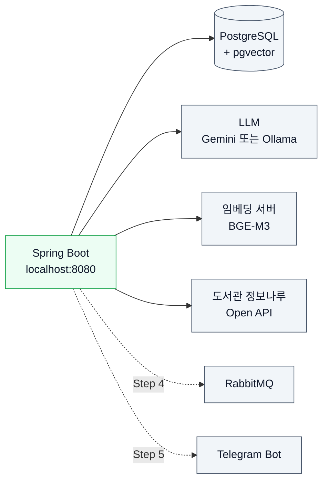

# 02. 개발 환경 준비

> JDK 21, Maven, PostgreSQL + pgvector를 준비하고, 비밀값과 LLM·임베딩 접속 정보를 설정해 애플리케이션을 `http://localhost:8080`에서 실행합니다.
>
> 예상 소요 시간: 1~2시간 · 난이도: 입문

## 학습 목표

- JDK 21, Maven, IDE, Docker를 설치하고 버전을 확인할 수 있다.
- Docker로 pgvector가 포함된 PostgreSQL을 실행하고 `vector` 확장을 활성화할 수 있다.
- `secrets.properties`의 역할을 이해하고, 필요한 키를 커밋하지 않고 설정할 수 있다.
- `spring.ai.selected-model`로 Gemini와 Ollama 중 사용할 LLM을 선택하고, 임베딩 엔드포인트를 설정할 수 있다.
- 애플리케이션을 실행하고 검색 화면이 열리는지 확인할 수 있다.

## 시작하기 전에

- [01. AI 백엔드 개발을 위한 기초 개념](01.ai-basics.md)에서 LLM, 임베딩, pgvector가 무엇인지 먼저 읽어 두면 설정값의 의미를 이해하기 쉽습니다.
- 터미널에서 명령을 실행하고 Git으로 저장소를 clone해 본 경험이 필요합니다.
- 모르는 용어는 [용어집](../glossary.md)에서 찾아볼 수 있습니다.

## 1. 왜 필요한가

이 프로젝트는 혼자 동작하는 Spring Boot 애플리케이션이 아닙니다. 실행 중에 다음 외부 시스템과 통신합니다.



각 시스템의 주소와 비밀번호, API 키가 하나라도 빠지면 애플리케이션이 시작되지 않거나 검색 중에 오류가 납니다. 또한 API 키를 실수로 GitHub에 올리면 다른 사람이 내 계정으로 요금을 발생시킬 수 있습니다. 이 문서에서는 필요한 준비물을 순서대로 갖추고, 비밀값을 안전하게 분리하는 방법까지 함께 익힙니다.

## 2. 핵심 개념

### 2.1 설정 파일의 구성

이 프로젝트의 설정은 여러 파일로 나뉘어 있습니다.

| 파일 | 역할 | 커밋 여부 |
|---|---|---|
| `src/main/resources/application.properties` | 공통 설정: DB 주소, Spring AI, 도서관 정보나루 API, 캐시 등 | 커밋 |
| `src/main/resources/application-dev.properties` | `dev` 프로필 설정: Telegram Bot 비활성화, `redis.properties`·`rabbitmq.properties` 가져오기 | 커밋 |
| `src/main/resources/application-prod.properties` | `prod` 프로필(운영 서버) 설정 | 커밋 |
| `secrets.properties.example` | 비밀값 템플릿 | 커밋 |
| `secrets.properties` (프로젝트 루트) | 실제 비밀값 | **커밋 금지**(`.gitignore`에 포함) |

`application.properties`에서 기본 프로필은 `spring.profiles.active=dev`입니다. 그리고 다음 줄로 비밀값 파일을 읽습니다.

```properties
spring.config.import=optional:file:./secrets.properties,optional:file:${user.home}/library/secrets.properties
```

- `optional:`이 붙어 있으므로 파일이 없어도 시작은 됩니다. 다만 값이 비어 있어 DB 접속 등이 실패합니다.
- `./secrets.properties`는 **현재 작업 디렉터리** 기준입니다. 반드시 프로젝트 루트에서 실행해야 이 파일을 찾습니다.
- 설정 파일에는 실제 값 대신 `${DB_PASSWORD:}` 같은 **플레이스홀더**만 둡니다. `secrets.properties`의 값이나 같은 이름의 환경 변수가 이 자리를 채웁니다.

### 2.2 비밀값 키 목록

| 키 | 사용하는 설정 | 필요한 시점 |
|---|---|---|
| `DB_PASSWORD` | `spring.datasource.password` | Step 1부터 |
| `GEMINI_API_KEY` | `spring.ai.google.genai.api-key` | Gemini를 쓸 때(Step 3부터) |
| `LIBRARY_API_KEY` | `library.api.key` (도서관 정보나루) | Step 7 |
| `RABBITMQ_PASSWORD` | `spring.rabbitmq.password` | Step 4 리뷰 요약 |
| `REDIS_PASSWORD` | `spring.data.redis.password` | Redis 사용 시 |
| `TELEGRAM_BOT_TOKEN` | `telegram.bot.token` | Step 5 |

### 2.3 LLM과 임베딩 모델 선택

| 구분 | 설정 키 | 기본값 |
|---|---|---|
| 사용할 LLM | `spring.ai.selected-model` | `ollama` (`gemini`로 바꿀 수 있음) |
| Ollama 서버 | `spring.ai.ollama.base-url`, `spring.ai.ollama.chat.options.model` | `http://ollama.java21.net`, `qwen2.5:latest` |
| Gemini | `spring.ai.google.genai.chat.options.model` | `gemini-2.0-flash` |
| 임베딩 서버 | `spring.ai.openai.base-url`, `spring.ai.openai.embedding.options.model` | `https://emb.java21.net`, `bge-m3` |

- 임베딩은 OpenAI 전용이 아니라 **OpenAI 호환 엔드포인트**(OpenAI와 같은 요청 형식을 받는 서버)를 씁니다. 그래서 Spring AI의 OpenAI 스타터로 BGE-M3 서버에 접속하며, `spring.ai.openai.api-key=dummy`처럼 키는 형식상 값만 넣습니다.
- 기본값의 `*.java21.net` 주소는 이 강의용으로 준비한 서버입니다. 접근할 수 없는 환경이라면 3장 STEP 5에서 로컬 대안을 설정합니다.

## 3. 따라 하기

### STEP 1. JDK 21, Maven, IDE 설치

목표: 빌드 도구 버전을 확인합니다.

```bash
java -version
mvn -version
```

예상 결과(세부 버전은 달라도 됩니다):

```text
openjdk version "21.0.x" ...
Apache Maven 3.9.x ...
Java version: 21.0.x ...
```

- JDK 21이 없다면 Temurin 등 OpenJDK 21 배포판을 설치합니다. `mvn -version`의 `Java version`도 21이어야 합니다(`JAVA_HOME` 확인).
- 이 프로젝트에는 Maven Wrapper(`mvnw`)가 없으므로 Maven을 직접 설치하고 `mvn` 명령을 사용합니다.
- IDE는 IntelliJ IDEA를 권장합니다. 프로젝트를 열 때 `pom.xml`을 Maven 프로젝트로 가져옵니다. Lombok을 사용하므로 IDE의 Annotation Processing을 켭니다.

### STEP 2. 저장소 clone과 첫 빌드

목표: 소스를 받고 컴파일이 되는지 확인합니다.

```bash
git clone https://github.com/nhn-academy-marco/ai-library.git
cd ai-library
mvn -q clean compile
```

- 오류 없이 끝나면 성공입니다. 처음에는 의존성을 내려받느라 몇 분 걸릴 수 있습니다.
- 빌드 과정에서 QueryDSL이 `target/generated-sources`에 `QBook` 같은 Q클래스를 생성합니다. IDE에서 `QBook`을 찾지 못한다는 빨간 줄이 보이면 `mvn clean compile`을 한 번 실행한 뒤 Maven 프로젝트를 다시 불러옵니다.

### STEP 3. PostgreSQL + pgvector 실행

목표: 벡터 컬럼을 쓸 수 있는 PostgreSQL을 준비합니다.

DB는 두 가지 방법 중 하나를 고릅니다.

| 방법 | 설명 | 추가 작업 |
|---|---|---|
| A. 강의 제공 DB | `application.properties`의 기본 주소(`s3.java21.net:8000/library`)를 그대로 사용 | 강사에게 받은 `DB_PASSWORD`만 설정 |
| B. 로컬 Docker DB | 내 컴퓨터에서 PostgreSQL을 직접 실행 | 아래 절차와 STEP 4의 접속 정보 덮어쓰기 |

B를 고른 경우 Docker를 설치하고 pgvector가 포함된 이미지를 실행합니다.

```bash
docker run -d --name pgvector -p 5432:5432 \
  -e POSTGRES_USER=library \
  -e POSTGRES_PASSWORD=postgres \
  -e POSTGRES_DB=library \
  pgvector/pgvector:pg16
```

`vector` 확장을 활성화합니다. 확장은 데이터베이스마다 한 번만 실행하면 됩니다.

```bash
docker exec -it pgvector psql -U library -d library -c "CREATE EXTENSION IF NOT EXISTS vector;"
docker exec -it pgvector psql -U library -d library -c "SELECT extversion FROM pg_extension WHERE extname = 'vector';"
```

예상 결과:

```text
 extversion
------------
 0.8.0
(1 row)
```

버전 숫자는 이미지에 따라 다를 수 있습니다. 한 행이 나오면 성공입니다. pgvector의 원리와 벡터 컬럼 추가는 [Step 2의 pgvector 설정](../step-2/02.pgvector-setup.md)에서 자세히 다룹니다.

### STEP 4. secrets.properties 작성

목표: 비밀값을 커밋되지 않는 파일에 분리합니다.

```bash
cp secrets.properties.example secrets.properties
```

`secrets.properties`를 열어 값을 채웁니다. 아직 필요하지 않은 키는 비워 두어도 됩니다.

```properties
DB_PASSWORD=강사에게_받은_비밀번호_또는_postgres
GEMINI_API_KEY=
LIBRARY_API_KEY=
RABBITMQ_PASSWORD=
REDIS_PASSWORD=
TELEGRAM_BOT_TOKEN=
```

STEP 3에서 B(로컬 Docker DB)를 골랐다면 같은 파일 아래쪽에 접속 주소를 덮어씁니다. `spring.config.import`로 가져온 파일의 값은 `application.properties`의 값보다 우선하므로, 커밋되는 설정 파일을 고치지 않고 내 컴퓨터에서만 주소를 바꿀 수 있습니다.

```properties
# 로컬 전용 설정 (secrets.properties는 커밋되지 않습니다)
spring.datasource.url=jdbc:postgresql://localhost:5432/library?stringtype=unspecified
spring.datasource.username=library
```

- `git status`를 실행했을 때 `secrets.properties`가 목록에 나오지 않아야 합니다. 나온다면 `.gitignore`를 확인합니다.
- 환경 변수로 대신할 수도 있습니다(예: `export DB_PASSWORD=...`). 서버 배포 시에는 GitHub Actions가 GitHub Secrets로 `~/library/secrets.properties`를 생성합니다.

### STEP 5. LLM 선택과 임베딩 엔드포인트 설정

목표: 사용할 LLM과 임베딩 서버를 정합니다.

#### 방법 1. Ollama (기본값)

기본 설정은 `spring.ai.selected-model=ollama`이고, 강의용 Ollama 서버(`http://ollama.java21.net`)의 `qwen2.5:latest` 모델을 사용합니다. 이 서버에 접근할 수 있다면 추가 설정이 없습니다.

내 컴퓨터에서 직접 실행하려면 [ollama.com](https://ollama.com)에서 Ollama를 설치한 뒤 모델을 내려받습니다.

```bash
ollama pull qwen2.5
ollama list
```

그리고 `secrets.properties`에 로컬 주소를 덮어씁니다.

```properties
spring.ai.ollama.base-url=http://localhost:11434
```

- `qwen2.5`는 Step 7의 Tool Calling(Function Calling)을 지원하는 모델이라 기본값으로 쓰입니다.
- 로컬 Ollama는 CPU만으로도 동작하지만 응답이 수십 초 걸릴 수 있습니다. `AiConfig`가 Ollama 사용 시 읽기 타임아웃을 5분으로 늘려 둔 이유입니다.

#### 방법 2. Google Gemini

1. [Google AI Studio](https://aistudio.google.com/)에 Google 계정으로 로그인하고 API 키를 발급합니다.
2. `secrets.properties`의 `GEMINI_API_KEY`에 키를 넣습니다.
3. 모델 선택을 바꿉니다.

```properties
spring.ai.selected-model=gemini
```

- 모델은 `gemini-2.0-flash`, `temperature=0.3`으로 설정되어 있습니다.
- 무료 사용량에는 분당·일일 호출 제한이 있습니다. 반복 테스트로 한도를 넘기면 `429` 오류가 날 수 있습니다.

#### 임베딩 엔드포인트(BGE-M3)

기본값은 강의용 BGE-M3 서버(`https://emb.java21.net`)입니다. 다른 OpenAI 호환 서버를 쓰려면 주소와 모델 이름을 덮어씁니다. 예를 들어 로컬 Ollama는 OpenAI 호환 임베딩 API를 제공하므로 다음처럼 쓸 수 있습니다.

```bash
ollama pull bge-m3
```

```properties
spring.ai.openai.base-url=http://localhost:11434
spring.ai.openai.embedding.options.model=bge-m3
```

- 도서 엔티티의 임베딩 컬럼은 `vector(1024)`입니다. BGE-M3는 1024차원 벡터를 만들기 때문에 맞습니다. 차원이 다른 임베딩 모델로 바꾸면 저장 시 오류가 납니다.
- 같은 DB 안에서는 모든 벡터를 같은 임베딩 모델로 만들어야 비교가 의미 있습니다.

### STEP 6. 도서관 정보나루 API 키 발급

목표: Step 7에서 쓸 외부 Open API 키를 미리 신청합니다.

1. [도서관 정보나루](https://www.data4library.kr/)에 회원 가입합니다.
2. 마이페이지에서 Open API 인증키를 신청합니다. 승인까지 시간이 걸릴 수 있으므로 미리 신청해 둡니다.
3. 발급받은 키를 `secrets.properties`의 `LIBRARY_API_KEY`에 넣습니다.

API 사용법과 응답 형식은 [도서관정보나루 API 매뉴얼](../step-7/도서관정보나루_API_Manual.md)에 정리되어 있습니다. Step 1~6에서는 이 키가 없어도 됩니다.

Telegram Bot 토큰(`TELEGRAM_BOT_TOKEN`)은 [Step 5의 Telegram Bot 설정](../step-5/01.telegram-bot-setup.md)에서 발급합니다. 기본 `dev` 프로필은 `telegram.bot.enabled=false`이므로 지금은 비워 두어도 됩니다.

### STEP 7. 애플리케이션 실행과 확인

목표: 브라우저에서 검색 화면을 확인합니다.

프로젝트 루트에서 실행합니다.

```bash
mvn spring-boot:run
```

예상 로그:

```text
The following 1 profile is active: "dev"
...
Tomcat started on port 8080 (http) with context path '/'
Started AiLibraryApplication in ... seconds
```

브라우저에서 다음 주소를 열어 확인합니다.

| 주소 | 확인할 것 |
|---|---|
| `http://localhost:8080` | 도서 검색 화면이 열림 |
| `http://localhost:8080/?keyword=자바&searchType=keyword` | 키워드 검색 결과 목록 |
| `http://localhost:8080/?keyword=자바 입문서&searchType=rag` | 하이브리드 검색 결과와 AI 추천(LLM 연결 확인) |

- `searchType`을 생략하면 기본값은 `rag`입니다.
- IDE에서 실행할 때는 실행 구성의 작업 디렉터리(Working directory)를 프로젝트 루트로 지정해야 `secrets.properties`를 읽습니다.

#### 로컬 DB를 처음 쓰는 경우

설정은 `spring.jpa.hibernate.ddl-auto=validate`이므로, 빈 DB에서는 "테이블이 없다"는 스키마 검증 오류로 시작이 실패합니다. 또 도서 CSV 적재는 `init.enable=false`로 꺼져 있습니다. 빈 로컬 DB에서 **처음 한 번만** 다음처럼 실행해 테이블을 만들고 도서 데이터를 적재합니다.

```bash
mvn spring-boot:run -Dspring-boot.run.arguments="--spring.jpa.hibernate.ddl-auto=update --init.enable=true"
```

- `init.enable=true`이면 시작 시 `src/main/resources/data/init/BOOK_DB_202112.csv`를 파싱해 적재합니다. 데이터가 많아 수 분이 걸립니다. 이 과정은 [Step 1의 CSV 배치 적재](../step-1/01.csv-batch-load.md)에서 자세히 다룹니다.
- 적재가 끝나면 두 옵션 없이 평소처럼 실행합니다. 다시 `init.enable=true`로 실행하면 같은 데이터를 중복 적재하려고 시도합니다.
- `ddl-auto=update`는 빈 로컬 DB를 준비할 때만 명령행으로 잠깐 씁니다. 설정 파일의 `validate`는 바꾸지 않습니다.

### 테스트 실행 시 주의

테스트는 원격 DB에 연결하지 않습니다. DB와 RabbitMQ가 필요한 Spring Context 테스트(`@SpringBootTest`)는 **Testcontainers**가 Docker로 띄운 일회용 컨테이너(PostgreSQL + pgvector, RabbitMQ)에 연결됩니다. `src/test/java/net/java21/library/support/TestcontainersInitializer.java`가 모든 Spring Context 테스트에 자동 적용되므로, 테스트를 실행하기 전에 Docker Desktop을 켜 두기만 하면 됩니다. 컨테이너는 테스트가 끝나면 사라지므로 테스트 안에서는 `ddl-auto=create-drop`을 써도 안전합니다.

> 참고: `create-drop`은 테스트가 끝날 때 테이블을 **삭제**합니다. 여러 사람이 함께 쓰는 DB에 이 설정으로 테스트를 돌리면 다른 사람의 데이터가 사라질 수 있어 사용하지 않습니다.

테스트는 다음처럼 대상을 지정해 실행합니다.

```bash
mvn test -Dtest='FeedbackServiceImplTest'
```

- Spring Context 없이 동작하는 단위 테스트를 우선 실행합니다.
- 실제 외부 API를 호출하는 `LibraryInfoNaruApiCallTest`는 `LIBRARY_API_KEY`가 있어야 통과합니다.

## 4. 직접 해 보기

### 미션 1 (기본): 준비 상태 점검표 만들기

다음 명령과 확인 결과를 모두 통과시켜 봅니다.

1. `java -version`이 21을 출력한다.
2. `docker ps`에 `pgvector` 컨테이너가 보인다(로컬 DB를 쓰는 경우).
3. `git status`에 `secrets.properties`가 나타나지 않는다.
4. `http://localhost:8080/?keyword=자바&searchType=keyword`에서 결과가 나온다.

<details>
<summary>힌트</summary>

4번에서 결과가 0건이면 DB에 도서 데이터가 없는 것입니다. 로컬 DB라면 "로컬 DB를 처음 쓰는 경우"의 명령으로 CSV를 적재했는지 확인합니다.

</details>

### 미션 2 (도전): LLM 바꿔 보기

`spring.ai.selected-model`을 `gemini`와 `ollama`로 번갈아 설정하고, 같은 질문(`searchType=rag`)의 응답 시간과 추천 사유를 비교해 봅니다. 어느 설정 파일을 고쳐야 커밋 걱정 없이 바꿀 수 있는지도 답해 봅니다.

<details>
<summary>정답 예시</summary>

`secrets.properties`에 `spring.ai.selected-model=gemini`를 추가하면 됩니다. `spring.config.import`로 가져온 값이 `application.properties`보다 우선하고, 이 파일은 `.gitignore`에 포함되어 있습니다. `AiConfig`는 이 값에 따라 `@Primary ChatModel`을 바꾸므로 서비스 코드는 고칠 필요가 없습니다.

</details>

## 5. 자주 하는 실수

| 증상 | 원인 | 해결 |
|---|---|---|
| `password authentication failed for user "library"` | `DB_PASSWORD`가 비어 있거나 `secrets.properties`를 읽지 못함 | 프로젝트 루트에서 실행했는지, IDE 작업 디렉터리가 루트인지 확인합니다. |
| `Schema-validation: missing table [books]` | 빈 DB에 `ddl-auto=validate`로 실행 | 로컬 DB라면 처음 한 번 `--spring.jpa.hibernate.ddl-auto=update`로 실행합니다. |
| `type "vector" does not exist` | pgvector 확장을 활성화하지 않음 | `CREATE EXTENSION IF NOT EXISTS vector;`를 실행합니다. 일반 `postgres` 이미지가 아닌 `pgvector/pgvector` 이미지를 씁니다. |
| RAG 검색에서 AI 추천만 나오지 않거나 타임아웃 | LLM 서버 주소 또는 API 키 문제 | `spring.ai.selected-model`과 해당 모델의 주소·키를 확인합니다. 로컬 Ollama라면 `ollama list`에 모델이 있는지 봅니다. |
| `QBook`을 찾을 수 없다는 컴파일 오류 | QueryDSL Q클래스가 아직 생성되지 않음 | `mvn clean compile` 후 IDE에서 Maven 프로젝트를 다시 불러옵니다. |

> 실제 사례: [사례 8. 테스트가 공용 개발 DB 스키마를 지움](../troubleshooting.md#사례-8-테스트가-공용-개발-db-스키마를-지움)  
> 실제 사례: [사례 10. 설정 파일에 API 키와 비밀번호가 커밋됨](../troubleshooting.md#사례-10-설정-파일에-api-키와-비밀번호가-커밋됨)

## 6. 정리

- 비밀값은 커밋되지 않는 `secrets.properties`(또는 환경 변수)에 두고, 설정 파일에는 `${KEY:}` 플레이스홀더만 둡니다.
- PostgreSQL은 pgvector 확장이 있어야 하며, 로컬 DB는 접속 정보를 `secrets.properties`에서 덮어씁니다.
- LLM은 `spring.ai.selected-model`(gemini | ollama)로 고르고, 임베딩은 OpenAI 호환 엔드포인트의 BGE-M3(1024차원)를 씁니다.
- DB를 쓰는 테스트는 Testcontainers로 일회용 컨테이너에 연결되므로, 테스트 전에 Docker를 실행해 둡니다.

- [ ] JDK 21과 Maven 버전을 확인했다.
- [ ] PostgreSQL + pgvector를 준비하고 `vector` 확장을 확인했다.
- [ ] `secrets.properties`를 만들고 `git status`에 나타나지 않는 것을 확인했다.
- [ ] 사용할 LLM과 임베딩 엔드포인트를 정했다.
- [ ] 도서관 정보나루 API 키를 신청했다.
- [ ] `http://localhost:8080`에서 검색 화면을 확인했다.

## 확인 문제

**1.** `secrets.properties`를 프로젝트 루트에 두었는데도 DB 비밀번호가 적용되지 않습니다. 가장 먼저 의심할 원인은 무엇입니까?

<details>
<summary>정답</summary>

실행 시 작업 디렉터리가 프로젝트 루트가 아닌 경우입니다. `optional:file:./secrets.properties`는 현재 작업 디렉터리 기준 경로이므로, IDE 실행 구성의 작업 디렉터리를 확인합니다.

</details>

**2.** 일반 PostgreSQL 이미지 대신 `pgvector/pgvector` 이미지를 쓰는 이유는 무엇입니까?

<details>
<summary>정답</summary>

도서 임베딩을 저장하는 `vector(1024)` 타입과 코사인 거리 연산자 `<=>`가 pgvector 확장에서 제공되기 때문입니다.

</details>

**3.** 임베딩 설정에 `spring.ai.openai.*` 키를 쓰는데, OpenAI 모델을 쓰는 것입니까?

<details>
<summary>정답</summary>

아닙니다. BGE-M3 서버가 OpenAI와 같은 요청 형식(OpenAI 호환 엔드포인트)을 제공하므로 Spring AI의 OpenAI 스타터로 접속하는 것입니다. 실제 모델은 `spring.ai.openai.embedding.options.model=bge-m3`입니다.

</details>

**4.** 이 프로젝트는 왜 테스트에서 원격 개발 DB 대신 Testcontainers를 사용합니까?

<details>
<summary>정답</summary>

테스트는 스키마를 만들고(`create-drop`) 데이터를 넣었다 지웁니다. 여러 사람이 함께 쓰는 원격 DB에서 이렇게 하면 다른 사람의 스키마와 데이터가 사라집니다. Testcontainers는 테스트마다 격리된 일회용 DB를 띄우므로 이런 사고 없이 실제 PostgreSQL(pgvector)로 테스트할 수 있습니다.

</details>

## 다음 문서

[Step 1. 데이터 구축과 전통적 검색 →](../step-1/README.md)
