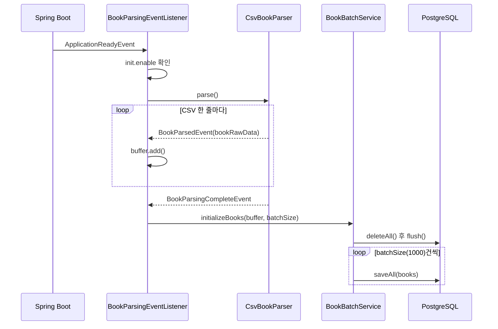

# 01. 데이터 적재: 공공 도서 CSV 배치 적재

> 공공 도서 CSV 파일(약 15만 건)을 읽어 PostgreSQL의 `books` 테이블에 한 번에 적재하는 배치 처리를 구현합니다. 파싱과 저장을 이벤트로 분리하는 구조와, 대량 저장을 빠르게 만드는 설정을 이해합니다.
>
> 예상 소요 시간: 2시간 · 난이도: 입문

## 학습 목표

- 배치(Batch) 처리가 무엇이고 한 건씩 저장하는 방식보다 왜 빠른지 설명할 수 있다
- Apache Commons CSV로 CSV 파일을 읽어 DTO로 변환할 수 있다
- `ApplicationEventPublisher`와 `@EventListener`로 파싱과 저장을 분리할 수 있다
- `saveAll()`과 Hibernate 배치 설정으로 대량 데이터를 저장할 수 있다
- 적재 결과를 SQL로 확인하고 흔한 오류를 해결할 수 있다

## 시작하기 전에

- [Step 0](../step-0/README.md)에서 개발 환경(Java 21, PostgreSQL, 프로젝트 실행)을 준비해 두어야 합니다.
- Spring Boot의 `@Component`, `@Service`, Spring Data JPA의 `save()`를 써 본 경험이 있으면 충분합니다.
- 모르는 용어는 [용어집](../glossary.md)을 참고합니다.

---

## 1. 왜 필요한가

이 교재의 최종 목표는 "AI가 도서를 추천해 주는 도서관 서비스"입니다. 그런데 AI가 아무리 똑똑해도 추천할 책 목록이 없으면 아무것도 할 수 없습니다. 그래서 첫 작업은 AI와 무관한, 아주 전통적인 일인 **데이터 적재**입니다.

이 프로젝트는 공공 도서 데이터 파일 `BOOK_DB_202112.csv`를 사용합니다. 파일 크기는 약 75MB이고 도서는 약 15만 7천 건입니다. 이 데이터를 DB에 넣는 가장 단순한 코드는 다음과 같습니다.

```java
for (BookRawData raw : rows) {
    bookRepository.save(BookMapper.toEntity(raw));   // 15만 번 반복
}
```

이 코드는 동작은 하지만 매우 느립니다. `save()`를 트랜잭션 밖에서 호출하면 호출할 때마다 트랜잭션이 열리고 커밋되며, INSERT 문도 한 건씩 DB로 전송됩니다. 택배 15만 개를 트럭 한 대에 한 개씩 싣고 15만 번 왕복하는 것과 같습니다.

이 문서에서는 다음 세 가지 문제를 해결합니다.

| 문제 | 해결 방법 |
|---|---|
| 한 건씩 저장하면 너무 느림 | 1,000건씩 묶어 저장(배치), Hibernate 배치 INSERT |
| 파일 읽기와 DB 저장 코드가 뒤엉킴 | 이벤트로 "파싱"과 "저장" 역할 분리 |
| 애플리케이션을 켤 때마다 다시 적재됨 | `init.enable` 설정으로 실행 여부 제어 |

---

## 2. 핵심 개념

### 2.1. 배치 처리

편지 100통을 보낸다고 생각해 봅시다. 한 통 쓰고 우체국에 다녀오기를 100번 반복하는 것보다, 100통을 다 쓴 뒤 한 번에 들고 가는 편이 훨씬 빠릅니다.

**배치(Batch) 처리**는 이처럼 데이터를 일정한 크기로 모아 한 번에 처리하는 방식입니다. DB 저장에서는 다음 두 가지 비용을 줄여 줍니다.

- **트랜잭션 비용**: 트랜잭션 하나에서 여러 건을 저장하고 한 번만 커밋합니다.
- **네트워크 왕복 비용**: 여러 INSERT 문을 묶어 한 번에 DB로 보냅니다.

대신 처리가 끝나야 결과가 반영되므로, 실시간 처리가 필요한 작업에는 맞지 않습니다. 초기 데이터 적재처럼 "한 번에 많이" 넣는 작업에 적합합니다.

### 2.2. CSV, DTO, 엔티티

**CSV(Comma-Separated Values)**는 쉼표로 값을 구분한 텍스트 파일입니다. 실제 파일의 첫 줄(헤더)은 다음과 같습니다(일부 생략).

```text
SEQ_NO,ISBN_THIRTEEN_NO,VLM_NM,TITLE_NM,AUTHR_NM,PUBLISHER_NM,PBLICTE_DE,...,PRC_VALUE,IMAGE_URL,BOOK_INTRCN_CN,...,TITLE_SBST_NM,...,TWO_PBLICTE_DE,...
```

CSV 한 줄은 바로 DB에 넣지 않고 두 단계를 거칩니다.

- **DTO(Data Transfer Object)**: 데이터를 옮기기 위한 객체입니다. 여기서는 CSV 한 줄을 그대로 담는 `BookRawData`입니다.
- **엔티티(Entity)**: DB 테이블과 1:1로 대응하는 객체입니다. 여기서는 `books` 테이블에 대응하는 `Book`입니다.

둘을 나누면 CSV 컬럼 이름이 바뀌어도 `Book` 엔티티와 DB 구조는 그대로 둘 수 있습니다. 변환은 `BookMapper`가 담당합니다.

### 2.3. 이벤트 기반 구조

식당에서 손님은 주방에 직접 말하지 않고 주문서를 남깁니다. 주방은 주문서만 보고 요리합니다. 손님과 주방은 서로를 몰라도 됩니다.

Spring에서는 `ApplicationEventPublisher`가 주문서(**이벤트**)를 발행하고, `@EventListener`가 붙은 메서드가 그 이벤트를 받아 처리합니다. 이 프로젝트에서는 다음과 같이 역할을 나눕니다.

| 역할 | 클래스 | 하는 일 |
|---|---|---|
| 파서 | `CsvBookParser` | CSV 한 줄을 읽을 때마다 `BookParsedEvent` 발행, 끝나면 `BookParsingCompleteEvent` 발행 |
| 리스너 | `BookParsingEventListener` | 이벤트를 받아 버퍼에 모으고, 완료 이벤트가 오면 저장 요청 |
| 저장 서비스 | `BookBatchService` | `batchSize` 단위로 나누어 `saveAll()` 실행 |

파서는 DB를 전혀 모르고, 저장 서비스는 CSV를 전혀 모릅니다. 나중에 "파싱이 끝나면 임베딩도 생성한다" 같은 기능이 필요해지면 리스너를 하나 더 추가하기만 하면 됩니다.

전체 흐름은 다음과 같습니다.



> **참고:** `@EventListener`는 기본적으로 **동기**로 동작합니다. `publishEvent()`를 호출하면 리스너 메서드가 끝날 때까지 기다린 뒤 다음 줄로 넘어갑니다. 그래서 `BookParsingCompleteEvent`가 도착했을 때 버퍼에는 이미 모든 도서가 들어 있습니다.

---

## 3. 따라 하기

### STEP 1. 적재 설정 추가하기

목표: CSV 파일 위치, 실행 여부, 배치 크기를 설정 파일에서 바꿀 수 있게 합니다.

```properties
# src/main/resources/application.properties (발췌)
init.book_file=data/init/BOOK_DB_202112.csv
init.enable=false
init.batch_size=1000

# saveAll()이 실제로 묶음 INSERT가 되도록 하는 Hibernate 설정
spring.jpa.properties.hibernate.jdbc.batch_size=1000
spring.jpa.properties.hibernate.order_inserts=true
```

- `init.enable`은 저장소에 `false`로 들어 있습니다. 처음 한 번 적재할 때만 `true`로 바꿔 실행하고, 적재가 끝나면 다시 `false`로 돌려 둡니다.
- `.properties` 파일은 줄 끝 주석을 지원하지 않습니다. `init.enable=true  # 설명`처럼 쓰면 `#` 뒤까지 값이 되므로 주석은 별도 줄에 씁니다.

설정값은 `@ConfigurationProperties`로 객체에 바인딩합니다. `book_file`, `batch_size`처럼 밑줄이 있는 키도 `bookFile`, `batchSize` 필드에 자동으로 연결됩니다(Spring Boot의 relaxed binding).

```java
@Component
@Getter
@Setter
@ToString
@ConfigurationProperties(prefix = "init")
public class InitProperties {
    private String bookFile;   // init.book_file
    private boolean enable;    // init.enable
    private int batchSize;     // init.batch_size
}
```

전체 코드: `src/main/java/net/java21/library/batch/init/properties/InitProperties.java`

### STEP 2. 이벤트와 DTO 정의하기

목표: 파서와 리스너가 주고받을 이벤트, CSV 한 줄을 담을 DTO를 만듭니다.

이벤트는 값을 전달하기만 하므로 불변 객체인 `record`로 선언합니다.

```java
// 도서 한 권을 파싱할 때마다 발행 (record이므로 bookRawData() 접근자가 자동 생성됨)
public record BookParsedEvent(BookRawData bookRawData) {}

// 모든 도서를 파싱하면 발행 (데이터 없이 "완료" 신호만 전달)
public record BookParsingCompleteEvent() {}
```

`BookRawData`는 CSV 컬럼을 그대로 담는 DTO입니다. 파서가 값을 하나씩 채워 넣으므로 Lombok `@Setter`를 사용합니다.

```java
@Getter
@Setter
@NoArgsConstructor
@ToString
public class BookRawData {
    private Long id;                       // SEQ_NO
    private String isbn;                   // ISBN_THIRTEEN_NO
    private String volumeTitle;            // VLM_NM (권차명)
    private String title;                  // TITLE_NM
    private String authorName;             // AUTHR_NM
    private String publisherName;          // PUBLISHER_NM
    private LocalDate firstPublishDate;    // PBLICTE_DE
    private BigDecimal price;              // PRC_VALUE
    private String imageUrl;               // IMAGE_URL
    private String bookContent;            // BOOK_INTRCN_CN (도서 소개)
    private String subtitle;               // TITLE_SBST_NM
    private LocalDate editionPublishDate;  // TWO_PBLICTE_DE
}
```

전체 코드: `src/main/java/net/java21/library/batch/init/event/`, `src/main/java/net/java21/library/batch/init/dto/BookRawData.java`

### STEP 3. CSV 파서 구현하기

목표: CSV를 한 줄씩 읽어 `BookRawData`로 바꾸고 이벤트를 발행합니다.

파서는 인터페이스로 분리해 둡니다. 나중에 JSON 파서 등으로 교체하기 쉽습니다.

```java
public interface BookParser {

    void parse() throws UnsupportedEncodingException;

    // 클래스패스(src/main/resources)에서 파일을 읽어 옴
    default InputStream getInputStream(String file) {
        return getClass().getClassLoader().getResourceAsStream(file);
    }
}
```

구현체 `CsvBookParser`의 핵심 부분입니다. CSV 파싱은 Apache Commons CSV(`commons-csv` 1.13.0)를 사용합니다. 이 라이브러리는 따옴표 안의 쉼표나 줄바꿈처럼 직접 처리하기 까다로운 경우를 대신 처리해 줍니다.

```java
@Override
public void parse() throws UnsupportedEncodingException {
    try (
            Reader reader = new InputStreamReader(
                    getInputStream(initProperties.getBookFile()), StandardCharsets.UTF_8);
            CSVParser parser = CSVFormat.Builder.create(CSVFormat.DEFAULT)
                    .setHeader()                 // 첫 줄을 헤더로 사용
                    .setSkipHeaderRecord(true)   // 헤더 줄은 데이터에서 제외
                    .setIgnoreHeaderCase(true)   // 헤더 대소문자 무시
                    .setTrim(true)               // 값 앞뒤 공백 제거
                    .get()
                    .parse(reader)
    ) {
        for (CSVRecord record : parser.getRecords()) {
            BookRawData book = new BookRawData();

            String seq = record.get(CSV_HEADER_SEQ);         // "SEQ_NO"
            if (!seq.isBlank()) {
                book.setId(Long.parseLong(seq));
            }
            book.setIsbn(record.get(CSV_HEADER_ISBN));
            book.setTitle(record.get(CSV_HEADER_TITLE));
            // ... 권차명, 저자, 출판사, 이미지, 소개, 부제도 같은 방식

            String pbDate = record.get(CSV_HEADER_PUB_DATE); // "yyyyMMdd" 문자열
            if (!pbDate.isBlank()) {
                book.setFirstPublishDate(LocalDate.parse(pbDate,
                        DateTimeFormatter.ofPattern(DEFAULT_DATE_FORMAT_NO_LINE)));
            }
            // ... 가격(BigDecimal), 2판 출판일(convertToLocalDate) 변환 생략

            applicationEventPublisher.publishEvent(new BookParsedEvent(book));
        }

        applicationEventPublisher.publishEvent(new BookParsingCompleteEvent());
    } catch (IOException e) {
        throw new RuntimeException(e);
    }
}
```

전체 코드: `src/main/java/net/java21/library/batch/init/parser/impl/CsvBookParser.java`

코드 설명:

- 컬럼 이름(`"SEQ_NO"`, `"TITLE_NM"` 등)은 `CSV_HEADER_*` 상수로 정의해 두고 사용합니다. 문자열을 직접 쓰면 오타를 찾기 어렵습니다.
- 빈 문자열을 `Long.parseLong()`이나 `LocalDate.parse()`에 넘기면 예외가 나므로, `isBlank()`로 확인한 뒤에만 변환합니다.
- 실제 소스는 2판 출판일(`TWO_PBLICTE_DE`)을 `convertToLocalDate()`로 변환합니다. 숫자 이외의 문자를 제거한 뒤 파싱하고, 실패하면 `null`을 반환합니다.
- 한 줄 처리가 끝날 때마다 이벤트를 발행하고, 반복이 끝나면 완료 이벤트를 발행합니다. 파서는 저장이 어떻게 이루어지는지 전혀 모릅니다.

### STEP 4. 이벤트 리스너 구현하기

목표: 애플리케이션이 시작되면 파싱을 시작하고, 이벤트를 모아 두었다가 저장을 요청합니다.

```java
@Slf4j
@Component
@RequiredArgsConstructor
public class BookParsingEventListener {

    private final InitProperties initProperties;
    private final BookParser bookParser;
    private final List<BookRawData> buffer = new ArrayList<>();
    private final BookBatchService bookbatchService;

    @EventListener(ApplicationReadyEvent.class)
    public void onApplicationReady() {
        if (initProperties.isEnable()) {          // init.enable=true일 때만 실행
            try {
                bookParser.parse();
            } catch (UnsupportedEncodingException e) {
                throw new RuntimeException(e);
            }
        }
    }

    @EventListener
    public void onBookParsed(BookParsedEvent event) {
        buffer.add(event.bookRawData());          // record 접근자
    }

    @EventListener
    public void onParsingCompleted(BookParsingCompleteEvent event) {
        bookbatchService.initializeBooks(buffer, initProperties.getBatchSize());
    }
}
```

전체 코드: `src/main/java/net/java21/library/batch/init/event/listener/BookParsingEventListener.java`

코드 설명:

- `ApplicationReadyEvent`는 Spring Boot가 모든 빈을 준비하고 애플리케이션을 띄운 직후 발행하는 이벤트입니다. 이 시점에 시작하면 DB 연결 등이 모두 준비되어 있습니다.
- 리스너 메서드는 파라미터 타입으로 어떤 이벤트를 받을지 결정합니다. 메서드 이름은 자유입니다.
- 이 구현은 모든 도서를 메모리(`buffer`)에 올린 뒤 저장합니다. 15만 건 수준에서는 문제가 없지만, 수백만 건이라면 "배치 크기만큼 모이면 바로 저장하고 버퍼를 비우는" 방식이 필요합니다(4장 도전 미션).

### STEP 5. 배치 저장 서비스 구현하기

목표: 버퍼에 모인 데이터를 `batchSize`씩 잘라 엔티티로 바꾸고 저장합니다.

```java
@Transactional
public void initializeBooks(List<BookRawData> buffer, int batchSize) {
    log.info("Starting book initialization. Buffer size: {}, Batch size: {}", buffer.size(), batchSize);

    bookRepository.deleteAll();   // 기존 데이터를 모두 지우고 새로 적재
    bookRepository.flush();

    for (int i = 0; i < buffer.size(); i += batchSize) {
        int endIndex = Math.min(i + batchSize, buffer.size());
        List<BookRawData> batch = buffer.subList(i, endIndex);
        bookRepository.saveAll(BookMapper.toEntity(batch));
    }

    log.info("Book initialization completed.");
}
```

DTO를 엔티티로 바꾸는 `BookMapper`는 상태가 없는 유틸리티 클래스입니다.

```java
public static Book toEntity(BookRawData rawData) {
    if (Objects.isNull(rawData)) {
        throw new IllegalArgumentException("BookRawData must not be null");
    }
    return new Book(
            rawData.getIsbn(), rawData.getVolumeTitle(), rawData.getTitle(),
            rawData.getAuthorName(), rawData.getPublisherName(), rawData.getFirstPublishDate(),
            rawData.getPrice(), rawData.getImageUrl(), rawData.getBookContent(),
            rawData.getSubtitle(), rawData.getEditionPublishDate());
}

public static List<Book> toEntity(List<BookRawData> rawDataList) {
    return rawDataList.stream().map(BookMapper::toEntity).toList();
}
```

전체 코드: `src/main/java/net/java21/library/batch/init/service/BookBatchService.java`, `src/main/java/net/java21/library/batch/init/mapper/BookMapper.java`

코드 설명:

- `@Transactional` 덕분에 삭제와 15만 건 저장이 **트랜잭션** 하나로 묶입니다. 트랜잭션은 "모두 성공하거나 모두 취소되는" 작업 단위입니다. 중간에 실패하면 `deleteAll()`까지 함께 취소되어, 테이블이 반쯤 비어 있는 상태가 남지 않습니다.
- `deleteAll()`이 있으므로 적재를 다시 실행하면 기존 데이터가 모두 교체됩니다. 리뷰 등 다른 데이터가 쌓인 뒤에는 실행하지 않도록 주의합니다.
- `saveAll()`만으로 INSERT가 묶여 전송되지는 않습니다. 실제로 묶음 전송이 되려면 다음 조건이 함께 필요합니다.

| 조건 | 이 프로젝트의 설정 |
|---|---|
| Hibernate 배치 크기 지정 | `spring.jpa.properties.hibernate.jdbc.batch_size=1000` |
| 같은 테이블 INSERT끼리 정렬 | `spring.jpa.properties.hibernate.order_inserts=true` |
| ID 생성 전략이 `IDENTITY`가 아닐 것 | `Book`은 `GenerationType.SEQUENCE`, `allocationSize = 1000` |

`IDENTITY` 전략은 INSERT를 실행해야 ID를 알 수 있으므로 Hibernate가 배치 INSERT를 사용하지 않습니다. `SEQUENCE` 전략은 시퀀스에서 ID를 1,000개씩 미리 받아 두므로 INSERT를 모아서 보낼 수 있습니다.

### STEP 6. 실행하고 확인하기

목표: 실제로 적재하고 결과를 확인합니다.

1. `application.properties`에서 `init.enable=true`로 바꿉니다.
2. 애플리케이션을 실행합니다.

```bash
mvn spring-boot:run
```

3. 로그에 다음과 같은 메시지가 나오면 적재가 진행 중입니다. 환경에 따라 수십 초에서 몇 분이 걸립니다.

```text
INFO  ... Starting CSV parsing with properties: InitProperties(bookFile=data/init/BOOK_DB_202112.csv, enable=true, batchSize=1000)
INFO  ... Starting book initialization. Buffer size: 157118, Batch size: 1000
INFO  ... Deleting all existing books before batch load.
INFO  ... Book initialization completed.
```

4. DB에서 건수와 샘플을 확인합니다.

```sql
SELECT COUNT(*) FROM books;

SELECT id, isbn, title, author_name, publisher_name
FROM books
ORDER BY id
LIMIT 5;
```

5. 확인이 끝나면 `init.enable=false`로 되돌립니다.

> **참고:** CSV의 일부 값에는 `&lt;`, `&gt;` 같은 HTML 엔티티가 그대로 들어 있습니다. 원본 공공 데이터의 형식이며, 이 단계에서는 별도로 정제하지 않습니다.

---

## 4. 직접 해 보기

### 미션 1 (기본). 배치 크기에 따른 적재 시간 비교

`init.batch_size`를 100, 1000, 5000으로 바꿔 가며 적재 시간을 비교합니다.

- 요구사항: `initializeBooks()` 시작과 끝 시각을 로그로 남기고, 세 번의 결과를 표로 정리합니다.
- 힌트: `hibernate.jdbc.batch_size`는 1000으로 고정되어 있으므로, `init.batch_size`를 바꾸면 "한 번에 `saveAll()`에 넘기는 양"만 달라집니다. 결과 차이가 생각보다 작다면 그 이유를 생각해 봅니다.

<details>
<summary>예시 코드</summary>

```java
long start = System.currentTimeMillis();
// ... 기존 저장 로직
log.info("Book initialization completed in {} ms", System.currentTimeMillis() - start);
```

실제 INSERT 묶음 크기는 `hibernate.jdbc.batch_size`가 결정합니다. 그래서 `init.batch_size`를 바꿔도 차이가 크지 않을 수 있습니다. 두 값을 함께 바꿔 보면 차이가 더 분명해집니다.

</details>

### 미션 2 (기본). 적재 건수 이벤트 리스너 추가

기존 코드를 고치지 않고, 파싱된 도서 수를 세어 완료 시 로그로 출력하는 리스너를 새로 만듭니다.

- 요구사항: `BookParsedEvent`와 `BookParsingCompleteEvent`를 받는 새 `@Component` 클래스
- 힌트: 이벤트 기반 구조의 장점인 "기존 코드 수정 없이 기능 추가"를 확인하는 미션입니다.

<details>
<summary>예시 코드</summary>

```java
@Slf4j
@Component
public class BookParsingCountListener {

    private long count = 0;

    @EventListener
    public void onBookParsed(BookParsedEvent event) {
        count++;
    }

    @EventListener
    public void onParsingCompleted(BookParsingCompleteEvent event) {
        log.info("Parsed {} books in total", count);
    }
}
```

</details>

### 미션 3 (도전). 메모리를 덜 쓰는 적재

지금은 모든 도서를 `buffer`에 모은 뒤 저장합니다. 버퍼가 `batchSize`만큼 차면 즉시 저장하고 비우도록 바꿔 봅니다.

- 요구사항: 완료 이벤트에서는 남은 데이터만 저장합니다. `deleteAll()`은 첫 저장 전에 한 번만 실행해야 합니다.
- 힌트: 이렇게 바꾸면 전체가 하나의 트랜잭션이 아니게 됩니다. 중간에 실패했을 때 어떤 상태가 남는지 함께 생각해 봅니다.

<details>
<summary>예시 코드</summary>

```java
@EventListener
public void onBookParsed(BookParsedEvent event) {
    buffer.add(event.bookRawData());
    if (buffer.size() >= initProperties.getBatchSize()) {
        bookBatchService.saveChunk(new ArrayList<>(buffer)); // 청크 단위 @Transactional 메서드
        buffer.clear();
    }
}

@EventListener
public void onParsingCompleted(BookParsingCompleteEvent event) {
    if (!buffer.isEmpty()) {
        bookBatchService.saveChunk(new ArrayList<>(buffer));
        buffer.clear();
    }
}
```

`saveChunk()`는 학습용으로 새로 만드는 메서드입니다. 청크마다 커밋되므로 중간 실패 시 일부만 저장된 상태가 남습니다. 메모리와 일관성 사이의 트레이드오프입니다.

</details>

---

## 5. 자주 하는 실수

**1. 파일을 찾지 못함 (`NullPointerException` 또는 `FileNotFoundException`)**

- 증상: `parse()` 시작 직후 `InputStreamReader` 생성에서 예외가 발생합니다.
- 원인: `getResourceAsStream()`은 파일이 없으면 `null`을 반환합니다. `init.book_file` 경로가 틀렸거나 파일이 `src/main/resources/data/init/`에 없습니다.
- 해결: 경로를 클래스패스 기준(`data/init/BOOK_DB_202112.csv`)으로 적었는지, 파일이 실제로 있는지 확인합니다.

**2. 애플리케이션을 켜도 적재가 안 됨**

- 증상: 로그에 `Starting CSV parsing`이 나오지 않습니다.
- 원인: `init.enable=false`이거나, 값 뒤에 줄 끝 주석을 붙여 `true  # ...`가 값으로 들어갔습니다.
- 해결: `init.enable=true` 한 줄만 쓰고 주석은 별도 줄에 둡니다.

**3. 한글이 깨짐**

- 증상: DB의 제목과 저자가 `???` 또는 이상한 문자로 저장됩니다.
- 원인: 파일 인코딩과 읽기 인코딩이 다릅니다. 이 프로젝트의 CSV는 UTF-8입니다.
- 해결: 다른 CSV를 쓴다면 인코딩을 확인합니다. EUC-KR 계열이면 `Charset.forName("MS949")`로 읽습니다.

**4. 유니크 제약 위반 또는 데이터 중복**

- 증상: `duplicate key value violates unique constraint "idx_book_isbn"` 오류가 납니다.
- 원인: `Book.isbn`은 `unique = true`입니다. 직접 수정한 코드에서 `deleteAll()` 없이 다시 적재했거나, 같은 ISBN이 두 번 들어간 CSV를 사용했습니다.
- 해결: 제공 코드의 `deleteAll()` 흐름을 유지하고, 적재 후에는 `init.enable=false`로 돌려 둡니다.

**5. `saveAll()`을 썼는데도 느림**

- 증상: SQL 로그에 INSERT가 한 건씩 실행되는 것처럼 보이고 적재가 매우 느립니다.
- 원인: `hibernate.jdbc.batch_size`가 없거나, 엔티티 ID 전략이 `IDENTITY`입니다.
- 해결: STEP 5의 표에 있는 세 가지 조건을 확인합니다. PostgreSQL에서는 JDBC URL에 `reWriteBatchedInserts=true`를 추가하면 더 빨라질 수 있습니다.

---

## 6. 정리

- 대량 데이터는 한 건씩 저장하지 않고, 트랜잭션과 INSERT를 묶는 배치 처리로 적재합니다.
- 파서는 이벤트만 발행하고, 리스너와 저장 서비스가 그 이벤트를 받아 처리합니다. 덕분에 파싱과 저장이 서로를 모릅니다.
- `saveAll()`이 실제로 배치 INSERT가 되려면 `hibernate.jdbc.batch_size`, `order_inserts`, `SEQUENCE` 전략이 필요합니다.
- 이렇게 적재한 15만여 건의 도서가 이후 키워드 검색, 벡터 검색, RAG의 공통 재료가 됩니다.

- [ ] `init.enable=true`로 적재를 실행하고 `SELECT COUNT(*) FROM books`로 건수를 확인했다
- [ ] 파서, 리스너, 저장 서비스가 각각 무엇을 하는지 설명할 수 있다
- [ ] `@EventListener`가 동기로 동작한다는 것을 알고 있다
- [ ] 배치 INSERT가 동작하기 위한 조건 세 가지를 말할 수 있다
- [ ] 적재 후 `init.enable=false`로 되돌렸다

---

## 확인 문제

**1. `save()`를 반복 호출하는 대신 `@Transactional` 메서드 안에서 `saveAll()`을 호출하면 무엇이 줄어드나요?**

<details>
<summary>정답</summary>

트랜잭션 시작·커밋 횟수가 줄어듭니다. 여기에 `hibernate.jdbc.batch_size` 설정이 더해지면 INSERT 문이 묶여 전송되어 DB와의 네트워크 왕복 횟수도 줄어듭니다.

</details>

**2. `CsvBookParser`는 `BookRepository`를 주입받지 않습니다. 그런데도 데이터가 저장되는 이유는 무엇인가요?**

<details>
<summary>정답</summary>

파서는 `BookParsedEvent`와 `BookParsingCompleteEvent`를 발행만 하고, `BookParsingEventListener`가 그 이벤트를 받아 `BookBatchService`를 호출하기 때문입니다. 파싱과 저장이 이벤트로 분리되어 있습니다.

</details>

**3. `Book` 엔티티의 ID 전략을 `GenerationType.IDENTITY`로 바꾸면 적재 성능에 어떤 영향이 있나요?**

<details>
<summary>정답</summary>

`IDENTITY`는 INSERT를 실행해야 ID를 알 수 있으므로 Hibernate가 배치 INSERT를 사용하지 않습니다. `saveAll()`을 써도 INSERT가 한 건씩 실행되어 느려집니다.

</details>

**4. `BookBatchService.initializeBooks()` 실행 중 10만 번째 도서에서 예외가 나면 `books` 테이블은 어떤 상태가 되나요?**

<details>
<summary>정답</summary>

메서드 전체가 `@Transactional`로 묶여 있으므로 롤백됩니다. `deleteAll()`도 취소되어 적재 전 상태 그대로 남습니다.

</details>

---

## 다음 문서

[02. 기본 검색: LIKE 기반 동적 쿼리 구현 →](02.basic-search-implementation.md)
