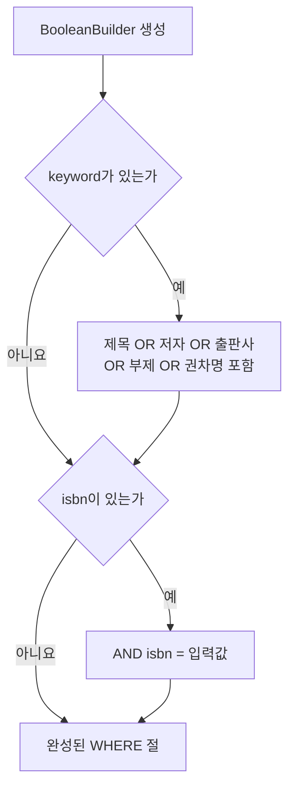
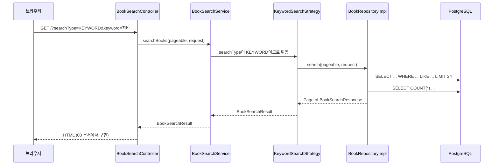

# 02. 기본 검색: LIKE 기반 동적 쿼리 구현

> 적재한 도서 데이터를 키워드와 ISBN으로 찾는 검색 백엔드를 만듭니다. 요청·응답 DTO, QueryDSL의 `BooleanBuilder`로 만드는 동적 쿼리, 페이징을 이해합니다.
>
> 예상 소요 시간: 2시간 · 난이도: 입문

## 학습 목표

- 검색 요청 DTO와 응답 DTO를 나누는 이유를 설명할 수 있다
- `LIKE '%키워드%'` 검색이 무엇을 찾고 무엇을 못 찾는지 설명할 수 있다
- QueryDSL의 `BooleanBuilder`로 입력값에 따라 달라지는 WHERE 절을 만들 수 있다
- `Pageable`과 `PageImpl`로 페이징된 검색 결과를 반환할 수 있다
- 요청이 Controller → Service → 검색 전략 → Repository로 흐르는 과정을 설명할 수 있다

## 시작하기 전에

- [01. 데이터 적재](01.csv-batch-load.md)를 마쳐 `books` 테이블에 데이터가 있어야 합니다.
- SQL의 `SELECT`, `WHERE`, `LIKE`와 Spring Data JPA의 `JpaRepository`를 알고 있으면 좋습니다.
- 모르는 용어는 [용어집](../glossary.md)을 참고합니다.

---

## 1. 왜 필요한가

01 문서에서 15만여 건의 도서를 DB에 넣었습니다. 하지만 지금은 SQL 클라이언트를 열어야만 데이터를 볼 수 있습니다. 사용자는 "자바"라고 입력하면 관련 책이 나오기를 기대합니다.

검색 조건은 생각보다 다양합니다.

| 사용자 입력 | 필요한 WHERE 절 |
|---|---|
| 아무것도 입력 안 함 | 조건 없음 (전체 목록) |
| 키워드 "자바" | 제목·저자·출판사·부제·권차명 중 하나에 "자바" 포함 |
| ISBN "9791162241837" | `isbn = '9791162241837'` |
| 키워드 + ISBN | 위 두 조건을 AND로 연결 |

조합마다 메서드를 따로 만들면(`findByTitle`, `findByTitleAndIsbn`, ...) 조건이 늘어날수록 메서드 수가 폭발합니다. 그래서 입력값에 따라 WHERE 절을 조립하는 **동적 쿼리**가 필요합니다.

또 하나, 결과가 수천 건이면 한 번에 모두 보내지 않고 24건씩 나누어 보여 주는 **페이징**도 필요합니다.

---

## 2. 핵심 개념

### 2.1. 요청 DTO와 응답 DTO

**DTO**는 계층 사이에서 데이터를 옮기는 객체입니다. 검색 기능에는 두 종류가 있습니다.

- **요청 DTO(`BookSearchRequest`)**: 사용자가 보낸 검색 조건(키워드, ISBN, 검색 방식)
- **응답 DTO(`BookSearchResponse`)**: 화면에 보여 줄 도서 정보

엔티티(`Book`)를 그대로 화면에 넘기지 않는 이유는 다음과 같습니다.

- `Book`에는 화면에 필요 없는 필드(이후 단계의 임베딩 벡터 등)가 있습니다. 필요한 값만 골라 담으면 전송량이 줄고 내부 구조가 노출되지 않습니다.
- DB 구조가 바뀌어도 응답 형식은 그대로 유지할 수 있습니다.

### 2.2. LIKE 부분 일치 검색

`LIKE`는 SQL에서 문자열 패턴을 찾는 연산자입니다. `%`는 "아무 글자나 0개 이상"을 뜻합니다.

```sql
SELECT * FROM books WHERE title LIKE '%자바%';
```

이 쿼리는 제목 어딘가에 "자바"라는 **글자 그대로**가 들어 있는 책을 찾습니다. 여기서 이 단계 검색의 성격이 드러납니다.

| 검색어 | 찾는 책 | 못 찾는 책 |
|---|---|---|
| 자바 | "이것이 자바다", "자바의 정석" | 제목이 "Java 프로그래밍"인 책 |
| 파이썬 | "혼자 공부하는 파이썬" | "Python 머신러닝" |

LIKE는 글자가 같은지만 비교할 뿐, "자바"와 "Java"가 같은 뜻이라는 것은 모릅니다. 이 한계는 04 문서와 Step 2에서 다시 다룹니다.

> **참고:** QueryDSL의 `containsIgnoreCase(keyword)`는 `lower(title) like '%keyword%'` 형태의 SQL로 바뀝니다. 영문 대소문자 차이("JAVA"와 "java")는 무시하지만, 한글 "자바"와 영문 "Java"는 여전히 다른 글자입니다.

### 2.3. QueryDSL과 BooleanBuilder

**QueryDSL**은 SQL(JPQL)을 문자열 대신 자바 코드로 작성하게 해 주는 라이브러리입니다.

```java
// 문자열 JPQL: 오타가 있어도 실행해 봐야 알 수 있음
"select b from Book b where b.titel like :keyword"

// QueryDSL: 필드 이름이 틀리면 컴파일 오류
queryFactory.selectFrom(book).where(book.title.contains(keyword)).fetch();
```

`book`은 빌드할 때 QueryDSL이 엔티티를 보고 자동 생성하는 **Q클래스**(`QBook`)의 인스턴스입니다. `target/generated-sources`에 생성됩니다.

**BooleanBuilder**는 WHERE 조건을 레고 블록처럼 하나씩 붙이는 도구입니다. 조건이 필요할 때만 `and()`나 `or()`로 추가하고, 아무것도 추가하지 않으면 WHERE 절이 생기지 않습니다.



### 2.4. 검색 요청의 흐름

이 프로젝트는 검색 방식(키워드, 벡터, 하이브리드, RAG)을 **전략 패턴**으로 나눠 두었습니다. `BookSearchService`가 `searchType`을 보고 알맞은 전략을 고르고, 이 단계에서 쓰는 것은 `KeywordSearchStrategy`입니다. 나머지 전략은 Step 2와 Step 3에서 하나씩 채워집니다.



---

## 3. 따라 하기

### STEP 1. 요청 DTO 만들기

목표: 사용자가 보내는 검색 조건을 담는 불변 객체를 만듭니다.

```java
public record BookSearchRequest(
    @Size(max = 100)
    String keyword,          // 검색 키워드

    @Size(max = 20)
    String isbn,             // ISBN (정확히 일치)

    SearchType searchType,   // KEYWORD, VECTOR, HYBRID, RAG
    float[] vector,          // 벡터 검색용 (Step 2)
    Boolean isWarmUp         // 캐시 워밍업 플래그 (Step 4)
) {
    public BookSearchRequest {             // 컴팩트 생성자: 기본값 채우기
        if (searchType == null) {
            searchType = SearchType.RAG;
        }
        if (isWarmUp == null) {
            isWarmUp = false;
        }
    }
}
```

전체 코드: `src/main/java/net/java21/library/core/book/dto/BookSearchRequest.java`

코드 설명:

- `record`는 필드, 생성자, 접근자(`keyword()`), `equals()`, `hashCode()`를 자동으로 만들어 주는 불변 클래스입니다. 실제 소스는 `float[]` 배열 비교를 위해 `equals()`와 `hashCode()`를 직접 재정의합니다.
- `@Size`는 Bean Validation 애노테이션입니다. 컨트롤러에서 `@Valid`와 함께 쓰면 100자를 넘는 키워드를 거부합니다.
- `vector`, `isWarmUp`은 지금은 쓰지 않습니다. 이후 단계에서 같은 DTO를 확장해 사용하므로 미리 자리만 보여 줍니다.
- **주의:** `searchType`을 보내지 않으면 기본값이 `RAG`입니다. RAG는 Step 3에서 만들 AI 기능이므로, 이 단계에서는 요청에 반드시 `searchType=KEYWORD`를 붙입니다.

`SearchType`은 다음 네 값을 가진 enum입니다. `from()`은 대소문자를 무시하고 매칭하며, 모르는 값이면 `KEYWORD`를 반환합니다.

```java
public enum SearchType {
    KEYWORD("keyword"), VECTOR("vector"), HYBRID("hybrid"), RAG("rag");
    // ...
}
```

### STEP 2. 응답 DTO 만들기

목표: 화면에 보여 줄 필드만 담는 응답 객체를 만듭니다.

```java
@Getter
@NoArgsConstructor
public class BookSearchResponse {

    private Long id;
    private String isbn;
    private String title;
    private String volumeTitle;
    private String authorName;
    private String publisherName;
    private BigDecimal price;
    private LocalDate editionPublishDate;
    private String imageUrl;
    private String bookContent;
    // similarity, rrfScore, 리뷰 정보 필드는 이후 단계에서 사용

    @QueryProjection
    public BookSearchResponse(Long id, String isbn, String title, String volumeTitle,
                              String authorName, String publisherName, BigDecimal price,
                              LocalDate editionPublishDate, String imageUrl, String bookContent) {
        this.id = id;
        this.isbn = isbn;
        // ... 나머지 필드 대입
    }
}
```

전체 코드: `src/main/java/net/java21/library/core/book/dto/BookSearchResponse.java`

코드 설명:

- 실제 클래스에는 생성자가 여러 개 있습니다. 벡터 유사도(`similarity`), RRF 점수(`rrfScore`), 리뷰 정보가 붙는 생성자는 Step 2와 Step 4에서 사용합니다.
- `@QueryProjection`을 붙이면 QueryDSL이 `QBookSearchResponse`를 생성해, 생성자 인자의 타입을 컴파일 시점에 검사할 수 있게 해 줍니다. 이 프로젝트의 `BookRepositoryImpl`은 `Projections.constructor()`로 같은 생성자를 호출합니다.
- 엔티티를 DTO로 바꾸는 정적 메서드 `BookSearchResponse.from(Book)`도 있습니다. STEP 5에서 사용합니다.

### STEP 3. Repository 인터페이스 나누기

목표: Spring Data JPA의 기본 기능과 QueryDSL로 직접 구현할 검색 기능을 하나의 Repository로 합칩니다.

```java
// 직접 구현할 검색 메서드 정의
@NoRepositoryBean
public interface BookRepositoryCustom {
    Page<BookSearchResponse> search(Pageable pageable, BookSearchRequest request);
    Page<BookSearchResponse> vectorSearch(Pageable pageable, BookSearchRequest request); // Step 2
}

// 기본 CRUD + 커스텀 검색
public interface BookRepository extends JpaRepository<Book, Long>, BookRepositoryCustom {
    // 임베딩 관련 조회 메서드는 Step 2 이후에 사용
}
```

전체 코드: `src/main/java/net/java21/library/core/book/repository/`

Spring Data JPA는 `BookRepositoryCustom`의 구현체를 이름 규칙(`인터페이스이름 + Impl`, 여기서는 `BookRepositoryImpl`)으로 찾아 연결합니다. 그래서 `bookRepository.search(...)`를 호출하면 우리가 작성한 QueryDSL 코드가 실행됩니다.

QueryDSL을 쓰려면 `JPAQueryFactory`를 빈으로 등록해야 합니다. Spring이 자동으로 만들어 주지 않기 때문입니다.

```java
@Configuration
public class QuerydslConfig {

    @Bean
    public JPAQueryFactory jpaQueryFactory(EntityManager entityManager) {
        return new JPAQueryFactory(entityManager);
    }
}
```

전체 코드: `src/main/java/net/java21/library/core/config/QuerydslConfig.java`

### STEP 4. QueryDSL로 검색 구현하기

목표: 조건에 맞는 도서 한 페이지와 전체 건수를 조회합니다.

```java
@Override
public Page<BookSearchResponse> search(Pageable pageable, BookSearchRequest request) {

    // 1. 현재 페이지의 데이터 조회
    List<BookSearchResponse> bookSearchResponseList = queryFactory
            .from(book)
            .select(Projections.constructor(BookSearchResponse.class,
                    book.id, book.isbn, book.title, book.volumeTitle,
                    book.authorName, book.publisherName, book.price,
                    book.editionPublishDate, book.imageUrl, book.bookContent))
            .where(commonWhere(request))           // 동적 WHERE
            .offset(pageable.getOffset())          // 건너뛸 행 수
            .limit(pageable.getPageSize())         // 가져올 행 수
            .fetch();

    // (실제 소스는 여기서 리뷰 요약 정보를 IN 절로 한 번에 조회해 채웁니다. Step 4에서 다룹니다.)

    // 2. 전체 건수 조회 (페이지 번호 계산용)
    long totalCount = queryFactory
            .select(book.count())
            .from(book)
            .where(commonWhere(request))
            .fetchOne();

    return new PageImpl<>(bookSearchResponseList, pageable, totalCount);
}
```

이어서 동적 WHERE 절을 만드는 `commonWhere()`입니다. 아래는 이 단계에서 다루는 LIKE 부분만 보여 줍니다.

```java
private BooleanBuilder commonWhere(BookSearchRequest request) {
    BooleanBuilder builder = new BooleanBuilder();

    if (StringUtils.isNotEmpty(request.keyword())) {
        String keyword = request.keyword();

        BooleanBuilder keywordBuilder = new BooleanBuilder();
        keywordBuilder.or(book.title.containsIgnoreCase(keyword))
                .or(book.authorName.containsIgnoreCase(keyword))
                .or(book.publisherName.containsIgnoreCase(keyword))
                .or(book.subtitle.containsIgnoreCase(keyword))
                .or(book.volumeTitle.containsIgnoreCase(keyword));

        // (실제 소스는 여기에 도서 소개 전문 검색 조건을 OR로 하나 더 붙입니다. 04 문서에서 다룹니다.)

        builder.and(keywordBuilder);              // 키워드 조건 묶음을 AND로 연결
    }

    if (StringUtils.isNotEmpty(request.isbn())) {
        builder.and(book.isbn.eq(request.isbn()));
    }

    return builder;
}
```

전체 코드: `src/main/java/net/java21/library/core/book/repository/impl/BookRepositoryImpl.java`

코드 설명:

- 키워드 조건 다섯 개는 별도의 `keywordBuilder`에 OR로 묶은 뒤, 바깥 `builder`에 AND로 붙입니다. 이렇게 해야 SQL이 `(title LIKE ... OR author LIKE ...) AND isbn = ...`처럼 괄호가 올바르게 생깁니다.
- `pageable.getOffset()`은 `페이지 번호 × 페이지 크기`입니다. 3페이지(번호 2), 크기 24라면 48행을 건너뛰고 24행을 가져옵니다.
- 전체 건수 쿼리에도 같은 `commonWhere()`를 적용해야 합니다. 그래야 "총 N권" 표시와 페이지 수가 실제 결과와 맞습니다.
- `search()` 앞부분에는 `searchType == VECTOR`일 때 `vectorSearch()`로 넘기는 분기도 있습니다. Step 2에서 다룹니다.

### STEP 5. 키워드 검색 전략과 서비스 연결하기

목표: 서비스가 검색 방식에 따라 전략을 고르고, 키워드 전략이 Repository를 호출하게 합니다.

```java
@Component
@RequiredArgsConstructor
public class KeywordSearchStrategy implements SearchStrategy {

    private final BookRepository bookRepository;

    @Override
    public BookSearchResult search(Pageable pageable, BookSearchRequest request) {
        // 키워드와 ISBN이 모두 비어 있으면 전체 목록 반환
        if (!StringUtils.hasText(request.keyword()) && !StringUtils.hasText(request.isbn())) {
            Page<Book> allBooks = bookRepository.findAll(pageable);
            return BookSearchResult.builder()
                    .books(allBooks.map(BookSearchResponse::from))
                    .build();
        }

        Page<BookSearchResponse> results = bookRepository.search(pageable, request);
        return BookSearchResult.builder()
                .books(results)
                .build();
    }
}
```

`BookSearchService`는 `searchType`으로 전략을 고르기만 합니다.

```java
private SearchStrategy selectStrategy(SearchType searchType) {
    return switch (searchType) {
        case KEYWORD -> keywordSearchStrategy;
        case VECTOR -> vectorSearchStrategy;   // Step 2
        case HYBRID -> hybridSearchStrategy;   // Step 2
        case RAG -> ragSearchStrategy;         // Step 3
    };
}
```

전체 코드: `src/main/java/net/java21/library/core/book/service/search/strategy/KeywordSearchStrategy.java`, `src/main/java/net/java21/library/core/book/service/search/BookSearchService.java`

코드 설명:

- `BookSearchResult`는 도서 페이지(`books`)와 AI 추천 목록(`aiResponse`)을 함께 담는 결과 객체입니다. 키워드 검색에서는 `aiResponse`가 비어 있습니다.
- 검색 방식이 늘어나도 서비스 코드는 `switch`에 한 줄만 추가하면 됩니다. 이것이 전략 패턴을 쓰는 이유입니다.

### STEP 6. 실행해서 SQL 확인하기

목표: 실제로 어떤 SQL이 실행되는지 눈으로 확인합니다.

`application.properties`에 SQL 로그 설정을 잠시 추가합니다.

```properties
spring.jpa.show-sql=true
spring.jpa.properties.hibernate.format_sql=true
```

애플리케이션을 실행한 뒤 브라우저에서 `http://localhost:8080/?searchType=KEYWORD&keyword=자바`를 엽니다. 화면은 03 문서에서 다루므로, 지금은 콘솔에 출력되는 SQL을 확인합니다. 다음과 비슷한 쿼리 두 개가 보여야 합니다(실제 소스에는 전문 검색 조건이 하나 더 붙어 있습니다).

```sql
select b1_0.id, b1_0.isbn, b1_0.title, ...
from books b1_0
where (lower(b1_0.title) like ? escape '!'
    or lower(b1_0.author_name) like ? escape '!'
    or lower(b1_0.publisher_name) like ? escape '!'
    or ...)
offset ? rows fetch first ? rows only

select count(b1_0.id)
from books b1_0
where (lower(b1_0.title) like ? escape '!' or ...)
```

같은 주소에 `&isbn=9791162241837`을 붙이면 WHERE 절 끝에 `and b1_0.isbn=?`가 추가되는 것을 확인할 수 있습니다. 입력값에 따라 쿼리가 바뀌는 것이 동적 쿼리입니다.

---

## 4. 직접 해 보기

### 미션 1 (기본). 키워드 검색의 결과 관찰

다음 키워드로 검색하고 결과 건수와 상위 결과를 기록합니다.

- `자바`, `Java`, `JAVA`
- `파이썬`, `Python`
- `요리`, `레시피`

요구사항: 표로 정리하고, 같은 의미인데 결과가 다른 경우를 찾아 이유를 한 줄로 적습니다.

<details>
<summary>관찰 포인트</summary>

- `Java`와 `JAVA`는 `containsIgnoreCase` 덕분에 같은 결과가 나옵니다.
- `자바`와 `Java`, `파이썬`과 `Python`은 의미가 같지만 글자가 달라 결과가 다릅니다.
- `요리`와 `레시피`도 관련 있는 개념이지만 LIKE는 이 관계를 모릅니다.

이 표는 Step 2의 첫 문서에서 "키워드 검색의 한계"를 분석할 때 다시 사용합니다.

</details>

### 미션 2 (기본). 출판사 정확히 일치 조건 추가

요청에 `publisher` 값이 있으면 출판사명이 정확히 일치하는 도서만 남기도록 학습용 코드를 작성해 봅니다(실제 소스는 수정하지 않고 별도 브랜치나 복사본에서 실습합니다).

- 힌트: `BookSearchRequest`에 필드를 추가하고, `commonWhere()`에 `builder.and(...)`를 하나 더 붙입니다.

<details>
<summary>예시 코드</summary>

```java
if (StringUtils.isNotEmpty(request.publisher())) {
    builder.and(book.publisherName.eq(request.publisher()));
}
```

record에 필드를 추가하면 모든 생성자 호출부를 함께 고쳐야 합니다. 기존 호출부가 많다면 보조 생성자를 두는 방법도 있습니다.

</details>

### 미션 3 (도전). 정렬 추가

`?sort=title,asc`를 붙이면 제목순으로 정렬되도록 `search()`를 바꿔 봅니다.

- 힌트: `Pageable`에는 정렬 정보(`pageable.getSort()`)가 들어 있지만, QueryDSL 쿼리에 자동으로 적용되지 않습니다. `orderBy()`를 직접 추가해야 합니다.

<details>
<summary>예시 코드</summary>

```java
JPAQuery<BookSearchResponse> query = queryFactory.from(book)
        .select(/* ... */)
        .where(commonWhere(request));

Sort.Order order = pageable.getSort().getOrderFor("title");
if (order != null) {
    query.orderBy(order.isAscending() ? book.title.asc() : book.title.desc());
}

List<BookSearchResponse> list = query
        .offset(pageable.getOffset())
        .limit(pageable.getPageSize())
        .fetch();
```

</details>

---

## 5. 자주 하는 실수

**1. `QBook`, `QBookSearchResponse`를 찾을 수 없음**

- 증상: `cannot find symbol: class QBook` 컴파일 오류가 납니다.
- 원인: Q클래스는 빌드할 때 생성됩니다. 아직 빌드하지 않았거나 패키지를 바꾼 뒤 이전 생성물이 남아 있습니다.
- 해결: `mvn -q clean compile`을 실행합니다. IDE에서는 `target/generated-sources`가 소스 폴더로 등록되어 있는지 확인합니다.

**2. 키워드로 검색했는데 AI 관련 오류가 나거나 느림**

- 증상: 키워드만 넣었는데 임베딩 생성이나 LLM 호출 로그가 보입니다.
- 원인: `searchType`을 보내지 않아 기본값 `RAG`가 선택되었습니다.
- 해결: 이 단계에서는 `searchType=KEYWORD`를 항상 함께 보냅니다.

**3. OR와 AND가 섞여 결과가 이상함**

- 증상: ISBN을 넣었는데도 다른 책이 함께 나옵니다.
- 원인: 키워드 조건을 바깥 `builder`에 바로 `or()`로 붙여, `title LIKE ... OR ... OR isbn = ...`처럼 괄호 없이 연결되었습니다.
- 해결: 키워드 조건은 별도 `BooleanBuilder`에 OR로 묶은 뒤 `builder.and(keywordBuilder)`로 붙입니다.

**4. 총 건수와 실제 페이지 수가 맞지 않음**

- 증상: "총 157,118권"이라고 나오는데 검색 결과는 몇 페이지뿐입니다.
- 원인: 건수 쿼리에 `where(commonWhere(request))`를 빠뜨렸습니다.
- 해결: 목록 쿼리와 건수 쿼리에 같은 조건을 적용합니다.

**5. 엔티티를 그대로 반환해 지연 로딩 오류 발생**

- 증상: `LazyInitializationException` 또는 JSON 직렬화 중 무한 참조가 발생합니다.
- 원인: `Book`에는 `reviewSummary` 같은 지연 로딩 연관 관계가 있습니다. 트랜잭션 밖에서 접근하면 오류가 납니다.
- 해결: Repository에서 바로 DTO로 조회(`Projections.constructor`)하거나 `BookSearchResponse.from()`으로 변환해 반환합니다.

---

## 6. 정리

- 검색 조건은 요청 DTO(`BookSearchRequest`)로, 결과는 응답 DTO(`BookSearchResponse`)로 주고받습니다.
- `BooleanBuilder`로 입력이 있는 조건만 WHERE 절에 붙여 하나의 메서드로 모든 조합을 처리합니다.
- 페이징은 `offset`/`limit` 조회와 같은 조건의 `count` 조회를 함께 실행해 `PageImpl`로 감쌉니다.
- `LIKE '%키워드%'`는 글자가 그대로 들어 있는 데이터만 찾습니다. "자바"와 "Java"처럼 뜻이 같아도 글자가 다르면 찾지 못합니다.

- [ ] `searchType=KEYWORD&keyword=자바`로 요청해 SQL 로그를 확인했다
- [ ] 키워드 조건이 OR 묶음 + AND 연결로 만들어지는 이유를 설명할 수 있다
- [ ] 목록 쿼리와 건수 쿼리에 같은 조건이 필요한 이유를 말할 수 있다
- [ ] 미션 1의 관찰 표를 작성해 두었다

---

## 확인 문제

**1. `keyword`와 `isbn`이 모두 비어 있는 요청이 오면 어떤 결과가 반환되나요?**

<details>
<summary>정답</summary>

`KeywordSearchStrategy`가 `bookRepository.findAll(pageable)`로 전체 도서를 페이지 단위로 반환합니다. `BookSearchResponse.from()`으로 DTO로 변환합니다.

</details>

**2. `containsIgnoreCase("java")`로 검색하면 제목이 "자바의 정석"인 책이 검색되나요?**

<details>
<summary>정답</summary>

검색되지 않습니다. `containsIgnoreCase`는 영문 대소문자만 무시할 뿐, "java"와 "자바"는 서로 다른 글자이므로 일치하지 않습니다.

</details>

**3. 페이지 크기가 24이고 `page=4`로 요청하면 `offset`은 얼마인가요?**

<details>
<summary>정답</summary>

96입니다. 페이지 번호는 0부터 시작하므로 `4 × 24 = 96`행을 건너뛰고 다음 24행을 가져옵니다.

</details>

**4. `BookSearchService`가 검색 방식마다 `if-else`를 쓰지 않고 전략 객체를 고르는 구조의 장점은 무엇인가요?**

<details>
<summary>정답</summary>

새 검색 방식(벡터, 하이브리드, RAG)을 추가할 때 기존 키워드 검색 코드를 고치지 않고 새 전략 클래스를 만들어 `switch`에 연결하기만 하면 됩니다. 검색 방식마다 코드가 분리되어 테스트와 유지보수가 쉬워집니다.

</details>

---

## 다음 문서

[03. 검색 UI: Thymeleaf와 Tabler 기반 화면 구축 →](03.search-ui.md)
