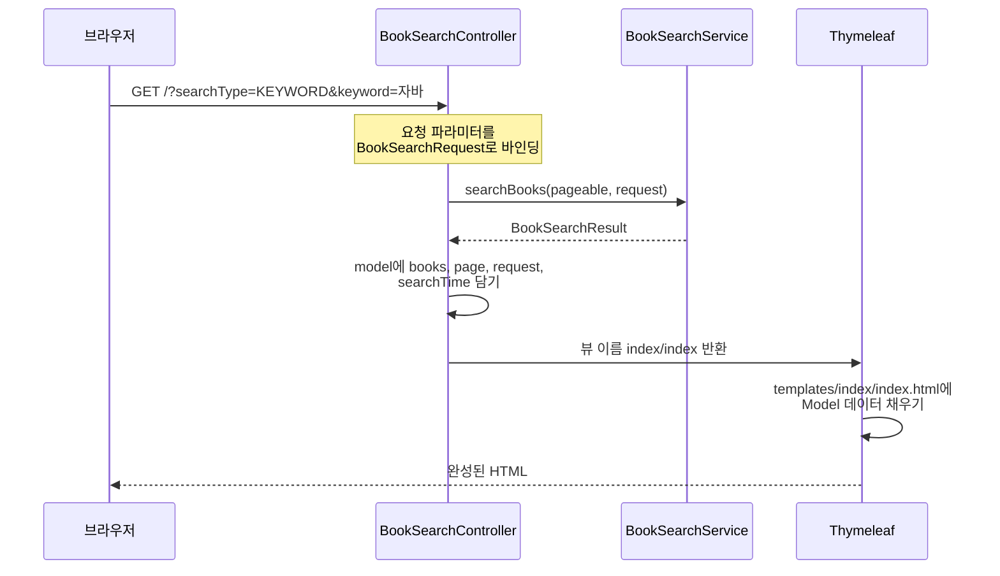
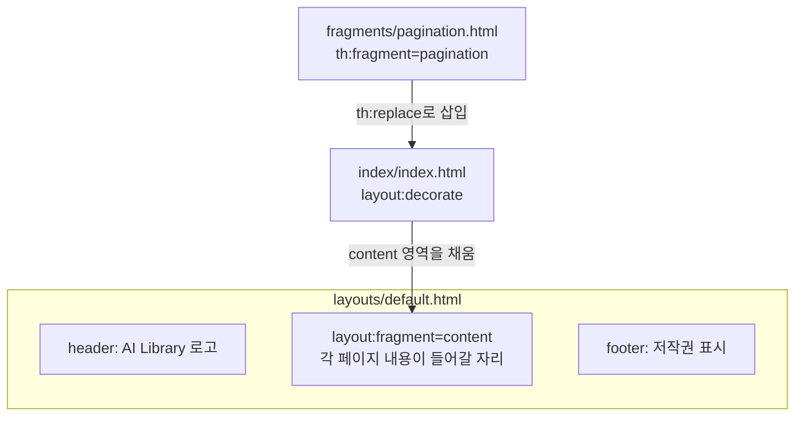

# 03. 검색 UI: Thymeleaf와 Tabler 기반 화면 구축

> 02 문서에서 만든 검색 기능을 브라우저에서 쓸 수 있도록 검색 폼, 결과 카드, 페이지 이동 화면을 만듭니다. 서버에서 HTML을 완성해 보내는 Thymeleaf의 동작 방식과 레이아웃·프래그먼트 재사용을 이해합니다.
>
> 예상 소요 시간: 2시간 · 난이도: 입문

## 학습 목표

- 컨트롤러가 `Model`에 담은 데이터가 Thymeleaf 템플릿에서 HTML로 바뀌는 과정을 설명할 수 있다
- 검색 폼의 입력값이 `BookSearchRequest`로 바인딩되는 원리를 설명할 수 있다
- `th:each`, `th:if`, `th:value`, `th:href`로 검색 결과와 페이지 링크를 출력할 수 있다
- 공통 레이아웃(`layout:decorate`)과 프래그먼트(`th:replace`)로 화면 코드를 재사용할 수 있다

## 시작하기 전에

- [02. 기본 검색](02.basic-search-implementation.md)의 검색 백엔드가 동작해야 합니다.
- HTML 태그와 폼(`<form>`, `<input>`, `<select>`)의 기본을 알고 있으면 충분합니다.
- 모르는 용어는 [용어집](../glossary.md)을 참고합니다.

---

## 1. 왜 필요한가

02 문서까지 마치면 검색은 되지만, 결과를 보려면 SQL 로그를 읽어야 합니다. 실제 사용자는 브라우저에서 검색어를 입력하고, 표지와 제목이 있는 목록을 보고, 다음 페이지로 넘어가기를 원합니다.

이 문서에서 만드는 화면은 앞으로 모든 단계에서 그대로 사용합니다. Step 2에서는 같은 화면의 검색 방식 선택에서 "벡터 검색"을, Step 3에서는 "AI 도서 추천(RAG)"을 고르게 됩니다. 즉 이 화면은 **키워드 검색과 AI 검색의 결과를 나란히 비교하는 실험대** 역할을 합니다.

이 프로젝트는 별도의 프런트엔드 프로젝트(React 등)를 두지 않고, 서버에서 HTML을 완성해 보내는 **서버 사이드 렌더링** 방식을 사용합니다. Spring MVC와 Thymeleaf만으로 화면을 만들 수 있어 백엔드 개발자가 빠르게 결과를 확인하기 좋습니다.

---

## 2. 핵심 개념

### 2.1. 템플릿 엔진과 Thymeleaf

**템플릿 엔진**은 HTML 틀에 데이터를 채워 완성된 HTML을 만드는 도구입니다. 붕어빵 틀(템플릿)에 반죽(데이터)을 부어 붕어빵(웹 페이지)을 만드는 것과 같습니다.

**Thymeleaf**는 Spring Boot에서 가장 널리 쓰이는 템플릿 엔진입니다. HTML 태그에 `th:` 속성을 붙여 데이터를 넣습니다.

```html
<h3 th:text="${book.title}">도서 제목</h3>
```

- 서버에서 처리되면 태그 안의 "도서 제목"이 실제 값(`book.title`)으로 바뀝니다.
- 서버 없이 파일을 브라우저로 열면 "도서 제목"이 그대로 보입니다. 그래서 디자인을 미리 확인하기 쉽습니다.

### 2.2. Spring MVC의 요청 처리 흐름

**MVC(Model-View-Controller)**는 화면 요청을 세 역할로 나누는 구조입니다.

- **Controller**: 요청을 받아 서비스를 호출하고, 결과를 Model에 담아 어떤 View를 보여 줄지 정합니다.
- **Model**: Controller가 View에 넘기는 데이터 상자입니다(`model.addAttribute("books", ...)`).
- **View**: Model의 데이터를 HTML로 그리는 템플릿입니다(`templates/index/index.html`).



### 2.3. 레이아웃과 프래그먼트

모든 페이지에 똑같은 상단 메뉴, 하단 저작권 표시, CSS 링크를 복사해 넣으면 하나를 고칠 때 모든 파일을 고쳐야 합니다. Thymeleaf는 이를 두 가지 방법으로 해결합니다.

| 방법 | 비유 | 이 프로젝트의 파일 |
|---|---|---|
| **레이아웃**(`layout:decorate`) | 액자 틀. 페이지는 가운데 그림만 그림 | `templates/layouts/default.html` |
| **프래그먼트**(`th:fragment`, `th:replace`) | 스티커. 필요한 곳에 붙여 씀 | `templates/fragments/pagination.html` |

레이아웃 기능은 Thymeleaf 기본 기능이 아니라 `thymeleaf-layout-dialect` 라이브러리가 제공합니다.



### 2.4. Tabler

**Tabler**는 Bootstrap 5를 기반으로 만든 UI 키트입니다. `card`, `btn btn-primary`, `form-select` 같은 클래스 이름만 붙이면 정돈된 화면이 나옵니다. CSS를 깊이 몰라도 되므로 이 교재에서는 화면 디자인보다 데이터 흐름에 집중할 수 있습니다. 이 프로젝트는 CDN으로 `@tabler/core@1.0.0-beta17`을 불러옵니다.

---

## 3. 따라 하기

### STEP 1. 컨트롤러 만들기

목표: `/` 요청을 받아 검색하고, 결과를 Model에 담아 `index/index` 템플릿으로 보냅니다.

```java
@Slf4j
@Controller
@RequiredArgsConstructor
public class BookSearchController {

    private final BookSearchService bookSearchService;

    @GetMapping("/")
    public String index(@Valid @ModelAttribute BookSearchRequest bookSearchRequest,
                        BindingResult bindingResult,
                        @PageableDefault(size = 24) Pageable pageable,
                        Model model) {

        if (bindingResult.hasErrors()) {          // 예: 키워드가 100자를 넘음
            model.addAttribute("books", List.of());
            model.addAttribute("page", null);
            model.addAttribute("request", bookSearchRequest);
            return "index/index";
        }

        long startTime = System.currentTimeMillis();
        BookSearchResult searchResult = bookSearchService.searchBooks(pageable, bookSearchRequest);
        long endTime = System.currentTimeMillis();

        model.addAttribute("books", searchResult.getBooks().getContent()); // 현재 페이지 도서 목록
        model.addAttribute("page", searchResult.getBooks());               // Page 객체 (총 건수, 페이지 번호)
        model.addAttribute("aiRecommendations", searchResult.getAiResponse()); // Step 3에서 사용
        model.addAttribute("request", bookSearchRequest);                  // 검색어 유지용
        model.addAttribute("searchTime", (endTime - startTime) / 1000.0);  // 초 단위

        return "index/index";   // templates/index/index.html
    }
}
```

전체 코드: `src/main/java/net/java21/library/front/web/BookSearchController.java` (도서 상세 페이지 `/books/{id}`도 같은 클래스에 있습니다)

코드 설명:

- `@ModelAttribute`는 요청 파라미터(`keyword=자바&searchType=KEYWORD`)를 객체로 바꿔 줍니다. `BookSearchRequest`는 setter가 없는 record이므로, Spring은 파라미터 이름과 같은 이름의 생성자 인자를 찾아 생성자를 호출합니다. 문자열 `"KEYWORD"`는 enum `SearchType.KEYWORD`로 자동 변환됩니다.
- `@Valid`와 `BindingResult`를 함께 쓰면 검증 실패 시 예외 대신 `bindingResult`에 오류가 담깁니다. 빈 결과로 같은 화면을 보여 줍니다.
- `@PageableDefault(size = 24)`는 `page`, `size` 파라미터가 없을 때 0페이지, 24건을 기본값으로 씁니다. 결과 카드를 한 줄에 3개씩 놓으므로 24는 8줄에 해당합니다.
- `request`를 다시 Model에 넣는 이유는 결과 화면의 검색창에 사용자가 입력한 검색어를 그대로 남겨 두기 위해서입니다.
- 실제 소스에는 검색 직후 표지가 없는 도서의 표지 보강을 비동기로 요청하는 `bookCoverService.requestEnrichment(...)` 호출이 더 있습니다. 검색 흐름과는 무관하므로 여기서는 생략했습니다.

### STEP 2. 공통 레이아웃 확인하기

목표: 모든 페이지가 공유하는 틀을 이해합니다.

```html
<!-- templates/layouts/default.html (발췌) -->
<html xmlns:th="http://www.thymeleaf.org"
      xmlns:layout="http://www.ultraq.net.nz/thymeleaf/layout">
<head>
    <title layout:title-pattern="$LAYOUT_TITLE | $CONTENT_TITLE">AI Library</title>
    <link rel="stylesheet" href="https://cdn.jsdelivr.net/npm/@tabler/core@1.0.0-beta17/dist/css/tabler.min.css">
</head>
<body>
<div class="page">
    <header class="navbar navbar-expand-md navbar-light d-print-none">
        <div class="container-xl">
            <h1 class="navbar-brand"><a href="/">AI Library</a></h1>
        </div>
    </header>
    <div class="page-wrapper">
        <div class="page-body">
            <div class="container-xl">
                <div layout:fragment="content">
                    <!-- 각 페이지의 내용이 여기에 들어감 -->
                </div>
            </div>
        </div>
        <footer class="footer footer-transparent d-print-none"><!-- 저작권 표시 --></footer>
    </div>
</div>
<script src="https://cdn.jsdelivr.net/npm/@tabler/core@1.0.0-beta17/dist/js/tabler.min.js"></script>
</body>
</html>
```

전체 코드: `src/main/resources/templates/layouts/default.html`

- `layout:fragment="content"` 자리에 각 페이지의 같은 이름 영역이 끼워집니다.
- `layout:title-pattern`은 브라우저 탭 제목을 "AI Library | 도서 검색"처럼 레이아웃 제목과 페이지 제목을 합쳐 만듭니다.
- 헤더와 푸터는 별도 파일로 나누지 않고 레이아웃 안에 직접 작성되어 있습니다.

### STEP 3. 검색 폼 만들기

목표: 검색 방식, ISBN, 키워드를 입력받아 `GET /`으로 보내는 폼을 만듭니다.

```html
<!-- templates/index/index.html (발췌) -->
<html xmlns:th="http://www.thymeleaf.org"
      xmlns:layout="http://www.ultraq.net.nz/thymeleaf/layout"
      layout:decorate="~{layouts/default}">
<head>
    <title>도서 검색</title>
</head>
<body>
<div layout:fragment="content">

    <form action="./" method="get" class="row g-3" id="search-form">
        <div class="col-md-2">
            <label class="form-label">검색 방식</label>
            <select name="searchType" class="form-select">
                <option value="KEYWORD"
                        th:selected="${request.searchType() == T(net.java21.library.core.book.domain.SearchType).KEYWORD}">키워드 검색</option>
                <!-- VECTOR, HYBRID, RAG 옵션은 Step 2·3에서 사용 -->
            </select>
        </div>
        <div class="col-md-2">
            <label class="form-label">ISBN</label>
            <input type="text" name="isbn" class="form-control" placeholder="ISBN 검색"
                   th:value="${request.isbn()}">
        </div>
        <div class="col-md-6">
            <label class="form-label">키워드</label>
            <input type="text" name="keyword" class="form-control" placeholder="제목, 저자, 출판사, 내용 등"
                   th:value="${request.keyword()}">
        </div>
        <div class="col-md-2 d-flex align-items-end">
            <button type="submit" class="btn btn-primary w-100">검색</button>
        </div>
    </form>
```

전체 코드: `src/main/resources/templates/index/index.html`

코드 설명:

- `name` 속성 값(`searchType`, `isbn`, `keyword`)이 `BookSearchRequest`의 필드 이름과 같아야 바인딩됩니다.
- `method="get"`이므로 검색 조건이 URL에 남습니다(`/?searchType=KEYWORD&isbn=&keyword=자바`). 검색 결과 주소를 복사해 공유하거나 새로고침해도 같은 결과가 나옵니다.
- `request`는 record이므로 Thymeleaf에서도 `request.keyword()`처럼 접근자 메서드를 호출합니다.
- `T(...)`는 Thymeleaf(SpEL)에서 자바 클래스의 정적 값에 접근하는 문법입니다. 현재 선택된 검색 방식이 다시 선택된 상태로 표시됩니다.
- 실제 템플릿에는 VECTOR, HYBRID, RAG 옵션이 이미 들어 있고 RAG가 기본 선택입니다. 이 단계에서는 "키워드 검색"을 직접 골라 사용합니다.

### STEP 4. 검색 결과 출력하기

목표: 총 건수, 소요 시간, 도서 카드 목록을 출력합니다.

```html
    <div class="row row-cards">
        <div class="col-12 mb-2 d-flex justify-content-between align-items-center">
            <p th:if="${page != null}" class="text-muted mb-0">
                총 <span th:text="${page.totalElements}" class="fw-bold">0</span>권의 도서가 검색되었습니다.
            </p>
            <span class="badge bg-green-lt" th:if="${searchTime != null}"
                  th:text="'검색 소요 시간: ' + ${searchTime} + 's'">검색 소요 시간: 0.5s</span>
        </div>

        <div th:each="book : ${books}" class="col-sm-6 col-lg-4">
            <div class="card book-card">
                <a th:href="@{/books/{id}(id=${book.id})}">
                    
                    <div th:unless="${book.imageUrl != null && !book.imageUrl.isEmpty()}">이미지 없음</div>
                </a>
                <div class="card-body">
                    <h3 class="card-title text-truncate">
                        <a th:href="@{/books/{id}(id=${book.id})}" th:text="${book.title}">도서 제목</a>
                    </h3>
                    <div class="text-muted mb-2" th:text="${book.authorName}">저자</div>
                    <div class="small">
                        <div class="text-muted">출판사: <span th:text="${book.publisherName}">출판사</span></div>
                        <div class="text-muted">출판일: <span th:text="${book.editionPublishDate}">2021-01-01</span></div>
                        <div class="text-muted">ISBN: <span th:text="${book.isbn}">ISBN</span></div>
                    </div>
                </div>
            </div>
        </div>
    </div>
```

(학습용으로 줄인 코드입니다. 실제 템플릿은 소요 시간 표시 조건에 AI 추천 여부가 포함되고, 유사도 배지가 추가되어 있으며, 표지 영역은 `fragments/book-cover.html`의 `cover` 프래그먼트로 그립니다. 프래그먼트 재사용 방식은 STEP 5에서 다룹니다.)

자주 쓰는 Thymeleaf 속성을 정리하면 다음과 같습니다.

| 속성 | 하는 일 | 예 |
|---|---|---|
| `th:text` | 태그 안 텍스트를 값으로 바꿈(HTML 이스케이프) | `th:text="${book.title}"` |
| `th:if` / `th:unless` | 조건이 참/거짓일 때만 태그 출력 | `th:if="${page != null}"` |
| `th:each` | 목록을 반복하며 태그 출력 | `th:each="book : ${books}"` |
| `th:value` | `input`의 값 설정 | `th:value="${request.keyword()}"` |
| `th:href` / `th:src` | 링크·이미지 주소 설정 | `th:href="@{/books/{id}(id=${book.id})}"` |

`@{/books/{id}(id=${book.id})}`는 URL 표현식입니다. 괄호 안의 값이 `{id}` 자리에 들어가 `/books/123`이 됩니다.

### STEP 5. 페이징 프래그먼트 붙이기

목표: 여러 페이지에서 재사용할 수 있는 페이지 이동 막대를 만듭니다.

```html
<!-- templates/fragments/pagination.html (발췌) -->
<div th:fragment="pagination(page, baseUrl, request)"
     th:if="${page != null && page.totalPages > 0}" class="d-flex mt-4 justify-content-center">
    <ul class="pagination">
        <li class="page-item" th:classappend="${!page.hasPrevious()} ? 'disabled'">
            <a class="page-link"
               th:href="@{${baseUrl}(page=${page.number - 1}, isbn=${request.isbn()}, keyword=${request.keyword()}, searchType=${request.searchType()})}">prev</a>
        </li>

        <!-- 페이지 번호: 10개 단위 블록만 표시 -->
        <li th:each="i : ${#numbers.sequence(0, page.totalPages - 1)}"
            th:if="${i >= (page.number / 10) * 10 && i < (page.number / 10 + 1) * 10}"
            class="page-item" th:classappend="${i == page.number} ? 'active'">
            <a class="page-link"
               th:href="@{${baseUrl}(page=${i}, isbn=${request.isbn()}, keyword=${request.keyword()}, searchType=${request.searchType()})}"
               th:text="${i + 1}">1</a>
        </li>

        <li class="page-item" th:classappend="${!page.hasNext()} ? 'disabled'">
            <a class="page-link"
               th:href="@{${baseUrl}(page=${page.number + 1}, isbn=${request.isbn()}, keyword=${request.keyword()}, searchType=${request.searchType()})}">next</a>
        </li>
    </ul>
</div>
```

검색 화면 마지막에서 이 프래그먼트를 불러옵니다.

```html
    <div th:if="${request.searchType() != T(net.java21.library.core.book.domain.SearchType).RAG}"
         th:replace="~{fragments/pagination :: pagination(${page}, '/', ${request})}"></div>
</div> <!-- layout:fragment="content" 끝 -->
```

전체 코드: `src/main/resources/templates/fragments/pagination.html`

코드 설명:

- `th:fragment="pagination(page, baseUrl, request)"`는 파라미터 세 개를 받는 재사용 조각입니다. 메서드를 호출하듯 값을 넘겨 사용합니다.
- 페이지 링크마다 `keyword`, `isbn`, `searchType`을 다시 붙입니다. 빠뜨리면 2페이지로 넘어갈 때 검색 조건이 사라집니다.
- 페이지 번호는 0부터 시작하지만 화면에는 `i + 1`로 1부터 보여 줍니다.
- `(page.number / 10) * 10`은 정수 나눗셈을 이용해 현재 페이지가 속한 10개 블록의 시작 번호를 구합니다. 예를 들어 13페이지(번호 12)면 10~19번을 표시합니다.
- RAG 검색은 AI가 고른 몇 권만 보여 주므로 페이징을 표시하지 않습니다.

### STEP 6. 실행해서 확인하기

1. 애플리케이션을 실행하고 `http://localhost:8080/`에 접속합니다.
2. 검색 방식에서 "키워드 검색"을 선택하고 키워드에 `자바`를 입력해 검색합니다.
3. 다음을 확인합니다.
   - 주소창이 `/?searchType=KEYWORD&isbn=&keyword=자바` 형태로 바뀝니다.
   - "총 N권의 도서가 검색되었습니다."와 검색 소요 시간이 표시됩니다.
   - 도서 카드가 한 줄에 3개씩(넓은 화면 기준) 최대 24개 표시됩니다.
   - 2페이지를 눌러도 검색창에 `자바`가 남아 있고 결과가 이어집니다.
   - 카드 제목을 누르면 `/books/{id}` 상세 페이지로 이동합니다.
4. ISBN 칸에 결과 카드 하나의 ISBN을 넣어 검색하면 그 책 한 권만 나옵니다.

> **참고:** 검색 버튼을 누르면 "AI가 최적의 도서를 찾고 답변을 생성 중입니다..." 로딩 화면이 잠깐 보입니다. 실제 템플릿에 들어 있는 로딩 오버레이이며, Step 3의 RAG 검색처럼 몇 초가 걸리는 요청을 위해 준비해 둔 것입니다. 키워드 검색은 대부분 순식간에 끝납니다.

---

## 4. 직접 해 보기

### 미션 1 (기본). 검색어 강조 표시

검색 결과 위에 "'자바' 검색 결과"처럼 현재 검색어를 보여 주는 문구를 추가합니다. 키워드가 없으면 표시하지 않습니다.

- 힌트: `th:if`와 Thymeleaf 유틸리티 `#strings.isEmpty()`를 사용합니다.

<details>
<summary>예시 코드</summary>

```html
<h3 th:unless="${#strings.isEmpty(request.keyword())}"
    th:text="|'${request.keyword()}' 검색 결과|">'자바' 검색 결과</h3>
```

`|...|`는 리터럴 치환 문법으로, 문자열과 표현식을 `+` 없이 이어 붙일 수 있습니다.

</details>

### 미션 2 (기본). 가격 표시 추가

도서 카드에 가격을 "16,000원" 형식으로 표시합니다. 가격이 없는 도서는 "가격 정보 없음"으로 표시합니다.

- 힌트: `BookSearchResponse`에는 이미 `price`(`BigDecimal`)가 있습니다. `#numbers.formatInteger()`를 사용합니다.

<details>
<summary>예시 코드</summary>

```html
<div class="text-muted">
    가격:
    <span th:if="${book.price != null}"
          th:text="${#numbers.formatInteger(book.price, 0, 'COMMA')} + '원'">16,000원</span>
    <span th:if="${book.price == null}">가격 정보 없음</span>
</div>
```

</details>

### 미션 3 (도전). 검색 결과 없음 안내

결과가 0건일 때 빈 화면 대신 "검색 결과가 없습니다. 다른 키워드로 검색해 보세요." 안내와 함께, 입력한 키워드를 영문 또는 한글로 바꿔 보라는 팁을 보여 줍니다.

- 힌트: `${books.isEmpty()}`로 판별합니다. 왜 이런 팁이 필요한지는 02 문서 미션 1의 관찰 결과를 떠올려 봅니다.

<details>
<summary>예시 코드</summary>

```html
<div th:if="${books != null && books.isEmpty() && !#strings.isEmpty(request.keyword())}"
     class="empty">
    <p class="empty-title">검색 결과가 없습니다.</p>
    <p class="empty-subtitle text-muted">
        다른 키워드로 검색해 보세요. 예: '자바' 대신 'Java'처럼 한글과 영문 표기를 바꿔 보세요.
    </p>
</div>
```

이런 안내가 필요하다는 것 자체가 키워드 검색의 한계입니다. 사용자가 데이터에 쓰인 표기를 맞춰야만 찾을 수 있습니다.

</details>

---

## 5. 자주 하는 실수

**1. 템플릿을 찾지 못함**

- 증상: `TemplateInputException: Error resolving template [index/index]`
- 원인: 템플릿 파일 위치가 `src/main/resources/templates/index/index.html`이 아니거나, 반환한 뷰 이름에 `.html`이나 앞 슬래시를 붙였습니다.
- 해결: 뷰 이름은 `templates/` 아래 경로에서 확장자를 뺀 `index/index`로 반환합니다.

**2. 레이아웃이 적용되지 않음**

- 증상: 헤더와 Tabler 스타일 없이 맨 HTML만 보입니다.
- 원인: `<html>`에 `layout:decorate="~{layouts/default}"`를 빠뜨렸거나, 본문을 `layout:fragment="content"`로 감싸지 않았습니다.
- 해결: 두 속성과 `xmlns:layout` 선언을 확인합니다. `thymeleaf-layout-dialect` 의존성도 확인합니다.

**3. record 필드 접근 오류**

- 증상: `Property or field 'keyword' cannot be found on object of type BookSearchRequest`
- 원인: record에는 `getKeyword()`가 없으므로 `${request.keyword}`로 접근할 수 없습니다.
- 해결: `${request.keyword()}`처럼 접근자 메서드를 호출합니다. 일반 클래스인 `BookSearchResponse`는 Lombok `@Getter`가 있으므로 `${book.title}`로 접근합니다.

**4. 페이지를 넘기면 검색 조건이 사라짐**

- 증상: 1페이지는 "자바" 결과인데 2페이지부터는 전체 도서가 나옵니다.
- 원인: 페이지 링크에 `keyword`, `searchType` 등을 붙이지 않았습니다.
- 해결: `@{${baseUrl}(page=..., keyword=${request.keyword()}, ...)}`처럼 모든 검색 조건을 링크에 포함합니다.

**5. 키워드 검색을 골랐는데 AI 검색이 실행됨**

- 증상: 키워드 검색인데 로딩이 오래 걸리고 AI 추천 영역이 보입니다.
- 원인: `<select>`의 기본 선택이 RAG이고, 검색 전에 검색 방식을 바꾸지 않았습니다.
- 해결: "키워드 검색"을 선택하거나 주소에 `searchType=KEYWORD`를 직접 넣습니다.

> 실제 사례: [사례 5. 첫 화면 목록이 새로고침마다 바뀌고 5페이지에서 끝남](../troubleshooting.md#사례-5-첫-화면-목록이-새로고침마다-바뀌고-5페이지에서-끝남)

---

## 6. 정리

- 컨트롤러는 요청을 `BookSearchRequest`로 바인딩해 서비스를 호출하고, 결과를 Model에 담아 뷰 이름을 반환합니다.
- Thymeleaf는 `th:` 속성으로 Model 데이터를 HTML에 채워 완성된 페이지를 브라우저로 보냅니다.
- 공통 틀은 레이아웃(`layouts/default.html`)으로, 반복 조각은 프래그먼트(`fragments/pagination.html`)로 재사용합니다.
- 이 화면은 이후 단계에서 검색 방식만 바꿔 키워드 검색과 AI 검색의 결과를 비교하는 데 계속 사용합니다.

- [ ] 키워드 검색 결과를 브라우저에서 확인했다
- [ ] 페이지를 넘겨도 검색 조건이 유지되는 이유를 설명할 수 있다
- [ ] `layout:decorate`와 `th:replace`의 차이를 설명할 수 있다
- [ ] record와 일반 클래스에서 Thymeleaf 접근 방식이 다른 이유를 알고 있다

---

## 확인 문제

**1. 검색 폼의 `<input name="keyword">`를 `<input name="query">`로 바꾸면 어떻게 되나요?**

<details>
<summary>정답</summary>

`BookSearchRequest`에 `query`라는 필드가 없으므로 바인딩되지 않고 `keyword`는 `null`이 됩니다. 키워드가 없으므로 전체 도서 목록이 반환됩니다.

</details>

**2. 컨트롤러에서 `model.addAttribute("request", bookSearchRequest)`를 빼면 어떤 문제가 생기나요?**

<details>
<summary>정답</summary>

템플릿의 `${request.keyword()}`, `${request.searchType()}` 등에서 `request`가 `null`이 되어 오류가 납니다. 검색창에 입력값을 다시 채우거나 페이지 링크에 검색 조건을 붙이는 기능이 모두 이 값에 의존합니다.

</details>

**3. 현재 페이지 번호(`page.number`)가 23일 때 페이징 막대에 표시되는 번호는 무엇인가요?**

<details>
<summary>정답</summary>

`(23 / 10) * 10 = 20`부터 `29`까지의 번호가 해당하고, 화면에는 `i + 1`인 21~30이 표시됩니다(전체 페이지 수가 30 이상일 때).

</details>

**4. 검색 폼에 `method="post"` 대신 `method="get"`을 쓰는 이유는 무엇인가요?**

<details>
<summary>정답</summary>

검색은 데이터를 바꾸지 않는 조회 요청이므로 GET이 맞습니다. 조건이 URL에 남아 새로고침, 뒤로 가기, 주소 공유를 해도 같은 결과를 볼 수 있습니다.

</details>

---

## 다음 문서

[04. 성능 최적화: 인덱싱과 전문 검색(Full Text Search) →](04.search-optimization.md)
