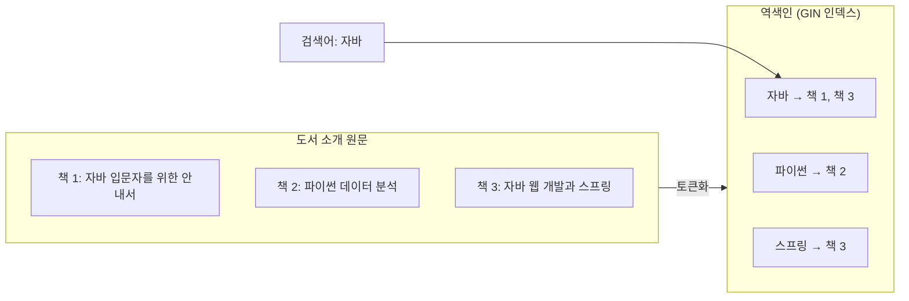

# 04. 성능 최적화: 인덱싱과 전문 검색(Full Text Search)

> `LIKE '%키워드%'` 검색이 왜 데이터가 늘수록 느려지는지 실행 계획으로 확인하고, PostgreSQL의 인덱스와 전문 검색으로 개선합니다. 마지막으로 빨라진 키워드 검색에도 남아 있는 한계를 정리해 Step 2로 넘어갈 준비를 합니다.
>
> 예상 소요 시간: 2시간 · 난이도: 기본

## 학습 목표

- 인덱스가 검색을 빠르게 만드는 원리를 설명할 수 있다
- `EXPLAIN ANALYZE`로 쿼리가 인덱스를 쓰는지(Index Scan) 전체를 훑는지(Seq Scan) 확인할 수 있다
- `LIKE '자바%'`와 `LIKE '%자바%'`의 인덱스 사용 여부 차이를 설명할 수 있다
- PostgreSQL 전문 검색(`to_tsvector`, `plainto_tsquery`, `@@`)과 GIN 인덱스의 역할을 설명할 수 있다
- 키워드 검색이 속도와 별개로 가진 "의미를 모르는" 한계를 예로 들 수 있다

## 시작하기 전에

- [02. 기본 검색](02.basic-search-implementation.md)과 [03. 검색 UI](03.search-ui.md)를 마쳐야 합니다.
- PostgreSQL에 접속해 SQL을 실행할 수 있는 도구(psql, IDE의 DB 콘솔 등)가 필요합니다.
- 모르는 용어는 [용어집](../glossary.md)을 참고합니다.

---

## 1. 왜 필요한가

02 문서에서 만든 검색은 다음과 같은 SQL을 실행합니다.

```sql
SELECT ... FROM books
WHERE lower(title) LIKE '%자바%'
   OR lower(author_name) LIKE '%자바%'
   OR ...;
```

15만 건 정도는 이 쿼리도 견딜 만합니다. 하지만 DB는 이 질문에 답하려고 **모든 행을 처음부터 끝까지 읽습니다**. 도서가 10배, 100배로 늘면 읽어야 할 양도 그만큼 늘어납니다. 동시에 여러 사용자가 검색하면 DB 전체가 느려집니다.

그리고 속도와 별개로 다른 문제도 있습니다. 제목·저자에만 검색어가 없을 뿐 **도서 소개(`book_content`)에는 관련 내용이 있는 책**이 많습니다. 긴 소개글까지 LIKE로 훑으면 훨씬 더 느려집니다.

이 문서는 두 가지를 다룹니다.

1. 인덱스로 "전부 훑지 않고 바로 찾는" 방법
2. 전문 검색(Full Text Search)으로 긴 소개글을 단어 단위로 빠르게 찾는 방법

---

## 2. 핵심 개념

### 2.1. 인덱스

책 맨 뒤의 "찾아보기"를 떠올려 봅시다. "트랜잭션"이라는 단어가 나오는 쪽을 찾으려면 책 전체를 넘기지 않고 찾아보기에서 "ㅌ" 부분만 보면 됩니다.

**인덱스(Index)**는 DB의 찾아보기입니다. 특정 컬럼 값을 정렬된 구조로 따로 저장해 두고, 원래 행이 어디 있는지 가리킵니다.

- 장점: 조회가 매우 빨라집니다.
- 단점: 저장 공간을 더 쓰고, INSERT·UPDATE 때 인덱스도 함께 고쳐야 하므로 쓰기가 느려집니다.

그래서 모든 컬럼에 인덱스를 만들지 않고, 자주 검색하는 컬럼에만 만듭니다. `books` 테이블에는 이미 `isbn`에 유니크 인덱스(`idx_book_isbn`)가 있어, ISBN 검색은 처음부터 빠릅니다.

### 2.2. B-Tree 인덱스와 LIKE

가장 기본적인 인덱스는 **B-Tree**입니다. 값을 정렬해 균형 잡힌 트리로 저장하므로, 전화번호부처럼 "앞부분"을 알면 범위를 좁혀 갈 수 있습니다.

| 조건 | 예 | B-Tree 사용 | 이유 |
|---|---|---|---|
| 정확히 일치 | `isbn = '979...'` | 가능 | 정렬된 값에서 바로 찾음 |
| 전방 일치 | `title LIKE '자바%'` | 가능(조건부) | "자바"로 시작하는 구간만 보면 됨 |
| 부분 일치 | `title LIKE '%자바%'` | 불가 | 시작 글자를 모르니 어디서 찾을지 정할 수 없음 |
| 함수 적용 | `lower(title) LIKE '자바%'` | 불가(같은 함수 인덱스가 없으면) | 인덱스는 `title` 원래 값으로 정렬되어 있음 |

전화번호부에서 "김"씨는 금방 찾지만, 이름에 "철수"가 들어간 사람은 처음부터 끝까지 읽어야 하는 것과 같습니다. 02 문서의 `containsIgnoreCase()`는 `lower(...) LIKE '%...%'`이므로 표의 마지막 두 경우에 모두 해당합니다.

### 2.3. 전문 검색과 역색인

**전문 검색(Full Text Search)**은 긴 문서를 **토큰**(검색 단위가 되는 단어 조각)으로 쪼개 두고, 단어로 문서를 찾는 방식입니다. 핵심은 **역색인(Inverted Index)**입니다. "문서 → 단어" 대신 "단어 → 문서 목록"으로 저장합니다.



PostgreSQL에서는 다음 요소를 사용합니다.

| 요소 | 역할 |
|---|---|
| `to_tsvector('korean', 텍스트)` | 텍스트를 토큰 목록(`tsvector`)으로 변환 |
| `plainto_tsquery('korean', '자바 웹')` | 검색어를 검색 조건(`tsquery`, 여기서는 `'자바' & '웹'`)으로 변환 |
| `@@` | `tsvector`가 `tsquery`와 일치하는지 검사 |
| **GIN 인덱스** | Generalized Inverted Index. 역색인을 저장하는 PostgreSQL 인덱스 종류 |

`'korean'`은 PostgreSQL에 기본으로 있는 설정이 아닙니다. 이 프로젝트는 `simple` 설정을 복사해 `korean`이라는 이름으로 만들어 씁니다. `simple`은 형태소 분석 없이 공백과 문장부호로만 단어를 나눕니다. 그래서 "자바를 배우자"는 `자바를`, `배우자`로 나뉘고, "자바"로 검색해도 `자바를`과는 일치하지 않습니다. 이 점은 6장에서 다시 봅니다.

---

## 3. 따라 하기

### STEP 1. 현재 쿼리의 실행 계획 보기

목표: 지금 검색이 테이블 전체를 훑는지 확인합니다.

DB 콘솔에서 다음을 실행합니다.

```sql
EXPLAIN ANALYZE
SELECT id, title FROM books WHERE title LIKE '%자바%';
```

결과에서 볼 부분은 첫 줄의 스캔 방식과 마지막 줄의 실행 시간입니다(수치는 환경마다 다릅니다).

```text
Seq Scan on books  (cost=... rows=... width=...) (actual time=... rows=... loops=1)
  Filter: ((title)::text ~~ '%자바%'::text)
  Rows Removed by Filter: 15xxxx
Planning Time: ... ms
Execution Time: ... ms
```

- **Seq Scan**(Sequential Scan): 테이블의 모든 행을 순서대로 읽었다는 뜻입니다.
- `Rows Removed by Filter`: 읽었지만 조건에 맞지 않아 버린 행 수입니다. 거의 전체 행을 읽고 대부분을 버렸습니다.
- `~~`는 PostgreSQL 내부에서 `LIKE`를 나타내는 연산자입니다.

### STEP 2. 전방 일치에 B-Tree 인덱스 적용하기

목표: 인덱스가 있으면 실행 계획이 어떻게 바뀌는지 확인합니다.

```sql
-- text_pattern_ops: DB 로케일(collation)이 C가 아니어도 LIKE '자바%' 전방 일치에 인덱스를 쓰도록 지정
CREATE INDEX idx_book_title ON books (title text_pattern_ops);

EXPLAIN ANALYZE SELECT id, title FROM books WHERE title LIKE '자바%';
EXPLAIN ANALYZE SELECT id, title FROM books WHERE title LIKE '%자바%';
```

예상 결과:

- `LIKE '자바%'`: `Index Scan` 또는 `Bitmap Index Scan on idx_book_title`이 나오고 실행 시간이 크게 줄어듭니다.
- `LIKE '%자바%'`: 인덱스가 있어도 여전히 `Seq Scan`입니다.

즉 B-Tree 인덱스만으로는 02 문서의 부분 일치 검색을 빠르게 만들 수 없습니다. 실습이 끝나면 인덱스를 지워 둡니다. 이 프로젝트의 운영 설정은 `ddl-auto=validate`이므로 인덱스는 SQL로 직접 관리합니다.

```sql
DROP INDEX idx_book_title;
```

> **참고:** 부분 일치를 꼭 빠르게 해야 한다면 PostgreSQL 확장 `pg_trgm`(글자를 3개씩 잘라 색인하는 방식)과 GIN 인덱스를 함께 쓰는 방법이 있습니다. 이 교재의 범위를 벗어나므로 이름만 소개합니다.

### STEP 3. 전문 검색 설정과 GIN 인덱스 만들기

목표: 도서 소개(`book_content`)를 단어 단위로 검색할 수 있게 합니다.

```sql
-- 1. 한글용 텍스트 검색 설정 생성 (simple 설정 복사, 최초 1회)
CREATE TEXT SEARCH CONFIGURATION korean (COPY = simple);

-- 2. 토큰화 결과 미리 보기
SELECT to_tsvector('korean', '자바 웹 개발을 위한 스프링 입문');
-- 결과 예: '개발을':3 '스프링':5 '웹':2 '위한':4 '입문':6 '자바':1

-- 3. 도서 소개에 GIN 인덱스 생성
CREATE INDEX idx_book_content_fts
    ON books USING GIN (to_tsvector('korean', book_content));
```

- 이 저장소에는 위 SQL을 자동으로 실행하는 스크립트가 없습니다. 개발 DB에 직접 한 번 실행합니다.
- 인덱스 식(`to_tsvector('korean', book_content)`)과 검색 쿼리의 식이 **글자 그대로 같아야** 인덱스가 사용됩니다.
- 15만 건의 소개글을 토큰화하므로 인덱스 생성에 시간이 걸릴 수 있습니다.

전문 검색 쿼리로 확인합니다.

```sql
EXPLAIN ANALYZE
SELECT id, title
FROM books
WHERE to_tsvector('korean', book_content) @@ plainto_tsquery('korean', '자바 스프링');
```

실행 계획에 `Bitmap Index Scan on idx_book_content_fts`가 보이면 GIN 인덱스가 사용된 것입니다.

### STEP 4. Hibernate에 전문 검색 함수 등록하기

목표: JPQL과 QueryDSL에서 PostgreSQL의 `@@` 연산을 쓸 수 있게 합니다.

`@@`는 PostgreSQL 전용 문법이라 JPQL로 바로 쓸 수 없습니다. Hibernate의 `FunctionContributor`로 SQL 패턴에 이름을 붙여 등록합니다.

```java
public class PostgreSQLFunctionContributor implements FunctionContributor {

    @Override
    public void contributeFunctions(FunctionContributions functionContributions) {
        functionContributions.getFunctionRegistry()
                .registerPattern("ts_match_korean",
                        "to_tsvector('korean', ?1) @@ plainto_tsquery('korean', ?2)",
                        functionContributions.getTypeConfiguration().getBasicTypeRegistry()
                                .resolve(StandardBasicTypes.BOOLEAN));

        // vector_cosine_similarity 함수도 함께 등록되어 있습니다(Step 2 벡터 검색에서 사용).
    }
}
```

전체 코드: `src/main/java/net/java21/library/core/config/PostgreSQLFunctionContributor.java`

이 클래스는 `@Component`가 아니라 Java SPI(Service Provider Interface)로 등록합니다. 다음 파일에 클래스 이름 한 줄을 적습니다.

```text
src/main/resources/META-INF/services/org.hibernate.boot.model.FunctionContributor
```

```text
net.java21.library.core.config.PostgreSQLFunctionContributor
```

`?1`, `?2` 자리에 함수 인자가 순서대로 들어갑니다. 이제 JPQL에서 `function('ts_match_korean', b.bookContent, :keyword)`처럼 쓸 수 있습니다.

### STEP 5. 키워드 검색에 전문 검색 조건 추가하기

목표: 02 문서의 `commonWhere()`에 도서 소개 전문 검색을 OR 조건으로 붙입니다.

```java
BooleanBuilder keywordBuilder = new BooleanBuilder();

// 1. 짧은 필드: LIKE 부분 일치
keywordBuilder.or(book.title.containsIgnoreCase(keyword))
        .or(book.authorName.containsIgnoreCase(keyword))
        .or(book.publisherName.containsIgnoreCase(keyword))
        .or(book.subtitle.containsIgnoreCase(keyword))
        .or(book.volumeTitle.containsIgnoreCase(keyword));

// 2. 긴 필드(도서 소개): 전문 검색
try {
    BooleanExpression fts = Expressions.booleanTemplate(
            "function('ts_match_korean', {0}, {1}) = true",
            book.bookContent,
            keyword
    );
    keywordBuilder.or(fts);
} catch (Exception e) {
    log.warn("[BOOK_REPOSITORY] FTS search failed or not supported: {}", e.getMessage());
}

builder.and(keywordBuilder);
```

전체 코드: `src/main/java/net/java21/library/core/book/repository/impl/BookRepositoryImpl.java`

코드 설명:

- 제목·저자처럼 짧은 필드는 부분 일치가 자연스러우므로 LIKE를 유지하고, 긴 소개글은 단어 단위 전문 검색을 씁니다.
- `Expressions.booleanTemplate()`은 QueryDSL이 모르는 함수를 문자열 템플릿으로 끼워 넣는 방법입니다. `{0}`, `{1}`에 필드와 검색어가 들어갑니다.
- `try-catch`는 템플릿 **객체를 만드는 단계**의 예외만 잡습니다. DB에 `korean` 설정이 없어서 **쿼리 실행** 중에 나는 오류는 잡지 못합니다(5장 참고).

애플리케이션을 다시 실행하고 키워드 검색을 해 보면, 제목에는 검색어가 없지만 소개글에 그 단어가 있는 책이 결과에 추가됩니다. SQL 로그에서 `to_tsvector('korean', ...) @@ plainto_tsquery('korean', ?)` 부분을 확인합니다.

> **참고:** WHERE 절이 `LIKE 조건 OR 전문 검색 조건`이므로, LIKE 쪽 조건 때문에 전체 실행 계획은 여전히 `Seq Scan`일 수 있습니다. OR로 묶인 조건 가운데 하나라도 인덱스를 못 쓰면 DB가 전체 스캔을 고르는 경우가 많습니다. STEP 3처럼 전문 검색만 따로 실행해 GIN 인덱스의 효과를 확인합니다.

---

## 4. 직접 해 보기

### 미션 1 (기본). 실행 계획 비교표 만들기

다음 네 쿼리의 실행 계획을 확인하고 스캔 방식과 실행 시간을 표로 정리합니다.

1. `WHERE isbn = '(실제 존재하는 ISBN)'`
2. `WHERE title LIKE '자바%'` (STEP 2 인덱스 생성 후)
3. `WHERE title LIKE '%자바%'`
4. `WHERE to_tsvector('korean', book_content) @@ plainto_tsquery('korean', '자바')` (STEP 3 인덱스 생성 후)

<details>
<summary>예상 결과</summary>

| 쿼리 | 스캔 방식 | 해석 |
|---|---|---|
| 1 | Index Scan (`idx_book_isbn`) | 유니크 인덱스로 바로 찾음 |
| 2 | Index Scan 또는 Bitmap Index Scan (`idx_book_title`) | 전방 일치는 B-Tree 사용 가능 |
| 3 | Seq Scan | 부분 일치는 B-Tree 사용 불가 |
| 4 | Bitmap Index Scan (`idx_book_content_fts`) | 역색인으로 단어를 바로 찾음 |

실행 시간은 1, 2, 4가 3보다 훨씬 짧게 나옵니다. 정확한 수치는 환경마다 다릅니다.

</details>

### 미션 2 (기본). 토큰화 결과 관찰

다음 문장을 `to_tsvector('korean', ...)`로 변환해 보고, `'자바'`로 검색했을 때 일치하는지 예상한 뒤 확인합니다.

- `'자바 프로그래밍 입문'`
- `'자바를 처음 배우는 사람'`
- `'Java 웹 개발'`

<details>
<summary>정답</summary>

```sql
SELECT to_tsvector('korean', '자바를 처음 배우는 사람') @@ plainto_tsquery('korean', '자바');
```

- 첫 문장만 `true`입니다.
- 두 번째는 토큰이 `자바를`이므로 `자바`와 일치하지 않습니다. `simple` 설정은 조사를 떼어 내지 않습니다.
- 세 번째는 토큰이 `java`(소문자로 정규화)이므로 한글 `자바`와 일치하지 않습니다.

</details>

### 미션 3 (도전). 키워드 검색으로 풀리지 않는 질문 모으기

검색 화면에서 "키워드 검색"으로 다음 질문을 그대로 입력해 보고, 결과를 기록합니다.

- `추운 겨울에 읽기 좋은 따뜻한 소설`
- `회사 생활이 힘들 때 위로가 되는 책`
- `초보자가 읽기 쉬운 경제 입문서`

요구사항: 결과 건수, 상위 3권이 질문 의도에 맞는지(O/X), 맞지 않는 이유를 정리합니다. 이 기록은 Step 2 첫 문서에서 그대로 사용합니다.

<details>
<summary>관찰 포인트</summary>

- LIKE 조건은 문장 전체(`'%추운 겨울에 읽기 좋은 따뜻한 소설%'`)가 제목 등에 그대로 들어 있어야 일치하므로 거의 0건입니다.
- 전문 검색은 `plainto_tsquery`가 모든 단어를 AND(`&`)로 묶으므로, 소개글에 `추운`, `겨울에`, `읽기`, `좋은`, `따뜻한`, `소설`이 **모두** 그 형태 그대로 있어야 일치합니다. 역시 결과가 거의 없거나 의도와 다른 책이 나옵니다.
- 사람은 "겨울", "따뜻함", "소설"이라는 의미를 이해하지만, 키워드 검색은 글자 일치만 볼 뿐 의미는 모릅니다.

</details>

---

## 5. 자주 하는 실수

**1. `text search configuration "korean" does not exist`**

- 증상: 키워드 검색 시 500 오류가 나고 로그에 위 메시지가 보입니다.
- 원인: DB에 `korean` 텍스트 검색 설정을 만들지 않았습니다. `try-catch`는 쿼리 실행 오류를 잡지 못합니다.
- 해결: STEP 3의 `CREATE TEXT SEARCH CONFIGURATION korean (COPY = simple);`을 실행합니다. DB를 새로 만들 때마다 필요합니다.

**2. GIN 인덱스를 만들었는데 사용되지 않음**

- 증상: 전문 검색 쿼리의 실행 계획이 여전히 `Seq Scan`입니다.
- 원인: 인덱스 식과 쿼리 식이 다릅니다. 예를 들어 인덱스는 `to_tsvector('korean', book_content)`인데 쿼리는 `to_tsvector(book_content)`(기본 설정 사용)인 경우입니다.
- 해결: 설정 이름까지 포함해 두 식을 똑같이 맞춥니다. 데이터를 대량으로 넣은 직후라면 `ANALYZE books;`로 통계를 갱신합니다.

**3. `function('ts_match_korean', ...)`을 Hibernate가 인식하지 못함**

- 증상: 애플리케이션 시작 또는 쿼리 실행 시 함수를 찾을 수 없다는 오류가 납니다.
- 원인: SPI 파일 경로나 이름이 틀렸거나, 파일 안의 클래스 이름이 실제 패키지와 다릅니다.
- 해결: `META-INF/services/org.hibernate.boot.model.FunctionContributor` 파일 이름과 내용(`net.java21.library.core.config.PostgreSQLFunctionContributor`)을 확인합니다.

**4. 인덱스를 많이 만들수록 좋다고 생각함**

- 증상: 검색은 빨라졌지만 데이터 적재(01 문서)가 눈에 띄게 느려졌습니다.
- 원인: INSERT마다 모든 인덱스를 함께 갱신해야 합니다. GIN 인덱스는 갱신 비용이 특히 큽니다.
- 해결: 실제로 검색에 쓰는 컬럼에만 인덱스를 만들고, 대량 적재 시에는 인덱스를 지운 뒤 적재하고 다시 만드는 방법도 고려합니다.

---

## 6. 정리: 빨라진 키워드 검색에 남은 한계

이번 단계에서 키워드 검색은 충분히 빨라졌습니다. 그런데 미션 2와 미션 3에서 본 것처럼 **빠른 것과 원하는 책을 찾는 것은 다른 문제**입니다.

| 상황 | 예 | 키워드 검색의 결과 |
|---|---|---|
| 표기가 다름 | "자바"로 검색, 데이터는 "Java" | 찾지 못함 |
| 형태가 다름 | "자바"로 검색, 소개글은 "자바를" | 전문 검색(`simple`)으로 찾지 못함 |
| 동의어 | "요리"로 검색, 제목은 "레시피" | 찾지 못함 |
| 자연어 질문 | "추운 겨울에 읽기 좋은 따뜻한 소설" | 단어가 전부 그대로 있어야 일치하므로 거의 찾지 못함 |

공통 원인은 하나입니다. 키워드 검색은 **글자가 같은지**를 비교할 뿐, **뜻이 비슷한지**는 판단하지 못합니다. 인덱스를 아무리 잘 만들어도 이 문제는 해결되지 않습니다.

Step 2에서는 문장의 의미를 숫자 목록(벡터)으로 바꾸는 **임베딩(Embedding)**을 사용해 "뜻이 비슷한 책"을 찾는 벡터 검색을 만듭니다. Step 1에서 만든 데이터, 검색 화면, 그리고 미션에서 모은 "찾지 못한 질문" 목록이 그 출발점이 됩니다.

- 인덱스는 정렬된 찾아보기이며, `EXPLAIN ANALYZE`로 사용 여부(Seq Scan, Index Scan)를 확인합니다.
- B-Tree는 정확히 일치와 전방 일치에는 효과가 있지만 `LIKE '%키워드%'`에는 쓰이지 않습니다.
- 전문 검색은 텍스트를 토큰으로 나누고 GIN 역색인으로 단어를 빠르게 찾습니다.
- 키워드 검색은 속도와 무관하게 표기·형태·동의어·자연어 질문에 약합니다.

- [ ] `EXPLAIN ANALYZE`로 Seq Scan과 Index Scan을 구분할 수 있다
- [ ] DB에 `korean` 텍스트 검색 설정과 `idx_book_content_fts` 인덱스를 만들었다
- [ ] `ts_match_korean` 함수가 Hibernate에 등록되는 과정을 설명할 수 있다
- [ ] 키워드 검색으로 찾지 못한 질문을 두 가지 이상 기록해 두었다

---

## 확인 문제

**1. `title` 컬럼에 B-Tree 인덱스를 만들었는데 `WHERE title LIKE '%자바%'`가 여전히 느린 이유는 무엇인가요?**

<details>
<summary>정답</summary>

B-Tree는 값을 앞에서부터 정렬해 저장하므로, 시작 글자를 알아야 범위를 좁힐 수 있습니다. `%자바%`는 시작 글자가 정해져 있지 않아 인덱스로 범위를 좁힐 수 없고, DB는 전체 행을 읽는 Seq Scan을 선택합니다.

</details>

**2. 역색인(Inverted Index)은 일반적인 "문서 → 내용" 저장 방식과 무엇이 다른가요?**

<details>
<summary>정답</summary>

"단어 → 그 단어가 나오는 문서 목록" 형태로 저장합니다. 검색어 단어를 키로 바로 문서 목록을 꺼낼 수 있으므로 모든 문서를 읽지 않아도 됩니다. PostgreSQL에서는 GIN 인덱스가 이 구조를 제공합니다.

</details>

**3. `korean` 설정(`simple` 복사)으로 만든 전문 검색에서 "자바"로 검색하면 소개글이 "자바를 배우자"인 책이 검색되나요?**

<details>
<summary>정답</summary>

검색되지 않습니다. `simple` 설정은 형태소 분석 없이 공백 기준으로 나누므로 토큰이 `자바를`이 되고, 검색어 토큰 `자바`와 일치하지 않습니다.

</details>

**4. 인덱스와 전문 검색으로 속도 문제를 해결했는데도 Step 2로 넘어가야 하는 이유는 무엇인가요?**

<details>
<summary>정답</summary>

키워드 검색은 글자 일치만 비교하므로, 표기가 다르거나("자바"와 "Java") 동의어이거나("요리"와 "레시피") 자연어 질문인 경우 의미가 같은 책을 찾지 못합니다. 이는 속도가 아니라 검색 방식의 한계이므로, 의미를 비교하는 임베딩 기반 벡터 검색이 필요합니다.

</details>

---

## 다음 문서

[Step 2. 벡터 검색과 자연어 검색 →](../step-2/README.md)
