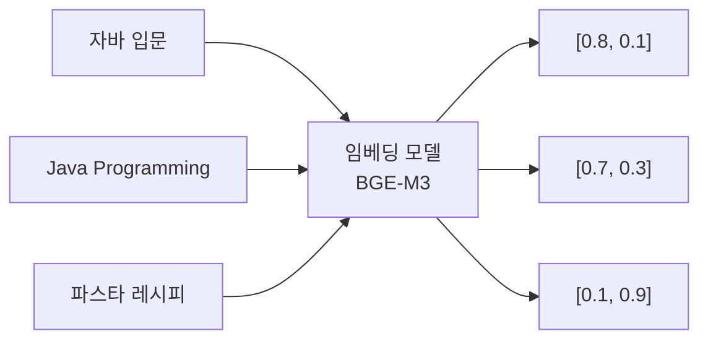
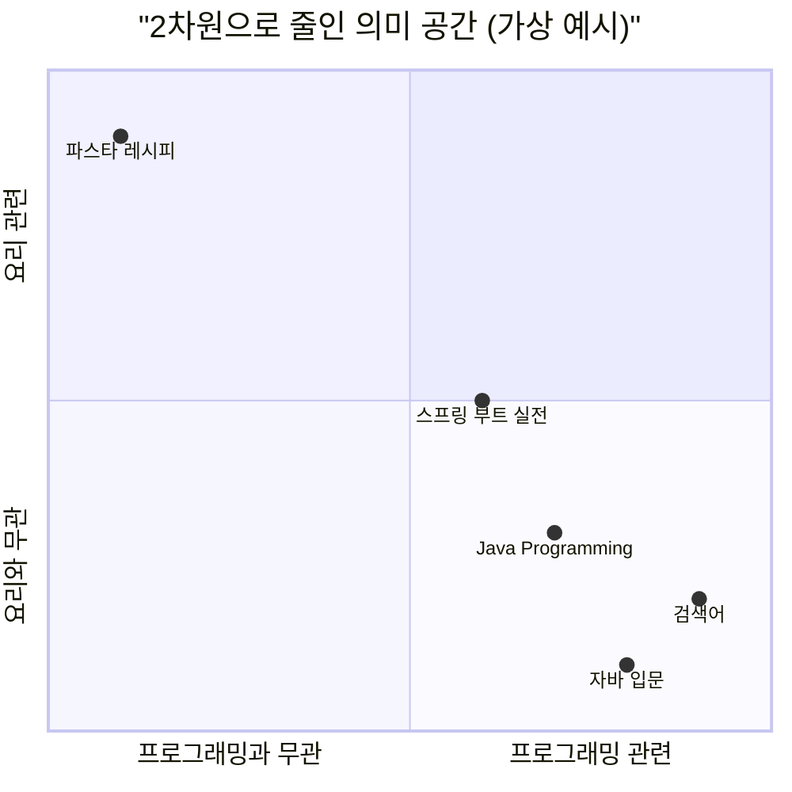
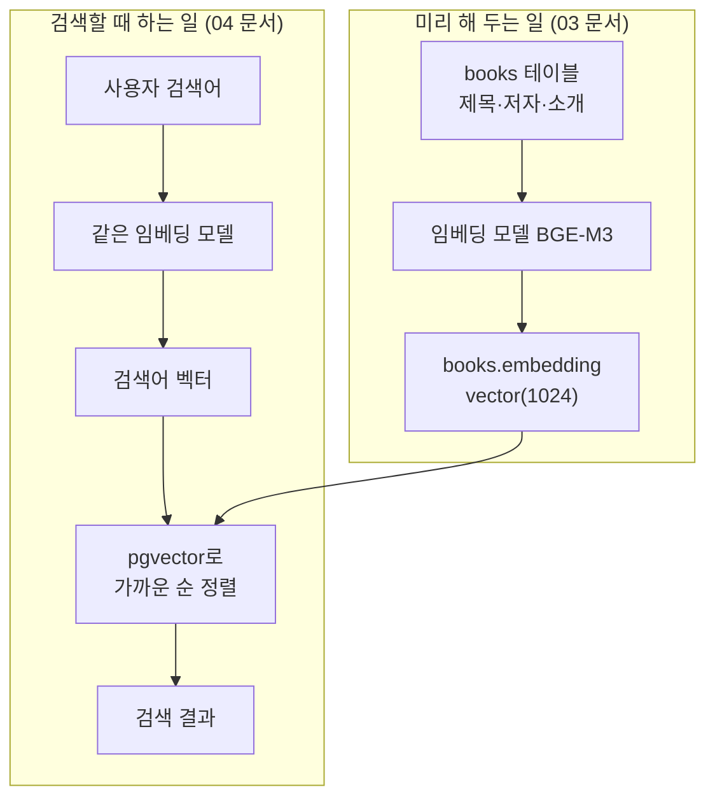

# 01. 키워드 검색의 한계 체감하기

> Step 1에서 만든 키워드 검색이 어떤 질문에서 실패하는지 직접 확인하고, 그 해결책인 임베딩(Embedding)과 벡터 검색의 아이디어를 작은 숫자 예시로 이해합니다. 코드는 거의 없고, 이후 문서 전체의 개념적 토대를 만드는 문서입니다.
>
> 예상 소요 시간: 1시간 · 난이도: 입문

## 학습 목표

- 키워드 검색이 실패하는 유형(동의어, 외국어 표기, 의도 표현, 오타)을 예시와 함께 설명할 수 있다
- 임베딩이 "텍스트를 의미 좌표로 바꾸는 것"이라는 직관을 설명할 수 있다
- 2차원 예시 벡터를 보고 어떤 문장끼리 의미가 가까운지 판단할 수 있다
- 정밀도(Precision)와 재현율(Recall)을 작은 예시로 계산할 수 있다

## 시작하기 전에

- [Step 1. 04. 검색 최적화](../step-1/04.search-optimization.md)까지 마쳐 키워드 검색(LIKE + 전문 검색)이 동작하는 상태여야 합니다.
- 처음 보는 용어는 [용어집](../glossary.md)에서 찾아볼 수 있습니다.

## 1. 왜 필요한가

Step 1의 키워드 검색은 `BookRepositoryImpl.commonWhere()`에서 다음 두 조건을 OR로 묶습니다.

- 제목·저자·출판사·부제·권차제목에 검색어가 **글자 그대로** 들어 있는가(`containsIgnoreCase`, 즉 `ILIKE '%검색어%'`)
- 책 소개(`book_content`)에 대해 PostgreSQL 전문 검색(`to_tsvector('korean', ...) @@ plainto_tsquery('korean', ...)`)이 일치하는가

두 조건 모두 "글자가 맞는가"를 봅니다. 사용자가 도서관 검색창에 실제로 입력하는 문장을 넣어 보면 한계가 드러납니다.

| 사용자 입력 | 사용자가 원하는 것 | 키워드 검색이 하는 일 | 결과 |
|-------------|--------------------|------------------------|------|
| `컴퓨터 구조` | 컴퓨터 구조 교재 | "컴퓨터 구조" 글자 찾기 | "Computer Architecture"는 못 찾음 |
| `파이썬 입문서` | 파이썬 기초 책 | "파이썬 입문서" 글자 찾기 | "처음 배우는 파이썬", "Python 첫걸음"을 놓침 |
| `프로그래밍을 처음 배우는 사람에게 맞는 책` | 입문용 프로그래밍 책 | 긴 문장 전체를 글자로 찾기 | 거의 0건 |
| `좌바 프로그래밍` | 자바 책 (오타) | "좌바" 글자 찾기 | 0건 |
| `우울할 때 읽기 좋은 소설` | 위로가 되는 소설 | "우울" 글자 찾기 | "우울"이 들어간 심리학 책 위주 |

사용자는 결과가 0건이면 "이 도서관에는 책이 없구나" 하고 떠납니다. 실제로는 책이 있는데도 말입니다. 이 문제는 인덱스를 추가하거나 SQL을 고쳐서 해결되지 않습니다. 검색 방식이 **글자**를 비교하는 한 계속 생깁니다. 그래서 **의미**를 비교하는 방법이 필요합니다.

## 2. 핵심 개념

### 2.1. 키워드 검색이 보는 것: 글자

키워드 검색은 사서에게 "이 글자가 적힌 책을 다 가져다 주세요"라고 부탁하는 것과 같습니다. 사서는 매우 정확하지만, 글자가 다르면 뜻이 같아도 가져오지 않습니다.

| 한계 | 설명 | 예시 |
|------|------|------|
| 동의어·외국어 표기 | 글자가 다르면 같은 뜻이어도 다른 단어로 취급 | 노트북 / 랩톱, 컴퓨터 구조 / Computer Architecture |
| 의도 표현 | 문장에 담긴 목적이나 수준을 이해하지 못함 | "처음 배우는 사람에게 맞는" = 입문 |
| 오타 | 한 글자만 틀려도 다른 단어 | 좌바, 프로그램밍 |
| 전부 아니면 전무 | 조건에 맞지 않으면 0건, "가장 비슷한 것"을 돌려주는 개념이 없음 | 긴 문장 검색 |

Step 1에서 배운 전문 검색(Full-Text Search)은 문장을 단어로 쪼개 색인하므로 LIKE보다 빠르고 어순에도 덜 민감하지만, "입문"과 "처음 배우는"이 같은 뜻이라는 것은 여전히 모릅니다. 전문 검색도 결국 **단어 단위의 글자 일치**입니다.

### 2.2. 임베딩: 텍스트를 의미 좌표로 바꾸기

지도 앱은 장소를 (위도, 경도) 두 숫자로 나타냅니다. 숫자로 바꾸고 나면 "강남역과 가까운 카페"를 거리 계산으로 찾을 수 있습니다. 이름이 비슷한지는 상관없습니다.

**임베딩(Embedding)** 은 같은 일을 문장에 대해 합니다. AI 모델이 문장을 읽고 그 의미를 숫자 목록으로 바꿉니다. 이 숫자 목록을 **벡터(Vector)** 라고 하고, 숫자의 개수를 **차원(Dimension)** 이라고 합니다.



위 그림의 숫자는 이해를 돕기 위해 2차원으로 줄인 가상의 값입니다. 이 프로젝트에서 쓰는 BGE-M3 모델은 문장 하나를 **1024개의 숫자**로 바꿉니다. 각 숫자가 정확히 무엇을 뜻하는지는 사람이 해석할 수 없지만, 모델이 학습 과정에서 **뜻이 비슷한 문장은 비슷한 숫자 목록이 되도록** 배웠다는 점이 중요합니다.

임베딩의 핵심 성질은 하나입니다.

> 의미가 비슷한 문장은 벡터 공간에서 가까운 곳에 놓인다.

"자바 입문"과 "Java Programming"은 글자가 하나도 겹치지 않지만, 둘 다 프로그래밍 책이라는 뜻이 같으므로 가까운 좌표를 받습니다.

### 2.3. 벡터 공간에서 "가깝다"는 것

2차원 예시로 생각해 봅시다. 가로축을 "프로그래밍 관련도", 세로축을 "요리 관련도"라고 가정합니다(실제 모델의 축은 이렇게 해석되지 않으며, 설명을 위한 가정입니다).

| 텍스트 | 프로그래밍 관련도 | 요리 관련도 |
|--------|------------------:|------------:|
| 검색어: 프로그래밍 처음 배우기 | 0.9 | 0.2 |
| 자바 입문 | 0.8 | 0.1 |
| Java Programming | 0.7 | 0.3 |
| 스프링 부트 실전 | 0.6 | 0.5 |
| 파스타 레시피 | 0.1 | 0.9 |

이 점들을 평면에 찍으면 다음과 같습니다.



검색어 바로 옆에 "자바 입문"과 "Java Programming"이 있고, "파스타 레시피"는 반대편 구석에 있습니다. 벡터 검색은 이 그림에서 **검색어와 가장 가까운 점부터 차례로** 돌려주는 일입니다. 글자가 겹치는지는 전혀 보지 않습니다.

"가깝다"를 숫자로 재는 방법은 여러 가지입니다. 이 프로젝트는 두 벡터가 **같은 방향을 가리키는 정도**를 재는 **코사인 유사도(Cosine Similarity)** 를 씁니다. 위 예시로 미리 계산해 보면 다음과 같습니다(계산 방법은 [04. 자연어 검색](04.natural-language-search.md)에서 다룹니다).

| 검색어와 비교한 문서 | 코사인 유사도 (1에 가까울수록 비슷함) |
|----------------------|------------------------------------:|
| 자바 입문 | 0.996 |
| Java Programming | 0.983 |
| 스프링 부트 실전 | 0.889 |
| 파스타 레시피 | 0.323 |

### 2.4. 검색 품질을 숫자로 재기: 정밀도와 재현율

"벡터 검색이 더 좋다"는 말을 확인하려면 검색 품질을 숫자로 잴 수 있어야 합니다. 가장 기본적인 지표 두 가지를 알아 둡니다.

- **정밀도(Precision)**: 검색 결과 중 실제로 관련 있는 것의 비율. "가져온 것 중 쓸 만한 것이 얼마나 되나"
- **재현율(Recall)**: 관련 있는 전체 문서 중 검색 결과에 들어온 것의 비율. "찾아야 할 것을 얼마나 놓치지 않았나"

예시로 계산해 봅니다. 도서관에 "파이썬 입문서"에 해당하는 책이 8권 있다고 합시다.

| 검색 방식 | 결과 수 | 그중 관련 있는 책 | 정밀도 | 재현율 |
|-----------|--------:|-----------------:|-------:|-------:|
| 키워드 검색 | 2 | 2 | 2/2 = 100% | 2/8 = 25% |
| 벡터 검색 (상위 10건) | 10 | 6 | 6/10 = 60% | 6/8 = 75% |

키워드 검색은 가져온 것은 정확하지만(정밀도 높음) 대부분을 놓쳤습니다(재현율 낮음). 벡터 검색은 많이 찾았지만 관련 없는 책도 섞였습니다. 두 지표는 보통 한쪽을 올리면 다른 쪽이 내려가는 관계이고, 이것이 [05. 하이브리드 검색](05.hybrid-search.md)에서 두 방식을 합치는 이유가 됩니다.

## 3. 예제로 이해하기

이 문서에서는 새 코드를 작성하지 않고, Step 1에서 만든 키워드 검색으로 한계를 직접 확인합니다.

### STEP 1: 검색 화면에서 실패 사례 확인하기

목표: 키워드 검색이 0건 또는 엉뚱한 결과를 내는 검색어를 직접 찾습니다.

애플리케이션을 실행하고 브라우저에서 키워드 검색을 실행합니다. 검색 방식 선택 상자에서 "키워드 검색"을 고르거나, 주소에 직접 파라미터를 넣어도 됩니다.

```text
http://localhost:8080/?keyword=컴퓨터 구조&searchType=KEYWORD
http://localhost:8080/?keyword=Computer Architecture&searchType=KEYWORD
http://localhost:8080/?keyword=프로그래밍을 처음 배우는 사람에게 맞는 책&searchType=KEYWORD
```

확인할 점:

- 첫 번째와 두 번째 검색 결과가 겹치는지 봅니다. 겹치지 않는다면 시스템이 둘을 다른 주제로 취급한다는 뜻입니다.
- 세 번째처럼 문장으로 검색하면 결과가 거의 없을 것입니다.

### STEP 2: SQL로 원인 확인하기

목표: 키워드 검색이 "글자 포함 여부"만 본다는 것을 SQL로 확인합니다.

```sql
-- 제목에 '컴퓨터 구조'가 들어간 책
SELECT count(*) FROM books WHERE title ILIKE '%컴퓨터 구조%';

-- 제목에 'computer architecture'가 들어간 책
SELECT count(*) FROM books WHERE title ILIKE '%computer architecture%';

-- 두 조건에 동시에 걸리는 책 (보통 0건)
SELECT count(*) FROM books
WHERE title ILIKE '%컴퓨터 구조%' AND title ILIKE '%computer architecture%';
```

예상 결과: 앞의 두 쿼리는 각각 몇 건씩 나오지만 세 번째는 대부분 0건입니다. 같은 주제의 책이 두 무리로 나뉘어 있고, 키워드 검색은 사용자가 입력한 쪽만 보여 줍니다. 적재된 데이터에 따라 건수는 달라집니다.

### STEP 3: 다음 문서에서 무엇을 만들지 그려 보기

목표: Step 2 전체에서 만들 구조를 미리 봅니다.



핵심은 **도서와 검색어를 같은 모델로 벡터화한다**는 점입니다. 같은 지도 위에 찍어야 거리를 잴 수 있기 때문입니다. 벡터를 저장할 컬럼은 [02. pgvector 설정](02.pgvector-setup.md)에서 준비합니다.

## 4. 직접 해 보기

### 미션 1 (기본): 실패하는 검색어 모으기

키워드 검색에서 "책은 있는데 못 찾는" 검색어를 유형별로 하나 이상 찾아 표로 정리합니다.

- 유형: 동의어, 외국어 표기, 의도 문장, 오타
- 각 검색어마다 "원래 찾고 싶었던 책 제목"을 SQL로 확인해 함께 적습니다.

이 표는 04, 05 문서에서 벡터 검색과 하이브리드 검색을 시험할 때 다시 사용합니다.

<details>
<summary>예시 답안</summary>

| 유형 | 검색어 | 찾고 싶던 책 | 키워드 검색 결과 |
|------|--------|--------------|------------------|
| 외국어 표기 | 데이터베이스 | "Database System Concepts" | 영문 제목 누락 |
| 동의어 | 랩톱 | "노트북 활용 가이드" | 0건 |
| 의도 문장 | 아이에게 읽어 줄 짧은 동화 | 그림책류 | 0건 |
| 오타 | 좌바 | "자바의 정석" | 0건 |

실제 결과는 적재된 데이터에 따라 다릅니다.

</details>

### 미션 2 (기본): 정밀도와 재현율 계산

관련 도서가 전체 5권인 질문에 대해 검색 결과 상위 4건 중 3건이 관련 있었습니다. 정밀도와 재현율을 구하세요.

<details>
<summary>정답</summary>

- 정밀도 = 3 / 4 = 75%
- 재현율 = 3 / 5 = 60%

</details>

### 미션 3 (도전): 2차원 의미 지도 만들어 보기

2.3절처럼 축 두 개를 정하고(예: "기술 관련도", "문학 관련도") 도서 다섯 권과 검색어 하나를 0~1 사이 좌표로 배치해 보세요. 그다음 검색어와 가장 가까운 책 두 권을 고르고, 그 책들이 키워드 검색으로도 찾아지는지 생각해 봅니다.

힌트: 좌표를 정확히 정하는 것이 목적이 아닙니다. "글자는 다르지만 좌표는 가까운" 쌍을 하나 이상 만들어 보는 것이 목적입니다.

## 5. 자주 하는 실수

**"벡터 검색이 키워드 검색을 대체한다"고 생각하기**
- 증상: ISBN이나 저자 이름 검색까지 벡터 검색으로 바꾸려 합니다.
- 원인: 벡터 검색은 "비슷한 것"을 찾는 방식이라, 정확히 일치해야 하는 값(ISBN `9788966262335`, 저자 "한강")에는 약합니다. "한강"이 강 이름과 비슷한 문서를 찾아올 수도 있습니다.
- 해결: 정확 일치는 키워드 검색, 의미 검색은 벡터 검색에 맡기고, 둘을 합치는 하이브리드 검색을 05 문서에서 만듭니다.

**벡터 검색 결과가 항상 "정답"이라고 생각하기**
- 증상: 1위 결과가 엉뚱한데도 유사도 수치만 믿습니다.
- 원인: 벡터 검색은 0건을 내지 않습니다. 관련 책이 없어도 "그나마 가장 가까운 책"을 돌려줍니다.
- 해결: 결과를 사람이 확인하고, 필요하면 유사도 하한(threshold)을 둡니다. 이 부분은 Step 4에서 다룹니다.

**임베딩의 각 숫자에 의미를 붙이려 하기**
- 증상: "37번째 숫자가 프로그래밍을 뜻하나요?" 같은 질문을 합니다.
- 원인: 2.3절의 "프로그래밍 관련도" 축은 설명을 위한 가정입니다. 실제 1024개의 숫자는 개별로 해석되지 않습니다.
- 해결: 개별 숫자가 아니라 **벡터 사이의 거리·방향**에 의미가 있다고 이해합니다.

**도서와 검색어를 서로 다른 모델로 임베딩하기**
- 증상: 벡터 검색 결과가 무작위처럼 보입니다.
- 원인: 모델마다 의미 공간이 다릅니다. 다른 지도의 좌표끼리 거리를 재는 것과 같습니다.
- 해결: 저장할 때와 검색할 때 같은 모델(이 프로젝트는 BGE-M3)을 씁니다.

## 6. 정리

- 키워드 검색은 글자 일치만 보므로 동의어, 외국어 표기, 의도 문장, 오타에 약합니다.
- 임베딩은 텍스트를 의미를 담은 숫자 목록(벡터)으로 바꾸며, 뜻이 비슷하면 벡터도 가깝습니다.
- 벡터 검색은 검색어 벡터와 가장 가까운 도서 벡터부터 돌려줍니다. 이 프로젝트는 코사인 유사도로 가까움을 잽니다.
- 정밀도는 "가져온 것 중 맞는 비율", 재현율은 "맞는 것 중 가져온 비율"입니다.

- [ ] 키워드 검색이 실패하는 사례를 직접 세 개 이상 확인했다
- [ ] 임베딩, 벡터, 차원을 한 문장씩으로 설명할 수 있다
- [ ] 2차원 예시에서 어떤 문장이 검색어와 가까운지 판단할 수 있다
- [ ] 정밀도와 재현율을 계산할 수 있다

## 확인 문제

**1. 다음 중 키워드 검색으로 해결하기 가장 어려운 검색어는?**

① `9788966262335` ② `한강` ③ `비 오는 날 읽기 좋은 잔잔한 소설` ④ `자바의 정석`

<details><summary>정답</summary>

③. 나머지는 책에 그대로 적힌 값(ISBN, 저자, 제목)이라 글자 일치로 찾을 수 있습니다. ③은 분위기와 의도를 담은 문장이라 책 정보에 같은 글자가 들어 있을 가능성이 낮습니다.

</details>

**2. "자바 입문"과 "Java Programming"이 벡터 공간에서 가까운 이유를 설명하세요.**

<details><summary>정답</summary>

임베딩 모델이 글자가 아니라 의미를 기준으로 벡터를 만들도록 학습되었기 때문입니다. 두 문장은 글자가 겹치지 않지만 모두 "프로그래밍 언어 학습서"라는 뜻이 같아 비슷한 벡터를 받습니다.

</details>

**3. 전문 검색(Full-Text Search)을 쓰면 동의어 문제가 해결되나요?**

<details><summary>정답</summary>

아니요. 전문 검색은 문장을 단어로 쪼개 색인할 뿐, 단어끼리 뜻이 같은지는 모릅니다. "입문"과 "처음 배우는"은 여전히 다른 단어입니다.

</details>

**4. 관련 도서 10권 중 검색 결과 20건에 6권이 포함되었습니다. 정밀도와 재현율은?**

<details><summary>정답</summary>

정밀도 6/20 = 30%, 재현율 6/10 = 60%입니다.

</details>

**5. 벡터 검색은 관련 도서가 하나도 없을 때 어떤 결과를 내나요?**

<details><summary>정답</summary>

0건이 아니라 "그나마 가장 가까운" 도서를 순서대로 돌려줍니다. 그래서 결과 품질을 따로 확인하거나 유사도 하한을 두는 장치가 필요합니다.

</details>

## 다음 문서

[02. pgvector 설정 →](02.pgvector-setup.md)
