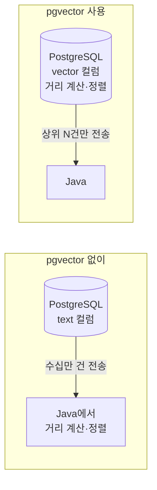
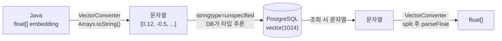

# 02. pgvector 설정

> PostgreSQL에 pgvector 확장을 켜고, 도서 테이블에 1024차원 벡터를 저장할 `embedding` 컬럼을 준비합니다. JPA 엔티티가 이 컬럼을 어떻게 읽고 쓰는지, 그리고 SQL로 벡터를 직접 만들어 비교하는 방법까지 확인합니다.
>
> 예상 소요 시간: 1시간 · 난이도: 입문

## 학습 목표

- pgvector가 PostgreSQL에 무엇을 더해 주는지 설명할 수 있다
- `vector(1024)` 컬럼의 차원이 임베딩 모델과 일치해야 하는 이유를 설명할 수 있다
- pgvector 확장을 활성화하고 `books.embedding` 컬럼을 추가할 수 있다
- `Book` 엔티티의 `embedding` 필드가 `VectorConverter`로 매핑되는 과정을 설명할 수 있다
- SQL로 작은 벡터를 만들어 pgvector 연산자를 실행해 볼 수 있다

## 시작하기 전에

- [01. 키워드 검색의 한계 체감하기](01.search-quality-limitations.md)에서 임베딩, 벡터, 차원의 뜻을 이해하고 오세요.
- Docker와 `psql`(또는 DBeaver 같은 DB 클라이언트)을 사용할 수 있어야 합니다.
- 처음 보는 용어는 [용어집](../glossary.md)에서 찾아볼 수 있습니다.

## 1. 왜 필요한가

01 문서에서 문장을 1024개의 숫자로 바꾸면 의미로 검색할 수 있다는 것을 보았습니다. 그런데 이 숫자 목록을 어디에 저장하고, 어떻게 "가까운 순서"로 꺼낼까요?

가장 단순한 방법은 `text` 컬럼에 `"[0.12, -0.5, ...]"` 문자열로 저장하고, 검색할 때마다 모든 도서를 Java로 읽어 와 거리를 계산하는 것입니다. 하지만 도서가 수십만 권이면 매 검색마다 수십만 개의 1024차원 벡터를 네트워크로 옮겨야 합니다. 정렬과 페이징도 직접 구현해야 합니다.

**pgvector**는 이 일을 데이터베이스 안에서 처리하게 해 주는 PostgreSQL 확장입니다.

- `vector` 타입으로 벡터를 그대로 저장합니다.
- 거리 연산자(`<=>`, `<->`, `<#>`)로 SQL 안에서 거리를 계산하고 `ORDER BY`로 정렬합니다.
- 도서 데이터와 벡터가 같은 테이블에 있으므로, 별도의 벡터 전용 DB 없이 기존 JPA·QueryDSL 코드와 함께 쓸 수 있습니다.



## 2. 핵심 개념

### 2.1. 벡터 타입과 차원

pgvector의 `vector(n)` 타입은 실수 n개를 담는 컬럼입니다. 괄호 안의 숫자가 **차원**입니다.

```sql
SELECT '[1, 2, 3]'::vector;        -- 3차원 벡터
SELECT '[0.12, -0.5, 0.88]'::vector(3);
```

이 프로젝트의 임베딩 모델 BGE-M3는 문장을 항상 **1024차원** 벡터로 바꿉니다. 그래서 컬럼도 `vector(1024)`로 만듭니다. 차원이 맞지 않는 값은 저장되지 않습니다.

| 개념 | 비유 | 이 프로젝트 |
|------|------|-------------|
| 벡터 | 지도 위 한 점의 좌표 | 도서 한 권의 의미 좌표 |
| 차원 | 좌표를 이루는 숫자 개수 (지도는 2개) | 1024개 |
| 차원 일치 | 같은 지도를 써야 거리를 잴 수 있음 | 도서와 검색어 모두 BGE-M3, 1024차원 |

차원이 클수록 의미를 더 세밀하게 담을 수 있지만 저장 공간과 계산량이 늘어납니다. pgvector는 벡터 하나를 `4바이트 × 차원 + 8바이트`로 저장하므로 1024차원 벡터는 약 4KB입니다. 도서 10만 권이면 임베딩만 약 400MB입니다.

차원은 우리가 고르는 값이 아니라 **모델이 정하는 값**입니다. 나중에 다른 임베딩 모델로 바꾸면 차원이 달라질 수 있고, 그때는 컬럼을 다시 만들고 모든 도서의 임베딩을 새로 생성해야 합니다.

### 2.2. pgvector 확장과 거리 연산자

PostgreSQL은 확장(Extension)으로 기능을 추가할 수 있습니다. pgvector를 설치하고 `CREATE EXTENSION vector`를 실행하면 `vector` 타입과 다음 연산자가 생깁니다.

| 연산자 | 계산하는 값 | 값이 작을수록 |
|--------|-------------|---------------|
| `<->` | L2 거리(유클리드 거리, 두 점 사이의 직선 거리) | 가까움 |
| `<=>` | 코사인 거리 = 1 − 코사인 유사도 | 방향이 비슷함 |
| `<#>` | 음의 내적 = 내적 × (−1) | 내적이 큼 |

세 연산자 모두 **값이 작을수록 비슷하다**는 규칙을 따르므로 `ORDER BY ... ASC`로 정렬하면 가까운 순서가 됩니다. 이 프로젝트는 `<=>`(코사인 거리)를 사용합니다. 각 연산자가 언제 쓰이는지, 실제 숫자로 어떻게 계산되는지는 [04. 자연어 검색](04.natural-language-search.md)에서 자세히 다룹니다.

### 2.3. JPA에서 벡터 다루기

Hibernate는 `vector` 타입을 기본으로 알지 못합니다. 이 프로젝트는 별도 라이브러리 없이 **문자열로 주고받는 방식**을 씁니다.



- 저장할 때: `float[]` → `"[0.12, -0.5, ...]"` 문자열 → PostgreSQL이 `vector`로 변환
- 조회할 때: `vector` → 문자열 → `float[]`

pgvector는 `'[1,2,3]'` 형태의 문자열을 `vector`로 바꿀 수 있으므로 이 방식이 동작합니다. 단, JDBC 드라이버가 문자열을 `varchar`로 못 박아 보내면 PostgreSQL이 "vector 컬럼에 varchar를 넣을 수 없다"며 거부합니다. 그래서 접속 URL에 `stringtype=unspecified`를 붙여 **문자열 파라미터의 타입 판단을 DB에 맡깁니다**.

## 3. 따라 하기

### STEP 1: pgvector가 포함된 PostgreSQL 실행

목표: pgvector가 설치된 PostgreSQL을 로컬에서 띄웁니다.

pgvector는 일반 PostgreSQL 이미지에 들어 있지 않습니다. pgvector가 포함된 공식 이미지를 사용합니다.

```bash
docker run -d --name pgvector -p 5432:5432 -e POSTGRES_PASSWORD=postgres pgvector/pgvector:pg16
```

설치 가능한 확장인지 확인합니다.

```sql
SELECT name, default_version FROM pg_available_extensions WHERE name = 'vector';
```

예상 결과: `vector` 한 행이 나옵니다. 행이 없다면 pgvector가 설치되지 않은 PostgreSQL에 접속한 것입니다.

공용 개발 DB를 쓰는 경우 이 단계는 이미 되어 있습니다. 접속 정보는 `src/main/resources/application.properties`, 비밀번호는 `secrets.properties`의 `DB_PASSWORD`로 설정합니다.

### STEP 2: 확장 활성화

목표: 데이터베이스에서 `vector` 타입을 쓸 수 있게 합니다.

```sql
CREATE EXTENSION IF NOT EXISTS vector;

-- 확인
SELECT extname, extversion FROM pg_extension WHERE extname = 'vector';
```

- `CREATE EXTENSION`은 데이터베이스마다 한 번 실행합니다. 설치(STEP 1)와 활성화(STEP 2)는 별개입니다.
- `IF NOT EXISTS`를 붙이면 이미 활성화된 경우에도 오류 없이 넘어갑니다.

### STEP 3: `embedding` 컬럼 추가

목표: 도서 테이블에 1024차원 벡터 컬럼을 만듭니다.

```sql
ALTER TABLE books ADD COLUMN IF NOT EXISTS embedding vector(1024);
```

이 프로젝트는 운영·개발 설정에서 `spring.jpa.hibernate.ddl-auto=validate`를 사용합니다. Hibernate는 테이블을 만들거나 고치지 않고 엔티티와 테이블이 맞는지만 확인하므로, **컬럼은 SQL로 직접 추가**해야 합니다. 컬럼이 없으면 애플리케이션이 시작되지 않습니다.

컬럼을 확인합니다.

```sql
SELECT column_name, udt_name
FROM information_schema.columns
WHERE table_name = 'books' AND column_name = 'embedding';
```

예상 결과:

```text
 column_name | udt_name
-------------+----------
 embedding   | vector
```

처음에는 모든 도서의 `embedding`이 `NULL`입니다. 값은 [03. 임베딩 생성 배치](03.embedding-generation.md)의 스케줄러가 채웁니다.

### STEP 4: 엔티티 매핑 확인

목표: `Book` 엔티티가 `embedding` 컬럼을 어떻게 매핑하는지 이해합니다.

```java
// Book.java (발췌)
@Convert(converter = VectorConverter.class)
@Column(name = "embedding", columnDefinition = "vector(1024)")
@JdbcTypeCode(SqlTypes.VARCHAR)
private float[] embedding;

public void updateEmbedding(float[] embedding) {
    this.embedding = embedding;
}
```

전체 코드: [`src/main/java/net/java21/library/core/book/domain/Book.java`](../../src/main/java/net/java21/library/core/book/domain/Book.java)

- `@Convert(converter = VectorConverter.class)`: Java의 `float[]`와 DB 값을 변환하는 컨버터를 지정합니다.
- `columnDefinition = "vector(1024)"`: 이 컬럼이 1024차원 벡터임을 명시합니다.
- `@JdbcTypeCode(SqlTypes.VARCHAR)`: JDBC로는 문자열로 주고받는다는 뜻입니다.
- `updateEmbedding()`: 임베딩을 바꾸는 유일한 통로입니다. 03 문서의 배치가 이 메서드를 호출하고, JPA 변경 감지(Dirty Checking)로 저장됩니다.

컨버터는 짧습니다.

```java
// VectorConverter.java (발췌)
@Override
public String convertToDatabaseColumn(float[] attribute) {
    if (attribute == null || attribute.length == 0) {
        return null;
    }
    return Arrays.toString(attribute);   // [0.12, -0.5, 0.88]
}

@Override
public float[] convertToEntityAttribute(String dbData) {
    if (dbData == null || dbData.isEmpty()) {
        return null;
    }
    String cleanData = dbData.substring(1, dbData.length() - 1);  // 대괄호 제거
    // ... 쉼표로 나눠 Float.parseFloat
}
```

전체 코드: [`src/main/java/net/java21/library/core/book/domain/VectorConverter.java`](../../src/main/java/net/java21/library/core/book/domain/VectorConverter.java)

`Arrays.toString(float[])`의 출력 형식 `[a, b, c]`가 pgvector의 입력 형식과 같다는 점을 이용한 구현입니다. 이 문자열이 `vector`로 들어가려면 STEP 5의 접속 설정이 필요합니다.

### STEP 5: 접속 URL 확인

목표: 문자열 파라미터가 `vector` 컬럼에 들어갈 수 있도록 설정합니다.

```properties
# application.properties
spring.datasource.url=jdbc:postgresql://s3.java21.net:8000/library?stringtype=unspecified
```

로컬 DB를 쓴다면 호스트와 포트를 바꾸되 `?stringtype=unspecified`는 반드시 유지합니다.

### STEP 6: SQL로 벡터 다뤄 보기

목표: 3차원 벡터로 pgvector를 직접 써 보며 감을 잡습니다.

```sql
-- 1) 같은 방향, 다른 길이
SELECT '[1,2,3]'::vector <=> '[2,4,6]'::vector AS cosine_distance,
       '[1,2,3]'::vector <-> '[2,4,6]'::vector AS l2_distance;
```

예상 결과:

```text
 cosine_distance |    l2_distance
-----------------+-------------------
               0 | 3.741657386773941
```

`[2,4,6]`은 `[1,2,3]`을 두 배로 늘린 벡터입니다. 방향이 완전히 같으므로 코사인 거리는 0이지만, 점의 위치는 다르므로 L2 거리는 약 3.74입니다. "방향을 보는 거리"와 "위치를 보는 거리"가 다르다는 점을 기억해 두세요.

```sql
-- 2) 차원이 다르면 비교할 수 없음
SELECT '[1,2,3]'::vector <-> '[1,2]'::vector;
-- ERROR: different vector dimensions 3 and 2

-- 3) 실제 데이터: 임베딩 진행 상황과 차원 확인
SELECT count(*) FILTER (WHERE embedding IS NOT NULL) AS embedded,
       count(*)                                     AS total
FROM books;

SELECT id, vector_dims(embedding) FROM books WHERE embedding IS NOT NULL LIMIT 3;
```

03 문서의 배치를 실행하기 전이라면 `embedded`는 0입니다. 배치가 돌고 나면 `vector_dims`가 1024로 나옵니다.

> 참고: 벡터 인덱스
>
> pgvector는 HNSW, IVFFlat 같은 근사 최근접 이웃(ANN, Approximate Nearest Neighbor) 인덱스를 제공합니다. 인덱스가 없으면 검색할 때마다 모든 행의 거리를 계산합니다(전체 스캔). 이 프로젝트의 소스는 벡터 인덱스를 만들지 않으며, 학습용 데이터 규모에서는 전체 스캔으로도 동작합니다. 인덱스를 쓰려면 `ORDER BY embedding <=> 검색벡터`처럼 **연산자 자체로 오름차순 정렬**해야 인덱스를 탈 수 있다는 점만 알아 두세요.

## 4. 직접 해 보기

### 미션 1 (기본): 내 DB 상태 점검

다음 세 가지를 SQL로 확인해 결과를 적어 보세요.

1. `vector` 확장 버전
2. `books.embedding` 컬럼의 타입
3. 임베딩이 채워진 도서 수 / 전체 도서 수

<details>
<summary>정답 SQL</summary>

```sql
SELECT extversion FROM pg_extension WHERE extname = 'vector';

SELECT udt_name FROM information_schema.columns
WHERE table_name = 'books' AND column_name = 'embedding';

SELECT count(*) FILTER (WHERE embedding IS NOT NULL), count(*) FROM books;
```

</details>

### 미션 2 (기본): 연산자 결과 예측하기

계산하기 전에 결과를 먼저 예측하고, SQL로 확인하세요.

```sql
SELECT '[1,0]'::vector <=> '[0,1]'::vector;   -- 직각
SELECT '[1,0]'::vector <=> '[-1,0]'::vector;  -- 반대 방향
SELECT '[3,4]'::vector <-> '[0,0]'::vector;   -- 원점까지 거리
```

<details>
<summary>정답</summary>

- 직각: 코사인 유사도 0 → 코사인 거리 1
- 반대 방향: 코사인 유사도 −1 → 코사인 거리 2
- 원점까지 거리: √(3² + 4²) = 5

코사인 거리의 범위는 0(같은 방향)부터 2(반대 방향)까지입니다.

</details>

### 미션 3 (도전): 차원이 틀린 값 저장해 보기

`books` 테이블을 건드리지 않도록 임시 테이블에서 실험합니다.

```sql
CREATE TEMP TABLE vec_test (v vector(3));
INSERT INTO vec_test VALUES ('[1,2,3]');
INSERT INTO vec_test VALUES ('[1,2]');
```

두 번째 `INSERT`가 어떤 오류를 내는지 확인하고, 임베딩 모델을 바꿀 때 왜 컬럼을 다시 만들어야 하는지 설명해 보세요.

<details>
<summary>정답</summary>

두 번째 `INSERT`는 `expected 3 dimensions, not 2` 오류로 실패합니다. 컬럼은 차원을 고정하므로, 출력 차원이 다른 모델로 바꾸면 기존 컬럼에 저장할 수 없습니다. 또 서로 다른 모델의 벡터는 의미 공간이 달라 비교할 수 없으므로, 컬럼을 새 차원으로 바꾸고 모든 도서의 임베딩을 다시 생성해야 합니다.

</details>

## 5. 자주 하는 실수

**`type "vector" does not exist`**
- 증상: `ALTER TABLE ... vector(1024)`나 애플리케이션 시작 시 이 오류가 납니다.
- 원인: 현재 데이터베이스에서 `CREATE EXTENSION vector`를 실행하지 않았습니다. 다른 데이터베이스에서 활성화한 경우도 같습니다.
- 해결: 애플리케이션이 접속하는 데이터베이스에서 `CREATE EXTENSION IF NOT EXISTS vector;`를 실행합니다.

**`column "embedding" is of type vector but expression is of type character varying`**
- 증상: 임베딩 저장 시 이 오류가 납니다.
- 원인: 접속 URL에 `stringtype=unspecified`가 없어 문자열이 `varchar`로 전달되었습니다.
- 해결: `spring.datasource.url` 끝에 `?stringtype=unspecified`를 붙입니다.

**애플리케이션 시작 시 `missing column [embedding]`**
- 증상: Hibernate 스키마 검증에서 실패합니다.
- 원인: `ddl-auto=validate`는 컬럼을 만들어 주지 않습니다.
- 해결: STEP 3의 `ALTER TABLE`을 직접 실행합니다. `ddl-auto`를 `update`나 `create`로 바꾸지 않습니다.

**`expected 1024 dimensions, not 768`**
- 증상: 임베딩 저장 시 차원 오류가 납니다.
- 원인: 설정한 임베딩 모델이 BGE-M3가 아니라 다른 차원의 모델입니다.
- 해결: `spring.ai.openai.embedding.options.model=bge-m3`인지 확인합니다. 모델을 정말 바꾸려면 컬럼 차원과 기존 임베딩을 모두 다시 맞춥니다.

## 6. 정리

- pgvector는 PostgreSQL에 `vector` 타입과 거리 연산자를 추가해, 벡터 저장과 거리 기반 정렬을 DB 안에서 처리하게 합니다.
- `books.embedding`은 BGE-M3의 출력에 맞춘 `vector(1024)` 컬럼이며, 차원은 모델이 정합니다.
- 엔티티는 `float[]`를 `VectorConverter`로 문자열 `[a, b, ...]`로 바꿔 저장하고, `stringtype=unspecified`가 DB 쪽 타입 변환을 가능하게 합니다.
- 연산자 `<->`(L2), `<=>`(코사인 거리), `<#>`(음의 내적)는 모두 작을수록 가깝습니다.

- [ ] `pg_extension`에서 `vector` 확장을 확인했다
- [ ] `books.embedding`이 `vector` 타입으로 존재한다
- [ ] `VectorConverter`와 `stringtype=unspecified`의 역할을 설명할 수 있다
- [ ] 3차원 벡터로 `<=>`와 `<->`를 실행해 결과 차이를 확인했다

## 확인 문제

**1. `embedding` 컬럼의 차원을 1024로 정한 근거는 무엇인가요?**

<details><summary>정답</summary>

임베딩 모델 BGE-M3가 1024차원 벡터를 출력하기 때문입니다. 차원은 모델이 정하며, 컬럼은 그 값에 맞춰야 합니다.

</details>

**2. `'[1,2,3]'::vector <=> '[2,4,6]'::vector`의 결과가 0인 이유는?**

<details><summary>정답</summary>

`<=>`는 코사인 거리(1 − 코사인 유사도)입니다. 두 벡터는 길이만 다르고 방향이 같아 코사인 유사도가 1이므로 코사인 거리는 0입니다.

</details>

**3. 접속 URL에서 `stringtype=unspecified`를 빼면 어떤 문제가 생기나요?**

<details><summary>정답</summary>

`VectorConverter`가 만든 문자열이 `varchar` 타입으로 전달되어, PostgreSQL이 `vector` 컬럼에 넣을 수 없다는 오류를 냅니다.

</details>

**4. 이 프로젝트에서 `embedding` 컬럼을 Hibernate가 자동으로 만들지 않는 이유는?**

<details><summary>정답</summary>

운영·개발 설정이 `ddl-auto=validate`라서 Hibernate는 스키마를 검증만 하고 변경하지 않습니다. 스키마 변경은 SQL로 직접 관리합니다.

</details>

## 다음 문서

[03. 임베딩 생성 배치 →](03.embedding-generation.md)
