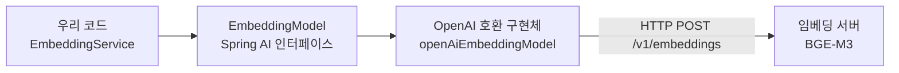
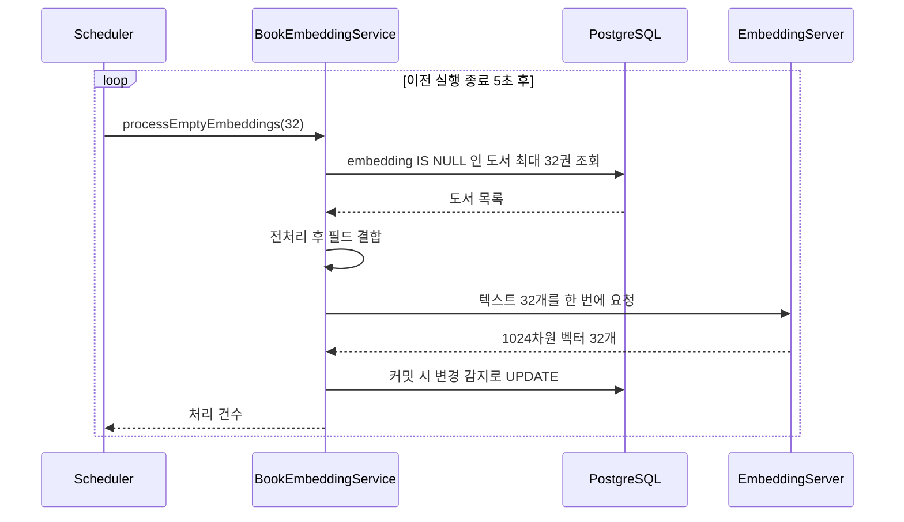

# 03. 임베딩 생성 배치

> Spring AI의 `EmbeddingModel`로 BGE-M3 임베딩 서버를 호출해 도서 정보를 1024차원 벡터로 바꾸고, 스케줄러가 임베딩이 없는 도서를 32권씩 자동으로 채우게 만듭니다. 이 프로젝트에서 처음으로 AI 모델을 코드로 호출하는 문서입니다.
>
> 예상 소요 시간: 2시간 · 난이도: 기본

## 학습 목표

- 임베딩 모델 호출이 "텍스트를 보내고 숫자 배열을 받는 HTTP API"라는 것을 설명할 수 있다
- Spring AI `EmbeddingModel`의 `embed(String)`과 `embed(List<String>)`를 사용할 수 있다
- 임베딩 전에 텍스트를 전처리하고 필드를 결합하는 이유를 설명할 수 있다
- 스케줄러와 배치로 대량 도서의 임베딩을 생성하는 흐름을 구현할 수 있다

## 시작하기 전에

- [02. pgvector 설정](02.pgvector-setup.md)을 마쳐 `books.embedding vector(1024)` 컬럼이 있어야 합니다.
- Step 1에서 도서 CSV가 적재되어 있어야 합니다([Step 1. 01. CSV 배치 적재](../step-1/01.csv-batch-load.md)).
- `@Scheduled`, `@Transactional`, JPA 변경 감지(Dirty Checking)를 써 본 적이 있으면 좋습니다.
- 처음 보는 용어는 [용어집](../glossary.md)에서 찾아볼 수 있습니다.

## 1. 왜 필요한가

02 문서에서 만든 `embedding` 컬럼은 아직 모두 `NULL`입니다. 벡터 검색을 하려면 모든 도서에 벡터가 있어야 합니다. 여기서 세 가지 문제를 풀어야 합니다.

1. **누가 벡터를 만드나**: 벡터는 우리가 계산하는 것이 아니라 임베딩 모델이 만듭니다. 애플리케이션은 모델 서버에 텍스트를 보내고 결과를 받아야 합니다.
2. **무엇을 보내나**: 도서 소개에는 `&nbsp;`, `<b>` 같은 HTML 조각이 섞여 있습니다. 이런 잡음까지 의미로 해석되면 벡터 품질이 떨어집니다. 쓰레기를 넣으면 쓰레기가 나옵니다(Garbage In, Garbage Out).
3. **수십만 권을 어떻게 처리하나**: 한 권씩 요청하면 너무 느리고, 한 번에 전부 보내면 요청이 너무 커집니다. 적당한 크기로 나눠 꾸준히 처리해야 하고, 새로 적재된 도서도 자동으로 채워져야 합니다.

## 2. 핵심 개념

### 2.1. 임베딩 모델은 HTTP API다

임베딩 모델은 "텍스트를 넣으면 숫자 배열을 돌려주는 함수"이고, 이 프로젝트에서는 그 함수가 원격 서버(`https://emb.java21.net`)에 있습니다. 이 서버는 BGE-M3 모델을 OpenAI 임베딩 API와 같은 형식으로 제공합니다.

```bash
curl https://emb.java21.net/v1/embeddings \
  -H "Content-Type: application/json" \
  -d '{"model": "bge-m3", "input": ["자바 입문", "파스타 레시피"]}'
```

응답(숫자는 줄여서 표시):

```json
{
  "data": [
    { "index": 0, "embedding": [0.0123, -0.0456, 0.0331, "... 총 1024개"] },
    { "index": 1, "embedding": [-0.0210, 0.0087, 0.0519, "... 총 1024개"] }
  ],
  "model": "bge-m3"
}
```

`input`에 여러 문장을 배열로 보내면 한 번의 요청으로 여러 벡터를 받을 수 있습니다. 이것이 **배치 임베딩**입니다.

**BGE-M3**는 한국어를 포함한 100개 이상의 언어를 지원하는 공개 임베딩 모델로, 문장 하나를 1024차원 벡터로 바꿉니다. 한국어 도서 제목과 영어 원서 제목이 섞인 데이터에서도 같은 의미 공간에 놓을 수 있어 이 프로젝트에 맞습니다.

### 2.2. Spring AI `EmbeddingModel`

HTTP 요청을 직접 만들 필요는 없습니다. **Spring AI**는 여러 AI 서비스를 같은 인터페이스로 다루게 해 주는 Spring 프로젝트이고, 임베딩은 `EmbeddingModel` 인터페이스로 추상화되어 있습니다.

| 메서드 | 입력 | 출력 | 용도 |
|--------|------|------|------|
| `embed(String text)` | 문장 1개 | `float[]` | 검색어 임베딩 |
| `embed(List<String> texts)` | 문장 여러 개 | `List<float[]>` (입력 순서와 같음) | 도서 배치 임베딩 |



우리 코드는 `EmbeddingModel`만 알고, 실제 서버가 어디인지는 설정 파일이 정합니다. 나중에 다른 임베딩 서비스로 바꿀 때 코드 대신 설정을 바꾸면 됩니다.

### 2.3. 무엇을 임베딩할까: 필드 결합과 전처리

도서 한 권을 하나의 벡터로 만들려면 여러 필드를 한 문장으로 합쳐야 합니다. 이 프로젝트는 필드 이름을 표시해 이어 붙입니다.

```text
[제목] 자바의 정석 [권차제목] 기초편 [저자] 남궁성 [내용] 자바의 기초부터 객체지향 개념까지 ...
```

ISBN, 가격, 출판일처럼 의미가 없는 값은 넣지 않습니다. 숫자 코드는 의미 공간에서 잡음이 되기 때문입니다.

합치기 전에 각 필드를 `TextPreprocessor`로 정리합니다. 다섯 단계를 순서대로 적용하면 다음과 같이 바뀝니다.

| 단계 | 처리 | `<p>&nbsp;<b>자바</b>의 정석!!</p>` |
|------|------|-------------------------------------|
| 1 | HTML 엔티티 디코딩 (`&nbsp;` → 줄바꿈 없는 공백, `&amp;` → `&`) | `<p> <b>자바</b>의 정석!!</p>` |
| 2 | HTML 태그를 공백으로 치환 | `   자바 의 정석!! ` |
| 3 | 문자·숫자·공백 외 특수문자 제거 | `   자바 의 정석 ` |
| 4 | 연속 공백을 하나로 줄이고 앞뒤 공백 제거 | `자바 의 정석` |
| 5 | 소문자 변환 | `자바 의 정석` |

영문이 섞인 예: `Java &amp; Spring` → `Java & Spring` → `Java  Spring` → `Java Spring` → `java spring`

### 2.4. 배치와 스케줄러

임베딩 생성은 사용자 요청과 상관없이 뒤에서 꾸준히 돌아야 하는 일입니다. 스케줄러가 5초마다 "임베딩이 없는 도서"를 최대 32권 골라 처리합니다.



- **배치 크기 32**: 한 번의 HTTP 요청에 32개 문장을 보냅니다. 1개씩 32번 요청하는 것보다 네트워크 왕복이 31번 줄어듭니다.
- **`fixedDelay`**: 이전 실행이 끝난 뒤 5초를 기다립니다. 임베딩 요청이 오래 걸려도 실행이 겹치지 않습니다.
- **자연스러운 종료 조건**: 처리된 도서는 `embedding`이 채워지므로 다음 조회에서 빠집니다. 모두 채워지면 조회 결과가 0건이 되고 아무 일도 하지 않습니다. 새 도서가 적재되면 다시 처리됩니다.

## 3. 따라 하기

### STEP 1: 의존성과 설정

목표: Spring AI가 BGE-M3 서버를 가리키는 `EmbeddingModel` 빈을 만들게 합니다.

```xml
<!-- pom.xml (발췌): 버전은 spring-ai-bom 1.1.2가 관리 -->
<dependency>
    <groupId>org.springframework.ai</groupId>
    <artifactId>spring-ai-starter-model-openai</artifactId>
</dependency>
```

```properties
# application.properties
spring.ai.openai.base-url=https://emb.java21.net
spring.ai.openai.api-key=dummy
spring.ai.openai.embedding.options.model=bge-m3
```

- 임베딩 서버가 OpenAI 호환 API를 제공하므로 **OpenAI 스타터**를 그대로 씁니다. `base-url`만 OpenAI가 아닌 우리 서버로 바꿉니다.
- 이 서버는 인증을 요구하지 않지만 스타터가 키 값을 필수로 요구하므로 `dummy`를 넣습니다.
- 설정 클래스를 따로 만들 필요는 없습니다. 자동 구성이 `openAiEmbeddingModel`이라는 이름의 `EmbeddingModel` 빈을 등록합니다.

### STEP 2: `EmbeddingService`

목표: 프로젝트 전체가 쓸 임베딩 호출 창구를 만듭니다.

```java
@Service
public class EmbeddingService {

    private final EmbeddingModel embeddingModel;

    public EmbeddingService(@Qualifier("openAiEmbeddingModel") EmbeddingModel embeddingModel) {
        this.embeddingModel = embeddingModel;
    }

    public float[] getEmbedding(String text) {
        float[] result = embeddingModel.embed(text);
        if (result == null) {
            return new float[0];
        }
        return result;
    }

    public List<float[]> getEmbeddings(List<String> texts) {
        return embeddingModel.embed(texts);
    }
}
```

전체 코드: [`src/main/java/net/java21/library/core/book/service/embedding/EmbeddingService.java`](../../src/main/java/net/java21/library/core/book/service/embedding/EmbeddingService.java)

- 이 프로젝트는 LLM용으로 Google GenAI, Ollama 스타터도 함께 씁니다. 스타터마다 `EmbeddingModel` 빈을 만들 수 있어 타입만으로는 하나를 고를 수 없습니다. `@Qualifier("openAiEmbeddingModel")`로 BGE-M3 쪽을 명시합니다. 그래서 Lombok `@RequiredArgsConstructor` 대신 생성자를 직접 작성했습니다.
- `getEmbedding()`은 검색어용(04 문서), `getEmbeddings()`는 도서 배치용입니다.

### STEP 3: `TextPreprocessor`

목표: 2.3절의 다섯 단계 전처리를 구현합니다.

```java
@NoArgsConstructor(access = AccessLevel.PRIVATE)
public class TextPreprocessor {

    private static final String HTML_TAG_PATTERN = "<[^>]*>";
    private static final String SPECIAL_CHARACTER_PATTERN = "[^\\p{L}\\p{N}\\s]";
    private static final String CONTINUOUS_SPACE_PATTERN = "\\s+";

    public static String preprocess(String text) {
        if (!StringUtils.hasText(text)) {
            return "";
        }
        String decoded = StringEscapeUtils.unescapeHtml4(text);              // 1. 엔티티 디코딩
        String cleaned = decoded.replaceAll(HTML_TAG_PATTERN, " ");          // 2. 태그 제거
        cleaned = cleaned.replaceAll(SPECIAL_CHARACTER_PATTERN, "");         // 3. 특수문자 제거
        cleaned = cleaned.replaceAll(CONTINUOUS_SPACE_PATTERN, " ").trim();  // 4. 공백 정규화
        return cleaned.toLowerCase();                                        // 5. 소문자
    }
}
```

전체 코드: [`src/main/java/net/java21/library/core/book/util/TextPreprocessor.java`](../../src/main/java/net/java21/library/core/book/util/TextPreprocessor.java)

- `StringEscapeUtils`는 Apache Commons Text 라이브러리입니다.
- `\p{L}`은 모든 언어의 문자(한글, 영문, 한자 등), `\p{N}`은 숫자입니다. 그 밖의 문자(`!`, `@`, `·` 등)를 지웁니다.
- 태그를 빈 문자열이 아니라 공백으로 바꾸는 이유는 `<br>`로 나뉜 두 단어가 붙어 버리지 않게 하기 위해서입니다.

### STEP 4: `BookEmbeddingService`

목표: 임베딩이 없는 도서를 조회해 배치로 벡터를 만들고 저장합니다.

```java
@Transactional
public int processEmptyEmbeddings(int batchSize) {
    // 1. 제목과 내용이 모두 있고 임베딩이 없는 도서 조회
    List<Book> booksToProcess = bookRepository
            .findAllByTitleIsNotNullAndBookContentIsNotNullAndEmbeddingIsNull(PageRequest.of(0, batchSize));
    if (booksToProcess.isEmpty()) {
        return 0;
    }

    // 2. 전처리·결합 후 텍스트가 남은 도서만 모음
    List<Book> validBooks = new ArrayList<>();
    List<String> combinedTexts = new ArrayList<>();
    for (Book book : booksToProcess) {
        String combinedText = createCombinedText(book);
        if (StringUtils.hasText(combinedText)) {
            validBooks.add(book);
            combinedTexts.add(combinedText);
        }
    }
    if (combinedTexts.isEmpty()) {
        return 0;
    }

    // 3. 한 번의 요청으로 여러 텍스트 임베딩
    List<float[]> embeddings = embeddingService.getEmbeddings(combinedTexts);

    // 4. 같은 순서로 매핑, 커밋 시 변경 감지로 UPDATE
    for (int i = 0; i < validBooks.size(); i++) {
        validBooks.get(i).updateEmbedding(embeddings.get(i));
    }
    return validBooks.size();
}
```

전체 코드: [`src/main/java/net/java21/library/core/book/service/embedding/BookEmbeddingService.java`](../../src/main/java/net/java21/library/core/book/service/embedding/BookEmbeddingService.java) (로그와 예외 처리 포함)

- **조회 조건**: Spring Data JPA 메서드 이름 규칙으로 `title IS NOT NULL AND book_content IS NOT NULL AND embedding IS NULL`을 만들고, `PageRequest.of(0, batchSize)`로 개수를 제한합니다. 항상 0페이지를 읽어도 되는 이유는 처리된 도서가 조건에서 빠지기 때문입니다.
- **`validBooks`와 `combinedTexts`를 같은 순서로 유지**하는 것이 핵심입니다. `embed(List)`는 입력 순서대로 결과를 돌려주므로 `i`번째 벡터가 `i`번째 도서의 것입니다.
- **저장 코드가 없습니다**. `@Transactional` 안에서 조회한 엔티티의 필드를 바꾸면 커밋할 때 JPA가 `UPDATE`를 실행합니다.
- 임베딩 요청이 실패하면 실제 소스는 예외를 다시 던져 트랜잭션을 롤백합니다. 일부만 저장되는 일이 없습니다.

필드를 결합하는 `createCombinedText()`는 각 필드를 전처리한 뒤 값이 있는 것만 `[제목]`, `[권차제목]`, `[부제]`, `[저자]`, `[내용]` 순서로 이어 붙입니다.

```java
private String createCombinedText(Book book) {
    String title = TextPreprocessor.preprocess(book.getTitle());
    // volumeTitle, subtitle, author, content도 같은 방식으로 전처리
    StringBuilder sb = new StringBuilder();
    if (StringUtils.hasText(title)) {
        sb.append("[제목] ").append(title).append(" ");
    }
    // ... [권차제목] [부제] [저자] [내용] 순서로 동일
    return sb.toString().trim();
}
```

### STEP 5: `BookEmbeddingScheduler`

목표: 배치를 주기적으로 실행합니다.

```java
@Slf4j
@Component
@ConditionalOnProperty(name = "scheduler.embedding.enabled", havingValue = "true")
@RequiredArgsConstructor
public class BookEmbeddingScheduler {

    private final BookEmbeddingService bookEmbeddingService;
    private static final int BATCH_SIZE = 32;

    @Scheduled(fixedDelay = 5000)
    public void runEmbeddingBatch() {
        try {
            int processedCount = bookEmbeddingService.processEmptyEmbeddings(BATCH_SIZE);
            if (processedCount > 0) {
                log.info("Successfully processed {} book embeddings.", processedCount);
            }
        } catch (Exception e) {
            log.error("Error occurred during embedding batch execution: {}", e.getMessage(), e);
        }
    }
}
```

전체 코드: [`src/main/java/net/java21/library/batch/embedding/scheduler/BookEmbeddingScheduler.java`](../../src/main/java/net/java21/library/batch/embedding/scheduler/BookEmbeddingScheduler.java)

- `@Scheduled`가 동작하려면 `AiLibraryApplication`에 `@EnableScheduling`이 있어야 합니다(이미 있습니다).
- `@ConditionalOnProperty`: `scheduler.embedding.enabled=true`일 때만 빈이 등록됩니다. 테스트나 특정 서버에서 배치를 끄고 싶을 때 설정만 바꾸면 됩니다.
- `try-catch`로 예외를 잡아 로그만 남깁니다. 한 번 실패해도 스케줄러가 멈추지 않고 5초 뒤 다시 시도합니다.
- 스케줄러와 서비스를 분리한 이유: `@Transactional`은 Spring 프록시를 거쳐야 동작합니다. 스케줄러가 다른 빈의 메서드를 호출하므로 트랜잭션이 적용됩니다.

### STEP 6: 실행하고 확인하기

목표: 임베딩이 실제로 채워지는지 확인합니다.

```properties
# application.properties
scheduler.embedding.enabled=true
```

애플리케이션을 실행하면 다음과 같은 로그가 5초 간격으로 나타납니다.

```text
INFO  BookEmbeddingService   : Processing 32 books for embeddings in core service using batch mode.
INFO  BookEmbeddingService   : Successfully generated embeddings for 32 books.
INFO  BookEmbeddingScheduler : Successfully processed 32 book embeddings.
```

SQL로 진행 상황을 확인합니다.

```sql
SELECT count(*) FILTER (WHERE embedding IS NOT NULL) AS embedded,
       count(*) AS total
FROM books;

SELECT id, title, vector_dims(embedding) AS dims
FROM books WHERE embedding IS NOT NULL LIMIT 3;
```

예상 결과: `embedded`가 몇 초마다 32씩 늘어나고, `dims`는 1024입니다. 제목이나 내용이 없는 도서는 조회 조건에서 빠지므로 `embedded`가 `total`에 도달하지 않을 수 있습니다.

## 4. 직접 해 보기

### 미션 1 (기본): 전처리 단위 테스트

`TextPreprocessor`에 대해 다음 입력의 결과를 검증하는 JUnit 테스트를 작성하세요. Spring 컨텍스트 없이 실행합니다.

- `<p>&nbsp;<b>자바</b>의 정석!!</p>`
- `Java &amp; Spring`
- `null`

<details>
<summary>정답 코드</summary>

```java
class TextPreprocessorTest {

    @Test
    @DisplayName("HTML 엔티티·태그·특수문자를 제거하고 공백을 정규화한다")
    void removesHtmlAndSpecialCharacters() {
        assertThat(TextPreprocessor.preprocess("<p>&nbsp;<b>자바</b>의 정석!!</p>"))
                .isEqualTo("자바 의 정석");
    }

    @Test
    @DisplayName("영문은 소문자로 바꾸고 기호는 지운다")
    void lowercasesEnglish() {
        assertThat(TextPreprocessor.preprocess("Java &amp; Spring"))
                .isEqualTo("java spring");
    }

    @Test
    @DisplayName("null이면 빈 문자열을 반환한다")
    void returnsEmptyForNull() {
        assertThat(TextPreprocessor.preprocess(null)).isEmpty();
    }
}
```

</details>

### 미션 2 (기본): 의미가 가까운 문장의 유사도 비교

`EmbeddingService`로 세 문장을 임베딩하고, `VectorUtils.calculateCosineSimilarity()`로 두 쌍의 유사도를 비교하세요. 실제 임베딩 서버를 호출하므로 수동 확인용 테스트로만 실행합니다.

- A: `자바 프로그래밍 입문`
- B: `Java programming for beginners`
- C: `이탈리아 파스타 만들기`

예측: A-B 유사도가 A-C 유사도보다 높아야 합니다.

<details>
<summary>예시 코드</summary>

```java
List<float[]> v = embeddingService.getEmbeddings(List.of(
        "자바 프로그래밍 입문",
        "Java programming for beginners",
        "이탈리아 파스타 만들기"));

System.out.println("차원: " + v.get(0).length);  // 1024
System.out.println("A-B: " + VectorUtils.calculateCosineSimilarity(v.get(0), v.get(1)));
System.out.println("A-C: " + VectorUtils.calculateCosineSimilarity(v.get(0), v.get(2)));
```

정확한 값은 서버와 모델 버전에 따라 다르지만, 한국어와 영어로 같은 뜻을 쓴 A-B가 A-C보다 확실히 높게 나옵니다. 01 문서의 "외국어 표기" 문제가 임베딩으로 풀리는 것을 확인할 수 있습니다.

</details>

### 미션 3 (도전): 배치 효과 측정

같은 문장 32개를 (1) `getEmbedding()`으로 32번 호출할 때와 (2) `getEmbeddings()`로 한 번 호출할 때의 소요 시간을 `System.nanoTime()`으로 측정하고 비교하세요. 왜 차이가 나는지 HTTP 요청 횟수 관점에서 설명해 보세요.

<details>
<summary>해설</summary>

(1)은 HTTP 요청 32번, (2)는 1번입니다. 요청마다 연결·전송·대기 시간이 붙으므로 (2)가 훨씬 빠릅니다. 다만 배치를 무작정 키우면 요청 하나가 커지고 실패 시 다시 처리할 양도 커지므로, 이 프로젝트는 32로 정했습니다.

</details>

## 5. 자주 하는 실수

**`NoUniqueBeanDefinitionException: ... EmbeddingModel`**
- 증상: 애플리케이션 시작 시 `EmbeddingModel` 빈이 여러 개라는 오류가 납니다.
- 원인: OpenAI, Google GenAI, Ollama 스타터가 각각 `EmbeddingModel`을 만들 수 있는데 `@Qualifier` 없이 주입했습니다.
- 해결: `@Qualifier("openAiEmbeddingModel")`로 대상을 지정합니다. 이때 Lombok `@RequiredArgsConstructor`는 필드의 `@Qualifier`를 생성자로 옮기지 않으므로 생성자를 직접 작성합니다.

**스케줄러 로그가 전혀 나오지 않음**
- 증상: 애플리케이션은 떴는데 임베딩이 생성되지 않습니다.
- 원인: `scheduler.embedding.enabled`가 `true`가 아니어서 빈이 등록되지 않았거나, `@EnableScheduling`이 빠졌습니다.
- 해결: 활성 프로필의 설정 파일에서 값을 확인합니다.

**같은 오류 로그가 5초마다 반복됨**
- 증상: `Error occurred during embedding batch execution`이 계속 찍히고 `embedded` 수가 늘지 않습니다.
- 원인: 배치 전체가 한 트랜잭션이라 요청이 실패하면 32권 모두 롤백되고, 다음 실행에서 같은 32권을 다시 조회합니다. 임베딩 서버 장애나 지나치게 긴 텍스트가 원인일 수 있습니다.
- 해결: 서버 상태(`curl`)를 먼저 확인하고, 로그의 `Preprocessed text for book ID` 줄에서 문제 도서를 찾습니다.

**도서 임베딩과 검색어 임베딩의 전처리가 다르다고 걱정함**
- 증상: "검색어도 `[제목]`을 붙여야 하나요?"라는 질문이 생깁니다.
- 설명: 실제 소스는 검색어를 전처리 없이 그대로 임베딩합니다(04 문서). 임베딩 모델은 표현이 조금 달라도 의미를 잡아내므로 동작합니다. 중요한 것은 **같은 모델**을 쓰는 것입니다.

## 6. 정리

- 임베딩 모델은 텍스트를 보내면 숫자 배열을 돌려주는 HTTP API이며, Spring AI `EmbeddingModel`이 이를 `embed()` 메서드로 감쌉니다.
- 이 프로젝트는 OpenAI 호환 BGE-M3 서버를 OpenAI 스타터로 호출하고, `@Qualifier("openAiEmbeddingModel")`로 빈을 지정합니다.
- 도서는 전처리한 필드를 `[제목] ... [내용] ...` 형식으로 합쳐 하나의 벡터로 만듭니다.
- 스케줄러가 5초 간격으로 임베딩이 없는 도서를 32권씩 배치로 처리하고, 변경 감지로 저장합니다.

- [ ] `EmbeddingService`로 문장 하나를 임베딩해 1024차원을 확인했다
- [ ] `TextPreprocessor`의 다섯 단계를 예시로 설명할 수 있다
- [ ] `validBooks`와 `combinedTexts`의 순서를 맞추는 이유를 설명할 수 있다
- [ ] SQL로 임베딩이 채워지는 것을 확인했다

## 확인 문제

**1. `embed(List<String>)`를 쓰는 배치 임베딩이 한 권씩 호출하는 것보다 빠른 이유는?**

<details><summary>정답</summary>

여러 문장을 한 번의 HTTP 요청으로 보내 네트워크 왕복 횟수가 줄기 때문입니다. 32권이면 요청이 32번에서 1번으로 줄어듭니다.

</details>

**2. `processEmptyEmbeddings()`에 `save()` 호출이 없는데도 임베딩이 저장되는 이유는?**

<details><summary>정답</summary>

`@Transactional` 안에서 조회한 엔티티는 영속 상태이고, `updateEmbedding()`으로 필드를 바꾸면 커밋 시점에 JPA 변경 감지(Dirty Checking)가 `UPDATE`를 실행하기 때문입니다.

</details>

**3. 항상 `PageRequest.of(0, 32)`로 0페이지만 조회하는데 같은 도서를 반복 처리하지 않는 이유는?**

<details><summary>정답</summary>

조회 조건에 `embedding IS NULL`이 있어, 처리가 끝난 도서는 다음 조회에서 빠집니다. 단, 처리에 실패해 롤백되면 같은 도서가 다시 조회됩니다.

</details>

**4. 도서 임베딩에 ISBN이나 가격을 넣지 않는 이유는?**

<details><summary>정답</summary>

의미를 담지 않은 숫자 코드라서 의미 공간에서 잡음이 되기 때문입니다. 이런 값은 키워드 검색이나 필터로 처리하는 편이 정확합니다.

</details>

**5. 프로젝트에 `EmbeddingModel` 빈이 여러 개 생기는 이유와 해결 방법은?**

<details><summary>정답</summary>

OpenAI(임베딩용), Google GenAI·Ollama(LLM용) 스타터를 함께 쓰고, 이들이 각각 `EmbeddingModel`을 등록할 수 있기 때문입니다. `@Qualifier("openAiEmbeddingModel")`로 BGE-M3 쪽 빈을 지정해 해결합니다.

</details>

## 다음 문서

[04. 자연어 검색 →](04.natural-language-search.md)
