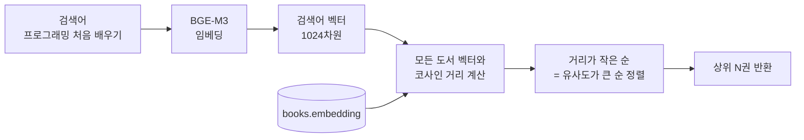
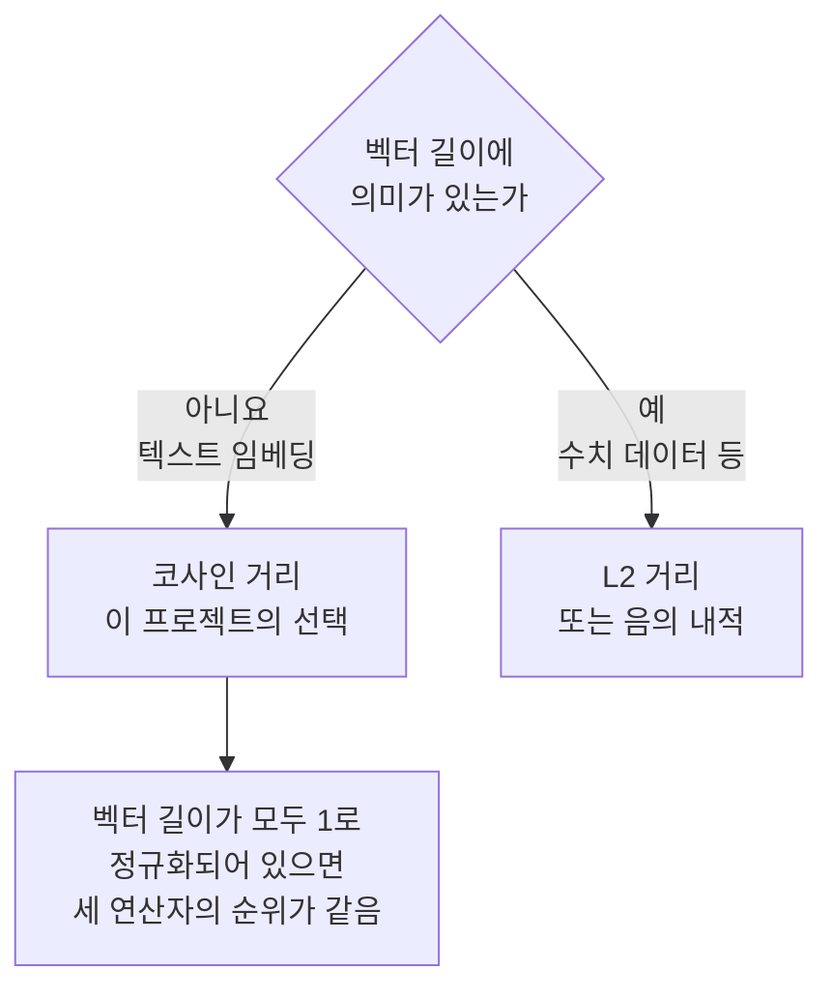
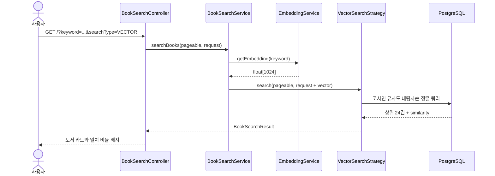

# 04. 자연어 검색

> 사용자의 검색어를 임베딩으로 바꾸고, pgvector의 코사인 거리 연산자 `<=>`로 의미가 가장 가까운 도서를 찾는 벡터 검색을 구현합니다. 코사인 유사도를 작은 숫자로 직접 계산해 보고, pgvector의 세 연산자 `<=>`, `<->`, `<#>`가 각각 무엇을 계산하는지 정확히 구분합니다.
>
> 예상 소요 시간: 2시간 · 난이도: 기본

## 학습 목표

- 2차원 벡터로 코사인 유사도를 손으로 계산할 수 있다
- pgvector 연산자 `<=>`(코사인 거리), `<->`(L2 거리), `<#>`(음의 내적)의 정의와 정렬 방향을 설명할 수 있다
- SQL만으로 "이 책과 비슷한 책" 검색을 실행할 수 있다
- Hibernate 커스텀 함수와 QueryDSL로 벡터 검색 쿼리를 구현할 수 있다
- 검색 화면의 "일치" 비율이 무엇을 뜻하는지 설명할 수 있다

## 시작하기 전에

- [03. 임베딩 생성 배치](03.embedding-generation.md)를 마쳐 도서 임베딩이 채워져 있어야 합니다.
- Step 1의 QueryDSL 키워드 검색 코드([Step 1. 02. 기본 검색 구현](../step-1/02.basic-search-implementation.md))를 읽어 두면 좋습니다.
- 처음 보는 용어는 [용어집](../glossary.md)에서 찾아볼 수 있습니다.

## 1. 왜 필요한가

이제 모든 도서가 1024차원 의미 좌표를 가지고 있습니다. 남은 일은 사용자가 입력한 문장도 같은 좌표계에 찍고, **가장 가까운 도서부터** 보여 주는 것입니다.

```text
사용자: 프로그래밍을 처음 배우는 사람에게 맞는 책

키워드 검색: 0건
벡터 검색:   자바 입문, 처음 배우는 파이썬, 코딩 첫걸음 ...
```

이를 위해 두 가지를 정해야 합니다.

1. **"가깝다"를 어떻게 잴 것인가**: 거리 측정 방법이 여러 개이고, pgvector는 방법마다 다른 연산자를 제공합니다.
2. **JPA·QueryDSL 코드에서 pgvector 연산자를 어떻게 쓸 것인가**: JPQL은 `<=>` 같은 연산자를 모릅니다.

## 2. 핵심 개념

### 2.1. 벡터 검색의 흐름



키워드 검색과 달리 **조건에 맞는 것을 거르는 것이 아니라, 전부 줄 세운 뒤 앞에서부터 자릅니다**. 그래서 벡터 검색은 0건이 나오지 않습니다.

### 2.2. 코사인 유사도: 방향이 얼마나 같은가

두 사람이 손가락으로 어딘가를 가리키고 있다고 해 봅시다. 둘이 같은 곳을 가리키면 "생각이 같다", 직각이면 "관계없다", 정반대면 "반대다"라고 할 수 있습니다. 팔 길이는 상관없습니다. **코사인 유사도(Cosine Similarity)** 는 이렇게 두 벡터의 **방향**만 비교합니다.

| 두 벡터 사이 각도 | 코사인 유사도 | 뜻 |
|------------------:|--------------:|----|
| 0° | 1 | 완전히 같은 방향 |
| 60° | 0.5 | 꽤 비슷함 |
| 90° | 0 | 관계없음 |
| 180° | −1 | 정반대 |

계산식은 "내적을 두 벡터 길이의 곱으로 나눈 값"입니다.

```text
코사인 유사도(A, B) = (A · B) / (|A| × |B|)

A · B  (내적)  = a1×b1 + a2×b2 + ...
|A|    (길이)  = √(a1² + a2² + ...)
```

01 문서의 2차원 예시로 직접 계산해 봅니다. 검색어 Q = (0.9, 0.2)입니다.

| 단계 | Q와 "자바 입문" (0.8, 0.1) | Q와 "파스타 레시피" (0.1, 0.9) |
|------|-----------------------------|--------------------------------|
| 내적 | 0.9×0.8 + 0.2×0.1 = 0.74 | 0.9×0.1 + 0.2×0.9 = 0.27 |
| Q 길이 | √(0.81 + 0.04) ≈ 0.922 | ≈ 0.922 |
| 문서 길이 | √(0.64 + 0.01) ≈ 0.806 | √(0.01 + 0.81) ≈ 0.906 |
| 유사도 | 0.74 / (0.922 × 0.806) ≈ **0.996** | 0.27 / (0.922 × 0.906) ≈ **0.323** |

"자바 입문"은 검색어와 거의 같은 방향이고, "파스타 레시피"는 크게 벗어나 있습니다. 실제 검색은 이 계산을 1024차원에서 도서 수만큼 반복하는 것입니다.

텍스트 임베딩에 코사인 유사도를 많이 쓰는 이유는, 문장의 의미가 벡터의 **방향**에 담기고 길이에는 의미가 적기 때문입니다.

### 2.3. pgvector의 세 가지 거리 연산자

pgvector는 "가까움"을 재는 연산자 세 개를 제공합니다. 모두 **값이 작을수록 가깝다**는 규칙을 따르므로 `ORDER BY 연산자 ASC`가 "가까운 순"입니다.

| 연산자 | 이름 | 계산 | 범위 | 비슷할수록 |
|--------|------|------|------|-----------|
| `<->` | L2 거리 (유클리드 거리) | √Σ(aᵢ − bᵢ)² , 두 점 사이 직선 거리 | 0 ~ ∞ | 0에 가까움 |
| `<=>` | 코사인 거리 | 1 − 코사인 유사도 | 0 ~ 2 | 0에 가까움 |
| `<#>` | 음의 내적 (negative inner product) | −(A · B) | −∞ ~ ∞ | 작을수록(더 음수일수록) |

3차원 예시로 확인합니다. A = [1, 0, 0], B = [1, 1, 0]이면 두 벡터 사이 각도는 45°입니다.

```sql
SELECT '[1,0,0]'::vector <-> '[1,1,0]'::vector AS l2,          -- 1
       '[1,0,0]'::vector <=> '[1,1,0]'::vector AS cosine_dist, -- 0.2928932...
       '[1,0,0]'::vector <#> '[1,1,0]'::vector AS neg_inner;   -- -1
```

- `<->`: 점 (1,0,0)과 (1,1,0) 사이 거리는 1입니다.
- `<=>`: 코사인 유사도가 cos 45° ≈ 0.7071이므로 코사인 거리는 1 − 0.7071 ≈ 0.2929입니다.
- `<#>`: 내적이 1×1 + 0×1 + 0×0 = 1이고, 부호를 뒤집어 −1입니다.

**`<#>`는 왜 음수를 돌려줄까요?** PostgreSQL의 인덱스 정렬은 오름차순만 지원합니다. 내적은 클수록 비슷한 값이라 그대로 두면 내림차순 정렬이 필요해집니다. 그래서 pgvector는 부호를 뒤집어 "작을수록 비슷함"으로 통일했습니다. 내적 값 자체가 필요하면 `(a <#> b) * -1`로 되돌립니다.

**셋 중 무엇을 써야 할까요?**



벡터 길이가 모두 1이면 코사인 유사도와 내적이 같은 값이 되고, L2 거리도 코사인 유사도만으로 결정됩니다. 그래서 순위가 같아집니다. 이 프로젝트는 길이에 상관없이 의미가 분명한 코사인 거리 `<=>`를 씁니다.

### 2.4. 거리를 "유사도"로 바꿔 보여 주기

`<=>`는 거리라서 작을수록 좋고, 사람에게 보여 주기에는 어색합니다. 그래서 쿼리에서 `1 - 코사인 거리`로 바꿔 **코사인 유사도**를 만들고, 화면에서는 백분율로 표시합니다.

```text
embedding <=> 검색벡터       = 0.18   (코사인 거리)
1 - (embedding <=> 검색벡터) = 0.82   (코사인 유사도)
화면 표시                     = 82.0% 일치
```

"82% 일치"는 "82% 확률로 맞는 책"이라는 뜻이 아닙니다. 두 벡터의 방향이 얼마나 같은지를 나타낸 값입니다. 실제 임베딩에서는 관련 없는 문서도 유사도가 0보다 꽤 큰 경우가 많아, 숫자의 절댓값보다 **순서**가 더 중요합니다.

## 3. 따라 하기

### STEP 1: SQL로 먼저 벡터 검색 해 보기

목표: Java 코드 없이 pgvector만으로 "이 책과 비슷한 책"을 찾습니다.

검색어를 임베딩하려면 API 호출이 필요하지만, 이미 저장된 도서의 임베딩을 검색 벡터로 쓰면 SQL만으로 실험할 수 있습니다.

```sql
-- 1) 기준이 될 책을 하나 고릅니다
SELECT id, title FROM books
WHERE embedding IS NOT NULL AND title ILIKE '%자바%'
LIMIT 5;

-- 2) 그 책과 의미가 가까운 책 10권 (id는 위에서 고른 값으로 바꿉니다)
SELECT b.id,
       b.title,
       1 - (b.embedding <=> t.embedding) AS similarity
FROM books b,
     (SELECT embedding FROM books WHERE id = 12345) t
WHERE b.embedding IS NOT NULL
ORDER BY b.embedding <=> t.embedding
LIMIT 10;
```

예상 결과: 1위는 기준 책 자신(유사도 1.0)이고, 그 아래에 제목에 "자바"가 없더라도 프로그래밍 관련 책이 나타납니다. `ORDER BY`는 거리 오름차순, 화면에 보이는 값은 유사도라는 점에 주의하세요.

### STEP 2: Hibernate에 벡터 함수 등록

목표: QueryDSL(JPQL)에서 `<=>` 연산자를 쓸 수 있게 합니다.

JPQL 문법에는 `<=>`가 없어 그대로 쓰면 파싱 오류가 납니다. Hibernate의 `FunctionContributor`로 **SQL 조각에 이름을 붙여** 함수처럼 등록합니다. Step 1의 전문 검색 함수 `ts_match_korean`과 같은 방식입니다.

```java
public class PostgreSQLFunctionContributor implements FunctionContributor {

    @Override
    public void contributeFunctions(FunctionContributions functionContributions) {
        // Step 1에서 등록한 ts_match_korean 생략

        functionContributions.getFunctionRegistry()
                .registerPattern("vector_cosine_similarity",
                        "(1.0 - (embedding <=> cast(?1 as vector)))",
                        functionContributions.getTypeConfiguration().getBasicTypeRegistry()
                                .resolve(StandardBasicTypes.DOUBLE));
    }
}
```

전체 코드: [`src/main/java/net/java21/library/core/config/PostgreSQLFunctionContributor.java`](../../src/main/java/net/java21/library/core/config/PostgreSQLFunctionContributor.java)

- `vector_cosine_similarity(?)`라고 쓰면 SQL에서는 `(1.0 - (embedding <=> cast(? as vector)))`로 바뀝니다.
- `?1`에는 `"[0.12, -0.5, ...]"` 형태의 문자열이 들어오고, `cast(... as vector)`로 pgvector 타입이 됩니다.
- 결과 타입은 `DOUBLE`, 즉 코사인 유사도입니다.
- 패턴 안의 `embedding`은 컬럼 이름을 직접 적은 것이라 `books` 테이블 전용입니다.

등록은 SPI 파일로 합니다. Hibernate가 시작할 때 이 파일을 읽습니다.

```text
# src/main/resources/META-INF/services/org.hibernate.boot.model.FunctionContributor
net.java21.library.core.config.PostgreSQLFunctionContributor
```

### STEP 3: 검색어를 벡터로 바꾸기

목표: 벡터가 필요한 검색 방식일 때만 검색어를 임베딩합니다.

```java
// BookSearchService.java (발췌)
public BookSearchResult searchBooks(Pageable pageable, BookSearchRequest request) {
    request = ensureEmbedding(request);
    SearchStrategy strategy = selectStrategy(request.searchType());
    return strategy.search(pageable, request);
}

private SearchStrategy selectStrategy(SearchType searchType) {
    return switch (searchType) {
        case KEYWORD -> keywordSearchStrategy;
        case VECTOR -> vectorSearchStrategy;
        case HYBRID -> hybridSearchStrategy;
        case RAG -> ragSearchStrategy;
    };
}

private BookSearchRequest ensureEmbedding(BookSearchRequest request) {
    if (shouldGenerateEmbedding(request)) {
        float[] vector = embeddingService.getEmbedding(request.keyword());
        return new BookSearchRequest(request.keyword(), request.isbn(), request.searchType(), vector, request.isWarmUp());
    }
    return request;
}

private boolean shouldGenerateEmbedding(BookSearchRequest request) {
    return (request.searchType() == SearchType.VECTOR || request.searchType() == SearchType.HYBRID
            || request.searchType() == SearchType.RAG)
            && request.keyword() != null && !request.keyword().isBlank() && request.vector() == null;
}
```

전체 코드: [`src/main/java/net/java21/library/core/book/service/search/BookSearchService.java`](../../src/main/java/net/java21/library/core/book/service/search/BookSearchService.java)

- 검색 방식마다 **전략 패턴**으로 클래스를 나눕니다(`KeywordSearchStrategy`, `VectorSearchStrategy`, `HybridSearchStrategy`, `RagSearchStrategy`). 새 방식을 추가해도 `if` 분기가 늘지 않습니다.
- 임베딩은 서비스에서 한 번만 만들어 요청 객체(`BookSearchRequest`는 record)에 담아 전략에 넘깁니다. 키워드 검색일 때는 API를 호출하지 않습니다.
- 검색어는 `TextPreprocessor`를 거치지 않고 그대로 임베딩합니다.

벡터 검색 전략은 저장소에 위임만 합니다.

```java
@Component
@RequiredArgsConstructor
public class VectorSearchStrategy implements SearchStrategy {

    private final BookRepository bookRepository;

    @Override
    public BookSearchResult search(Pageable pageable, BookSearchRequest request) {
        Page<BookSearchResponse> results = bookRepository.vectorSearch(pageable, request);
        return BookSearchResult.builder().books(results).build();
    }
}
```

### STEP 4: QueryDSL 벡터 검색 쿼리

목표: STEP 2의 함수로 유사도를 계산하고, 유사도 높은 순으로 정렬합니다.

```java
// BookRepositoryImpl.java (발췌)
@Override
public Page<BookSearchResponse> vectorSearch(Pageable pageable, BookSearchRequest request) {
    if (request.vector() == null) {
        return new PageImpl<>(List.of(), pageable, 0);
    }

    String vectorString = arrayToVectorString(request.vector());   // Arrays.toString()
    NumberTemplate<Double> similarityTemplate = Expressions.numberTemplate(
            Double.class, "function('vector_cosine_similarity', {0})", vectorString);

    List<BookSearchResponse> bookSearchResponseList = queryFactory
            .from(book)
            .select(Projections.constructor(BookSearchResponse.class,
                    book.id, book.isbn, book.title, book.volumeTitle,
                    book.authorName, book.publisherName, book.price,
                    book.editionPublishDate, book.imageUrl, book.bookContent,
                    similarityTemplate))                                // 11번째 인자: similarity
            .where(Expressions.booleanTemplate("embedding is not null"))
            .orderBy(similarityTemplate.desc())                         // 유사도 높은 순
            .offset(pageable.getOffset())
            .limit(pageable.getPageSize())
            .fetch();

    // (리뷰 요약 정보를 IN 절로 한 번에 붙이는 부분 생략)

    long totalCount = queryFactory.select(book.count()).from(book)
            .where(Expressions.booleanTemplate("embedding is not null"))
            .fetchOne();

    return new PageImpl<>(bookSearchResponseList, pageable, totalCount);
}
```

전체 코드: [`src/main/java/net/java21/library/core/book/repository/impl/BookRepositoryImpl.java`](../../src/main/java/net/java21/library/core/book/repository/impl/BookRepositoryImpl.java)

실제로 PostgreSQL에 전달되는 SQL은 대략 다음과 같습니다.

```sql
SELECT b.id, b.isbn, b.title, ...,
       (1.0 - (embedding <=> cast(? as vector)))
FROM books b
WHERE embedding IS NOT NULL
ORDER BY (1.0 - (embedding <=> cast(? as vector))) DESC
OFFSET ? LIMIT ?
```

- **정렬 방향**: STEP 1의 SQL은 거리(`<=>`)를 오름차순으로, 이 쿼리는 유사도(`1 - <=>`)를 내림차순으로 정렬합니다. 두 정렬은 같은 순서입니다.
- **`embedding is not null`**: 아직 임베딩이 없는 도서는 거리를 계산할 수 없으므로 제외합니다.
- **유사도 결과 담기**: `BookSearchResponse`에는 `similarity`를 받는 11개 인자 생성자가 있어, 키워드 검색(10개 인자)과 같은 DTO를 씁니다.
- **전체 건수**: 임베딩이 있는 모든 도서 수입니다. 벡터 검색은 거르지 않고 줄 세우므로 "검색 결과 수"가 곧 전체 도서 수가 됩니다.

### STEP 5: 화면에서 확인하기

목표: 벡터 검색 결과와 유사도를 화면에서 확인합니다.

검색 화면의 검색 방식 선택 상자에서 "벡터 검색"을 고르거나 주소로 직접 요청합니다.

```text
http://localhost:8080/?keyword=프로그래밍을 처음 배우는 사람에게 맞는 책&searchType=VECTOR
```

도서 카드에는 유사도 배지가 붙습니다(`templates/index/index.html`).

```html
<span th:if="${book.similarity != null}" class="badge bg-green-lt"
      th:text="${#numbers.formatPercent(book.similarity, 1, 1)} + ' 일치'">95% 일치</span>
```

전체 흐름을 정리하면 다음과 같습니다.



01 문서에서 키워드 검색이 실패했던 검색어를 다시 넣어 보세요. "Computer Architecture"로 검색하면 "컴퓨터 구조" 책이 함께 나오는 것을 확인할 수 있습니다(적재된 데이터에 따라 다릅니다).

## 4. 직접 해 보기

### 미션 1 (기본): 손으로 계산하고 코드로 확인하기

A = (3, 4), B = (4, 3)의 코사인 유사도, 코사인 거리, L2 거리, 음의 내적을 손으로 계산한 뒤 SQL로 확인하세요.

<details>
<summary>정답</summary>

- 내적: 3×4 + 4×3 = 24, 길이: 둘 다 5
- 코사인 유사도: 24 / 25 = 0.96
- 코사인 거리 `<=>`: 1 − 0.96 = 0.04
- L2 거리 `<->`: √((3−4)² + (4−3)²) = √2 ≈ 1.414
- 음의 내적 `<#>`: −24

```sql
SELECT '[3,4]'::vector <=> '[4,3]'::vector,
       '[3,4]'::vector <-> '[4,3]'::vector,
       '[3,4]'::vector <#> '[4,3]'::vector;
```

Java에서는 `VectorUtils.calculateCosineSimilarity(new float[]{3, 4}, new float[]{4, 3})`로 0.96을 확인할 수 있습니다.

</details>

### 미션 2 (기본): 임베딩 벡터의 길이 확인

pgvector의 `vector_norm()` 함수로 저장된 임베딩 몇 개의 길이를 확인하고, 세 연산자로 정렬한 상위 5건이 같은지 비교하세요.

```sql
SELECT id, vector_norm(embedding) FROM books WHERE embedding IS NOT NULL LIMIT 5;
```

<details>
<summary>해설</summary>

길이가 모두 1에 가깝다면 임베딩 서버가 정규화된 벡터를 돌려주는 것이고, 이때는 `<=>`, `<->`, `<#>` 중 무엇으로 정렬해도 순위가 같습니다. 길이가 제각각이라면 순위가 달라질 수 있으며, 텍스트 임베딩에는 길이의 영향을 받지 않는 `<=>`가 안전합니다.

```sql
-- id 12345를 기준 책으로 사용하는 예
SELECT id FROM books WHERE embedding IS NOT NULL
ORDER BY embedding <#> (SELECT embedding FROM books WHERE id = 12345) LIMIT 5;
```

</details>

### 미션 3 (도전): 키워드 검색과 벡터 검색 비교표

01 문서 미션 1에서 모은 "키워드 검색 실패 검색어"를 벡터 검색으로 다시 실행하고, 상위 5건 중 원하던 책이 몇 권인지 표로 정리하세요. 반대로 ISBN이나 저자 이름처럼 **벡터 검색이 오히려 못하는** 검색어도 하나 찾아 보세요.

<details>
<summary>힌트</summary>

ISBN `9788966262335`처럼 숫자만 있는 검색어나, 흔한 단어와 겹치는 저자 이름(예: "한강")으로 벡터 검색을 해 보세요. 정확히 그 책이 1위에 오지 않을 수 있습니다. 이 결과가 다음 문서의 하이브리드 검색이 필요한 이유입니다.

</details>

## 5. 자주 하는 실수

**정렬 방향을 반대로 씀**
- 증상: 가장 관련 없는 책이 맨 위에 나옵니다.
- 원인: 거리(`<=>`)를 `DESC`로, 또는 유사도(`1 - <=>`)를 `ASC`로 정렬했습니다.
- 해결: 거리는 오름차순, 유사도는 내림차순입니다. 지금 정렬하는 값이 거리인지 유사도인지 먼저 확인합니다.

**`<#>` 결과를 내적으로 착각함**
- 증상: 내적이 −32라서 "반대 의미"라고 해석합니다.
- 원인: `<#>`는 내적에 −1을 곱한 값입니다. −32는 내적이 +32라는 뜻입니다.
- 해결: 내적이 필요하면 `(a <#> b) * -1`로 계산합니다.

**JPQL에서 `<=>`를 직접 씀**
- 증상: `Expressions.numberTemplate(..., "embedding <=> {0}")` 같은 코드에서 쿼리 파싱 오류가 납니다.
- 원인: JPQL(HQL) 문법에 pgvector 연산자가 없습니다.
- 해결: `FunctionContributor`로 SQL 패턴을 함수로 등록하고 `function('vector_cosine_similarity', {0})`으로 호출합니다. SPI 파일 등록도 확인합니다.

**벡터 검색 결과가 비어 있음**
- 증상: 검색어를 넣었는데 0건입니다.
- 원인: 검색어가 비어 있으면 임베딩을 만들지 않아 `vector`가 `null`이고, `vectorSearch()`는 빈 페이지를 반환합니다. 또는 아직 임베딩된 도서가 없습니다.
- 해결: 검색어를 확인하고, `SELECT count(*) FROM books WHERE embedding IS NOT NULL`로 임베딩 진행 상황을 봅니다.

**검색할 때마다 느려짐**
- 증상: 도서 수가 늘수록 벡터 검색이 눈에 띄게 느려집니다.
- 원인: 벡터 인덱스 없이 모든 행의 거리를 계산합니다.
- 해결: 학습 규모에서는 문제가 되지 않습니다. 운영 규모라면 HNSW 인덱스를 검토하되, 인덱스는 `ORDER BY embedding <=> 검색벡터` 형태여야 사용됩니다. 현재 소스는 유사도는 select에만 쓰고 정렬은 거리 오름차순으로 합니다. 성능 문제는 Step 4에서 다룹니다.

> 실제 사례: [사례 4. 임베딩 서버 장애로 검색이 수십 초 지연됨](../troubleshooting.md#사례-4-임베딩-서버-장애로-검색이-수십-초-지연됨)

## 6. 정리

- 코사인 유사도는 두 벡터의 방향이 얼마나 같은지(1 ~ −1)를 나타내며, 텍스트 임베딩 비교에 적합합니다.
- pgvector의 `<->`는 L2 거리, `<=>`는 코사인 거리(1 − 코사인 유사도), `<#>`는 음의 내적이며, 모두 작을수록 가깝습니다.
- 이 프로젝트는 `vector_cosine_similarity` 함수로 `1 - (embedding <=> 검색벡터)`를 계산해 유사도 내림차순으로 정렬합니다.
- `BookSearchService`가 벡터가 필요한 검색 방식에서만 검색어를 임베딩하고, 전략 패턴으로 검색 방식을 고릅니다.

- [ ] 2차원 벡터로 코사인 유사도를 손으로 계산했다
- [ ] 세 연산자의 정의와 정렬 방향을 표 없이 말할 수 있다
- [ ] SQL로 "이 책과 비슷한 책" 검색을 실행했다
- [ ] 화면에서 벡터 검색을 실행하고 "일치" 비율의 의미를 설명할 수 있다

## 확인 문제

**1. `'[1,0]'::vector <=> '[0,1]'::vector`의 결과와 그 이유는?**

<details><summary>정답</summary>

1입니다. 두 벡터는 직각(90°)이라 코사인 유사도가 0이고, 코사인 거리는 1 − 0 = 1입니다.

</details>

**2. `'[1,2,3]'::vector <#> '[4,5,6]'::vector`의 결과는?**

<details><summary>정답</summary>

−32입니다. 내적이 1×4 + 2×5 + 3×6 = 32이고, `<#>`는 부호를 뒤집은 음의 내적을 돌려줍니다.

</details>

**3. 다음 두 쿼리의 결과 순서가 같은 이유는?**

```sql
ORDER BY embedding <=> :q ASC
ORDER BY 1 - (embedding <=> :q) DESC
```

<details><summary>정답</summary>

`1 - x`는 `x`가 작을수록 커지므로, 거리 오름차순과 유사도 내림차순은 같은 순서입니다.

</details>

**4. 벡터 검색의 `totalCount`가 임베딩된 전체 도서 수와 같은 이유는?**

<details><summary>정답</summary>

벡터 검색은 조건으로 거르지 않고 모든 도서를 유사도 순으로 줄 세운 뒤 페이지만큼 자르기 때문입니다. `WHERE` 조건은 `embedding is not null`뿐입니다.

</details>

**5. JPQL에서 `<=>`를 쓰기 위해 이 프로젝트가 사용한 방법은?**

<details><summary>정답</summary>

Hibernate `FunctionContributor`로 `(1.0 - (embedding <=> cast(?1 as vector)))` 패턴을 `vector_cosine_similarity` 함수로 등록하고, SPI 파일(`META-INF/services/org.hibernate.boot.model.FunctionContributor`)로 등록했습니다. QueryDSL에서는 `function('vector_cosine_similarity', {0})`으로 호출합니다.

</details>

## 다음 문서

[05. 하이브리드 검색 →](05.hybrid-search.md)
