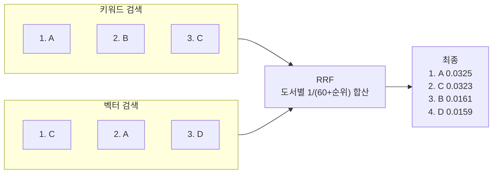
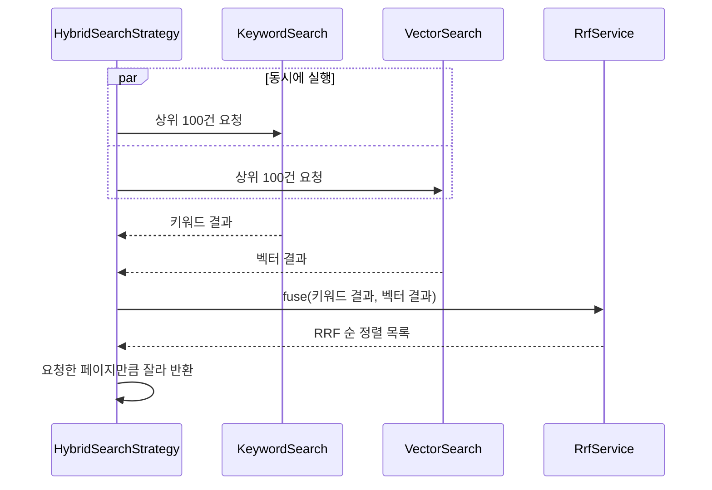

# 05. 하이브리드 검색

> 키워드 검색과 벡터 검색을 동시에 실행하고, 두 결과의 순위를 RRF(Reciprocal Rank Fusion)로 합쳐 하나의 목록을 만듭니다. 작은 예시 표로 RRF 점수를 직접 계산해 보고, `RrfService`와 `CompletableFuture` 병렬 실행 코드를 읽습니다.
>
> 예상 소요 시간: 2시간 · 난이도: 기본

## 학습 목표

- 키워드 검색과 벡터 검색이 서로의 약점을 보완하는 사례를 설명할 수 있다
- 두 검색의 점수를 그대로 더하면 안 되는 이유를 설명할 수 있다
- 작은 예시로 RRF 점수를 계산하고 최종 순위를 예측할 수 있다
- `RrfService`와 `HybridSearchStrategy`의 동작을 설명할 수 있다
- `CompletableFuture`로 두 검색을 병렬 실행하는 이유와 방법을 설명할 수 있다

## 시작하기 전에

- [04. 자연어 검색](04.natural-language-search.md)을 마쳐 벡터 검색이 동작해야 합니다.
- Java `Map`, Stream API를 쓸 수 있어야 합니다. `CompletableFuture`는 이 문서에서 필요한 만큼 설명합니다.
- 처음 보는 용어는 [용어집](../glossary.md)에서 찾아볼 수 있습니다.

## 1. 왜 필요한가

04 문서의 미션 3에서 본 것처럼 두 검색은 잘하는 일이 다릅니다.

| 검색어 | 키워드 검색 | 벡터 검색 |
|--------|-------------|-----------|
| `9788966262335` (ISBN) | 정확히 그 책 | 숫자 문자열과 "비슷한" 엉뚱한 책 |
| `한강` (저자) | 저자 한강의 책 | 강, 지리, 서울 관련 책이 섞임 |
| `Computer Architecture` | 영문 제목 책만 | 한글 "컴퓨터 구조" 책까지 |
| `처음 배우는 사람에게 맞는 프로그래밍 책` | 거의 0건 | 입문서들 |

사용자는 이 두 종류를 섞어서 검색합니다. "한강 작가의 잔잔한 소설"에는 정확히 맞아야 하는 부분(한강)과 의미로 찾아야 하는 부분(잔잔한 소설)이 함께 있습니다. 어느 한 방식만으로는 둘 다 만족시키기 어렵습니다.

01 문서의 용어로 말하면, 키워드 검색은 정밀도가, 벡터 검색은 재현율이 강점입니다. **하이브리드 검색**은 두 검색을 모두 실행하고 결과를 합쳐 양쪽의 장점을 얻으려는 방법입니다. 문제는 "어떻게 합치는가"입니다.

## 2. 핵심 개념

### 2.1. 점수를 그대로 더하면 안 되는 이유

가장 먼저 떠오르는 방법은 두 검색의 점수를 더하는 것입니다. 하지만 두 점수는 **단위가 다릅니다**.

- 벡터 검색 점수: 코사인 유사도. 0.7 ~ 0.9 근처에 몰려 있는 경우가 많습니다.
- 키워드 검색 점수: 전문 검색 순위 점수라면 0.1일 수도, 12.5일 수도 있습니다. 이 프로젝트의 키워드 검색은 아예 점수를 계산하지 않고 조건에 맞는 도서를 돌려줍니다.

시험에 비유하면, 국어는 100점 만점이고 수학은 10점 만점인데 원점수를 그대로 더해 종합 등수를 매기는 것과 같습니다. 국어 점수가 결과를 거의 다 정하게 됩니다.

해결책은 점수 대신 **순위**를 쓰는 것입니다. "국어 1등, 수학 3등"처럼 순위는 어느 과목이든 같은 단위입니다.

### 2.2. RRF: 순위의 역수를 더한다

**RRF(Reciprocal Rank Fusion)** 는 각 검색 결과에서의 순위를 점수로 바꾼 뒤 더합니다.

```text
도서 d의 RRF 점수 = Σ  1 / (k + 순위)
                  (d가 등장한 모든 검색 결과에 대해)

k = 60 (이 프로젝트의 RrfService.RRF_K)
순위는 1부터 시작
```

순위별 점수는 다음과 같습니다.

| 순위 | 1 | 2 | 3 | 10 | 100 |
|------|---|---|---|----|-----|
| 1 / (60 + 순위) | 0.0164 | 0.0161 | 0.0159 | 0.0143 | 0.0063 |

검색 결과에 없는 도서는 그 검색에서 0점입니다. 그래서 **두 검색에 모두 등장한 도서**가 한 검색에만 등장한 도서보다 유리합니다.

### 2.3. 예시로 RRF 계산하기

검색어 "자바 프로그래밍"에 대해 두 검색이 각각 상위 3건을 돌려줬다고 합시다.

| 순위 | 키워드 검색 | 벡터 검색 |
|-----:|-------------|-----------|
| 1 | A. 자바 프로그래밍 | C. Java 입문 |
| 2 | B. 자바 커피 이야기 | A. 자바 프로그래밍 |
| 3 | C. Java 입문 | D. 처음 배우는 프로그래밍 |

도서별로 점수를 계산합니다.

| 도서 | 키워드 순위 | 키워드 점수 | 벡터 순위 | 벡터 점수 | RRF 합계 | 최종 순위 |
|------|-----------:|-----------:|---------:|---------:|---------:|---------:|
| A | 1 | 1/61 = 0.016393 | 2 | 1/62 = 0.016129 | **0.032522** | 1 |
| C | 3 | 1/63 = 0.015873 | 1 | 1/61 = 0.016393 | **0.032266** | 2 |
| B | 2 | 1/62 = 0.016129 | - | 0 | **0.016129** | 3 |
| D | - | 0 | 3 | 1/63 = 0.015873 | **0.015873** | 4 |

결과를 해석해 봅니다.

- A와 C는 두 검색 모두에 등장해 점수가 약 두 배입니다. 둘이 1, 2위를 차지합니다.
- B("자바 커피 이야기")는 키워드 검색 2위였지만 벡터 검색에는 없어서 3위로 내려갔습니다. 글자만 겹친 책이 밀려난 것입니다.
- D("처음 배우는 프로그래밍")는 키워드 검색에는 없었지만 벡터 검색 덕분에 결과에 들어왔습니다. 글자는 다르지만 의미가 맞는 책을 놓치지 않은 것입니다.



### 2.4. k는 왜 60일까

k는 "1위와 2위의 차이를 얼마나 크게 볼 것인가"를 정합니다. 극단적인 두 도서로 비교해 봅니다.

- X: 한 검색에서만 1위
- Y: 두 검색 모두 3위

| k | X 점수 | Y 점수 | 승자 |
|---|-------:|-------:|------|
| 1 | 1/2 = 0.5000 | 1/4 + 1/4 = 0.5000 | 동점 |
| 60 | 1/61 = 0.0164 | 1/63 + 1/63 = 0.0317 | Y |

k가 작으면 1위의 점수가 매우 커서 "한 검색에서의 1위"가 결과를 좌우합니다. k가 크면 순위 사이 점수 차가 작아져 "여러 검색에서 고르게 상위권"인 도서가 이깁니다. 60은 RRF를 처음 제안한 연구에서 쓴 값으로, 여러 데이터에서 무난하게 동작해 기본값으로 널리 쓰입니다.

### 2.5. 두 검색을 동시에 실행하기

하이브리드 검색은 검색을 두 번 합니다. 차례로 실행하면 응답 시간이 두 검색 시간의 합이 됩니다. 두 검색은 서로 결과를 기다릴 필요가 없으므로 동시에 실행할 수 있습니다.

| 방식 | 키워드 검색 100ms, 벡터 검색 150ms일 때 (예시 수치) |
|------|---------------------------------------------------|
| 순차 실행 | 100 + 150 = 250ms |
| 병렬 실행 | max(100, 150) = 150ms |

피자와 치킨을 시킬 때 한 가게 배달이 도착한 뒤 다른 가게에 전화하지 않고, 두 가게에 동시에 주문하는 것과 같습니다. Java에서는 `CompletableFuture`로 이렇게 합니다.

| 메서드 | 하는 일 |
|--------|---------|
| `supplyAsync(작업, executor)` | 작업을 다른 스레드에서 시작하고 "나중에 결과가 들어올 상자"를 바로 돌려줌 |
| `a.thenCombineAsync(b, 함수, executor)` | a와 b가 모두 끝나면 두 결과로 함수를 실행 |
| `join()` | 결과가 나올 때까지 현재 스레드가 기다림 |



## 3. 따라 하기

### STEP 1: `RrfService` 구현

목표: 2.3절의 계산을 코드로 옮깁니다.

```java
@Slf4j
@Service
public class RrfService {

    /** RRF 알고리즘의 랭킹 평활화를 위한 상수 k */
    private static final int RRF_K = 60;

    public List<BookSearchResponse> fuse(List<BookSearchResponse> keywordResults,
                                         List<BookSearchResponse> vectorResults) {
        Map<Long, Double> rrfScores = new HashMap<>();                 // 도서 ID → 누적 점수
        Map<Long, BookSearchResponse> bookMap = new HashMap<>();       // 도서 ID → 도서 정보

        // 1. 키워드 결과: i는 0부터 시작하므로 순위는 i + 1
        for (int i = 0; i < keywordResults.size(); i++) {
            BookSearchResponse b = keywordResults.get(i);
            rrfScores.put(b.getId(), rrfScores.getOrDefault(b.getId(), 0.0) + 1.0 / (RRF_K + i + 1));
            bookMap.put(b.getId(), b);
        }

        // 2. 벡터 결과: 같은 방식으로 누적
        for (int i = 0; i < vectorResults.size(); i++) {
            BookSearchResponse b = vectorResults.get(i);
            rrfScores.put(b.getId(), rrfScores.getOrDefault(b.getId(), 0.0) + 1.0 / (RRF_K + i + 1));
            if (!bookMap.containsKey(b.getId())) {
                bookMap.put(b.getId(), b);
            } else {
                // 키워드 결과에 이미 있으면 벡터 검색의 similarity를 덧붙인 객체로 교체
                BookSearchResponse existing = bookMap.get(b.getId());
                bookMap.put(b.getId(), new BookSearchResponse(
                        existing.getId(), /* ... 나머지 필드 ... */ b.getSimilarity()));
            }
        }

        // 3. 점수 내림차순 정렬, rrfScore를 담은 DTO로 변환
        return rrfScores.entrySet().stream()
                .sorted((e1, e2) -> e2.getValue().compareTo(e1.getValue()))
                .map(entry -> {
                    BookSearchResponse original = bookMap.get(entry.getKey());
                    return new BookSearchResponse(
                            original.getId(), /* ... 나머지 필드 ... */
                            original.getSimilarity(), entry.getValue());
                })
                .toList();
    }
}
```

전체 코드: [`src/main/java/net/java21/library/core/book/service/search/RrfService.java`](../../src/main/java/net/java21/library/core/book/service/search/RrfService.java)

- **도서 ID를 Map 키로 사용**: 같은 도서가 두 결과에 모두 있어도 점수는 한 항목에 누적되고, 최종 목록에는 한 번만 나옵니다. 2.3절 예시에서 A, B, C, D 네 권이 나온 것과 같습니다.
- **`RRF_K + i + 1`**: 반복 변수 `i`는 0부터, 순위는 1부터 시작하므로 `+ 1`을 합니다. 이것을 빼면 1위의 점수가 1/60이 됩니다.
- **similarity 보존**: 키워드 결과의 DTO에는 유사도가 없으므로, 같은 도서가 벡터 결과에도 있으면 벡터 쪽 유사도를 붙여 둡니다. 화면에 유사도와 RRF 점수가 함께 표시되는 이유입니다.
- 정책 값 `RRF_K`는 상수로 두었습니다. k를 바꿔 보고 싶다면 이 값만 바꾸면 됩니다.

### STEP 2: `HybridSearchStrategy` 구현

목표: 두 검색을 병렬로 실행하고, RRF로 합친 뒤, 요청한 페이지만 잘라 돌려줍니다.

```java
@Slf4j
@Component
@RequiredArgsConstructor
public class HybridSearchStrategy implements SearchStrategy {

    private final BookRepository bookRepository;
    private final RrfService rrfService;
    private final Executor taskExecutor;

    /** RRF 점수 계산을 위해 각 검색 엔진에서 가져올 상위 결과 수 */
    private static final int DEFAULT_BATCH_SIZE = 100;

    @Override
    public BookSearchResult search(Pageable pageable, BookSearchRequest request) {
        // 1. 두 검색을 각각 다른 스레드에서 시작
        CompletableFuture<List<BookSearchResponse>> keywordSearchFuture = CompletableFuture.supplyAsync(() -> {
            var keywordPage = bookRepository.search(PageRequest.of(0, DEFAULT_BATCH_SIZE), request);
            return (keywordPage != null && keywordPage.getContent() != null) ? keywordPage.getContent() : List.of();
        }, taskExecutor);

        CompletableFuture<List<BookSearchResponse>> vectorSearchFuture = CompletableFuture.supplyAsync(() -> {
            var vectorPage = bookRepository.vectorSearch(PageRequest.of(0, DEFAULT_BATCH_SIZE), request);
            return (vectorPage != null && vectorPage.getContent() != null) ? vectorPage.getContent() : List.of();
        }, taskExecutor);

        // 2. 둘 다 끝나면 RRF로 병합
        CompletableFuture<List<BookSearchResponse>> fusedResultsFuture = keywordSearchFuture.thenCombineAsync(
                vectorSearchFuture,
                (keywordResults, vectorResults) -> rrfService.fuse(keywordResults, vectorResults),
                taskExecutor);

        List<BookSearchResponse> fusedResults = fusedResultsFuture.join();

        // 3. 메모리에서 페이징
        int start = (int) pageable.getOffset();
        int end = Math.min((start + pageable.getPageSize()), fusedResults.size());
        List<BookSearchResponse> content = new ArrayList<>();
        if (start < fusedResults.size()) {
            content = fusedResults.subList(start, end);
        }
        return BookSearchResult.builder()
                .books(new PageImpl<>(content, pageable, fusedResults.size()))
                .build();
    }
}
```

전체 코드: [`src/main/java/net/java21/library/core/book/service/search/strategy/HybridSearchStrategy.java`](../../src/main/java/net/java21/library/core/book/service/search/strategy/HybridSearchStrategy.java) (소요 시간 로그 포함)

- **각 검색에서 상위 100건**을 가져옵니다. RRF는 순위가 필요하므로 화면에 보여 줄 24건보다 넉넉히 가져와 합칩니다. 합친 결과는 최대 200건입니다.
- **검색어 벡터는 이미 준비되어 있습니다**. `BookSearchService.ensureEmbedding()`이 `HYBRID`일 때도 임베딩을 만들어 `request`에 담아 넘깁니다(04 문서 STEP 3).
- **페이징은 메모리에서** 합니다. DB에서 페이지를 나누면 RRF 순서가 깨지기 때문입니다. 그래서 전체 건수(`fusedResults.size()`)도 최대 200입니다.
- **`taskExecutor`** 는 `AsyncConfig`에 정의된 스레드 풀입니다(기본 5개, 최대 10개 스레드, 대기열 100, 꽉 차면 호출한 스레드가 직접 실행하는 `CallerRunsPolicy`). `supplyAsync`에 executor를 넘기지 않으면 JVM 공용 풀(`ForkJoinPool.commonPool()`)을 쓰게 됩니다.

### STEP 3: 화면에서 확인하기

목표: 세 가지 검색 방식을 같은 검색어로 비교합니다.

검색 화면의 검색 방식 선택 상자(`<select name="searchType">`)에는 "키워드 검색", "벡터 검색", "하이브리드 검색", "AI 도서 추천 (RAG)"이 있습니다. 하이브리드 검색 결과 카드에는 두 배지가 함께 붙습니다.

```html
<span th:if="${book.similarity != null}" class="badge bg-green-lt"
      th:text="${#numbers.formatPercent(book.similarity, 1, 1)} + ' 일치'">95% 일치</span>
<span th:if="${book.rrfScore != null}" class="badge bg-blue-lt"
      th:text="'RRF: ' + ${#numbers.formatDecimal(book.rrfScore, 1, 4)}">RRF: 0.0333</span>
```

같은 검색어로 세 방식을 차례로 실행해 봅니다.

```text
http://localhost:8080/?keyword=자바 프로그래밍&searchType=KEYWORD
http://localhost:8080/?keyword=자바 프로그래밍&searchType=VECTOR
http://localhost:8080/?keyword=자바 프로그래밍&searchType=HYBRID
```

확인할 점:

- 하이브리드 결과 상위권에 "N% 일치"와 "RRF" 배지가 **둘 다** 붙은 책이 많다면, 두 검색에 모두 등장한 책이 위로 올라왔다는 뜻입니다.
- RRF 배지만 있고 일치 배지가 없는 책은 키워드 검색에서만 찾은 책입니다.
- RRF 점수의 최댓값은 1/61 + 1/61 ≈ 0.0328입니다. 두 검색 모두에서 1위인 경우입니다.

## 4. 직접 해 보기

### 미션 1 (기본): RRF 손 계산

k = 60일 때 최종 순위를 구하세요.

| 순위 | 키워드 검색 | 벡터 검색 |
|-----:|-------------|-----------|
| 1 | P | R |
| 2 | Q | S |
| 3 | R | P |

<details>
<summary>정답</summary>

| 도서 | 계산 | RRF 합계 | 순위 |
|------|------|---------:|-----:|
| R | 1/63 + 1/61 | 0.032266 | 1 |
| P | 1/61 + 1/63 | 0.032266 | 1 (동점) |
| Q | 1/62 | 0.016129 | 3 |
| S | 1/62 | 0.016129 | 3 (동점) |

P와 R은 순위의 조합이 (1위, 3위)로 같아 점수가 정확히 같습니다. `RrfService`는 `HashMap`을 정렬하므로 동점끼리의 순서는 보장되지 않습니다.

</details>

### 미션 2 (기본): `RrfService` 단위 테스트

2.3절 예시(키워드 A, B, C / 벡터 C, A, D)를 그대로 넣어 결과 순서가 A, C, B, D이고 A의 점수가 1/61 + 1/62인지 검증하는 테스트를 작성하세요. `RrfService`는 의존성이 없으므로 Spring 컨텍스트 없이 `new RrfService()`로 만듭니다.

<details>
<summary>정답 코드</summary>

```java
class RrfServiceTest {

    private final RrfService rrfService = new RrfService();

    @Test
    @DisplayName("두 검색에 모두 등장한 도서가 한쪽에만 등장한 도서보다 앞선다")
    void fusesByReciprocalRank() {
        List<BookSearchResponse> keyword = List.of(book(1L, null), book(2L, null), book(3L, null)); // A, B, C
        List<BookSearchResponse> vector = List.of(book(3L, 0.9), book(1L, 0.8), book(4L, 0.7));    // C, A, D

        List<BookSearchResponse> fused = rrfService.fuse(keyword, vector);

        assertThat(fused).extracting(BookSearchResponse::getId).containsExactly(1L, 3L, 2L, 4L);
        assertThat(fused.get(0).getRrfScore()).isCloseTo(1.0 / 61 + 1.0 / 62, within(1e-9));
        assertThat(fused.get(0).getSimilarity()).isEqualTo(0.8);  // 벡터 검색의 유사도가 보존됨
    }

    private BookSearchResponse book(Long id, Double similarity) {
        return new BookSearchResponse(id, null, "도서" + id, null, null, null, null, null, null, null, similarity);
    }
}
```

테스트 위치는 메인 패키지와 같은 `src/test/java/net/java21/library/core/book/service/search/`로 둡니다.

</details>

### 미션 3 (도전): k 값 바꿔 보기

미션 2의 테스트 안에 `k`를 인자로 받는 RRF 계산 메서드를 직접 작성하고(소스는 수정하지 않습니다), 2.4절의 X(한 검색에서만 1위)와 Y(두 검색 모두 3위)를 k = 1, 10, 60으로 비교해 보세요. 어느 k부터 Y가 앞서는지 확인하고, 이 프로젝트에서 k가 작아지면 어떤 책이 유리해질지 설명해 보세요.

<details>
<summary>해설</summary>

k = 1에서 X 0.5, Y 0.5로 동점이고, k가 1보다 커지면 Y가 앞섭니다(k = 10: X 0.0909, Y 0.1538). k가 작을수록 한 검색에서의 1위가 강해지므로, 키워드 검색에서만 1위인 "글자만 겹치는 책"이나 벡터 검색에서만 1위인 "의미만 비슷한 책"이 상위로 올라오기 쉬워집니다.

</details>

## 5. 자주 하는 실수

**순위를 0부터 계산함**
- 증상: RRF 점수가 예상보다 조금 크고, 손 계산과 맞지 않습니다.
- 원인: `1.0 / (RRF_K + i)`처럼 반복 변수 `i`(0부터)를 순위로 썼습니다.
- 해결: 순위는 `i + 1`입니다.

**동점 도서의 순서가 실행마다 다르다고 버그로 판단함**
- 증상: 같은 검색을 반복하면 점수가 같은 두 책의 순서가 바뀔 때가 있습니다.
- 원인: 점수만으로 정렬하므로 동점끼리의 순서는 `HashMap` 순회 순서에 따릅니다.
- 해결: 순서가 꼭 고정되어야 한다면 도서 ID 같은 2차 정렬 기준을 추가합니다. 학습 단계에서는 동작상 문제는 아닙니다.

**하이브리드 검색의 전체 건수가 작다고 놀람**
- 증상: 벡터 검색은 수만 건인데 하이브리드는 200건 이하입니다.
- 원인: 각 검색에서 상위 100건만 가져와 합치고, 메모리에서 페이징하기 때문입니다.
- 해결: 의도된 동작입니다. 더 깊이 볼 필요가 있다면 `DEFAULT_BATCH_SIZE`를 조정하되, 가져오는 양만큼 메모리와 DB 부하가 늘어납니다.

**병렬 실행 후 DB 커넥션이 부족해짐**
- 증상: 동시 사용자가 늘면 커넥션 대기 시간이 길어집니다.
- 원인: 하이브리드 검색 한 번이 DB 커넥션 두 개를 동시에 씁니다.
- 해결: 커넥션 풀 크기와 `taskExecutor` 스레드 수를 함께 조정합니다. 성능·비용 문제는 Step 4에서 다룹니다.

**점수를 그대로 더하는 방식으로 "개선"하려 함**
- 증상: `similarity + 키워드 점수`로 정렬했더니 한쪽 검색 결과만 위로 올라옵니다.
- 원인: 두 점수의 범위와 분포가 달라 큰 쪽이 결과를 지배합니다.
- 해결: 점수를 쓰려면 정규화가 필요하고, 그 정규화 방식이 또 다른 튜닝 대상이 됩니다. 순위만 쓰는 RRF는 이 문제를 피합니다.

## 6. 정리

- 키워드 검색은 정확히 일치해야 하는 값에, 벡터 검색은 의미가 담긴 문장에 강하며, 하이브리드 검색은 둘을 함께 실행해 합칩니다.
- 두 검색의 점수는 단위가 달라 그대로 더할 수 없으므로, RRF는 순위만 사용해 `1 / (60 + 순위)`를 도서별로 더합니다.
- 두 검색에 모두 등장한 도서가 크게 유리하고, 한쪽에만 있는 도서도 결과에 남습니다.
- `HybridSearchStrategy`는 두 검색을 `CompletableFuture`로 병렬 실행해 각각 상위 100건을 받고, `RrfService`로 합친 뒤 메모리에서 페이징합니다.

Step 2 전체를 돌아보면, 키워드 검색의 한계(01)를 확인하고, pgvector 컬럼을 준비하고(02), BGE-M3로 도서 임베딩을 채우고(03), 코사인 거리로 의미 검색을 만들고(04), 마지막으로 RRF로 두 검색을 합쳤습니다(05).

- [ ] 2.3절의 RRF 표를 보지 않고 다시 계산할 수 있다
- [ ] `RrfService`에서 순위에 `+ 1`을 하는 이유를 설명할 수 있다
- [ ] 화면에서 세 검색 방식을 같은 검색어로 비교해 보았다
- [ ] 병렬 실행이 응답 시간을 줄이는 이유를 설명할 수 있다

## 확인 문제

**1. 키워드 검색 점수와 벡터 유사도를 그대로 더하면 안 되는 이유는?**

<details><summary>정답</summary>

두 점수의 범위와 분포가 달라서, 값이 큰 쪽 점수가 합계를 거의 결정하기 때문입니다. 순위는 어느 검색에서나 같은 단위라 공정하게 합칠 수 있습니다.

</details>

**2. 키워드 2위이고 벡터 결과에는 없는 도서의 RRF 점수는? (k = 60)**

<details><summary>정답</summary>

1 / (60 + 2) = 1/62 ≈ 0.0161입니다. 벡터 결과에 없으므로 벡터 쪽 점수는 0입니다.

</details>

**3. k를 60에서 1로 줄이면 어떤 도서가 유리해지나요?**

<details><summary>정답</summary>

한 검색에서만 최상위인 도서가 유리해집니다. k가 작으면 1위의 점수(1/2)가 2, 3위보다 훨씬 커서, 여러 검색에 고르게 등장하는 것보다 한 검색에서의 1위가 더 큰 영향을 줍니다.

</details>

**4. `HybridSearchStrategy`가 DB가 아니라 메모리에서 페이징하는 이유는?**

<details><summary>정답</summary>

최종 순서는 두 검색 결과를 RRF로 합친 뒤에야 정해지기 때문입니다. DB의 `OFFSET`/`LIMIT`은 각 검색 안에서만 의미가 있어 합친 순서의 페이지를 만들 수 없습니다.

</details>

**5. 키워드 검색 100ms, 벡터 검색 150ms, RRF 병합 1ms라면 순차 실행과 병렬 실행의 대략적인 응답 시간은?**

<details><summary>정답</summary>

순차 실행은 100 + 150 + 1 = 251ms, 병렬 실행은 max(100, 150) + 1 = 151ms 정도입니다.

</details>

## 다음 문서

Step 3에서는 이번 단계의 검색 결과를 LLM에 컨텍스트로 넘겨, 근거가 있는 답변을 생성하는 RAG(Retrieval-Augmented Generation)를 만듭니다.

[Step 3. RAG →](../step-3/README.md)
