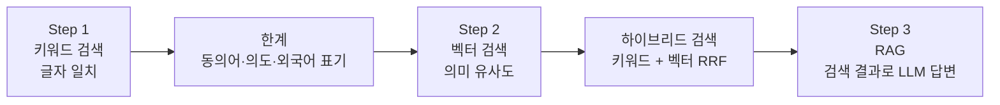

# Step 2. 벡터 검색

> 글자가 아니라 의미로 책을 찾습니다. 임베딩(Embedding) 모델 BGE-M3로 도서 정보를 숫자 벡터로 바꾸고, pgvector로 "의미가 가까운 책"을 찾은 뒤, 키워드 검색과 합쳐 하이브리드 검색까지 완성합니다. 이 프로젝트에서 AI 모델을 처음 직접 호출하는 단계입니다.

## 이 단계에서 만드는 것

검색 화면의 검색 방식 선택 상자에 "벡터 검색"과 "하이브리드 검색"이 추가됩니다. 같은 질문을 넣어도 방식마다 결과가 다릅니다.

"프로그래밍을 처음 배우는 사람에게 맞는 책"을 하이브리드 방식으로 검색한 화면입니다. 이 문장을 그대로 담은 제목은 없지만, 의미가 가까운 입문서가 위에 나옵니다. 카드의 "일치"는 벡터 유사도, "RRF"는 키워드·벡터 순위를 합친 점수입니다. 같은 문장을 키워드 방식으로 검색해 결과를 비교해 보세요. 수치는 데이터와 임베딩 서버에 따라 달라집니다.

완성 후 동작하는 것:

- 도서가 적재되면 스케줄러가 5초 간격으로 임베딩이 없는 도서를 32권씩 골라 1024차원 벡터를 만들어 `books.embedding` 컬럼에 저장합니다.
- 사용자가 벡터 검색을 고르면 검색어를 같은 모델로 벡터로 바꾸고, pgvector의 코사인 거리 연산자 `<=>`로 가까운 순서대로 도서를 돌려줍니다.
- 하이브리드 검색은 키워드 검색과 벡터 검색을 병렬로 실행한 뒤 RRF(Reciprocal Rank Fusion, k=60)로 순위를 합칩니다.

## 왜 이 단계가 필요한가

Step 1의 키워드 검색은 GIN 인덱스와 전문 검색으로 빨라졌지만, 여전히 **글자가 일치하는지**만 봅니다. "컴퓨터 구조"로는 "Computer Architecture"를 찾지 못하고, "처음 배우는 사람에게 맞는 책"처럼 의도를 담은 문장에는 거의 답하지 못합니다.

이번 단계에서는 문장을 **의미를 담은 숫자 목록(벡터)** 으로 바꿔, 글자가 달라도 뜻이 가까우면 찾을 수 있게 합니다. 다만 벡터 검색은 ISBN이나 저자 이름처럼 정확히 일치해야 하는 검색에는 약하므로, 마지막에 두 방식을 합칩니다.

이 단계의 벡터 검색 결과는 Step 3에서 LLM에 넘길 **컨텍스트**가 됩니다. 검색이 좋아야 RAG 답변도 좋아집니다.

## 문서 구성

| 순서 | 문서 | 내용 | 예상 시간 |
|------|------|------|-----------|
| 1 | [01. 키워드 검색의 한계 체감하기](01.search-quality-limitations.md) | 키워드 검색이 실패하는 사례, 임베딩·벡터 공간의 직관, 정밀도와 재현율 | 1시간 |
| 2 | [02. pgvector 설정](02.pgvector-setup.md) | pgvector 확장, `vector(1024)` 컬럼, JPA 엔티티 매핑, 연산자 미리 보기 | 1시간 |
| 3 | [03. 임베딩 생성 배치](03.embedding-generation.md) | Spring AI `EmbeddingModel`로 BGE-M3 호출, 텍스트 전처리, 스케줄러 배치 | 2시간 |
| 4 | [04. 자연어 검색](04.natural-language-search.md) | 코사인 유사도 계산, pgvector 연산자 `<=>`·`<->`·`<#>`, QueryDSL 벡터 검색 | 2시간 |
| 5 | [05. 하이브리드 검색](05.hybrid-search.md) | RRF 계산 과정, `RrfService`, `CompletableFuture` 병렬 검색 | 2시간 |

## 이 단계를 마치면

- [ ] 키워드 검색이 실패하는 사례를 세 가지 이상 들 수 있다
- [ ] 임베딩, 벡터, 차원, 코사인 유사도를 자기 말로 설명할 수 있다
- [ ] `books.embedding vector(1024)` 컬럼이 준비되어 있고 임베딩이 채워지는 것을 SQL로 확인할 수 있다
- [ ] pgvector 연산자 `<=>`(코사인 거리), `<->`(L2 거리), `<#>`(음의 내적)의 차이를 설명할 수 있다
- [ ] 검색 화면에서 벡터 검색을 실행하고 "일치" 비율의 의미를 설명할 수 있다
- [ ] 작은 예시로 RRF 점수를 직접 계산하고 하이브리드 검색 결과 순서를 예측할 수 있다

## 관련 소스 코드

| 클래스 | 역할 | 경로 |
|--------|------|------|
| `Book` | `embedding` 필드(`vector(1024)`) 매핑 | `src/main/java/net/java21/library/core/book/domain/Book.java` |
| `VectorConverter` | `float[]` ↔ `"[0.1, 0.2, ...]"` 문자열 변환 | `src/main/java/net/java21/library/core/book/domain/VectorConverter.java` |
| `TextPreprocessor` | 임베딩 전 텍스트 정제 | `src/main/java/net/java21/library/core/book/util/TextPreprocessor.java` |
| `EmbeddingService` | Spring AI `EmbeddingModel` 호출 | `src/main/java/net/java21/library/core/book/service/embedding/EmbeddingService.java` |
| `BookEmbeddingService` | 임베딩이 없는 도서를 골라 배치로 생성·저장 | `src/main/java/net/java21/library/core/book/service/embedding/BookEmbeddingService.java` |
| `BookEmbeddingScheduler` | 5초 간격, 32권씩 임베딩 배치 실행 | `src/main/java/net/java21/library/batch/embedding/scheduler/BookEmbeddingScheduler.java` |
| `PostgreSQLFunctionContributor` | `vector_cosine_similarity` 함수 등록 | `src/main/java/net/java21/library/core/config/PostgreSQLFunctionContributor.java` |
| `BookRepositoryImpl` | `vectorSearch()` QueryDSL 쿼리 | `src/main/java/net/java21/library/core/book/repository/impl/BookRepositoryImpl.java` |
| `BookSearchService` | 검색어 임베딩 생성 후 검색 전략 선택 | `src/main/java/net/java21/library/core/book/service/search/BookSearchService.java` |
| `VectorSearchStrategy` | 벡터 검색 전략 | `src/main/java/net/java21/library/core/book/service/search/strategy/VectorSearchStrategy.java` |
| `HybridSearchStrategy` | 키워드·벡터 병렬 검색 후 RRF 병합 | `src/main/java/net/java21/library/core/book/service/search/strategy/HybridSearchStrategy.java` |
| `RrfService` | RRF(k=60) 순위 병합 | `src/main/java/net/java21/library/core/book/service/search/RrfService.java` |

[01. 키워드 검색의 한계 체감하기 →](01.search-quality-limitations.md)
