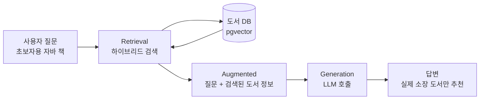

# 01. RAG 이해: LLM의 환각을 검색으로 막기

> LLM을 처음으로 직접 호출해 보고, LLM이 우리 도서관에 없는 책을 지어내는 환각(Hallucination)을 체험합니다. 이어서 같은 질문에 검색 결과를 함께 넘기면 답이 어떻게 달라지는지 확인하며 RAG의 원리를 이해합니다.
>
> 예상 소요 시간: 1.5시간 · 난이도: 입문

## 학습 목표

- LLM이 답을 만드는 방식과 환각이 생기는 이유를 설명할 수 있다
- Spring AI `ChatClient`로 LLM을 한 번 호출하고 응답 문자열을 받을 수 있다
- 같은 질문에 참고 자료(컨텍스트)를 넣었을 때 답이 달라지는 것을 실험으로 확인할 수 있다
- RAG의 세 단계(검색 → 증강 → 생성)를 이 프로젝트의 클래스와 연결해 설명할 수 있다

## 시작하기 전에

- [Step 2. 하이브리드 검색](../step-2/05.hybrid-search.md)까지 완료해 `SearchType.HYBRID` 검색이 동작해야 합니다.
- LLM API를 호출하려면 Ollama 서버 주소 또는 Gemini API 키가 필요합니다. 키는 프로젝트 루트의 `secrets.properties`에 `GEMINI_API_KEY=...` 형태로 넣습니다(템플릿: `secrets.properties.example`). 코드나 문서에 실제 키를 쓰지 않습니다.
- 처음 보는 용어는 [용어집](../glossary.md)을 참고합니다.

## 1. 왜 필요한가

Step 2까지 만든 검색은 "의미가 비슷한 책 목록"을 돌려줍니다. 하지만 사용자가 정말 원하는 것은 다음과 같은 대답입니다.

> "자바를 처음 배우는 분께는 ○○을 추천합니다. 기초 문법부터 예제 중심으로 설명하기 때문입니다."

이런 문장을 쓰는 일은 **LLM**(Large Language Model, 대규모 언어 모델)이 잘합니다. 그렇다면 LLM에게 그냥 "우리 도서관에 있는 자바 책을 추천해 줘"라고 물으면 될까요? 답은 "아니요"입니다. LLM은 우리 도서관의 소장 목록을 본 적이 없기 때문입니다. 그런데도 LLM은 "모릅니다"라고 하기보다 그럴듯한 책 제목과 저자를 만들어 냅니다.

이 문서의 3장에서 이 현상을 직접 확인해 보겠습니다. 먼저 필요한 개념을 짧게 정리합니다.

## 2. 핵심 개념

### 2.1. LLM은 "다음에 올 말"을 예측하는 모델

**LLM**은 인터넷 문서, 책 등 방대한 텍스트로 학습한 모델로, 입력한 문장 뒤에 올 가능성이 가장 높은 말을 이어 붙여 답을 만듭니다. LLM에게 보내는 입력 문장을 **프롬프트**(Prompt)라고 합니다.

여기서 중요한 사실이 두 가지 있습니다.

1. LLM이 아는 것은 **학습 시점까지 본 텍스트**뿐입니다. 학습 이후에 나온 책이나 우리 DB의 데이터는 모릅니다.
2. LLM은 사실을 "조회"하지 않고 문장을 "생성"합니다. 그래서 모르는 내용도 문장 형태로는 매끄럽게 만들어 낼 수 있습니다.

### 2.2. 환각(Hallucination)

**환각**은 LLM이 사실이 아닌 내용을 그럴듯하게 지어내는 현상입니다. 교과서를 덮고 기억에만 의존해 서술형 시험을 보는 학생을 떠올리면 쉽습니다. 기억이 흐릿한 부분도 빈칸으로 두지 않고 그럴듯한 문장으로 채웁니다.

| 질문 | 환각이 생기는 이유 |
|------|-------------------|
| "이 도서관에 있는 Spring AI 책은?" | 우리 도서관 소장 목록을 학습한 적이 없음 |
| "지난달 나온 신간은?" | 학습 시점 이후의 정보 |
| "그 책의 청구기호는?" | 학습 데이터에 거의 없는 세부 정보 |

### 2.3. RAG: 오픈 북 시험

**RAG**(Retrieval-Augmented Generation, 검색 증강 생성)는 LLM에게 답을 시키기 전에 **신뢰할 수 있는 자료를 먼저 검색해서 프롬프트에 함께 넣어 주는** 방식입니다. 시험으로 치면 "교과서를 펴 놓고 보는 오픈 북 시험"입니다. 이름의 세 단어가 그대로 처리 순서입니다.

| 단계 | 의미 | 이 프로젝트에서 |
|------|------|----------------|
| Retrieval(검색) | 질문과 관련된 자료를 찾음 | Step 2의 하이브리드 검색 |
| Augmented(증강) | 찾은 자료를 프롬프트에 덧붙임 | 검색된 도서 정보를 텍스트로 만든 **컨텍스트**(Context) |
| Generation(생성) | LLM이 자료를 근거로 답을 생성 | LLM이 추천 도서와 사유를 JSON으로 반환 |



### 2.4. RAG와 파인튜닝

LLM에게 새 지식을 넣는 또 다른 방법은 **파인튜닝**(Fine-tuning), 즉 우리 데이터로 모델을 추가 학습시키는 것입니다.

| 항목 | 파인튜닝 | RAG |
|------|---------|-----|
| 모델 수정 | 필요(추가 학습) | 불필요 |
| 데이터가 바뀌면 | 다시 학습 | DB만 갱신하면 즉시 반영 |
| 근거 확인 | 어려움 | 어떤 문서를 참고했는지 알 수 있음 |
| 비용·난이도 | 높음 | 낮음 |

도서 목록처럼 자주 바뀌고 "실제로 있는지"가 중요한 데이터에는 RAG가 적합합니다.

## 3. 따라 하기

이번 장에서는 저장소에 없는 **학습용 테스트**를 직접 만들어 LLM을 호출합니다. LLM의 답은 매번 조금씩 다르므로, 아래 출력은 예시로만 봐 주세요.

### STEP 1. 어떤 LLM을 쓰는지 확인하기

목표: 이 프로젝트가 어떤 LLM을 어떻게 선택하는지 파악합니다.

`src/main/resources/application.properties`의 AI 관련 설정입니다.

```properties
# Google Gemini
spring.ai.google.genai.api-key=${GEMINI_API_KEY:}
spring.ai.google.genai.chat.options.model=gemini-2.0-flash
spring.ai.google.genai.chat.options.temperature=0.3

# Ollama
spring.ai.ollama.base-url=http://ollama.java21.net
spring.ai.ollama.chat.options.model=qwen2.5:latest
spring.ai.ollama.chat.options.temperature=0.3

# 사용할 모델 선택 (gemini 또는 ollama, 지정하지 않으면 gemini)
spring.ai.selected-model=ollama
```

의존성에 Gemini와 Ollama 스타터가 모두 들어 있어서 `ChatModel` 빈이 두 개 생깁니다. 어떤 것을 기본으로 쓸지는 `AiConfig`가 `spring.ai.selected-model` 값을 보고 `@Primary`로 정합니다. 자세한 내용은 [03. LLM 연동](03.llm-integration.md)에서 다룹니다.

- **Gemini**: Google의 클라우드 LLM. API 키가 필요합니다.
- **Ollama**: 오픈소스 LLM을 서버에서 실행해 주는 도구. 이 프로젝트는 `qwen2.5` 모델을 씁니다.

### STEP 2. LLM에게 그냥 물어보기 (환각 체험)

목표: 참고 자료 없이 질문했을 때 LLM이 소장 도서를 지어내는 것을 확인합니다.

`src/test/java/net/java21/library/study/HallucinationTest.java`를 새로 만듭니다. 원격 DB에 연결되는 `@SpringBootTest`를 피하려고, Spring 컨텍스트 없이 Ollama `ChatModel`을 직접 만듭니다.

```java
package net.java21.library.study;

import org.junit.jupiter.api.BeforeEach;
import org.junit.jupiter.api.DisplayName;
import org.junit.jupiter.api.Test;
import org.springframework.ai.chat.client.ChatClient;
import org.springframework.ai.ollama.OllamaChatModel;
import org.springframework.ai.ollama.api.OllamaApi;
import org.springframework.ai.ollama.api.OllamaChatOptions;

class HallucinationTest {

    private static final String OLLAMA_URL = "http://ollama.java21.net";
    private static final String MODEL = "qwen2.5:latest";

    private ChatClient chatClient;

    @BeforeEach
    void setUp() {
        OllamaChatModel chatModel = OllamaChatModel.builder()
                .ollamaApi(OllamaApi.builder().baseUrl(OLLAMA_URL).build())
                .defaultOptions(OllamaChatOptions.builder()
                        .model(MODEL)
                        .temperature(0.3)
                        .build())
                .build();
        chatClient = ChatClient.create(chatModel);
    }

    @Test
    @DisplayName("참고 자료 없이 질문하면 LLM이 소장 도서를 지어낸다")
    void askWithoutContext() {
        String answer = chatClient.prompt()
                .user("우리 도서관에 소장된 Spring AI 관련 책 3권을 제목, 저자, 청구기호와 함께 추천해 주세요.")
                .call()
                .content();

        System.out.println(answer);
    }
}
```

**코드 설명**

- `ChatClient.create(chatModel)`: `ChatModel`을 감싸 체인 방식으로 LLM을 호출하게 해 주는 Spring AI 1.1.2의 클라이언트입니다.
- `prompt()` → `user(...)` → `call()` → `content()`: "프롬프트를 시작하고, 사용자 메시지를 넣고, 동기 호출한 뒤, 응답 본문 문자열을 꺼낸다"는 뜻입니다.

**실행과 예상 결과**

```bash
mvn test -Dtest=HallucinationTest#askWithoutContext
```

```text
네, 추천해 드리겠습니다.
1. 『Spring AI 완벽 가이드』 - 김○○ 저, 청구기호 005.133 김84ㅅ
2. 『스프링 AI로 시작하는 LLM 애플리케이션』 - 이○○ 저, 청구기호 005.1 이56ㅅ
3. ...
```

출력은 자신감 있어 보이지만, 우리 도서관 DB를 조회한 적이 없으므로 제목과 청구기호 모두 확인되지 않은 정보입니다. 실제로 `/` 화면에서 같은 제목을 검색해 보면 대부분 결과가 없습니다. 이것이 환각입니다.

### STEP 3. 참고 자료를 넣어서 다시 물어보기

목표: 같은 질문에 "우리 도서관 목록"을 함께 주면 답이 어떻게 달라지는지 확인합니다.

`HallucinationTest`에 메서드를 추가합니다. 여기서는 검색 대신 손으로 쓴 도서 목록을 넣습니다(실제 검색 결과 연결은 STEP 4와 02 문서에서 합니다).

```java
@Test
@DisplayName("참고 자료를 함께 주면 목록 안에서만 답한다")
void askWithContext() {
    String context = """
            ID: 101, 제목: 혼자 공부하는 자바, 저자: 신용권
            ID: 102, 제목: 이것이 자바다, 저자: 신용권
            ID: 103, 제목: 모던 자바 인 액션, 저자: 라울-게이브리얼 우르마
            """;

    String answer = chatClient.prompt()
            .user("""
                    아래 [도서 목록]에 있는 책만 사용해서 답하세요.
                    목록에 알맞은 책이 없으면 "해당 도서를 찾을 수 없습니다"라고 답하세요.

                    [질문]
                    우리 도서관에 소장된 Spring AI 관련 책을 추천해 주세요.

                    [도서 목록]
                    """ + context)
            .call()
            .content();

    System.out.println(answer);
}
```

**예상 결과**

```text
해당 도서를 찾을 수 없습니다. 제공된 목록에는 자바 입문서와 자바 심화서만 있고
Spring AI를 다루는 책은 없습니다.
```

질문을 "자바를 처음 배우는데 어떤 책이 좋을까요?"로 바꿔 다시 실행하면, 이번에는 목록의 `혼자 공부하는 자바`를 근거와 함께 추천합니다. 두 실험의 차이를 정리하면 다음과 같습니다.

| 실험 | 프롬프트에 든 것 | 결과 |
|------|----------------|------|
| STEP 2 | 질문만 | 존재 여부를 알 수 없는 책을 지어냄 |
| STEP 3 | 질문 + 도서 목록 + "목록 밖은 답하지 말 것" 규칙 | 목록 안에서만 답하거나 "없다"고 답함 |

RAG는 STEP 3에서 손으로 쓴 도서 목록을 **검색 결과로 자동으로 채우는 것**입니다.

### STEP 4. 검색 결과를 연결한 최소 RAG 서비스 (학습용)

목표: Step 2의 하이브리드 검색과 LLM 호출을 하나로 잇는 가장 단순한 RAG를 만들어 흐름을 익힙니다.

> 이 `BookRagService`는 이해를 돕기 위한 **학습용 예제**로, 저장소에는 없습니다. 실제 프로젝트에서는 `RagSearchStrategy`가 RAG 검색 흐름을, `AiRecommendationService`가 컨텍스트 구성과 LLM 호출을 맡습니다. 두 클래스는 [03. LLM 연동](03.llm-integration.md)에서 자세히 봅니다.

```java
package net.java21.library.study.rag;

import java.util.List;
import lombok.extern.slf4j.Slf4j;
import net.java21.library.core.book.domain.SearchType;
import net.java21.library.core.book.dto.BookSearchRequest;
import net.java21.library.core.book.dto.BookSearchResponse;
import net.java21.library.core.book.service.search.BookSearchService;
import org.springframework.ai.chat.client.ChatClient;
import org.springframework.ai.chat.model.ChatModel;
import org.springframework.data.domain.PageRequest;
import org.springframework.stereotype.Service;

@Slf4j
@Service
public class BookRagService {

    private static final int TOP_K = 5;

    private final BookSearchService bookSearchService;
    private final ChatClient chatClient;

    public BookRagService(BookSearchService bookSearchService, ChatModel chatModel) {
        this.bookSearchService = bookSearchService;
        this.chatClient = ChatClient.create(chatModel); // @Primary ChatModel 사용
    }

    public String recommend(String question) {
        // 1. Retrieval: 하이브리드 검색으로 상위 TOP_K권
        BookSearchRequest request = new BookSearchRequest(question, null, SearchType.HYBRID, null);
        List<BookSearchResponse> books = bookSearchService
                .searchBooks(PageRequest.of(0, TOP_K), request)
                .getBooks()
                .getContent();
        log.info("검색된 도서 수: {}", books.size());

        // 2. Augmented: 검색 결과를 텍스트로
        StringBuilder context = new StringBuilder();
        for (BookSearchResponse book : books) {
            context.append(String.format("ID: %d, 제목: %s, 저자: %s%n",
                    book.getId(), book.getTitle(), book.getAuthorName()));
        }

        // 3. Generation: LLM 호출
        return chatClient.prompt()
                .user("""
                        당신은 도서관 사서입니다. [도서 목록]에 있는 책만 사용해 답하세요.
                        목록에 알맞은 책이 없으면 모른다고 답하세요.

                        [질문]
                        %s

                        [도서 목록]
                        %s
                        """.formatted(question, context))
                .call()
                .content();
    }
}
```

**코드 설명**

- `BookSearchService.searchBooks()`에 `SearchType.HYBRID`를 넘기면 Step 2의 하이브리드 검색이 실행됩니다. 벡터가 `null`이면 서비스가 임베딩을 알아서 만듭니다.
- 생성자에서 `ChatModel`을 주입받아 `ChatClient`를 만듭니다. `ChatModel`이 Gemini와 Ollama 두 개라도 `AiConfig`의 `@Primary` 덕분에 선택된 하나가 주입됩니다.
- 이 버전은 LLM 답을 문자열 그대로 돌려줍니다. 화면에 "AI 추천 %"처럼 구조화해 보여 주려면 JSON으로 받아야 하는데, 이는 02와 03에서 다룹니다.

**확인 방법**: 학습용 컨트롤러를 만들거나 애플리케이션 실행 후 디버거로 `recommend("자바를 처음 배우는데 좋은 책")`을 호출해 봅니다. 응답에 나온 책 제목이 모두 검색 결과에 있는지 비교합니다.

### STEP 5. 실제 화면에서 RAG 확인하기

목표: 이미 구현된 RAG 검색을 화면에서 실행해 봅니다.

1. 애플리케이션을 실행하고 `http://localhost:8080/`에 접속합니다.
2. 검색 방식으로 "AI 도서 추천 (RAG)"을 고르고 "초보자를 위한 자바 책"을 검색합니다.
3. 처음에는 하이브리드 검색 결과만 보입니다. 잠시 후 같은 검색을 다시 하면 AI 추천 영역(AI 추천 %, 일치율, RRF, 추천 사유)이 나타납니다.

처음에 AI 추천이 바로 보이지 않는 이유는 LLM 호출이 수 초 걸리기 때문에, 실제 구현은 먼저 하이브리드 결과를 보여 주고 AI 추천은 백그라운드에서 만들어 캐시에 넣기 때문입니다. 이 구조는 03 문서와 [Step 4. 시맨틱 캐싱](../step-4/03.semantic-caching.md)에서 다룹니다.

화면의 세 수치는 출처가 서로 다릅니다.

| 지표 | 누가 계산하나 | 의미 |
|------|-------------|------|
| AI 추천 %(relevance) | LLM | 질문과 도서의 관련성을 LLM이 0~100으로 판단 |
| 일치율(similarity) | pgvector | 질문 임베딩과 도서 임베딩의 벡터 유사도 |
| RRF | `RrfService` | 키워드·벡터 검색 순위를 합친 점수(k=60) |

## 4. 직접 해 보기

### 미션 1 (기본): 환각 유도 질문 만들기

STEP 2의 `askWithoutContext`에서 질문을 바꿔 가며 환각이 잘 일어나는 질문의 특징을 찾아보세요. "최신", "우리 도서관", "청구기호", "출판일"처럼 세부 정보를 요구하는 질문을 3개 이상 시도하고 결과를 표로 정리합니다.

<details>
<summary>힌트</summary>

세부 사실(숫자, 고유명사, 날짜)을 요구할수록 환각이 늘어납니다. 반대로 "자바를 배우는 일반적인 순서" 같은 일반 지식 질문은 비교적 정확합니다. LLM이 약한 부분이 "학습하지 않은 구체적 사실"이라는 점을 확인하는 것이 목적입니다.

</details>

### 미션 2 (기본): 규칙 한 줄의 효과

STEP 3의 `askWithContext`에서 "목록에 알맞은 책이 없으면 ... 답하세요" 줄을 지우고 Spring AI 질문을 다시 실행해 보세요. 결과가 어떻게 달라지는지 기록합니다.

<details>
<summary>예상 결과와 해설</summary>

규칙이 없으면 LLM이 목록과 무관한 책을 덧붙이거나 "목록에는 없지만 다음 책도 있습니다"처럼 외부 지식을 섞는 경우가 늘어납니다. 컨텍스트를 넣는 것만으로는 부족하고, "컨텍스트 밖은 답하지 말라"는 규칙이 함께 있어야 환각이 줄어듭니다. 실제 `AiRecommendationService`의 프롬프트에도 "입력 데이터에 없는 필드는 추측하지 마세요", "추천 사유를 명확히 알 수 없는 경우 ... 모른다는 표현을 사용하세요" 같은 규칙이 들어 있습니다.

</details>

### 미션 3 (도전): 검색 결과 0건 처리

`BookRagService.recommend()`에서 검색 결과가 비어 있으면 LLM을 호출하지 않고 "관련 도서를 찾을 수 없습니다."를 반환하도록 고쳐 보세요.

<details>
<summary>정답 예시</summary>

```java
if (books.isEmpty()) {
    return "관련 도서를 찾을 수 없습니다.";
}
```

검색 결과가 없으면 LLM에게 줄 근거가 없으므로 호출 자체가 비용 낭비이고 환각의 원인이 됩니다. 실제 `AiRecommendationService.recommend()`도 첫 줄에서 `books`가 비어 있으면 `List.of()`를 반환합니다.

</details>

## 5. 자주 하는 실수

| 증상 | 원인 | 해결 |
|------|------|------|
| `NoUniqueBeanDefinitionException: ChatModel` | Gemini·Ollama `ChatModel`이 둘 다 있는데 `@Primary`가 없음 | `AiConfig`가 등록되는지, `spring.ai.selected-model` 값이 `gemini` 또는 `ollama`인지 확인 |
| Gemini 호출 시 인증 오류 | `GEMINI_API_KEY`가 비어 있음 | `secrets.properties`에 키를 넣고 애플리케이션을 다시 시작. 키를 코드에 직접 쓰지 않음 |
| 테스트가 오래 멈춰 있다가 타임아웃 | Ollama 서버 응답이 느리거나 접속 불가 | 브라우저로 `http://ollama.java21.net` 접속 확인. 운영 설정에서는 `AiConfig`가 읽기 타임아웃을 5분으로 늘림 |
| 컨텍스트를 넣었는데도 목록 밖 책을 추천 | "목록에 있는 책만", "모르면 모른다고" 규칙이 없음 | 프롬프트에 근거 제한 규칙을 명시(미션 2 참고) |
| 실행할 때마다 답이 다름 | LLM은 확률적으로 문장을 생성 | 정상 동작. Temperature를 낮추면 변동이 줄어듦(03 문서) |

## 6. 정리

- LLM은 학습한 텍스트를 바탕으로 다음 말을 생성할 뿐, 우리 DB를 조회하지 않습니다. 그래서 모르는 사실을 그럴듯하게 지어내는 환각이 생깁니다.
- RAG는 검색(Retrieval)으로 찾은 실제 자료를 프롬프트에 덧붙여(Augmented) LLM이 그 근거로 답하게(Generation) 하는 방식입니다.
- 컨텍스트와 함께 "자료 밖은 답하지 말 것"이라는 규칙을 줘야 효과가 있습니다.
- 실제 구현은 `RagSearchStrategy`(흐름)와 `AiRecommendationService`(프롬프트·LLM 호출)로 나뉘고, 모델 선택은 `AiConfig`가 `spring.ai.selected-model`로 합니다.

- [ ] `ChatClient`로 LLM을 호출해 응답을 출력해 보았다
- [ ] 참고 자료 유무에 따라 답이 달라지는 것을 확인했다
- [ ] RAG의 세 단계를 이 프로젝트의 클래스에 대응시킬 수 있다
- [ ] 화면에서 RAG 검색을 실행해 AI 추천 영역을 확인했다

## 확인 문제

**1. LLM이 "우리 도서관에 있는 책"을 정확히 답하지 못하는 근본 이유는 무엇입니까?**

<details>
<summary>정답</summary>

LLM은 학습 시점까지 본 텍스트로 다음 말을 생성할 뿐, 우리 도서관 DB를 학습하거나 조회하지 않기 때문입니다. 모르는 사실도 문장으로는 만들 수 있어서 환각이 생깁니다.

</details>

**2. RAG의 R, A, G는 이 프로젝트에서 각각 무엇에 해당합니까?**

<details>
<summary>정답</summary>

R(Retrieval)은 Step 2의 하이브리드 검색, A(Augmented)는 검색된 도서 정보를 텍스트 컨텍스트로 만들어 프롬프트에 넣는 단계, G(Generation)는 LLM이 그 컨텍스트를 근거로 추천 도서와 사유를 생성하는 단계입니다.

</details>

**3. 도서 목록처럼 자주 바뀌는 데이터에 파인튜닝보다 RAG가 적합한 이유를 한 가지 쓰세요.**

<details>
<summary>정답</summary>

RAG는 모델을 다시 학습하지 않고 DB만 갱신하면 새 데이터가 바로 답변에 반영됩니다. 또 어떤 도서를 근거로 답했는지 확인할 수 있습니다.

</details>

**4. 화면의 "AI 추천 %"와 "일치율"은 무엇이 다릅니까?**

<details>
<summary>정답</summary>

"AI 추천 %"는 LLM이 질문과 도서의 관련성을 판단해 매긴 relevance 점수이고, "일치율"은 pgvector가 계산한 질문 임베딩과 도서 임베딩의 벡터 유사도입니다. 하나는 LLM의 판단, 다른 하나는 수치 계산 결과입니다.

</details>

## 다음 문서

[02. 컨텍스트 구축 →](02.context-construction.md)
