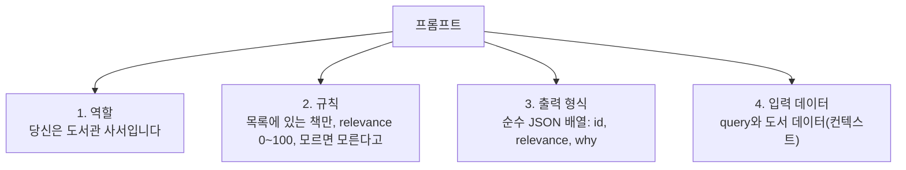

# 02. 컨텍스트 구축: 검색 결과를 LLM이 읽는 글로 바꾸기

> 검색으로 얻은 `List<BookSearchResponse>`를 LLM이 읽을 수 있는 텍스트(컨텍스트)로 바꾸고, 역할·규칙·출력 형식을 갖춘 프롬프트를 만듭니다. 실제 `AiRecommendationService`가 컨텍스트를 어떻게 구성하는지도 함께 살펴봅니다.
>
> 예상 소요 시간: 2시간 · 난이도: 기본

## 학습 목표

- 컨텍스트와 토큰이 무엇이고, 컨텍스트 크기가 비용·속도·품질에 어떤 영향을 주는지 설명할 수 있다
- 검색 결과에서 LLM에게 필요한 필드만 골라 컨텍스트 문자열을 만들 수 있다
- 역할, 규칙, 출력 형식, 입력 데이터로 이루어진 프롬프트 템플릿을 작성할 수 있다
- 실제 `AiRecommendationService`의 컨텍스트 구성 방식(RRF 순 정렬, 후보 수 제한)을 설명할 수 있다

## 시작하기 전에

- [01. RAG 이해](01.understanding-rag.md)에서 `ChatClient`로 LLM을 호출해 보았어야 합니다.
- Java 텍스트 블록(`"""`)과 `StringBuilder` 사용법을 알고 있으면 좋습니다.
- 처음 보는 용어는 [용어집](../glossary.md)을 참고합니다.

## 1. 왜 필요한가

01 문서의 STEP 3에서는 도서 목록을 손으로 썼습니다. 이제 이 자리를 실제 검색 결과로 채워야 합니다. 가장 쉬운 방법은 리스트를 그대로 문자열에 붙이는 것입니다.

```java
String prompt = "다음 도서 중에서 추천해 주세요: " + books;
```

LLM이 실제로 받는 글은 이렇습니다. `BookSearchResponse`에는 `toString()`이 없기 때문입니다.

```text
다음 도서 중에서 추천해 주세요: [net.java21.library.core.book.dto.BookSearchResponse@6d06d69c,
net.java21.library.core.book.dto.BookSearchResponse@7852e922, ...]
```

LLM은 Java 객체를 볼 수 없고, 오직 **글자**만 읽습니다. 반대로 모든 필드를 다 넣으면 ISBN, 이미지 URL, 가격처럼 추천과 무관한 정보가 글을 길게 만들어 비용과 응답 시간만 늘어납니다.

또 하나의 문제는 **답의 형태**입니다. 01 문서의 LLM은 자유로운 문장으로 답했습니다. 하지만 화면에 "AI 추천 %"와 추천 사유를 도서별로 표시하려면 "어떤 책(ID)에, 몇 점, 어떤 이유"를 프로그램이 읽을 수 있는 형태로 받아야 합니다.

그래서 이 문서에서는 두 가지를 설계합니다.

1. LLM에게 **무엇을, 어떤 모양으로 보여 줄지**(컨텍스트)
2. LLM에게 **어떻게 답하라고 시킬지**(프롬프트의 규칙과 출력 형식)

## 2. 핵심 개념

### 2.1. 컨텍스트(Context)

**컨텍스트**는 LLM이 답을 만들 때 참고하도록 프롬프트에 넣어 주는 자료입니다. 01 문서의 오픈 북 시험 비유에서 "펴 놓은 교과서"에 해당합니다. 교과서가 정리되어 있어야 빨리 찾아 답할 수 있듯이, 컨텍스트도 한 도서당 한 줄처럼 일정한 형식으로 정리해야 LLM이 헷갈리지 않습니다.

### 2.2. 토큰(Token)과 컨텍스트 크기

**토큰**은 LLM이 글을 읽고 쓰는 단위입니다. 단어보다 작은 조각으로, 한국어는 대략 한 글자가 1토큰 안팎입니다(모델마다 다릅니다). LLM API는 보통 입력·출력 토큰 수로 요금을 매기고, 한 번에 읽을 수 있는 토큰 수에도 상한이 있습니다.

컨텍스트에 넣는 도서 수를 **Top-K**(상위 K개)라고 부릅니다. K를 정할 때는 다음을 저울질합니다.

| K | 장점 | 단점 |
|---|------|------|
| 크게(예: 50) | 정답 후보를 놓칠 가능성이 낮음 | 토큰·비용 증가, 응답 지연, 중요한 정보가 묻힘 |
| 작게(예: 5) | 빠르고 저렴, LLM이 집중하기 쉬움 | 검색이 놓친 책은 추천 불가 |

이 프로젝트의 실제 구현은 하이브리드 검색으로 100권을 뽑은 뒤 RRF 점수 기준을 넘는 **최대 5권**만 LLM에게 보냅니다. 이 값의 근거는 [Step 4. Top-K 최적화](../step-4/02.topk-optimization.md)에서 다룹니다.

### 2.3. 프롬프트의 네 부분

좋은 프롬프트는 대체로 네 부분으로 나뉩니다.



| 부분 | 역할 | 빠지면 생기는 일 |
|------|------|----------------|
| 역할 | 어떤 관점과 어조로 답할지 | 어조와 판단 기준이 매번 달라짐 |
| 규칙 | 근거 제한, 점수 기준, 금지 사항 | 목록 밖 책 추천, 점수 기준 들쭉날쭉 |
| 출력 형식 | 프로그램이 파싱할 수 있는 모양 | 자유 문장이 와서 DTO로 변환 불가 |
| 입력 데이터 | 질문과 컨텍스트 | 환각(01 문서 STEP 2) |

### 2.4. 순서도 정보다

LLM은 긴 입력의 **앞부분과 끝부분**을 비교적 잘 활용하고, 가운데 묻힌 정보는 놓치기 쉽다고 알려져 있습니다. 그래서 컨텍스트는 "중요한 책이 앞에" 오도록 정렬하는 것이 좋습니다. 실제 구현은 RRF 점수가 높은 순으로 도서를 정렬한 뒤 컨텍스트를 만듭니다.

## 3. 따라 하기

01 문서의 학습용 `BookRagService`에서 컨텍스트와 프롬프트를 만드는 부분을 별도 클래스로 분리합니다. Spring 없이 단위 테스트할 수 있게 하려는 목적입니다.

> `RagPromptBuilder`는 **학습용 예제**로 저장소에는 없습니다. 실제 프로젝트에서는 `AiRecommendationService.recommend()` 한 메서드가 컨텍스트 구성, 프롬프트 치환, LLM 호출, JSON 파싱을 모두 처리합니다(STEP 4에서 비교).

### STEP 1. 컨텍스트에 넣을 필드 고르기

목표: `BookSearchResponse`의 필드 중 추천 판단에 필요한 것만 고릅니다.

| 필드 | 포함 여부 | 이유 |
|------|----------|------|
| `id` | 필수 | LLM 응답의 도서를 검색 결과와 다시 연결하는 열쇠 |
| `title`, `authorName` | 필수 | 추천 판단과 사유 작성의 기본 정보 |
| `editionPublishDate` | 포함 | "최신 출간일" 고려 규칙에 사용 |
| `bookContent` | 포함 | 책 소개. 길이가 길면 토큰을 많이 차지 |
| `isbn`, `imageUrl`, `price` | 제외 | 추천 판단에 쓰이지 않음 |
| `averageRating`, `reviewCount`, `reviewSummary` | Step 4에서 추가 | 리뷰 정보 반영([Step 4. 리뷰 RAG 연동](../step-4/05.review-rag-integration.md)) |

`id`를 꼭 넣어야 하는 이유가 중요합니다. LLM이 "혼자 공부하는 자바"라고 제목만 돌려주면 같은 제목의 다른 판본과 구분할 수 없습니다. `id`를 받으면 검색 결과에서 정확히 그 책을 찾아 이미지, 출판사, 벡터 유사도 등을 함께 보여 줄 수 있습니다.

### STEP 2. 컨텍스트 문자열 만들기

목표: 도서 목록을 "한 도서당 한 줄" 텍스트로 바꿉니다.

`src/main/java/net/java21/library/study/rag/RagPromptBuilder.java`(학습용)를 만듭니다.

```java
package net.java21.library.study.rag;

import java.util.List;
import net.java21.library.core.book.dto.BookSearchResponse;

public final class RagPromptBuilder {

    private static final int MAX_CONTENT_LENGTH = 300;
    private static final String UNKNOWN = "알 수 없음";

    private RagPromptBuilder() {
    }

    public static String buildContext(List<BookSearchResponse> books) {
        StringBuilder context = new StringBuilder();
        for (BookSearchResponse book : books) {
            context.append(String.format("ID: %d, 제목: %s, 저자: %s, 출판일: %s, 내용: %s%n",
                    book.getId(),
                    book.getTitle(),
                    book.getAuthorName(),
                    book.getEditionPublishDate() != null ? book.getEditionPublishDate() : UNKNOWN,
                    truncate(book.getBookContent())));
        }
        return context.toString();
    }

    private static String truncate(String content) {
        if (content == null || content.isBlank()) {
            return "내용 없음";
        }
        return content.length() > MAX_CONTENT_LENGTH
                ? content.substring(0, MAX_CONTENT_LENGTH) + "..."
                : content;
    }
}
```

**코드 설명**

- 한 줄 형식 `ID: ..., 제목: ..., 저자: ...`는 실제 `AiRecommendationService`와 같은 모양입니다. 일정한 형식은 LLM이 도서 경계를 혼동하지 않게 해 줍니다.
- `null`을 그대로 출력하면 LLM이 "null"이라는 글자를 정보로 오해할 수 있으므로 "알 수 없음", "내용 없음"으로 바꿉니다.
- 소개글은 300자로 자릅니다. 학습용 버전에서는 Top-K 대신 길이 제한으로 토큰을 관리해 보는 것입니다.

**예상 결과**

```text
ID: 101, 제목: 혼자 공부하는 자바, 저자: 신용권, 출판일: 2019-06-10, 내용: 혼자 해도 충분하다! 1:1 과외하듯 배우는 자바 프로그래밍 자습서...
ID: 102, 제목: 이것이 자바다, 저자: 신용권, 출판일: 2024-01-05, 내용: 15년 이상 자바 언어를 교육해 온 저자의 노하우를...
```

### STEP 3. 프롬프트 템플릿 작성하기

목표: 2.3의 네 부분을 갖춘 템플릿에 질문과 컨텍스트를 채웁니다.

`RagPromptBuilder`에 메서드를 추가합니다.

```java
private static final String TEMPLATE = """
        당신은 경험 많은 도서관 사서입니다.

        [규칙]
        - 사용자의 query와 가장 관련 있는 도서를 [도서 데이터]에서만 선별하세요.
        - 각 도서에 relevance 점수(0~100)를 부여하고, 50 미만은 출력에서 제외하세요.
        - 추천 사유("why")는 공손한 합니다체로, 점수 없이 이유만 쓰세요.
        - 추천 사유를 알 수 없으면 "추천 사유를 명확히 알 수 없습니다"라고 쓰세요.
        - 입력 데이터에 없는 내용은 추측하지 마세요.

        [출력 형식]
        - 마크다운 코드 블록이나 설명 없이 순수 JSON 배열만 출력하세요.
        - 예: [{"id": 123, "relevance": 95, "why": "추천 사유"}]
        - relevance 내림차순으로 정렬하세요.

        query: {question}

        도서 데이터:
        {context}
        """;

public static String buildPrompt(String question, String context) {
    return TEMPLATE
            .replace("{question}", question)
            .replace("{context}", context);
}
```

**코드 설명**

- 역할(사서) → 규칙 → 출력 형식 → 입력 데이터 순서입니다. 데이터를 맨 뒤에 두면 규칙을 읽은 뒤 자료를 보게 되어 지시가 잘 지켜집니다.
- 출력 형식에 JSON 예시를 한 줄 보여 줍니다. LLM은 설명보다 예시를 더 잘 따라 합니다.
- 자리 표시자(`{question}`, `{context}`)는 `String.replace()`로 치환합니다. 실제 `AiRecommendationService`도 같은 방식입니다. `String.format()`을 쓰지 않는 이유는 5장 "자주 하는 실수"에서 설명합니다.

### STEP 4. 실제 구현과 비교하기

목표: 저장소의 `AiRecommendationService`가 컨텍스트를 어떻게 만드는지 확인합니다.

```java
// 컨텍스트 구성: RRF 점수 내림차순으로 정렬하여 가장 중요한 정보가 컨텍스트의 앞부분에 오도록 함
List<BookSearchResponse> sortedBooks = new ArrayList<>(books);
sortedBooks.sort((b1, b2) -> {
    Double s1 = b1.getRrfScore() != null ? b1.getRrfScore() : 0.0;
    Double s2 = b2.getRrfScore() != null ? b2.getRrfScore() : 0.0;
    return s2.compareTo(s1);
});

StringBuilder context = new StringBuilder();
for (BookSearchResponse book : sortedBooks) {
    String ratingInfo = formatRatingInfo(book);                      // "평점: 4.8/5.0(127개 리뷰)" 또는 ""
    String summaryInfo = formatReviewSummary(book.getReviewSummary()); // 100자로 자른 리뷰 요약 또는 ""

    StringBuilder bookContext = new StringBuilder();
    bookContext.append(String.format("ID: %d, 제목: %s, 저자: %s",
        book.getId(), book.getTitle(), book.getAuthorName()));
    if (!ratingInfo.isEmpty()) {
        bookContext.append(", ").append(ratingInfo);
    }
    if (!summaryInfo.isEmpty()) {
        bookContext.append(", ").append(summaryInfo);
    }
    bookContext.append(String.format(", 출판일: %s, 내용: %s\n",
        book.getEditionPublishDate() != null ? book.getEditionPublishDate().toString() : "알 수 없음",
        book.getBookContent() != null ? book.getBookContent() : "내용 없음"));

    context.append(bookContext);
}
```

전체 코드: [`AiRecommendationService.java`](../../src/main/java/net/java21/library/core/book/service/ai/AiRecommendationService.java)

학습용 버전과의 차이는 다음과 같습니다.

| 항목 | 학습용 `RagPromptBuilder` | 실제 `AiRecommendationService` |
|------|--------------------------|-------------------------------|
| 정렬 | 검색 순서 그대로 | RRF 점수 내림차순(2.4 참고) |
| 토큰 관리 | 소개글 300자 자르기 | 소개글은 그대로, 대신 `RagSearchStrategy`가 후보를 최대 5권(`MAX_AI_CANDIDATES`)으로 제한 |
| 리뷰 정보 | 없음 | 평점·리뷰 수, 리뷰 요약(100자 제한)을 포함(Step 4) |
| 프롬프트 규칙 | 핵심 규칙만 | 점수 구간별 기준, 리뷰 기반 가감점 규칙, 공손한 어투 규칙 포함 |

실제 프롬프트의 규칙 일부입니다.

```text
[규칙]
- 사용자가 제공하는 query와 가장 관련 있는 도서를 선별하세요.
- 각 도서에 대해 relevance 점수(0~100)를 부여하세요:
  - 90–100: query와 직접적으로 강하게 연관, 주제 적합성이 매우 높음
  - 70–89: query와 밀접하게 관련 있지만 일부 범위가 제한적임
  - 50–69: query와 간접적으로 관련, 배경 지식에 도움이 됨
  - 50 미만: 관련성이 낮으므로 출력에서 제외
...
[출력 형식]
- 출력은 반드시 순수 JSON만 포함하세요.
- 마크다운 코드 블록(```json ... ```)이나 추가 설명 텍스트는 절대 포함하지 마세요.
```

점수 구간마다 기준을 적어 두면 LLM이 매번 비슷한 잣대로 점수를 매깁니다. 이 점수는 03 문서에서 볼 `RagSearchStrategy`가 "relevance 50 이상만 결과에 남기는" 필터로 다시 사용합니다.

### STEP 5. 단위 테스트로 확인하기

목표: LLM을 호출하지 않고 컨텍스트와 프롬프트가 의도대로 만들어지는지 검증합니다.

```java
class RagPromptBuilderTest {

    @Test
    @DisplayName("컨텍스트에는 도서 ID와 제목이 한 줄씩 들어간다")
    void buildContext() {
        // (id, isbn, title, volumeTitle, authorName, publisherName, price, editionPublishDate, imageUrl, bookContent)
        BookSearchResponse book = new BookSearchResponse(1L, "9788968481475", "혼자 공부하는 자바", null,
                "신용권", "한빛미디어", null, null, null, "초보자를 위한 자바 입문서");

        String context = RagPromptBuilder.buildContext(List.of(book));

        assertThat(context).contains("ID: 1, 제목: 혼자 공부하는 자바, 저자: 신용권");
        assertThat(context).contains("출판일: 알 수 없음");
        assertThat(context).doesNotContain("9788968481475"); // ISBN은 제외
    }

    @Test
    @DisplayName("프롬프트의 자리 표시자가 질문과 컨텍스트로 치환된다")
    void buildPrompt() {
        String prompt = RagPromptBuilder.buildPrompt("초보자용 자바 책", "ID: 1, 제목: ...");

        assertThat(prompt).contains("query: 초보자용 자바 책");
        assertThat(prompt).contains("ID: 1, 제목: ...");
        assertThat(prompt).doesNotContain("{question}", "{context}");
    }
}
```

```bash
mvn test -Dtest=RagPromptBuilderTest
```

두 테스트가 통과하면 LLM에 보낼 입력이 준비된 것입니다. 실제 구현의 컨텍스트 정렬은 저장소의 `BookContextReorderingTest`가 같은 방식(LLM 호출을 Mockito로 대체하고 전달된 프롬프트를 캡처)으로 검증합니다.

## 4. 직접 해 보기

### 미션 1 (기본): 컨텍스트 길이 재 보기

01 문서의 `BookRagService`에서 Top-K를 5, 10, 20으로 바꿔 가며 `RagPromptBuilder.buildContext()` 결과의 길이(`length()`)를 로그로 출력해 보세요. 질문은 "초보자를 위한 자바 책"으로 고정합니다.

<details>
<summary>힌트</summary>

```java
String context = RagPromptBuilder.buildContext(books);
log.info("Top-K: {}, 컨텍스트 길이: {}자", books.size(), context.length());
```

소개글을 300자로 잘랐으므로 도서 한 권당 대략 350자 안팎이 됩니다. K가 4배가 되면 입력 토큰도 대략 4배가 되고, 그만큼 비용과 응답 시간이 늘어납니다.

</details>

### 미션 2 (기본): 출력 형식 규칙 지우기

`TEMPLATE`에서 `[출력 형식]` 부분을 지우고 01 문서처럼 LLM을 호출해 응답을 출력해 보세요. 어떤 형태로 답하는지 기록합니다.

<details>
<summary>예상 결과와 해설</summary>

"다음 도서를 추천해 드립니다. 1. 혼자 공부하는 자바: ..."처럼 자유 문장으로 답하는 경우가 대부분입니다. 이런 응답은 `id`와 `relevance`를 프로그램이 꺼낼 수 없어 화면의 "AI 추천 %"를 만들 수 없습니다. 출력 형식은 "사람에게 보여 줄 글"이 아니라 "프로그램이 읽을 데이터"를 받기 위한 계약입니다.

</details>

### 미션 3 (도전): RRF 점수로 정렬하기

`buildContext()`가 실제 구현처럼 RRF 점수 내림차순으로 도서를 정렬한 뒤 컨텍스트를 만들도록 고치고, 정렬을 검증하는 테스트를 작성해 보세요.

<details>
<summary>정답 예시</summary>

```java
public static String buildContext(List<BookSearchResponse> books) {
    List<BookSearchResponse> sorted = books.stream()
            .sorted(Comparator.comparing(
                    (BookSearchResponse b) -> b.getRrfScore() != null ? b.getRrfScore() : 0.0)
                    .reversed())
            .toList();

    StringBuilder context = new StringBuilder();
    for (BookSearchResponse book : sorted) {
        // ... 기존과 동일
    }
    return context.toString();
}
```

```java
@Test
@DisplayName("RRF 점수가 높은 도서가 컨텍스트 앞에 온다")
void sortByRrfScore() {
    // (..., bookContent, similarity, rrfScore)
    BookSearchResponse low = new BookSearchResponse(1L, null, "낮은점수도서", null, "저자1",
            null, null, null, null, "내용1", 0.1, 0.01);
    BookSearchResponse high = new BookSearchResponse(2L, null, "높은점수도서", null, "저자2",
            null, null, null, null, "내용2", 0.9, 0.05);

    String context = RagPromptBuilder.buildContext(List.of(low, high));

    assertThat(context.indexOf("높은점수도서")).isLessThan(context.indexOf("낮은점수도서"));
}
```

`getRrfScore()`가 `null`일 수 있으므로 0.0으로 대체해야 `NullPointerException`이 나지 않습니다.

</details>

## 5. 자주 하는 실수

**1. `String.format()`으로 프롬프트를 만들다가 예외가 납니다.**

- 증상: `UnknownFormatConversionException` 또는 `MissingFormatArgumentException`
- 원인: 템플릿에 "relevance 50% 이상"처럼 `%` 문자가 들어가면 `String.format()`이 형식 지정자로 해석합니다.
- 해결: 고정된 템플릿에는 `{question}` 같은 자리 표시자를 두고 `String.replace()`로 치환합니다. 실제 `AiRecommendationService`도 이 방식을 씁니다.

**2. `ChatClient`의 `param()`으로 치환하려다 템플릿 오류가 납니다.**

- 증상: `.user(u -> u.text(TEMPLATE).param("question", q))` 호출 시 템플릿 렌더링 예외
- 원인: Spring AI 1.1.2의 `ChatClient`는 `param()`이 있으면 사용자 메시지를 템플릿 엔진(StringTemplate, 구분자 `{ }`)으로 렌더링합니다. 프롬프트 안의 JSON 예시 `{"id": 123, ...}`까지 변수로 해석하려다 실패합니다.
- 해결: JSON 예시처럼 중괄호가 들어간 프롬프트는 직접 치환한 완성 문자열을 `.user(String)`으로 넘깁니다. `param()`을 쓰지 않으면 렌더링을 하지 않습니다.

**3. LLM 응답의 도서를 화면 데이터와 연결할 수 없습니다.**

- 증상: 추천 사유는 오는데 이미지·출판사·일치율을 표시할 수 없음
- 원인: 컨텍스트에 `ID`를 넣지 않아 LLM이 제목만 돌려줌
- 해결: 컨텍스트와 JSON 출력 형식 모두에 `id`를 포함합니다.

**4. 컨텍스트에 `null`이라는 글자가 들어갑니다.**

- 증상: "출판일: null"이 컨텍스트에 보이고, LLM이 "출판일 정보가 null입니다" 같은 사유를 씀
- 원인: `String.format()`은 `null`을 문자열 "null"로 출력함
- 해결: "알 수 없음", "내용 없음" 같은 기본값으로 바꿉니다.

**5. 도서를 많이 넣었더니 오히려 추천이 엉뚱해집니다.**

- 증상: Top-K를 늘렸는데 관련 없는 책이 추천되거나 응답이 느려짐
- 원인: 관련성 낮은 도서가 섞여 LLM의 판단을 흐리고 토큰이 늘어남
- 해결: 후보를 줄이고 중요한 도서를 앞에 둡니다. 실제 구현은 RRF 점수 0.02 이상인 도서 중 최대 5권만 보냅니다.

> 실제 사례: [사례 1. 리뷰 요약에 Markdown 기호와 인사말이 그대로 보임](../troubleshooting.md#사례-1-리뷰-요약에-markdown-기호와-인사말이-그대로-보임)

## 6. 정리

- LLM은 글자만 읽으므로, 검색 결과를 필요한 필드만 담은 일정한 형식의 텍스트(컨텍스트)로 바꿔야 합니다.
- 컨텍스트가 길수록 토큰·비용·지연이 늘고 정보가 묻힙니다. 후보 수(Top-K)를 제한하고 중요한 도서를 앞에 둡니다.
- 프롬프트는 역할, 규칙, 출력 형식, 입력 데이터의 네 부분으로 구성하고, 결과를 프로그램이 읽을 수 있게 JSON으로 요청합니다.
- `id`는 LLM 응답을 검색 결과와 다시 연결하는 열쇠입니다.

- [ ] 컨텍스트에 넣을 필드와 뺄 필드를 이유와 함께 고를 수 있다
- [ ] `RagPromptBuilder`의 `buildContext()`, `buildPrompt()`를 구현하고 테스트했다
- [ ] 실제 `AiRecommendationService`의 RRF 정렬과 후보 수 제한을 설명할 수 있다
- [ ] `String.format()`과 `ChatClient.param()`을 쓸 때의 주의점을 알고 있다

## 확인 문제

**1. 검색 결과 리스트를 `"..." + books`처럼 프롬프트에 붙이면 안 되는 이유는 무엇입니까?**

<details>
<summary>정답</summary>

`BookSearchResponse`에는 `toString()`이 없어 `BookSearchResponse@6d06d69c` 같은 객체 주소만 전달됩니다. LLM은 객체를 볼 수 없고 글자만 읽으므로, 필요한 필드를 직접 텍스트로 만들어 넣어야 합니다.

</details>

**2. 컨텍스트에 도서 `id`를 반드시 넣어야 하는 이유는 무엇입니까?**

<details>
<summary>정답</summary>

LLM 응답의 추천 도서를 검색 결과의 도서와 정확히 연결하기 위해서입니다. 제목만으로는 같은 제목의 다른 판본을 구분할 수 없고, `id`가 있어야 벡터 유사도·RRF 점수·이미지 등을 함께 보여 줄 수 있습니다.

</details>

**3. 실제 구현이 컨텍스트를 RRF 점수 내림차순으로 정렬하는 이유는 무엇입니까?**

<details>
<summary>정답</summary>

LLM은 긴 입력의 가운데에 있는 정보를 놓치기 쉬우므로, 검색 점수가 높은(중요한) 도서를 앞부분에 두어 LLM이 잘 활용하도록 하기 위해서입니다.

</details>

**4. 프롬프트의 네 부분을 쓰고, 이 중 "출력 형식"이 없으면 어떤 문제가 생기는지 설명하세요.**

<details>
<summary>정답</summary>

역할, 규칙, 출력 형식, 입력 데이터입니다. 출력 형식이 없으면 LLM이 자유 문장으로 답하므로 `id`, `relevance`, `why`를 프로그램이 꺼내 DTO로 변환할 수 없고, 화면에 도서별 점수와 사유를 표시할 수 없습니다.

</details>

## 다음 문서

[03. LLM 연동 →](03.llm-integration.md)
