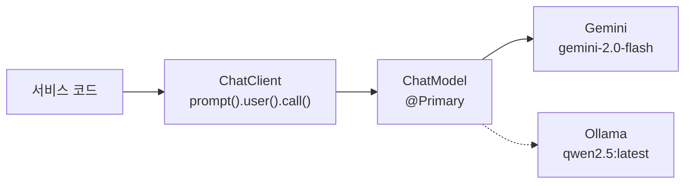
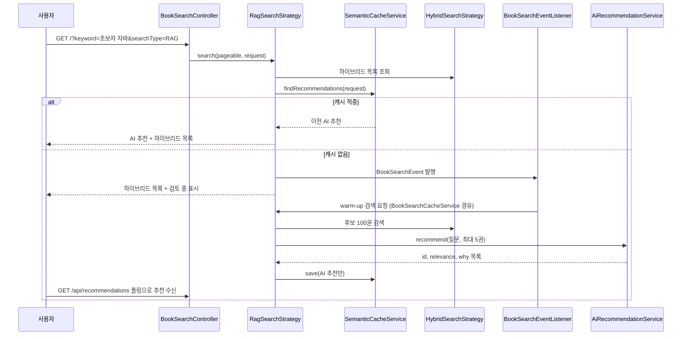

# 03. LLM 연동: ChatClient로 호출하고 응답 처리하기

> Spring AI 1.1.2의 `ChatClient`로 LLM을 호출하는 방법을 익히고, LLM이 돌려준 JSON을 DTO로 변환해 학습용 RAG 서비스를 완성합니다. 마지막으로 실제 `RagSearchStrategy`와 `AiRecommendationService`가 캐시·백그라운드 처리·relevance 필터링까지 어떻게 엮는지 살펴봅니다.
>
> 예상 소요 시간: 2.5시간 · 난이도: 기본

## 학습 목표

- `ChatModel`과 `ChatClient`의 관계를 설명하고, `AiConfig`가 `spring.ai.selected-model`로 모델을 고르는 원리를 설명할 수 있다
- `ChatClient`로 시스템·사용자 메시지와 Temperature 옵션을 지정해 LLM을 호출할 수 있다
- LLM의 JSON 응답을 DTO 리스트로 변환하고, 파싱 실패와 호출 오류에 대비할 수 있다
- 실제 `RagSearchStrategy`의 처리 흐름(캐시 → 하이브리드 결과 선반환 → 백그라운드 AI 추천 → relevance 필터링)을 설명할 수 있다

## 시작하기 전에

- [01. RAG 이해](01.understanding-rag.md)의 `BookRagService`, [02. 컨텍스트 구축](02.context-construction.md)의 `RagPromptBuilder`를 만들어 두었어야 합니다.
- Jackson `ObjectMapper`로 JSON을 객체로 바꿔 본 경험이 있으면 좋습니다.
- 처음 보는 용어는 [용어집](../glossary.md)을 참고합니다.

## 1. 왜 필요한가

02 문서까지 마치면 LLM에 보낼 프롬프트 문자열이 준비됩니다. 이제 남은 질문은 다음과 같습니다.

- Gemini와 Ollama 중 **어떤 모델**을, **어떤 방법**으로 호출하는가?
- LLM이 돌려준 문자열 `[{"id": 101, "relevance": 95, "why": "..."}]`을 어떻게 **Java 객체**로 바꾸는가?
- LLM이 형식을 어기거나, API가 실패하거나, 응답이 수 초씩 걸리면 **사용자 화면은 어떻게** 되는가?

마지막 질문이 특히 중요합니다. 키워드 검색은 수십 밀리초면 끝나지만 LLM 호출은 수 초가 걸리고, 때때로 실패합니다. 실제 서비스는 이 느리고 불안정한 부품을 감싸는 구조가 필요합니다.

## 2. 핵심 개념

### 2.1. ChatModel과 ChatClient

Spring AI는 LLM을 두 층으로 추상화합니다.

| 구분 | 역할 | 비유 |
|------|------|------|
| `ChatModel` | 특정 LLM(Gemini, Ollama 등)과 실제로 통신하는 저수준 인터페이스. `call(String)`, `call(Prompt)` 제공 | JDBC 드라이버 |
| `ChatClient` | `ChatModel`을 감싸 메시지 구성, 옵션, 응답 변환을 체인 방식으로 제공하는 고수준 API | `JdbcTemplate` |

`ChatModel`만 바꾸면 같은 `ChatClient` 코드로 Gemini도 Ollama도 호출할 수 있습니다.



### 2.2. 메시지 역할(Role)

LLM에게 보내는 메시지에는 역할이 있습니다.

| 역할 | 내용 | `ChatClient` 메서드 |
|------|------|-------------------|
| System | LLM의 정체성과 지켜야 할 규칙. 대화 내내 유지 | `.system(...)` |
| User | 사용자의 질문과 데이터 | `.user(...)` |
| Assistant | LLM의 이전 응답(대화 이력) | `.messages(...)` |

02 문서처럼 한 덩어리의 사용자 메시지에 규칙까지 넣어도 동작합니다. 실제 `AiRecommendationService`가 그렇게 합니다. 규칙과 데이터를 나누고 싶으면 규칙은 System, 질문과 컨텍스트는 User로 보냅니다.

### 2.3. Temperature

**Temperature**는 LLM이 다음 단어를 고를 때 얼마나 모험을 할지 정하는 값입니다. 낮으면(0에 가까우면) 가장 그럴듯한 단어를 주로 골라 답이 안정적이고, 높으면 덜 흔한 단어도 골라 답이 다양해집니다.

| 값 | 특징 | 적합한 작업 |
|----|------|------------|
| 0.0~0.3 | 일관적, 형식을 잘 지킴 | 추천, 분류, JSON 출력 |
| 0.7 안팎 | 균형 | 일반 대화 |
| 1.0 이상 | 다양, 형식을 깨기 쉬움 | 아이디어 발상, 창작 |

이 프로젝트는 Gemini와 Ollama 모두 `temperature=0.3`으로 설정합니다. JSON 형식을 잘 지키고 추천이 매번 크게 바뀌지 않게 하기 위해서입니다. Temperature 0.0이어도 응답이 완전히 같다는 보장은 없습니다.

### 2.4. 응답은 문자열, 형식은 약속일 뿐

LLM이 돌려주는 것은 언제나 **문자열**입니다. "순수 JSON만 출력하라"고 해도 가끔은 ` ```json ` 코드 블록으로 감싸거나 설명을 덧붙입니다. 그래서 응답을 파싱하는 코드는 **형식이 깨질 수 있다고 가정**하고 작성해야 합니다.

## 3. 따라 하기

### STEP 1. 모델 선택 구조 이해하기 (AiConfig)

목표: 두 개의 `ChatModel` 중 하나가 어떻게 기본으로 선택되는지 확인합니다.

`pom.xml`에는 Gemini(`spring-ai-starter-model-google-genai`), Ollama(`spring-ai-starter-model-ollama`), 임베딩용 OpenAI 호환(`spring-ai-starter-model-openai`) 스타터가 함께 들어 있고, 버전은 `spring-ai-bom` 1.1.2로 관리합니다. 그 결과 `googleGenAiChatModel`과 `ollamaChatModel` 두 빈이 생기므로, 타입만으로 `ChatModel`을 주입하면 어느 것을 쓸지 정할 수 없습니다. `AiConfig`가 이를 해결합니다.

```java
@Bean
@Primary
@ConditionalOnProperty(name = "spring.ai.selected-model", havingValue = "gemini", matchIfMissing = true)
public ChatModel selectedGeminiChatModel(@Qualifier("googleGenAiChatModel") ChatModel googleChatModel) {
    return googleChatModel;
}

@Bean
@Primary
@ConditionalOnProperty(name = "spring.ai.selected-model", havingValue = "ollama")
public ChatModel selectedOllamaChatModel(@Qualifier("ollamaChatModel") ChatModel ollamaChatModel) {
    return ollamaChatModel;
}

@Bean
public ChatClient chatClient(ChatModel chatModel) {
    return ChatClient.builder(chatModel).build();
}
```

전체 코드: [`AiConfig.java`](../../src/main/java/net/java21/library/core/config/AiConfig.java)

**코드 설명**

- `@ConditionalOnProperty`: 설정값이 조건에 맞을 때만 빈을 등록합니다. `spring.ai.selected-model=gemini`(또는 값 없음, `matchIfMissing = true`)이면 Gemini, `ollama`이면 Ollama 모델이 `@Primary`가 됩니다.
- `@Primary`: 같은 타입 빈이 여럿일 때 기본으로 주입될 빈입니다. 그래서 `AiRecommendationService`처럼 `ChatModel`을 그냥 주입받는 곳은 설정 하나로 모델이 바뀝니다.
- 마지막 `chatClient` 빈은 `@Primary` 모델을 감싼 기본 `ChatClient`입니다. `ollama`를 선택하면 Step 7에서 쓰는 `qwenChatClient`, `llama3ChatClient`도 함께 등록되므로, 학습용 코드에서는 01 문서처럼 `ChatModel`을 주입받아 `ChatClient.create(chatModel)`로 만드는 편이 헷갈리지 않습니다.

**확인 방법**: `application.properties`의 `spring.ai.selected-model` 값을 바꾸고 애플리케이션을 다시 실행한 뒤, RAG 검색 로그에서 호출 대상이 바뀌는지 확인합니다. 저장소의 기본 설정 파일은 `ollama`로 되어 있고, Gemini를 쓰려면 `gemini`로 바꾸고 `secrets.properties`에 `GEMINI_API_KEY`를 넣습니다.

### STEP 2. ChatClient 기본 사용법

목표: `ChatClient`의 주요 메서드를 익힙니다.

```java
// 1) 가장 단순한 호출: 사용자 메시지 하나
String answer = chatClient.prompt()
        .user("자바를 처음 배우는 순서를 세 줄로 알려 주세요.")
        .call()
        .content();

// 2) 시스템 메시지로 규칙을 분리하고, 이번 호출에만 Temperature 지정
String answer2 = chatClient.prompt()
        .system("당신은 도서관 사서입니다. 공손한 합니다체로 답하세요.")
        .user("자바 입문서를 고를 때 무엇을 보면 좋을까요?")
        .options(ChatOptions.builder().temperature(0.0).build())
        .call()
        .content();

// 3) 자리 표시자 치환: 템플릿에 JSON 예시처럼 중괄호가 없을 때만 사용
String answer3 = chatClient.prompt()
        .user(u -> u.text("{topic}을 다루는 입문서의 특징을 알려 주세요.")
                .param("topic", "자바"))
        .call()
        .content();
```

| 메서드 | 설명 |
|--------|------|
| `prompt()` | 요청을 만들기 시작 |
| `system(String)` / `user(String)` | 시스템·사용자 메시지 지정 |
| `user(u -> u.text(...).param(k, v))` | 템플릿 자리 표시자 치환(02 문서 "자주 하는 실수" 2번 참고) |
| `options(ChatOptions)` | 이번 호출에만 적용할 모델 옵션(Temperature 등) |
| `call()` | 동기 호출. 스트리밍은 `stream()` |
| `content()` | 응답 본문 문자열 |
| `entity(Class)`, `entity(ParameterizedTypeReference)` | 응답 JSON을 객체로 변환(STEP 3) |
| `chatResponse()` | 토큰 사용량 등 메타데이터까지 포함한 전체 응답 |

`ChatOptions`는 `org.springframework.ai.chat.prompt.ChatOptions`입니다. 실제 `AiRecommendationService`는 `ChatModel.call(String)`을 직접 호출하는데, 이는 `chatClient.prompt().user(prompt).call().content()`와 같은 결과를 냅니다.

### STEP 3. JSON 응답을 DTO로 변환하기

목표: LLM 응답 문자열을 `List<추천 항목>`으로 바꿉니다. 두 가지 방법이 있습니다.

**방법 A. 직접 파싱 (실제 구현 방식)**

실제 프로젝트는 응답 항목을 `BookAiRecommendationResponse`로 받습니다.

```java
@Getter
@Setter
@NoArgsConstructor
public class BookAiRecommendationResponse {
    private Long id;            // LLM이 반환
    private Integer relevance;  // LLM이 반환 (0~100)
    private String why;         // LLM이 반환
    private Double similarity;  // 검색 결과에서 채움
    private Double rrfScore;    // 검색 결과에서 채움
}
```

`AiRecommendationService`의 파싱 부분입니다.

```java
String rawResponse = chatModel.call(renderedPrompt);

try {
    // JSON 응답에서 마크다운 코드 블록 제거
    String jsonPart = rawResponse.replaceAll("```json", "").replaceAll("```", "").trim();
    List<BookAiRecommendationResponse> recommendations =
            objectMapper.readValue(jsonPart, new TypeReference<List<BookAiRecommendationResponse>>() {});

    // 검색된 도서 리스트에서 유사도 및 RRF 점수 매핑
    for (BookAiRecommendationResponse rec : recommendations) {
        books.stream()
                .filter(b -> b.getId().equals(rec.getId()))
                .findFirst()
                .ifPresent(b -> {
                    rec.setSimilarity(b.getSimilarity());
                    rec.setRrfScore(b.getRrfScore());
                });
    }
    return recommendations;
} catch (Exception e) {
    log.error("Failed to parse AI response: {}", rawResponse, e);
    return List.of();
}
```

- 프롬프트에서 금지해도 코드 블록이 올 수 있으므로 ` ```json `과 ` ``` `를 지운 뒤 파싱합니다(2.4).
- LLM은 `id`, `relevance`, `why`만 채우고, `similarity`와 `rrfScore`는 `id`로 검색 결과를 찾아 코드가 채웁니다. 02 문서에서 `id`를 컨텍스트에 넣은 이유가 여기서 쓰입니다.
- 파싱에 실패하면 예외를 던지지 않고 **빈 목록**을 반환합니다. AI 추천은 부가 기능이므로, 실패해도 검색 결과 화면은 정상으로 보이게 하려는 선택입니다.

**방법 B. `entity()`로 자동 변환 (ChatClient 기능)**

`ChatClient`는 응답을 원하는 타입으로 바로 변환해 줍니다. LLM이 채울 필드만 담은 record를 따로 두는 것이 깔끔합니다.

```java
public record AiPick(Long id, Integer relevance, String why) {
}

List<AiPick> picks = chatClient.prompt()
        .user(prompt)
        .call()
        .entity(new ParameterizedTypeReference<List<AiPick>>() {});
```

- `entity()`는 내부적으로 `BeanOutputConverter`를 사용해 대상 타입의 JSON 스키마를 프롬프트 끝에 출력 형식 지시로 덧붙이고, 응답의 코드 블록을 정리한 뒤 역직렬화합니다.
- `ParameterizedTypeReference`는 `org.springframework.core.ParameterizedTypeReference`입니다. `List<AiPick>`처럼 제네릭 타입을 넘길 때 씁니다.
- 변환에 실패하면 예외가 발생하므로, 방법 A처럼 실패를 빈 목록으로 바꾸려면 `try-catch`로 감쌉니다.

이 교재의 학습용 코드는 실제 구현과 맞추기 위해 방법 A를 씁니다.

### STEP 4. 학습용 RAG 서비스 완성하기

목표: 01의 `BookRagService`를 02의 `RagPromptBuilder`와 STEP 3의 파싱으로 완성합니다.

```java
@Slf4j
@Service
public class BookRagService {

    private static final int TOP_K = 5;
    private static final int MIN_RELEVANCE = 50;

    private final BookSearchService bookSearchService;
    private final ChatClient chatClient;
    private final ObjectMapper objectMapper;

    public BookRagService(BookSearchService bookSearchService, ChatModel chatModel, ObjectMapper objectMapper) {
        this.bookSearchService = bookSearchService;
        this.chatClient = ChatClient.create(chatModel);
        this.objectMapper = objectMapper;
    }

    public List<BookAiRecommendationResponse> recommend(String question) {
        // 1. Retrieval
        BookSearchRequest request = new BookSearchRequest(question, null, SearchType.HYBRID, null);
        List<BookSearchResponse> books = bookSearchService
                .searchBooks(PageRequest.of(0, TOP_K), request)
                .getBooks()
                .getContent();
        if (books.isEmpty()) {
            return List.of();
        }

        // 2. Augmented
        String prompt = RagPromptBuilder.buildPrompt(question, RagPromptBuilder.buildContext(books));

        // 3. Generation
        String raw = chatClient.prompt().user(prompt).call().content();

        // 4. 응답 변환 + 50점 미만 제외
        return parse(raw).stream()
                .filter(r -> r.getRelevance() != null && r.getRelevance() >= MIN_RELEVANCE)
                .toList();
    }

    private List<BookAiRecommendationResponse> parse(String raw) {
        try {
            String json = raw.replaceAll("```json", "").replaceAll("```", "").trim();
            return objectMapper.readValue(json, new TypeReference<List<BookAiRecommendationResponse>>() {});
        } catch (Exception e) {
            log.error("AI 응답 파싱 실패: {}", raw, e);
            return List.of();
        }
    }
}
```

**코드 설명**

- 01 문서의 세 단계(Retrieval → Augmented → Generation)에 "응답 변환"이 더해진 구조입니다.
- `MIN_RELEVANCE = 50`은 실제 `RagSearchStrategy`의 `MIN_RELEVANCE_SCORE`와 같은 기준입니다. 프롬프트에서 "50 미만 제외"를 지시했어도 LLM이 지키지 않을 수 있으므로 코드에서 한 번 더 거릅니다.

**확인 방법**: 학습용 컨트롤러나 테스트에서 `recommend("자바를 처음 배우는데 좋은 책")`을 호출하고, 반환된 각 항목의 `id`가 검색 결과에 있는지, `relevance`가 50 이상인지 확인합니다.

```text
[id=101, relevance=95, why=프로그래밍을 처음 배우는 분을 위해 기초 문법부터 차근차근 설명하는 입문서입니다.]
[id=102, relevance=88, why=예제가 풍부해 문법을 익힌 뒤 실습하기 좋은 책으로 추천해 드립니다.]
```

### STEP 5. 실제 구현의 흐름 읽기 (RagSearchStrategy)

목표: 학습용 서비스와 실제 구현이 어떻게 다른지, 왜 다른지 이해합니다.

실제 프로젝트에는 RAG 전용 컨트롤러가 없습니다. `BookSearchController`의 `/` 요청이 `BookSearchService.searchBooks()`를 호출하고, `SearchType.RAG`이면 전략 패턴으로 `RagSearchStrategy`가 선택됩니다(검색 타입을 지정하지 않으면 기본값도 RAG입니다).



핵심 부분을 발췌하면 다음과 같습니다.

```java
private static final int DEFAULT_BATCH_SIZE = 100;   // 검색 후보 수
private static final double SCORE_THRESHOLD = 0.02;  // AI 후보 최소 RRF 점수
private static final int MAX_AI_CANDIDATES = 5;      // LLM에게 보낼 최대 도서 수
private static final int MIN_RELEVANCE_SCORE = 50;   // LLM 검증 최소 점수

// 캐시 미스(사용자 실시간 요청): 하이브리드 목록을 먼저 반환하고 AI 추천은 백그라운드로 (aiPending = true)
eventPublisher.publishEvent(new BookSearchEvent(this, request.keyword()));
return new BookSearchResult(hybrid.getBooks(), List.of(), 0L, false, canWarmUp);

// warm-up(백그라운드): 100권 검색 → RRF 0.02 이상 최대 5권 → LLM 추천
List<BookSearchResponse> topKBooks = retrievalResult.getBooks().getContent().stream()
        .filter(b -> b.getRrfScore() != null && b.getRrfScore() >= SCORE_THRESHOLD)
        .limit(MAX_AI_CANDIDATES)
        .toList();
aiResponse = aiRecommendationService.recommend(request.keyword(), topKBooks);

// 시맨틱 캐시에는 AI 추천만 저장 (목록은 매 요청 하이브리드 검색으로 채움)
semanticCacheService.save(request, aiResponse);
```

전체 코드: [`RagSearchStrategy.java`](../../src/main/java/net/java21/library/core/book/service/search/strategy/RagSearchStrategy.java)

| 항목 | 학습용 `BookRagService` | 실제 `RagSearchStrategy` + `AiRecommendationService` |
|------|------------------------|--------------------------------------------------|
| 호출 시점 | 요청마다 즉시 LLM 호출 | 캐시 없으면 하이브리드 목록을 먼저 반환, LLM은 `@Async` 이벤트 리스너에서 호출, 화면은 폴링으로 추천 수신 |
| 후보 선정 | 상위 5권 | 100권 중 RRF 0.02 이상 최대 5권, 없으면 상위 3권으로 대체 |
| relevance 활용 | 50 미만 제외 | 프롬프트에서 50 미만 제외, 추천 패널에 relevance 표시(목록은 하이브리드 순서 유지) |
| 결과 재사용 | 없음 | AI 추천을 시맨틱 캐시에 저장해 비슷한 질문에 재사용 |
| LLM 호출 API | `ChatClient` | `ChatModel.call(String)` |

01 문서의 STEP 5에서 처음 검색할 때 AI 추천이 바로 보이지 않았던 이유가 이 구조 때문입니다. 수 초 걸리는 LLM을 사용자 요청 경로에서 빼서 응답 속도를 지킨 것입니다. 캐시 동작은 [Step 4. 시맨틱 캐싱](../step-4/03.semantic-caching.md)에서 자세히 다룹니다.

화면에서는 `BookSearchController`가 `searchResult.getAiResponse()`를 `aiRecommendations` 모델 속성으로 넘기고, `templates/index/index.html`이 각 항목의 `relevance`(AI 추천 %), `similarity`(일치율), `rrfScore`(RRF), `why`(추천 사유)를 표시합니다.

### STEP 6. 호출 오류 처리하기

목표: LLM API 호출이 실패하는 경우를 구분해 처리합니다.

Spring AI는 `org.springframework.ai.retry` 패키지의 두 예외로 오류를 나눕니다.

- `TransientAiException`: 속도 제한(429), 일시적 서버 오류처럼 **다시 시도하면 성공할 수 있는** 오류
- `NonTransientAiException`: 잘못된 API 키, 잘못된 요청처럼 **다시 시도해도 실패하는** 오류

```java
try {
    return chatClient.prompt().user(prompt).call().content();
} catch (TransientAiException e) {
    log.warn("LLM 일시적 오류: {}", e.getMessage());
    return null; // 호출부에서 AI 추천 없이 검색 결과만 표시
} catch (NonTransientAiException e) {
    log.error("LLM 호출 실패(설정 확인 필요): {}", e.getMessage());
    return null;
}
```

Gemini·Ollama `ChatModel`은 Spring AI의 재시도 설정(`RetryTemplate`)으로 일시적 오류를 몇 차례 다시 시도하고, 그래도 실패하면 예외를 던집니다. 이 프로젝트에서는 AI 추천 생성이 백그라운드 이벤트에서 일어나므로, 실패해도 사용자는 하이브리드 검색 결과를 계속 볼 수 있습니다.

## 4. 직접 해 보기

### 미션 1 (기본): Temperature 비교

01 문서의 `HallucinationTest`처럼 Spring 컨텍스트 없이 `ChatClient`를 만들고, 같은 프롬프트("자바 입문서 한 권을 추천하고 이유를 한 문장으로")를 Temperature 0.0과 1.0으로 각각 3번씩 호출해 결과를 비교해 보세요.

<details>
<summary>정답 예시</summary>

```java
@Test
@DisplayName("Temperature에 따라 응답의 다양성이 달라진다")
void compareTemperature() {
    String prompt = "자바 입문서 한 권을 추천하고 이유를 한 문장으로 쓰세요.";
    for (double temperature : new double[]{0.0, 1.0}) {
        for (int i = 0; i < 3; i++) {
            String answer = chatClient.prompt()
                    .user(prompt)
                    .options(ChatOptions.builder().temperature(temperature).build())
                    .call()
                    .content();
            System.out.printf("[T=%.1f #%d] %s%n", temperature, i + 1, answer);
        }
    }
}
```

0.0에서는 세 응답이 거의 같고, 1.0에서는 추천 도서나 문장 표현이 더 자주 바뀝니다. 다만 0.0에서도 완전히 같다는 보장은 없으므로 `assertEquals`로 비교하지 말고 눈으로 확인합니다.

</details>

### 미션 2 (기본): 파싱 실패 테스트

`BookRagService.parse()`를 테스트할 수 있게 패키지 접근 수준으로 바꾸고, 다음 세 입력에 대한 결과를 검증하는 단위 테스트를 작성해 보세요.

1. ` ```json [{"id":1,"relevance":90,"why":"좋음"}] ``` ` → 1건
2. `"추천할 책이 없습니다."` → 빈 목록
3. `"[]"` → 빈 목록

<details>
<summary>힌트</summary>

`BookRagService`를 Spring 없이 `new BookRagService(null, mock(ChatModel.class), new ObjectMapper())`로 만들면 `parse()`만 단위 테스트할 수 있습니다(`ChatClient.create()`에 `null`을 넘기면 안 되므로 `ChatModel`은 Mockito 목으로 넘깁니다). 2번이 예외 없이 빈 목록을 돌려주는지가 핵심입니다.

</details>

### 미션 3 (도전): `entity()`로 바꿔 보기

STEP 4의 `recommend()`에서 `content()`와 `parse()` 대신 STEP 3의 방법 B(`entity(new ParameterizedTypeReference<List<AiPick>>() {})`)를 사용하도록 바꾸고, 결과를 `BookAiRecommendationResponse`로 옮겨 담아 보세요. 두 방식의 장단점을 정리합니다.

<details>
<summary>해설</summary>

`entity()`는 출력 형식 지시와 코드 블록 정리를 자동으로 해 주어 코드가 짧아집니다. 대신 Spring AI가 덧붙이는 JSON 스키마 지시만큼 입력 토큰이 늘고, 변환 실패 시 예외가 나므로 `try-catch`가 필요합니다. 직접 파싱은 프롬프트를 완전히 통제할 수 있고 실패 처리를 원하는 대로 정할 수 있습니다. 실제 구현은 후자를 택했습니다.

</details>

## 5. 자주 하는 실수

| 증상 | 원인 | 해결 |
|------|------|------|
| `NoUniqueBeanDefinitionException: ChatClient` | `ollama` 선택 시 `ChatClient` 빈이 3개(`chatClient`, `qwenChatClient`, `llama3ChatClient`) | `ChatModel`을 주입받아 `ChatClient.create(chatModel)`로 만들거나 `@Qualifier("chatClient")` 사용 |
| `selected-model`을 바꿨는데 같은 모델이 호출됨 | 값 오타(`Gemini`, `google` 등) 또는 재시작하지 않음 | 값은 소문자 `gemini` 또는 `ollama`. 변경 후 애플리케이션 재시작 |
| 화면에 AI 추천이 비어 있고 로그에 `Failed to parse AI response` | LLM이 JSON 앞뒤에 설명을 붙였거나 형식을 어김 | 로그의 원본 응답 확인, 프롬프트의 출력 형식 규칙 강화, Temperature 낮추기 |
| RAG 첫 검색에서 AI 추천이 바로 안 보임 | 캐시 미스 시 하이브리드 결과를 먼저 반환하고 추천은 백그라운드에서 생성하는 정상 동작 | 화면이 `/api/recommendations`를 폴링해 준비되면 자동 표시(최대 90초). 로그에서 `[STRATEGIC_CACHE]` 메시지 확인 |
| Ollama 호출이 오래 걸리다 실패 | 원격 Ollama 서버의 모델 로딩·응답 지연 | `AiConfig`의 Ollama 전용 `RestClient.Builder`(읽기 타임아웃 5분) 적용 여부 확인, 서버 상태 확인 |

> 실제 사례: [사례 4. 임베딩 서버 장애로 검색이 수십 초 지연됨](../troubleshooting.md#사례-4-임베딩-서버-장애로-검색이-수십-초-지연됨)  
> 실제 사례: [사례 15. AI 추천을 다시 검색하면 결과 목록이 1~5권으로 줄어듦](../troubleshooting.md#사례-15-ai-추천을-다시-검색하면-결과-목록이-15권으로-줄어듦)  
> 실제 사례: [사례 17. 로컬 LLM AI 추천이 60초 넘게 걸림](../troubleshooting.md#사례-17-로컬-llm-ai-추천이-60초-넘게-걸림)

## 6. 정리

- `ChatModel`은 특정 LLM과 통신하는 저수준 인터페이스이고, `ChatClient`는 이를 감싼 체인 방식 API입니다. `AiConfig`가 `spring.ai.selected-model`로 `@Primary ChatModel`을 정합니다.
- `chatClient.prompt().system(...).user(...).options(...).call().content()`가 기본 호출 형태이고, `entity()`로 객체 변환도 할 수 있습니다.
- LLM 응답은 형식이 깨질 수 있다고 가정하고, 코드 블록 제거와 파싱 실패 시 빈 목록 반환으로 대비합니다.
- 실제 `RagSearchStrategy`는 느린 LLM 호출을 백그라운드로 보내고, relevance 50 이상만 남겨 정렬한 결과를 시맨틱 캐시에 저장합니다.

- [ ] `AiConfig`의 `@ConditionalOnProperty`와 `@Primary` 역할을 설명할 수 있다
- [ ] `ChatClient`로 시스템·사용자 메시지와 Temperature를 지정해 호출했다
- [ ] LLM의 JSON 응답을 `BookAiRecommendationResponse` 목록으로 변환했다
- [ ] 학습용 `BookRagService`와 실제 `RagSearchStrategy`의 차이를 설명할 수 있다

## 확인 문제

**1. `spring.ai.selected-model` 설정을 지우면 어떤 모델이 사용됩니까? 그 이유는 무엇입니까?**

<details>
<summary>정답</summary>

Gemini가 사용됩니다. `selectedGeminiChatModel` 빈의 `@ConditionalOnProperty`에 `matchIfMissing = true`가 있어 설정값이 없을 때도 등록되고, `@Primary`이므로 기본 `ChatModel`로 주입됩니다.

</details>

**2. 프롬프트에 "순수 JSON만 출력하라"고 썼는데도 코드에서 ` ```json `을 지우는 이유는 무엇입니까?**

<details>
<summary>정답</summary>

LLM의 응답은 확률적으로 생성되는 문자열이라 지시를 항상 지키지는 않습니다. 코드 블록으로 감싸 오는 경우가 흔하므로, 파싱 전에 정리하고 그래도 실패하면 빈 목록을 반환하도록 방어합니다.

</details>

**3. LLM 응답에 없는 `similarity`, `rrfScore`는 어떻게 채워집니까?**

<details>
<summary>정답</summary>

`AiRecommendationService`가 LLM이 반환한 각 항목의 `id`로 검색 결과(`books`)에서 같은 도서를 찾아 그 도서의 `similarity`와 `rrfScore`를 설정합니다.

</details>

**4. 실제 `RagSearchStrategy`가 캐시 미스일 때 LLM을 바로 호출하지 않는 이유는 무엇입니까?**

<details>
<summary>정답</summary>

LLM 호출은 수 초가 걸리기 때문에 사용자를 기다리게 하지 않으려는 것입니다. 하이브리드 검색 결과를 먼저 반환하고, `BookSearchEvent`를 발행해 `@Async` 리스너가 백그라운드에서 AI 추천을 생성해 시맨틱 캐시에 저장합니다. 다음에 비슷한 질문이 오면 캐시에서 바로 AI 추천을 보여 줍니다.

</details>

**5. `TransientAiException`과 `NonTransientAiException`의 차이를 예와 함께 설명하세요.**

<details>
<summary>정답</summary>

`TransientAiException`은 속도 제한이나 일시적 서버 오류처럼 다시 시도하면 성공할 수 있는 오류이고, `NonTransientAiException`은 잘못된 API 키처럼 다시 시도해도 실패하는 오류입니다. 전자는 재시도나 나중에 다시 처리하는 전략이, 후자는 설정 점검이 필요합니다.

</details>

## 다음 문서

[Step 4. 고급 최적화와 리뷰 시스템 →](../step-4/README.md)
