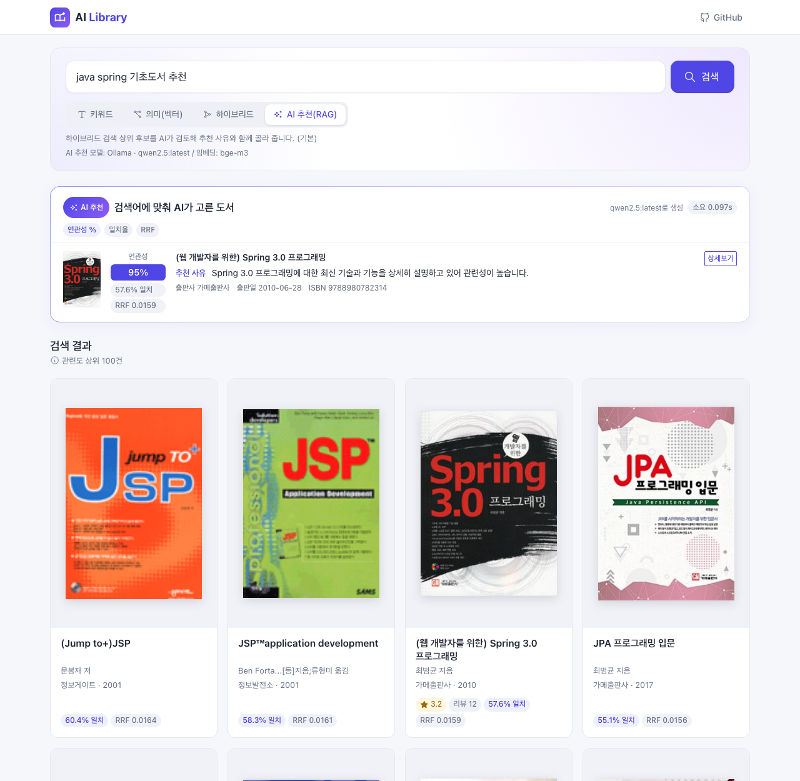
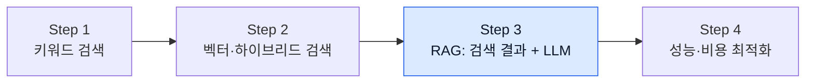

# Step 3. RAG: 검색 결과로 LLM 답변 만들기

> 처음으로 LLM(대규모 언어 모델)을 호출해 보고, LLM이 지어낸 답을 하는 환각(Hallucination)을 검색 결과로 막는 RAG(Retrieval-Augmented Generation, 검색 증강 생성)를 구현합니다.

## 이 단계에서 만드는 것

Step 2까지 만든 하이브리드 검색 결과를 LLM에게 "참고 자료"로 건네고, LLM이 그 안에서만 책을 골라 추천 사유를 쓰게 합니다. 검색 방식으로 "AI 도서 추천 (RAG)"을 고르면 검색 결과 위에 다음과 같은 AI 추천 영역이 나타납니다(출력은 예시입니다).

"java spring 기초도서 추천"을 AI 추천(RAG) 방식으로 검색한 화면입니다. 위쪽 패널은 LLM이 하이브리드 검색 후보를 읽고 고른 도서와 추천 사유, 아래쪽은 근거가 된 하이브리드 검색 결과입니다.

- **연관성 %**: LLM이 매긴 질문과의 관련성 점수(relevance, 0~100)
- **일치율**: Step 2의 벡터 유사도
- **RRF**: Step 2의 하이브리드 검색 점수

## 왜 이 단계가 필요한가

Step 2의 벡터 검색은 "의미가 비슷한 책"을 찾아 주지만, 결과는 여전히 책 목록입니다. 사용자는 "그래서 나한테는 어떤 책이 맞는가"에 대한 설명을 원합니다.

LLM은 자연스러운 설명을 잘 쓰지만, 우리 도서관에 어떤 책이 있는지는 모릅니다. 그래서 그냥 물어보면 존재하지 않는 책을 그럴듯하게 지어냅니다. 이번 단계에서는 이 문제를 직접 겪어 본 뒤, **검색(Step 1~2)이 찾은 실제 도서**를 LLM에게 함께 넘겨 주는 RAG로 해결합니다.

## 문서 구성

| 순서 | 문서 | 내용 | 예상 시간 |
|------|------|------|----------|
| 01 | [RAG 이해](01.understanding-rag.md) | LLM을 처음 호출해 환각을 체험하고, 참고 자료를 넣었을 때 답이 어떻게 달라지는지 확인 | 1.5시간 |
| 02 | [컨텍스트 구축](02.context-construction.md) | 검색 결과를 LLM이 읽을 텍스트(컨텍스트)로 바꾸고, 규칙·출력 형식을 담은 프롬프트 작성 | 2시간 |
| 03 | [LLM 연동](03.llm-integration.md) | Spring AI `ChatClient`로 LLM을 호출하고 JSON 응답을 DTO로 변환, 실제 `RagSearchStrategy` 흐름 이해 | 2.5시간 |

학습 순서는 01 → 02 → 03을 권장합니다. 01과 02에서는 이해를 돕기 위해 단순화한 `BookRagService`를 직접 만들고, 03에서 저장소의 실제 구현과 비교합니다.

## 이 단계를 마치면

- [ ] 환각이 왜 생기는지, RAG가 이를 어떻게 줄이는지 설명할 수 있다
- [ ] Spring AI `ChatClient`로 LLM을 호출하고 응답 문자열을 받을 수 있다
- [ ] 검색 결과를 컨텍스트로 만들고 역할·규칙·출력 형식을 갖춘 프롬프트를 작성할 수 있다
- [ ] LLM의 JSON 응답을 Java DTO로 변환하고, 파싱 실패에 대비할 수 있다
- [ ] `spring.ai.selected-model`로 Gemini와 Ollama를 바꿔 쓰는 원리를 설명할 수 있다
- [ ] 화면에서 RAG 검색을 실행해 AI 추천 영역을 확인할 수 있다

## 관련 소스 코드

| 클래스 | 역할 | 경로 |
|--------|------|------|
| `RagSearchStrategy` | RAG 검색 전략: 하이브리드 검색 → 후보 선별 → AI 추천 → relevance 필터링 → 캐시 저장 | `src/main/java/net/java21/library/core/book/service/search/strategy/RagSearchStrategy.java` |
| `AiRecommendationService` | 컨텍스트 구성, 프롬프트 생성, LLM 호출, JSON 파싱 | `src/main/java/net/java21/library/core/book/service/ai/AiRecommendationService.java` |
| `AiConfig` | `spring.ai.selected-model` 값에 따라 `@Primary ChatModel`(Gemini 또는 Ollama)과 `ChatClient` 빈 등록 | `src/main/java/net/java21/library/core/config/AiConfig.java` |
| `BookSearchService` | `SearchType`에 맞는 `SearchStrategy`를 골라 실행 | `src/main/java/net/java21/library/core/book/service/search/BookSearchService.java` |
| `BookAiRecommendationResponse` | LLM 응답 항목 DTO(`id`, `relevance`, `why`, `similarity`, `rrfScore`) | `src/main/java/net/java21/library/core/book/dto/BookAiRecommendationResponse.java` |
| `BookSearchEvent`, `BookSearchEventListener` | 캐시가 없을 때 AI 추천을 백그라운드에서 생성하도록 이벤트 전달 | `src/main/java/net/java21/library/core/book/event/` |

## 다음 문서

[01. RAG 이해 →](01.understanding-rag.md)
