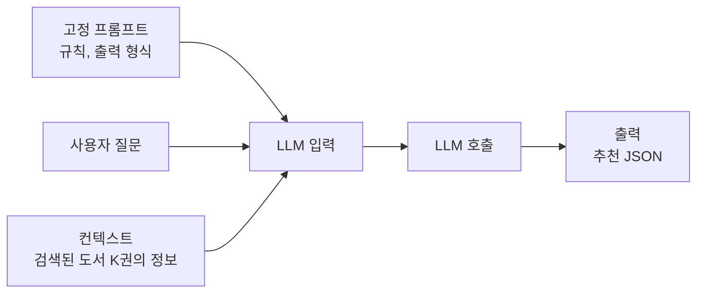

# 01. 성능과 비용

> LLM을 호출하는 서비스가 왜 느리고 비싼지 토큰 단위로 계산해 보고, 이 단계에서 적용할 두 가지 최적화(Top-K, 시맨틱 캐싱)의 방향을 잡습니다.
>
> 예상 소요 시간: 1시간 · 난이도: 입문

## 학습 목표

- 토큰(Token)이 무엇이고 LLM 요금이 어떻게 매겨지는지 설명할 수 있다
- 요청 1건의 입력 토큰 수와 비용을 직접 계산할 수 있다
- RAG 요청의 응답 시간에서 LLM 호출이 차지하는 비중을 설명할 수 있다
- "LLM에 넣는 양 줄이기"와 "LLM 호출 횟수 줄이기"를 구분하고 각각에 맞는 기법을 고를 수 있다

## 시작하기 전에

- [Step 3. RAG](../step-3/README.md)에서 검색 결과로 컨텍스트를 만들어 LLM에 보내는 흐름을 이해하고 있어야 합니다.
- [Step 2. 하이브리드 검색](../step-2/05.hybrid-search.md)의 RRF 점수를 알고 있으면 02 문서가 쉬워집니다.
- 모르는 용어는 [용어집](../glossary.md)을 참고합니다.

## 1. 왜 필요한가

Step 3에서 만든 RAG 검색을 학과 동아리 100명이 쓰는 동안에는 아무 문제가 없었다고 가정해 봅시다. 그런데 학교 도서관 공식 서비스로 열자 두 가지 불만이 들어옵니다.

- "검색 버튼을 누르고 3초 넘게 기다려야 해요." (속도)
- "이번 달 Gemini API 요금이 예상보다 훨씬 많이 나왔습니다." (비용)

일반 웹 서비스는 DB 쿼리가 대부분의 시간을 차지하고, 요청이 늘어도 서버 비용이 크게 늘지 않습니다. 반면 LLM 서비스는 **요청마다 외부 API 요금이 붙고**, 그 요금은 **보낸 글자 수(토큰 수)에 비례**합니다. 그래서 "얼마나 많이 보내는가"와 "얼마나 자주 보내는가"가 곧 비용과 속도가 됩니다.

이 문서에서는 계산기를 들고 이 두 가지를 숫자로 확인합니다.

## 2. 핵심 개념

### 2.1. 토큰: LLM 요금의 단위

**토큰(Token)** 은 LLM이 텍스트를 읽는 최소 단위입니다. 단어 하나가 토큰 하나일 수도 있고, 한 단어가 여러 토큰으로 쪼개질 수도 있습니다. 한글은 대체로 영어보다 같은 의미에 더 많은 토큰이 듭니다.

정확한 토큰 수는 모델의 토크나이저(Tokenizer)마다 다릅니다. 이 교재에서는 손으로 계산하기 쉽도록 다음과 같이 가정합니다.

| 가정 | 값 |
|------|----|
| 한글 글자 수 → 토큰 | 한글 2글자 ≈ 1토큰 |
| 입력 단가(Gemini 2.0 Flash 기준 예시) | 100만 토큰당 $0.10 |
| 출력 단가(Gemini 2.0 Flash 기준 예시) | 100만 토큰당 $0.40 |

> 단가는 바뀔 수 있으므로 실제 서비스 비용은 [Gemini 가격표](https://ai.google.dev/pricing)로 확인합니다. 이 프로젝트의 기본 모델 설정은 `spring.ai.selected-model`(gemini 또는 ollama)로 고르며, 로컬 Ollama는 API 요금이 없지만 GPU 시간이 그만큼 듭니다.

LLM 요금은 다음 식으로 계산합니다.

```text
요청 1건 비용 = 입력 토큰 × 입력 단가 + 출력 토큰 × 출력 단가
```

### 2.2. RAG 요청 1건에 들어가는 입력

RAG 요청의 입력은 크게 두 부분입니다.



- 고정 프롬프트와 질문은 요청마다 거의 같습니다.
- 컨텍스트는 **넘기는 도서 수(K)에 비례**해 늘어납니다. 비용을 좌우하는 것은 대부분 이 부분입니다.

### 2.3. 응답 시간의 구성

RAG 검색 한 번은 여러 단계를 거칩니다. 아래 수치는 환경에 따라 크게 달라지는 대략적인 예입니다.

| 단계 | 대략적인 시간 | 설명 |
|------|---------------|------|
| 질문 임베딩 생성 | 0.1~0.3초 | BGE-M3로 질문을 벡터로 변환 |
| 키워드 검색 + 벡터 검색 + RRF 병합 | 0.1~0.5초 | DB 쿼리 |
| LLM 호출 | 1~3초 이상 | 입력이 길수록, 출력이 길수록 느려짐 |

LLM 호출이 가장 큰 비중을 차지합니다. 그래서 속도 개선도 결국 LLM을 다루는 방식에서 나옵니다.

### 2.4. 최적화의 두 방향

비용 식을 다시 보면 줄일 수 있는 것은 두 가지입니다.

```text
하루 비용 = (요청 1건 비용) × (하루 LLM 호출 횟수)
```

| 방향 | 기법 | 다루는 문서 |
|------|------|-------------|
| 요청 1건 비용 줄이기 | **Top-K 최적화**: 후보는 넉넉히 찾되 LLM에는 상위 몇 권만 보냄 | [02](02.topk-optimization.md) |
| 호출 횟수 줄이기 | **시맨틱 캐싱(Semantic Caching)**: 의미가 같은 질문은 이전 결과를 재사용 | [03](03.semantic-caching.md) |

두 기법은 곱셈의 서로 다른 항을 줄이므로 함께 쓰면 효과가 곱해집니다.

## 3. 예제로 이해하기

계산기를 준비하고 STEP을 따라 직접 계산해 봅니다. 숫자는 모두 2.1의 가정을 사용합니다.

### STEP 1: 요청 1건의 입력 토큰 계산

**목표:** 도서 K권을 넘길 때 입력 토큰을 구합니다.

조건은 다음과 같습니다.

- 고정 프롬프트(규칙, 출력 형식) + 질문: 1,000자
- 도서 1권당 컨텍스트(제목, 저자, 출판일, 소개 문구): 200자

```text
입력 글자 수 = 1,000 + 200 × K
입력 토큰    = 입력 글자 수 ÷ 2
```

| K | 입력 글자 수 | 입력 토큰 |
|---|--------------|-----------|
| 5 | 1,000 + 1,000 = 2,000자 | 1,000토큰 |
| 20 | 1,000 + 4,000 = 5,000자 | 2,500토큰 |
| 100 | 1,000 + 20,000 = 21,000자 | 10,500토큰 |

K가 5에서 100으로 늘면 입력 토큰은 10배 이상 늘어납니다.

### STEP 2: 요청 1건의 비용 계산

**목표:** 토큰을 달러로 바꿉니다.

출력은 K와 상관없이 추천 JSON 약 300토큰이라고 가정합니다.

```text
K=5
  입력: 1,000 × $0.10 / 1,000,000 = $0.0001
  출력:   300 × $0.40 / 1,000,000 = $0.00012
  합계: $0.00022

K=100
  입력: 10,500 × $0.10 / 1,000,000 = $0.00105
  출력:    300 × $0.40 / 1,000,000 = $0.00012
  합계: $0.00117
```

한 건으로 보면 아주 작은 돈이지만, K=100은 K=5보다 약 5.3배 비쌉니다.

### STEP 3: 하루 비용으로 늘려 보기

**목표:** 요청 수를 곱해 규모를 체감합니다.

하루 검색 요청이 10만 건이라고 가정합니다.

```text
K=100: $0.00117 × 100,000 = $117/일 → 30일 약 $3,510
K=5:   $0.00022 × 100,000 = $22/일  → 30일 약 $660
```

입력을 줄이는 것만으로 비용이 80% 이상 줄었습니다. 출력 비용($0.00012)은 K와 관계없이 남기 때문에 100%까지는 줄지 않습니다.

### STEP 4: 캐시를 더하면

**목표:** 호출 횟수를 줄였을 때의 효과를 계산합니다.

10만 건 중 70%가 이미 캐시에 있는 질문이라고 가정합니다. 이 비율을 **적중률(Hit Rate)** 이라고 합니다.

```text
LLM 호출 횟수 = 100,000 × (1 - 0.7) = 30,000건
K=5 + 캐시:  $0.00022 × 30,000 = $6.6/일
```

| 구성 | 하루 비용 | K=100 대비 |
|------|-----------|------------|
| K=100, 캐시 없음 | $117 | 기준 |
| K=5, 캐시 없음 | $22 | 약 81% 절감 |
| K=5, 적중률 70% | $6.6 | 약 94% 절감 |

속도도 함께 좋아집니다. 캐시가 적중하면 LLM을 기다리지 않으므로 임베딩 생성과 메모리 조회 시간만 듭니다.

> 실제 적중률은 서비스마다 크게 다릅니다. 이 프로젝트의 시맨틱 캐시는 유사도 기준이 0.98로 엄격하고 TTL이 30분이라 적중률이 70%까지 나오기는 어렵습니다. 03 문서에서 이 트레이드오프를 다룹니다.

### STEP 5: 실제 토큰 수 확인하기

**목표:** 가정 대신 실제 사용량을 확인하는 방법을 압니다.

이 프로젝트의 `AiRecommendationService`는 `chatModel.call(String)`으로 문자열만 받습니다. 토큰 사용량을 보려면 `Prompt`로 호출해 `ChatResponse`의 메타데이터를 읽습니다.

```java
ChatResponse response = chatModel.call(new Prompt(renderedPrompt));
Usage usage = response.getMetadata().getUsage();
log.info("입력 토큰: {}, 출력 토큰: {}, 합계: {}",
        usage.getPromptTokens(), usage.getCompletionTokens(), usage.getTotalTokens());
String rawResponse = response.getResult().getOutput().getText();
```

같은 질문을 K=5와 K=20으로 보내고 입력 토큰을 비교해 보면 STEP 1의 계산이 대략 맞는지 확인할 수 있습니다.

## 4. 직접 해 보기

### 미션 1 (기본): 내 서비스 비용 계산

다음 조건에서 하루 비용을 계산하세요.

- 하루 요청 2만 건, K=10, 도서당 200자, 고정 프롬프트 + 질문 1,000자, 출력 300토큰
- 단가와 글자-토큰 비율은 2.1의 가정 사용

<details>
<summary>정답</summary>

```text
입력 글자 = 1,000 + 200 × 10 = 3,000자 → 1,500토큰
입력 비용 = 1,500 × 0.10 / 1,000,000 = $0.00015
출력 비용 =   300 × 0.40 / 1,000,000 = $0.00012
1건 = $0.00027
하루 = $0.00027 × 20,000 = $5.4
```

</details>

### 미션 2 (기본): 도서 소개 문구 줄이기

미션 1에서 도서당 컨텍스트를 200자에서 100자로 줄이면 하루 비용은 얼마가 되나요? K를 줄이는 것과 도서당 글자 수를 줄이는 것 중 무엇이 더 위험할지도 생각해 보세요.

<details>
<summary>정답</summary>

```text
입력 글자 = 1,000 + 100 × 10 = 2,000자 → 1,000토큰 → $0.0001
1건 = $0.0001 + $0.00012 = $0.00022
하루 = $0.00022 × 20,000 = $4.4
```

소개 문구를 줄이면 LLM이 책 내용을 판단할 근거가 줄어 추천 사유가 빈약해질 수 있습니다. K를 줄이면 관련 있는 책이 아예 빠질 수 있습니다. 어느 쪽이든 품질 확인 없이 줄이면 안 됩니다.

</details>

### 미션 3 (도전): 손익분기 적중률

K=5(1건 $0.00022) 구성에서 캐시를 도입하면 임베딩 생성 비용이 추가로 든다고 가정합니다. 임베딩 1건이 $0.00001이라면, 적중률이 몇 % 이상일 때 캐시가 이득일까요? (이 프로젝트는 검색 시 어차피 질문 임베딩을 만들기 때문에 실제로는 추가 비용이 거의 없습니다.)

<details>
<summary>정답</summary>

캐시 적중 1건마다 $0.00022를 아끼고, 모든 요청에 $0.00001이 추가된다고 보면

```text
0.00022 × 적중률 > 0.00001
적중률 > 약 4.5%
```

적중률이 약 4.5%만 넘어도 이득입니다. LLM 호출이 임베딩보다 훨씬 비싸기 때문입니다.

</details>

## 5. 자주 하는 실수

| 증상 | 원인 | 해결 |
|------|------|------|
| 예상 비용과 청구 금액이 크게 다름 | 글자 수 ÷ 2 같은 가정을 그대로 믿음 | `Usage`로 실제 토큰을 측정하고 가정을 보정 |
| K를 줄였는데 비용이 생각만큼 안 줄어듦 | 출력 토큰과 고정 프롬프트 비용을 빼먹음 | 비용을 입력·출력, 고정·가변으로 나눠 계산 |
| 비용은 줄었는데 추천 품질이 떨어짐 | 관련 있는 책까지 잘려 나감 | K를 줄이기 전에 관련성 높은 순으로 정렬하고 필터링(02 문서) |
| 응답 속도 개선을 DB 튜닝으로만 시도 | 전체 시간의 대부분이 LLM 호출임을 놓침 | 단계별 소요 시간을 로그로 먼저 측정 |

> 실제 사례: [사례 13. 운영 DB에 HNSW 인덱스를 만들다 공간 부족으로 실패함](../troubleshooting.md#사례-13-운영-db에-hnsw-인덱스를-만들다-공간-부족으로-실패함)  
> 실제 사례: [사례 14. 하이브리드 검색이 1.2초 넘게 걸림](../troubleshooting.md#사례-14-하이브리드-검색이-12초-넘게-걸림)  
> 실제 사례: [사례 16. 같은 AI 추천 검색이 가끔 7.7초 걸림](../troubleshooting.md#사례-16-같은-ai-추천-검색이-가끔-77초-걸림)  
> 실제 사례: [사례 17. 로컬 LLM AI 추천이 60초 넘게 걸림](../troubleshooting.md#사례-17-로컬-llm-ai-추천이-60초-넘게-걸림)

## 6. 정리

- LLM 비용은 `입력 토큰 × 입력 단가 + 출력 토큰 × 출력 단가`이고, RAG에서 입력의 대부분은 검색된 도서 컨텍스트입니다.
- 하루 비용은 "요청 1건 비용 × LLM 호출 횟수"이므로 두 항을 각각 줄일 수 있습니다.
- 요청 1건 비용은 Top-K 최적화(02), 호출 횟수는 시맨틱 캐싱(03)으로 줄입니다.
- 응답 시간의 대부분은 LLM 호출이며, 캐시 적중 시 이 시간이 사라집니다.

- [ ] K와 도서당 글자 수로 입력 토큰을 계산할 수 있다
- [ ] 입력·출력 단가로 요청 1건 비용을 계산할 수 있다
- [ ] 적중률을 반영해 하루 비용을 계산할 수 있다
- [ ] Top-K와 시맨틱 캐싱이 각각 비용 식의 어느 항을 줄이는지 말할 수 있다

## 확인 문제

**1.** RAG 요청에서 도서 수 K를 늘리면 입력 토큰과 출력 토큰 중 어느 쪽이 주로 늘어나나요?

<details><summary>정답</summary>

입력 토큰입니다. 컨텍스트에 도서 정보가 K권만큼 들어가기 때문입니다. 출력(추천 JSON)은 K에 따라 조금 늘 수 있지만 입력만큼 비례하지는 않습니다.

</details>

**2.** 하루 요청 1만 건, 요청 1건 비용 $0.0002, 적중률 50%일 때 하루 LLM 비용은 얼마인가요?

<details><summary>정답</summary>

LLM 호출은 10,000 × 0.5 = 5,000건이므로 5,000 × $0.0002 = $1입니다.

</details>

**3.** 시맨틱 캐싱은 비용 식의 어느 항을 줄이나요?

<details><summary>정답</summary>

LLM 호출 횟수입니다. 요청 1건의 비용(토큰 수)은 Top-K 최적화가 줄입니다.

</details>

**4.** "글자 수 ÷ 2 = 토큰 수"를 그대로 쓰면 안 되는 이유는 무엇인가요?

<details><summary>정답</summary>

토큰 분할 방식은 모델의 토크나이저마다 다르고, 한글·영어·숫자 비율에 따라서도 달라집니다. 학습용 어림값일 뿐이므로 실제 서비스에서는 `ChatResponse`의 `Usage`로 측정해야 합니다.

</details>

## 다음 문서

[02. Top-K 최적화 →](02.topk-optimization.md)
