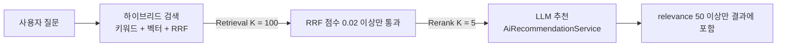

# 02. Top-K 최적화

> 검색으로 100권을 넉넉히 찾되 LLM에는 관련성 높은 5권만 보내는 Top-K 최적화를 실제 코드(`RagSearchStrategy`)로 따라가며, RRF 임계값 0.02의 의미를 계산으로 이해합니다.
>
> 예상 소요 시간: 1.5시간 · 난이도: 기본

## 학습 목표

- Retrieval K와 Rerank K를 나누는 이유를 설명할 수 있다
- RRF 점수 임계값 0.02가 어떤 도서를 통과시키는지 계산으로 설명할 수 있다
- `RagSearchStrategy`의 후보 선택 흐름(필터 → 상위 5권 → 대체 후보 → LLM 검증)을 설명할 수 있다
- Stream API로 Top-K 선택 로직을 구현하고 단위 테스트로 검증할 수 있다

## 시작하기 전에

- [01. 성능과 비용](01.performance-cost.md)에서 K가 입력 토큰에 비례한다는 것을 확인했습니다.
- [Step 2. 하이브리드 검색](../step-2/05.hybrid-search.md)의 RRF(Reciprocal Rank Fusion) 공식을 복습해 두면 좋습니다.
- [Step 3. 컨텍스트 구성](../step-3/02.context-construction.md)에서 도서 목록을 프롬프트 문자열로 만드는 방법을 다뤘습니다.
- 모르는 용어는 [용어집](../glossary.md)을 참고합니다.

## 1. 왜 필요한가

01 문서의 계산에서 K=100이면 K=5보다 요청 1건 비용이 약 5배였습니다. 그렇다면 처음부터 검색을 5권만 하면 될까요?

```text
질문: "자바 처음 배우는 대학생에게 맞는 책"

검색을 5권만 하면
  키워드 검색 상위 5권: "자바"라는 글자가 많이 들어간 책 위주
  벡터 검색 상위 5권:   의미가 비슷한 책 위주
  → 두 목록이 겹치지 않으면 RRF로 합쳐도 "둘 다 높게 평가한 책"을 찾을 수 없음
```

검색 단계에서 후보를 너무 적게 가져오면 좋은 책이 아예 후보에 들어오지 못합니다. 반대로 LLM에 100권을 다 보내면 비싸고, 관련 없는 책이 섞여 LLM이 엉뚱한 책을 추천할 위험도 커집니다.

해결책은 **찾는 단계와 고르는 단계를 나누는 것**입니다.

## 2. 핵심 개념

### 2.1. Retrieval K와 Rerank K

도서관 사서에게 책을 부탁하는 상황에 비유할 수 있습니다. 사서는 서가에서 관련 있어 보이는 책 100권을 일단 카트에 담습니다(찾기). 그다음 카트에서 가장 적합한 5권만 골라 책상에 올려 둡니다(고르기). 학생은 책상 위 5권만 읽으면 됩니다.

| 용어 | 뜻 | 이 프로젝트의 값 | 상수 |
|------|----|-----------------|------|
| **Retrieval K** | 검색 단계에서 가져오는 후보 수 | 100 | `DEFAULT_BATCH_SIZE` |
| **Rerank K** | LLM에 넘기는 최종 후보 수 | 5 | `MAX_AI_CANDIDATES` |



검색(DB 쿼리)은 100권을 가져와도 비용이 거의 늘지 않지만, LLM은 한 권마다 토큰 요금이 붙습니다. 그래서 비싼 단계에 들어가는 양만 줄입니다.

### 2.2. RRF 임계값 0.02의 의미

하이브리드 검색은 키워드 검색과 벡터 검색의 순위를 RRF로 합칩니다. `RrfService`의 공식은 다음과 같습니다(k=60, 순위는 1부터).

```text
RRF 점수 = 1 / (60 + 키워드 순위) + 1 / (60 + 벡터 순위)
           (한쪽 목록에만 있으면 그쪽 항만 더함)
```

몇 가지 경우를 계산해 보면 0.02라는 숫자의 의미가 드러납니다.

| 경우 | 계산 | RRF 점수 | 0.02 통과 |
|------|------|----------|-----------|
| 키워드 1위만 (벡터 목록에 없음) | 1/61 | 0.0164 | X |
| 키워드 1위, 벡터 1위 | 1/61 + 1/61 | 0.0328 | O |
| 키워드 40위, 벡터 40위 | 1/100 + 1/100 | 0.0200 | O (경계) |
| 키워드 50위, 벡터 50위 | 1/110 + 1/110 | 0.0182 | X |
| 키워드 1위, 벡터 100위 | 1/61 + 1/160 | 0.0226 | O |

한쪽 목록에서 1위를 해도 점수는 최대 1/61 ≈ 0.0164라서 0.02를 넘지 못합니다. 즉 **임계값 0.02는 "키워드 검색과 벡터 검색 양쪽에서 모두 찾은 책"만 LLM 후보로 올리는 규칙**입니다. 글자만 겹치거나 의미만 비슷한 책은 걸러지고, 두 방식이 모두 인정한 책이 남습니다.

### 2.3. 순서도 품질에 영향을 준다

LLM은 긴 입력의 가운데 부분을 상대적으로 덜 반영하는 경향이 있습니다. 이를 **Lost in the Middle** 현상이라고 부릅니다. 그래서 `AiRecommendationService.recommend()`는 컨텍스트를 만들기 전에 도서를 RRF 점수 내림차순으로 다시 정렬해, 가장 관련성 높은 책이 컨텍스트 앞부분에 오게 합니다. K가 5처럼 작으면 이 영향도 줄어듭니다.

### 2.4. LLM이 한 번 더 거른다

Top-K로 고른 5권도 모두 좋은 추천이라는 보장은 없습니다. 그래서 프롬프트에서 LLM에게 도서마다 **relevance 점수(0~100)** 를 매기게 하고, `RagSearchStrategy`는 50점 이상(`MIN_RELEVANCE_SCORE`)인 도서만 최종 결과에 남깁니다. 검색 점수(RRF)로 1차, LLM 판단으로 2차 필터링을 하는 셈입니다.

## 3. 따라 하기

실제 코드는 `RagSearchStrategy.search()` 한 메서드에 들어 있습니다. 이 메서드는 캐시 처리(03 문서)도 함께 하므로, 여기서는 Top-K와 관련된 부분만 STEP으로 나눠 읽습니다.

전체 코드: [`core/book/service/search/strategy/RagSearchStrategy.java`](../../src/main/java/net/java21/library/core/book/service/search/strategy/RagSearchStrategy.java)

### STEP 1: 상수로 정책 정의하기

**목표:** Top-K 관련 숫자를 이름 있는 상수로 둡니다.

```java
/** 검색 후보군 추출을 위한 기본 배치 크기 */
private static final int DEFAULT_BATCH_SIZE = 100;

/** AI 추천 후보로 선정되기 위한 최소 RRF 점수 임계값 */
private static final double SCORE_THRESHOLD = 0.02;

/** AI에게 전달할 최대 도서 후보 수 */
private static final int MAX_AI_CANDIDATES = 5;

/** 적절한 후보가 없을 경우 대체 사용할 도서 수 */
private static final int FALLBACK_CANDIDATES = 3;

/** LLM 검증 최소 relevance 점수 */
private static final int MIN_RELEVANCE_SCORE = 50;
```

**설명:** 코드 곳곳에 `100`, `0.02`, `5`를 직접 쓰면 나중에 값을 바꿀 때 놓치기 쉽습니다. 이 프로젝트는 매직 넘버를 `UPPER_SNAKE_CASE` 상수로 정의하는 규칙을 따릅니다.

### STEP 2: Retrieval K로 후보 가져오기

**목표:** 하이브리드 검색으로 100권을 RRF 점수 순으로 가져옵니다.

```java
BookSearchResult retrievalResult =
        hybridSearchStrategy.search(PageRequest.of(0, DEFAULT_BATCH_SIZE), request);
```

**설명:** 사용자가 요청한 페이지 크기(예: 24)와 상관없이 첫 페이지 100권을 가져옵니다. `HybridSearchStrategy`가 키워드 검색과 벡터 검색 결과를 `RrfService`로 합치므로, 돌려받은 목록은 이미 RRF 점수 내림차순입니다.

### STEP 3: 임계값 필터와 Rerank K 적용하기

**목표:** RRF 0.02 이상인 도서 중 앞에서부터 5권만 고릅니다.

```java
List<BookSearchResponse> topKBooks = retrievalResult.getBooks().getContent().stream()
        .filter(b -> b.getRrfScore() != null && b.getRrfScore() >= SCORE_THRESHOLD)
        .limit(MAX_AI_CANDIDATES)
        .toList();
```

**설명:**

- `filter`: RRF 점수가 없거나 0.02 미만인 도서를 버립니다. 2.2에서 본 것처럼 한쪽 검색에서만 나온 책이 여기서 빠집니다.
- `limit(5)`: 목록이 이미 점수 순이므로 다시 정렬하지 않고 앞에서 5권만 자릅니다.
- `null` 검사를 먼저 해야 `getRrfScore() >= ...`에서 언박싱 `NullPointerException`이 나지 않습니다.

### STEP 4: 후보가 없을 때 대체하기

**목표:** 임계값을 통과한 책이 한 권도 없을 때도 추천을 만들 수 있게 합니다.

```java
if (request.isWarmUp() && topKBooks.isEmpty()) {
    log.info("No books passed the threshold (>= {}). Using top keyword results as fallback for warm-up.", SCORE_THRESHOLD);
    topKBooks = retrievalResult.getBooks().getContent().stream().limit(FALLBACK_CANDIDATES).toList();
}
```

**설명:** 질문이 아주 짧거나 특이하면 키워드 검색과 벡터 검색이 겹치는 책이 없을 수 있습니다. 그대로 두면 LLM에 보낼 책이 0권이 되므로, 이때는 검색 상위 3권으로 대신합니다. `isWarmUp()` 조건이 붙은 이유는 03 문서에서 설명합니다(LLM 호출은 웜업 요청에서만 일어납니다).

### STEP 5: LLM 호출과 relevance 필터

**목표:** 5권으로 LLM 추천을 받고, relevance 50 이상인 도서만 결과로 남깁니다.

```java
aiResponse = aiRecommendationService.recommend(request.keyword(), topKBooks);

// relevance ≥ 50인 도서만 추출
List<Long> llmApprovedIds = aiResponse.stream()
        .filter(r -> r.getRelevance() != null && r.getRelevance() >= MIN_RELEVANCE_SCORE)
        .map(BookAiRecommendationResponse::getId)
        .toList();
```

이후 `retrievalResult`의 100권 중 `llmApprovedIds`에 포함된 도서만 relevance 내림차순으로 정렬해 최종 결과를 만들고, 시맨틱 캐시에 저장합니다.

**확인 방법:** 애플리케이션을 실행하고 RAG 검색을 한 뒤 로그에서 다음 줄을 찾습니다.

```log
[LLM_VALIDATION] Approved 4/5 books with relevance >= 50
```

"5" 자리가 LLM에 보낸 도서 수(Rerank K 이하)이고, "4" 자리가 relevance 검증을 통과한 수입니다. 임계값 필터 때문에 5보다 작게 나올 수도 있습니다.

### STEP 6: 컨텍스트 정렬 확인하기

**목표:** LLM에 들어가는 순서를 확인합니다.

`AiRecommendationService.recommend()`의 앞부분입니다.

```java
List<BookSearchResponse> sortedBooks = new ArrayList<>(books);
sortedBooks.sort((b1, b2) -> {
    Double s1 = b1.getRrfScore() != null ? b1.getRrfScore() : 0.0;
    Double s2 = b2.getRrfScore() != null ? b2.getRrfScore() : 0.0;
    return s2.compareTo(s1);
});
```

**설명:** 대체 후보(STEP 4)처럼 RRF 점수가 없는 책이 섞여도 0.0으로 취급해 뒤로 보냅니다. 전체 코드: [`core/book/service/ai/AiRecommendationService.java`](../../src/main/java/net/java21/library/core/book/service/ai/AiRecommendationService.java)

## 4. 직접 해 보기

### 미션 1 (기본): Top-K 선택 메서드와 단위 테스트

`RagSearchStrategy`의 STEP 3 로직을 순수 함수로 떼어 내 테스트해 봅니다. Spring 컨텍스트 없이 JUnit 5만으로 작성합니다.

요구사항:

- `selectTopK(List<BookSearchResponse> books, double threshold, int k)`를 만듭니다.
- RRF 점수가 `null`이거나 임계값 미만인 도서는 제외하고, 앞에서부터 최대 k권을 반환합니다.
- 테스트: RRF 점수가 `0.0328, 0.0164, 0.0226, null, 0.0200`인 도서 5권, 임계값 0.02, k=2일 때 결과 ID를 검증합니다.

힌트: `BookSearchResponse`에는 `rrfScore`까지 받는 12개 인자 생성자가 있습니다(`id, isbn, title, volumeTitle, authorName, publisherName, price, editionPublishDate, imageUrl, bookContent, similarity, rrfScore`).

<details>
<summary>정답 예시</summary>

```java
class TopKSelectorTest {

    static List<BookSearchResponse> selectTopK(List<BookSearchResponse> books, double threshold, int k) {
        return books.stream()
                .filter(b -> b.getRrfScore() != null && b.getRrfScore() >= threshold)
                .limit(k)
                .toList();
    }

    private static BookSearchResponse book(long id, Double rrf) {
        return new BookSearchResponse(id, "isbn" + id, "book" + id, null, "author", "publisher",
                null, null, null, "content", null, rrf);
    }

    @Test
    @DisplayName("임계값 미만과 null을 제외하고 앞에서부터 k권만 고른다")
    void selectTopK_filtersAndLimits() {
        List<BookSearchResponse> books = List.of(
                book(1, 0.0328), book(2, 0.0164), book(3, 0.0226), book(4, null), book(5, 0.0200));

        List<BookSearchResponse> result = selectTopK(books, 0.02, 2);

        assertThat(result).extracting(BookSearchResponse::getId).containsExactly(1L, 3L);
    }
}
```

5번 도서(0.0200)는 임계값을 통과하지만 k=2라서 잘립니다.

</details>

### 미션 2 (기본): 임계값 손계산

키워드 검색 20위, 벡터 검색 80위인 도서와 키워드 검색 45위, 벡터 검색 45위인 도서의 RRF 점수를 계산하고 0.02 통과 여부를 판단하세요.

<details>
<summary>정답</summary>

```text
20위 + 80위: 1/80 + 1/140 = 0.0125 + 0.0071 = 0.0196 → 탈락
45위 + 45위: 1/105 + 1/105 = 0.0095 × 2  = 0.0190 → 탈락
```

양쪽에 모두 있어도 순위가 낮으면 탈락합니다. 두 순위의 "평균적인" 위치가 대략 40위 안쪽이어야 통과합니다.

</details>

### 미션 3 (도전): K 값 실험 계획 세우기

K를 3, 5, 10으로 바꿔 가며 품질과 비용을 비교하는 실험을 설계해 보세요. 질문 목록, 측정 지표(입력 토큰, 응답 시간, relevance 50 이상 개수, 사람이 본 추천 만족도), 결과 기록 방식을 표로 정리합니다.

<details>
<summary>힌트</summary>

- 질문은 "특정 도서 찾기", "주제 추천", "막연한 추천" 유형을 섞어 10개 이상 준비합니다.
- 입력 토큰은 01 문서 STEP 5의 `Usage`로 측정합니다.
- `MAX_AI_CANDIDATES`만 바꾸고 나머지(임계값, 프롬프트)는 고정해야 비교가 공정합니다.
- 캐시가 결과를 재사용하지 않도록 실험마다 애플리케이션을 재시작하거나 질문을 바꿉니다.

</details>

## 5. 자주 하는 실수

| 증상 | 원인 | 해결 |
|------|------|------|
| 검색 단계 자체를 5권으로 줄였더니 추천 품질이 떨어짐 | Retrieval K와 Rerank K를 같은 값으로 둠 | 검색은 넉넉히(100), LLM 입력만 줄임(5) |
| 필터에서 `NullPointerException` 발생 | `Double`을 `null` 검사 없이 비교 | `b.getRrfScore() != null &&`를 먼저 검사 |
| 임계값을 0.02에서 0.01로 내렸더니 엉뚱한 책이 섞임 | 0.01이면 한쪽 검색에서만 나온 책도 통과 | 2.2의 표처럼 임계값이 어떤 순위 조합을 허용하는지 계산 후 조정 |
| LLM에 보낸 책은 5권인데 결과가 1~2권뿐 | relevance 50 미만 도서는 결과에서 제외됨 | 정상 동작. 로그 `[LLM_VALIDATION] Approved n/m`으로 확인 |
| 후보가 0권이라 LLM 호출이 생략됨 | 임계값 통과 도서가 없고 웜업 요청이 아님 | 대체 후보 로직(STEP 4)과 웜업 흐름(03 문서) 확인 |

> 실제 사례: [사례 17. 로컬 LLM AI 추천이 60초 넘게 걸림](../troubleshooting.md#사례-17-로컬-llm-ai-추천이-60초-넘게-걸림)

## 6. 정리

- 검색은 넉넉히(Retrieval K=100), LLM 입력은 적게(Rerank K=5) 나눠서 비용과 품질을 함께 잡습니다.
- RRF 임계값 0.02는 키워드·벡터 검색 양쪽에서 모두 찾은 책만 통과시키는 기준입니다.
- 통과한 책이 없으면 검색 상위 3권을 대체 후보로 씁니다.
- LLM이 매긴 relevance 50 이상인 도서만 최종 결과에 남깁니다.
- 컨텍스트는 RRF 점수 내림차순으로 정렬해 중요한 책을 앞에 둡니다.

- [ ] Retrieval K와 Rerank K의 값과 역할을 말할 수 있다
- [ ] RRF 점수를 손으로 계산해 0.02 통과 여부를 판단할 수 있다
- [ ] `filter` → `limit` 순서로 Top-K를 고르는 코드를 작성할 수 있다
- [ ] 최종 결과가 5권보다 적게 나올 수 있는 두 가지 이유를 말할 수 있다

## 확인 문제

**1.** 검색 단계(Retrieval K)를 100으로 넉넉히 잡아도 비용이 크게 늘지 않는 이유는 무엇인가요?

<details><summary>정답</summary>

검색은 DB 쿼리로 처리되어 토큰 요금이 들지 않습니다. 토큰 요금은 LLM에 보내는 양(Rerank K)에만 비례합니다.

</details>

**2.** 키워드 검색에서 1위를 했지만 벡터 검색 결과 100권 안에 없는 책은 LLM 후보가 될 수 있나요?

<details><summary>정답</summary>

될 수 없습니다(대체 후보 상황 제외). RRF 점수가 1/61 ≈ 0.0164로 임계값 0.02보다 작기 때문입니다.

</details>

**3.** STEP 3에서 `limit(5)` 전에 다시 정렬하지 않아도 되는 이유는 무엇인가요?

<details><summary>정답</summary>

`HybridSearchStrategy`가 돌려주는 목록이 이미 RRF 점수 내림차순이기 때문입니다. 필터는 순서를 바꾸지 않으므로 앞에서 5권을 자르면 점수 상위 5권이 됩니다.

</details>

**4.** Lost in the Middle 현상을 줄이기 위해 이 프로젝트가 하는 일은 무엇인가요?

<details><summary>정답</summary>

`AiRecommendationService`가 컨텍스트를 만들기 전에 도서를 RRF 점수 내림차순으로 정렬해 관련성 높은 책을 앞에 둡니다. 또 Rerank K를 5로 작게 유지해 컨텍스트 자체를 짧게 합니다.

</details>

## 다음 문서

[03. 시맨틱 캐싱 →](03.semantic-caching.md)
