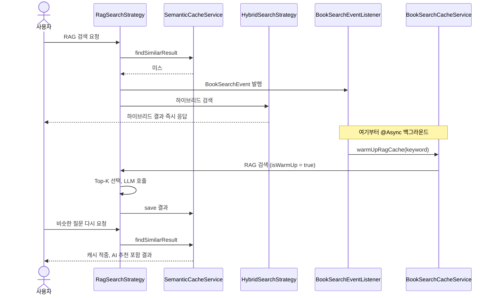
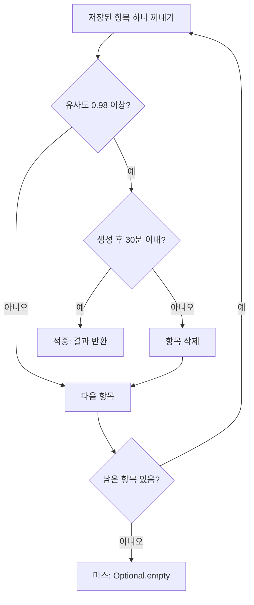

# 03. 시맨틱 캐싱

> 의미가 거의 같은 질문이 다시 들어오면 LLM을 호출하지 않고 저장해 둔 결과를 돌려주는 시맨틱 캐시를 실제 코드로 따라갑니다. 캐시 미스 때는 하이브리드 결과를 먼저 주고, AI 추천은 이벤트로 백그라운드에서 미리 만들어 둡니다.
>
> 예상 소요 시간: 2시간 · 난이도: 기본

## 학습 목표

- 일반 캐시와 시맨틱 캐시의 차이를 예시로 설명할 수 있다
- 이 프로젝트 시맨틱 캐시의 규칙(코사인 유사도 0.98, TTL 30분, 최대 1,000건 FIFO)을 설명할 수 있다
- 캐시 미스 시 "하이브리드 결과 즉시 반환 + 이벤트로 비동기 웜업" 흐름을 시퀀스로 그릴 수 있다
- 캐시 저장소와 조회 로직을 단위 테스트로 검증할 수 있다

## 시작하기 전에

- [02. Top-K 최적화](02.topk-optimization.md)에서 `RagSearchStrategy`가 LLM을 호출하는 부분을 읽었습니다.
- [Step 2. 임베딩 생성](../step-2/03.embedding-generation.md)의 임베딩과 코사인 유사도를 알고 있어야 합니다.
- [Step 1. CSV 적재](../step-1/01.csv-batch-load.md)에서 쓴 Spring 이벤트(`ApplicationEventPublisher`, `@EventListener`)를 다시 사용합니다.
- 모르는 용어는 [용어집](../glossary.md)을 참고합니다.

## 1. 왜 필요한가

도서관 검색 로그를 보면 같은 시간대에 비슷한 질문이 반복됩니다.

```text
10:02  "자바 입문서 추천"
10:05  "자바 입문서 추천해줘"
10:07  "자바 입문서 추천"
10:15  "파이썬 데이터 분석 책"
10:16  "자바 입문서 추천"
```

캐시가 없으면 "자바 입문서 추천" 계열 질문 4번에 LLM을 4번 호출합니다. 결과는 거의 같은데 매번 2~3초를 기다리고 요금을 냅니다.

일반 캐시(`Map<String, 결과>`)를 쓰면 "자바 입문서 추천"과 "자바 입문서 추천해줘"는 문자열이 달라 서로 다른 키가 됩니다. 사람이 보기에는 같은 질문인데도 캐시가 적중하지 않습니다. 그래서 문자열이 아니라 **의미**로 비교하는 캐시가 필요합니다.

## 2. 핵심 개념

### 2.1. 시맨틱 캐시

**시맨틱 캐시(Semantic Cache)** 는 질문을 임베딩 벡터로 바꿔 저장해 두고, 새 질문의 벡터와 **코사인 유사도(Cosine Similarity)** 를 비교해 충분히 비슷하면 저장된 결과를 재사용하는 캐시입니다.

| 구분 | 일반 캐시 | 시맨틱 캐시 |
|------|-----------|-------------|
| 키 | 질문 문자열 | 질문 임베딩 벡터 |
| 적중 조건 | 문자열이 정확히 같음 | 코사인 유사도가 기준 이상 |
| 조회 방법 | 해시 조회 한 번 | 저장된 항목과 하나씩 유사도 계산 |
| 위험 | 표현이 조금만 달라도 미스 | 기준이 낮으면 다른 질문에 엉뚱한 답을 줌 |

코사인 유사도는 두 벡터가 가리키는 방향이 얼마나 같은지를 -1.0~1.0으로 나타냅니다. 1.0이면 방향이 완전히 같습니다. 이 프로젝트는 `VectorUtils.calculateCosineSimilarity()`로 계산합니다.

### 2.2. 이 프로젝트의 캐시 규칙

| 규칙 | 값 | 위치 |
|------|----|------|
| 적중 기준 | 코사인 유사도 **0.98 이상** | `SemanticCacheService.SIMILARITY_THRESHOLD` |
| 유효 기간(TTL, Time To Live) | **30분** | `cache.ttl.minutes=30` |
| 저장소 | 애플리케이션 메모리의 `LinkedHashMap` | `InMemoryBookSearchCacheRepository` |
| 최대 개수 | **1,000건**, 넘치면 가장 먼저 저장된 항목부터 제거(**FIFO**) | `cache.semantic.max-size`(기본 1000) |
| 저장 대상 | RAG 검색 결과만 | `SemanticCacheService.save()` |

0.98은 매우 엄격한 기준입니다. 띄어쓰기나 어미가 조금 다른 정도의 질문은 적중하지만, "자바 책"과 "자바 교재"처럼 단어가 바뀌면 미스가 날 수 있습니다. 기준을 낮추면 적중률은 오르지만 "자바 입문"과 "자바 고급"처럼 다른 질문에 같은 답을 줄 위험이 커집니다. 어느 정도까지 적중하는지는 임베딩 모델에 따라 다르므로 4장 미션에서 직접 측정해 봅니다.

FIFO(First In, First Out)는 "먼저 들어온 것이 먼저 나간다"는 뜻입니다. 최근에 자주 쓰인 항목을 남기는 LRU(Least Recently Used)와 달리, 조회 여부와 상관없이 저장 순서만 봅니다. 구현이 단순한 대신 인기 있는 질문도 오래되면 밀려날 수 있습니다.

### 2.3. 이벤트 기반 웜업

캐시 미스가 났을 때 그 자리에서 LLM을 호출하면 사용자는 여전히 3초를 기다립니다. 이 프로젝트는 다른 방법을 씁니다.

1. 캐시 미스면 **하이브리드 검색 결과를 즉시 반환**합니다(AI 추천 사유 없음).
2. 동시에 `BookSearchEvent`를 발행합니다.
3. 이벤트 리스너가 **백그라운드(`@Async`)에서 RAG 검색을 수행**해 AI 추천을 만들고 캐시에 저장합니다. 이것을 **웜업(Warm-up)** 이라고 부릅니다.
4. 다음에 비슷한 질문이 오면 캐시가 적중해 AI 추천까지 즉시 받습니다.

식당에 비유하면, 첫 손님에게는 바로 나오는 기본 메뉴를 먼저 내고, 주방은 그사이 정식 요리를 만들어 둡니다. 다음 손님은 정식 요리를 바로 받습니다.



`BookSearchRequest`의 `isWarmUp` 값으로 두 경로를 구분합니다.

| `isWarmUp` | 누가 보내나 | `RagSearchStrategy`의 동작 |
|------------|-------------|----------------------------|
| `false` | 사용자 요청 | 캐시 조회 → 적중이면 반환, 미스면 이벤트 발행 후 하이브리드 결과 반환 |
| `true` | 웜업 | 캐시를 보지 않고 Top-K → LLM 호출 → 캐시 저장 |

## 3. 따라 하기

### STEP 1: 캐시 항목과 저장소

**목표:** 질문 벡터와 결과를 함께 담는 캐시 항목, 최대 1,000건을 유지하는 저장소를 확인합니다.

```java
@Data
@Builder
@NoArgsConstructor
@AllArgsConstructor
public class BookSearchCache {
    @Id
    private String id;
    private String keyword;                                  // 원래 질문 (로그용)
    private float[] vector;                                  // 질문 임베딩 (비교 대상)
    private List<BookSearchResponse> books;                  // 검색 결과
    private List<BookAiRecommendationResponse> aiResponse;   // AI 추천
    private long createdAt;                                  // 생성 시각 (TTL 계산용)
}
```

저장소의 핵심은 `LinkedHashMap`의 `removeEldestEntry`입니다.

```java
public InMemoryBookSearchCacheRepository(@Value("${cache.semantic.max-size:1000}") int maxSize) {
    // ...
    this.cache = new LinkedHashMap<>() {
        @Override
        protected boolean removeEldestEntry(Map.Entry<String, BookSearchCache> eldest) {
            return size() > InMemoryBookSearchCacheRepository.this.maxSize;
        }
    };
}

@Override
public synchronized Iterable<BookSearchCache> findAll() {
    // 순회 중 다른 스레드의 수정에 영향받지 않도록 스냅샷 반환
    return new ArrayList<>(cache.values());
}
```

**설명:**

- `LinkedHashMap`은 기본적으로 **삽입 순서**를 기억합니다. `put` 직후 `removeEldestEntry`가 `true`를 반환하면 가장 먼저 넣은 항목을 지웁니다. 그래서 1,001번째 항목이 들어오면 첫 번째 항목이 사라집니다(FIFO).
- 사용자 요청 스레드와 웜업 스레드가 동시에 접근하므로 모든 메서드에 `synchronized`를 붙였습니다.
- `findAll()`은 복사본을 돌려줍니다. 호출한 쪽이 순회하는 동안 다른 스레드가 항목을 지워도 `ConcurrentModificationException`이 나지 않습니다.
- `cache.semantic.max-size`는 `application.properties`에 없으므로 기본값 1,000이 쓰입니다.

전체 코드: [`core/book/repository/InMemoryBookSearchCacheRepository.java`](../../src/main/java/net/java21/library/core/book/repository/InMemoryBookSearchCacheRepository.java)

### STEP 2: 유사도로 조회하고 TTL 확인하기

**목표:** 저장된 항목을 하나씩 비교해 0.98 이상이고 30분 이내인 항목을 찾습니다.

```java
public Optional<BookSearchResult> findSimilarResult(BookSearchRequest request) {
    if (request.vector() == null) return Optional.empty();

    long ttlMillis = (long) cacheTtlMinutes * MILLIS_PER_MINUTE;
    long now = System.currentTimeMillis();

    for (BookSearchCache cached : cacheRepository.findAll()) {
        double similarity = VectorUtils.calculateCosineSimilarity(request.vector(), cached.getVector());
        if (similarity < SIMILARITY_THRESHOLD) continue;          // 1. 0.98 미만이면 다른 질문

        long age = now - cached.getCreatedAt();
        if (age > ttlMillis || age < 0) {                          // 2. 30분 지났으면 삭제
            evictCache(cached);
            continue;
        }

        return Optional.of(BookSearchResult.builder()              // 3. 적중
                .books(new PageImpl<>(cached.getBooks()))
                .aiResponse(cached.getAiResponse())
                .createdAt(cached.getCreatedAt())
                .build());
    }
    return Optional.empty();                                       // 미스
}
```



**설명:**

- **선형 탐색**입니다. 항목이 1,000건이고 BGE-M3 벡터가 1,024차원이면 조회 한 번에 곱셈이 약 100만 번 일어납니다. 수 밀리초 수준이라 LLM 호출(수 초)에 비하면 무시할 만하지만, 항목 수를 크게 늘리려면 벡터 인덱스가 필요합니다.
- **가장 비슷한 항목이 아니라 처음 찾은 항목**을 돌려줍니다. 0.98 이상이면 사실상 같은 질문으로 보기 때문입니다.
- **TTL은 조회할 때 검사**합니다(지연 만료). 별도 스케줄러가 없으므로, 0.98 이상으로 매칭되지 않는 오래된 항목은 FIFO로 밀려날 때까지 메모리에 남습니다.
- `age < 0`은 서버 시계가 뒤로 조정된 경우를 막는 방어 코드입니다.

### STEP 3: 결과 저장하기

**목표:** 웜업에서 만든 RAG 결과를 캐시에 넣습니다.

```java
public void save(BookSearchRequest request, BookSearchResult result) {
    if (request.searchType() != SearchType.RAG) return;   // RAG 결과만 저장

    BookSearchCache cacheEntry = BookSearchCache.builder()
            .keyword(request.keyword())
            .vector(request.vector())
            .books(result.getBooks().getContent())
            .aiResponse(result.getAiResponse())
            .createdAt(result.getCreatedAt())
            .build();
    cacheRepository.save(cacheEntry);

    // Spring Cache(Caffeine)에도 저장
    Cache cache = cacheManager.getCache("bookSearchCache");
    if (cache != null) {
        cache.put(request, result);
    }
}
```

**설명:** 시맨틱 조회에 쓰이는 저장소는 `InMemoryBookSearchCacheRepository`입니다. 같은 결과를 Caffeine 기반 `bookSearchCache`(TTL 30분, 최대 500건, `CacheConfig`)에도 넣고, 만료 시 함께 지웁니다. 다만 현재 코드에서 `bookSearchCache`를 읽는 곳은 없으므로, 적중 여부를 결정하는 것은 인메모리 저장소입니다.

전체 코드: [`core/book/service/cache/SemanticCacheService.java`](../../src/main/java/net/java21/library/core/book/service/cache/SemanticCacheService.java)

### STEP 4: 캐시 미스에서 이벤트 발행하기

**목표:** 사용자 요청이 미스면 하이브리드 결과를 바로 돌려주고 웜업을 예약합니다.

```java
@Override
public BookSearchResult search(Pageable pageable, BookSearchRequest request) {
    if (!request.isWarmUp()) {
        Optional<BookSearchResult> cachedResult = semanticCacheService.findSimilarResult(request);
        if (cachedResult.isPresent()) {
            log.info("[STRATEGIC_CACHE] Found similar RAG result in cache.");
            return cachedResult.get();
        }

        log.info("[STRATEGIC_CACHE] No RAG cache found. Falling back to hybrid results and publishing event.");
        eventPublisher.publishEvent(new BookSearchEvent(this, request.keyword()));
        return hybridSearchStrategy.search(pageable, request);
    }

    // isWarmUp == true: Top-K 선택 → LLM 호출 → 캐시 저장 (02 문서)
    // ...
    semanticCacheService.save(request, finalResult);
    return finalResult;
}
```

**설명:** 사용자 요청 경로에서는 **LLM을 절대 호출하지 않습니다**. 미스면 하이브리드 결과(AI 추천 사유 없이 도서 목록만)를 반환하므로 응답은 검색 시간만큼만 걸립니다. 02 문서의 대체 후보 조건에 `request.isWarmUp()`이 붙은 이유도 이것입니다. LLM 호출 경로는 웜업뿐입니다.

### STEP 5: 백그라운드 웜업

**목표:** 이벤트를 받아 비동기로 RAG 결과를 만들고, 같은 키워드의 웜업이 겹치지 않게 합니다.

```java
@Component
@RequiredArgsConstructor
public class BookSearchEventListener {
    private final BookSearchCacheService bookSearchCacheService;

    @Async
    @EventListener
    public void handleBookSearchEvent(BookSearchEvent event) {
        bookSearchCacheService.warmUpRagCache(event.getKeyword());
    }
}
```

```java
@Service
@RequiredArgsConstructor
public class BookSearchCacheService {
    private final ApplicationContext applicationContext;
    private final SemanticCacheService semanticCacheService;
    private final Set<String> inFlightWarmUps = ConcurrentHashMap.newKeySet();

    @Async
    public void warmUpRagCache(String keyword) {
        if (keyword == null || keyword.isBlank()) return;
        if (!inFlightWarmUps.add(keyword)) return;          // 같은 키워드 웜업이 진행 중이면 건너뜀

        try {
            BookSearchService bookSearchService = applicationContext.getBean(BookSearchService.class);
            EmbeddingService embeddingService = applicationContext.getBean(EmbeddingService.class);

            float[] vector = embeddingService.getEmbedding(keyword);
            BookSearchRequest ragRequest = new BookSearchRequest(keyword, null, SearchType.RAG, vector, true);

            if (semanticCacheService.findSimilarResult(ragRequest).isPresent()) return;  // 그사이 누가 만들었으면 종료

            bookSearchService.searchBooks(PageRequest.of(0, 24), ragRequest);           // LLM 호출 + 캐시 저장
        } catch (Exception e) {
            log.error("[STRATEGIC_CACHE] Failed to warm up RAG cache for keyword: {}", keyword, e);
        } finally {
            inFlightWarmUps.remove(keyword);
        }
    }
}
```

**설명:**

- **중복 웜업 방지**: 같은 질문이 1초에 10번 들어와 미스가 10번 나도, `inFlightWarmUps.add()`는 처음 한 번만 `true`를 반환합니다. `ConcurrentHashMap.newKeySet()`이라 여러 스레드가 동시에 호출해도 안전합니다. 단, 비교 기준은 **키워드 문자열**이므로 표현이 다른 질문은 각각 웜업됩니다.
- **한 번 더 캐시 확인**: 웜업이 대기하는 사이 다른 웜업이 비슷한 질문의 결과를 저장했을 수 있으므로, LLM을 부르기 전에 다시 확인합니다.
- **`ApplicationContext.getBean()`**: `BookSearchService` → `RagSearchStrategy` → 이벤트 → `BookSearchCacheService` → `BookSearchService`로 이어지는 순환 참조를 피하려고 필요한 시점에 빈을 꺼냅니다.
- **`finally`에서 제거**: 실패해도 키워드를 지워야 다음 요청이 웜업을 다시 시도할 수 있습니다.
- `@Async`는 `AiLibraryApplication`의 `@EnableAsync`로 활성화되어 있습니다.

전체 코드: [`core/book/service/cache/BookSearchCacheService.java`](../../src/main/java/net/java21/library/core/book/service/cache/BookSearchCacheService.java), [`core/book/event/BookSearchEventListener.java`](../../src/main/java/net/java21/library/core/book/event/BookSearchEventListener.java)

### STEP 6: 로그로 확인하기

**목표:** 미스 → 웜업 → 적중 흐름을 실제로 봅니다.

애플리케이션을 실행하고 웹 화면에서 RAG 검색으로 같은 질문을 두 번 보냅니다. 첫 번째와 두 번째 사이에 LLM 응답 시간(수 초) 정도 기다립니다.

```log
# 첫 번째 요청: 미스 → 하이브리드 결과 반환 → 백그라운드 웜업
[STRATEGIC_CACHE] No RAG cache found. Falling back to hybrid results and publishing event.
[EVENT_LISTENER] Received search event for keyword: 자바 입문서 추천
[STRATEGIC_CACHE] Warming up RAG cache for keyword: 자바 입문서 추천
[STRATEGIC_CACHE] Performing AI recommendation for warm-up.
[LLM_VALIDATION] Approved 4/5 books with relevance >= 50
[SEMANTIC_CACHE] Putting result into Redis for keyword: 자바 입문서 추천
[STRATEGIC_CACHE] Successfully warmed up RAG cache for keyword: 자바 입문서 추천

# 두 번째 요청: 적중
[SEMANTIC_CACHE] Found similar request in cache: '자바 입문서 추천' (Similarity: 1.0)
[STRATEGIC_CACHE] Found similar RAG result in cache.
```

> 저장 로그 문구에 "Redis"가 남아 있지만 실제 저장 위치는 애플리케이션 메모리입니다. `RedisConfig`는 Redis 호스트가 설정되었을 때 `RedisTemplate`만 등록하며 시맨틱 캐시에는 쓰이지 않습니다. 따라서 Redis 없이도 이 문서를 실습할 수 있습니다.

첫 번째 화면에는 AI 추천 사유가 없고, 두 번째 화면에는 있습니다. 서버를 재시작하면 메모리 캐시가 비므로 다시 미스부터 시작합니다.

## 4. 직접 해 보기

### 미션 1 (기본): FIFO 동작 확인

`InMemoryBookSearchCacheRepository`를 최대 2건으로 만들어 3건을 저장했을 때 첫 번째 항목이 사라지는지 단위 테스트로 확인하세요. Spring 컨텍스트 없이 생성자를 직접 호출합니다.

<details>
<summary>정답 예시</summary>

```java
class InMemoryBookSearchCacheRepositoryTest {

    @Test
    @DisplayName("최대 개수를 넘으면 가장 먼저 저장된 항목부터 제거한다")
    void save_evictsEldestWhenFull() {
        InMemoryBookSearchCacheRepository repository = new InMemoryBookSearchCacheRepository(2);

        repository.save(BookSearchCache.builder().keyword("A").build());
        repository.save(BookSearchCache.builder().keyword("B").build());
        repository.save(BookSearchCache.builder().keyword("C").build());

        List<String> keywords = new ArrayList<>();
        repository.findAll().forEach(c -> keywords.add(c.getKeyword()));
        assertThat(keywords).containsExactly("B", "C");
    }
}
```

</details>

### 미션 2 (기본): TTL 만료 테스트

`SemanticCacheService`에 31분 전에 만든 항목을 넣고 조회하면 미스가 나고 저장소에서도 지워지는지 확인하세요.

힌트:

- 생성자는 `(BookSearchCacheRepository, CacheManager)`입니다. 저장소는 실제 `InMemoryBookSearchCacheRepository`, `CacheManager`는 Mockito mock을 씁니다.
- `cacheTtlMinutes`는 `@Value` 필드라 Spring 없이는 0입니다. `ReflectionTestUtils.setField(service, "cacheTtlMinutes", 30)`으로 넣습니다.

<details>
<summary>정답 예시</summary>

```java
@ExtendWith(MockitoExtension.class)
class SemanticCacheServiceTest {

    @Mock
    CacheManager cacheManager;

    @Test
    @DisplayName("TTL이 지난 항목은 미스로 처리하고 저장소에서 제거한다")
    void findSimilarResult_evictsExpiredEntry() {
        InMemoryBookSearchCacheRepository repository = new InMemoryBookSearchCacheRepository(1000);
        SemanticCacheService service = new SemanticCacheService(repository, cacheManager);
        ReflectionTestUtils.setField(service, "cacheTtlMinutes", 30);

        float[] vector = {1.0f, 2.0f, 3.0f};
        repository.save(BookSearchCache.builder()
                .keyword("test").vector(vector).books(List.of()).aiResponse(List.of())
                .createdAt(System.currentTimeMillis() - 31 * 60 * 1000L)
                .build());

        BookSearchRequest request = new BookSearchRequest("test", null, SearchType.RAG, vector);

        assertThat(service.findSimilarResult(request)).isEmpty();
        assertThat(repository.findAll()).isEmpty();
    }
}
```

`cacheManager.getCache()`는 mock이라 `null`을 반환하고, `evictCache()`는 `null`이면 Caffeine 처리를 건너뜁니다.

</details>

### 미션 3 (도전): 0.98이 어느 정도인지 측정하기

임베딩 서버(BGE-M3)가 켜져 있다면, 아래 질문 쌍의 코사인 유사도를 `EmbeddingService.getEmbedding()`과 `VectorUtils.calculateCosineSimilarity()`로 계산해 표로 정리하세요. 0.98을 넘는 쌍은 어떤 특징이 있나요?

| 질문 1 | 질문 2 |
|--------|--------|
| 자바 입문서 추천 | 자바 입문서 추천해줘 |
| 자바 입문서 추천 | 자바 입문 책 추천 |
| 자바 입문서 추천 | 자바 고급 서적 추천 |
| 자바 입문서 추천 | 파이썬 입문서 추천 |

<details>
<summary>생각해 볼 점</summary>

- 정확한 값은 모델과 버전에 따라 다르므로 직접 측정한 값이 정답입니다.
- "자바 입문"과 "자바 고급", "자바"와 "파이썬"처럼 의미가 다른 질문도 0.9 이상이 나올 수 있습니다. 이 때문에 기준을 0.9 정도로 낮추면 다른 질문에 같은 답을 주게 됩니다.
- 적중률과 정확성 중 무엇을 우선할지에 따라 기준을 정합니다. 이 프로젝트는 정확성을 우선해 0.98을 씁니다.

</details>

## 5. 자주 하는 실수

| 증상 | 원인 | 해결 |
|------|------|------|
| 같은 질문을 두 번 했는데 두 번째도 AI 추천이 없음 | 웜업(LLM 호출)이 끝나기 전에 다시 요청함 | 로그에서 `Successfully warmed up`을 확인한 뒤 다시 요청 |
| 웜업이 아예 실행되지 않음 | `@EnableAsync`가 없거나, 같은 클래스 안에서 `@Async` 메서드를 호출함 | 프록시를 거치도록 별도 빈에서 호출(이 프로젝트는 리스너와 서비스를 분리) |
| 비슷한 질문인데 매번 미스 | 0.98 기준이 엄격함 | 미션 3처럼 실제 유사도를 측정한 뒤 기준 조정을 검토 |
| 단위 테스트에서 모든 항목이 만료됨 | `@Value` 필드 `cacheTtlMinutes`가 0 | `ReflectionTestUtils.setField`로 30을 주입 |
| 서버 재시작 후 캐시가 비어 있음 | 저장소가 애플리케이션 메모리 | 정상 동작. 여러 서버가 캐시를 공유하려면 Redis 같은 외부 저장소가 필요 |

## 6. 정리

- 시맨틱 캐시는 질문 임베딩끼리 코사인 유사도를 비교해, 0.98 이상이면 저장된 RAG 결과를 재사용합니다.
- 항목은 30분 TTL로 조회 시점에 만료되고, 1,000건을 넘으면 가장 먼저 저장된 것부터 제거됩니다(FIFO).
- 사용자 요청 경로는 LLM을 부르지 않습니다. 미스면 하이브리드 결과를 즉시 주고 `BookSearchEvent`로 웜업을 예약합니다.
- 웜업은 `@Async`로 실행되며, 같은 키워드의 웜업이 겹치지 않게 `inFlightWarmUps`로 막고, LLM 호출 전 캐시를 한 번 더 확인합니다.

- [ ] 일반 캐시와 시맨틱 캐시의 키와 적중 조건 차이를 말할 수 있다
- [ ] 0.98, 30분, 1,000건 FIFO가 각각 어디서 정해지는지 안다
- [ ] 캐시 미스부터 적중까지의 시퀀스를 그릴 수 있다
- [ ] `isWarmUp` 값에 따라 `RagSearchStrategy`가 어떻게 다르게 동작하는지 설명할 수 있다
- [ ] 저장소와 조회 로직을 Spring 없이 단위 테스트할 수 있다

## 확인 문제

**1.** 캐시 미스가 난 사용자는 어떤 결과를 받나요? 그 사용자의 요청 처리 중에 LLM이 호출되나요?

<details><summary>정답</summary>

하이브리드 검색 결과(AI 추천 사유 없음)를 즉시 받습니다. 그 요청 처리 중에는 LLM이 호출되지 않고, 이벤트를 받은 백그라운드 웜업에서 호출됩니다.

</details>

**2.** 캐시에 1,000건이 차 있을 때 새 결과가 저장되면 어떤 항목이 지워지나요?

<details><summary>정답</summary>

가장 먼저 저장된 항목입니다. `LinkedHashMap`이 삽입 순서를 유지하고 `removeEldestEntry`가 크기 초과 시 가장 오래된 항목을 제거하는 FIFO 방식이므로, 최근에 조회되었는지는 고려하지 않습니다.

</details>

**3.** 40분 전에 저장된 항목이 아직 메모리에 남아 있을 수 있는 이유는 무엇인가요?

<details><summary>정답</summary>

TTL을 조회 시점에만 검사하고, 그것도 유사도 0.98 이상으로 매칭된 항목만 검사하기 때문입니다. 비슷한 질문이 다시 오지 않으면 FIFO로 밀려날 때까지 남아 있습니다. 적중 여부에는 영향이 없습니다(매칭되면 만료로 처리됨).

</details>

**4.** 같은 키워드로 동시에 미스가 10번 나면 LLM은 몇 번 호출되나요?

<details><summary>정답</summary>

보통 1번입니다. `inFlightWarmUps.add(keyword)`가 첫 번째 웜업만 통과시키고, 진행 중인 동안 들어온 나머지는 건너뜁니다. 웜업이 끝난 뒤에는 캐시가 적중합니다.

</details>

**5.** 유사도 기준을 0.98에서 0.85로 낮추면 어떤 문제가 생길 수 있나요?

<details><summary>정답</summary>

적중률은 오르지만, "자바 입문서"와 "자바 고급서"처럼 의미가 다른 질문에 이전 결과를 그대로 돌려주는 잘못된 적중이 생길 수 있습니다.

</details>

## 다음 문서

[04. 리뷰 요약 시스템 →](04.review-summarization.md)
