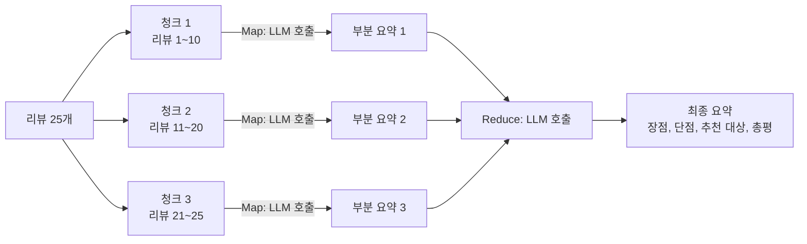
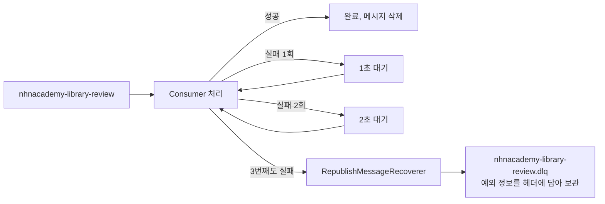
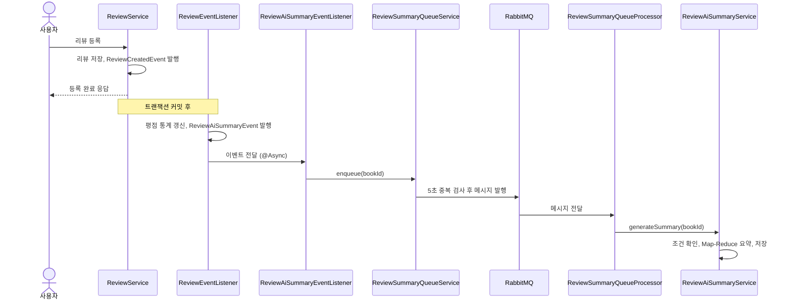

# 04. 리뷰 요약 시스템

> 도서 리뷰를 LLM으로 요약하는 기능을 만듭니다. 리뷰가 많아도 처리할 수 있도록 Map-Reduce로 나눠 요약하고, 리뷰 등록 요청이 느려지지 않도록 RabbitMQ 큐를 거쳐 백그라운드에서 처리합니다. 실패하면 3번까지 시도한 뒤 DLQ로 보내고, 같은 도서의 요약이 중복 실행되지 않게 막습니다.
>
> 예상 소요 시간: 2.5시간 · 난이도: 심화

## 학습 목표

- Map-Reduce 요약과 누적 요약(Incremental Summary)의 동작과 LLM 호출 횟수를 설명할 수 있다
- 리뷰 등록 → 이벤트 → RabbitMQ 큐 → Consumer → 요약 저장 흐름을 그릴 수 있다
- 메시지 처리 실패 시 재시도 3회 후 DLQ(Dead Letter Queue)로 이동하는 구조를 설명할 수 있다
- 같은 도서의 요약이 중복 실행되지 않도록 막는 세 가지 장치를 설명할 수 있다

## 시작하기 전에

- [Step 1. CSV 적재](../step-1/01.csv-batch-load.md)에서 Spring 이벤트를 써 봤어야 합니다.
- `@Transactional`, `@Async`의 기본 동작을 알고 있어야 합니다.
- RabbitMQ 서버 접속 정보는 `rabbitmq.properties`에 있고, 비밀번호는 `secrets.properties`의 `RABBITMQ_PASSWORD`로 주입됩니다. 로컬에서 직접 띄우려면 `docker run -d -p 5672:5672 -p 15672:15672 rabbitmq:3-management`를 사용할 수 있습니다.
- 모르는 용어는 [용어집](../glossary.md)을 참고합니다.

## 1. 왜 필요한가

도서 상세 화면에 리뷰가 200개 달려 있다고 생각해 봅시다. 사용자는 200개를 다 읽지 않습니다. "장점은 무엇이고, 단점은 무엇이고, 누구에게 맞는 책인가"를 몇 문장으로 정리해 주면 훨씬 유용합니다. 이 요약은 05 문서에서 LLM 추천의 근거로도 쓰입니다.

그런데 단순하게 구현하면 세 가지 문제가 생깁니다.

| 단순한 구현 | 문제 |
|-------------|------|
| 리뷰 200개를 한 프롬프트에 모두 넣음 | 입력이 너무 길어 비용이 크고, 모델의 입력 한도를 넘을 수 있음 |
| 리뷰 등록 API 안에서 바로 LLM 호출 | 사용자가 리뷰를 쓰고 수 초를 기다림. LLM이 실패하면 리뷰 등록까지 실패 |
| 리뷰가 등록될 때마다 요약 | 동시에 리뷰 10개가 오면 같은 도서를 10번 요약하고 서로 덮어씀 |

이 문서는 각 문제를 **Map-Reduce 요약**, **메시지 큐 기반 비동기 처리**, **중복 방지 장치**로 해결합니다.

## 2. 핵심 개념

### 2.1. Map-Reduce 요약

리뷰 200개를 한 번에 요약하는 대신, 작은 묶음으로 나눠 요약한 뒤 그 요약들을 다시 합칩니다.

조별 과제에 비유하면, 200쪽 자료를 10쪽씩 20명에게 나눠 각자 요약하게 하고(Map), 조장이 20개의 요약을 모아 최종 보고서를 씁니다(Reduce).



- **청크(Chunk)**: 한 번에 요약할 리뷰 묶음입니다. 크기는 `app.review.map-chunk-size`(기본 10)입니다.
- **Map**: 청크마다 리뷰를 "[장점], [단점], [추천 대상], [총평]" 네 줄로 요약합니다.
- **Reduce**: 부분 요약들을 합쳐 같은 네 줄 형식의 최종 요약을 만듭니다.

LLM 호출 횟수는 다음과 같습니다.

```text
LLM 호출 = ⌈리뷰 수 ÷ 청크 크기⌉ (Map) + 1 (Reduce)
리뷰 25개, 청크 10 → 3 + 1 = 4번
```

### 2.2. 누적 요약과 전체 재요약

리뷰가 5개 늘 때마다 전체를 다시 요약하면 낭비입니다. **누적 요약(Incremental Summary)** 은 새로 들어온 리뷰만 Map으로 요약하고, Reduce 단계에서 **기존 요약과 합칩니다**.

| 방식 | 입력 | 언제 쓰나 |
|------|------|-----------|
| 누적 요약 | 새 리뷰 + 기존 요약 | 마지막 요약 이후 새 리뷰가 10개 미만 |
| 전체 재요약(Full Rebuild) | 모든 리뷰 | 마지막 요약 이후 새 리뷰가 10개 이상 |

기준값은 `app.review.reduce-threshold`(기본 10)입니다. 누적 요약을 계속 반복하면 요약 위에 요약을 덧칠하는 셈이라 내용이 점점 흐려질 수 있습니다(드리프트, Drift). 새 리뷰가 많이 쌓였을 때는 처음부터 다시 만들어 이 문제를 줄입니다.

어디까지 요약했는지는 `BookReviewSummary.lastSummarizedCount`에 기록합니다.

### 2.3. 메시지 큐와 RabbitMQ

**메시지 큐(Message Queue)** 는 "할 일 목록"을 보관하는 별도 서버입니다. 일을 시키는 쪽(**Producer**)은 메시지를 큐에 넣고 바로 돌아가고, 일을 하는 쪽(**Consumer**)은 큐에서 메시지를 꺼내 처리합니다.

식당 주문서 꽂이를 떠올리면 됩니다. 홀 직원은 주문서를 꽂아 두고 다음 손님을 받으러 가고, 주방 요리사 여러 명이 꽂이에서 주문서를 하나씩 가져가 요리합니다.

| 용어 | 이 프로젝트에서 |
|------|-----------------|
| Producer | `ReviewSummaryQueueService` (메시지 발행) |
| Exchange | `nhnacademy-library-exchange` (Direct 방식, 라우팅 키로 큐를 고름) |
| Queue | `nhnacademy-library-review` (라우팅 키 `review.summary`) |
| Consumer | `ReviewSummaryQueueProcessor` (`@RabbitListener`, 3~5개 동시 처리) |
| 메시지 | `ReviewSummaryTask` (`bookId`, `enqueueTime`), JSON으로 변환 |

`@Async`만 써도 비동기 처리는 되는데 왜 RabbitMQ를 쓸까요?

| 비교 | `@Async` 스레드 | RabbitMQ |
|------|-----------------|----------|
| 서버가 재시작되면 | 처리 대기 중인 작업이 사라짐 | 큐에 남아 있다가 재시작 후 처리 |
| 서버를 여러 대 띄우면 | 서버마다 따로 처리 | 모든 서버가 같은 큐를 나눠 처리 |
| 실패한 작업 | 로그만 남음 | 재시도 후 DLQ에 보관해 나중에 확인 |
| 동시 처리 수 조절 | 스레드 풀 설정 | Consumer 수(`concurrency`) 설정 |

### 2.4. 재시도와 DLQ

LLM 서버가 잠깐 응답하지 않으면 요약이 실패합니다. 이런 일시적인 오류는 잠시 후 다시 하면 대부분 성공합니다. 반대로 데이터 문제처럼 계속 실패하는 메시지를 무한히 다시 시도하면 Consumer가 그 메시지에 묶여 다른 도서의 요약이 밀립니다.

그래서 **정해진 횟수만 재시도하고, 그래도 실패하면 별도 큐로 옮깁니다.** 이 별도 큐를 **DLQ(Dead Letter Queue)** 라고 합니다. 배달 못 한 우편물을 모아 두는 보관함과 같습니다.



- 최대 시도 횟수: 3번(첫 시도 포함)
- 대기 간격: 1초에서 시작해 2배씩 늘림, 최대 10초
- 3번 모두 실패하면 원래 큐로 되돌리지 않고 DLQ로 재발행

### 2.5. 중복 실행 방지

같은 도서에 리뷰가 몰리면 요약 요청도 몰립니다. 이 프로젝트는 세 겹으로 막습니다.

| 장치 | 위치 | 막는 것 |
|------|------|---------|
| ① 5초 중복 필터 | `ReviewSummaryQueueService.pendingBooks` | 같은 도서의 메시지를 5초 안에 여러 번 발행하는 것 |
| ② `isGenerating` 플래그 | `BookReviewSummary` 테이블 | Consumer 여러 개가 같은 도서를 동시에 요약하는 것 |
| ③ 요약 조건(Dirty Flag) | `BookReviewSummary.isSummaryDirty`, 리뷰 수 5개 이상 | 요약이 필요 없을 때 LLM을 부르는 것 |

**Dirty Flag**는 "데이터가 바뀌어 다시 계산해야 한다"는 표시입니다. 요약을 만들면 `false`로 바꾸고, 요약이 필요한 상태일 때만 LLM을 호출합니다.

## 3. 따라 하기

전체 흐름을 먼저 보고 STEP별로 코드를 읽습니다.



사용자는 리뷰 저장까지만 기다리고, 통계 갱신과 요약은 모두 그 뒤에 일어납니다.

### STEP 1: 요약 상태를 담는 엔티티

**목표:** 도서별 통계와 요약 진행 상태를 저장하는 `book_review_summary` 테이블을 확인합니다.

| 필드 | 설명 |
|------|------|
| `book_id` | 도서 ID(PK) |
| `review_count`, `average_rating`, `rating_1_count`~`rating_5_count`, `last_reviewed_at` | 평점 통계 |
| `review_summary` | AI가 만든 요약(TEXT) |
| `is_summary_dirty` | 요약을 다시 만들어야 하는지(Dirty Flag) |
| `last_summarized_count` | 마지막 요약에 포함된 리뷰 수 |
| `is_generating` | 지금 요약을 만드는 중인지 |
| `version` | 낙관적 잠금(`@Version`) |

전체 코드: [`core/review/domain/BookReviewSummary.java`](../../src/main/java/net/java21/library/core/review/domain/BookReviewSummary.java)

### STEP 2: 리뷰 저장과 이벤트 연결

**목표:** 리뷰 저장, 통계 갱신, 요약 요청을 이벤트로 분리합니다.

```java
// ReviewService.createReview(): 리뷰 저장 후 이벤트만 발행
BookReview savedReview = bookReviewRepository.save(review);
eventPublisher.publishEvent(new ReviewCreatedEvent(bookId));
```

```java
// ReviewEventListener: 리뷰 저장 트랜잭션이 커밋된 뒤 통계 갱신
@TransactionalEventListener(phase = TransactionPhase.AFTER_COMMIT)
public void handleReviewCreatedEvent(ReviewCreatedEvent event) {
    reviewService.updateReviewSummary(event.bookId());
}
```

```java
// ReviewService.updateReviewSummary(): 새 트랜잭션에서 통계 갱신 후 요약 이벤트 발행
@Transactional(propagation = Propagation.REQUIRES_NEW)
public void updateReviewSummary(Long bookId) {
    // selectStat(bookId)로 COUNT, AVG, 별점별 개수를 집계해 updateStat(...)
    // ...
    eventPublisher.publishEvent(new ReviewAiSummaryEvent(bookId));
}
```

**설명:**

- 이벤트는 `record ReviewCreatedEvent(Long bookId)`처럼 불변 객체입니다.
- `AFTER_COMMIT`: 리뷰 저장이 실제로 커밋된 뒤에만 통계를 계산합니다. 롤백된 리뷰가 통계에 들어가는 일을 막습니다.
- `REQUIRES_NEW`: 커밋이 끝난 뒤에는 기존 트랜잭션을 쓸 수 없으므로 새 트랜잭션을 엽니다. `ReviewEventListener`가 다른 빈(`ReviewService`)의 메서드를 호출하므로 프록시를 거쳐 이 설정이 적용됩니다.

전체 코드: [`core/review/service/ReviewService.java`](../../src/main/java/net/java21/library/core/review/service/ReviewService.java), [`core/review/service/ReviewEventListener.java`](../../src/main/java/net/java21/library/core/review/service/ReviewEventListener.java)

### STEP 3: RabbitMQ 설정

**목표:** 큐, Exchange, 바인딩, JSON 변환기를 선언합니다.

```properties
# rabbitmq.properties
spring.rabbitmq.host=s4.java21.net
spring.rabbitmq.port=5672
spring.rabbitmq.username=admin
spring.rabbitmq.password=${RABBITMQ_PASSWORD:}
spring.rabbitmq.listener.simple.concurrency=3
spring.rabbitmq.listener.simple.max-concurrency=5
spring.rabbitmq.listener.simple.acknowledge-mode=auto
rabbitmq.queue.review-summary=nhnacademy-library-review
```

```java
@Configuration
public class RabbitMQConfig {

    @Value("${rabbitmq.queue.review-summary}")
    private String reviewSummaryQueueName;

    private static final String EXCHANGE = "nhnacademy-library-exchange";
    private static final String ROUTING_KEY = "review.summary";

    @Bean
    public Queue reviewSummaryQueue() {
        return QueueBuilder.durable(reviewSummaryQueueName).build();   // 재시작해도 유지
    }

    @Bean
    public DirectExchange exchange() {
        return new DirectExchange(EXCHANGE, true, false);
    }

    @Bean
    public Binding binding(Queue reviewSummaryQueue, DirectExchange exchange) {
        return BindingBuilder.bind(reviewSummaryQueue).to(exchange).with(ROUTING_KEY);
    }

    @Bean
    public MessageConverter jsonMessageConverter() {
        return new Jackson2JsonMessageConverter();                      // 객체 ↔ JSON
    }

    // RabbitTemplate에 JSON 변환기 지정, DLQ 관련 빈은 STEP 6
}
```

**설명:**

- **Durable** 큐는 RabbitMQ 서버가 재시작되어도 사라지지 않습니다.
- **Direct Exchange**는 라우팅 키가 정확히 같은 큐로 메시지를 보냅니다. `review.summary` 키로 보낸 메시지는 요약 큐로 갑니다.
- `acknowledge-mode=auto`: Consumer 메서드가 예외 없이 끝나면 메시지를 처리 완료로 표시해 큐에서 지웁니다.
- 큐와 Exchange는 애플리케이션이 시작할 때 자동으로 선언되므로 관리 콘솔에서 미리 만들 필요가 없습니다.

전체 코드: [`core/config/RabbitMQConfig.java`](../../src/main/java/net/java21/library/core/config/RabbitMQConfig.java)

### STEP 4: Producer와 5초 중복 필터

**목표:** 요약 이벤트를 받아 큐에 메시지를 발행하되, 같은 도서의 요청이 5초 안에 반복되면 무시합니다.

```java
// ReviewAiSummaryEventListener
@Async
@EventListener
public void handleReviewAiSummaryEvent(ReviewAiSummaryEvent event) {
    boolean enqueued = queueService.enqueue(event.bookId());
    // enqueued == false 이면 중복으로 무시된 것
}
```

```java
// ReviewSummaryQueueService
private final Map<Long, Long> pendingBooks = new ConcurrentHashMap<>();   // bookId → 발행 시각
private static final long DEDUP_WINDOW_MS = 5000;

public boolean enqueue(Long bookId) {
    Long lastEnqueueTime = pendingBooks.get(bookId);
    long now = System.currentTimeMillis();

    if (lastEnqueueTime != null && (now - lastEnqueueTime) < DEDUP_WINDOW_MS) {
        return false;                                                    // 5초 안의 중복 요청
    }

    try {
        ReviewSummaryTask task = new ReviewSummaryTask(bookId);
        rabbitTemplate.convertAndSend(EXCHANGE, ROUTING_KEY, task);      // JSON으로 발행
        pendingBooks.put(bookId, now);
        return true;
    } catch (Exception e) {
        log.error("Failed to publish summary task for book {}: {}", bookId, e.getMessage(), e);
        return false;
    }
}
```

**설명:**

- 리뷰가 1초 간격으로 3개 달리면 메시지는 1개만 발행됩니다. 어차피 Consumer는 처리 시점의 최신 리뷰를 DB에서 읽으므로 메시지 1개로 충분합니다.
- `pendingBooks`는 Consumer가 처리를 마치면 지워집니다(STEP 5). 그 뒤에는 5초가 안 지났어도 새 메시지를 발행할 수 있습니다.
- `pendingBooks`는 서버 메모리에 있으므로 서버가 여러 대면 서버마다 따로 관리됩니다. 그래서 ② `isGenerating` 플래그가 한 번 더 필요합니다.

전체 코드: [`core/review/service/ReviewSummaryQueueService.java`](../../src/main/java/net/java21/library/core/review/service/ReviewSummaryQueueService.java)

### STEP 5: Consumer

**목표:** 큐에서 메시지를 받아 요약을 생성합니다.

```java
@RabbitListener(
        queues = "${rabbitmq.queue.review-summary}",
        concurrency = "3-5"
)
public void processTask(ReviewSummaryTask task) {
    long startTime = System.currentTimeMillis();
    log.info("Processing summary task for book {} (queue wait: {}ms)",
            task.getBookId(), startTime - task.getEnqueueTime());
    try {
        reviewAiSummaryService.generateSummary(task.getBookId());
    } catch (Exception e) {
        log.error("Failed to process summary task for book {}: {}", task.getBookId(), e.getMessage(), e);
        throw e;                                      // 다시 던져야 재시도·DLQ가 동작
    } finally {
        queueService.removePending(task.getBookId()); // 중복 필터 해제
    }
}
```

**설명:**

- `concurrency = "3-5"`: 평소에는 Consumer 스레드 3개, 메시지가 쌓이면 5개까지 늘립니다. 서로 다른 도서를 동시에 요약할 수 있습니다.
- 예외를 잡아서 로그만 남기고 삼키면 RabbitMQ는 처리 성공으로 보고 메시지를 지웁니다. **재시도를 원하면 반드시 다시 던져야 합니다.**
- `enqueueTime`으로 메시지가 큐에서 얼마나 기다렸는지 로그로 볼 수 있습니다.

전체 코드: [`core/review/service/ReviewSummaryQueueProcessor.java`](../../src/main/java/net/java21/library/core/review/service/ReviewSummaryQueueProcessor.java)

### STEP 6: 재시도 3회와 DLQ

**목표:** Consumer가 실패하면 3번까지 시도하고, 그래도 실패하면 DLQ로 보냅니다.

```properties
# application.properties
spring.rabbitmq.listener.simple.retry.enabled=true
spring.rabbitmq.listener.simple.retry.max-attempts=3
spring.rabbitmq.listener.simple.retry.initial-interval=1s
spring.rabbitmq.listener.simple.retry.multiplier=2.0
spring.rabbitmq.listener.simple.retry.max-interval=10s
spring.rabbitmq.listener.simple.default-requeue-rejected=false
```

```java
// RabbitMQConfig (DLQ 부분)
static final String DLQ_ROUTING_KEY = "review.summary.dlq";

@Bean
public Queue reviewSummaryDeadLetterQueue() {
    return QueueBuilder.durable(reviewSummaryQueueName + ".dlq").build();
}

@Bean
public Binding deadLetterBinding(Queue reviewSummaryDeadLetterQueue, DirectExchange exchange) {
    return BindingBuilder.bind(reviewSummaryDeadLetterQueue).to(exchange).with(DLQ_ROUTING_KEY);
}

@Bean
public MessageRecoverer messageRecoverer(RabbitTemplate rabbitTemplate) {
    return new RepublishMessageRecoverer(rabbitTemplate, EXCHANGE, DLQ_ROUTING_KEY);
}
```

**설명:**

- `retry.*`: Spring AMQP가 Consumer 안에서 재시도합니다(`spring-retry` 의존성 필요, `pom.xml`에 포함). 시도 간격은 1초, 2초 순으로 늘어납니다.
- `default-requeue-rejected=false`: 실패한 메시지를 원래 큐로 되돌리지 않습니다. 되돌리면 같은 메시지가 끝없이 다시 전달됩니다.
- `RepublishMessageRecoverer`: 재시도를 모두 소진하면 메시지를 `review.summary.dlq` 라우팅 키로 다시 발행합니다. 메시지 헤더에 예외 메시지와 스택 트레이스가 담겨 원인을 확인할 수 있습니다.
- DLQ에 쌓인 메시지 수는 RabbitMQ 관리 콘솔(`http://<호스트>:15672`)의 Queues 화면에서 확인할 수 있습니다.

> RabbitMQ 자체 기능(큐의 `x-dead-letter-exchange` 인자)으로도 DLQ를 만들 수 있습니다. 하지만 이미 운영 중인 큐에 인자를 추가하면 기존 선언과 달라 애플리케이션 시작 시 큐 재선언에 실패합니다. 그래서 기존 큐는 그대로 두고 애플리케이션에서 DLQ로 재발행하는 방식을 택했습니다.

### STEP 7: 요약 조건 확인과 방식 선택

**목표:** 요약이 필요한지 확인하고, 누적 요약과 전체 재요약 중 하나를 고릅니다.

```java
@Transactional(propagation = Propagation.REQUIRES_NEW)
public void generateSummary(Long bookId) {
    BookReviewSummary summary = /* findById(bookId), 없으면 return */;

    // ③ 리뷰 5개 이상 && isSummaryDirty
    if (!shouldGenerateSummary(summary)) return;
    // ② 이미 다른 Consumer가 생성 중이면 건너뜀
    if (Boolean.TRUE.equals(summary.getIsGenerating())) return;

    try {
        summary.setGenerating(true);
        bookReviewSummaryRepository.saveAndFlush(summary);

        long reviewCount = summary.getReviewCount();
        long lastSummarizedCount = /* null이면 0 */;
        boolean needsRebuild =
                (reviewCount - lastSummarizedCount) >= reviewSummarizer.getReduceThreshold();

        if (needsRebuild) {
            // 전체 리뷰를 Map-Reduce로 다시 요약
            List<String> all = /* findAllByBookId(bookId)의 content */;
            summary.updateSummaryWithCount(reviewSummarizer.summarizeReviews(all), reviewCount);
        } else {
            // 마지막 요약 이후의 리뷰만 요약해 기존 요약과 병합
            List<BookReview> newReviews =
                    bookReviewRepository.findNewReviewsAfterId(bookId, lastSummarizedCount);
            // newReviews가 비어 있으면 dirty만 false로 바꾸고 종료
            summary.updateSummaryWithCount(
                    reviewSummarizer.summarizeIncremental(/* 새 리뷰 content */, summary.getReviewSummary()),
                    reviewCount);
        }
        bookReviewSummaryRepository.save(summary);
    } catch (Exception e) {
        log.error("Failed to generate summary for book {}: {}", bookId, e.getMessage(), e);
    } finally {
        summary.setGenerating(false);               // 실패해도 플래그 해제
        bookReviewSummaryRepository.save(summary);
    }
}
```

**설명:**

- `updateSummaryWithCount()`는 요약, `lastSummarizedCount`를 저장하고 `isSummaryDirty`를 `false`로 바꿉니다.
- `findNewReviewsAfterId()`는 이름과 달리 리뷰 ID가 아니라 **개수**로 건너뜁니다. 도서의 리뷰를 ID 오름차순으로 정렬한 뒤 `lastSummarizedCount`만큼 `offset`을 줍니다. 리뷰 ID는 모든 도서가 함께 쓰는 일련번호라 도서별 개수와 비교할 수 없기 때문입니다(리뷰가 삭제되지 않는다는 전제).
- `finally`에서 `isGenerating`을 반드시 `false`로 되돌립니다. 그렇지 않으면 한 번 실패한 도서는 영원히 "생성 중"으로 남습니다.

전체 코드: [`core/review/service/ReviewAiSummaryService.java`](../../src/main/java/net/java21/library/core/review/service/ReviewAiSummaryService.java)

### STEP 8: Map-Reduce 요약기

**목표:** 청크로 나눠 요약하고 합치는 `ReviewSummarizer`를 확인합니다.

```java
public String summarizeReviews(List<String> reviews) {
    if (reviews == null || reviews.isEmpty()) {
        return "리뷰가 없어 요약할 수 없습니다.";
    }

    // 1. Map: 청크별 부분 요약
    List<String> partialSummaries = new ArrayList<>();
    for (List<String> chunk : Lists.partition(reviews, mapChunkSize)) {
        partialSummaries.add(ReviewSummaryFormatter.clean(chatModel.call(createMapPrompt(chunk))));
    }

    // 2. Reduce: 부분 요약을 합쳐 최종 요약
    return ReviewSummaryFormatter.clean(chatModel.call(createReducePrompt(partialSummaries)));
}
```

(실제 코드는 청크 번호를 로그로 남기기 위해 인덱스 기반 `for` 문을 씁니다.)

`summarizeIncremental(newReviews, existingSummary)`도 Map 단계는 같고, Reduce 단계에서 기존 요약을 함께 넣는 병합 프롬프트를 씁니다.

Map, Reduce, 병합 프롬프트는 모두 같은 출력 형식(`OUTPUT_FORMAT` 상수)을 붙입니다.

```text
[출력 형식]
아래 네 줄만 출력하세요. 각 줄은 항목 이름으로 시작하고 1~2문장으로 작성합니다.
[장점] ...
[단점] ...
[추천 대상] ...
[총평] ...

[규칙]
- 인사말, 서두("물론입니다", "작성해 드리겠습니다" 등), 제목을 쓰지 마세요.
- Markdown 기호(**, #, -, *)를 쓰지 마세요. 일반 텍스트만 출력하세요.
- 리뷰에 근거가 없는 내용은 쓰지 마세요. 해당 항목에 근거가 없으면 "리뷰에서 언급이 없습니다."라고 쓰세요.
- 공손한 합니다체(~입니다, ~합니다)를 사용하세요.
```

**설명:**

- `Lists.partition()`은 Guava의 메서드로, 리스트를 정해진 크기의 하위 리스트로 나눕니다. 마지막 청크는 크기가 더 작을 수 있습니다.
- 세 프롬프트가 같은 형식을 쓰므로 부분 요약, 최종 요약, 병합 결과의 모양이 일정합니다. 05 문서에서 요약을 컨텍스트에 넣을 때도 이 일관성이 도움이 됩니다.
- LLM은 지시를 어기고 Markdown 기호나 인사말을 붙이기도 합니다. 그래서 응답을 `ReviewSummaryFormatter.clean()`으로 한 번 정리한 뒤 저장합니다. 화면에서는 같은 클래스의 `parse()`로 네 항목을 나눠 표시합니다.

전체 코드: [`core/review/service/ReviewSummarizer.java`](../../src/main/java/net/java21/library/core/review/service/ReviewSummarizer.java)

### STEP 9: 실행해서 확인하기

**목표:** 로그로 전체 흐름을 확인합니다.

한 도서에 리뷰를 5개 등록합니다(웹 화면 또는 리뷰 등록 API 사용). 5번째 리뷰 뒤에 다음과 같은 로그가 보입니다.

```log
Handling ReviewCreatedEvent for book id: 101
Received ReviewAiSummaryEvent for book id: 101
Enqueued AI summary task for book 101
Processing summary task for book 101 (queue wait: 35ms)
Incremental summary for book 101 (5 new reviews since last summary).
Starting incremental summarization for 5 new reviews.
Map step: processing new reviews chunk 1/1
Reduce step: merging existing summary with 1 new partial summaries.
Successfully updated review summary for book 101.
Completed summary task for book 101 in 4210ms
```

리뷰가 4개 이하일 때는 `Conditions not met for book 101. Review count: 4, ...` 로그가 나오고 LLM은 호출되지 않습니다.

## 4. 직접 해 보기

### 미션 1 (기본): LLM 호출 횟수와 비용 계산

리뷰 1개는 평균 120자이고, 한글 2글자 ≈ 1토큰, Map 프롬프트 고정 문구는 100토큰, 부분 요약 1개는 80토큰이라고 가정합니다(청크 크기 10).

1. 리뷰 45개를 전체 요약(`summarizeReviews`)할 때 LLM 호출 횟수는?
2. Map 단계 입력 토큰의 합은?
3. 같은 45개를 한 프롬프트에 모두 넣는 경우와 비교해 Map-Reduce의 장점과 단점은?

<details>
<summary>정답</summary>

1. Map ⌈45 ÷ 10⌉ = 5번 + Reduce 1번 = 6번
2. 리뷰 토큰: 45 × 120 ÷ 2 = 2,700토큰. 고정 문구: 5 × 100 = 500토큰. 합계 약 3,200토큰
3. 한 번에 넣으면 입력은 약 2,800토큰으로 조금 적고 호출도 1번이지만, 리뷰가 수천 개로 늘면 모델의 입력 한도를 넘고 긴 입력의 가운데를 놓치기 쉽습니다. Map-Reduce는 호출 횟수가 늘고 고정 문구 비용이 반복되지만, 리뷰 수와 상관없이 한 번의 입력 크기가 일정합니다.

</details>

### 미션 2 (기본): 5초 중복 필터 단위 테스트

`ReviewSummaryQueueService`에 같은 `bookId`로 `enqueue()`를 두 번 연속 호출하면 두 번째는 `false`이고 `RabbitTemplate.convertAndSend()`는 한 번만 호출되는지 검증하세요. `removePending()` 후에는 다시 `true`가 되는지도 확인합니다.

<details>
<summary>정답 예시</summary>

```java
@ExtendWith(MockitoExtension.class)
class ReviewSummaryQueueServiceTest {

    @Mock
    RabbitTemplate rabbitTemplate;

    @InjectMocks
    ReviewSummaryQueueService queueService;

    @Test
    @DisplayName("5초 안에 같은 도서를 다시 요청하면 발행하지 않는다")
    void enqueue_ignoresDuplicateWithinWindow() {
        assertThat(queueService.enqueue(1L)).isTrue();
        assertThat(queueService.enqueue(1L)).isFalse();

        verify(rabbitTemplate, times(1))
                .convertAndSend(eq("nhnacademy-library-exchange"), eq("review.summary"), any(ReviewSummaryTask.class));
    }

    @Test
    @DisplayName("Consumer가 처리를 마치면 다시 발행할 수 있다")
    void enqueue_allowsAfterRemovePending() {
        queueService.enqueue(1L);
        queueService.removePending(1L);

        assertThat(queueService.enqueue(1L)).isTrue();
    }
}
```

</details>

### 미션 3 (도전): 재시도 타임라인 그리기

LLM 서버가 10초 동안 응답하지 않는 상황에서 메시지 1개가 들어왔습니다. 각 시도가 즉시 실패한다고 가정하고, 시도 시각과 최종 결과(성공 또는 DLQ)를 적어 보세요. 그다음 LLM 장애가 2초 만에 복구되는 경우도 적어 보세요.

<details>
<summary>정답</summary>

```text
[10초 장애]
0초  1번째 시도 실패 → 1초 대기
1초  2번째 시도 실패 → 2초 대기
3초  3번째 시도 실패 → 재시도 소진 → DLQ로 이동

[2초 장애]
0초  1번째 시도 실패 → 1초 대기
1초  2번째 시도 실패 → 2초 대기
3초  3번째 시도 성공 → 메시지 삭제
```

주의: 이 타임라인은 예외가 `processTask()` 밖으로 전파될 때의 동작입니다. 현재 `ReviewAiSummaryService.generateSummary()`는 요약 중 발생한 예외를 내부에서 잡아 로그만 남기므로, LLM 호출 실패는 재시도·DLQ로 이어지지 않습니다. 5장의 표를 참고하세요.

</details>

## 5. 자주 하는 실수

| 증상 | 원인 | 해결 |
|------|------|------|
| 애플리케이션 시작 시 RabbitMQ 연결 오류 | `RABBITMQ_PASSWORD`가 비어 있거나 서버에 접근 불가 | `secrets.properties` 확인, 로컬이면 Docker로 RabbitMQ 실행 |
| Consumer에서 예외가 났는데 재시도도 DLQ 이동도 없음 | 예외를 잡고 다시 던지지 않음. 현재 `generateSummary()`도 요약 중 예외를 내부에서 처리함 | 재시도가 필요한 예외는 Consumer 밖으로 전파되게 설계 |
| 같은 메시지가 끝없이 다시 처리됨 | `default-requeue-rejected`가 `true`(기본값)이고 재시도 설정이 없음 | `retry.enabled=true`, `default-requeue-rejected=false`, `MessageRecoverer` 빈 등록 |
| 한 번 실패한 도서가 다시는 요약되지 않음 | `finally`에서 `isGenerating`을 해제하지 않음 | 플래그 해제를 `finally`에 둠 |
| 첫 요약 이후 리뷰가 늘어도 요약이 갱신되지 않음 | 요약 후 `isSummaryDirty`가 `false`가 되는데, 현재 `updateStat()`은 이 값을 다시 `true`로 바꾸지 않음 | 통계 갱신 시 Dirty Flag를 `true`로 설정하는 것을 검토 |
| 메시지 역직렬화 오류 | Producer와 Consumer의 메시지 변환기가 다름 | 양쪽 모두 `Jackson2JsonMessageConverter` 사용 |

## 6. 정리

- 리뷰가 많아도 Map-Reduce로 10개씩 나눠 요약하고 합치므로 한 번의 LLM 입력 크기가 일정합니다. 새 리뷰가 10개 미만이면 누적 요약, 10개 이상이면 전체 재요약을 합니다.
- 리뷰 등록 → `ReviewCreatedEvent` → 통계 갱신 → `ReviewAiSummaryEvent` → RabbitMQ 큐 → Consumer → 요약 저장 순으로 흐르며, 사용자는 리뷰 저장까지만 기다립니다.
- Consumer에서 예외가 전파되면 1초, 2초 간격으로 최대 3번 시도하고, 그래도 실패하면 `nhnacademy-library-review.dlq`로 옮깁니다.
- 중복 실행은 5초 중복 필터, `isGenerating` 플래그, 요약 조건(리뷰 5개 이상, Dirty Flag)으로 막습니다.

- [ ] 리뷰 수와 청크 크기로 LLM 호출 횟수를 계산할 수 있다
- [ ] 누적 요약과 전체 재요약을 고르는 기준을 말할 수 있다
- [ ] Producer, Exchange, Queue, Consumer를 이 프로젝트의 클래스와 연결할 수 있다
- [ ] 재시도 3회 후 DLQ로 가는 조건과 필요한 설정을 말할 수 있다
- [ ] 중복 방지 장치 세 가지가 각각 무엇을 막는지 설명할 수 있다

## 확인 문제

**1.** 리뷰 32개를 전체 요약할 때 LLM은 몇 번 호출되나요? (청크 크기 10)

<details><summary>정답</summary>

Map ⌈32 ÷ 10⌉ = 4번, Reduce 1번으로 총 5번입니다.

</details>

**2.** 리뷰 등록 API 안에서 바로 LLM 요약을 호출하지 않고 큐를 거치는 이유 두 가지를 말해 보세요.

<details><summary>정답</summary>

사용자가 LLM 응답을 기다리지 않아도 되고, LLM이 실패해도 리뷰 등록은 성공합니다. 또 큐에 메시지가 남아 있으므로 서버가 재시작되어도 요약 작업이 사라지지 않고, 여러 서버가 같은 큐를 나눠 처리할 수 있습니다.

</details>

**3.** `spring.rabbitmq.listener.simple.default-requeue-rejected=false`를 설정하지 않으면 어떤 문제가 생길 수 있나요?

<details><summary>정답</summary>

처리에 실패한 메시지가 원래 큐로 되돌아가 계속 다시 전달됩니다. 계속 실패하는 메시지가 Consumer를 붙잡아 다른 도서의 요약이 밀립니다.

</details>

**4.** 5초 중복 필터가 있는데도 `isGenerating` 플래그가 필요한 이유는 무엇인가요?

<details><summary>정답</summary>

5초 필터는 서버 메모리(`pendingBooks`)에 있어 서버마다 따로 동작하고, Consumer가 처리를 마치면 해제됩니다. 서버가 여러 대이거나 5초가 지난 뒤 같은 도서의 메시지가 또 들어오면 Consumer 여러 개가 같은 도서를 동시에 처리할 수 있으므로, DB에 저장된 플래그로 한 번 더 막습니다.

</details>

**5.** `findNewReviewsAfterId()`가 리뷰 ID가 아니라 개수(`offset`)로 새 리뷰를 찾는 이유는 무엇인가요?

<details><summary>정답</summary>

리뷰 ID는 모든 도서가 함께 쓰는 일련번호라서, 도서별 리뷰 개수(`lastSummarizedCount`)와 비교하면 다른 도서의 리뷰 수에 따라 결과가 틀어집니다. 도서별로 ID 오름차순 정렬 후 요약한 개수만큼 건너뛰어야 정확합니다.

</details>

## 다음 문서

[05. 리뷰 RAG 연동 →](05.review-rag-integration.md)
