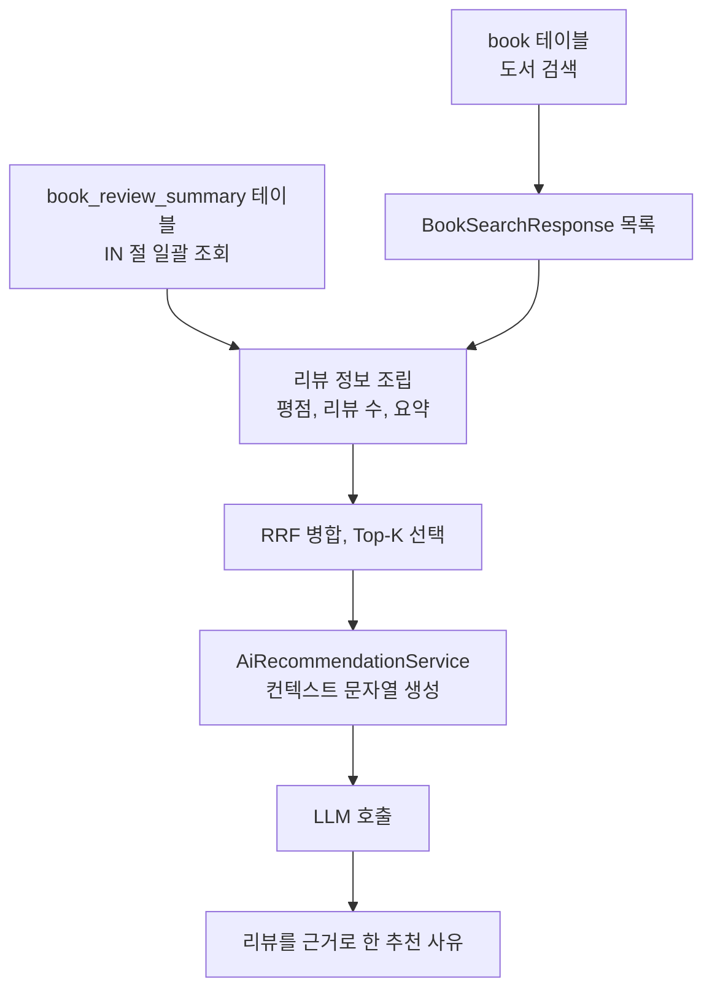

# 05. 리뷰 RAG 연동

> 04에서 만든 평점 통계와 리뷰 요약을 검색 결과 DTO에 붙이고, LLM 프롬프트의 컨텍스트에 넣어 "리뷰를 근거로 한 추천 사유"를 만듭니다. 이 과정에서 N+1 문제를 피하는 조회 방법과 데이터가 없을 때의 처리를 익힙니다.
>
> 예상 소요 시간: 1.5시간 · 난이도: 기본

## 학습 목표

- 리뷰 정보가 DB에서 LLM 프롬프트까지 전달되는 경로를 설명할 수 있다
- IN 절 일괄 조회로 N+1 문제 없이 검색 결과에 리뷰 정보를 붙일 수 있다
- 리뷰나 요약이 없는 도서를 고려해 컨텍스트 문자열을 만들 수 있다
- 리뷰 정보를 활용하도록 프롬프트 규칙을 작성할 수 있다

## 시작하기 전에

- [04. 리뷰 요약 시스템](04.review-summarization.md)에서 `book_review_summary` 테이블과 요약 생성 과정을 이해했어야 합니다.
- [Step 3. 컨텍스트 구성](../step-3/02.context-construction.md)과 [02. Top-K 최적화](02.topk-optimization.md)에서 `AiRecommendationService`가 컨텍스트를 만드는 방식을 봤습니다.
- JPA를 쓰며 N+1 문제를 겪어 봤다면 이해가 빠릅니다.
- 모르는 용어는 [용어집](../glossary.md)을 참고합니다.

## 1. 왜 필요한가

Step 3의 LLM은 도서의 제목, 저자, 출판일, 소개 문구만 보고 추천 사유를 씁니다. 그러면 추천 사유가 소개 문구를 바꿔 말한 정도에 그칩니다.

```text
사용자: "주식 투자 입문서 추천해줘"

[리뷰 반영 전]
"이 책은 주식 투자의 기본 개념을 다루고 있어 질문과 관련이 있습니다."

[리뷰 반영 후]
"평점 4.8/5.0(127개 리뷰)으로 많은 독자에게 검증된 도서입니다.
 리뷰어들이 '설명이 쉽고 실전 예제가 많다'고 평가해 입문자에게 추천해 드립니다."
```

실제 독자의 평가는 소개 문구보다 설득력 있는 근거입니다. 그런데 이 정보는 `book_review_summary` 테이블에만 있고, LLM에 전달되는 `BookSearchResponse`에는 없었습니다. 이 문서에서는 이 둘을 연결합니다.

## 2. 핵심 개념

### 2.1. 데이터 흐름



새로 추가되는 정보는 세 가지입니다.

| 필드 | 출처 | 리뷰가 없으면 |
|------|------|---------------|
| `averageRating` | `book_review_summary.average_rating` | `null` |
| `reviewCount` | `book_review_summary.review_count` | `null` |
| `reviewSummary` | `book_review_summary.review_summary` | `null` (리뷰 5개 미만이면 요약도 없음) |

### 2.2. N+1 문제

검색 결과 100권에 리뷰 정보를 붙인다고 할 때, 도서마다 리뷰를 따로 조회하면 다음처럼 됩니다.

```sql
SELECT ... FROM book WHERE ...;                          -- 1번
SELECT ... FROM book_review_summary WHERE book_id = 1;   -- 도서마다
SELECT ... FROM book_review_summary WHERE book_id = 2;
-- ... 총 101번
```

이것을 **N+1 문제**라고 합니다. 처음 1번의 쿼리 결과 N건 때문에 쿼리가 N번 더 실행됩니다. 해결 방법은 두 가지입니다.

| 방법 | 쿼리 수 | 특징 |
|------|---------|------|
| **IN 절 일괄 조회** (이 프로젝트) | 2번 | 기존 도서 조회 쿼리를 건드리지 않고 뒤에 붙일 수 있음 |
| LEFT JOIN | 1번 | 쿼리 한 번이지만 기존 검색 쿼리를 수정해야 함 |

```sql
SELECT ... FROM book WHERE ...;
SELECT ... FROM book_review_summary WHERE book_id IN (1, 2, 3, ..., 100);
```

리뷰가 없는 도서도 검색 결과에서 빠지면 안 되므로, JOIN을 쓴다면 INNER JOIN이 아니라 LEFT JOIN이어야 합니다.

### 2.3. 없는 정보는 넣지 않는다

리뷰가 없는 신간에 "평점: null/5.0(null개 리뷰)" 같은 문자열을 넣으면 LLM이 혼란스러워하거나 이상한 추론을 합니다. 그래서 값이 있을 때만 해당 항목을 컨텍스트에 붙이고, 없으면 항목 자체를 생략합니다. 요약은 길어지면 토큰이 늘어나므로 100자로 자릅니다.

## 3. 따라 하기

### STEP 1: 검색 결과 DTO에 리뷰 필드 추가

**목표:** `BookSearchResponse`가 리뷰 정보를 담을 수 있게 합니다.

```java
@Getter
@NoArgsConstructor
public class BookSearchResponse {
    // 기존 필드: id, isbn, title, ..., bookContent, similarity, rrfScore

    // 리뷰 정보
    private BigDecimal averageRating;
    private Long reviewCount;
    private String reviewSummary;

    // 기존 생성자(10개, 11개, 12개 인자)는 그대로 유지

    // 리뷰 정보까지 받는 생성자 (LEFT JOIN + @QueryProjection용)
    @QueryProjection
    public BookSearchResponse(Long id, String isbn, String title, String volumeTitle,
                              String authorName, String publisherName, BigDecimal price,
                              LocalDate editionPublishDate, String imageUrl, String bookContent,
                              Double similarity, Double rrfScore,
                              BigDecimal averageRating, Long reviewCount, String reviewSummary) { ... }

    // 조회 후 조립용 setter
    public void setAverageRating(BigDecimal averageRating) { this.averageRating = averageRating; }
    public void setReviewCount(Long reviewCount) { this.reviewCount = reviewCount; }
    public void setReviewSummary(String reviewSummary) { this.reviewSummary = reviewSummary; }
}
```

**설명:** 기존 생성자를 지우지 않아야 이 DTO를 쓰는 다른 코드(키워드 검색, 벡터 검색, RRF 병합)가 그대로 컴파일됩니다. 리뷰 필드는 나중에 채우므로 setter를 둡니다.

전체 코드: [`core/book/dto/BookSearchResponse.java`](../../src/main/java/net/java21/library/core/book/dto/BookSearchResponse.java)

### STEP 2: IN 절로 리뷰 정보 일괄 조회

**목표:** 도서 조회 직후 리뷰 요약을 한 번에 가져와 붙입니다.

`BookRepositoryImpl`의 `search()`(키워드 검색)와 `vectorSearch()`(벡터 검색) 모두 도서를 조회한 뒤 같은 코드를 실행합니다.

```java
// 2. 리뷰 정보 조회 (N+1 문제 방지 - IN 절 사용)
if (!bookSearchResponseList.isEmpty()) {
    List<Long> bookIds = bookSearchResponseList.stream()
            .map(BookSearchResponse::getId)
            .collect(Collectors.toList());

    List<BookReviewSummary> summaries = queryFactory
            .selectFrom(bookReviewSummary)
            .where(bookReviewSummary.bookId.in(bookIds))
            .fetch();

    Map<Long, BookReviewSummary> reviewMap = summaries.stream()
            .collect(Collectors.toMap(BookReviewSummary::getBookId, s -> s));

    // 3. 리뷰 정보 조합 (리뷰가 없는 도서는 null 유지)
    bookSearchResponseList.forEach(response -> {
        BookReviewSummary summary = reviewMap.get(response.getId());
        if (summary != null) {
            response.setAverageRating(summary.getAverageRating());
            response.setReviewCount(summary.getReviewCount());
            response.setReviewSummary(summary.getReviewSummary());
        }
    });
}
```

**설명:**

- 도서 ID 목록으로 `IN` 조회를 한 번 하고, 결과를 `bookId → 요약` 맵으로 바꿉니다. 맵 조회는 O(1)이라 도서 수가 많아도 빠릅니다.
- `book_review_summary`는 `book_id`가 PK라 도서당 최대 1행이므로 `toMap`에서 키가 겹치지 않습니다.
- 빈 목록일 때 `IN ()` 쿼리가 나가지 않도록 `isEmpty()`를 먼저 검사합니다.

**확인 방법:** `spring.jpa.show-sql=true` 또는 Hibernate SQL 로그를 켜고 키워드 검색을 한 번 하면, 도서 조회 쿼리 뒤에 `book_review_summary ... in (...)` 쿼리가 한 번만 나오는지 확인합니다.

전체 코드: [`core/book/repository/impl/BookRepositoryImpl.java`](../../src/main/java/net/java21/library/core/book/repository/impl/BookRepositoryImpl.java)

### STEP 3: 컨텍스트에 리뷰 정보 넣기

**목표:** `AiRecommendationService`가 도서별 컨텍스트에 평점과 요약을 붙이게 합니다.

```java
private static final int MAX_REVIEW_SUMMARY_LENGTH = 100;

// recommend() 안, RRF 점수 내림차순으로 정렬한 sortedBooks를 순회
for (BookSearchResponse book : sortedBooks) {
    String ratingInfo = formatRatingInfo(book);
    String summaryInfo = formatReviewSummary(book.getReviewSummary());

    StringBuilder bookContext = new StringBuilder();
    bookContext.append(String.format("ID: %d, 제목: %s, 저자: %s",
        book.getId(), book.getTitle(), book.getAuthorName()));
    if (!ratingInfo.isEmpty()) {
        bookContext.append(", ").append(ratingInfo);
    }
    if (!summaryInfo.isEmpty()) {
        bookContext.append(", ").append(summaryInfo);
    }
    bookContext.append(String.format(", 출판일: %s, 내용: %s\n",
        book.getEditionPublishDate() != null ? book.getEditionPublishDate().toString() : "알 수 없음",
        book.getBookContent() != null ? book.getBookContent() : "내용 없음"));

    context.append(bookContext);
}
```

```java
private String formatRatingInfo(BookSearchResponse book) {
    if (book.getAverageRating() != null
            && book.getReviewCount() != null
            && book.getReviewCount() > 0) {
        return String.format("평점: %.1f/5.0(%d개 리뷰)",
            book.getAverageRating(), book.getReviewCount());
    }
    return "";
}

private String formatReviewSummary(String summary) {
    if (summary == null || summary.isBlank()) {
        return "";
    }
    String truncated = summary.length() > MAX_REVIEW_SUMMARY_LENGTH
        ? summary.substring(0, MAX_REVIEW_SUMMARY_LENGTH) + "..."
        : summary;
    return String.format("요약: \"%s\"", truncated);
}
```

만들어지는 컨텍스트는 도서 상태에 따라 세 가지 모양입니다.

```text
[리뷰 5개 이상, 요약 있음]
ID: 101, 제목: 주식 입문, 저자: 김철수, 평점: 4.8/5.0(127개 리뷰), 요약: "[장점] 설명이 쉽고 실전 예제가 많습니다...", 출판일: 2020-01-01, 내용: ...

[리뷰 1~4개, 요약 없음]
ID: 102, 제목: 자바 기초, 저자: 이영희, 평점: 4.0/5.0(3개 리뷰), 출판일: 2023-05-10, 내용: ...

[리뷰 없음]
ID: 103, 제목: 신간 SQL, 저자: 박민수, 출판일: 2024-01-10, 내용: ...
```

**설명:**

- `%.1f`는 `BigDecimal`도 받습니다. 평점 4.75는 "4.8"로 표시됩니다.
- 요약을 100자로 자르면 도서 5권 기준 최대 약 500자, 01 문서의 가정으로 약 250토큰만 늘어납니다.
- 04 문서의 요약은 "[장점], [단점], [추천 대상], [총평]" 순서이므로, 앞 100자에는 주로 장점이 들어갑니다. 단점까지 반영하고 싶다면 길이 제한이나 요약 형식을 조정해야 합니다.

전체 코드: [`core/book/service/ai/AiRecommendationService.java`](../../src/main/java/net/java21/library/core/book/service/ai/AiRecommendationService.java)

### STEP 4: 프롬프트에 리뷰 활용 규칙 추가

**목표:** LLM이 리뷰 정보를 어떻게 써야 하는지 알려 줍니다.

기존 규칙(relevance 점수 기준, 공손한 어투, 모르면 모른다고 답하기, 순수 JSON 출력) 뒤에 다음 규칙이 추가되어 있습니다.

```text
[규칙 - 리뷰 정보 반영]
- 평점과 리뷰 수를 relevance 점수에 반영하세요:
  - 평점 4.5 이상 + 리뷰 20개 이상: relevance +5점 (검증된 인기 도서)
  - 평점 4.0 이상 + 리뷰 20개 이상: relevance +3점 (검증된 도서)
  - 평점 3.5 미만: relevance -10점 (부정적 평가)
  - 리뷰 없음: relevance ±0점 (변동 없음)

- 평점이 4.0 이상인 도서를 우선적으로 고려하세요.
- 리뷰가 20개 이상인 도서는 검증된 도서로 판단하고 신뢰도를 높게 평가하세요.
- 리뷰 요약이 있는 경우, 요약의 내용을 참고하여 구체적인 추천 사유를 작성하세요.
  - 예: "리뷰어들이 '설명이 쉽고 실전 예제가 많다'고 평가했습니다."
- 평점이 3.5 미만인 도서는 주의를 권장하세요.
  - 예: "평점이 3.2/5.0로 평가가 엇갈립니다. 리뷰 내용을 확인해보세요."
- 리뷰가 없는 신간 도서는 "신간 도서로 아직 리뷰가 없습니다"라고 언급하고, 최신성과 내용의 관련성을 더 중요하게 평가하세요.
```

**설명:**

- 점수 가감을 숫자로 적으면 LLM의 판단이 덜 흔들립니다. 다만 LLM은 계산기가 아니므로 정확히 +5점을 지킨다는 보장은 없습니다.
- 평점 3.5 미만에 -10점을 주면 relevance가 50 아래로 떨어져 02 문서의 검증 단계에서 결과에서 빠질 수 있습니다. 리뷰 평가가 실제 노출 여부에 영향을 주는 셈입니다.
- 기존 규칙의 "입력 데이터에 없는 필드는 추측하지 마세요"가 있어, 리뷰 정보가 없는 도서에 평점을 지어내는 것을 막습니다.

LLM 응답은 다음과 같은 JSON입니다.

```json
[
  {
    "id": 101,
    "relevance": 95,
    "why": "평점 4.8/5.0(127개 리뷰)으로 검증된 도서입니다. 리뷰어들이 '설명이 쉽고 실전 예제가 많다'고 평가해 입문자에게 추천해 드립니다."
  },
  {
    "id": 103,
    "relevance": 72,
    "why": "신간 도서로 아직 리뷰가 없습니다. 최신 SQL 문법을 다루고 있어 질문과 관련이 있습니다."
  }
]
```

### STEP 5: 실행해서 확인하기

**목표:** 리뷰 정보가 실제로 컨텍스트에 들어가는지 확인합니다.

1. 04 문서의 방법으로 한 도서에 리뷰를 5개 이상 등록하고, 요약 생성 로그(`Successfully updated review summary`)를 확인합니다.
2. `logging.level.net.java21.library.core.book.service.ai=DEBUG`로 로그 레벨을 올립니다.
3. 그 도서가 나올 만한 질문으로 RAG 검색을 하고, 웜업이 끝난 뒤 같은 질문을 다시 합니다(03 문서).
4. 로그에서 도서별 평점과 요약 길이를 확인합니다. 리뷰 정보가 끝까지 전달되면 다음과 같이 보입니다.

```log
[AI 추천] 시작, 질문: 주식 투자 입문서 추천해줘, 도서 수: 5
[AI 추천] ID=101, 평점=4.80, 리뷰수=127
[AI 추천] ID=101, 요약길이=108
[AI 추천] 컨텍스트 생성 완료, 길이: 1834자
```

> 확인 결과 리뷰를 등록한 도서인데도 `평점=null`로 찍힌다면 5장의 첫 번째 실수를 확인하세요. 현재 코드에서 실제로 나타나는 현상이며, 미션 3에서 직접 원인을 찾아 고쳐 봅니다.

## 4. 직접 해 보기

### 미션 1 (기본): 컨텍스트 포맷 단위 테스트

`formatRatingInfo()`와 같은 규칙으로 동작하는 정적 메서드를 만들고, 다음 세 경우를 테스트하세요.

- 평점 4.75, 리뷰 127개 → `"평점: 4.8/5.0(127개 리뷰)"`
- 평점 4.0, 리뷰 0개 → `""`
- 평점 `null` → `""`

<details>
<summary>정답 예시</summary>

```java
class RatingFormatTest {

    static String formatRatingInfo(BigDecimal rating, Long count) {
        if (rating != null && count != null && count > 0) {
            return String.format("평점: %.1f/5.0(%d개 리뷰)", rating, count);
        }
        return "";
    }

    @Test
    @DisplayName("평점과 리뷰 수가 있으면 소수 첫째 자리까지 표시한다")
    void format_withRating() {
        assertThat(formatRatingInfo(new BigDecimal("4.75"), 127L)).isEqualTo("평점: 4.8/5.0(127개 리뷰)");
    }

    @Test
    @DisplayName("리뷰 수가 0이면 빈 문자열을 반환한다")
    void format_zeroCount() {
        assertThat(formatRatingInfo(new BigDecimal("4.0"), 0L)).isEmpty();
    }

    @Test
    @DisplayName("평점이 없으면 빈 문자열을 반환한다")
    void format_nullRating() {
        assertThat(formatRatingInfo(null, null)).isEmpty();
    }
}
```

`BigDecimal` 4.75를 `%.1f`로 포맷하면 `RoundingMode.HALF_UP`으로 "4.8"이 됩니다.

</details>

### 미션 2 (기본): 쿼리 수 세기

검색 결과가 24권이고 그중 10권에만 리뷰가 있을 때, (1) 도서마다 리뷰를 조회하는 방식과 (2) IN 절 방식의 쿼리 수를 각각 구하세요. 페이지 전체 건수를 세는 `count` 쿼리는 제외합니다.

<details>
<summary>정답</summary>

1. 도서 조회 1번 + 도서마다 1번 × 24 = 25번 (리뷰가 없는 도서도 "없는지" 확인하려면 조회해야 함)
2. 도서 조회 1번 + IN 조회 1번 = 2번

</details>

### 미션 3 (도전): 리뷰 정보가 사라지는 지점 찾기

리뷰를 등록한 도서로 RAG 검색을 했는데 `AiRecommendationService`의 DEBUG 로그에 `평점=null`이 찍힙니다. STEP 2에서 분명히 리뷰 정보를 붙였는데 어디서 사라졌을까요? 2.1의 흐름도를 따라가며 `HybridSearchStrategy`와 `RrfService.fuse()`를 읽고 원인을 찾은 뒤, 수정 방법을 제안하세요.

<details>
<summary>힌트</summary>

`RrfService.fuse()`가 최종 결과를 만들 때 어떤 생성자로 `BookSearchResponse`를 새로 만드는지 보세요. 인자가 몇 개인가요?

</details>

<details>
<summary>정답</summary>

`RrfService.fuse()`는 RRF 점수를 넣기 위해 `BookSearchResponse`를 새로 만드는데, 리뷰 필드가 없는 12개 인자 생성자(`... similarity, rrfScore`)를 씁니다. 키워드 결과와 벡터 결과가 겹칠 때 유사도를 보존하는 부분도 11개 인자 생성자를 씁니다. 그래서 `BookRepositoryImpl`에서 붙인 평점, 리뷰 수, 요약이 병합 단계에서 빠집니다.

수정 방법 예시: 리뷰 필드까지 받는 15개 인자 생성자를 사용합니다.

```java
return new BookSearchResponse(
        original.getId(), original.getIsbn(), original.getTitle(), original.getVolumeTitle(),
        original.getAuthorName(), original.getPublisherName(), original.getPrice(),
        original.getEditionPublishDate(), original.getImageUrl(), original.getBookContent(),
        original.getSimilarity(), rrfScore,
        original.getAverageRating(), original.getReviewCount(), original.getReviewSummary()
);
```

유사도를 보존하는 부분도 같은 방식으로 리뷰 필드를 넘겨야 합니다. 수정 후에는 `RrfService`의 단위 테스트에 "병합 후에도 리뷰 정보가 유지된다"는 테스트를 추가합니다.

이처럼 DTO에 필드를 추가하면 그 DTO를 **새로 만드는 모든 곳**을 찾아 함께 고쳐야 합니다. IDE의 "Find Usages"로 생성자 호출부를 확인하는 습관을 들이세요.

</details>

## 5. 자주 하는 실수

| 증상 | 원인 | 해결 |
|------|------|------|
| DB에는 리뷰 요약이 있는데 컨텍스트에 평점이 없음 | 중간 단계(`RrfService.fuse()`)에서 DTO를 새로 만들며 리뷰 필드를 빠뜨림. 현재 코드에서도 발생 | 생성자 호출부를 모두 찾아 리뷰 필드까지 전달(미션 3) |
| 리뷰 없는 도서가 검색 결과에서 사라짐 | JOIN 방식을 쓰면서 INNER JOIN을 사용 | LEFT JOIN 또는 IN 절 조회 후 조립 |
| 컨텍스트에 "평점: null/5.0" 같은 문자열이 들어감 | null 검사 없이 포맷 | 값이 있을 때만 항목을 붙이고 없으면 생략 |
| 리뷰를 새로 달았는데 추천 사유가 바뀌지 않음 | RAG 결과가 시맨틱 캐시에 30분간 남아 있음 | 정상 동작. TTL이 지나거나 서버 재시작 후 확인 |
| 리뷰 수가 많은 도서만 추천됨 | 프롬프트의 가산점 규칙이 관련성보다 강하게 작동 | 가산점을 줄이거나 "관련성이 우선"이라는 규칙을 명시 |

## 6. 정리

- 리뷰 정보는 `book_review_summary` → `BookSearchResponse` → 컨텍스트 문자열 → LLM 순으로 전달됩니다.
- 도서 조회 후 ID 목록으로 IN 절 조회를 한 번 해서 N+1 문제 없이 리뷰 정보를 붙입니다.
- 리뷰나 요약이 없으면 컨텍스트에서 해당 항목을 생략하고, 요약은 100자로 잘라 토큰을 아낍니다.
- 프롬프트 규칙으로 평점과 리뷰 수를 relevance에 반영하고, 요약을 근거로 추천 사유를 쓰게 합니다.
- DTO에 필드를 추가하면 그 DTO를 새로 만드는 모든 지점에서 필드가 전달되는지 확인해야 합니다.

- [ ] 리뷰 정보가 LLM까지 가는 경로를 클래스 이름으로 말할 수 있다
- [ ] N+1 문제와 IN 절 해결 방식을 설명할 수 있다
- [ ] 리뷰 유무에 따라 달라지는 컨텍스트 세 가지 모양을 말할 수 있다
- [ ] 리뷰 반영 프롬프트 규칙이 최종 결과 노출에 어떤 영향을 주는지 설명할 수 있다

## 확인 문제

**1.** 검색 결과 100권에 리뷰 정보를 붙일 때 IN 절 방식은 도서마다 조회하는 방식보다 쿼리가 몇 번 적게 나가나요?

<details><summary>정답</summary>

도서마다 조회하면 1 + 100 = 101번, IN 절 방식은 2번이므로 99번 적습니다.

</details>

**2.** 리뷰가 3개 달린 도서의 컨텍스트에는 어떤 리뷰 정보가 들어가나요?

<details><summary>정답</summary>

평점과 리뷰 수만 들어갑니다. 04 문서의 요약은 리뷰가 5개 이상일 때만 만들어지므로 `reviewSummary`가 `null`이고, 요약 항목은 생략됩니다.

</details>

**3.** 리뷰 요약을 100자로 자르는 이유와, 그로 인한 부작용은 무엇인가요?

<details><summary>정답</summary>

도서 5권의 요약이 모두 길면 입력 토큰이 크게 늘기 때문에 비용과 응답 시간을 줄이려고 자릅니다. 부작용으로 요약이 "[장점], [단점], [추천 대상], [총평]" 순서라 뒤쪽의 추천 대상과 총평이 잘릴 수 있습니다.

</details>

**4.** 평점 3.2인 도서가 원래 relevance 55를 받을 만한 경우, 리뷰 규칙이 적용되면 최종 결과에 어떤 일이 생길 수 있나요?

<details><summary>정답</summary>

-10점이 적용되어 relevance가 45가 되면, `RagSearchStrategy`의 검증 기준(relevance 50 이상)을 통과하지 못해 최종 결과에서 빠집니다.

</details>

## 다음 문서

[Step 5. Telegram Bot 연동 →](../step-5/README.md)
