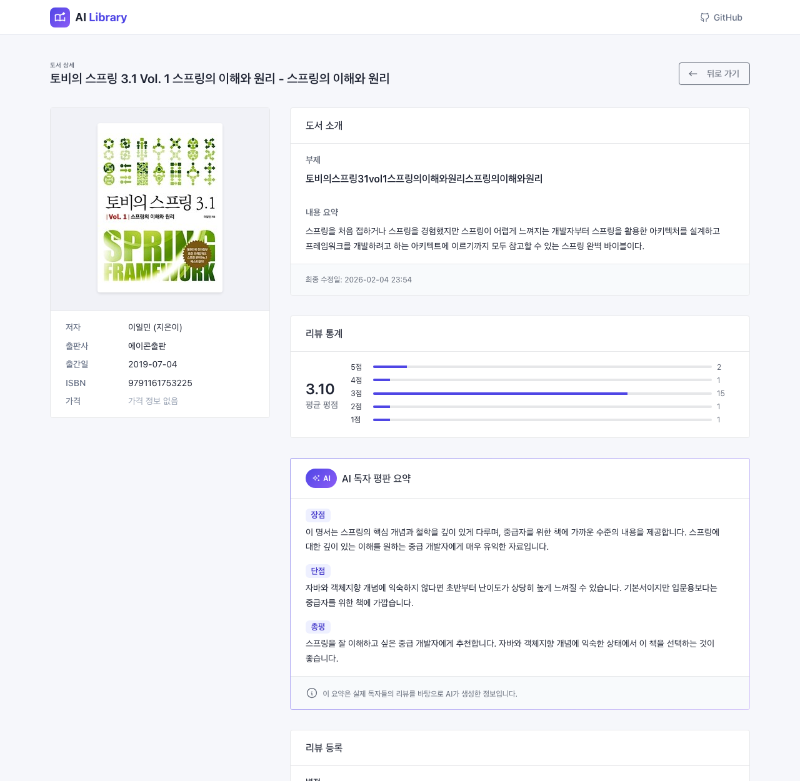
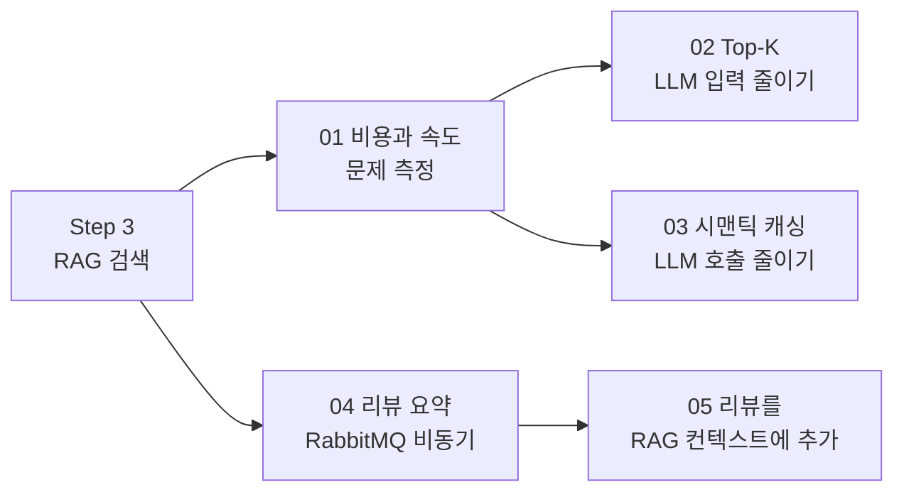

# Step 4. 성능 최적화와 리뷰 시스템

> Step 3에서 만든 RAG 검색을 더 싸고 빠르게 만들고, 사용자 리뷰를 AI로 요약해 추천 근거로 활용합니다.

## 이 단계에서 만드는 것

Step 4를 마치면 다음 두 가지가 동작합니다.

1. **빠르고 저렴한 RAG 검색**
   - 검색 후보 100권 중 관련성 높은 5권만 LLM에 전달합니다(Top-K 최적화).
   - 의미가 거의 같은 질문이 30분 안에 다시 들어오면 LLM을 호출하지 않고 저장해 둔 결과를 돌려줍니다(시맨틱 캐싱).
2. **리뷰 요약과 리뷰 기반 추천**
   - 리뷰가 등록되면 RabbitMQ 큐를 거쳐 백그라운드에서 AI가 리뷰를 요약합니다.
   - 검색 결과에 평점, 리뷰 수, 리뷰 요약이 붙고, LLM은 이를 근거로 추천 사유를 씁니다.

리뷰가 5건 이상 쌓인 도서의 상세 화면에는 리뷰 통계와 AI가 정리한 평판 요약(장점·단점·총평)이 나타납니다.

<p align="center"></p>

LLM 추천 사유가 바뀌는 모습은 다음과 같습니다.

```text
[리뷰 반영 전]
"이 책은 주식 투자와 관련된 내용을 다룹니다."

[리뷰 반영 후]
"평점 4.8/5.0(127개 리뷰)으로 검증된 도서입니다.
 리뷰어들이 '설명이 쉽고 실전 예제가 많다'고 평가했습니다."
```

## 왜 이 단계가 필요한가

Step 3의 RAG 검색은 동작은 하지만, 실제 서비스로 내놓기에는 세 가지 문제가 있습니다.

| 문제 | 증상 | 이 단계의 해결 |
|------|------|----------------|
| 비용 | 검색 결과를 많이 넘길수록 토큰이 늘어 요금이 비례해 증가 | Top-K 최적화(02) |
| 속도 | LLM 호출에 수 초가 걸려 사용자가 기다림 | 시맨틱 캐싱(03) |
| 추천 근거 부족 | 책 소개 문구만으로 추천해 설득력이 약함 | 리뷰 요약(04), 리뷰 RAG 연동(05) |



## 문서 구성

| 순서 | 문서 | 내용 | 예상 시간 |
|------|------|------|-----------|
| 01 | [성능과 비용](01.performance-cost.md) | 토큰과 비용 계산, 응답 지연의 원인, 해결 방향 | 1시간 |
| 02 | [Top-K 최적화](02.topk-optimization.md) | Retrieval K와 Rerank K 분리, RRF 임계값 필터링 | 1.5시간 |
| 03 | [시맨틱 캐싱](03.semantic-caching.md) | 코사인 유사도 0.98 캐시, TTL 30분, 이벤트 기반 웜업 | 2시간 |
| 04 | [리뷰 요약 시스템](04.review-summarization.md) | Map-Reduce 요약, RabbitMQ 큐, 재시도와 DLQ, 중복 방지 | 2.5시간 |
| 05 | [리뷰 RAG 연동](05.review-rag-integration.md) | 검색 결과에 리뷰 정보 추가, N+1 방지, 프롬프트 반영 | 1.5시간 |

01 → 02 → 03은 성능 최적화, 04 → 05는 리뷰 시스템입니다. 두 묶음은 서로 독립적이므로 04부터 읽어도 됩니다.

## 이 단계를 마치면

- [ ] 요청 1건의 입력 토큰과 비용을 직접 계산할 수 있다
- [ ] Retrieval K(100)와 Rerank K(5)를 나누는 이유를 설명할 수 있다
- [ ] RRF 임계값 0.02가 어떤 도서를 걸러 내는지 설명할 수 있다
- [ ] 시맨틱 캐시의 조회, 만료(TTL 30분), 제거(최대 1,000건 FIFO) 규칙을 설명할 수 있다
- [ ] 캐시 미스 때 하이브리드 결과를 먼저 주고 이벤트로 웜업하는 흐름을 설명할 수 있다
- [ ] Map-Reduce 요약과 누적 요약의 차이를 설명할 수 있다
- [ ] 리뷰 이벤트 → RabbitMQ 큐 → Consumer → 재시도 3회 → DLQ 흐름을 그릴 수 있다
- [ ] 검색 결과에 리뷰 정보를 N+1 없이 붙이는 방법을 설명할 수 있다

## 관련 소스 코드

경로는 `src/main/java/net/java21/library/` 기준입니다.

| 클래스 | 역할 | 경로 |
|--------|------|------|
| `RagSearchStrategy` | Top-K 선택, 캐시 조회, 웜업 이벤트 발행 | `core/book/service/search/strategy/` |
| `RrfService` | 키워드·벡터 결과를 RRF(k=60)로 병합 | `core/book/service/search/` |
| `AiRecommendationService` | 컨텍스트 구성(리뷰 정보 포함), LLM 호출 | `core/book/service/ai/` |
| `SemanticCacheService` | 코사인 유사도 0.98 캐시 조회, TTL 검사, 저장 | `core/book/service/cache/` |
| `BookSearchCacheService` | 비동기 웜업, 같은 키워드 중복 웜업 방지 | `core/book/service/cache/` |
| `InMemoryBookSearchCacheRepository` | `LinkedHashMap` 기반 캐시 저장소(최대 1,000건 FIFO) | `core/book/repository/` |
| `BookSearchEvent`, `BookSearchEventListener` | 캐시 미스 이벤트와 `@Async` 리스너 | `core/book/event/` |
| `CacheConfig` | Caffeine 캐시 매니저 설정 | `core/config/` |
| `ReviewService`, `ReviewEventListener` | 리뷰 저장, 통계 갱신, 요약 이벤트 발행 | `core/review/service/` |
| `ReviewSummaryQueueService` | RabbitMQ 메시지 발행, 5초 중복 필터 | `core/review/service/` |
| `ReviewSummaryQueueProcessor` | `@RabbitListener` Consumer(3~5개) | `core/review/service/` |
| `ReviewAiSummaryService` | 요약 조건 확인, 전체/누적 요약 선택 | `core/review/service/` |
| `ReviewSummarizer` | Map-Reduce 요약, 누적 요약 프롬프트 | `core/review/service/` |
| `RabbitMQConfig` | 큐, Exchange, DLQ, `RepublishMessageRecoverer` | `core/config/` |
| `BookRepositoryImpl` | 검색 결과에 리뷰 요약을 IN 절로 일괄 조회 | `core/book/repository/impl/` |

## 다음 문서

[01. 성능과 비용 →](01.performance-cost.md)
