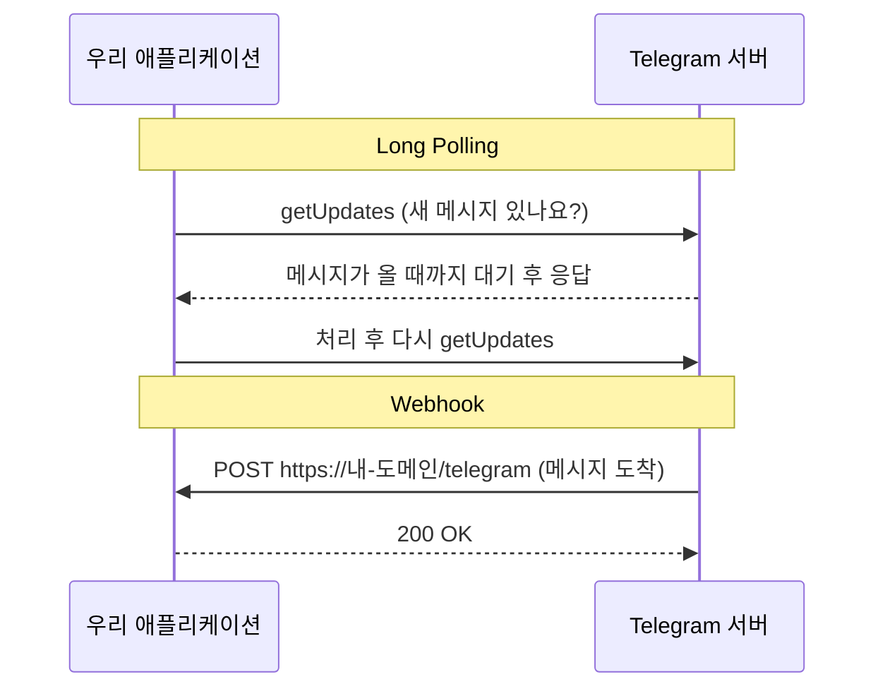
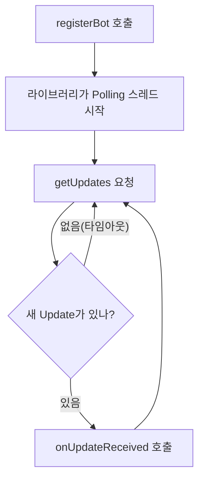
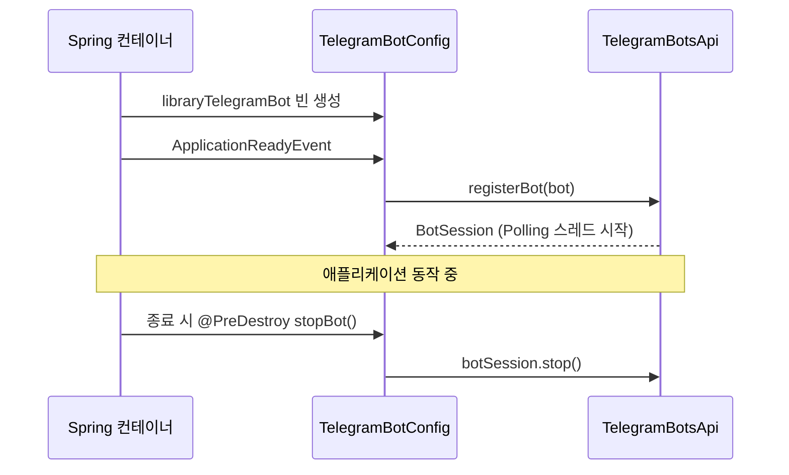

# 01. Telegram Bot 설정

> Telegram에서 Bot을 만들고, Spring Boot 애플리케이션이 시작될 때 Bot을 등록해 메시지를 받을 수 있게 합니다. 메시지를 받는 두 방식(Long Polling, Webhook)의 차이와 Bot 스레드를 안전하게 정리하는 방법을 함께 익힙니다.
>
> 예상 소요 시간: 1.5시간 · 난이도: 입문

## 학습 목표

- BotFather로 Bot을 만들고 토큰을 안전하게 설정할 수 있다
- Long Polling과 Webhook의 차이를 설명하고, 이 프로젝트가 Long Polling을 쓰는 이유를 말할 수 있다
- `@ConfigurationProperties`와 `@ConditionalOnProperty`로 Bot 설정과 활성화를 분리할 수 있다
- `ApplicationReadyEvent`와 `@PreDestroy`로 Bot의 시작과 종료를 관리할 수 있다

## 시작하기 전에

- Step 1~4를 마쳐 도서 검색(`BookSearchService`)이 동작하는 상태여야 합니다.
- Spring Boot의 `@Configuration`, `@Bean`, 프로퍼티 파일 사용법을 알고 있으면 충분합니다.
- 스마트폰이나 PC에 Telegram 앱이 설치되어 있어야 합니다.
- 처음 보는 용어는 [용어집](../glossary.md)을 참고하세요.

## 1. 왜 필요한가

지금까지 만든 검색은 웹 브라우저로 `/books` 화면에 들어가야 쓸 수 있습니다. 화면을 만들려면 HTML, CSS, 페이지 이동까지 신경 써야 하고, 사용자는 매번 사이트에 접속해야 합니다.

**Telegram Bot**을 쓰면 상황이 달라집니다.

- 사용자는 이미 쓰고 있는 메신저 창에 "해리포터"라고 입력하기만 하면 됩니다.
- 개발자는 화면 대신 "메시지를 받으면 무엇을 답할지"만 구현하면 됩니다.
- 버튼(Inline Keyboard)을 붙일 수 있어서, 다음 문서들에서 만들 👍/👎 피드백 수집에도 알맞습니다.

이 문서에서는 Bot이 메시지를 받을 수 있는 상태까지 만듭니다. 검색 연동은 [02. Telegram으로 RAG 검색하기](02.rag-search-via-telegram.md)에서 합니다.

## 2. 핵심 개념

### 2.1 Bot, BotFather, 토큰

- **Telegram Bot**: 사람 대신 프로그램이 대화하는 Telegram 계정입니다. 사용자가 Bot에게 보낸 메시지는 Telegram 서버를 거쳐 우리 애플리케이션으로 전달됩니다.
- **BotFather**: Bot을 만들어 주는 Telegram 공식 Bot입니다. 여기서 `/newbot`을 입력하면 새 Bot이 생깁니다.
- **Bot 토큰**: `123456789:AAH...` 형태의 문자열로, "이 Bot을 조종할 권한"을 뜻합니다. 비밀번호와 같으므로 코드나 Git에 절대 넣지 않습니다.

### 2.2 메시지를 받는 두 방식: Long Polling과 Webhook

우편물을 받는 방법에 비유할 수 있습니다.

- **Long Polling**: 내가 우체국에 가서 "제 우편물 왔나요?"라고 묻고, 없으면 창구 앞에서 잠시 기다립니다. 우편물이 오면 바로 받아 오고, 다시 가서 묻습니다.
- **Webhook**: 우체국에 내 집 주소를 등록해 두면, 우편물이 올 때마다 배달원이 집으로 가져다줍니다.



| 비교 항목 | Long Polling | Webhook |
|-----------|-------------|---------|
| 누가 연결을 여는가 | 우리 애플리케이션 | Telegram 서버 |
| 공개 URL, HTTPS 인증서 | 필요 없음 | 필요함 |
| 로컬 개발 | 바로 가능 | ngrok 같은 터널링 도구 필요 |
| 대규모 트래픽 | 부적합 | 적합 |

이 프로젝트는 **Long Polling**을 씁니다. 공개 도메인이나 인증서 없이 로컬 PC에서도 바로 실행할 수 있어서 학습에 알맞고, 도서 검색 Bot 정도의 트래픽에는 충분합니다.

### 2.3 Bot은 별도 스레드에서 돈다

Long Polling은 스케줄러(`@Scheduled`)가 아닙니다. telegrambots 라이브러리의 `TelegramLongPollingBot`을 등록하면 라이브러리가 **백그라운드 스레드**를 만들고, 그 스레드가 계속 `getUpdates`를 호출합니다. 새 메시지가 오면 우리가 구현한 `onUpdateReceived(Update)`를 불러 줍니다.



이 스레드는 Spring이 만든 것이 아니므로, 애플리케이션이 종료될 때 **직접 멈추지 않으면** 계속 남을 수 있습니다(좀비 스레드). 그래서 시작과 종료를 함께 관리합니다.

### 2.4 Update

**Update**는 Telegram 서버가 전달하는 이벤트 한 건입니다. 사용자가 텍스트를 보내면 `update.hasMessage()`가, 버튼을 누르면 `update.hasCallbackQuery()`가 `true`가 됩니다. 버튼 처리는 [04. 피드백 버튼과 Callback 처리](04.feedback-ui-callback-handler.md)에서 다룹니다.

## 3. 따라 하기

### STEP 1. BotFather로 Bot 만들기

목표: Bot 토큰과 사용자명을 얻습니다.

1. Telegram에서 `@BotFather`를 검색해 대화를 시작합니다.
2. `/newbot`을 입력합니다.
3. Bot 이름(화면에 보이는 이름)을 입력합니다. 예: `My Library Bot`
4. Bot 사용자명을 입력합니다. 반드시 `bot`으로 끝나야 합니다. 예: `my_library_study_bot`
5. BotFather가 알려 주는 토큰을 복사해 둡니다.

### STEP 2. 의존성 확인

목표: telegrambots 라이브러리를 사용할 수 있게 합니다. 프로젝트 `pom.xml`에는 이미 추가되어 있습니다.

```xml
<dependency>
    <groupId>org.telegram</groupId>
    <artifactId>telegrambots</artifactId>
    <version>6.8.0</version>
</dependency>
```

### STEP 3. 토큰을 secrets.properties에 넣기

목표: 토큰을 코드와 Git에서 분리합니다.

이 프로젝트는 비밀값을 프로젝트 루트의 `secrets.properties`(Git 제외)에 둡니다. 템플릿을 복사한 뒤 `TELEGRAM_BOT_TOKEN`을 채웁니다.

```bash
cp secrets.properties.example secrets.properties
```

```properties
# secrets.properties (커밋하지 않음)
TELEGRAM_BOT_TOKEN=여기에_BotFather가_준_토큰
```

`application.properties`가 이 파일을 불러옵니다.

```properties
# src/main/resources/application.properties
spring.config.import=optional:file:./secrets.properties,optional:file:${user.home}/library/secrets.properties
```

Telegram 설정 파일은 이 값을 플레이스홀더로 참조합니다.

```properties
# src/main/resources/telegram.properties
telegram.bot.enabled=true
telegram.bot.token=${TELEGRAM_BOT_TOKEN:}
telegram.bot.username=nhnacademy_library_bot
```

- `${TELEGRAM_BOT_TOKEN:}`는 "`TELEGRAM_BOT_TOKEN` 값을 쓰고, 없으면 빈 문자열"이라는 뜻입니다. 같은 이름의 환경 변수로 넣어도 됩니다.
- `telegram.bot.username`은 이 프로젝트 운영 Bot의 사용자명입니다. 실습할 때는 STEP 1에서 만든 자기 Bot의 사용자명으로 바꿉니다.
- 서버에서는 GitHub Actions가 Secrets로 `~/library/secrets.properties`를 만들어 같은 키를 채웁니다.

### STEP 4. 프로필별로 Bot 켜고 끄기

목표: 어떤 환경에서 Bot이 동작하는지 이해합니다.

| 프로필 | 설정 | Bot |
|--------|------|-----|
| `dev`(기본값) | `telegram.bot.enabled=false`, `telegram.properties`를 불러오지 않음 | 꺼짐 |
| `prod` | `spring.config.import=classpath:telegram.properties,...` | 켜짐 |

`application.properties`의 기본 프로필은 `dev`이므로, 그대로 실행하면 Bot은 등록되지 않습니다. 같은 토큰으로 두 곳에서 Long Polling을 하면 충돌하기 때문에, 개발 서버에서는 꺼 두는 것입니다.

로컬에서 자기 Bot으로 실습하려면 다음 중 하나를 고릅니다.

```bash
# 방법 1: dev 프로필에서 실행 인자로 Bot 켜기 (작은따옴표로 감싸 셸이 ${}를 해석하지 않게 함)
mvn spring-boot:run -Dspring-boot.run.arguments='--telegram.bot.enabled=true --telegram.bot.token=${TELEGRAM_BOT_TOKEN} --telegram.bot.username=my_library_study_bot'

# 방법 2: prod 프로필로 실행 (telegram.properties를 불러옴)
mvn spring-boot:run -Dspring-boot.run.profiles=prod
```

- 방법 1은 `dev`에서 `telegram.properties`를 불러오지 않기 때문에 토큰과 사용자명까지 인자로 넘깁니다. `${TELEGRAM_BOT_TOKEN}`은 Spring이 `secrets.properties`에서 찾아 채웁니다.
- 방법 2는 운영 서버 기준 설정이라 Redis 설정을 `./redis.properties` 파일에서 찾는 등 로컬 환경에 따라 추가 준비가 필요할 수 있습니다. 이때도 `telegram.bot.username`은 자기 Bot으로 바꿔야 합니다.

### STEP 5. 설정 클래스 TelegramBotProperties

목표: `telegram.bot.*` 값을 자바 객체로 받습니다.

```java
@Component
@ConfigurationProperties(prefix = "telegram.bot")
public class TelegramBotProperties {
    private boolean enabled = false;  // 기본값: 비활성화
    private String token;
    private String username;
    // getter, setter
}
```

- `@ConfigurationProperties(prefix = "telegram.bot")`는 `telegram.bot.enabled`, `telegram.bot.token`, `telegram.bot.username`을 각 필드에 채워 줍니다.
- `enabled` 기본값을 `false`로 두어, 설정이 없으면 Bot이 켜지지 않게 합니다.

전체 코드: [`config/TelegramBotProperties.java`](../../src/main/java/net/java21/library/external/telegram/config/TelegramBotProperties.java)

### STEP 6. Bot 클래스 LibraryTelegramBot의 뼈대

목표: 메시지를 받으면 호출되는 메서드를 구현합니다.

```java
@Slf4j
public class LibraryTelegramBot extends TelegramLongPollingBot {

    private final TelegramBotProperties properties;
    // 검색, 피드백 등 의존성은 02~04 문서에서 추가

    @Override
    public void onUpdateReceived(Update update) {
        // 버튼 클릭은 04 문서에서 처리
        if (update.hasMessage() && update.getMessage().hasText()) {
            String messageText = update.getMessage().getText();
            Long chatId = update.getMessage().getChatId();
            log.info("[Telegram] Received message from chatId {}: {}", chatId, messageText);
            // 02 문서에서 명령어/검색 분기를 구현
        }
    }

    @Override
    public String getBotUsername() {
        return properties.getUsername();
    }

    @Override
    public String getBotToken() {
        return properties.getToken();
    }
}
```

- `TelegramLongPollingBot`을 상속하면 Polling 스레드 관리는 라이브러리가 맡고, 우리는 `onUpdateReceived`만 채우면 됩니다.
- `chatId`는 대화방을 구분하는 번호입니다. 답장을 보낼 때도, 나중에 피드백을 저장할 때도 이 값으로 사용자를 구분합니다.
- `LibraryTelegramBot`에는 `@Component`를 붙이지 않습니다. 다음 STEP의 설정 클래스가 `@Bean`으로 만들기 때문에, Bot이 꺼져 있을 때는 빈 자체가 생기지 않습니다.

전체 코드: [`bot/LibraryTelegramBot.java`](../../src/main/java/net/java21/library/external/telegram/bot/LibraryTelegramBot.java)

### STEP 7. TelegramBotConfig: 생성, 등록, 종료

목표: 애플리케이션이 완전히 뜬 뒤 Bot을 등록하고, 종료 시 정리합니다.

```java
@Slf4j
@Configuration
@ConditionalOnProperty(name = "telegram.bot.enabled", havingValue = "true", matchIfMissing = false)
public class TelegramBotConfig {

    private final TelegramBotProperties properties;
    private BotSession botSession;

    @Bean
    public LibraryTelegramBot libraryTelegramBot(BookSearchService bookSearchService,
                                                 SemanticCacheService semanticCacheService,
                                                 CallbackQueryHandler callbackQueryHandler,
                                                 TelegramKeyboardFactory keyboardFactory,
                                                 FeedbackService feedbackService,
                                                 AiLibraryAssistantService aiLibraryAssistantService,
                                                 AiOrchestrationService aiOrchestrationService) {
        DefaultBotOptions options = new DefaultBotOptions();
        return new LibraryTelegramBot(properties, options, bookSearchService, semanticCacheService,
                callbackQueryHandler, keyboardFactory, feedbackService,
                aiLibraryAssistantService, aiOrchestrationService);
    }

    @EventListener(ApplicationReadyEvent.class)
    public void startBot(ApplicationReadyEvent event) {
        try {
            LibraryTelegramBot bot = event.getApplicationContext().getBean(LibraryTelegramBot.class);
            TelegramBotsApi botsApi = new TelegramBotsApi(DefaultBotSession.class);
            botSession = botsApi.registerBot(bot);   // 이 시점에 Polling 스레드 시작
            log.info("[Telegram] Bot registered successfully: @{}", properties.getUsername());
        } catch (TelegramApiException e) {
            log.error("[Telegram] Failed to register bot: {}", e.getMessage(), e);
        }
    }

    @PreDestroy
    public void stopBot() {
        if (botSession != null && botSession.isRunning()) {
            botSession.stop();   // Polling 스레드 종료
        }
    }
}
```

코드 설명:

- `@ConditionalOnProperty`: `telegram.bot.enabled=true`일 때만 이 설정 클래스가 동작합니다. `false`이면 Bot 빈도, 등록도 없습니다.
- `@Bean` 메서드의 파라미터: 실제 소스는 Step 5~7에서 필요한 서비스를 모두 받습니다. 지금 단계에서는 `BookSearchService` 정도만 쓰고, 나머지는 이후 문서에서 하나씩 쓰임새를 봅니다(`AiOrchestrationService`는 Step 7의 Tool 기반 오케스트레이션).
- `ApplicationReadyEvent`: DB 연결, 다른 빈 생성이 모두 끝난 뒤 Bot을 등록합니다. 너무 일찍 등록하면 메시지를 받았는데 검색 서비스가 준비되지 않은 상황이 생길 수 있습니다.
- `registerBot`의 반환값 `BotSession`을 필드에 보관해 두었다가 `@PreDestroy`에서 `stop()`을 호출합니다. 이 부분이 없으면 애플리케이션을 종료해도 Polling 스레드가 남을 수 있습니다.



전체 코드: [`config/TelegramBotConfig.java`](../../src/main/java/net/java21/library/external/telegram/config/TelegramBotConfig.java)

### STEP 8. 실행하고 확인하기

목표: Bot이 등록되고 메시지를 받는지 확인합니다.

1. STEP 4의 방법으로 애플리케이션을 실행합니다.
2. 로그에서 다음 줄을 확인합니다.

```text
[Telegram] Registering bot with Telegram API...
[Telegram] ✅ Bot registered successfully: @my_library_study_bot
[Telegram] ✅ Long Polling thread started in background
```

3. Telegram에서 자기 Bot을 검색해 `/start`를 보냅니다. 실제 소스에서는 환영 메시지가 돌아옵니다.

```text
🎉 AI Library Bot에 오신 것을 환영합니다!

이 Bot은 AI 기반 하이브리드 검색을 제공합니다.
...
도움이 필요하시면 /help를 입력하세요
```

4. 애플리케이션을 종료하면 `[Telegram] Bot stopped successfully` 로그가 찍히는지 확인합니다.

## 4. 직접 해 보기

### 미션 1 (기본): Bot 꺼 두기

`telegram.bot.enabled=false`로 실행했을 때 `LibraryTelegramBot` 빈이 만들어지지 않는 것을 확인하세요.

- 힌트: 시작 로그에 `[Telegram] TelegramBotConfig initialized` 가 찍히는지 보면 됩니다.

<details>
<summary>정답 확인 방법</summary>

`@ConditionalOnProperty(..., havingValue = "true", matchIfMissing = false)` 때문에 `enabled`가 `false`이거나 아예 없으면 `TelegramBotConfig`가 등록되지 않습니다. 따라서 생성자 로그, `Creating LibraryTelegramBot bean` 로그, 등록 로그가 모두 나오지 않습니다.

</details>

### 미션 2 (기본): 알 수 없는 명령어 응답 확인

Bot에 `/hello`를 보내고 어떤 응답이 오는지 확인한 뒤, `LibraryTelegramBot`에서 해당 응답을 만드는 메서드를 찾아보세요.

<details>
<summary>정답</summary>

`❌ 알 수 없는 Command입니다.` 메시지가 옵니다. `handleCommand`의 `switch` 문 `default`에서 `sendUnknownCommandMessage(chatId)`를 호출합니다.

</details>

### 미션 3 (도전): 생명주기 테스트

`TelegramBotConfig.stopBot()`이 `botSession`이 없을 때(`null`)와 이미 멈췄을 때 예외 없이 지나가는지 단위 테스트로 검증해 보세요.

- 힌트: Mockito로 `BotSession`을 목(mock)으로 만들고 `isRunning()`이 `false`를 반환하게 한 뒤, `stop()`이 호출되지 않았음을 `verify(..., never())`로 확인합니다. `botSession`은 private 필드이므로 `ReflectionTestUtils.setField`를 쓸 수 있습니다.

<details>
<summary>예시 코드</summary>

```java
@Test
@DisplayName("세션이 실행 중이 아니면 stop을 호출하지 않는다")
void stopBot_skipsWhenNotRunning() {
    TelegramBotConfig config = new TelegramBotConfig(new TelegramBotProperties());
    BotSession session = mock(BotSession.class);
    when(session.isRunning()).thenReturn(false);
    ReflectionTestUtils.setField(config, "botSession", session);

    config.stopBot();

    verify(session, never()).stop();
}
```

</details>

## 5. 자주 하는 실수

| 증상 | 원인 | 해결 |
|------|------|------|
| 실행해도 Bot 관련 로그가 전혀 없음 | 기본 프로필이 `dev`라 `telegram.bot.enabled=false` | STEP 4의 방법으로 Bot을 켭니다 |
| `Failed to register bot` 또는 401 Unauthorized | 토큰이 비었거나 잘못됨 | `secrets.properties`의 `TELEGRAM_BOT_TOKEN` 값과 파일 위치(프로젝트 루트)를 확인합니다 |
| 409 Conflict: terminated by other getUpdates request | 같은 토큰으로 두 프로세스가 Polling 중 | 다른 터미널·서버에서 실행 중인 애플리케이션을 끄거나, 실습용 Bot을 따로 만듭니다 |
| 애플리케이션을 종료해도 JVM이 바로 끝나지 않음 | `BotSession`을 멈추지 않음 | `@PreDestroy`에서 `botSession.stop()`을 호출합니다 |
| 토큰이 GitHub에 올라감 | 설정 파일에 토큰을 직접 씀 | 즉시 BotFather에서 `/revoke`로 토큰을 재발급하고, 설정에는 `${TELEGRAM_BOT_TOKEN:}`만 둡니다 |

## 6. 정리

- Telegram Bot은 메신저를 사용자 화면으로 쓰는 방법이며, BotFather에서 만들고 토큰으로 제어합니다.
- 이 프로젝트는 공개 URL이 필요 없는 **Long Polling**을 쓰며, 라이브러리가 만든 별도 스레드에서 `onUpdateReceived`가 호출됩니다.
- 토큰은 `secrets.properties`의 `TELEGRAM_BOT_TOKEN`에 두고, `telegram.properties`는 `${TELEGRAM_BOT_TOKEN:}`로 참조만 합니다.
- `@ConditionalOnProperty`로 켜고 끄고, `ApplicationReadyEvent`에서 등록, `@PreDestroy`에서 정리합니다.

- [ ] BotFather로 Bot을 만들고 토큰을 `secrets.properties`에 넣었다
- [ ] Bot을 켠 상태로 실행해 `/start` 응답을 받았다
- [ ] 종료 시 `Bot stopped successfully` 로그를 확인했다

## 확인 문제

**1. 로컬 PC에서 개발할 때 Webhook보다 Long Polling이 편한 이유는 무엇입니까?**

<details><summary>정답</summary>

Webhook은 Telegram 서버가 우리 애플리케이션으로 요청을 보내야 하므로 외부에서 접근 가능한 HTTPS 주소가 필요합니다. Long Polling은 우리 애플리케이션이 Telegram 서버로 요청을 보내는 방식이라 공개 주소나 인증서 없이 바로 동작합니다.

</details>

**2. `TelegramBotConfig`에서 Bot 등록을 생성자나 `@PostConstruct`가 아니라 `ApplicationReadyEvent`에서 하는 이유는 무엇입니까?**

<details><summary>정답</summary>

등록하는 순간부터 메시지를 받기 시작합니다. 애플리케이션이 완전히 준비된 뒤(모든 빈 생성, DB 연결 완료) 등록해야 메시지를 받았을 때 검색 서비스 등을 바로 쓸 수 있습니다.

</details>

**3. `@PreDestroy`에서 `botSession.stop()`을 호출하지 않으면 어떤 문제가 생길 수 있습니까?**

<details><summary>정답</summary>

Polling 스레드는 telegrambots 라이브러리가 만든 스레드라 Spring이 자동으로 멈추지 않습니다. 애플리케이션 종료 후에도 스레드가 남아(좀비 스레드) 프로세스가 바로 끝나지 않거나, 재배포 시 같은 토큰으로 두 번 Polling하는 충돌이 생길 수 있습니다.

</details>

**4. `telegram.bot.token=${TELEGRAM_BOT_TOKEN:}`에서 콜론(`:`) 뒤가 비어 있는 것은 무슨 뜻입니까?**

<details><summary>정답</summary>

`TELEGRAM_BOT_TOKEN` 값이 없을 때 쓸 기본값이 빈 문자열이라는 뜻입니다. 값이 없어도 애플리케이션 시작 자체는 실패하지 않습니다(Bot 등록 단계에서 오류 로그가 남습니다).

</details>

## 다음 문서

[02. Telegram으로 RAG 검색하기 →](02.rag-search-via-telegram.md)
