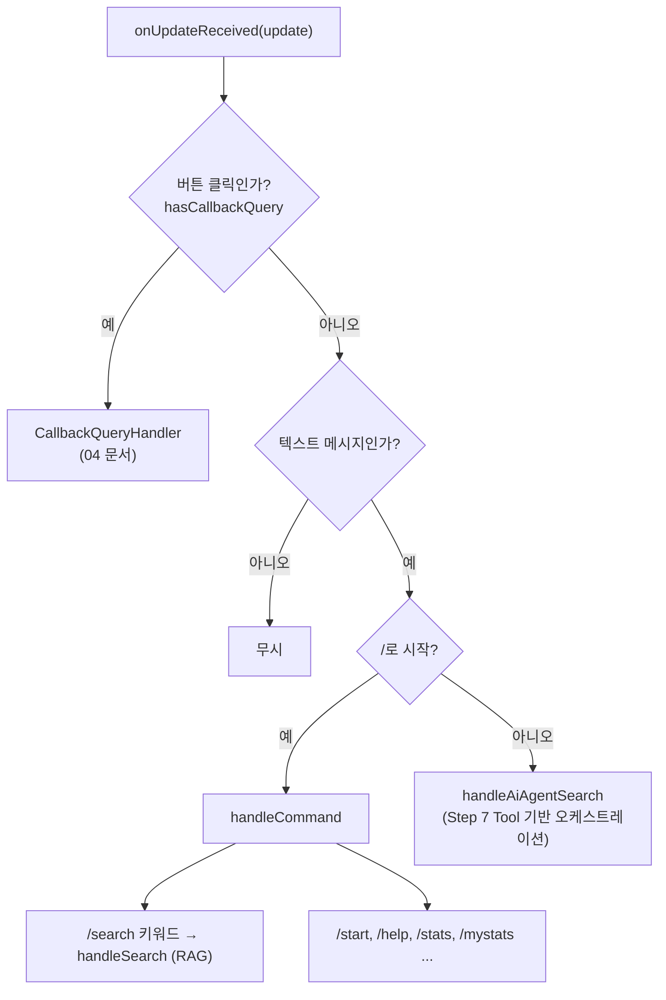
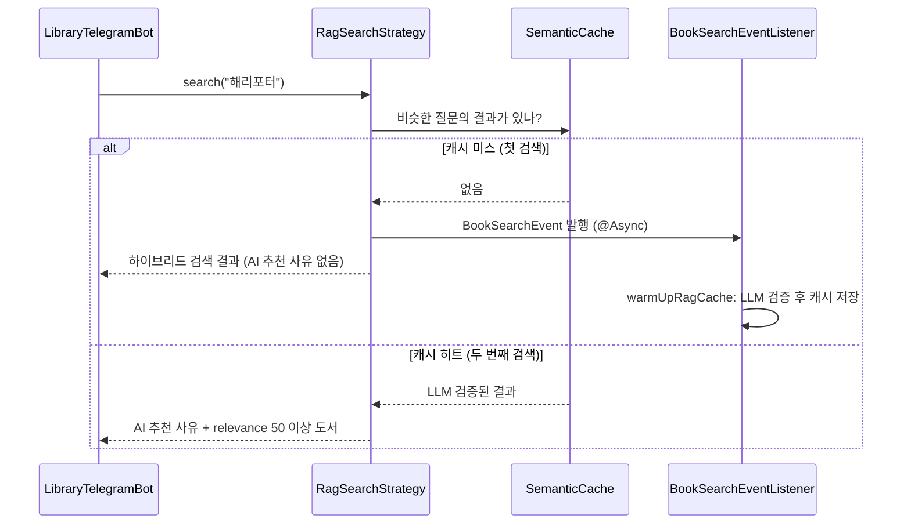

# 02. Telegram으로 RAG 검색하기

> Bot이 받은 메시지를 명령어와 일반 텍스트로 나누고, `/search 키워드`로 Step 3~4에서 만든 RAG 검색을 호출해 결과를 도서별 메시지와 표지 이미지로 보냅니다.
>
> 예상 소요 시간: 1.5시간 · 난이도: 기본

## 학습 목표

- `onUpdateReceived`에서 명령어(`/`로 시작)와 일반 텍스트를 분기할 수 있다
- `BookSearchService`에 `SearchType.RAG` 요청을 보내 Telegram에서 검색 결과를 받을 수 있다
- 시맨틱 캐시 때문에 첫 검색과 두 번째 검색의 결과 모양이 다른 이유를 설명할 수 있다
- `SendMessage`와 `SendPhoto`로 결과를 보내고, 이미지 전송 실패 시 텍스트로 대체할 수 있다

## 시작하기 전에

- [01. Telegram Bot 설정](01.telegram-bot-setup.md)을 마쳐 Bot이 `/start`에 응답해야 합니다.
- RAG 검색 흐름은 [Step 3. RAG 이해하기](../step-3/01.understanding-rag.md), 시맨틱 캐시는 [Step 4. 시맨틱 캐시](../step-4/03.semantic-caching.md)를 참고하세요.
- 용어는 [용어집](../glossary.md)에서 확인할 수 있습니다.

## 1. 왜 필요한가

01 문서의 Bot은 메시지를 받기만 하고 검색은 하지 못합니다. 사용자가 "해리포터"를 보냈을 때 우리가 원하는 것은 웹 화면의 RAG 검색과 같은 결과입니다.

- AI가 쓴 추천 사유
- 관련 도서 몇 권과 저자, 출판사, 점수
- 가능하면 표지 이미지

새 검색 로직을 만들 필요는 없습니다. 이미 있는 `BookSearchService`를 Bot에서 호출하고, 결과를 채팅에 맞게 **포맷팅**하는 것이 이 문서의 일입니다. 같은 서비스를 웹과 Telegram이 함께 쓰는 구조이므로, 검색 품질을 개선하면 두 화면에 동시에 반영됩니다.

## 2. 핵심 개념

### 2.1 명령어와 일반 텍스트

Telegram Bot에서 `/`로 시작하는 메시지를 **명령어(Command)** 라고 부릅니다. 이 프로젝트의 Bot은 다음과 같이 분기합니다.



> 참고: Step 5를 처음 구현했을 때는 일반 텍스트도 `handleSearch`로 보냈습니다. 현재 소스는 Step 7에서 일반 텍스트를 AI 에이전트(`AiOrchestrationService`)에 넘기도록 바뀌었습니다. 그래서 이 단계의 RAG 검색과 👍/👎 버튼을 보려면 **`/search 키워드`** 를 사용합니다.

### 2.2 RAG 검색과 전략적 캐싱

Step 4에서 RAG 검색에 시맨틱 캐시를 붙였습니다. LLM 호출은 몇 초씩 걸리기 때문에, 처음 들어온 질문은 빠른 하이브리드 검색 결과를 먼저 돌려주고 AI 추천은 뒤에서 만들어 캐시에 넣습니다.



그래서 Telegram에서 **같은 검색어를 처음 보내면 "AI 추천 사유"가 없고, 잠시 뒤 다시 보내면 나타납니다.** 버그가 아니라 설계된 동작입니다.

백그라운드(Warm-up)에서 하는 일은 다음과 같습니다(`RagSearchStrategy`의 상수 기준).

| 단계 | 내용 |
|------|------|
| 후보 추출 | 하이브리드 검색 상위 100건 중 RRF 점수 0.02 이상, 최대 5건 |
| 후보가 없을 때 | 상위 3건으로 대체 |
| LLM 검증 | 각 도서에 relevance(0~100)와 추천 사유 부여 |
| 결과 구성 | relevance 50 이상만 남기고 relevance 내림차순 정렬, 캐시에 저장 |

### 2.3 Telegram 메시지의 제약

- 메시지 한 건은 최대 4,096자, 사진 캡션은 그보다 훨씬 짧습니다(1,024자). 그래서 결과는 최대 5권으로 제한하고, AI 추천 사유는 300자에서 자릅니다.
- 이 프로젝트는 `parseMode`를 지정하지 않고 **일반 텍스트**로 보냅니다. Markdown 기호(`*`, `_`, `[` 등)가 섞이면 Telegram이 파싱 오류를 낼 수 있기 때문에, 사용자 입력은 `escapeMarkdown`으로 특수문자를 제거합니다.

## 3. 따라 하기

### STEP 1. 명령어 분기 구현

목표: `/search 키워드`, `/start`, `/help` 등을 나눠 처리합니다.

```java
private void handleCommand(Update update, String command) {
    Long chatId = update.getMessage().getChatId();

    // /search <keyword> 형식 처리
    if (command.startsWith("/search ")) {
        String keyword = command.substring("/search ".length()).trim();
        if (!keyword.isEmpty()) {
            handleSearch(update, keyword);
        } else {
            sendSimpleMessage(chatId, "검색어를 입력해주세요.\n예: /search 해리포터");
        }
        return;
    }

    // /ai, /stats <query> 처리는 생략 (Step 7, 04 문서)

    switch (command) {
        case "/start" -> sendWelcomeMessage(chatId);
        case "/help" -> sendHelpMessage(chatId);
        case "/stats", "/mystats" -> handleUserStats(update);
        default -> sendUnknownCommandMessage(chatId);
    }
}
```

- `"/search "`처럼 공백까지 포함해 비교하므로, `/search`만 보내면 `switch`의 `default`로 가서 "알 수 없는 Command" 응답이 나옵니다.
- 실제 소스는 전통적인 `case ... : break;` 문법을 쓰지만 동작은 같습니다.

### STEP 2. RAG 검색 호출

목표: 키워드로 RAG 검색을 실행합니다.

```java
private void handleSearch(Update update, String keyword) {
    Long chatId = update.getMessage().getChatId();

    try {
        // 1. 최근 검색어 저장 (피드백용, 04 문서에서 사용)
        callbackQueryHandler.setRecentQuery(chatId, keyword);

        // 2. RAG 검색 실행 (캐시 확인, LLM 추천 사유 생성 포함)
        Pageable pageable = PageRequest.of(0, 5);
        BookSearchRequest request = new BookSearchRequest(keyword, null, SearchType.RAG, null, false);
        BookSearchResult result = bookSearchService.searchBooks(pageable, request, chatId);

        // 3. 응답 전송
        sendSearchResult(chatId, keyword, result);
    } catch (Exception e) {
        log.error("[Telegram] Search failed for keyword: {}, chatId: {}", keyword, chatId, e);
        sendSimpleMessage(chatId, "검색 중 오류가 발생했습니다. 다시 시도해주세요.");
    }
}
```

코드 설명:

- `PageRequest.of(0, 5)`: 첫 페이지 5건만 받습니다. 채팅에서는 결과가 많으면 오히려 읽기 어렵습니다.
- `BookSearchRequest`의 마지막 인자 `false`는 Warm-up 여부입니다. 사용자 요청이므로 `false`로 두어 캐시 확인과 이벤트 발행 경로를 탑니다.
- `searchBooks(pageable, request, chatId)`: `chatId`를 넘기는 오버로드는 검색 후 Step 6의 개인화 재정렬을 적용합니다. 피드백이 아직 없으면 순서가 그대로 유지되므로 지금은 신경 쓰지 않아도 됩니다.
- 예외를 잡아 사용자에게 안내 문구를 보냅니다. Bot에서 예외가 밖으로 새면 사용자는 아무 응답도 받지 못합니다.

### STEP 3. 결과 헤더 보내기

목표: 검색어, AI 추천 사유, 결과 건수를 첫 메시지로 보냅니다.

```java
private void sendSearchResult(Long chatId, String keyword, BookSearchResult result) {
    List<BookSearchResponse> books = result.getBooks().getContent();
    if (books.isEmpty()) {
        sendSimpleMessage(chatId, "❌ 검색 결과가 없습니다.");
        return;
    }

    StringBuilder header = new StringBuilder();
    header.append("📚 \"").append(escapeMarkdown(keyword)).append("\" 검색 결과\n\n");

    // AI 추천 사유가 있으면 표시 (캐시 히트일 때)
    if (result.getAiResponse() != null && !result.getAiResponse().isEmpty()) {
        header.append("🤖 AI 추천 사유\n");
        String aiReason = result.getAiResponse().get(0).getWhy();
        if (aiReason == null || aiReason.isBlank()) {
            aiReason = "-";
        } else if (aiReason.length() > 300) {
            aiReason = aiReason.substring(0, 300) + "...";
        }
        header.append("💬 ").append(aiReason).append("\n\n");
    }

    header.append("검색된 도서 (").append(books.size()).append("개)\n\n");
    sendSimpleMessage(chatId, header.toString());

    for (int i = 0; i < books.size(); i++) {
        sendBookWithScore(chatId, keyword, i + 1, books.get(i));
    }
}
```

- `getAiResponse()`가 비어 있으면(첫 검색) 추천 사유 블록 자체를 생략합니다.
- 추천 사유는 첫 번째 응답의 `why`만 보여 줍니다. 여러 권의 사유를 모두 보내면 메시지가 너무 길어집니다.

### STEP 4. 도서 한 권씩 보내기

목표: 도서마다 메시지 한 건(또는 사진 한 장)을 보냅니다.

```java
private void sendBookWithScore(Long chatId, String keyword, int index, BookSearchResponse book) {
    StringBuilder bookInfo = new StringBuilder();
    bookInfo.append(index).append(". ").append(book.getTitle()).append("\n");
    bookInfo.append("📖 ").append(book.getAuthorName()).append("\n");
    if (book.getPublisherName() != null) {
        bookInfo.append("🏢 ").append(book.getPublisherName()).append("\n");
    }
    if (book.getSimilarity() != null && book.getSimilarity() > 0) {
        bookInfo.append(String.format("🎯 유사도: %.2f%%\n", book.getSimilarity() * 100));
    }
    if (book.getRrfScore() != null && book.getRrfScore() > 0) {
        bookInfo.append(String.format("📊 RRF 점수: %.2f\n", book.getRrfScore()));
    }
    bookInfo.append("🔗 상세 보기: https://library.java21.net/books/").append(book.getId()).append("\n");

    // 이미지가 있으면 사진으로, 없으면 텍스트로 (둘 다 피드백 버튼 포함, 04 문서)
    if (book.getImageUrl() != null && !book.getImageUrl().isBlank()) {
        sendBookImageWithFeedback(chatId, book.getImageUrl(), bookInfo.toString(), keyword, book.getId());
    } else {
        sendBookTextWithFeedback(chatId, bookInfo.toString(), keyword, book.getId());
    }
}
```

- 도서를 한 메시지에 몰지 않고 **한 권씩** 보내는 이유는, 04 문서에서 도서마다 👍/👎 버튼을 따로 붙이기 위해서입니다.
- 상세 링크는 Markdown 링크가 아니라 URL을 그대로 씁니다. Telegram 앱이 URL을 자동으로 링크로 바꿔 줍니다.
- 유사도와 RRF 점수는 검색 경로에 따라 없을 수 있으므로 `null`과 0을 확인한 뒤에만 표시합니다.

### STEP 5. 이미지 전송과 실패 대비

목표: 표지 이미지를 사진으로 보내고, 실패하면 텍스트로 대체합니다.

```java
private void sendBookImageWithFeedback(Long chatId, String imageUrl, String caption, String query, Long bookId) {
    try {
        SendPhoto photo = SendPhoto.builder()
                .chatId(chatId)
                .photo(new InputFile(imageUrl))   // URL을 넘기면 Telegram 서버가 직접 내려받음
                .caption(caption)
                .replyMarkup(keyboardFactory.createFeedbackKeyboard(query, bookId))
                .build();
        this.execute(photo);
    } catch (TelegramApiException e) {
        // 이미지 URL이 깨졌거나 Telegram이 내려받지 못하면 텍스트로 대체
        sendBookTextWithFeedback(chatId, caption, query, bookId);
    }
}
```

- `new InputFile(imageUrl)`은 우리 서버가 이미지를 내려받는 것이 아니라 **Telegram 서버가 URL에서 가져가게** 합니다. 그래서 외부에서 접근할 수 없는 URL이면 실패합니다.
- `replyMarkup`은 04 문서에서 만드는 피드백 버튼입니다. 이 문서 단계에서는 이 줄을 빼고 사진만 보내도 됩니다.

전체 코드: [`bot/LibraryTelegramBot.java`](../../src/main/java/net/java21/library/external/telegram/bot/LibraryTelegramBot.java)

### STEP 6. 실행하고 확인하기

1. Bot을 켠 상태로 애플리케이션을 실행합니다.
2. Telegram에서 `/search 해리포터`를 보냅니다. 첫 번째 응답은 AI 추천 사유 없이 옵니다.

```text
📚 "해리포터" 검색 결과

검색된 도서 (5개)

1. 해리포터와 마법사의 돌
📖 조앤 K. 롤링
🏢 문학수첩
📊 RRF 점수: 0.03
🔗 상세 보기: https://library.java21.net/books/101
```

3. 로그에서 `[STRATEGIC_CACHE] No RAG cache found. Falling back to hybrid results and publishing event.`와, 잠시 뒤 `[LLM_VALIDATION] Approved ...` 로그를 확인합니다.
4. 같은 검색어를 다시 보냅니다. 이번에는 `[STRATEGIC_CACHE] Found similar RAG result in cache.` 로그와 함께 `🤖 AI 추천 사유`가 붙어 옵니다.

## 4. 직접 해 보기

### 미션 1 (기본): 결과 건수 바꿔 보기

`/search` 결과를 3건만 보내도록 바꾸고 동작을 확인하세요. 확인 후에는 원래대로 되돌립니다.

<details>
<summary>정답</summary>

`handleSearch`의 `PageRequest.of(0, 5)`를 `PageRequest.of(0, 3)`으로 바꿉니다. 캐시 미스일 때의 하이브리드 결과는 3건으로 줄어듭니다. 캐시 히트일 때는 캐시에 저장된 결과를 그대로 돌려주므로(`cachedResult.get()`), 건수가 바로 바뀌지 않을 수 있다는 점도 확인해 보세요.

</details>

### 미션 2 (기본): 빈 검색어 처리 확인

`/search ` (공백 뒤 아무것도 없음)와 `/search`를 각각 보내 보고, 응답이 다른 이유를 코드에서 찾으세요.

<details>
<summary>정답</summary>

`/search `는 `startsWith("/search ")`에 걸려 `keyword`가 빈 문자열이 되므로 "검색어를 입력해주세요." 안내가 나옵니다. 다만 Telegram 앱이 끝 공백을 지우고 보내는 경우가 있어 실제로는 `/search`로 도착할 수 있습니다. `/search`는 `startsWith("/search ")`에 걸리지 않아 `switch`의 `default`로 가고 "알 수 없는 Command" 응답이 나옵니다.

</details>

### 미션 3 (도전): `/search`만 보냈을 때도 안내하기

`/search`만 보냈을 때도 "검색어를 입력해주세요." 안내가 나오도록 `handleCommand`를 고쳐 보세요. `LibraryTelegramBotTest`에 테스트를 추가하면 더 좋습니다.

<details>
<summary>예시 코드</summary>

```java
if (command.equals("/search") || command.startsWith("/search ")) {
    String keyword = command.length() > "/search".length()
            ? command.substring("/search".length()).trim()
            : "";
    if (!keyword.isEmpty()) {
        handleSearch(update, keyword);
    } else {
        sendSimpleMessage(chatId, "검색어를 입력해주세요.\n예: /search 해리포터");
    }
    return;
}
```

</details>

## 5. 자주 하는 실수

| 증상 | 원인 | 해결 |
|------|------|------|
| 첫 검색에 AI 추천 사유가 없음 | 시맨틱 캐시 미스 시 하이브리드 결과를 먼저 반환하는 설계 | 잠시 뒤 같은 검색어로 다시 검색합니다 |
| 일반 텍스트를 보냈는데 피드백 버튼이 없음 | 일반 텍스트는 Step 7의 AI 에이전트로 전달됨 | `/search 키워드`를 사용합니다 |
| `Bad Request: can't parse entities` | `parseMode`를 Markdown으로 지정했는데 제목에 특수문자가 있음 | 일반 텍스트로 보내거나 `escapeMarkdown`으로 특수문자를 제거합니다 |
| 표지 대신 텍스트만 옴 | Telegram 서버가 이미지 URL을 내려받지 못함 | 정상 동작입니다(대체 전송). 로그의 `Failed to send image` 원인을 확인합니다 |
| `message is too long` | 메시지가 4,096자 초과 | 결과 건수 제한, 추천 사유 300자 자르기를 유지합니다 |

## 6. 정리

- Bot은 버튼 클릭 → 명령어 → 일반 텍스트 순서로 분기하며, RAG 검색은 `/search 키워드`가 담당합니다.
- 검색 로직은 새로 만들지 않고 `BookSearchService.searchBooks(pageable, request, chatId)`를 재사용합니다.
- 첫 검색은 하이브리드 결과, 캐시가 채워진 뒤의 검색은 LLM 검증 결과와 AI 추천 사유가 나옵니다.
- 도서는 한 권씩 사진(또는 텍스트)으로 보내고, 이미지 전송이 실패하면 텍스트로 대체합니다.

- [ ] `/search 해리포터`로 결과를 받았다
- [ ] 같은 검색어를 두 번 보내 AI 추천 사유가 나타나는 것을 확인했다
- [ ] 이미지가 있는 도서와 없는 도서의 전송 방식 차이를 설명할 수 있다

## 확인 문제

**1. 같은 검색어를 처음 보냈을 때와 두 번째 보냈을 때 결과가 다른 이유는 무엇입니까?**

<details><summary>정답</summary>

`RagSearchStrategy`는 시맨틱 캐시에 결과가 없으면 하이브리드 검색 결과를 즉시 반환하고, `BookSearchEvent`를 발행해 백그라운드에서 LLM 검증 결과를 만들어 캐시에 저장합니다. 두 번째 검색은 캐시에 저장된 LLM 검증 결과(AI 추천 사유 포함)를 받습니다.

</details>

**2. 검색 결과를 한 메시지로 묶지 않고 도서마다 따로 보내는 이유는 무엇입니까?**

<details><summary>정답</summary>

Inline Keyboard는 메시지 단위로 붙습니다. 도서마다 👍/👎 피드백 버튼을 따로 달아 어떤 도서에 대한 피드백인지 구분하려면 도서별로 메시지를 보내야 합니다.

</details>

**3. `new InputFile(imageUrl)`로 사진을 보낼 때 이미지를 내려받는 주체는 누구이며, 그래서 어떤 경우에 실패합니까?**

<details><summary>정답</summary>

Telegram 서버가 URL에서 이미지를 가져갑니다. 따라서 외부에서 접근할 수 없는 주소(사설망, localhost)나 깨진 URL이면 실패하고, 이때 코드는 텍스트 전송으로 대체합니다.

</details>

**4. `handleSearch`가 모든 예외를 잡아 안내 메시지를 보내는 이유는 무엇입니까?**

<details><summary>정답</summary>

`onUpdateReceived`에서 예외가 처리되지 않으면 사용자는 아무 응답도 받지 못해 Bot이 멈춘 것처럼 보입니다. 오류를 로그로 남기고 "다시 시도해주세요" 같은 안내를 보내야 사용자가 상황을 알 수 있습니다.

</details>

## 다음 문서

[03. 피드백 데이터 계층 설계 →](03.feedback-entity-repository.md)
