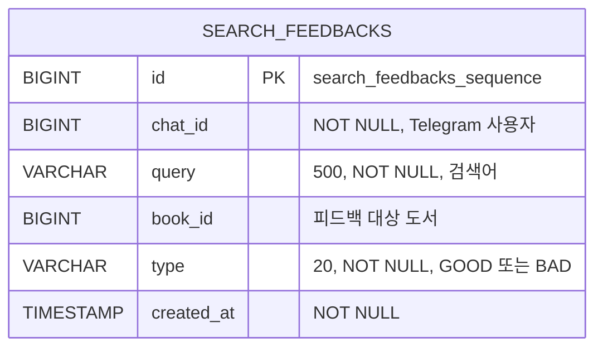

# 03. 피드백 데이터 계층 설계

> 사용자가 누른 👍/👎를 저장할 `search_feedbacks` 테이블과 `SearchFeedback` 엔티티, Repository, DTO, `FeedbackService`를 만듭니다. 버튼(UI)보다 데이터를 먼저 설계해 "무엇을 저장해야 나중에 쓸 수 있는가"를 정합니다.
>
> 예상 소요 시간: 2시간 · 난이도: 기본

## 학습 목표

- 검색 피드백에 필요한 정보(누가, 무엇을, 어떻게, 언제)를 정하고 테이블로 설계할 수 있다
- `@Enumerated(EnumType.STRING)`, `@SequenceGenerator`, `@PrePersist`를 사용해 엔티티를 구현할 수 있다
- 조회 패턴에 맞춰 Repository 메서드와 인덱스를 정할 수 있다
- 피드백 점수 `(긍정 - 부정) / 전체`를 계산하는 `FeedbackStats`를 구현할 수 있다

## 시작하기 전에

- [02. Telegram으로 RAG 검색하기](02.rag-search-via-telegram.md)에서 도서별 메시지 전송까지 마쳐야 합니다.
- JPA 엔티티, Spring Data JPA 쿼리 메서드, `@Transactional`을 써 본 경험을 전제로 합니다.
- 용어는 [용어집](../glossary.md)을 참고하세요.

## 1. 왜 필요한가

검색 결과에 대한 평가는 지금까지 시스템이 스스로 매긴 점수(유사도, RRF 점수, LLM relevance)뿐이었습니다. 그런데 이 점수들은 "사용자가 정말 원하던 책인가"를 보장하지 않습니다.

예를 들어 "해리포터"를 검색했을 때 유사도가 가장 높은 책이 『해리포터 영화 메이킹북』일 수 있습니다. 시스템은 1위로 보여 주지만, 소설을 찾던 사용자는 실망합니다. 이 실망을 기록할 방법이 있어야 다음 검색을 개선할 수 있습니다.

많은 서비스가 같은 방식으로 품질을 개선합니다.

| 서비스 | 사용자 반응 | 활용 |
|--------|-------------|------|
| 동영상 플랫폼 | 좋아요, 시청 시간 | 추천 순위 조정 |
| 검색 엔진 | 결과 클릭 여부 | 검색 순위 조정 |
| 쇼핑몰 | 구매 여부 | 상품 추천 개선 |

우리 Bot에서는 가장 단순한 형태인 **👍 좋았음 / 👎 별로였음** 두 가지를 모읍니다. 이 문서에서는 그 데이터를 저장하는 계층을 만들고, 버튼은 [04 문서](04.feedback-ui-callback-handler.md)에서 붙입니다.

## 2. 핵심 개념

### 2.1 무엇을 저장할까

피드백 한 건에는 네 가지 질문의 답이 들어갑니다.

| 질문 | 필드 | 예 |
|------|------|----|
| 누가 | `chatId` (Telegram 대화방 번호) | 123456789 |
| 무엇에 대해 | `query`(검색어), `bookId`(도서) | "해리포터", 101 |
| 어떻게 평가했나 | `type` (GOOD 또는 BAD) | GOOD |
| 언제 | `createdAt` | 2025-01-15 14:30:25 |

검색어와 도서를 **둘 다** 저장하는 것이 중요합니다. 같은 책이라도 "해리포터"로 찾았을 때는 좋은 결과지만 "자바 입문"으로 찾았을 때는 엉뚱한 결과입니다. `bookId`만 있으면 도서 인기도는 알 수 있어도 검색어별 품질은 알 수 없습니다.

### 2.2 이진 피드백과 피드백 점수

별점(1~5점) 대신 👍/👎 두 가지만 쓰는 이유는 사용자가 고민 없이 한 번에 누를 수 있기 때문입니다. 참여율이 높아야 데이터가 쌓입니다.

GOOD은 +1, BAD는 -1로 보고 다음 두 지표를 계산합니다.

- **긍정 비율(goodRatio)** = 긍정 수 / 전체 수 (0.0 ~ 1.0)
- **피드백 점수(feedbackScore)** = (긍정 수 - 부정 수) / 전체 수 (-1.0 ~ +1.0)

| 긍정 | 부정 | 긍정 비율 | 피드백 점수 |
|------|------|-----------|-------------|
| 15 | 2 | 0.882 | (15 - 2) / 17 = 0.765 |
| 5 | 5 | 0.5 | 0.0 |
| 2 | 8 | 0.2 | -0.6 |

피드백 점수는 0을 기준으로 좋은지 나쁜지가 바로 보여서, 나중에 검색 점수에 더하거나 빼기 편합니다([06 문서](06.llm-prompt-guidelines.md)).

### 2.3 계층 구조

```mermaid
flowchart TD
    H["CallbackQueryHandler<br/>(04 문서)"] -->|"FeedbackRequest"| S["FeedbackService"]
    A["FeedbackAdminController<br/>(05 문서)"] --> S
    S -->|"SearchFeedback"| R["SearchFeedbackRepository"]
    S -->|"FeedbackStats.from(...)"| ST["FeedbackStats"]
    R --> DB[("search_feedbacks")]
```



- **엔티티(`SearchFeedback`)**: 테이블 한 행
- **Repository**: 테이블 조회·저장
- **DTO(`FeedbackRequest`, `FeedbackStats`)**: 계층 사이에 주고받는 값. 엔티티를 그대로 밖에 내보내지 않기 위해 씁니다.
- **Service**: 저장 규칙과 통계 계산

## 3. 따라 하기

### STEP 1. 테이블 설계

목표: 저장 구조와 인덱스를 정합니다.



이 프로젝트는 JPA 스키마 자동 생성을 쓰지 않고(`ddl-auto=validate`), DDL을 직접 실행합니다.

```sql
-- 1. 테이블
CREATE TABLE search_feedbacks (
    id BIGSERIAL PRIMARY KEY,
    chat_id BIGINT NOT NULL,
    query VARCHAR(500) NOT NULL,
    book_id BIGINT,
    type VARCHAR(20) NOT NULL,
    created_at TIMESTAMP DEFAULT CURRENT_TIMESTAMP
);

-- 2. 인덱스 (PostgreSQL은 CREATE TABLE 안에 INDEX를 쓸 수 없으므로 따로 생성)
CREATE INDEX idx_search_feedbacks_chat_id ON search_feedbacks(chat_id);
CREATE INDEX idx_search_feedbacks_created_at ON search_feedbacks(created_at);
CREATE INDEX idx_search_feedbacks_query_book ON search_feedbacks(query, book_id);
CREATE INDEX idx_search_feedbacks_book_id ON search_feedbacks(book_id);

-- 3. 엔티티의 @SequenceGenerator가 사용하는 시퀀스
CREATE SEQUENCE search_feedbacks_sequence;
```

인덱스는 "어떤 조건으로 자주 찾는가"에서 나옵니다.

| 인덱스 | 쓰이는 곳 |
|--------|-----------|
| `chat_id` | 내 피드백 내역(`/mystats`), Step 6 사용자 선호도 계산 |
| `created_at` | 최근 N일 피드백 조회(관리자 API) |
| `(query, book_id)` | 중복 피드백 확인, 검색어별 통계 |
| `book_id` | 도서별 피드백 통계 |

`BIGSERIAL`은 PostgreSQL이 `search_feedbacks_id_seq`라는 시퀀스를 자동으로 만들지만, 엔티티는 이름을 명시한 `search_feedbacks_sequence`에서 번호를 받습니다. 그래서 3번 시퀀스를 따로 만듭니다.

### STEP 2. FeedbackType 열거형

목표: 피드백 종류와 점수를 한곳에 정의합니다.

```java
public enum FeedbackType {
    GOOD(1, "좋았음"),
    BAD(-1, "별로였음");

    private final int scoreValue;
    private final String description;

    FeedbackType(int scoreValue, String description) {
        this.scoreValue = scoreValue;
        this.description = description;
    }

    public int getScoreValue() { return scoreValue; }
    public String getDescription() { return description; }
}
```

- 점수(+1, -1)를 enum에 두면, 점수 규칙이 여러 클래스에 흩어지지 않습니다.
- 위치가 `entity`가 아닌 `dto` 패키지인 이유는, 04 문서의 Callback 파싱에서도 같은 타입을 쓰기 때문입니다.

전체 코드: [`dto/FeedbackType.java`](../../src/main/java/net/java21/library/external/telegram/dto/FeedbackType.java)

### STEP 3. SearchFeedback 엔티티

목표: 테이블과 1:1로 대응하는 엔티티를 만듭니다.

```java
@Entity
@Table(name = "search_feedbacks", indexes = {
    @Index(name = "idx_search_feedbacks_chat_id", columnList = "chat_id"),
    @Index(name = "idx_search_feedbacks_created_at", columnList = "created_at"),
    @Index(name = "idx_search_feedbacks_query_book", columnList = "query,book_id"),
    @Index(name = "idx_search_feedbacks_book_id", columnList = "book_id")
})
@NoArgsConstructor(access = AccessLevel.PROTECTED)
public class SearchFeedback {

    @Id
    @GeneratedValue(strategy = GenerationType.SEQUENCE, generator = "search_feedbacks_generator")
    @SequenceGenerator(name = "search_feedbacks_generator",
                       sequenceName = "search_feedbacks_sequence", allocationSize = 1)
    private Long id;

    @Column(name = "chat_id", nullable = false)
    private Long chatId;

    @Column(name = "query", nullable = false, length = 500)
    private String query;

    @Column(name = "book_id")
    private Long bookId;

    @Enumerated(EnumType.STRING)
    @Column(name = "type", nullable = false, length = 20)
    private FeedbackType type;

    @Column(name = "created_at", nullable = false)
    private OffsetDateTime createdAt;

    public static SearchFeedback of(Long chatId, String query, Long bookId, FeedbackType type) {
        SearchFeedback feedback = new SearchFeedback();
        feedback.chatId = chatId;
        feedback.query = query;
        feedback.bookId = bookId;
        feedback.type = type;
        return feedback;
    }

    @PrePersist
    protected void onPrePersist() {
        if (createdAt == null) {
            createdAt = OffsetDateTime.now();
        }
    }
    // getter만 제공 (setter 없음)
}
```

코드 설명:

- `@Enumerated(EnumType.STRING)`: DB에 `GOOD`, `BAD` 문자열로 저장합니다. 기본값인 `ORDINAL`은 0, 1 같은 순번으로 저장하므로, 나중에 enum 순서를 바꾸면 기존 데이터의 의미가 뒤바뀝니다.
- `@SequenceGenerator(allocationSize = 1)`: 시퀀스에서 번호를 하나씩 받습니다. DDL로 만든 시퀀스의 증가값(기본 1)과 같게 맞춰야 저장되는 id가 어긋나지 않습니다.
- `@NoArgsConstructor(access = AccessLevel.PROTECTED)`: JPA는 기본 생성자가 필요하지만, 외부에서 빈 객체를 만들지 못하게 `protected`로 막습니다. 생성은 정적 팩터리 `of(...)`로만 합니다.
- `@PrePersist`: 저장 직전에 호출되어 `createdAt`을 채웁니다. 호출하는 쪽이 시간을 깜빡해도 항상 값이 들어갑니다.
- `@Table`의 `indexes`는 문서화 목적이 큽니다. 스키마 자동 생성을 쓰지 않으므로 실제 인덱스는 STEP 1의 DDL로 만듭니다.

전체 코드: [`entity/SearchFeedback.java`](../../src/main/java/net/java21/library/external/telegram/entity/SearchFeedback.java)

### STEP 4. SearchFeedbackRepository

목표: 필요한 조회를 메서드로 정의합니다.

```java
public interface SearchFeedbackRepository extends JpaRepository<SearchFeedback, Long> {

    // 사용자별 최신순 (/mystats, Step 6 선호도 계산)
    List<SearchFeedback> findByChatIdOrderByCreatedAtDesc(Long chatId);

    // 도서별 통계
    List<SearchFeedback> findByBookId(Long bookId);

    // 검색어별 통계 (/stats 검색어)
    List<SearchFeedback> findByQuery(String query);

    // 중복 피드백 확인: 같은 사용자가 같은 검색어로 같은 도서를 이미 평가했는가
    @Query("SELECT sf FROM SearchFeedback sf WHERE sf.chatId = :chatId AND sf.query = :query AND sf.bookId = :bookId")
    Optional<SearchFeedback> findByChatIdAndQueryAndBookId(@Param("chatId") Long chatId,
                                                           @Param("query") String query,
                                                           @Param("bookId") Long bookId);

    // 기간 조회 (최근 N일)
    @Query("SELECT sf FROM SearchFeedback sf WHERE sf.createdAt BETWEEN :startDate AND :endDate")
    List<SearchFeedback> findByCreatedAtBetween(@Param("startDate") OffsetDateTime startDate,
                                                @Param("endDate") OffsetDateTime endDate);
}
```

- 앞의 세 메서드는 이름만으로 쿼리가 만들어지는 **쿼리 메서드**입니다.
- 실제 소스에는 `findByChatIdAndBookId`, `findByQueryAndBookId`도 있습니다. 06 문서의 "검색어+도서별 피드백 점수" 설계에서 쓸 수 있도록 준비해 둔 메서드입니다.

전체 코드: [`repository/SearchFeedbackRepository.java`](../../src/main/java/net/java21/library/external/telegram/repository/SearchFeedbackRepository.java)

### STEP 5. DTO: FeedbackRequest와 FeedbackStats

목표: 저장 요청과 통계 결과를 불변 객체로 정의합니다.

```java
public record FeedbackRequest(
        String query,  // Telegram callback_data 제한 때문에 비어 있을 수 있음 (04 문서)

        @NotNull(message = "도서 ID는 필수입니다.")
        Long bookId,

        @NotNull(message = "피드백 타입은 필수입니다.")
        FeedbackType type
) {}
```

```java
public record FeedbackStats(int goodCount, int badCount, int totalCount,
                            double goodRatio, double feedbackScore) {

    public static FeedbackStats from(List<SearchFeedback> feedbacks) {
        if (feedbacks == null || feedbacks.isEmpty()) {
            return new FeedbackStats(0, 0, 0, 0.0, 0.0);
        }
        int goodCount = (int) feedbacks.stream().filter(f -> f.getType() == FeedbackType.GOOD).count();
        int badCount = (int) feedbacks.stream().filter(f -> f.getType() == FeedbackType.BAD).count();
        int totalCount = feedbacks.size();
        double goodRatio = (double) goodCount / totalCount;
        double feedbackScore = (double) (goodCount - badCount) / totalCount;
        return new FeedbackStats(goodCount, badCount, totalCount, goodRatio, feedbackScore);
    }
}
```

- `record`는 필드, 생성자, 접근자(`goodCount()`), `equals`/`hashCode`를 자동으로 만들어 주는 불변 클래스입니다.
- 피드백이 없을 때 0으로 나누지 않도록 빈 목록을 먼저 처리합니다.
- 실제 소스는 `totalCount > 0 ? ... : 0.0`으로 한 번 더 방어합니다.

전체 코드: [`dto/FeedbackRequest.java`](../../src/main/java/net/java21/library/external/telegram/dto/FeedbackRequest.java), [`dto/FeedbackStats.java`](../../src/main/java/net/java21/library/external/telegram/dto/FeedbackStats.java)

### STEP 6. FeedbackService

목표: 저장, 조회, 통계를 한 서비스에 모읍니다.

```java
@Slf4j
@Service
@RequiredArgsConstructor
public class FeedbackServiceImpl implements FeedbackService {

    private final SearchFeedbackRepository searchFeedbackRepository;
    private final PersonalizationService personalizationService;

    @Override
    @Transactional
    public SearchFeedback recordFeedback(Long chatId, FeedbackRequest request) {
        SearchFeedback feedback = SearchFeedback.of(chatId, request.query(), request.bookId(), request.type());
        SearchFeedback saved = searchFeedbackRepository.save(feedback);

        // 새 피드백이 다음 검색의 선호도 벡터에 반영되도록 캐시 무효화 (Step 6)
        personalizationService.evictUserPreferenceCache(chatId);
        return saved;
    }

    @Override
    @Transactional(readOnly = true)
    public FeedbackStats getQueryFeedbackStats(String query) {
        return FeedbackStats.from(searchFeedbackRepository.findByQuery(query));
    }

    @Override
    @Transactional(readOnly = true)
    public boolean hasExistingFeedback(Long chatId, String query, Long bookId) {
        return searchFeedbackRepository.findByChatIdAndQueryAndBookId(chatId, query, bookId).isPresent();
    }

    // getUserFeedback, getBookFeedbackStats, getRecentFeedback, getAllFeedback 생략
}
```

| 메서드 | 쓰는 곳 |
|--------|---------|
| `recordFeedback(chatId, request)` | 버튼 클릭 처리(04) |
| `hasExistingFeedback(chatId, query, bookId)` | 중복 클릭 방지(04) |
| `getQueryFeedbackStats(query)` | `/stats 검색어`(04), 관리자 API(05) |
| `getUserFeedback(chatId)` | `/mystats`(04), 관리자 API(05) |
| `getBookFeedbackStats(bookId)` | 관리자 API(05) |
| `getRecentFeedback(days)` | 관리자 API(05) |
| `getAllFeedback()` | CSV 내보내기(05) |

코드 설명:

- 조회 메서드에 `@Transactional(readOnly = true)`를 붙이면 Hibernate가 변경 감지(dirty checking)를 생략해 조금 가볍게 동작하고, "이 메서드는 쓰지 않는다"는 의도도 드러납니다.
- `evictUserPreferenceCache(chatId)`는 Step 6에서 만드는 "사용자 선호 벡터" 캐시를 지웁니다. 피드백을 남긴 직후의 다음 검색부터 새 피드백이 반영되게 하려는 것입니다. 지금은 "피드백이 저장되면 개인화 캐시도 비운다"는 정도만 기억하면 됩니다.

전체 코드: [`service/FeedbackServiceImpl.java`](../../src/main/java/net/java21/library/external/telegram/service/FeedbackServiceImpl.java)

### STEP 7. 테스트로 확인하기

목표: 저장 후 캐시 무효화가 일어나는지 단위 테스트로 검증합니다. 프로젝트에는 이미 `FeedbackServiceImplTest`가 있습니다.

```bash
mvn test -Dtest='FeedbackServiceImplTest'
```

예상 결과: `피드백 저장 후 해당 사용자의 선호도 벡터 캐시를 무효화해야 한다` 테스트가 통과합니다.

## 4. 직접 해 보기

### 미션 1 (기본): FeedbackStats 단위 테스트

GOOD 3건, BAD 1건 목록으로 `FeedbackStats.from`을 호출했을 때 `goodRatio`가 0.75, `feedbackScore`가 0.5인지 검증하세요.

- 힌트: `SearchFeedback.of(1L, "해리포터", 101L, FeedbackType.GOOD)`로 엔티티를 만들 수 있습니다.

<details>
<summary>예시 코드</summary>

```java
@Test
@DisplayName("긍정 3건, 부정 1건이면 피드백 점수는 0.5다")
void from_calculatesScore() {
    List<SearchFeedback> feedbacks = List.of(
            SearchFeedback.of(1L, "해리포터", 101L, FeedbackType.GOOD),
            SearchFeedback.of(2L, "해리포터", 101L, FeedbackType.GOOD),
            SearchFeedback.of(3L, "해리포터", 101L, FeedbackType.GOOD),
            SearchFeedback.of(4L, "해리포터", 101L, FeedbackType.BAD));

    FeedbackStats stats = FeedbackStats.from(feedbacks);

    assertThat(stats.goodRatio()).isEqualTo(0.75);
    assertThat(stats.feedbackScore()).isEqualTo(0.5);
}
```

</details>

### 미션 2 (기본): 빈 목록 처리

`FeedbackStats.from(List.of())`와 `FeedbackStats.from(null)`이 모두 0으로 채워진 통계를 돌려주는지 확인하세요.

<details>
<summary>정답</summary>

두 경우 모두 첫 `if` 문에 걸려 `new FeedbackStats(0, 0, 0, 0.0, 0.0)`을 반환합니다. 이 처리가 없으면 `totalCount`가 0이라 나눗셈 결과가 `NaN`이 됩니다.

</details>

### 미션 3 (도전): 검색어별 도서 통계 쿼리

"해리포터" 검색어에 대해 도서별 GOOD 수, BAD 수를 한 번의 쿼리로 구하는 SQL을 작성해 보세요(06 문서의 설계에서 사용합니다).

<details>
<summary>예시 SQL</summary>

```sql
SELECT book_id,
       COUNT(*) FILTER (WHERE type = 'GOOD') AS good_count,
       COUNT(*) FILTER (WHERE type = 'BAD')  AS bad_count,
       COUNT(*)                              AS total_count
FROM search_feedbacks
WHERE query = '해리포터'
GROUP BY book_id
ORDER BY total_count DESC;
```

`(query, book_id)` 인덱스가 `WHERE query = ...` 조건에 쓰입니다.

</details>

## 5. 자주 하는 실수

| 증상 | 원인 | 해결 |
|------|------|------|
| `relation "search_feedbacks_sequence" does not exist` | 시퀀스를 만들지 않음 | STEP 1 DDL의 `CREATE SEQUENCE`를 실행합니다 |
| `permission denied for sequence search_feedbacks_sequence` | DB 사용자에게 시퀀스 권한이 없음 | `GRANT USAGE, SELECT ON ALL SEQUENCES IN SCHEMA public TO library;` |
| 시작 시 `Schema-validation: missing table` | `ddl-auto=validate`인데 테이블이 없음 | DDL을 먼저 실행합니다. 자동 생성(`create`)으로 바꾸지 않습니다 |
| enum 순서를 바꿨더니 과거 데이터 의미가 뒤바뀜 | `EnumType.ORDINAL` 사용 | `@Enumerated(EnumType.STRING)`을 씁니다 |
| `No default constructor for entity` | 기본 생성자 없음 | `@NoArgsConstructor(access = AccessLevel.PROTECTED)`를 붙입니다 |

## 6. 정리

- 피드백 한 건은 "누가(chatId), 무엇에 대해(query, bookId), 어떻게(type), 언제(createdAt)"를 담습니다.
- 인덱스는 실제 조회 패턴(사용자별, 기간별, 검색어+도서, 도서별)에서 정합니다.
- enum은 문자열로 저장하고, 생성 시각은 `@PrePersist`로 자동으로 채웁니다.
- 피드백 점수 `(긍정 - 부정) / 전체`는 -1.0 ~ +1.0 범위로, 0을 기준으로 좋고 나쁨을 판단합니다.
- 피드백을 저장하면 Step 6의 사용자 선호도 캐시를 비워 다음 검색에 반영되게 합니다.

- [ ] `search_feedbacks` 테이블, 인덱스, 시퀀스를 만들었다
- [ ] `SearchFeedback`, `SearchFeedbackRepository`를 이해하고 설명할 수 있다
- [ ] `FeedbackStats.from`의 계산식을 손으로 검산해 보았다
- [ ] `FeedbackServiceImplTest`를 실행해 통과를 확인했다

## 확인 문제

**1. 피드백에 `bookId`만 저장하지 않고 `query`도 함께 저장하는 이유는 무엇입니까?**

<details><summary>정답</summary>

같은 도서라도 어떤 검색어로 찾았느냐에 따라 좋은 결과일 수도, 엉뚱한 결과일 수도 있습니다. 검색어가 있어야 "이 검색어에 이 도서가 적절했는가"를 분석할 수 있습니다.

</details>

**2. `@Enumerated(EnumType.ORDINAL)`을 쓰면 어떤 문제가 생길 수 있습니까?**

<details><summary>정답</summary>

enum의 선언 순서(0, 1, ...)가 저장됩니다. 나중에 상수 순서를 바꾸거나 중간에 새 값을 추가하면, 이미 저장된 숫자가 다른 의미로 해석됩니다.

</details>

**3. 긍정 4건, 부정 6건일 때 긍정 비율과 피드백 점수는 각각 얼마입니까?**

<details><summary>정답</summary>

긍정 비율 = 4 / 10 = 0.4, 피드백 점수 = (4 - 6) / 10 = -0.2입니다.

</details>

**4. `recordFeedback`이 저장 후 `evictUserPreferenceCache(chatId)`를 호출하는 이유는 무엇입니까?**

<details><summary>정답</summary>

Step 6의 개인화는 사용자가 좋아한 도서로 계산한 선호 벡터를 캐시해 둡니다. 새 피드백이 생겼는데 캐시를 그대로 두면 다음 검색에 반영되지 않으므로, 해당 사용자의 캐시를 지워 다시 계산하게 합니다.

</details>

## 다음 문서

[04. 피드백 버튼과 Callback 처리 →](04.feedback-ui-callback-handler.md)
