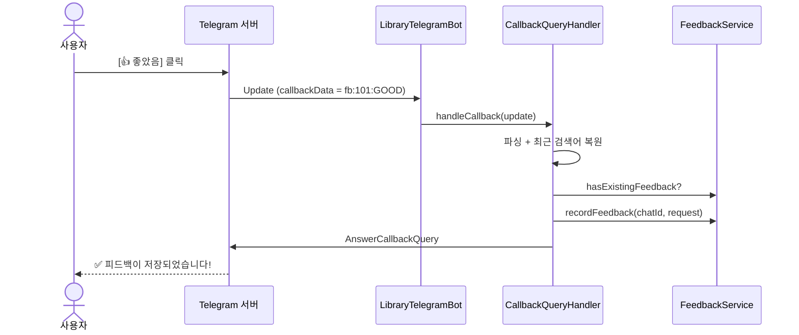
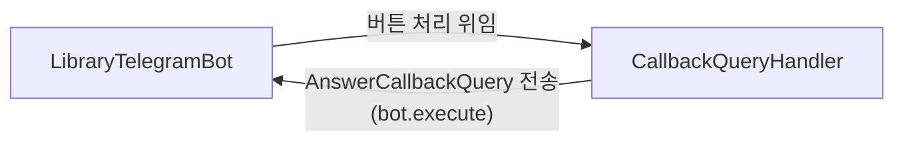
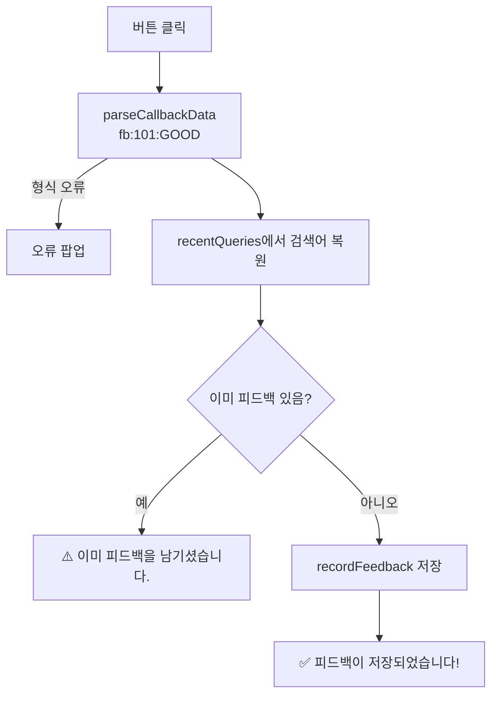

# 04. 피드백 버튼과 Callback 처리

> 검색 결과 도서마다 👍/👎 버튼(Inline Keyboard)을 붙이고, 사용자가 버튼을 누르면 Telegram이 보내는 Callback Query를 받아 피드백을 저장합니다. `/stats`, `/mystats` 명령어로 저장된 피드백도 확인합니다.
>
> 예상 소요 시간: 2시간 · 난이도: 기본

## 학습 목표

- 일반 메시지와 Callback Query의 차이를 설명할 수 있다
- `TelegramKeyboardFactory`로 도서별 피드백 버튼을 만들 수 있다
- `callback_data` 64바이트 제한 때문에 `fb:{bookId}:{type}` 형식을 쓰고, 검색어를 따로 보관하는 이유를 설명할 수 있다
- `CallbackQueryHandler`에서 파싱, 중복 확인, 저장, `AnswerCallbackQuery` 응답을 구현할 수 있다
- `@Lazy`로 빈 사이의 순환 의존성을 끊을 수 있다

## 시작하기 전에

- [03. 피드백 데이터 계층 설계](03.feedback-entity-repository.md)의 `FeedbackService`가 동작해야 합니다.
- [02. Telegram으로 RAG 검색하기](02.rag-search-via-telegram.md)의 도서별 전송 코드(`sendBookWithScore`)를 기억해 두세요.
- 용어는 [용어집](../glossary.md)을 참고하세요.

## 1. 왜 필요한가

03 문서에서 피드백을 저장할 곳은 만들었지만, 사용자가 피드백을 남길 방법이 없습니다. "좋았으면 `/good 101`을 입력하세요"처럼 명령어로 받을 수도 있지만, 도서 ID를 외워 입력할 사용자는 없습니다.

웹 화면의 "좋아요" 버튼처럼, 도서 메시지 바로 아래에 버튼이 있어야 합니다. Telegram에서는 이것을 **Inline Keyboard**라고 합니다. 버튼을 누르면 Telegram이 미리 정해 둔 짧은 문자열(`callback_data`)을 Bot에 보내 주므로, 사용자는 한 번 누르기만 하면 됩니다.

## 2. 핵심 개념

### 2.1 Inline Keyboard와 Callback Query

- **Inline Keyboard**: 메시지에 붙는 버튼 묶음입니다. 버튼마다 화면에 보일 글자(`text`)와 눌렀을 때 Bot에 전달될 값(`callbackData`)을 가집니다.
- **Callback Query**: 사용자가 버튼을 눌렀을 때 Bot이 받는 Update입니다. `update.hasCallbackQuery()`가 `true`가 됩니다.

| 구분 | 일반 메시지 | Callback Query |
|------|-------------|----------------|
| 사용자 행동 | 텍스트 입력 | 버튼 클릭 |
| Bot에서 확인 | `update.hasMessage()` | `update.hasCallbackQuery()` |
| 받는 값 | 입력한 텍스트 | 버튼의 `callbackData` |
| 응답 방법 | `SendMessage` (새 메시지) | `AnswerCallbackQuery` (짧은 알림) |

URL 링크(🔗 상세 보기)와도 다릅니다. 링크를 누르면 브라우저가 열리고 Bot은 아무것도 받지 못하지만, Inline Keyboard 버튼을 누르면 Bot이 신호를 받습니다.



### 2.2 callback_data는 64바이트까지

Telegram은 `callback_data`를 **최대 64바이트**로 제한합니다. 저장하려는 정보는 "검색어, 도서 ID, 좋음/나쁨"인데, 한글 검색어는 한 글자가 UTF-8로 3바이트라 "해리포터와 마법사의 돌을 찾고 있어요" 정도만 넣어도 한도를 넘습니다.

그래서 버튼에는 짧은 값만 넣고, 검색어는 서버에 따로 보관합니다.

```text
포맷: fb:{bookId}:{type}
예:   fb:101:GOOD   (11바이트)

fb    → 피드백 버튼이라는 접두어 (다른 종류의 버튼을 추가할 때 구분)
101   → 도서 ID
GOOD  → FeedbackType (GOOD 또는 BAD)
```

검색어는 `/search`를 처리할 때 `CallbackQueryHandler.setRecentQuery(chatId, keyword)`로 "이 대화방의 최근 검색어"로 저장해 두고, 버튼이 눌리면 `chatId`로 꺼내 씁니다.

### 2.3 AnswerCallbackQuery

버튼을 누르면 Telegram 앱은 버튼 위에 로딩 표시를 띄우고 Bot의 응답을 기다립니다. Bot이 `AnswerCallbackQuery`를 보내야 로딩이 멈추고 화면 위쪽에 짧은 알림이 뜹니다. 보내지 않으면 사용자는 버튼이 고장 난 것처럼 느낍니다.

- `showAlert(false)`: 화면 위쪽에 잠깐 떴다 사라지는 알림
- `showAlert(true)`: 확인 버튼이 있는 팝업(오류 안내에 사용)

## 3. 따라 하기

### STEP 1. 피드백 키보드 만들기

목표: 도서 ID를 받아 👍/👎 두 버튼짜리 키보드를 만듭니다.

```java
@Slf4j
@Component
public class TelegramKeyboardFactory {

    public InlineKeyboardMarkup createFeedbackKeyboard(String query, Long bookId) {
        // 콜백 데이터: fb:{bookId}:{type} (검색어는 64바이트 제한 때문에 넣지 않음)
        String goodCallback = String.format("fb:%d:GOOD", bookId);
        String badCallback = String.format("fb:%d:BAD", bookId);

        InlineKeyboardButton goodButton = InlineKeyboardButton.builder()
                .text("👍 좋았음")
                .callbackData(goodCallback)
                .build();

        InlineKeyboardButton badButton = InlineKeyboardButton.builder()
                .text("👎 별로였음")
                .callbackData(badCallback)
                .build();

        // 한 줄(row)에 버튼 두 개
        List<InlineKeyboardButton> row = List.of(goodButton, badButton);
        return InlineKeyboardMarkup.builder()
                .keyboard(List.of(row))
                .build();
    }
}
```

- 키보드는 `List<List<InlineKeyboardButton>>` 구조입니다. 바깥 리스트가 줄(row), 안쪽 리스트가 한 줄의 버튼입니다.
- `query` 파라미터는 로그에만 쓰고 `callback_data`에는 넣지 않습니다.

전체 코드: [`keyboard/TelegramKeyboardFactory.java`](../../src/main/java/net/java21/library/external/telegram/keyboard/TelegramKeyboardFactory.java)

### STEP 2. 도서 메시지에 키보드 붙이기

목표: 02 문서의 도서별 전송에 `replyMarkup`을 추가합니다.

```java
private void sendBookTextWithFeedback(Long chatId, String text, String query, Long bookId) {
    SendMessage message = SendMessage.builder()
            .chatId(chatId)
            .text(text)
            .replyMarkup(keyboardFactory.createFeedbackKeyboard(query, bookId))
            .build();
    try {
        this.execute(message);
    } catch (TelegramApiException e) {
        // 키보드가 있는 전송이 실패하면 일반 텍스트로 재시도
        sendSimpleMessage(chatId, text);
    }
}
```

사진으로 보내는 `sendBookImageWithFeedback`도 `SendPhoto.builder()...replyMarkup(...)`으로 같은 키보드를 붙입니다(02 문서 STEP 5).

### STEP 3. 버튼 클릭을 가장 먼저 분기하기

목표: `onUpdateReceived`에서 Callback Query를 일반 메시지보다 먼저 처리합니다.

```java
@Override
public void onUpdateReceived(Update update) {
    try {
        // Callback Query 처리를 최우선으로 수행
        if (update.hasCallbackQuery()) {
            callbackQueryHandler.handleCallback(update);
            return;
        }

        if (update.hasMessage() && update.getMessage().hasText()) {
            // 02 문서의 명령어 / 일반 텍스트 분기
        }
    } catch (Exception e) {
        log.error("[Telegram] Error in onUpdateReceived: {}", e.getMessage(), e);
    }
}
```

버튼 클릭 Update에는 `getMessage()`가 없습니다(버튼이 달린 원래 메시지는 `getCallbackQuery().getMessage()`에 있음). 메시지 분기를 먼저 하면 버튼 클릭이 조용히 무시되므로 Callback을 먼저 확인합니다.

### STEP 4. CallbackQueryHandler: 최근 검색어 보관

목표: 대화방별 최근 검색어를 저장하고 꺼낼 수 있게 합니다.

```java
@Slf4j
@Component
public class CallbackQueryHandler {

    private final FeedbackService feedbackService;
    private final LibraryTelegramBot libraryTelegramBot;

    // 채팅별 최근 검색어 (callback_data에 검색어를 넣을 수 없으므로 별도 저장)
    private final Map<Long, String> recentQueries = new ConcurrentHashMap<>();

    public CallbackQueryHandler(FeedbackService feedbackService,
                                @Lazy LibraryTelegramBot libraryTelegramBot) {
        this.feedbackService = feedbackService;
        this.libraryTelegramBot = libraryTelegramBot;
    }

    public void setRecentQuery(Long chatId, String query) {
        recentQueries.put(chatId, query);
    }
}
```

- `ConcurrentHashMap`: Polling 스레드에서 여러 사용자의 Update가 동시에 처리될 수 있으므로 스레드 안전한 Map을 씁니다.
- `@Lazy LibraryTelegramBot`: 아래 그림처럼 두 빈이 서로를 필요로 합니다.



Bot을 만들려면 Handler가 필요하고, Handler를 만들려면 Bot이 필요하니 Spring이 생성 순서를 정할 수 없습니다. `@Lazy`를 붙이면 Spring은 진짜 Bot 대신 **프록시**를 먼저 넣어 두고, 실제로 `execute()`를 호출하는 시점에 진짜 Bot을 찾아 연결합니다.

### STEP 5. CallbackQueryHandler: 클릭 처리

목표: 파싱 → 검색어 복원 → 중복 확인 → 저장 → 응답 순서로 처리합니다.

```java
public void handleCallback(Update update) {
    CallbackQuery callbackQuery = update.getCallbackQuery();
    String callbackData = callbackQuery.getData();
    Long chatId = callbackQuery.getMessage().getChatId();
    String callbackQueryId = callbackQuery.getId();

    try {
        // 1. Callback 데이터 파싱
        FeedbackRequest request = parseCallbackData(callbackData);

        // 2. 저장된 최근 검색어 가져오기
        String query = recentQueries.get(chatId);
        if (query == null || query.isBlank()) {
            query = "";
        }

        // 3. 검색어를 포함해 요청 재생성
        FeedbackRequest requestWithQuery = new FeedbackRequest(query, request.bookId(), request.type());

        // 4. 중복 피드백 체크
        if (feedbackService.hasExistingFeedback(chatId, query, requestWithQuery.bookId())) {
            libraryTelegramBot.execute(AnswerCallbackQuery.builder()
                    .callbackQueryId(callbackQueryId)
                    .text("⚠️ 이미 피드백을 남기셨습니다.")
                    .showAlert(false)
                    .build());
            return;
        }

        // 5. 피드백 저장
        feedbackService.recordFeedback(chatId, requestWithQuery);

        // 6. 응답 (로딩 애니메이션 중지)
        libraryTelegramBot.execute(AnswerCallbackQuery.builder()
                .callbackQueryId(callbackQueryId)
                .text("✅ 피드백이 저장되었습니다!")
                .showAlert(false)
                .build());

    } catch (IllegalArgumentException e) {
        answerCallbackWithError(callbackQueryId, "피드백 처리 중 오류가 발생했습니다.");
    } catch (TelegramApiException e) {
        log.error("Failed to answer callback query: chatId={}, data={}", chatId, callbackData, e);
    } catch (Exception e) {
        answerCallbackWithError(callbackQueryId, "피드백 처리 중 오류가 발생했습니다.");
    }
}
```

```java
private FeedbackRequest parseCallbackData(String callbackData) {
    try {
        String[] parts = callbackData.split(":");
        if (parts.length != 3 || !parts[0].equals("fb")) {
            throw new IllegalArgumentException("Invalid callback data format: " + callbackData);
        }
        Long bookId = Long.parseLong(parts[1]);
        FeedbackType type = FeedbackType.valueOf(parts[2]);
        return new FeedbackRequest("", bookId, type);   // 검색어는 handleCallback에서 채움
    } catch (Exception e) {
        throw new IllegalArgumentException("Failed to parse callback data: " + callbackData, e);
    }
}
```

코드 설명:

- 파싱 단계의 모든 오류(`NumberFormatException`, 알 수 없는 enum 값 등)를 `IllegalArgumentException`으로 감싸, 호출부에서 한 번에 "잘못된 버튼 데이터"로 처리합니다.
- 중복 기준은 (사용자, 검색어, 도서)입니다. 같은 사용자가 같은 검색 결과의 같은 책에 두 번 누르면 저장하지 않습니다. 다른 검색어로 같은 책을 다시 만나면 새 피드백으로 저장됩니다.
- 오류 응답은 `showAlert(true)` 팝업으로 보여 사용자가 놓치지 않게 합니다.



전체 코드: [`handler/CallbackQueryHandler.java`](../../src/main/java/net/java21/library/external/telegram/handler/CallbackQueryHandler.java)

### STEP 6. /stats와 /mystats

목표: 저장된 피드백을 Bot에서 바로 확인합니다.

| 명령어 | 동작 | 메서드 |
|--------|------|--------|
| `/stats 검색어` | 검색어별 피드백 통계 | `handleFeedbackStats` → `getQueryFeedbackStats(query)` |
| `/mystats` 또는 `/stats` | 내 피드백 내역(최근 10건) | `handleUserStats` → `getUserFeedback(chatId)` |

```java
private void handleFeedbackStats(Update update, String query) {
    Long chatId = update.getMessage().getChatId();
    FeedbackStats stats = feedbackService.getQueryFeedbackStats(query);

    StringBuilder message = new StringBuilder();
    message.append("📊 \"").append(escapeMarkdown(query)).append("\" 피드백 통계\n\n");
    message.append("👍 좋았음: ").append(stats.goodCount()).append("건\n");
    message.append("👎 별로였음: ").append(stats.badCount()).append("건\n");
    message.append("📈 전체: ").append(stats.totalCount()).append("건\n");
    message.append("💯 긍정 비율: ").append(String.format("%.1f%%", stats.goodRatio() * 100)).append("\n");
    message.append("⭐ 피드백 점수: ").append(String.format("%.3f", stats.feedbackScore())).append("\n");
    sendSimpleMessage(chatId, message.toString());
}
```

`handleUserStats`는 `getUserFeedback(chatId)`(최신순)에서 최대 10건을 `👍 해리포터`처럼 한 줄씩 보여 주고, 10건이 넘으면 `... 외 N건`을 붙입니다.

### STEP 7. 실행하고 확인하기

1. `/search 해리포터`를 보냅니다. 도서마다 `[👍 좋았음] [👎 별로였음]` 버튼이 붙어 있는지 확인합니다.
2. 첫 번째 도서의 👍를 누릅니다. 화면 위쪽에 `✅ 피드백이 저장되었습니다!`가 잠깐 뜹니다.
3. 같은 버튼을 다시 누릅니다. `⚠️ 이미 피드백을 남기셨습니다.`가 뜹니다.
4. DB에서 저장 결과를 확인합니다.

```sql
SELECT id, chat_id, query, book_id, type, created_at
FROM search_feedbacks ORDER BY id DESC LIMIT 5;
```

5. `/stats 해리포터`와 `/mystats`를 보내 통계를 확인합니다.

```text
📊 "해리포터" 피드백 통계

👍 좋았음: 1건
👎 별로였음: 0건
📈 전체: 1건
💯 긍정 비율: 100.0%
⭐ 피드백 점수: 1.000
```

## 4. 직접 해 보기

### 미션 1 (기본): callback_data 길이 계산

도서 ID가 `9223372036854775807`(Long 최댓값)일 때 `fb:{bookId}:GOOD`는 몇 바이트입니까? 64바이트 안에 들어갑니까?

<details>
<summary>정답</summary>

`fb:` 3바이트 + 숫자 19바이트 + `:GOOD` 5바이트 = 27바이트입니다. 모두 ASCII 문자라 글자 수와 바이트 수가 같고, 64바이트 안에 충분히 들어갑니다.

</details>

### 미션 2 (기본): 잘못된 데이터 처리

`parseCallbackData`에 `fb:abc:GOOD`, `fb:101:LIKE`, `xx:101:GOOD`를 넣으면 각각 어떻게 됩니까?

<details>
<summary>정답</summary>

- `fb:abc:GOOD`: `Long.parseLong("abc")`에서 `NumberFormatException` → `IllegalArgumentException`으로 감싸짐
- `fb:101:LIKE`: `FeedbackType.valueOf("LIKE")`에서 `IllegalArgumentException`
- `xx:101:GOOD`: 접두어가 `fb`가 아니라 직접 `IllegalArgumentException`을 던짐

세 경우 모두 `handleCallback`에서 "피드백 처리 중 오류가 발생했습니다." 팝업을 보냅니다.

</details>

### 미션 3 (도전): 최근 검색어 방식의 한계 찾기

사용자가 `/search 해리포터`를 보낸 뒤 `/search 자바`를 보내고, 다시 위로 스크롤해 "해리포터" 결과의 👍를 누르면 어떤 검색어로 저장됩니까? 이 문제를 줄일 방법을 생각해 보세요.

<details>
<summary>정답과 해설</summary>

`recentQueries`에는 대화방별로 **가장 최근 검색어 하나**만 있으므로 "자바"로 저장됩니다. 또 Map이 메모리에만 있어 서버를 재시작하면 검색어가 빈 문자열로 저장됩니다.

개선 방법 예시:
- 검색할 때마다 짧은 검색 ID(예: Redis에 `search:{id}` → 검색어)를 만들어 `fb:{searchId}:{bookId}:{type}`처럼 `callback_data`에 넣습니다. 64바이트 안에 들어가도록 ID를 짧게 유지해야 합니다.
- 버튼이 달린 메시지 ID(`callbackQuery.getMessage().getMessageId()`)와 검색어를 함께 저장해 두고, 클릭 시 메시지 ID로 찾습니다.

</details>

## 5. 자주 하는 실수

| 증상 | 원인 | 해결 |
|------|------|------|
| 버튼이 보이지 않음 | `replyMarkup` 누락 | `SendMessage`/`SendPhoto` 빌더에 `.replyMarkup(keyboard)`를 넣습니다 |
| 버튼을 누르면 로딩만 계속 돎 | `AnswerCallbackQuery`를 보내지 않음 | 성공·중복·오류 모든 경로에서 응답을 보냅니다 |
| `BUTTON_DATA_INVALID` 오류 | `callback_data`가 64바이트 초과(검색어를 넣음) | `fb:{bookId}:{type}`만 넣고 검색어는 `setRecentQuery`로 보관합니다 |
| 시작 시 `The dependencies of some of the beans form a cycle` | Bot과 Handler가 서로를 주입 | Handler 생성자의 Bot 파라미터에 `@Lazy`를 붙입니다 |
| 피드백의 `query`가 빈 문자열로 저장됨 | 서버 재시작으로 `recentQueries`가 비었거나 검색 없이 버튼을 누름 | 알려진 한계입니다. 미션 3의 개선 방법을 참고합니다 |

## 6. 정리

- Inline Keyboard 버튼을 누르면 Bot은 Callback Query를 받으며, 일반 메시지보다 먼저 분기합니다.
- `callback_data`는 64바이트 제한이 있어 `fb:{bookId}:{type}`만 담고, 검색어는 `recentQueries`에 대화방별로 보관합니다.
- `CallbackQueryHandler`는 파싱 → 검색어 복원 → 중복 확인 → 저장 → `AnswerCallbackQuery` 순서로 처리합니다.
- Bot과 Handler의 순환 의존성은 `@Lazy`로 끊습니다.

- [ ] 검색 결과 도서마다 👍/👎 버튼이 붙는다
- [ ] 버튼을 누르면 `search_feedbacks`에 저장되고 알림이 뜬다
- [ ] 같은 버튼을 다시 누르면 중복 안내가 뜬다
- [ ] `/stats 검색어`, `/mystats`로 통계를 확인했다

## 확인 문제

**1. `onUpdateReceived`에서 `hasCallbackQuery()`를 `hasMessage()`보다 먼저 확인하는 이유는 무엇입니까?**

<details><summary>정답</summary>

버튼 클릭 Update에는 `getMessage()`가 없고 `getCallbackQuery()`만 있습니다. Callback을 먼저 분기해야 버튼 클릭이 메시지 처리 분기에서 무시되지 않습니다.

</details>

**2. `callback_data`에 검색어를 넣지 않는 이유와, 대신 검색어를 어떻게 알아내는지 설명하세요.**

<details><summary>정답</summary>

`callback_data`는 최대 64바이트이고 한글은 글자당 3바이트라 검색어를 넣으면 쉽게 초과합니다. 대신 `/search` 처리 시 `setRecentQuery(chatId, keyword)`로 대화방별 최근 검색어를 저장해 두고, 버튼 클릭 시 `chatId`로 꺼냅니다.

</details>

**3. `AnswerCallbackQuery`를 보내지 않으면 사용자 화면에서 어떤 일이 생깁니까?**

<details><summary>정답</summary>

버튼 위의 로딩 표시가 한동안 멈추지 않아 사용자는 버튼이 동작하지 않는다고 느낍니다. 성공, 중복, 오류 모든 경우에 응답을 보내야 합니다.

</details>

**4. `CallbackQueryHandler` 생성자의 `@Lazy`는 무엇을 해결합니까?**

<details><summary>정답</summary>

`LibraryTelegramBot`은 `CallbackQueryHandler`를, `CallbackQueryHandler`는 `LibraryTelegramBot`을 필요로 하는 순환 의존성입니다. `@Lazy`를 붙이면 Spring이 Bot 자리에 프록시를 먼저 주입하고, 실제 호출 시점에 진짜 Bot을 찾아 연결하므로 생성 순서 문제가 사라집니다.

</details>

## 다음 문서

[05. 피드백 루프 완성: 관리자 API와 검색 연동 →](05.feedback-search-integration.md)
