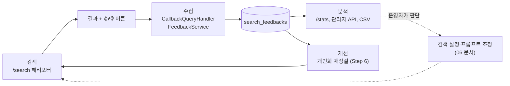
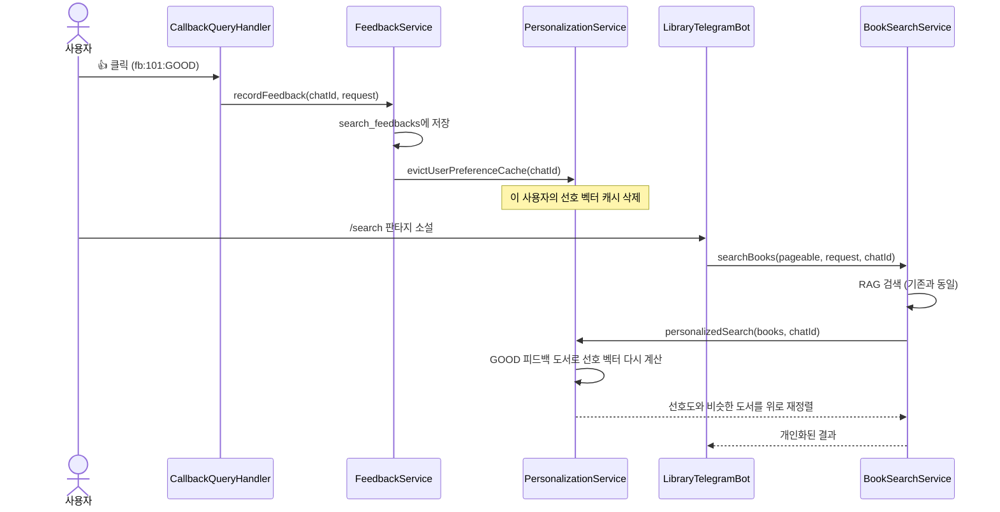

# 05. 피드백 루프 완성: 관리자 API와 검색 연동

> 모은 피드백을 관리자가 조회·내보낼 수 있는 REST API를 확인하고, 저장된 피드백이 다음 검색에 어떤 경로로 닿는지 따라가 "수집 → 분석 → 개선" 루프를 완성합니다.
>
> 예상 소요 시간: 1.5시간 · 난이도: 기본

## 학습 목표

- 피드백 루프(수집 → 분석 → 개선)의 각 단계가 이 프로젝트의 어느 클래스에 해당하는지 설명할 수 있다
- `FeedbackAdminController`의 엔드포인트를 호출하고, 요청 값 검증 규칙을 설명할 수 있다
- 피드백 저장이 다음 `/search`의 순위에 반영되는 경로(캐시 무효화 → 개인화 재정렬)를 따라갈 수 있다
- 피드백 데이터를 다룰 때의 개인정보 고려 사항을 말할 수 있다

## 시작하기 전에

- [04. 피드백 버튼과 Callback 처리](04.feedback-ui-callback-handler.md)까지 마쳐 피드백이 DB에 저장되어야 합니다.
- Spring MVC의 `@RestController`, `@PathVariable`, `@RequestParam`, Bean Validation을 알고 있으면 좋습니다.
- 용어는 [용어집](../glossary.md)을 참고하세요.

## 1. 왜 필요한가

04 문서까지 마치면 피드백이 DB에 쌓입니다. 그런데 쌓기만 하면 아무 일도 일어나지 않습니다.

- 운영자는 "어떤 검색어의 결과가 나쁜가"를 DB에 직접 접속하지 않고 확인하고 싶습니다.
- 데이터 분석가는 전체 피드백을 엑셀로 받아 보고 싶습니다.
- 무엇보다, 사용자가 👎를 누른 책이 다음 검색에서도 똑같이 1위로 나온다면 피드백을 남길 이유가 없습니다.

피드백이 실제 개선으로 이어지는 순환 구조를 **피드백 루프(Feedback Loop)** 라고 합니다. 이 문서에서는 루프의 나머지 절반, 즉 "분석"과 "개선으로 연결"을 다룹니다.

## 2. 핵심 개념

### 2.1 피드백 루프



| 단계 | 하는 일 | 이 프로젝트의 구현 |
|------|---------|-------------------|
| 수집 | 사용자 반응 저장 | `CallbackQueryHandler`, `FeedbackService.recordFeedback` |
| 분석 | 통계로 품질 파악 | `/stats`, `/mystats`, `FeedbackAdminController`, CSV |
| 개선(자동) | 다음 검색 순위에 반영 | `PersonalizationService`(Step 6) |
| 개선(수동) | 운영자가 설정·프롬프트 조정 | 06 문서의 설계 가이드 |

### 2.2 자동 개선과 수동 개선

- **자동 개선**: 코드가 피드백을 읽어 검색 결과를 바로 바꿉니다. 이 프로젝트에서는 Step 6의 개인화가 해당합니다. 사용자가 👍를 누른 도서들의 임베딩 평균(선호 벡터)을 구해, 그와 비슷한 도서를 위로 올립니다.
- **수동 개선**: 사람이 통계를 보고 판단합니다. 예를 들어 "주식" 검색어의 긍정 비율이 20%라면, 하이브리드 가중치나 RAG 프롬프트를 손봐야 한다는 신호입니다.

### 2.3 피드백과 개인정보

`chat_id`는 Telegram 사용자를 가리키는 식별자입니다. 이름이나 전화번호는 아니지만, 다른 정보와 합치면 특정인을 알아낼 수 있으므로 함부로 외부에 내보내지 않습니다.

- **해싱(hashing)**: 원래 값을 되돌릴 수 없는 고정 길이 문자열로 바꿉니다. 같은 사용자는 항상 같은 해시가 나오므로 "같은 사람인지"는 구분하면서 누구인지는 숨길 수 있습니다.
- **마스킹(masking)**: 일부만 보여 줍니다(예: `123***`). 로그에 남길 때 씁니다.

프로젝트의 `PrivacyUtil`이 두 기능(`hashChatId`, `maskChatId`)을 제공합니다.

## 3. 따라 하기

### STEP 1. 관리자 API 살펴보기

목표: 피드백 통계를 HTTP로 조회하는 엔드포인트를 확인합니다.

| 메서드 | 경로 | 설명 | 검증 |
|--------|------|------|------|
| GET | `/api/admin/feedback/book/{bookId}/stats` | 도서별 통계 | `bookId` 양수 |
| GET | `/api/admin/feedback/stats?query=해리포터` | 검색어별 통계 | 비어 있지 않음, 100자 이하 |
| GET | `/api/admin/feedback/recent?days=7` | 최근 N일 피드백 목록 | 기본 7, 1~30 |
| GET | `/api/admin/feedback/user/{chatId}` | 사용자별 피드백 목록 | `chatId` 양수 |
| GET | `/api/admin/feedback/export/csv` | 전체 피드백 CSV | - |

```java
@Slf4j
@RestController
@RequestMapping("/api/admin/feedback")
@RequiredArgsConstructor
@Validated
public class FeedbackAdminController {

    private final FeedbackService feedbackService;
    private final CsvExportService csvExportService;

    @GetMapping("/stats")
    public ResponseEntity<FeedbackStats> getQueryFeedbackStats(
            @RequestParam("query") @NotBlank(message = "검색어는 비어있을 수 없습니다")
            @Size(max = 100, message = "검색어는 100자 이하여야 합니다") String query) {
        return ResponseEntity.ok(feedbackService.getQueryFeedbackStats(query));
    }

    @GetMapping("/recent")
    public ResponseEntity<List<SearchFeedback>> getRecentFeedback(
            @RequestParam(value = "days", defaultValue = "7")
            @Min(value = 1, message = "일수는 최소 1일 이상이어야 합니다")
            @Max(value = 30, message = "일수는 최대 30일 이하여야 합니다") int days) {
        return ResponseEntity.ok(feedbackService.getRecentFeedback(days));
    }
    // book/{bookId}/stats, user/{chatId}, export/csv 생략
}
```

코드 설명:

- 클래스에 `@Validated`를 붙여야 메서드 파라미터의 `@NotBlank`, `@Min` 같은 제약이 동작합니다. DTO가 아닌 단순 파라미터를 검증할 때 필요합니다.
- `days`의 상한을 30으로 둔 이유는 한 번에 너무 많은 행을 읽지 않게 하기 위해서입니다.
- 컨트롤러는 서비스에 위임만 하고, 계산은 `FeedbackService`와 `FeedbackStats`가 맡습니다.

전체 코드: [`api/FeedbackAdminController.java`](../../src/main/java/net/java21/library/external/telegram/api/FeedbackAdminController.java)

### STEP 2. API 호출해 보기

목표: curl로 통계와 검증 오류를 확인합니다.

```bash
# 검색어별 통계 (한글은 URL 인코딩)
curl -G "http://localhost:8080/api/admin/feedback/stats" --data-urlencode "query=해리포터"
```

```json
{
  "goodCount": 15,
  "badCount": 2,
  "totalCount": 17,
  "goodRatio": 0.8823529411764706,
  "feedbackScore": 0.7647058823529411
}
```

```bash
# 범위를 벗어난 값 → 검증 오류
curl "http://localhost:8080/api/admin/feedback/recent?days=100"
```

`days=100`은 `@Max(30)`에 걸려 400 계열 오류 응답이 옵니다. 오류 응답 형식은 `GlobalExceptionHandler`가 정합니다.

### STEP 3. CSV 내보내기

목표: 전체 피드백을 엑셀에서 열 수 있는 파일로 받습니다.

```bash
curl -OJ "http://localhost:8080/api/admin/feedback/export/csv"
```

```text
ID,ChatId,Query,BookId,Type,CreatedAt
1,123456789,해리포터,101,GOOD,2025-01-15T14:30:25+09:00
2,123456789,해리포터,102,BAD,2025-01-15T14:31:10+09:00
```

- `CsvExportService`는 쉼표, 큰따옴표, 줄바꿈이 들어간 값을 큰따옴표로 감싸 CSV가 깨지지 않게 합니다. 검색어에 쉼표가 들어갈 수 있기 때문입니다.
- 응답 본문 앞에 UTF-8 BOM(``)을 붙입니다. 이것이 없으면 엑셀이 한글을 깨진 글자로 엽니다.

전체 코드: [`util/CsvExportService.java`](../../src/main/java/net/java21/library/external/telegram/util/CsvExportService.java)

### STEP 4. 피드백이 다음 검색에 닿는 경로

목표: 👍 한 번이 다음 `/search` 순위에 반영되기까지의 흐름을 따라갑니다.



핵심 코드는 두 군데입니다.

```java
// FeedbackServiceImpl.recordFeedback (03 문서)
SearchFeedback saved = searchFeedbackRepository.save(feedback);
personalizationService.evictUserPreferenceCache(chatId);
```

```java
// BookSearchService.searchBooks(pageable, request, chatId)
BookSearchResult result = searchBooks(pageable, request);          // 1. 기존 검색
List<BookSearchResponse> personalizedBooks =
        personalizationService.personalizedSearch(result.getBooks().getContent(), chatId);  // 2. 개인화
```

- 개인화는 GOOD 피드백이 일정 수(`app.personalization.min-feedback-count`, 기본 3) 이상일 때만 적용됩니다. 그보다 적으면 **콜드 스타트(cold start)**, 즉 "아직 이 사용자를 잘 모르는 상태"로 보고 원래 순서를 그대로 둡니다.
- 선호 벡터 계산과 재정렬 방식은 [Step 6. 개인화 추천](../step-6/README.md)에서 자세히 다룹니다. 이 단계에서는 "피드백 저장 → 캐시 무효화 → 다음 검색에서 재계산"이라는 연결 고리만 이해하면 됩니다.

### STEP 5. 동작 확인

1. `/search 판타지 소설`을 보내 결과 순서를 기록합니다.
2. 판타지 도서 3권 이상에 👍를 누릅니다(검색어를 바꿔 가며 눌러도 됩니다).
3. 다시 `/search 판타지 소설`을 보내 순서가 바뀌었는지 비교합니다.
4. 로그에서 `Searching books with personalization for chatId: ...`를 확인합니다.

시맨틱 캐시가 같은 검색 결과를 돌려주더라도, 개인화는 그 뒤에 적용되므로 순서가 달라질 수 있습니다.

## 4. 직접 해 보기

### 미션 1 (기본): 품질이 낮은 검색어 찾기

피드백이 3건 이상인 검색어 중 긍정 비율이 가장 낮은 5개를 구하는 SQL을 작성하세요.

<details>
<summary>예시 SQL</summary>

```sql
SELECT query,
       COUNT(*) AS total,
       ROUND(AVG(CASE WHEN type = 'GOOD' THEN 1.0 ELSE 0.0 END), 3) AS good_ratio
FROM search_feedbacks
WHERE query <> ''
GROUP BY query
HAVING COUNT(*) >= 3
ORDER BY good_ratio ASC, total DESC
LIMIT 5;
```

`query <> ''` 조건은 04 문서에서 본 "검색어 없이 저장된 피드백"을 분석에서 빼기 위한 것입니다.

</details>

### 미션 2 (기본): CSV에 chatId 해시 적용

CSV를 외부에 공유한다고 가정하고, `ChatId` 열에 원래 값 대신 `PrivacyUtil.hashChatId(chatId)`를 쓰도록 바꾸려면 `CsvExportService`의 어느 줄을 고쳐야 할까요?

<details>
<summary>정답</summary>

`generateCsv`에서 `feedback.getChatId().toString()`을 쓰는 줄을 `PrivacyUtil.hashChatId(feedback.getChatId())`로 바꿉니다. 해시값은 Base64 문자열이라 `+`, `/`, `=`가 들어갈 수 있지만 쉼표는 없으므로 CSV 이스케이프 처리에는 문제가 없습니다. 현재 소스는 원래 `chatId`를 그대로 내보내므로, 실제로 외부에 공유한다면 이 변경을 검토해야 합니다.

</details>

### 미션 3 (도전): 관리자 API 보호

현재 `/api/admin/feedback/**`는 누구나 호출할 수 있습니다. 운영 환경이라면 어떤 보호 장치가 필요한지 두 가지 이상 제안해 보세요.

<details>
<summary>예시 답안</summary>

- Spring Security로 `/api/admin/**`에 관리자 역할(`ROLE_ADMIN`)이 있는 사용자만 접근하게 합니다.
- 내부망이나 VPN에서만 접근 가능하도록 리버스 프록시(Nginx)에서 경로를 막습니다.
- 사용자별 목록(`/user/{chatId}`)처럼 개인 단위 데이터를 돌려주는 엔드포인트는 응답에서 `chatId`를 해시로 바꿉니다.
- 호출 기록(감사 로그)을 남깁니다.

</details>

## 5. 자주 하는 실수

| 증상 | 원인 | 해결 |
|------|------|------|
| `days=100`인데 검증 오류 없이 조회됨 | 컨트롤러에 `@Validated` 누락 | 클래스에 `@Validated`를 붙입니다 |
| 엑셀에서 CSV 한글이 깨짐 | BOM 없이 UTF-8로 내보냄 | 본문 앞에 ``를 붙입니다 |
| 👍를 눌러도 다음 검색 순서가 그대로 | GOOD 피드백이 최소 개수(기본 3) 미만 | 3건 이상 남긴 뒤 다시 검색합니다 |
| 피드백을 남겼는데 개인화가 이전 상태로 계산됨 | 선호 벡터 캐시를 지우지 않음 | `recordFeedback`에서 `evictUserPreferenceCache`를 호출합니다 |
| curl로 한글 검색어를 보내면 400 오류 | URL 인코딩을 하지 않음 | `curl -G --data-urlencode "query=..."`를 씁니다 |

## 6. 정리

- 피드백 루프는 수집(`CallbackQueryHandler`) → 분석(`/stats`, 관리자 API, CSV) → 개선(Step 6 개인화, 06 문서의 설계)으로 이어집니다.
- 관리자 API는 `@Validated`와 파라미터 제약으로 잘못된 요청을 걸러 냅니다.
- 피드백을 저장하면 사용자 선호 벡터 캐시를 지우고, 다음 `/search`에서 `personalizedSearch`가 새 선호도로 순위를 다시 매깁니다.
- `chat_id`는 개인 식별에 쓰일 수 있으므로 외부로 내보낼 때는 해싱·마스킹과 접근 제어를 고려합니다.

- [ ] 관리자 API 5개를 호출해 보았다
- [ ] CSV를 내려받아 엑셀에서 한글이 정상으로 보이는 것을 확인했다
- [ ] 피드백 3건 이상을 남긴 뒤 검색 순서 변화를 확인했다

## 확인 문제

**1. 피드백 루프의 세 단계와 각 단계를 담당하는 클래스(또는 기능)를 하나씩 쓰세요.**

<details><summary>정답</summary>

수집: `CallbackQueryHandler`/`FeedbackService.recordFeedback`, 분석: `FeedbackAdminController`(또는 `/stats`), 개선: `PersonalizationService.personalizedSearch`(Step 6)입니다.

</details>

**2. `FeedbackAdminController`에 `@Validated`가 없으면 어떤 일이 생깁니까?**

<details><summary>정답</summary>

메서드 파라미터에 붙은 `@NotBlank`, `@Size`, `@Min`, `@Max`, `@Positive` 제약이 검사되지 않아, `days=100`이나 빈 검색어 같은 잘못된 요청도 그대로 처리됩니다.

</details>

**3. 피드백 저장 직후 `evictUserPreferenceCache(chatId)`를 호출하지 않으면 사용자는 어떤 경험을 하게 됩니까?**

<details><summary>정답</summary>

캐시에 남은 이전 선호 벡터로 개인화가 계산되므로, 방금 남긴 피드백이 다음 검색 순서에 반영되지 않습니다(캐시가 만료될 때까지).

</details>

**4. GOOD 피드백이 1건뿐인 사용자에게 개인화를 적용하지 않는 이유는 무엇입니까?**

<details><summary>정답</summary>

한두 건의 피드백으로는 취향을 믿을 만하게 추정할 수 없어(콜드 스타트), 오히려 엉뚱한 도서를 위로 올릴 수 있습니다. 그래서 최소 개수(기본 3) 이상일 때만 적용합니다.

</details>

## 다음 문서

[06. 피드백 기반 검색 개선 설계 →](06.llm-prompt-guidelines.md)
