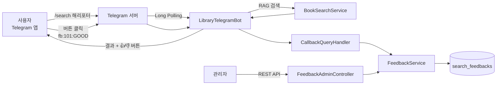

# Step 5. Telegram Bot과 사용자 피드백 수집

> 지금까지 웹 화면에서만 쓰던 AI 도서 검색을 Telegram 채팅으로 옮기고, 검색 결과마다 단 버튼으로 사용자의 만족도(피드백)를 모읍니다.

## 이 단계에서 만드는 것

이 단계를 마치면 Telegram 앱에서 다음과 같이 대화할 수 있습니다.

```text
User: /search 해리포터

Bot:  📚 "해리포터" 검색 결과

      🤖 AI 추천 사유
      💬 해리포터 시리즈는 마법 세계를 배경으로 한 판타지 소설로 ...

      검색된 도서 (3개)

Bot:  [표지 이미지]
      1. 해리포터와 마법사의 돌
      📖 조앤 K. 롤링
      🏢 문학수첩
      📊 RRF 점수: 0.03
      🔗 상세 보기: https://library.java21.net/books/101
      [👍 좋았음] [👎 별로였음]

User: (👍 좋았음 버튼을 누름)
Bot:  ✅ 피드백이 저장되었습니다!   ← 화면 위쪽에 잠깐 뜨는 알림

User: /stats 해리포터
Bot:  📊 "해리포터" 피드백 통계
      👍 좋았음: 15건
      👎 별로였음: 2건
      📈 전체: 17건
      💯 긍정 비율: 88.2%
      ⭐ 피드백 점수: 0.765
```

관리자는 REST API(`/api/admin/feedback/...`)로 도서별·검색어별 통계를 조회하고, 전체 피드백을 CSV로 내려받을 수 있습니다.

## 왜 이 단계가 필요한가

Step 1~4에서 키워드 검색, 벡터 검색, RAG(Retrieval-Augmented Generation), 시맨틱 캐시까지 만들었습니다. 그런데 한 가지 질문에 아직 답하지 못합니다.

> "이 검색 결과, 사용자는 정말 만족했을까?"

유사도 점수나 RRF 점수는 시스템이 스스로 매긴 점수일 뿐, 사용자가 실제로 원하던 책인지는 알려 주지 않습니다. 검색 품질을 개선하려면 **사용자의 실제 반응(피드백)** 이 필요합니다.

이 단계에서는 두 가지 문제를 함께 해결합니다.

| 이전 단계의 한계 | 이번 단계의 해결 |
|------------------|------------------|
| 웹 화면에 접속해야만 검색할 수 있음 | 이미 쓰는 메신저(Telegram)에서 바로 검색 |
| 검색 결과가 좋았는지 알 방법이 없음 | 도서마다 👍/👎 버튼으로 피드백 수집 |
| 품질을 숫자로 확인할 수 없음 | 피드백 통계(긍정 비율, 피드백 점수)와 관리자 API |

여기서 모은 피드백은 [Step 6. 개인화 추천](../step-6/README.md)에서 "이 사용자가 좋아한 책과 비슷한 책을 위로 올리는" 데 쓰입니다.

## 전체 흐름



## 문서 구성

| 순서 | 문서 | 내용 | 예상 시간 |
|------|------|------|-----------|
| 01 | [Telegram Bot 설정](01.telegram-bot-setup.md) | BotFather로 Bot 만들기, Long Polling과 Webhook, 토큰 설정, Bot 등록·종료 | 1.5시간 |
| 02 | [Telegram으로 RAG 검색하기](02.rag-search-via-telegram.md) | 메시지·명령어 분기, `/search`로 RAG 검색 호출, 결과·이미지 전송 | 1.5시간 |
| 03 | [피드백 데이터 계층 설계](03.feedback-entity-repository.md) | `SearchFeedback` 엔티티, Repository, DTO, `FeedbackService` | 2시간 |
| 04 | [피드백 버튼과 Callback 처리](04.feedback-ui-callback-handler.md) | Inline Keyboard, `fb:{bookId}:{type}` 포맷, `CallbackQueryHandler`, `/stats` | 2시간 |
| 05 | [피드백 루프 완성: 관리자 API와 검색 연동](05.feedback-search-integration.md) | 관리자 API, CSV 내보내기, 피드백이 다음 검색에 닿는 경로 | 1.5시간 |
| 06 | [피드백 기반 검색 개선 설계](06.llm-prompt-guidelines.md) | 피드백 점수, 보너스 재정렬, LLM 프롬프트에 피드백을 넣는 원칙 | 1시간 |

## 이 단계를 마치면

- [ ] BotFather에서 Bot을 만들고 토큰을 `secrets.properties`의 `TELEGRAM_BOT_TOKEN`에 넣어 실행할 수 있다
- [ ] Long Polling 방식으로 메시지를 받는 원리와 Bot 스레드를 정리해야 하는 이유를 설명할 수 있다
- [ ] `/search 키워드`로 RAG 검색 결과를 Telegram에서 받을 수 있다
- [ ] 검색 결과 도서마다 👍/👎 버튼이 붙고, 누르면 `search_feedbacks` 테이블에 저장된다
- [ ] `callback_data`를 `fb:{bookId}:{type}` 형식으로 짧게 설계한 이유를 설명할 수 있다
- [ ] `/stats 검색어`, `/mystats`, 관리자 API로 피드백 통계를 확인할 수 있다

## 관련 소스 코드

패키지 루트: `src/main/java/net/java21/library/external/telegram/`

| 클래스 | 역할 | 경로 |
|--------|------|------|
| `TelegramBotProperties` | `telegram.bot.*` 설정 바인딩 | `config/TelegramBotProperties.java` |
| `TelegramBotConfig` | Bot 빈 생성, 시작 시 등록, 종료 시 정리 | `config/TelegramBotConfig.java` |
| `LibraryTelegramBot` | 메시지 수신, 명령어 분기, 검색 결과 전송 | `bot/LibraryTelegramBot.java` |
| `TelegramKeyboardFactory` | 👍/👎 Inline Keyboard 생성 | `keyboard/TelegramKeyboardFactory.java` |
| `CallbackQueryHandler` | 버튼 클릭 처리, 최근 검색어 보관 | `handler/CallbackQueryHandler.java` |
| `SearchFeedback` | 피드백 엔티티(`search_feedbacks`) | `entity/SearchFeedback.java` |
| `SearchFeedbackRepository` | 피드백 조회·중복 확인 | `repository/SearchFeedbackRepository.java` |
| `FeedbackType`, `FeedbackRequest`, `FeedbackStats` | 피드백 타입·요청·통계 DTO | `dto/` |
| `FeedbackService`, `FeedbackServiceImpl` | 피드백 저장·통계 계산 | `service/` |
| `FeedbackAdminController` | 관리자 REST API | `api/FeedbackAdminController.java` |
| `CsvExportService`, `PrivacyUtil` | CSV 내보내기, chatId 해싱·마스킹 | `util/` |

설정 파일: `src/main/resources/telegram.properties`, 프로젝트 루트의 `secrets.properties`(템플릿 `secrets.properties.example`)

---

[01. Telegram Bot 설정 →](01.telegram-bot-setup.md)
