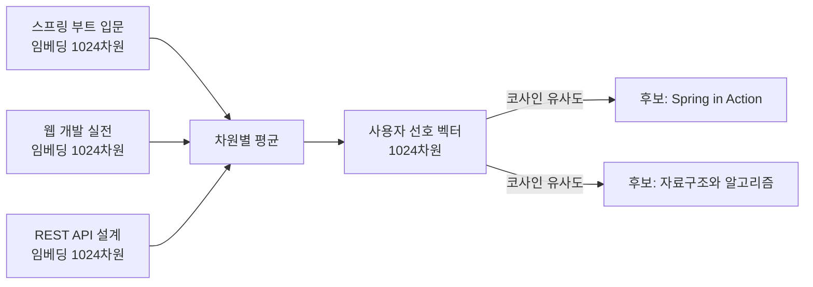

# 01. 취향을 벡터로 표현하기: 임베딩 복습과 개인화 관점

> Step 2에서 도서를 벡터로 바꾼 것처럼, 사용자의 취향도 같은 공간의 벡터 하나로 나타낼 수 있습니다. 이 문서는 임베딩과 코사인 유사도를 짧게 복습한 뒤, "좋아한 책들의 평균 = 사용자 취향"이라는 개인화의 핵심 아이디어를 손으로 계산하고 SQL로 확인합니다.
>
> 예상 소요 시간: 1시간 · 난이도: 입문

## 학습 목표

- 도서 임베딩과 사용자 선호 벡터가 같은 벡터 공간에 놓인다는 의미를 설명할 수 있다.
- 코사인 유사도 값(-1 ~ 1)이 개인화 점수로 어떻게 해석되는지 설명할 수 있다.
- 여러 벡터의 평균을 계산하고, 평균 벡터가 "취향의 중심"이 되는 이유를 설명할 수 있다.
- pgvector 쿼리로 특정 사용자의 취향과 가까운 도서를 직접 조회할 수 있다.

## 시작하기 전에

- 임베딩이 무엇인지 처음 듣는다면 [Step 0. AI 기초](../step-0/01.ai-basics.md)를 먼저 읽습니다.
- 도서 임베딩(BGE-M3, 1024차원)을 만들고 저장하는 과정은 [Step 2. 임베딩 생성](../step-2/03.embedding-generation.md)에서 다뤘습니다.
- 피드백 데이터(`search_feedbacks` 테이블)는 [Step 5. 피드백 엔티티와 저장소](../step-5/03.feedback-entity-repository.md)에서 만들었습니다.
- 모르는 용어는 [용어집](../glossary.md)을 참고합니다.

## 1. 왜 필요한가

Step 5까지 만든 Telegram Bot은 같은 검색어에 대해 누구에게나 같은 순서로 결과를 보여 줍니다. "자바"를 검색하면 웹 개발자에게도, 알고리즘 공부를 하는 학생에게도 같은 다섯 권이 같은 순서로 나옵니다.

그런데 Step 5에서 우리는 사용자마다 👍(GOOD), 👎(BAD) 피드백을 모으기 시작했습니다. `search_feedbacks` 테이블에는 이런 기록이 쌓여 있습니다.

```
 chat_id | book_id | type | query
---------+---------+------+-----------
   12345 |     101 | GOOD | 스프링
   12345 |     205 | GOOD | 웹 개발
   12345 |     310 | GOOD | REST API
   12345 |     412 | BAD  | 알고리즘
```

이 기록에서 "12345번 사용자는 웹 개발 책을 좋아한다"는 사실을 사람은 쉽게 읽어 냅니다. 문제는 이것을 **검색 결과의 각 도서와 비교할 수 있는 형태**로 바꾸는 것입니다. 도서 ID 목록만으로는 처음 보는 도서 "Spring in Action"이 이 사용자의 취향과 얼마나 맞는지 계산할 수 없습니다.

해답은 이미 가지고 있습니다. 모든 도서에는 Step 2에서 만든 임베딩이 있습니다. 사용자가 좋아한 도서들의 임베딩을 모아 하나의 벡터로 만들면, 그 벡터는 도서와 **같은 공간**에 놓이므로 어떤 도서와도 코사인 유사도로 비교할 수 있습니다. 이 벡터를 **사용자 선호 벡터(User Preference Vector)**라고 부릅니다.

## 2. 핵심 개념

### 2.1 임베딩 복습: 의미를 좌표로

**임베딩(Embedding)**은 텍스트를 의미가 담긴 숫자 배열(벡터)로 바꾼 것입니다. 이 프로젝트는 BGE-M3 모델로 도서의 제목·내용을 1024개의 숫자로 바꿔 `books.embedding` 컬럼(`vector(1024)`)에 저장해 두었습니다.

| 항목 | 이 프로젝트의 값 |
|------|------------------|
| 임베딩 모델 | BGE-M3 |
| 차원 | 1024 |
| 저장 위치 | `books.embedding` (pgvector `vector(1024)`) |
| Java 타입 | `float[]` (`Book.embedding`) |

기억할 성질은 하나입니다. **의미가 비슷한 텍스트는 벡터 공간에서 가까운 곳에 놓입니다.** 판타지 소설끼리 모여 있고, 프로그래밍 책끼리 모여 있습니다.

### 2.2 코사인 유사도 복습: 방향이 얼마나 같은가

두 벡터가 얼마나 비슷한지는 **코사인 유사도(Cosine Similarity)**로 잽니다. 두 화살표가 가리키는 방향이 같을수록 1에 가깝고, 직각이면 0, 정반대면 -1입니다.

```
코사인 유사도(A, B) = (A · B) / (|A| × |B|)

A · B : 같은 위치의 값끼리 곱해 모두 더한 값(내적)
|A|   : 벡터의 길이 = √(각 값의 제곱의 합)
```

| 두 벡터의 관계 | 각도 | 코사인 유사도 | 개인화에서의 해석 |
|----------------|------|---------------|-------------------|
| 같은 방향 | 0° | 1.0 | 취향과 매우 잘 맞음 |
| 비스듬함 | 약 60° | 0.5 | 어느 정도 관련 있음 |
| 직각 | 90° | 0.0 | 취향과 무관 |
| 반대 방향 | 180° | -1.0 | 취향과 정반대 |

Step 2의 벡터 검색은 "검색어 벡터 ↔ 도서 벡터"를 비교했습니다. Step 6에서는 비교 대상만 바뀝니다. **"사용자 선호 벡터 ↔ 도서 벡터"**를 비교합니다. 공식도, 코드도 같습니다.

> pgvector의 `<=>` 연산자는 유사도가 아니라 **코사인 거리**(= 1 - 코사인 유사도)를 돌려줍니다. 값이 작을수록 가깝습니다. Java 코드에서는 유사도를, SQL에서는 거리를 다룬다는 점을 구분해 둡니다.

### 2.3 취향 = 좋아한 책들의 평균

사용자 선호 벡터를 만드는 방법은 단순합니다. **사용자가 GOOD을 누른 도서들의 임베딩을 차원별로 평균**냅니다.

비유하자면, 지도에 내가 좋아하는 식당 세 곳을 핀으로 꽂고 그 가운데 지점을 찍는 것과 같습니다. 그 가운데 지점 근처에 있는 새 식당은 내 취향일 가능성이 높습니다.



평균을 쓰는 이유는 세 가지입니다.

- **도서와 같은 공간에 있습니다.** 1024차원 벡터의 평균도 1024차원 벡터이므로, 그대로 도서 임베딩과 코사인 유사도를 계산할 수 있습니다.
- **한 권의 우연을 줄입니다.** 한 권만 보면 우연히 누른 GOOD일 수 있지만, 여러 권을 평균하면 공통된 방향이 남습니다.
- **계산이 싸고 설명하기 쉽습니다.** 덧셈과 나눗셈뿐이고, 별도의 모델 학습이 필요 없습니다.

한계도 분명합니다. 판타지 소설과 주식 투자 책을 함께 좋아하는 사용자의 평균은 두 주제의 **중간 어딘가**에 놓이게 되어, 실제로는 어느 쪽과도 아주 가깝지 않을 수 있습니다. 이 프로젝트는 단순함을 택했고, 이런 한계는 [04. 콜드 스타트와 최적화](04.cold-start-and-optimization.md)에서 다시 다룹니다.

### 2.4 콘텐츠 기반 추천

추천 방식은 크게 두 가지입니다.

| 방식 | 아이디어 | 필요한 것 |
|------|----------|-----------|
| **콘텐츠 기반(Content-based)** | 내가 좋아한 것과 **내용이 비슷한** 것을 추천 | 아이템의 특징(임베딩) |
| **협업 필터링(Collaborative Filtering)** | 나와 **취향이 비슷한 사람**이 좋아한 것을 추천 | 많은 사용자의 행동 데이터 |

이 프로젝트는 콘텐츠 기반 방식을 씁니다. 모든 도서에 임베딩이 이미 있고, 사용자 수가 적어도 동작하기 때문입니다. 협업 필터링은 사용자가 충분히 많아야 의미가 생깁니다.

## 3. 예제로 이해하기

### STEP 1. 2차원으로 손 계산하기

목표: 1024차원 대신 2차원 장난감 벡터로 "평균 → 유사도 → 순위"를 직접 계산합니다.

두 축을 [웹 개발 성향, 알고리즘 성향]이라고 가정합니다. (실제 임베딩의 각 차원에는 이렇게 이름 붙일 수 있는 의미가 없습니다. 이해를 돕기 위한 가정입니다.)

| 도서 | 벡터 |
|------|------|
| 스프링 부트 입문 (GOOD) | [0.9, 0.1] |
| 웹 개발 실전 (GOOD) | [0.8, 0.2] |
| REST API 설계 (GOOD) | [0.7, 0.3] |

차원별로 평균을 냅니다.

```
선호 벡터 = [(0.9 + 0.8 + 0.7) / 3, (0.1 + 0.2 + 0.3) / 3]
          = [0.8, 0.2]
```

이제 검색 결과에 나온 두 후보와 비교합니다.

```
후보 A: Spring in Action   = [0.85, 0.15]
후보 B: 자료구조와 알고리즘 = [0.1, 0.95]

유사도(선호, A) = (0.8×0.85 + 0.2×0.15) / (√(0.8²+0.2²) × √(0.85²+0.15²))
               = 0.71 / (0.8246 × 0.8631) ≈ 0.998

유사도(선호, B) = (0.8×0.1 + 0.2×0.95) / (0.8246 × √(0.1²+0.95²))
               = 0.27 / (0.8246 × 0.9552) ≈ 0.343
```

후보 A가 이 사용자의 취향에 훨씬 가깝습니다. 03 문서에서는 이 유사도를 기존 검색 점수에 더해 순위를 다시 매깁니다.

### STEP 2. 실제 코드: VectorUtils

목표: 위 계산을 수행하는 실제 유틸리티 두 메서드를 확인합니다.

코사인 유사도는 Step 2부터 쓰던 메서드를 그대로 재사용합니다. 평균 계산 메서드가 Step 6에서 추가되었습니다.

```java
@NoArgsConstructor(access = AccessLevel.PRIVATE)
public final class VectorUtils {

    public static double calculateCosineSimilarity(float[] vectorA, float[] vectorB) {
        if (vectorA == null || vectorB == null || vectorA.length != vectorB.length) {
            return 0.0;
        }
        double dotProduct = 0.0;
        double normA = 0.0;
        double normB = 0.0;
        for (int i = 0; i < vectorA.length; i++) {
            dotProduct += vectorA[i] * vectorB[i];
            normA += Math.pow(vectorA[i], 2);
            normB += Math.pow(vectorB[i], 2);
        }
        if (normA == 0 || normB == 0) {
            return 0.0;
        }
        return dotProduct / (Math.sqrt(normA) * Math.sqrt(normB));
    }

    public static float[] averageVector(float[][] vectors) {
        if (vectors == null || vectors.length == 0) {
            throw new IllegalArgumentException("Vectors cannot be null or empty");
        }
        int dimension = vectors[0].length;
        float[] result = new float[dimension];

        for (float[] vector : vectors) {
            if (vector.length != dimension) {
                throw new IllegalArgumentException("All vectors must have the same dimension");
            }
            for (int i = 0; i < dimension; i++) {
                result[i] += vector[i];   // 차원별 합계
            }
        }
        for (int i = 0; i < dimension; i++) {
            result[i] /= vectors.length;  // 합계 / 개수
        }
        return result;
    }
}
```

전체 코드: [`src/main/java/net/java21/library/core/book/util/VectorUtils.java`](../../src/main/java/net/java21/library/core/book/util/VectorUtils.java)

코드 설명:

- `calculateCosineSimilarity()`는 한 번의 반복문에서 내적과 두 벡터의 길이(제곱합)를 함께 구합니다. 차원이 다르거나 영벡터면 비교할 수 없으므로 0.0을 돌려줍니다.
- `averageVector()`는 비어 있는 입력이나 차원이 다른 벡터를 예외로 막습니다. 호출하는 쪽(02 문서의 `UserPreferenceVectorCalculator`)은 임베딩이 비어 있으면 미리 `null`을 반환하므로 이 예외에 도달하지 않습니다.

확인 방법: STEP 1의 값을 넣어 보는 단위 테스트를 작성해 실행합니다(4장 미션 2).

### STEP 3. SQL로 내 취향과 가까운 도서 찾기

목표: Java 코드를 작성하기 전에, pgvector만으로 "선호 벡터 계산 → 가까운 도서 조회"를 체험합니다.

pgvector는 `vector` 타입에 대한 `avg()` 집계 함수를 제공합니다. 피드백을 남긴 chatId 하나를 골라 실행합니다.

```sql
-- 1) 피드백이 있는 사용자 확인
SELECT chat_id,
       COUNT(*) FILTER (WHERE type = 'GOOD') AS good_count
FROM search_feedbacks
GROUP BY chat_id
ORDER BY good_count DESC
LIMIT 5;

-- 2) 해당 사용자의 선호 벡터와 가장 가까운 도서 5권
WITH preference AS (
    SELECT avg(b.embedding) AS vec
    FROM books b
    WHERE b.id IN (SELECT DISTINCT book_id
                   FROM search_feedbacks
                   WHERE chat_id = 12345 AND type = 'GOOD')
      AND b.embedding IS NOT NULL
)
SELECT b.id,
       b.title,
       1 - (b.embedding <=> p.vec) AS similarity   -- 거리 → 유사도
FROM books b, preference p
WHERE b.embedding IS NOT NULL
ORDER BY b.embedding <=> p.vec
LIMIT 5;
```

예상 결과(값은 데이터에 따라 다릅니다):

```
  id  |          title           | similarity
------+--------------------------+------------
  101 | 스프링 부트 입문          |     0.9312
  205 | 웹 개발 실전              |     0.9205
 7781 | 스프링 MVC 프로그래밍     |     0.8874
  310 | REST API 설계             |     0.8751
 9120 | 자바 웹 프로그래밍 입문   |     0.8630
```

사용자가 이미 좋아한 도서(101, 205, 310)가 상위에 나오는 것은 당연합니다. 눈여겨볼 것은 그 사이에 섞인 **처음 보는 도서**(7781, 9120)입니다. 이것이 개인화가 해 주는 일입니다.

> 이 SQL은 이해를 돕기 위한 실험입니다. 실제 애플리케이션은 최신 GOOD 피드백 최대 20개만 쓰고, 결과를 캐싱하며, 전체 도서가 아니라 **검색 결과 안에서만** 순서를 바꿉니다. 이 차이는 02, 03 문서에서 구현합니다.

## 4. 직접 해 보기

### 미션 1 (기본): 취향이 섞인 사용자

다음 사용자의 선호 벡터를 구하고, 후보 A·B와의 코사인 유사도를 계산합니다. 축은 STEP 1과 같습니다.

```
GOOD 도서: [0.9, 0.1], [0.1, 0.9]
후보 A: [0.9, 0.1]
후보 B: [0.7, 0.7]
```

힌트: 평균 벡터를 먼저 구한 뒤, 어느 후보와 방향이 같은지 생각해 봅니다.

<details>
<summary>정답</summary>

```
선호 벡터 = [(0.9 + 0.1) / 2, (0.1 + 0.9) / 2] = [0.5, 0.5]

유사도(선호, A) = (0.5×0.9 + 0.5×0.1) / (√0.5 × √0.82) = 0.5 / (0.7071 × 0.9055) ≈ 0.781
유사도(선호, B) = (0.5×0.7 + 0.5×0.7) / (√0.5 × √0.98) = 0.7 / (0.7071 × 0.9899) ≈ 1.000
```

사용자가 실제로 좋아한 쪽(A)보다, 두 주제의 중간에 있는 B가 더 높게 나옵니다. 취향이 여러 갈래인 사용자에게 평균 방식이 가진 한계입니다.
</details>

### 미션 2 (기본): averageVector 단위 테스트

STEP 1의 세 벡터를 `VectorUtils.averageVector()`에 넣어 `[0.8, 0.2]`가 나오는지 검증하는 JUnit 테스트를 작성합니다.

힌트: `float` 연산에는 오차가 있으므로 AssertJ의 `within()`을 씁니다.

<details>
<summary>정답</summary>

```java
@Test
@DisplayName("세 벡터의 차원별 평균을 계산한다")
void averageVector_ReturnsDimensionWiseMean() {
    float[][] vectors = {
        {0.9f, 0.1f},
        {0.8f, 0.2f},
        {0.7f, 0.3f}
    };

    float[] avg = VectorUtils.averageVector(vectors);

    assertThat(avg).containsExactly(new float[]{0.8f, 0.2f}, within(0.0001f));
}
```
</details>

### 미션 3 (도전): BAD 피드백도 쓸 수 있을까

GOOD 도서의 평균만 쓰는 대신, BAD 도서의 평균을 빼는 방식(`GOOD 평균 - BAD 평균`)을 생각해 볼 수 있습니다. STEP 3의 SQL을 고쳐 이 방식으로 상위 5권을 조회하고, 결과가 어떻게 달라지는지 비교합니다.

힌트: pgvector는 `vector - vector` 연산을 지원합니다. BAD 피드백이 없는 사용자는 어떻게 처리할지도 정해야 합니다.

<details>
<summary>정답 예시</summary>

```sql
WITH good AS (
    SELECT avg(embedding) AS vec FROM books
    WHERE id IN (SELECT book_id FROM search_feedbacks WHERE chat_id = 12345 AND type = 'GOOD')
),
bad AS (
    SELECT avg(embedding) AS vec FROM books
    WHERE id IN (SELECT book_id FROM search_feedbacks WHERE chat_id = 12345 AND type = 'BAD')
),
preference AS (
    -- BAD가 없으면 avg()가 NULL이므로 GOOD 평균만 사용
    SELECT CASE WHEN bad.vec IS NULL THEN good.vec ELSE good.vec - bad.vec END AS vec
    FROM good, bad
)
SELECT b.id, b.title, 1 - (b.embedding <=> p.vec) AS similarity
FROM books b, preference p
WHERE b.embedding IS NOT NULL
ORDER BY b.embedding <=> p.vec
LIMIT 5;
```

현재 프로젝트는 단순함을 위해 GOOD만 사용합니다. 빼기 방식은 BAD 몇 건에 결과가 크게 흔들릴 수 있어, 실제로 쓰려면 BAD 쪽에 0.5 같은 작은 가중치를 곱하는 식의 조정이 필요합니다.
</details>

## 5. 자주 하는 실수

| 증상 | 원인 | 해결 |
|------|------|------|
| SQL 결과에서 관련 없는 도서가 위에 나옴 | `ORDER BY ... <=> ... DESC`로 정렬함. `<=>`는 거리이므로 작을수록 가까움 | 거리는 오름차순으로 정렬하고, 화면에 보일 때만 `1 - 거리`로 바꿉니다. |
| 코사인 유사도가 항상 0.0 | 비교하는 두 배열의 길이가 다르거나(예: 테스트용 3차원과 실제 1024차원), 한쪽이 `null` | `calculateCosineSimilarity()`는 이 경우 0.0을 돌려줍니다. 두 벡터가 같은 모델·같은 차원인지 확인합니다. |
| `averageVector()`에서 `IllegalArgumentException` | 빈 배열을 넘김(좋아한 도서에 임베딩이 하나도 없음) | 호출 전에 비어 있는지 확인합니다. 실제 코드는 비어 있으면 `null`을 반환하고 개인화를 건너뜁니다. |
| 유사도를 백분율처럼 0~100%로만 해석함 | 코사인 유사도는 음수가 될 수 있음 | 범위는 -1 ~ 1입니다. 실제 BGE-M3 임베딩끼리는 대부분 양수지만, 공식상 음수도 가능합니다. |

## 6. 정리

- 도서 임베딩과 사용자 선호 벡터는 같은 1024차원 공간에 있으므로 코사인 유사도로 직접 비교할 수 있습니다.
- 사용자 선호 벡터는 GOOD 피드백 도서 임베딩의 차원별 평균, 즉 "취향의 중심점"입니다.
- 이 방식은 콘텐츠 기반 추천이며, 사용자가 적어도 동작하고 모델 학습이 필요 없습니다.
- 취향이 여러 갈래인 사용자는 평균이 중간 지점에 놓이는 한계가 있습니다.

- [ ] 도서 벡터와 선호 벡터가 같은 공간에 있다는 의미를 설명할 수 있다.
- [ ] 코사인 유사도와 pgvector `<=>`(코사인 거리)의 차이를 구분할 수 있다.
- [ ] 2차원 예시로 평균 벡터와 코사인 유사도를 손으로 계산할 수 있다.
- [ ] SQL로 특정 사용자의 취향과 가까운 도서를 조회해 보았다.

## 확인 문제

**1. 사용자 선호 벡터를 도서 임베딩과 코사인 유사도로 비교할 수 있는 이유는 무엇입니까?**

<details>
<summary>정답</summary>

선호 벡터가 도서 임베딩들의 평균이므로, 같은 모델이 만든 같은 1024차원 공간의 벡터이기 때문입니다. 서로 다른 모델이나 차원의 벡터끼리는 비교해도 의미가 없습니다.
</details>

**2. `SELECT 1 - (a <=> b)`의 결과가 0.9였습니다. `a <=> b`의 값과 그 의미는 무엇입니까?**

<details>
<summary>정답</summary>

`a <=> b`는 0.1입니다. `<=>`는 코사인 거리이고, 거리 0.1은 코사인 유사도 0.9, 즉 두 벡터의 방향이 매우 비슷하다는 뜻입니다.
</details>

**3. 이 프로젝트가 협업 필터링 대신 콘텐츠 기반 추천을 택한 이유를 두 가지 고르십시오.**

<details>
<summary>정답</summary>

모든 도서에 임베딩이 이미 있어 추가 준비가 필요 없고, 사용자 수가 적어도 동작하기 때문입니다. 협업 필터링은 비슷한 사용자를 찾을 만큼 많은 사용자 행동 데이터가 있어야 합니다.
</details>

**4. 판타지 소설만 좋아하는 사용자 A와, 판타지와 주식 책을 반반 좋아하는 사용자 B가 있습니다. 평균 방식의 선호 벡터가 더 잘 맞는 쪽은 누구이며, 이유는 무엇입니까?**

<details>
<summary>정답</summary>

사용자 A입니다. A의 GOOD 도서들은 한 방향으로 모여 있어 평균도 그 방향을 가리킵니다. B의 평균은 두 주제의 중간에 놓여, 실제로 좋아한 어느 주제와도 아주 가깝지 않을 수 있습니다.
</details>

## 다음 문서

[02. 사용자 선호 벡터 계산하기 →](02.user-preference-vector.md)
