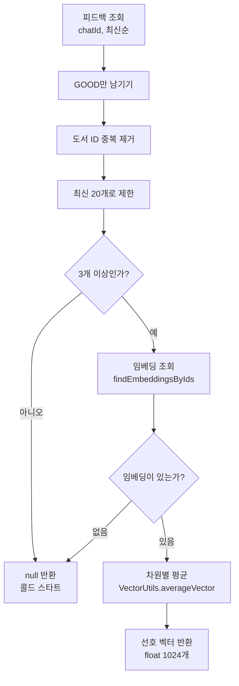
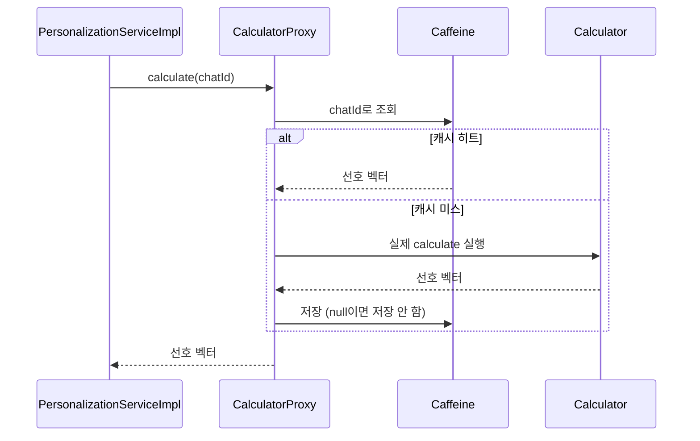
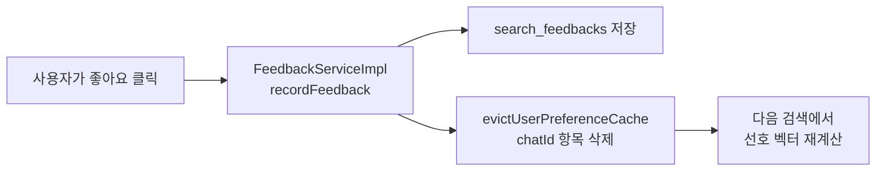

# 02. 사용자 선호 벡터 계산하기

> 사용자의 GOOD 피드백으로 선호 벡터를 계산하는 `UserPreferenceVectorCalculator`를 만들고, Caffeine 캐시를 붙입니다. `@Cacheable`이 왜 별도 빈에 있어야 하는지(self-invocation)와, 새 피드백이 들어오면 캐시를 어떻게 비우는지도 함께 구현합니다.
>
> 예상 소요 시간: 2시간 · 난이도: 기본

## 학습 목표

- 피드백 목록에서 선호 벡터 계산에 쓸 도서 ID를 고르는 규칙(GOOD, 중복 제거, 최신 20개, 최소 3개)을 설명할 수 있다.
- `UserPreferenceVectorCalculator`로 선호 벡터를 계산하고 `@Cacheable`로 캐싱할 수 있다.
- 같은 클래스 안에서 호출하면 `@Cacheable`이 동작하지 않는 이유(self-invocation)를 설명할 수 있다.
- 피드백 저장 시 캐시를 무효화해 새 피드백이 다음 검색에 반영되게 할 수 있다.

## 시작하기 전에

- [01. 취향을 벡터로 표현하기](01.vector-embedding-basics.md)에서 평균 벡터와 코사인 유사도를 이해했어야 합니다.
- Step 5의 `SearchFeedback` 엔티티, `SearchFeedbackRepository`, `FeedbackServiceImpl`이 있어야 합니다([Step 5. 피드백 엔티티와 저장소](../step-5/03.feedback-entity-repository.md)).
- Spring의 `@Cacheable`을 처음 본다면 [Step 4. 시맨틱 캐싱](../step-4/03.semantic-caching.md)의 캐시 설명을 먼저 읽어도 좋습니다.
- 모르는 용어는 [용어집](../glossary.md)을 참고합니다.

## 1. 왜 필요한가

01 문서의 SQL 실험으로 "GOOD 도서 임베딩의 평균"이 취향을 잘 나타낸다는 것을 확인했습니다. 이것을 그대로 애플리케이션에 옮기려면 몇 가지 질문에 답해야 합니다.

- **오래된 피드백도 똑같이 쓸까?** 1년 전에 좋아한 책보다 어제 좋아한 책이 지금 취향에 가깝습니다.
- **피드백이 1개뿐이면?** 한 권만으로 취향을 판단하면 우연에 크게 흔들립니다.
- **검색할 때마다 계산할까?** 선호 벡터를 만들려면 피드백 조회, 임베딩 조회(최대 20 × 1024개 숫자), 평균 계산이 필요합니다. 검색마다 반복하면 낭비입니다.
- **캐싱했다면, 새 피드백은 언제 반영될까?** 캐시에 하루 동안 옛 벡터가 남아 있으면 방금 누른 👍가 무시됩니다.

이 문서는 이 네 가지 질문에 대한 답을 코드로 구현합니다.

## 2. 핵심 개념

### 2.1 선호 벡터 계산 규칙

`UserPreferenceVectorCalculator.calculate(chatId)`는 다음 순서로 동작합니다.



| 규칙 | 설정 키 | 기본값 | 이유 |
|------|---------|--------|------|
| GOOD만 사용 | - | - | 좋아한 도서만 취향의 근거로 삼음 |
| 중복 제거 | - | - | 같은 책에 GOOD을 여러 번 눌러도 한 번만 반영 |
| 최신 N개 | `app.personalization.max-feedback-count` | 20 | 최근 취향을 우선하고 계산량을 제한 |
| 최소 N개 | `app.personalization.min-feedback-count` | 3 | 1~2권은 우연일 수 있음 |

피드백이 부족해 개인화를 할 수 없는 상태를 **콜드 스타트(Cold Start)**라고 합니다. 이때 `null`을 반환하면, 03 문서의 재정렬 코드가 "개인화 없이 원래 결과를 그대로 돌려준다"로 처리합니다. 콜드 스타트는 04 문서에서 자세히 다룹니다.

### 2.2 @Cacheable과 프록시, 그리고 self-invocation

Spring의 `@Cacheable`은 메서드 결과를 캐시에 저장해 두고, 같은 인자로 다시 호출되면 메서드를 실행하지 않고 캐시 값을 돌려줍니다. 이 일은 메서드 자체가 아니라 Spring이 빈 앞에 세워 둔 **프록시(Proxy)**, 즉 대리 객체가 합니다.



문제는 **같은 클래스 안에서 자기 메서드를 호출할 때**입니다. `this.calculate()`는 프록시가 아닌 원본 객체를 직접 부르므로 캐시가 끼어들 틈이 없습니다. 이를 **self-invocation(자기 호출)**이라고 합니다.

```java
// 동작하지 않는 예: 같은 클래스 안의 호출
@Service
public class PersonalizationServiceImpl {

    @Cacheable("userPreferenceVectors")
    public float[] calculateUserPreferenceVector(Long chatId) { ... }

    public List<BookSearchResponse> personalizedSearch(List<BookSearchResponse> results, Long chatId) {
        float[] v = calculateUserPreferenceVector(chatId);  // this.호출 → 프록시를 거치지 않음 → 매번 계산
        ...
    }
}
```

03 문서에서 만들 `personalizedSearch()`는 내부에서 선호 벡터를 꺼내야 합니다. 그래서 이 프로젝트는 캐시 대상 메서드를 **별도 빈 `UserPreferenceVectorCalculator`**로 옮겼습니다. 다른 빈을 주입받아 호출하면 항상 프록시를 거치므로 캐시가 동작합니다. 같은 이유로 `@Transactional`, `@Async`가 필요한 메서드도 별도 빈으로 분리합니다.

### 2.3 캐시 무효화: 새 피드백이 들어오면 지운다

선호 벡터는 24시간 동안 캐시에 머뭅니다. 그사이 사용자가 새로 👍를 누르면, 캐시를 그대로 두는 한 그 피드백은 다음 날까지 반영되지 않습니다. 그래서 **피드백을 저장할 때 해당 사용자의 캐시 항목만 지웁니다.** 다음 검색에서 캐시 미스가 나고, 새 피드백을 포함해 다시 계산됩니다.



## 3. 따라 하기

### STEP 1. 임베딩 일괄 조회 쿼리

목표: 도서 ID 목록으로 임베딩을 한 번에 가져오는 메서드를 `BookRepository`에 추가합니다.

```java
@Query("SELECT b.embedding FROM Book b WHERE b.id IN :bookIds AND b.embedding IS NOT NULL")
List<float[]> findEmbeddingsByIds(@Param("bookIds") List<Long> bookIds);
```

전체 코드: [`src/main/java/net/java21/library/core/book/repository/BookRepository.java`](../../src/main/java/net/java21/library/core/book/repository/BookRepository.java)

코드 설명:

- 도서를 한 권씩 `findById()`로 가져오면 20권에 쿼리 20번이 나갑니다. `IN` 절로 한 번에 가져옵니다.
- 임베딩이 아직 생성되지 않은(`NULL`) 도서는 제외합니다. 그래서 결과 개수가 입력 ID 개수보다 적을 수 있습니다.
- 반환 순서는 입력 ID 순서와 같다는 보장이 없습니다. 평균 계산은 순서와 무관하므로 여기서는 문제가 없지만, 03 문서에서는 이 점 때문에 다른 쿼리를 씁니다.

### STEP 2. UserPreferenceVectorCalculator

목표: 2.1의 규칙대로 선호 벡터를 계산하고, 결과를 캐싱하는 컴포넌트를 만듭니다.

```java
@Slf4j
@Component
@RequiredArgsConstructor
public class UserPreferenceVectorCalculator {

    @Value("${app.personalization.min-feedback-count:3}")
    private int minFeedbackCount;

    @Value("${app.personalization.max-feedback-count:20}")
    private int maxFeedbackCount;

    private final BookRepository bookRepository;
    private final SearchFeedbackRepository feedbackRepository;

    @Cacheable(
        value = "userPreferenceVectors",
        key = "#chatId",
        unless = "#result == null",
        cacheManager = "personalizationCacheManager"
    )
    public float[] calculate(Long chatId) {
        log.info("[PERSONALIZATION] Calculating preference vector for chatId: {}", chatId);

        // 1. GOOD 피드백만 추출 (최신순)
        List<Long> likedBookIds = getLikedBookIds(chatId);

        // 2. 콜드 스타트 체크
        if (likedBookIds.size() < minFeedbackCount) {
            log.info("[PERSONALIZATION] Cold start for chatId: {} (feedback count: {})",
                chatId, likedBookIds.size());
            return null;
        }

        // 3. 임베딩 조회
        List<float[]> embeddings = bookRepository.findEmbeddingsByIds(likedBookIds);
        if (embeddings.isEmpty()) {
            log.warn("[PERSONALIZATION] No embeddings found for chatId: {}", chatId);
            return null;
        }

        // 4. 평균 벡터 계산
        float[] preferenceVector = VectorUtils.averageVector(embeddings.toArray(new float[0][]));
        log.info("[PERSONALIZATION] Preference vector calculated for chatId: {} (based on {} books)",
            chatId, embeddings.size());
        return preferenceVector;
    }

    @CacheEvict(
        value = "userPreferenceVectors",
        key = "#chatId",
        cacheManager = "personalizationCacheManager"
    )
    public void evict(Long chatId) {
        log.info("[PERSONALIZATION] Cache evicted for chatId: {}", chatId);
    }

    private List<Long> getLikedBookIds(Long chatId) {
        return feedbackRepository.findByChatIdOrderByCreatedAtDesc(chatId).stream()
            .filter(feedback -> feedback.getType() == FeedbackType.GOOD)
            .map(SearchFeedback::getBookId)
            .distinct()               // 중복 제거
            .limit(maxFeedbackCount)  // 최신 20개
            .collect(Collectors.toList());
    }
}
```

전체 코드: [`src/main/java/net/java21/library/core/book/service/personalization/impl/UserPreferenceVectorCalculator.java`](../../src/main/java/net/java21/library/core/book/service/personalization/impl/UserPreferenceVectorCalculator.java) (원본에는 임베딩이 없는 도서 수를 남기는 디버그 로그가 더 있습니다.)

코드 설명:

- `getLikedBookIds()`: Step 5에서 만든 `findByChatIdOrderByCreatedAtDesc()`가 이미 최신순으로 정렬해 주므로, 스트림에서 `distinct()` 다음 `limit()`을 걸면 "가장 최근에 좋아한 서로 다른 도서 20권"이 됩니다. `filter → distinct → limit` 순서가 중요합니다. `limit`을 먼저 하면 BAD나 중복이 20개 안에 섞여 실제 사용 도서가 줄어듭니다.
- `@Cacheable` 속성
  - `value = "userPreferenceVectors"`: 캐시 이름
  - `key = "#chatId"`: 사용자별로 하나씩 저장
  - `unless = "#result == null"`: 콜드 스타트 결과(`null`)는 저장하지 않습니다. 저장해 두면 사용자가 피드백을 3개 채운 뒤에도 하루 동안 개인화가 켜지지 않을 수 있습니다.
  - `cacheManager = "personalizationCacheManager"`: 개인화 전용 캐시 매니저(STEP 4)를 지정합니다.
- `evict()`: 본문은 로그뿐이고, 실제 삭제는 `@CacheEvict` 프록시가 합니다. 이 메서드도 별도 빈에 있어야 프록시를 거칩니다.

### STEP 3. PersonalizationService는 위임만

목표: 외부(검색 서비스, 피드백 서비스)가 쓰는 인터페이스를 만들고, 구현체는 계산기에 위임하게 합니다.

```java
public interface PersonalizationService {

    float[] calculateUserPreferenceVector(Long chatId);

    List<BookSearchResponse> personalizedSearch(List<BookSearchResponse> results, Long chatId);

    void evictUserPreferenceCache(Long chatId);
}
```

```java
@Slf4j
@Service
@RequiredArgsConstructor
public class PersonalizationServiceImpl implements PersonalizationService {

    private final BookRepository bookRepository;
    private final UserPreferenceVectorCalculator userPreferenceVectorCalculator;

    @Override
    public float[] calculateUserPreferenceVector(Long chatId) {
        // 캐시가 적용되도록 별도 빈(프록시)을 통해 호출
        return userPreferenceVectorCalculator.calculate(chatId);
    }

    @Override
    public void evictUserPreferenceCache(Long chatId) {
        userPreferenceVectorCalculator.evict(chatId);
    }

    // personalizedSearch()는 03 문서에서 구현합니다.
}
```

전체 코드: [`PersonalizationService.java`](../../src/main/java/net/java21/library/core/book/service/personalization/PersonalizationService.java), [`PersonalizationServiceImpl.java`](../../src/main/java/net/java21/library/core/book/service/personalization/impl/PersonalizationServiceImpl.java)

코드 설명: 서비스의 핵심 일은 03 문서의 재정렬(`personalizedSearch()`)입니다. 선호 벡터 계산과 캐시 무효화는 계산기에 넘기므로, 이 클래스에는 캐시 애노테이션이 하나도 없습니다.

### STEP 4. Caffeine 캐시 설정

목표: 선호 벡터 전용 캐시 매니저를 등록합니다.

**Caffeine**은 JVM 메모리 안에 데이터를 저장하는 캐시 라이브러리입니다. 별도 서버(Redis 등)가 필요 없고, 만료 시간(TTL)과 최대 개수를 지정할 수 있습니다.

```properties
# application.properties
cache.personalization.ttl.hours=24
cache.personalization.max-size=1000

app.personalization.min-feedback-count=3
app.personalization.max-feedback-count=20
```

```java
@Bean("personalizationCacheManager")
public CacheManager personalizationCacheManager() {
    CaffeineCacheManager cacheManager = new CaffeineCacheManager("userPreferenceVectors");
    cacheManager.setCaffeine(Caffeine.newBuilder()
        .expireAfterWrite(personalizationTtlHours, TimeUnit.HOURS)  // 24시간 후 만료
        .maximumSize(personalizationMaxSize)                       // 최대 1,000명
        .recordStats());                                           // 적중률 통계 수집
    return cacheManager;
}
```

전체 코드: [`src/main/java/net/java21/library/core/config/CacheConfig.java`](../../src/main/java/net/java21/library/core/config/CacheConfig.java)

코드 설명:

- `CacheConfig`에는 도서 검색·외부 API용 `@Primary` 캐시 매니저(TTL 30~60분)가 따로 있습니다. 선호 벡터는 성격이 달라(하루 단위로 유지, 사용자 수만큼 저장) 별도 매니저를 둡니다. 그래서 `@Cacheable`에 `cacheManager` 속성을 반드시 적습니다.
- 선호 벡터 하나는 `float` 1024개, 약 4KB입니다. 1,000명이면 약 4MB로 메모리 부담이 작습니다. 1,000명을 넘으면 Caffeine이 덜 쓰인 항목부터 내보냅니다.

### STEP 5. 피드백 저장 시 캐시 무효화

목표: Step 5의 `FeedbackServiceImpl.recordFeedback()`에 캐시 무효화를 한 줄 추가합니다.

```java
@Override
@Transactional
public SearchFeedback recordFeedback(Long chatId, FeedbackRequest request) {
    SearchFeedback feedback = SearchFeedback.of(chatId, request.query(), request.bookId(), request.type());
    SearchFeedback saved = searchFeedbackRepository.save(feedback);

    // 새 피드백이 다음 검색의 선호도 벡터에 반영되도록 캐시 무효화
    personalizationService.evictUserPreferenceCache(chatId);

    return saved;
}
```

전체 코드: [`src/main/java/net/java21/library/external/telegram/service/FeedbackServiceImpl.java`](../../src/main/java/net/java21/library/external/telegram/service/FeedbackServiceImpl.java)

코드 설명: GOOD이든 BAD든 피드백이 저장되면 무효화합니다. BAD는 계산에 쓰이지 않지만, 규칙을 단순하게 유지하고 나중에 BAD를 활용하게 바꿔도 코드를 고치지 않아도 되도록 구분하지 않습니다.

### STEP 6. 테스트로 확인하기

목표: 계산 규칙과 캐시 동작을 각각 테스트로 확인합니다.

**계산 규칙(단위 테스트).** Mockito로 저장소를 대체하면 DB 없이 규칙을 검증할 수 있습니다. `@Value` 필드는 Mockito가 채우지 않으므로 직접 설정합니다.

```java
@ExtendWith(MockitoExtension.class)
@DisplayName("UserPreferenceVectorCalculator 단위 테스트")
class UserPreferenceVectorCalculatorTest {

    @Mock private BookRepository bookRepository;
    @Mock private SearchFeedbackRepository feedbackRepository;
    @InjectMocks private UserPreferenceVectorCalculator calculator;

    private static final Long CHAT_ID = 12345L;

    @BeforeEach
    void setUp() {
        ReflectionTestUtils.setField(calculator, "minFeedbackCount", 3);
        ReflectionTestUtils.setField(calculator, "maxFeedbackCount", 20);
    }

    @Test
    @DisplayName("GOOD 피드백이 3개 이상이면 선호도 벡터를 계산해야 한다")
    void calculateUserPreferenceVector_ThreeGoodFeedbacks_ReturnsVector() {
        when(feedbackRepository.findByChatIdOrderByCreatedAtDesc(CHAT_ID)).thenReturn(List.of(
            SearchFeedback.of(CHAT_ID, "q", 101L, FeedbackType.GOOD),
            SearchFeedback.of(CHAT_ID, "q", 102L, FeedbackType.GOOD),
            SearchFeedback.of(CHAT_ID, "q", 103L, FeedbackType.GOOD)));
        when(bookRepository.findEmbeddingsByIds(anyList())).thenReturn(List.of(
            new float[]{1f, 2f, 3f}, new float[]{3f, 4f, 5f}, new float[]{5f, 6f, 7f}));

        assertThat(calculator.calculate(CHAT_ID)).isEqualTo(new float[]{3f, 4f, 5f});  // 차원별 평균
    }
}
```

전체 코드: [`src/test/java/net/java21/library/core/book/service/personalization/impl/UserPreferenceVectorCalculatorTest.java`](../../src/test/java/net/java21/library/core/book/service/personalization/impl/UserPreferenceVectorCalculatorTest.java) (피드백 0개·2개, BAD 필터링, 최대 20개 제한 테스트 포함)

**캐시 동작(최소 스프링 컨텍스트).** 단위 테스트에는 프록시가 없으므로 캐시를 검증할 수 없습니다. `PersonalizationCacheTest`는 DB 없이 `@EnableCaching`과 두 빈만 띄워 "두 번 검색해도 피드백 조회는 1번, evict 후에는 다시 조회"를 확인합니다.

```java
personalizationService.personalizedSearch(List.of(), CHAT_ID);
personalizationService.personalizedSearch(List.of(), CHAT_ID);
verify(feedbackRepository, times(1)).findByChatIdOrderByCreatedAtDesc(CHAT_ID);  // 두 번째는 캐시 히트

personalizationService.evictUserPreferenceCache(CHAT_ID);
personalizationService.personalizedSearch(List.of(), CHAT_ID);
verify(feedbackRepository, times(2)).findByChatIdOrderByCreatedAtDesc(CHAT_ID);  // 무효화 후 재계산
```

전체 코드: [`src/test/java/net/java21/library/core/book/service/personalization/impl/PersonalizationCacheTest.java`](../../src/test/java/net/java21/library/core/book/service/personalization/impl/PersonalizationCacheTest.java)

실행:

```bash
mvn test -Dtest='UserPreferenceVectorCalculatorTest,PersonalizationCacheTest'
```

예상 결과: 두 테스트 클래스가 모두 통과합니다(`Tests run: ..., Failures: 0, Errors: 0`).

## 4. 직접 해 보기

### 미션 1 (기본): 로그로 캐시 히트 확인하기

애플리케이션을 실행하고 Telegram Bot에서 GOOD 피드백을 3개 이상 남긴 뒤, 같은 검색을 두 번 합니다. 로그에서 `Calculating preference vector`가 몇 번 찍히는지 확인합니다. 이어서 피드백을 하나 더 남기고 다시 검색했을 때 로그가 어떻게 달라지는지 확인합니다.

<details>
<summary>예상 결과</summary>

```
[PERSONALIZATION] Calculating preference vector for chatId: 12345     ← 첫 검색: 계산
[PERSONALIZATION] Preference vector calculated for chatId: 12345 (based on 3 books)
                                                                       ← 두 번째 검색: 로그 없음(캐시 히트)
[PERSONALIZATION] Cache evicted for chatId: 12345                      ← 피드백 저장
[PERSONALIZATION] Calculating preference vector for chatId: 12345     ← 다음 검색: 재계산
[PERSONALIZATION] Preference vector calculated for chatId: 12345 (based on 4 books)
```
</details>

### 미션 2 (기본): 콜드 스타트 기준 바꿔 보기

`app.personalization.min-feedback-count`를 5로 바꾸고, GOOD이 4개인 사용자가 개인화를 받지 못하는 것을 단위 테스트로 확인합니다.

힌트: `ReflectionTestUtils.setField(calculator, "minFeedbackCount", 5)`

<details>
<summary>정답</summary>

```java
@Test
@DisplayName("최소 피드백 수가 5일 때 GOOD 4개면 null을 반환한다")
void calculate_ReturnsNull_WhenBelowCustomMinimum() {
    ReflectionTestUtils.setField(calculator, "minFeedbackCount", 5);
    when(feedbackRepository.findByChatIdOrderByCreatedAtDesc(CHAT_ID)).thenReturn(List.of(
        SearchFeedback.of(CHAT_ID, "q", 1L, FeedbackType.GOOD),
        SearchFeedback.of(CHAT_ID, "q", 2L, FeedbackType.GOOD),
        SearchFeedback.of(CHAT_ID, "q", 3L, FeedbackType.GOOD),
        SearchFeedback.of(CHAT_ID, "q", 4L, FeedbackType.GOOD)));

    assertThat(calculator.calculate(CHAT_ID)).isNull();
    verifyNoInteractions(bookRepository);  // 임베딩 조회 전에 멈춤
}
```
</details>

### 미션 3 (도전): self-invocation 직접 겪어 보기

`PersonalizationCacheTest`를 복사해, 캐시 애노테이션을 `PersonalizationServiceImpl` 안의 메서드로 옮기고 `personalizedSearch()`에서 `this`로 호출하는 실험용 클래스를 만들어 봅니다. 같은 테스트가 실패하는 것을 확인합니다(실험이 끝나면 원래 코드로 되돌립니다).

<details>
<summary>예상 결과와 해설</summary>

`verify(feedbackRepository, times(1))`에서 실제 호출 횟수가 2로 나와 실패합니다. `personalizedSearch()`는 프록시를 통해 호출되었지만, 그 안의 `this.calculateUserPreferenceVector()`는 원본 객체의 메서드를 직접 부르므로 캐시 프록시가 개입하지 않습니다. 계산을 별도 빈으로 분리한 이유가 바로 이것입니다.
</details>

## 5. 자주 하는 실수

**캐시가 전혀 동작하지 않음**
- 증상: 검색할 때마다 `Calculating preference vector` 로그가 찍힘
- 원인: `@Cacheable` 메서드를 같은 클래스 안에서 호출함(self-invocation), 또는 `@EnableCaching` 누락
- 해결: 캐시 대상 메서드를 별도 빈으로 분리하고 그 빈을 주입받아 호출합니다.

**`Cannot find cache named 'userPreferenceVectors'` 예외**
- 증상: 첫 검색에서 `IllegalArgumentException`
- 원인: `@Cacheable`에 `cacheManager` 속성을 빼먹음. 기본(`@Primary`) 캐시 매니저는 미리 등록한 이름만 허용하므로 이 캐시를 찾지 못함
- 해결: `cacheManager = "personalizationCacheManager"`를 지정합니다. `@CacheEvict`도 마찬가지입니다.

**피드백을 3개 채웠는데도 개인화가 안 켜짐**
- 증상: 피드백 2개 상태에서 검색한 뒤 하나를 더 눌렀는데 계속 콜드 스타트
- 원인: `unless = "#result == null"`을 빼서 `null`이 캐싱되었고, 무효화도 빠져 있음
- 해결: `null`은 캐싱하지 않고, 피드백 저장 시 `evictUserPreferenceCache()`를 호출합니다.

**단위 테스트에서 항상 선호 벡터가 계산됨**
- 증상: 피드백 0개인데도 `averageVector()`에서 예외가 나거나 콜드 스타트가 동작하지 않음
- 원인: Mockito는 `@Value`를 주입하지 않으므로 `minFeedbackCount`가 0
- 해결: `ReflectionTestUtils.setField()`로 설정값을 직접 넣습니다.

## 6. 정리

- 선호 벡터는 "최신순 → GOOD → 중복 제거 → 최대 20개 → 3개 미만이면 `null` → 임베딩 평균" 순서로 계산합니다.
- 계산 결과는 Caffeine 전용 캐시(`personalizationCacheManager`, TTL 24시간, 최대 1,000개)에 사용자별로 저장하고, `null`은 저장하지 않습니다.
- `@Cacheable`은 프록시가 처리하므로 같은 클래스 안의 호출에는 적용되지 않습니다. 그래서 계산을 `UserPreferenceVectorCalculator`로 분리했습니다.
- 피드백을 저장할 때 해당 사용자의 캐시를 지워 새 피드백이 다음 검색에 반영되게 합니다.

- [ ] `UserPreferenceVectorCalculator`의 계산 순서를 그림 없이 말할 수 있다.
- [ ] `@Cacheable`의 `key`, `unless`, `cacheManager` 속성의 역할을 설명할 수 있다.
- [ ] self-invocation이 무엇이고 왜 별도 빈으로 분리했는지 설명할 수 있다.
- [ ] `UserPreferenceVectorCalculatorTest`, `PersonalizationCacheTest`를 실행해 통과를 확인했다.

## 확인 문제

**1. `getLikedBookIds()`에서 `.limit(20)`을 `.filter(GOOD)`보다 먼저 두면 어떤 문제가 생깁니까?**

<details>
<summary>정답</summary>

최신 피드백 20개를 먼저 자른 뒤 GOOD만 남기므로, 그 20개 안에 BAD나 중복이 섞여 있으면 실제로 쓰이는 도서가 20권보다 적어집니다. 극단적으로는 GOOD이 충분히 있는데도 3개 미만이 되어 콜드 스타트로 처리될 수 있습니다.
</details>

**2. `unless = "#result == null"`이 없으면 어떤 일이 생깁니까?**

<details>
<summary>정답</summary>

콜드 스타트 사용자의 `null` 결과가 24시간 동안 캐싱됩니다. 피드백 저장 시 무효화를 하므로 대부분은 복구되지만, 무효화가 누락되거나 실패하면 사용자가 피드백을 채운 뒤에도 하루 동안 개인화를 받지 못합니다. `null`은 "아직 계산할 수 없음"이라는 일시적 상태이므로 저장하지 않는 것이 맞습니다.
</details>

**3. 다음 코드에서 캐시가 동작하지 않는 이유는 무엇입니까?**

```java
@Service
public class A {
    @Cacheable("x") public int heavy(int n) { ... }
    public int run(int n) { return heavy(n) + 1; }
}
```

<details>
<summary>정답</summary>

`run()` 안의 `heavy(n)`은 `this.heavy(n)`이므로 Spring 프록시를 거치지 않습니다. 캐시 처리는 프록시가 하므로 이 호출에는 적용되지 않습니다(self-invocation). `heavy()`를 다른 빈으로 옮기고 주입받아 호출해야 합니다.
</details>

**4. 선호 벡터 전용 캐시 매니저를 따로 둔 이유는 무엇입니까?**

<details>
<summary>정답</summary>

선호 벡터는 하루 단위로 유지해도 되고(TTL 24시간) 사용자 수만큼 저장해야 하는 등, TTL 30~60분인 검색·외부 API 캐시와 성격이 다르기 때문입니다. 캐시 매니저마다 TTL과 최대 크기를 따로 정할 수 있습니다.
</details>

## 다음 문서

[03. 검색 결과 개인화 재정렬 →](03.personalized-ranking.md)
