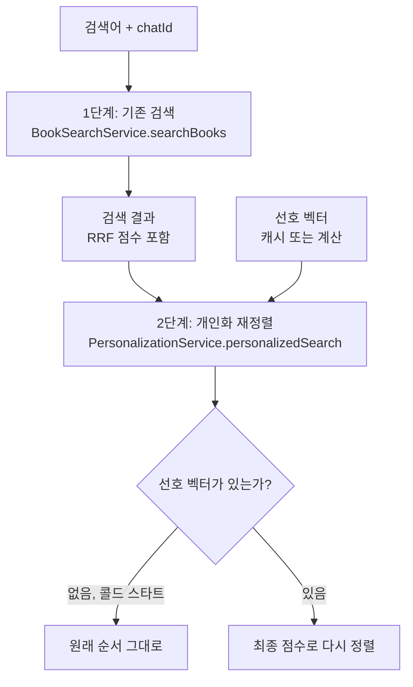

# 03. 검색 결과 개인화 재정렬

> 02 문서에서 만든 선호 벡터로 검색 결과의 순서를 사용자마다 다르게 바꿉니다. "최종 점수 = RRF 점수 + 코사인 유사도 × 0.3" 공식을 구현하고, Telegram Bot 검색에 연결합니다.
>
> 예상 소요 시간: 1.5시간 · 난이도: 기본

## 학습 목표

- 검색(후보 찾기)과 재정렬(순서 정하기)을 나누는 2단계 구조를 설명할 수 있다.
- RRF 점수와 선호 유사도를 합친 최종 점수를 계산하고, 가중치가 순위에 주는 영향을 설명할 수 있다.
- `IN` 쿼리 결과를 도서 ID 기준으로 매핑해야 하는 이유를 설명하고 구현할 수 있다.
- `personalizedSearch()`를 `BookSearchService`와 Telegram Bot에 연결할 수 있다.

## 시작하기 전에

- [02. 사용자 선호 벡터 계산하기](02.user-preference-vector.md)를 마쳐 `UserPreferenceVectorCalculator`가 동작해야 합니다.
- RRF(Reciprocal Rank Fusion)는 [Step 2. 하이브리드 검색](../step-2/05.hybrid-search.md)에서 다뤘습니다. 이 프로젝트는 `k = 60`을 씁니다.
- 모르는 용어는 [용어집](../glossary.md)을 참고합니다.

## 1. 왜 필요한가

선호 벡터가 생겼지만 아직 아무 데도 쓰이지 않습니다. 이제 이 벡터로 검색 결과를 바꿔야 합니다. 두 가지 방법을 생각할 수 있습니다.

1. **선호 벡터로 전체 도서를 검색한다.** 01 문서의 SQL 실험처럼 하면 취향에는 맞지만, 사용자가 "파이썬"을 검색했는데 평소 좋아하던 "스프링" 책이 나올 수 있습니다. 검색어를 무시하게 됩니다.
2. **검색은 그대로 하고, 나온 결과의 순서만 바꾼다.** 검색어와 관련된 후보는 기존 검색(하이브리드 + RRF)이 고르고, 그 후보들 안에서 취향에 맞는 책을 위로 올립니다.

이 프로젝트는 2번을 택했습니다. 이렇게 검색 결과를 받아 순서를 다시 매기는 것을 **재정렬(Reranking)**이라고 합니다.

```
같은 검색어 "자바", 같은 후보 5권

[개인화 전]              [웹 개발을 좋아하는 사용자]   [알고리즘을 좋아하는 사용자]
1. Effective Java        1. 스프링 부트 입문            1. 자바 알고리즘 문제 풀이
2. 스프링 부트 입문      2. Effective Java              2. 자바 성능 튜닝
3. 자바 성능 튜닝        3. 자바의 정석                 3. Effective Java
...                      ...                            ...
```

## 2. 핵심 개념

### 2.1 2단계 구조: 후보는 검색이, 순서는 취향이



재정렬은 **이미 받은 결과 안에서만** 순서를 바꿉니다. 새 도서를 끌어오거나 결과를 빼지 않습니다. Telegram Bot은 한 번에 5권(`PageRequest.of(0, 5)`)을 받으므로, 실제로는 그 5권의 순서가 사용자마다 달라집니다.

### 2.2 점수 공식

```
최종 점수 = RRF 점수 + (코사인 유사도 × 가중치)
가중치(app.personalization.weight) 기본값 = 0.3
```

- **RRF 점수**: 검색어와 얼마나 관련 있는지. 키워드 검색과 벡터 검색의 순위를 합친 값입니다.
- **코사인 유사도**: 이 도서가 사용자 선호 벡터와 얼마나 비슷한지(-1 ~ 1).
- **가중치**: 취향을 얼마나 반영할지 정하는 값입니다.

예시로 계산해 봅니다. RRF는 `1 / (60 + 순위)`를 두 검색 결과에 대해 더하므로, 두 검색 모두 1위일 때 최댓값이 `2/61 ≈ 0.033`입니다.

| 도서 | RRF 점수 | 선호 유사도 | 유사도 × 0.3 | 최종 점수 | 순위 변화 |
|------|----------|-------------|--------------|-----------|-----------|
| Effective Java | 0.0325 | 0.55 | 0.165 | 0.1975 | 1위 → 4위 |
| 스프링 부트 입문 | 0.0310 | 0.82 | 0.246 | 0.2770 | 2위 → 1위 |
| 자바 성능 튜닝 | 0.0300 | 0.60 | 0.180 | 0.2100 | 3위 → 2위 |
| 자바의 정석 | 0.0290 | 0.58 | 0.174 | 0.2030 | 4위 → 3위 |

### 2.3 가중치 0.3을 어떻게 읽을까

표를 보면 RRF 점수끼리의 차이는 0.001~0.004 정도입니다. 반면 유사도 항은 0.17~0.25로 훨씬 큽니다. 즉 **두 점수의 크기(스케일)가 달라서, 같은 후보 안에서의 순서는 사실상 선호 유사도가 정합니다.** 유사도가 0.01만 달라도 `0.01 × 0.3 = 0.003`으로, RRF 순위 몇 칸 차이를 뒤집습니다.

그래서 이 프로젝트의 구조는 이렇게 이해하는 것이 정확합니다.

- **검색어와의 관련성**은 1단계 검색이 "어떤 책이 후보에 들어오는가"로 보장합니다.
- **후보 안에서의 순서**는 대부분 취향이 정합니다.
- 가중치 0.3은 "30%만 반영"이라는 뜻이 아닙니다. 검색어 관련성을 순서에도 더 남기고 싶다면 가중치를 0.01~0.05 수준으로 낮추거나, 두 점수를 같은 범위로 정규화한 뒤 합쳐야 합니다(4장 도전 미션).

| 가중치 | 같은 후보 안에서의 순서 |
|--------|------------------------|
| 0.0 | 개인화 없음, 기존 RRF 순서 |
| 0.01 ~ 0.05 | RRF 순서와 취향이 비슷한 비중으로 경쟁 |
| 0.3 (기본값) | 거의 취향 순서 |

### 2.4 IN 쿼리 결과는 ID로 매핑한다

재정렬하려면 검색 결과 각 도서의 임베딩이 필요합니다. 한 권씩 조회하면 N번 쿼리가 나가므로(N+1 문제), `IN` 절로 한 번에 가져옵니다. 이때 두 가지를 조심해야 합니다.

- **순서 보장 없음**: `WHERE id IN (5, 2, 9)`의 결과가 5, 2, 9 순서로 온다는 보장이 없습니다.
- **개수 불일치**: 임베딩이 없는 도서는 `IS NOT NULL` 조건으로 빠집니다.

그래서 임베딩만 받아 리스트 인덱스로 짝지으면, 엉뚱한 도서에 엉뚱한 임베딩이 붙습니다. 이 프로젝트는 **(도서 ID, 임베딩) 쌍**으로 조회해 `Map<Long, float[]>`으로 바꾼 뒤 ID로 찾아 씁니다.

## 3. 따라 하기

### STEP 1. (ID, 임베딩) 쌍 조회 쿼리

목표: 재정렬용 쿼리를 `BookRepository`에 추가합니다.

```java
/**
 * 도서 ID 목록으로 (도서 ID, 임베딩 벡터) 쌍을 조회합니다.
 *
 * <p>IN 쿼리 결과는 입력 순서를 보장하지 않으므로,
 * 결과를 도서 ID 기준으로 매핑해야 할 때 사용합니다.</p>
 *
 * @return [0]: 도서 ID(Long), [1]: 임베딩 벡터(float[])
 */
@Query("SELECT b.id, b.embedding FROM Book b WHERE b.id IN :bookIds AND b.embedding IS NOT NULL")
List<Object[]> findIdAndEmbeddingsByIds(@Param("bookIds") List<Long> bookIds);
```

전체 코드: [`src/main/java/net/java21/library/core/book/repository/BookRepository.java`](../../src/main/java/net/java21/library/core/book/repository/BookRepository.java)

코드 설명: JPQL에서 두 값을 `SELECT`하면 행마다 `Object[]`가 반환됩니다. `[0]`이 ID, `[1]`이 임베딩입니다. 02 문서의 `findEmbeddingsByIds()`는 평균 계산용이라 순서가 상관없었지만, 여기서는 도서별로 짝지어야 하므로 ID가 꼭 필요합니다.

### STEP 2. personalizedSearch() 구현

목표: `PersonalizationServiceImpl`에 재정렬 메서드를 추가합니다.

```java
@Value("${app.personalization.weight:0.3}")
private double personalizationWeight;

@Override
public List<BookSearchResponse> personalizedSearch(List<BookSearchResponse> results, Long chatId) {
    // 1. 선호도 벡터 조회 (별도 빈을 거쳐야 캐시 적용)
    float[] preferenceVector = userPreferenceVectorCalculator.calculate(chatId);

    // 2. 선호도 벡터가 없으면 기존 결과 반환 (콜드 스타트)
    if (preferenceVector == null) {
        log.debug("[PERSONALIZATION] No preference vector for chatId: {}, skipping personalization", chatId);
        return results;
    }

    // 3. 검색 결과 도서들의 임베딩을 한 번에 조회해 ID 기준으로 매핑
    List<Long> bookIds = results.stream().map(BookSearchResponse::getId).collect(Collectors.toList());
    List<Object[]> rows = bookRepository.findIdAndEmbeddingsByIds(bookIds);

    Map<Long, float[]> embeddingMap = new HashMap<>();
    for (Object[] row : rows) {
        embeddingMap.put((Long) row[0], (float[]) row[1]);
    }

    // 4. 도서별 최종 점수 계산 후 내림차순 정렬
    return results.stream()
        .map(response -> {
            float[] bookEmbedding = embeddingMap.get(response.getId());
            if (bookEmbedding == null) {
                return response;  // 임베딩이 없으면 점수를 바꾸지 않음
            }
            double similarity = VectorUtils.calculateCosineSimilarity(preferenceVector, bookEmbedding);
            double rrfScore = response.getRrfScore() != null ? response.getRrfScore() : 0.0;
            double finalScore = rrfScore + (similarity * personalizationWeight);

            response.setSimilarity(similarity);  // 선호 유사도
            response.setRrfScore(finalScore);    // 최종 점수
            return response;
        })
        .sorted((a, b) -> {
            double scoreA = a.getRrfScore() != null ? a.getRrfScore() : 0.0;
            double scoreB = b.getRrfScore() != null ? b.getRrfScore() : 0.0;
            return Double.compare(scoreB, scoreA);  // 내림차순
        })
        .collect(Collectors.toList());
}
```

전체 코드: [`src/main/java/net/java21/library/core/book/service/personalization/impl/PersonalizationServiceImpl.java`](../../src/main/java/net/java21/library/core/book/service/personalization/impl/PersonalizationServiceImpl.java) (원본에는 도서별 점수를 남기는 디버그 로그가 더 있습니다.)

코드 설명:

- **선호 벡터는 계산기 빈에서 꺼냅니다.** `this.calculateUserPreferenceVector()`를 부르면 self-invocation으로 캐시가 동작하지 않습니다(02 문서 2.2).
- **콜드 스타트면 즉시 반환합니다.** 임베딩 조회 쿼리도 나가지 않습니다.
- **새 필드를 만들지 않고 기존 필드를 재사용합니다.** 개인화가 적용되면 `similarity`에는 선호 유사도가, `rrfScore`에는 최종 점수가 들어갑니다. `BookSearchResponse`에는 이를 위한 setter 두 개만 추가되어 있습니다.
- **임베딩이 없는 도서는 RRF 점수 그대로 남습니다.** 유사도 항이 더해진 다른 도서보다 점수가 훨씬 낮으므로 자연스럽게 아래로 내려갑니다.
- **가중치 `app.personalization.weight`는 `application.properties`에 적혀 있지 않습니다.** 코드의 기본값 0.3이 쓰이며, 바꾸려면 속성을 추가합니다.

### STEP 3. BookSearchService에 연결

목표: chatId를 받는 `searchBooks()` 오버로드를 추가해 "검색 → 재정렬"을 묶습니다.

```java
@Transactional(readOnly = true)
public BookSearchResult searchBooks(Pageable pageable, BookSearchRequest request, Long chatId) {
    log.info("Searching books with personalization for chatId: {}", chatId);

    // 1. 기존 검색 실행
    BookSearchResult result = searchBooks(pageable, request);

    // 2. 개인화 적용
    List<BookSearchResponse> personalizedBooks = personalizationService.personalizedSearch(
        result.getBooks().getContent(), chatId);

    // 3. 결과 재구성 (전체 개수와 AI 추천 사유는 그대로)
    return new BookSearchResult(
        new PageImpl<>(personalizedBooks, pageable, result.getBooks().getTotalElements()),
        result.getAiResponse()
    );
}
```

전체 코드: [`src/main/java/net/java21/library/core/book/service/search/BookSearchService.java`](../../src/main/java/net/java21/library/core/book/service/search/BookSearchService.java)

코드 설명: 기존 `searchBooks(pageable, request)`는 손대지 않습니다. 웹 화면처럼 chatId가 없는 곳은 기존 메서드를, Telegram Bot은 새 메서드를 씁니다. 검색 전략(Keyword/Vector/Hybrid/RAG)과 무관하게 결과 리스트만 받아 재정렬하므로, 어떤 전략에도 붙일 수 있습니다.

### STEP 4. Telegram Bot 검색에 적용

목표: Bot의 검색 처리에서 chatId를 넘기도록 바꿉니다.

```java
private void handleSearch(Update update, String keyword) {
    Long chatId = update.getMessage().getChatId();
    ...
    Pageable pageable = PageRequest.of(0, 5);
    BookSearchRequest request = new BookSearchRequest(keyword, null, SearchType.RAG, null, false);

    BookSearchResult result = bookSearchService.searchBooks(pageable, request, chatId);  // chatId 전달
    sendSearchResult(chatId, keyword, result);
}
```

전체 코드: [`src/main/java/net/java21/library/external/telegram/bot/LibraryTelegramBot.java`](../../src/main/java/net/java21/library/external/telegram/bot/LibraryTelegramBot.java)

도서별 메시지(`sendBookWithScore()`)는 Step 5와 같이 `similarity`와 `rrfScore`를 출력합니다. 개인화가 적용되면 이 두 값의 의미가 바뀝니다.

```
1. 스프링 부트 입문
📖 홍길동
🎯 유사도: 82.00%      ← 개인화 적용 시: 선호 벡터와의 유사도
📊 RRF 점수: 0.28      ← 개인화 적용 시: 최종 점수
```

실행·확인 방법:

1. GOOD 피드백이 3개 이상인 계정으로 Bot에 검색어를 보냅니다.
2. 로그에 `[PERSONALIZATION] Applying personalization for chatId: ...`가 찍히는지 확인합니다.
3. 피드백이 없는 다른 계정으로 같은 검색어를 보내 순서를 비교합니다. 이 계정의 로그에는 `Cold start`가 찍히고 순서는 개인화 전과 같습니다.

> 화면에 "개인화가 적용되었습니다" 같은 안내 문구는 현재 소스에 없습니다. 필요하면 `personalizationService.calculateUserPreferenceVector(chatId) != null`로 판단해 헤더에 덧붙일 수 있습니다(캐시 덕분에 추가 비용이 거의 없습니다).

### STEP 5. 테스트로 확인하기

목표: 재정렬 로직, 특히 ID 매핑이 순서와 무관하게 동작하는지 단위 테스트로 확인합니다.

선호 벡터 계산은 02 문서에서 따로 테스트했으므로 여기서는 Mock으로 대체합니다.

```java
@Test
@DisplayName("IN 쿼리 결과 순서가 입력과 달라도 도서 ID 기준으로 임베딩을 매핑해야 한다")
void personalizedSearch_ResultOrderDiffers_MapsEmbeddingById() {
    // Given: 선호도 벡터는 x축 방향
    when(userPreferenceVectorCalculator.calculate(CHAT_ID)).thenReturn(new float[]{1.0f, 0.0f});

    BookSearchResponse book1 = createBookSearchResponse(1L, "Book 1");
    BookSearchResponse book2 = createBookSearchResponse(2L, "Book 2");
    BookSearchResponse book3 = createBookSearchResponse(3L, "Book 3");

    // DB가 입력(1, 2, 3)과 다른 순서(3, 1)로 반환하고, 2번은 임베딩 없음
    when(bookRepository.findIdAndEmbeddingsByIds(anyList())).thenReturn(List.of(
        new Object[]{3L, new float[]{1.0f, 0.0f}},  // 선호도와 동일 방향
        new Object[]{1L, new float[]{0.0f, 1.0f}}   // 직교
    ));

    // When
    List<BookSearchResponse> personalized =
        personalizationService.personalizedSearch(List.of(book1, book2, book3), CHAT_ID);

    // Then
    assertThat(book3.getSimilarity()).isEqualTo(1.0, Offset.offset(1e-6));
    assertThat(book1.getSimilarity()).isEqualTo(0.0, Offset.offset(1e-6));
    assertThat(personalized.get(0).getId()).isEqualTo(3L);
    verify(bookRepository).findIdAndEmbeddingsByIds(List.of(1L, 2L, 3L));  // 쿼리는 한 번
}
```

전체 코드: [`src/test/java/net/java21/library/core/book/service/personalization/impl/PersonalizationServiceImplTest.java`](../../src/test/java/net/java21/library/core/book/service/personalization/impl/PersonalizationServiceImplTest.java) (`@BeforeEach`에서 가중치 0.3을 설정합니다. 콜드 스타트 시 원래 결과 반환, 계산·무효화 위임 테스트도 들어 있습니다.)

```bash
mvn test -Dtest='PersonalizationServiceImplTest'
```

## 4. 직접 해 보기

### 미션 1 (기본): 손으로 재정렬하기

가중치 0.3일 때 다음 세 도서의 최종 순위를 구합니다. 이어서 가중치를 0.02로 바꾸면 순위가 어떻게 되는지도 구합니다.

| 도서 | RRF 점수 | 선호 유사도 |
|------|----------|-------------|
| A | 0.0328 | 0.40 |
| B | 0.0250 | 0.70 |
| C | 0.0300 | 0.65 |

<details>
<summary>정답</summary>

가중치 0.3: A = 0.0328 + 0.120 = 0.1528, B = 0.0250 + 0.210 = 0.2350, C = 0.0300 + 0.195 = 0.2250 → **B, C, A**

가중치 0.02: A = 0.0328 + 0.0080 = 0.0408, B = 0.0250 + 0.0140 = 0.0390, C = 0.0300 + 0.0130 = 0.0430 → **C, A, B**

가중치가 작아지면 검색어 관련성(RRF)이 순서에 다시 영향을 줍니다. 0.3에서는 순서가 유사도 순서와 똑같습니다.
</details>

### 미션 2 (기본): 가중치를 설정으로 바꾸기

`application.properties`에 `app.personalization.weight=0.05`를 추가하고, 같은 계정·같은 검색어로 결과 순서가 어떻게 달라지는지 확인합니다. 로그 레벨을 DEBUG로 올리면 도서별 `Similarity`, `Final Score`를 볼 수 있습니다.

힌트: `logging.level.net.java21.library.core.book.service.personalization=DEBUG`

### 미션 3 (도전): 점수 정규화

두 점수의 스케일 차이를 없애기 위해, 후보 안에서 RRF 점수를 최소-최대 정규화(`(x - min) / (max - min)`)해 0~1로 바꾼 뒤 `최종 = (1 - α) × 정규화 RRF + α × 유사도`로 합치는 방식을 설계합니다. 기존 코드를 수정하지 말고, 같은 입력·출력을 갖는 메서드를 테스트 코드 안에 만들어 미션 1의 데이터로 결과를 비교합니다.

<details>
<summary>풀이 예시</summary>

```java
static List<Long> rerankNormalized(List<double[]> rows, double alpha) {
    // rows: {id, rrf, similarity}
    double min = rows.stream().mapToDouble(r -> r[1]).min().orElse(0);
    double max = rows.stream().mapToDouble(r -> r[1]).max().orElse(0);
    double range = max - min == 0 ? 1 : max - min;

    return rows.stream()
        .sorted(Comparator.comparingDouble(
            (double[] r) -> (1 - alpha) * ((r[1] - min) / range) + alpha * r[2]).reversed())
        .map(r -> (long) r[0])
        .toList();
}
```

미션 1 데이터에서 α = 0.3이면 A = 0.7×1.0 + 0.3×0.40 = 0.82, B = 0.7×0.0 + 0.3×0.70 = 0.21, C = 0.7×0.641 + 0.3×0.65 ≈ 0.644로 **A, C, B**가 됩니다. 이제 α가 "취향 반영 비율"이라는 직관과 맞습니다. 대신 후보가 1권뿐이거나 RRF 점수가 모두 같으면 정규화 값이 의미가 없어지는 점을 처리해야 합니다.
</details>

## 5. 자주 하는 실수

**엉뚱한 도서가 위로 올라옴**
- 증상: 취향과 무관한 도서가 1위가 되고, 테스트에서도 순서가 가끔 틀림
- 원인: `findEmbeddingsByIds()`(임베딩만)로 조회해 리스트 인덱스로 짝지음. `IN` 결과 순서와 개수가 입력과 다를 수 있음
- 해결: `findIdAndEmbeddingsByIds()`로 (ID, 임베딩)을 받아 `Map`으로 매핑합니다.

**개인화가 매번 느림**
- 증상: 검색마다 피드백 조회 쿼리가 나감
- 원인: `personalizedSearch()` 안에서 `this.calculateUserPreferenceVector()`를 호출함
- 해결: 주입받은 `UserPreferenceVectorCalculator`를 통해 호출합니다.

**가중치를 0.5로 올렸는데 체감 변화가 없음**
- 증상: 0.3과 0.5의 결과 순서가 같음
- 원인: 0.3에서 이미 순서가 유사도로 결정되어 있음(2.3)
- 해결: 순서 변화를 보려면 가중치를 오히려 0.01~0.05 범위에서 조정하거나 정규화를 적용합니다.

**같은 검색을 반복할수록 점수가 커짐**
- 증상: 같은 검색어로 다시 검색하면 `📊 RRF 점수` 값이 계속 늘어남
- 원인: `personalizedSearch()`는 응답 객체의 `rrfScore`를 직접 덮어씁니다. RAG 검색 결과가 인메모리 시맨틱 캐시에서 나온 경우 캐시 안의 같은 객체가 수정되어, 다음 검색에서 이미 더해진 점수에 또 더해질 수 있습니다.
- 해결: 현재 소스의 한계로 알아 두고, 직접 고친다면 응답 객체를 복사한 뒤 점수를 설정하거나 최종 점수를 별도 값으로 계산해 정렬에만 씁니다.

## 6. 정리

- 검색은 후보를 고르고, 개인화는 그 후보 안의 순서를 바꿉니다. 콜드 스타트면 원래 순서를 그대로 돌려줍니다.
- 최종 점수는 `RRF 점수 + 선호 유사도 × 0.3`이며, 스케일 차이 때문에 후보 안의 순서는 사실상 선호 유사도가 정합니다.
- 검색 결과 임베딩은 `findIdAndEmbeddingsByIds()`로 한 번에 가져와 ID로 매핑합니다.
- 개인화 결과는 `similarity`(선호 유사도), `rrfScore`(최종 점수) 필드에 담겨 Telegram Bot에 그대로 표시됩니다.

- [ ] 2단계(검색 → 재정렬) 구조를 그림으로 그릴 수 있다.
- [ ] 주어진 RRF 점수와 유사도로 최종 순위를 계산할 수 있다.
- [ ] `IN` 쿼리 결과를 ID로 매핑해야 하는 두 가지 이유를 말할 수 있다.
- [ ] Bot에서 피드백이 있는 계정과 없는 계정의 결과 순서를 비교해 보았다.

## 확인 문제

**1. 선호 벡터로 전체 도서를 검색하지 않고, 기존 검색 결과를 재정렬하는 이유는 무엇입니까?**

<details>
<summary>정답</summary>

검색어와의 관련성을 지키기 위해서입니다. 선호 벡터만으로 검색하면 사용자가 무엇을 검색했는지와 상관없이 평소 취향의 책이 나옵니다. 재정렬은 검색어로 고른 후보 안에서만 순서를 바꾸므로 검색 의도를 벗어나지 않습니다.
</details>

**2. `WHERE id IN (5, 2, 9) AND embedding IS NOT NULL`의 결과를 리스트 인덱스로 5, 2, 9번 도서에 차례로 붙이면 안 되는 이유 두 가지는 무엇입니까?**

<details>
<summary>정답</summary>

첫째, `IN` 결과의 반환 순서는 입력 순서와 같다는 보장이 없습니다. 둘째, 임베딩이 없는 도서는 결과에서 빠지므로 개수가 줄어 이후 인덱스가 모두 밀립니다.
</details>

**3. RRF 점수가 0.0325(1위)와 0.0290(4위)인 두 도서가 있습니다. 가중치 0.3에서 4위 도서가 1위를 앞지르려면 선호 유사도가 최소 얼마나 더 높아야 합니까?**

<details>
<summary>정답</summary>

RRF 차이 0.0035를 메우려면 `유사도 차이 × 0.3 > 0.0035`, 즉 유사도가 약 0.012(1.2%포인트)만 더 높으면 됩니다. 아주 작은 차이로도 순위가 뒤집힌다는 뜻이며, 이것이 가중치 0.3에서 순서가 사실상 취향으로 결정되는 이유입니다.
</details>

**4. 피드백이 없는 사용자가 개인화 검색을 하면 `bookRepository.findIdAndEmbeddingsByIds()`가 호출됩니까?**

<details>
<summary>정답</summary>

호출되지 않습니다. 선호 벡터가 `null`이면 `personalizedSearch()`가 임베딩 조회 전에 원래 결과를 그대로 반환합니다. 단위 테스트에서는 `verifyNoInteractions(bookRepository)`로 확인할 수 있습니다.
</details>

## 다음 문서

[04. 콜드 스타트와 최적화 →](04.cold-start-and-optimization.md)
