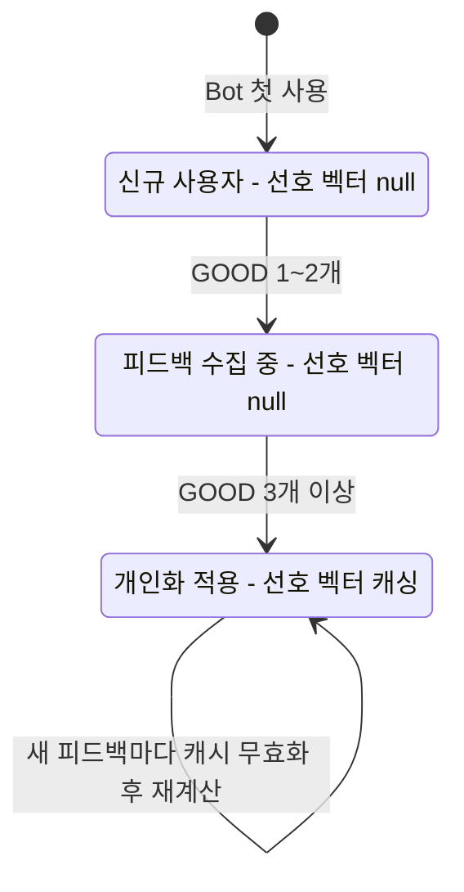
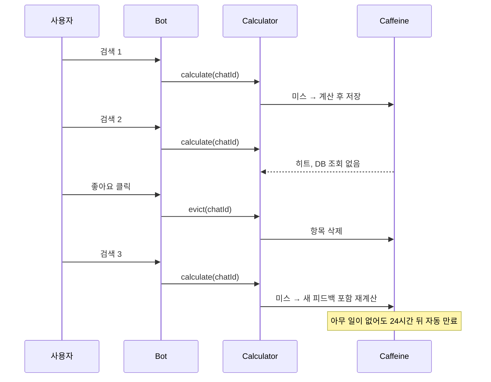
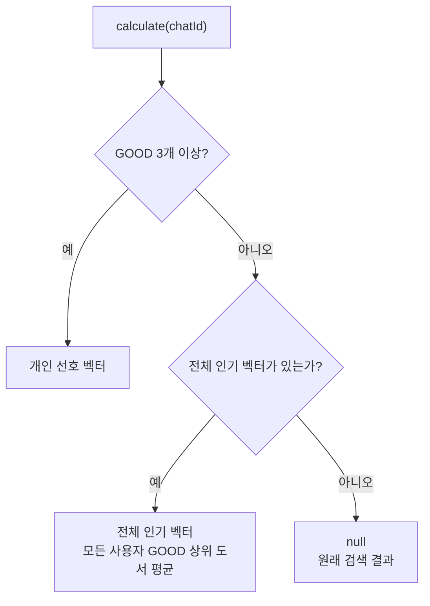

# 04. 콜드 스타트와 최적화

> 개인화를 실제 서비스에 붙이면 세 가지 현실 문제를 만납니다. 피드백이 없는 신규 사용자(콜드 스타트), 검색마다 반복되는 계산 비용, 로그인 없는 Telegram chatId의 한계입니다. 현재 구현이 각각을 어떻게 처리하는지 확인하고, 더 개선할 수 있는 방향을 살펴봅니다.
>
> 예상 소요 시간: 1.5시간 · 난이도: 기본

## 학습 목표

- 콜드 스타트가 무엇이고, 현재 구현이 어떤 기준으로 개인화를 켜고 끄는지 설명할 수 있다.
- 선호 벡터 캐시의 생성·만료·무효화 시점을 설명하고, 설정값을 조정할 수 있다.
- Caffeine 캐시 통계로 캐시가 효과가 있는지 확인할 수 있다.
- chatId 기반 익명 개인화의 한계와, 전체 인기 벡터 같은 보완책을 설명할 수 있다.

## 시작하기 전에

- [02. 사용자 선호 벡터 계산하기](02.user-preference-vector.md)의 캐시 구조(`UserPreferenceVectorCalculator`, `personalizationCacheManager`)를 이해했어야 합니다.
- [03. 검색 결과 개인화 재정렬](03.personalized-ranking.md)까지 마쳐 Bot에서 개인화가 동작해야 합니다.
- 모르는 용어는 [용어집](../glossary.md)을 참고합니다.

## 1. 왜 필요한가

03 문서까지 마치면 피드백을 충분히 남긴 사용자에게는 개인화가 잘 동작합니다. 그런데 실제로 Bot을 열어 보면 이런 상황이 생깁니다.

- 오늘 처음 Bot을 쓴 사용자는 피드백이 0개입니다. 이 사용자에게는 무엇을 보여 줘야 할까요?
- 같은 사용자가 1분 동안 검색을 10번 하면, 선호 벡터를 10번 계산해야 할까요?
- 사용자가 Bot을 삭제했다가 다시 추가하거나, 가족이 한 계정을 함께 쓰면 취향 데이터는 어떻게 될까요?

추천 시스템에서 이런 문제는 피할 수 없습니다. 중요한 것은 **문제가 생겼을 때 서비스가 나빠지지 않게** 설계하는 것입니다. 이 프로젝트의 원칙은 단순합니다. **확신이 없으면 개인화하지 않고 원래 검색 결과를 보여 줍니다.**

## 2. 핵심 개념

### 2.1 콜드 스타트: 확신이 생길 때까지 기다린다

**콜드 스타트(Cold Start)**는 데이터가 없어서 개인화를 할 수 없는 상태입니다. 자동차 엔진이 차가울 때 바로 힘을 내지 못하는 것에 빗댄 말입니다.

현재 구현에서 사용자는 GOOD 피드백 수에 따라 다음 상태를 거칩니다.



| 상태 | `calculate()` 결과 | 캐싱 | 검색 결과 |
|------|-------------------|------|-----------|
| GOOD 0~2개 | `null` | 하지 않음(`unless`) | 원래 순서 그대로 |
| GOOD 3개 이상, 임베딩 없음 | `null` | 하지 않음 | 원래 순서 그대로 |
| GOOD 3개 이상 | 평균 벡터 | 24시간 | 개인화 재정렬 |

두 가지를 짚어 둡니다.

- **콜드 스타트 사용자는 검색할 때마다 피드백을 다시 조회합니다.** `null`을 캐싱하지 않기 때문입니다. 대신 피드백이 3개가 되는 순간 바로 개인화가 켜집니다. 피드백 조회는 chatId 조건의 가벼운 쿼리이고 피드백 수가 적으므로 이 비용은 작습니다. 반대로 `null`을 캐싱하면 쿼리는 줄지만, 무효화가 누락되면 최대 24시간 동안 개인화가 켜지지 않습니다. 정확성을 택한 것입니다.
- **기준 3개는 설정값입니다.** `app.personalization.min-feedback-count`로 바꿀 수 있습니다. 낮추면 더 빨리 개인화되지만 우연에 흔들리고, 높이면 안정적이지만 개인화를 받는 사용자가 줄어듭니다.

### 2.2 캐시의 일생: 생성, 히트, 무효화, 만료

선호 벡터 캐시 항목 하나가 만들어지고 사라지는 과정입니다.



| 시점 | 무슨 일이 일어나는가 | 관련 설정 |
|------|----------------------|-----------|
| 생성 | 캐시 미스 시 계산 결과 저장 | - |
| 히트 | 같은 chatId 재검색 시 저장된 벡터 사용 | - |
| 무효화 | 피드백 저장 시 해당 chatId만 삭제 | `FeedbackServiceImpl.recordFeedback()` |
| 만료 | 저장 후 24시간이 지나면 삭제 | `cache.personalization.ttl.hours=24` |
| 축출 | 1,000명을 넘으면 덜 쓰인 항목부터 삭제 | `cache.personalization.max-size=1000` |

캐시 히트일 때 개인화 비용은 "검색 결과 5권의 임베딩 조회 1번 + 코사인 유사도 5번"뿐입니다. 캐시 미스일 때는 여기에 피드백 조회와 최대 20권의 임베딩 조회, 평균 계산이 더해집니다.

### 2.3 익명 사용자 환경의 한계

이 프로젝트에는 로그인이 없습니다. 사용자를 구분하는 값은 Telegram이 주는 **chatId** 하나입니다.

| 상황 | 결과 | 영향 |
|------|------|------|
| 휴대폰·PC에서 같은 Telegram 계정 사용 | 같은 chatId | 기기와 무관하게 취향 유지(장점) |
| 가족이 한 계정을 함께 사용 | 같은 chatId | 여러 사람의 취향이 평균으로 섞임 |
| 다른 Telegram 계정으로 접속 | 다른 chatId | 처음부터 다시 콜드 스타트 |
| 그룹 채팅에서 Bot 사용 | 그룹의 chatId | 그룹 구성원 전체의 취향이 섞임 |

또 chatId와 피드백 기록은 개인의 관심사를 드러내는 데이터입니다. 로그에 chatId를 남길 때는 필요한 만큼만 남기고, 오래된 피드백은 일정 기간이 지나면 정리하는 정책을 두는 것이 좋습니다. 현재 소스에는 자동 정리 기능이 없습니다.

## 3. 따라 하기

### STEP 1. 콜드 스타트 전환 확인하기

목표: 피드백 수에 따라 개인화가 꺼졌다 켜지는 것을 로그로 확인합니다.

1. 피드백을 남긴 적 없는 Telegram 계정으로 "자바"를 검색합니다.
2. 결과 중 두 권에 👍를 누르고 다시 검색합니다.
3. 한 권에 더 👍를 누르고(GOOD 3개) 다시 검색합니다.

예상 로그:

```
[PERSONALIZATION] Calculating preference vector for chatId: 12345
[PERSONALIZATION] Cold start for chatId: 12345 (feedback count: 0)
...
[PERSONALIZATION] Cache evicted for chatId: 12345
[PERSONALIZATION] Calculating preference vector for chatId: 12345
[PERSONALIZATION] Cold start for chatId: 12345 (feedback count: 2)
...
[PERSONALIZATION] Cache evicted for chatId: 12345
[PERSONALIZATION] Calculating preference vector for chatId: 12345
[PERSONALIZATION] Preference vector calculated for chatId: 12345 (based on 3 books)
[PERSONALIZATION] Applying personalization for chatId: 12345
```

1·2번 단계에서는 검색할 때마다 `Calculating`이 찍힙니다(`null`은 캐싱하지 않음). 3번 이후 같은 검색을 반복하면 더 이상 찍히지 않습니다(캐시 히트).

### STEP 2. 캐시 통계로 효과 확인하기

목표: Caffeine이 수집하는 통계(적중률, 항목 수)를 읽어 봅니다.

`personalizationCacheManager`는 `recordStats()`를 켜 두었으므로 네이티브 Caffeine 캐시에서 통계를 꺼낼 수 있습니다.

```java
@Qualifier("personalizationCacheManager")
private final CacheManager personalizationCacheManager;

public void logPreferenceCacheStats() {
    CaffeineCache cache = (CaffeineCache) personalizationCacheManager.getCache("userPreferenceVectors");
    com.github.benmanes.caffeine.cache.Cache<Object, Object> nativeCache = cache.getNativeCache();
    CacheStats stats = nativeCache.stats();

    log.info("[PERSONALIZATION] cache size={}, hitRate={}, hits={}, misses={}",
        nativeCache.estimatedSize(), stats.hitRate(), stats.hitCount(), stats.missCount());
}
```

> 위 코드는 확인용 예시이며 현재 소스에는 없습니다. 실습용 컨트롤러나 테스트에 잠시 넣어 실행해 봅니다. SLF4J 로그에는 `{}` 자리 표시자만 쓸 수 있으므로 소수점 형식이 필요하면 `String.format()`으로 먼저 만듭니다.

해석:

- **hitRate**가 낮다면 사용자가 검색보다 피드백을 더 자주 남겨 무효화가 잦거나, 사용자 대부분이 하루에 한 번 정도만 검색한다는 뜻입니다.
- **size**가 `max-size`(1,000)에 자주 닿는다면 활성 사용자가 많다는 뜻입니다. 선호 벡터 하나는 약 4KB(`float` 1024개)이므로 10,000으로 늘려도 약 40MB 수준입니다.

### STEP 3. 설정값 조정하기

목표: 서비스 상황에 맞게 조정할 수 있는 값과 그 영향을 정리합니다.

```properties
# 개인화 기준
app.personalization.min-feedback-count=3     # 개인화를 켜는 최소 GOOD 수
app.personalization.max-feedback-count=20    # 평균에 쓰는 최신 GOOD 수
# app.personalization.weight=0.3             # 재정렬 가중치(파일에 없으면 코드 기본값 0.3)

# 선호 벡터 캐시
cache.personalization.ttl.hours=24
cache.personalization.max-size=1000
```

| 설정 | 올리면 | 내리면 |
|------|--------|--------|
| `min-feedback-count` | 안정적이지만 개인화 대상이 줄어듦 | 빨리 개인화되지만 우연에 흔들림 |
| `max-feedback-count` | 오래된 취향까지 반영, 계산량 증가 | 최근 취향에 민감, 계산량 감소 |
| `ttl.hours` | DB 조회 감소 | 피드백이 없어도 더 자주 새로 계산 |
| `max-size` | 메모리 사용 증가, 적중률 상승 | 메모리 절약, 축출 증가 |

`ttl.hours`는 정확성에 큰 영향을 주지 않습니다. 새 피드백은 무효화로 즉시 반영되므로, TTL은 "무효화가 누락되었을 때의 안전장치"에 가깝습니다.

### STEP 4. 확장 아이디어: 콜드 스타트 사용자를 위한 보완책

목표: 현재 소스에 없는 보완책을 이해합니다. 구현은 4장의 도전 미션입니다.

현재는 콜드 스타트 사용자에게 원래 검색 결과를 보여 줍니다. 더 나아가려면 다음 방법을 생각할 수 있습니다.



| 방법 | 아이디어 | 주의할 점 |
|------|----------|-----------|
| 전체 인기 벡터 | 모든 사용자의 GOOD이 많은 도서 20권의 평균을 하루 한 번 계산해 두고 신규 사용자에게 사용 | 모두에게 같은 순서가 되므로 "개인화"는 아님. 인기 편향이 커질 수 있음 |
| 피드백 유도 | 콜드 스타트 사용자에게 "피드백 3개를 남기면 맞춤 추천이 시작됩니다" 안내 | 안내 문구가 검색 결과보다 눈에 띄지 않게 |
| 단계적 가중치 | GOOD 1~2개일 때는 작은 가중치로 약하게 개인화 | 설정과 테스트가 복잡해짐 |

> **심화: 캐시 무효화 시점.** `recordFeedback()`은 `@Transactional` 메서드이고, 캐시 무효화는 그 안에서 **커밋 전에** 실행됩니다. 무효화와 커밋 사이의 아주 짧은 순간에 같은 사용자의 검색이 들어오면, 아직 커밋되지 않은 새 피드백을 보지 못한 채 옛 벡터를 다시 캐싱할 수 있습니다. 이 경우 다음 피드백이나 TTL 만료 때까지 새 피드백이 반영되지 않습니다. 사람이 버튼을 누르고 다시 검색하는 간격을 생각하면 드문 일이지만, 엄밀하게 막으려면 `@TransactionalEventListener(phase = AFTER_COMMIT)`로 커밋 후에 무효화합니다.

## 4. 직접 해 보기

### 미션 1 (기본): 상태 추적하기

GOOD 피드백을 다음 순서로 남긴 사용자가 있습니다. 각 검색 시점에 선호 벡터가 `null`인지, 캐시 히트인지 미스인지 표로 정리합니다.

```
검색 → GOOD → 검색 → GOOD → GOOD → 검색 → 검색 → BAD → 검색
```

<details>
<summary>정답</summary>

| 시점 | GOOD 수 | 캐시 | 결과 |
|------|---------|------|------|
| 검색 1 | 0 | 미스 | null(저장 안 함) |
| 검색 2 | 1 | 미스 | null(저장 안 함) |
| 검색 3 | 3 | 미스 | 벡터 계산, 저장 |
| 검색 4 | 3 | 히트 | 저장된 벡터 |
| 검색 5 | 3 | 미스(BAD 저장 시 무효화됨) | 같은 벡터를 다시 계산, 저장 |

BAD는 계산에 쓰이지 않지만 무효화는 일어나므로, 검색 5에서 한 번 더 계산합니다.
</details>

### 미션 2 (기본): 메모리 계산

활성 사용자가 50,000명이고 모두 선호 벡터를 캐싱하려면 메모리가 얼마나 필요한지 계산하고, `max-size`를 얼마로 정할지 의견을 적습니다.

<details>
<summary>정답</summary>

`50,000 × 1024 × 4바이트 ≈ 205MB`입니다(객체 헤더 등 부가 비용은 제외). JVM 힙이 넉넉하지 않다면 전원을 캐싱하기보다 `max-size`를 5,000~10,000(20~40MB) 정도로 두고, 자주 검색하는 사용자만 캐시에 남도록 Caffeine의 축출 정책에 맡기는 것이 현실적입니다.
</details>

### 미션 3 (도전): 전체 인기 벡터 설계

STEP 4의 전체 인기 벡터를 구현한다고 할 때 필요한 것을 나열하고, 핵심 메서드를 작성합니다. 실제 `src` 코드는 수정하지 말고 별도 브랜치나 설계 메모로 진행합니다.

힌트: 인기 도서 ID를 뽑는 쿼리, 하루 한 번 실행되는 스케줄러, 결과를 보관할 곳, `calculate()`의 콜드 스타트 분기 변경이 필요합니다.

<details>
<summary>풀이 예시</summary>

```java
// SearchFeedbackRepository: GOOD이 많은 도서 ID
@Query("SELECT f.bookId FROM SearchFeedback f WHERE f.type = :type GROUP BY f.bookId ORDER BY COUNT(f) DESC")
List<Long> findMostLikedBookIds(@Param("type") FeedbackType type, Pageable pageable);
```

```java
// 별도 컴포넌트: 하루 한 번 계산해 필드에 보관
@Component
@RequiredArgsConstructor
public class GlobalPreferenceVectorHolder {

    private static final int TOP_BOOKS = 20;

    private final SearchFeedbackRepository feedbackRepository;
    private final BookRepository bookRepository;
    private volatile float[] globalVector;

    @Scheduled(cron = "0 0 3 * * *")
    public void refresh() {
        List<Long> ids = feedbackRepository.findMostLikedBookIds(FeedbackType.GOOD, PageRequest.of(0, TOP_BOOKS));
        List<float[]> embeddings = ids.isEmpty() ? List.of() : bookRepository.findEmbeddingsByIds(ids);
        globalVector = embeddings.isEmpty() ? null : VectorUtils.averageVector(embeddings.toArray(new float[0][]));
    }

    public float[] get() {
        return globalVector;
    }
}
```

`calculate()`의 콜드 스타트 분기에서 `null` 대신 `globalPreferenceVectorHolder.get()`을 반환하면 됩니다. 이때 전체 인기 벡터가 사용자 키로 24시간 캐싱되지 않도록 주의해야 합니다. 캐싱되면 사용자가 피드백 3개를 채워도 무효화 전까지 전체 벡터가 쓰입니다. 콜드 스타트 분기를 `calculate()` 밖(`personalizedSearch()`)에 두는 편이 안전합니다. `@Scheduled`를 쓰려면 `@EnableScheduling`이 필요합니다.
</details>

## 5. 자주 하는 실수

**콜드 스타트 사용자에게 오류 메시지가 나감**
- 증상: 피드백이 없는 사용자의 검색이 실패함
- 원인: 선호 벡터 `null`을 확인하지 않고 코사인 유사도를 계산하거나, 빈 목록으로 `averageVector()`를 호출함
- 해결: `null`이면 원래 결과를 반환하고, 임베딩이 비어 있으면 평균 계산 전에 `null`을 반환합니다(현재 구현).

**피드백을 남겨도 결과가 바뀌지 않음**
- 증상: 👍를 눌렀는데 다음 검색 순서가 그대로임
- 원인: `recordFeedback()`에서 캐시 무효화를 호출하지 않음, 또는 `@CacheEvict`에 `cacheManager` 속성이 빠짐
- 해결: 로그에 `Cache evicted`가 찍히는지 확인합니다. 찍히는데도 그대로라면 새 GOOD 도서에 임베딩이 없거나, 이미 20권이 넘어 평균 변화가 작은 경우입니다.

**캐시 적중률이 너무 낮다고 TTL만 늘림**
- 증상: TTL을 7일로 늘렸는데 적중률이 그대로임
- 원인: 적중률이 낮은 이유가 만료가 아니라 잦은 무효화(피드백)나 드문 재검색이기 때문
- 해결: 통계의 미스 원인을 먼저 봅니다. 무효화를 없애는 것은 새 피드백 반영을 포기하는 것이므로 신중해야 합니다.

**chatId를 사용자 ID처럼 영구 저장함**
- 증상: 다른 서비스 데이터와 chatId로 사용자를 연결하려 함
- 원인: chatId를 로그인 계정처럼 취급함
- 해결: chatId는 Telegram 대화 단위의 식별자입니다. 그룹 채팅이나 계정 공유에서는 한 사람을 뜻하지 않으므로, 단기 개인화 용도로만 씁니다.

## 6. 정리

- 콜드 스타트(GOOD 3개 미만)에서는 선호 벡터가 `null`이고, 원래 검색 결과를 그대로 보여 줍니다. `null`은 캐싱하지 않으므로 3개가 되는 즉시 개인화가 켜집니다.
- 선호 벡터 캐시는 미스 때 생성되고, 피드백 저장 시 무효화되며, 24시간 뒤 만료되고, 1,000명을 넘으면 축출됩니다.
- Caffeine의 `recordStats()`로 적중률과 크기를 확인해 설정을 조정합니다.
- chatId는 익명 대화 식별자이므로 계정 공유·그룹 채팅에서는 취향이 섞입니다. 전체 인기 벡터 같은 보완책은 확장 과제입니다.

- [ ] 피드백 수에 따른 개인화 상태 전환을 설명할 수 있다.
- [ ] 캐시 항목의 생성·히트·무효화·만료·축출 시점을 말할 수 있다.
- [ ] `min-feedback-count`, `ttl.hours`를 바꿨을 때의 영향을 설명할 수 있다.
- [ ] chatId 기반 개인화의 한계 두 가지를 말할 수 있다.

## 확인 문제

**1. 콜드 스타트 사용자에게 개인화 대신 원래 검색 결과를 보여 주는 이유는 무엇입니까?**

<details>
<summary>정답</summary>

근거가 부족한 상태에서 순서를 바꾸면 오히려 검색 품질이 나빠질 수 있기 때문입니다. 원래 검색 결과는 최소한 검색어와의 관련성이 보장되므로, 확신이 없을 때 가장 안전한 기본값입니다.
</details>

**2. `null`을 캐싱하지 않는 대가와 이득은 각각 무엇입니까?**

<details>
<summary>정답</summary>

대가는 콜드 스타트 사용자가 검색할 때마다 피드백 조회 쿼리가 실행되는 것입니다. 이득은 GOOD이 3개가 되는 순간 다음 검색부터 바로 개인화가 적용되고, 무효화 누락 때문에 개인화가 늦게 켜지는 일이 없다는 것입니다.
</details>

**3. 피드백 저장 시 캐시를 무효화하는데도 TTL(24시간)을 두는 이유는 무엇입니까?**

<details>
<summary>정답</summary>

무효화가 누락되거나 실패했을 때의 안전장치이고, 오래 검색하지 않은 사용자의 항목을 메모리에서 정리하기 위해서입니다. 정상적인 경우 새 피드백은 TTL과 관계없이 무효화로 즉시 반영됩니다.
</details>

**4. 가족 세 명이 하나의 Telegram 계정으로 Bot을 쓰면 선호 벡터에 어떤 일이 생깁니까?**

<details>
<summary>정답</summary>

세 사람의 GOOD 피드백이 같은 chatId에 쌓여 하나의 평균 벡터로 계산됩니다. 취향이 서로 다르면 평균이 세 취향의 중간 지점에 놓여, 누구의 취향과도 잘 맞지 않는 결과가 될 수 있습니다.
</details>

## 다음 문서

[05. 전체 흐름 복습 →](05.integration-guide.md)
