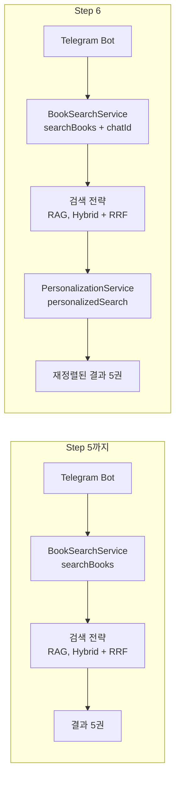
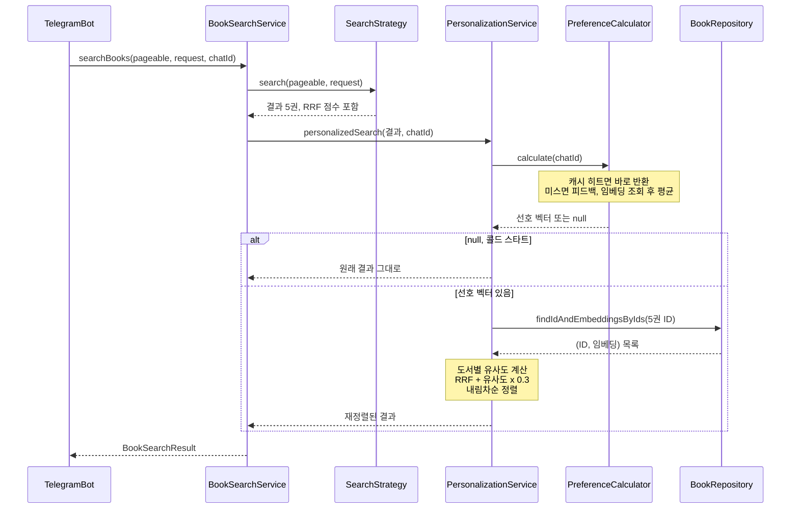
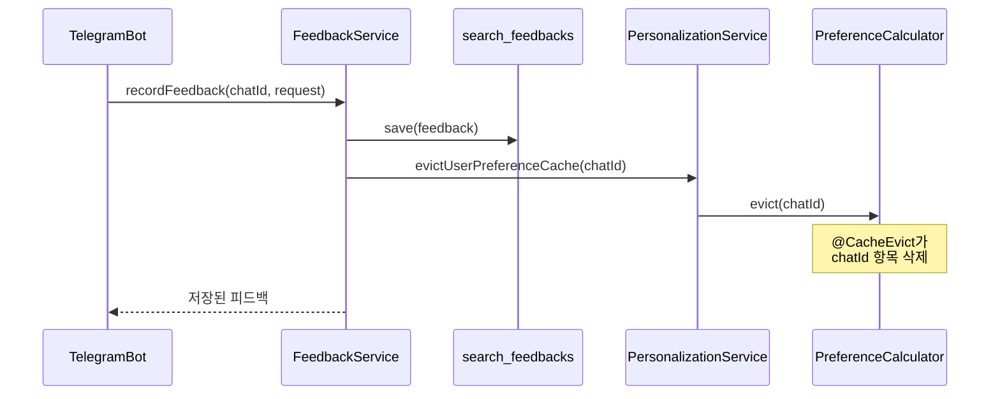

# 05. 전체 흐름 복습: 개인화 검색 한눈에 보기

> 01~04 문서에서 나눠 만든 조각들을 하나의 흐름으로 이어 봅니다. 검색 한 번과 피드백 한 번이 시스템 안에서 어떤 순서로 처리되는지 따라가고, 한 사용자의 시나리오를 처음부터 끝까지 추적하며 Step 6을 마무리합니다.
>
> 예상 소요 시간: 1시간 · 난이도: 기본

## 학습 목표

- 개인화 검색 요청이 Bot에서 재정렬된 결과로 돌아오기까지 거치는 컴포넌트를 순서대로 설명할 수 있다.
- 피드백 저장이 다음 검색 결과에 반영되는 경로를 설명할 수 있다.
- 증상(개인화가 안 됨, 느림, 순서가 이상함)을 보고 어느 컴포넌트를 확인할지 판단할 수 있다.
- Step 6 관련 테스트를 실행해 전체 동작을 검증할 수 있다.

## 시작하기 전에

- [01](01.vector-embedding-basics.md) ~ [04](04.cold-start-and-optimization.md) 문서를 마쳤어야 합니다. 이 문서는 새 코드를 만들지 않고 복습과 점검에 집중합니다.
- 모르는 용어는 [용어집](../glossary.md)을 참고합니다.

## 1. 왜 필요한가

Step 6의 코드는 클래스 몇 개에 흩어져 있습니다. 선호 벡터는 `UserPreferenceVectorCalculator`가, 재정렬은 `PersonalizationServiceImpl`이, 연결은 `BookSearchService`가, 캐시 무효화는 `FeedbackServiceImpl`이 맡습니다. 각 문서에서 하나씩 만들 때는 이해가 되지만, 막상 "왜 내 검색 결과 순서가 안 바뀌지?" 같은 문제가 생기면 어디부터 봐야 할지 막막합니다.

전체 흐름을 머릿속에 그려 두면 문제를 만났을 때 "검색 흐름의 어느 단계인가, 피드백 흐름의 어느 단계인가"로 범위를 좁힐 수 있습니다.

## 2. 핵심 개념: 전체 그림

### 2.1 개인화 전과 후

Step 5까지의 검색과 Step 6의 검색을 비교합니다. 바뀐 부분은 **검색이 끝난 뒤 한 단계가 추가된 것**뿐입니다.



### 2.2 흐름 1: 검색 요청

사용자가 Bot에 검색어를 보냈을 때의 전체 순서입니다.



### 2.3 흐름 2: 피드백 저장

사용자가 결과에 👍 또는 👎를 눌렀을 때입니다. 이 흐름은 검색 결과를 직접 바꾸지 않고, **다음 검색이 새로 계산하도록 캐시를 비우는 것**으로 끝납니다.



### 2.4 컴포넌트와 책임

| 컴포넌트 | 책임 | 처음 등장 |
|----------|------|-----------|
| `VectorUtils` | 코사인 유사도, 평균 벡터 계산 | 01 |
| `BookRepository.findEmbeddingsByIds()` | 선호 벡터용 임베딩 일괄 조회 | 02 |
| `UserPreferenceVectorCalculator` | 선호 벡터 계산, `@Cacheable`/`@CacheEvict` | 02 |
| `CacheConfig.personalizationCacheManager()` | Caffeine 캐시(TTL 24시간, 최대 1,000개) | 02 |
| `FeedbackServiceImpl.recordFeedback()` | 피드백 저장 후 캐시 무효화 | 02 |
| `BookRepository.findIdAndEmbeddingsByIds()` | 재정렬용 (ID, 임베딩) 조회 | 03 |
| `PersonalizationServiceImpl` | 재정렬(`personalizedSearch()`), 계산·무효화 위임 | 02, 03 |
| `BookSearchService.searchBooks(..., chatId)` | 검색 후 개인화 적용 | 03 |
| `LibraryTelegramBot.handleSearch()` | chatId를 넘겨 개인화 검색 호출 | 03 |

설계에서 기억할 결정 세 가지:

1. **계산과 캐시는 별도 빈에 둔다.** 같은 클래스 안에서 호출하면 `@Cacheable` 프록시를 거치지 않기 때문입니다(self-invocation).
2. **검색 결과 임베딩은 ID로 매핑한다.** `IN` 쿼리는 순서도, 개수도 보장하지 않기 때문입니다.
3. **확신이 없으면 개인화하지 않는다.** 콜드 스타트나 임베딩이 없는 경우 원래 검색 결과를 그대로 돌려줍니다.

## 3. 예제로 이해하기: 한 사용자의 시나리오

사용자 A(chatId 12345)가 처음 Bot을 쓰는 날을 따라가며, 각 시점에 어떤 컴포넌트가 무엇을 하는지 확인합니다. 직접 Bot으로 재현하면서 로그를 대조해 봅니다.

### STEP 1. 첫 검색: 콜드 스타트

A가 "자바"를 검색합니다. 피드백이 없으므로 선호 벡터는 `null`이고, 결과는 개인화 전과 같습니다.

```
Searching books with personalization for chatId: 12345
[PERSONALIZATION] Calculating preference vector for chatId: 12345
[PERSONALIZATION] Cold start for chatId: 12345 (feedback count: 0)
```

| 단계 | 일어난 일 |
|------|-----------|
| 검색 흐름 | 검색 전략이 5권 반환 |
| 선호 벡터 | GOOD 0개 → `null`, 캐싱하지 않음 |
| 재정렬 | 건너뜀, 임베딩 조회 쿼리 없음 |

### STEP 2. 피드백 세 번

A가 웹 개발 관련 도서 세 권에 👍를 누릅니다. 누를 때마다 피드백이 저장되고 캐시 무효화가 호출됩니다. 캐시에 항목이 없더라도 무효화는 오류 없이 지나갑니다.

```
Recording feedback: chatId=12345, query=자바, bookId=101, type=GOOD
[PERSONALIZATION] Cache evicted for chatId: 12345
... (두 번 더 반복)
```

### STEP 3. 두 번째 검색: 개인화 시작

A가 다시 "자바"를 검색합니다. 이제 GOOD이 3개이므로 선호 벡터가 계산되어 캐시에 저장되고, 5권이 다시 정렬됩니다.

```
[PERSONALIZATION] Calculating preference vector for chatId: 12345
[PERSONALIZATION] Preference vector calculated for chatId: 12345 (based on 3 books)
[PERSONALIZATION] Applying personalization for chatId: 12345
```

Bot 메시지에서 각 도서의 `🎯 유사도`는 선호 벡터와의 유사도, `📊 RRF 점수`는 최종 점수로 바뀌어 표시됩니다.

### STEP 4. 세 번째 검색: 캐시 히트

A가 "스프링"을 검색합니다. 검색어는 달라도 선호 벡터는 사용자 단위이므로 캐시에서 바로 꺼냅니다. `Calculating` 로그가 찍히지 않습니다.

```
Searching books with personalization for chatId: 12345
[PERSONALIZATION] Applying personalization for chatId: 12345
```

### STEP 5. 데이터로 확인하기

SQL로 A의 상태를 확인합니다.

```sql
-- A의 최근 GOOD 피드백 (선호 벡터 계산에 쓰이는 도서)
SELECT f.book_id, b.title, f.created_at, b.embedding IS NOT NULL AS has_embedding
FROM search_feedbacks f
JOIN books b ON b.id = f.book_id
WHERE f.chat_id = 12345 AND f.type = 'GOOD'
ORDER BY f.created_at DESC
LIMIT 20;
```

`has_embedding`이 `false`인 도서는 평균 계산에서 빠집니다. GOOD이 3개여도 임베딩이 있는 도서가 하나도 없으면 개인화가 켜지지 않습니다.

### STEP 6. 테스트로 전체 점검

Step 6 관련 단위 테스트와 캐시 테스트를 한 번에 실행합니다. 모두 DB 없이 동작합니다.

```bash
mvn test -Dtest='UserPreferenceVectorCalculatorTest,PersonalizationServiceImplTest,PersonalizationCacheTest'
```

| 테스트 클래스 | 검증하는 것 |
|---------------|-------------|
| `UserPreferenceVectorCalculatorTest` | 콜드 스타트(0개, 2개), 평균 계산, BAD 필터링, 최대 20개 |
| `PersonalizationServiceImplTest` | 콜드 스타트 시 원래 결과, ID 기준 임베딩 매핑, 위임 |
| `PersonalizationCacheTest` | 반복 호출 시 1회 계산, 무효화 후 재계산 |

> `@SpringBootTest` 전체 컨텍스트 테스트(예: `AiLibraryApplicationTests`)는 원격 개발 DB 스키마를 지울 수 있으므로 함께 실행하지 않습니다.

## 4. 직접 해 보기

### 미션 1 (기본): 흐름을 그림 없이 설명하기

2장의 그림을 보지 않고, 다음 두 질문에 컴포넌트 이름을 순서대로 적어 답합니다.

1. Bot에서 검색어를 보낸 뒤 재정렬된 결과가 돌아오기까지
2. 👍를 누른 뒤 다음 검색 결과에 반영되기까지

<details>
<summary>정답</summary>

1. `LibraryTelegramBot.handleSearch()` → `BookSearchService.searchBooks(pageable, request, chatId)` → 검색 전략(`RagSearchStrategy` 등) → `PersonalizationServiceImpl.personalizedSearch()` → `UserPreferenceVectorCalculator.calculate()`(캐시) → `BookRepository.findIdAndEmbeddingsByIds()` → 유사도 계산·정렬 → Bot 메시지 전송
2. `FeedbackServiceImpl.recordFeedback()` → `SearchFeedbackRepository.save()` → `PersonalizationService.evictUserPreferenceCache()` → `UserPreferenceVectorCalculator.evict()`(`@CacheEvict`) → 다음 검색에서 캐시 미스 → 새 피드백을 포함해 재계산
</details>

### 미션 2 (기본): 증상으로 원인 찾기

다음 증상마다 가장 먼저 확인할 로그나 코드를 고릅니다.

1. GOOD을 5개 남겼는데 결과 순서가 처음과 똑같다.
2. 검색할 때마다 `Calculating preference vector` 로그가 찍힌다(GOOD 5개 사용자).
3. 순서는 바뀌는데 취향과 상관없는 책이 1위로 올라온다.

<details>
<summary>정답</summary>

1. `Cold start` 로그가 찍히는지 확인합니다. 찍힌다면 GOOD 도서에 임베딩이 없거나(STEP 5의 SQL), 피드백의 `type`이 GOOD으로 저장되지 않은 것입니다. `Applying personalization`이 찍히는데도 순서가 같다면 원래 순서가 이미 취향 순서와 같을 수 있습니다.
2. 캐시가 동작하지 않는 것입니다. `@Cacheable`이 있는 메서드를 같은 클래스 안에서 호출하고 있지 않은지, `@EnableCaching`과 `cacheManager` 속성이 있는지 확인합니다.
3. 재정렬 코드에서 임베딩을 ID가 아니라 리스트 인덱스로 짝짓고 있지 않은지 확인합니다(`findIdAndEmbeddingsByIds()` 사용 여부).
</details>

### 미션 3 (도전): 웹 검색에도 개인화를 붙인다면

현재 웹 화면(`front.web`)은 chatId가 없어 `searchBooks(pageable, request)`만 씁니다. 웹 사용자에게도 개인화를 제공하려면 무엇이 필요한지 설계해 봅니다.

힌트: 사용자를 구분할 식별자, 피드백 저장 위치, `PersonalizationService` 메서드 시그니처를 생각해 봅니다.

<details>
<summary>풀이 예시</summary>

- **식별자**: 로그인이 없다면 세션 ID나 쿠키에 저장한 익명 ID를 씁니다. 다만 현재 `SearchFeedback.chatId`는 `Long`이므로, 웹 식별자를 `Long`으로 발급하거나 컬럼을 일반화(`userKey` 등)해야 합니다.
- **피드백**: 웹 화면에도 👍/👎 버튼과 피드백 저장 API를 추가하고, 저장 후 같은 방식으로 캐시를 무효화합니다.
- **서비스**: `PersonalizationService`는 이미 "결과 목록 + 사용자 키"만 받으므로 재정렬 로직은 그대로 재사용할 수 있습니다. 컨트롤러에서 `searchBooks(pageable, request, userKey)`를 호출하도록 바꾸면 됩니다.

재정렬 로직이 검색 전략이나 Telegram에 의존하지 않도록 분리해 둔 덕분에, 진입점만 추가하면 된다는 점이 핵심입니다.
</details>

## 5. 자주 하는 실수: 증상별 점검표

| 증상 | 먼저 볼 곳 | 관련 문서 |
|------|------------|-----------|
| 개인화가 전혀 적용되지 않음 | `Cold start` 로그, GOOD 수, GOOD 도서의 임베딩 유무 | 02, 04 |
| 피드백을 남겨도 순서가 그대로 | `Cache evicted` 로그, `recordFeedback()`의 무효화 호출 | 02 |
| 매 검색마다 선호 벡터를 다시 계산 | self-invocation, `@EnableCaching`, `cacheManager` 속성 | 02 |
| `Cannot find cache named 'userPreferenceVectors'` | `@Cacheable`/`@CacheEvict`의 `cacheManager = "personalizationCacheManager"` | 02 |
| 엉뚱한 책이 위로 올라옴 | `findIdAndEmbeddingsByIds()`로 ID 매핑하는지 | 03 |
| 가중치를 바꿔도 순서 변화가 없음 | RRF와 유사도 항의 스케일 차이 | 03 |
| 같은 검색 반복 시 점수가 계속 커짐 | 응답 객체를 직접 수정하는 구조와 시맨틱 캐시 | 03 |

## 6. 정리

- Step 6은 기존 검색 뒤에 **재정렬 한 단계**를 추가한 것입니다. 검색이 후보를 고르고, 선호 벡터가 그 안의 순서를 정합니다.
- 선호 벡터는 GOOD 피드백 도서 임베딩의 평균이며, 별도 빈(`UserPreferenceVectorCalculator`)에서 계산해 Caffeine에 24시간 캐싱합니다.
- 피드백 흐름은 저장 후 캐시를 비우는 것으로 끝나고, 다음 검색이 새 피드백을 반영해 다시 계산합니다.
- 콜드 스타트, 임베딩 없음 같은 불확실한 상황에서는 원래 검색 결과를 그대로 보여 줍니다.

Step 6 완료 체크리스트:

- [ ] 검색 흐름과 피드백 흐름을 컴포넌트 이름으로 설명할 수 있다.
- [ ] Bot에서 콜드 스타트 → 개인화 시작 → 캐시 히트를 로그로 확인했다.
- [ ] Step 6 테스트 세 클래스를 실행해 통과를 확인했다.
- [ ] 개인화가 동작하지 않을 때 확인할 곳을 세 군데 이상 말할 수 있다.

## 확인 문제

**1. `PersonalizationService.personalizedSearch()`는 어떤 검색 전략(Keyword, Vector, Hybrid, RAG)과도 함께 쓸 수 있습니다. 그 이유는 무엇입니까?**

<details>
<summary>정답</summary>

검색 전략이 만든 결과 목록(`List<BookSearchResponse>`)과 chatId만 입력으로 받기 때문입니다. 검색이 어떻게 수행되었는지는 알 필요가 없고, 각 도서의 ID와 점수만 있으면 재정렬할 수 있습니다. 다만 RRF 점수가 없는 전략의 결과는 기존 점수를 0으로 보고 유사도만으로 정렬됩니다.
</details>

**2. 사용자가 👍를 누른 직후, 화면에 이미 떠 있는 검색 결과 순서는 바뀝니까?**

<details>
<summary>정답</summary>

바뀌지 않습니다. 피드백 흐름은 캐시를 비우는 것으로 끝나며, 새 피드백은 **다음 검색**에서 선호 벡터를 다시 계산할 때 반영됩니다.
</details>

**3. 검색어가 "자바"에서 "스프링"으로 바뀌었는데 선호 벡터는 캐시에서 그대로 꺼내 씁니다. 이것이 올바른 동작인 이유는 무엇입니까?**

<details>
<summary>정답</summary>

선호 벡터는 검색어가 아니라 사용자의 피드백에서 계산되므로, 캐시 키가 chatId이고 검색어와 무관합니다. 검색어가 바뀌면 후보 도서(1단계 검색 결과)가 바뀔 뿐, 취향은 같습니다.
</details>

**4. Step 6 설계에서 "확신이 없으면 개인화하지 않는다"는 원칙이 적용된 곳을 두 군데 이상 고르십시오.**

<details>
<summary>정답</summary>

GOOD 피드백이 3개 미만이면 선호 벡터를 `null`로 반환하는 콜드 스타트 처리, 좋아한 도서의 임베딩이 하나도 없으면 `null`을 반환하는 처리, 검색 결과 중 임베딩이 없는 도서는 점수를 바꾸지 않는 처리가 있습니다.
</details>

## 다음 문서

[Step 7. Tool Calling으로 만드는 도서관 도우미 AI →](../step-7/README.md)
