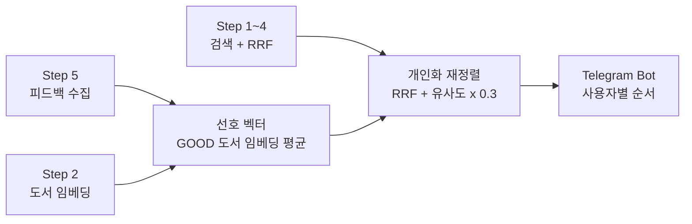

# Step 6. 피드백 기반 개인화 추천

> Step 5에서 모은 👍/👎 피드백으로 사용자의 취향을 벡터 하나로 표현하고, 같은 검색어라도 사용자마다 검색 결과의 순서를 다르게 보여 줍니다.

## 이 단계에서 만드는 것

이 단계를 마치면 Telegram Bot의 검색 결과가 사용자의 취향에 따라 다시 정렬됩니다. 웹 개발 책에 👍를 여러 번 누른 사용자가 "자바"를 검색하면, 같은 후보 중에서 스프링·웹 관련 도서가 위로 올라옵니다.

```text
[피드백이 없는 사용자]              [웹 개발 책에 GOOD 3개 이상 남긴 사용자]
User: 자바                          User: 자바

1. Effective Java                   1. 스프링 부트 입문
   📊 RRF 점수: 0.03                   🎯 유사도: 82.00%
2. 스프링 부트 입문                    📊 RRF 점수: 0.28
   📊 RRF 점수: 0.03                2. 자바 성능 튜닝
3. 자바 성능 튜닝                      🎯 유사도: 60.00%
   ...                                 📊 RRF 점수: 0.21
                                    ...
```

개인화가 적용되면 `🎯 유사도`는 사용자 취향과의 유사도, `📊 RRF 점수`는 취향을 반영한 최종 점수를 뜻합니다.

## 왜 이 단계가 필요한가

Step 5까지의 검색은 누구에게나 같은 결과를 같은 순서로 보여 줍니다. 그런데 Step 5에서 사용자마다 어떤 책을 좋아했는지 기록이 쌓이기 시작했습니다. 이 기록을 쓰지 않으면 피드백은 통계로만 남습니다.

Step 6은 Step 2에서 만든 도서 임베딩을 다시 활용합니다. 사용자가 좋아한 책들의 임베딩을 평균내면 그 사용자의 **선호 벡터**가 되고, 이 벡터는 도서와 같은 공간에 있으므로 검색 결과의 각 도서와 코사인 유사도로 비교할 수 있습니다. 검색은 지금처럼 검색어로 후보를 고르고, 개인화는 그 후보 안의 순서만 바꿉니다.



## 문서 구성

| 순서 | 문서 | 내용 | 예상 시간 |
|------|------|------|-----------|
| 01 | [취향을 벡터로 표현하기](01.vector-embedding-basics.md) | 임베딩·코사인 유사도 복습, 평균 벡터로 취향 표현, pgvector로 체험 | 1시간 |
| 02 | [사용자 선호 벡터 계산하기](02.user-preference-vector.md) | `UserPreferenceVectorCalculator`, `@Cacheable`과 self-invocation, Caffeine, 캐시 무효화 | 2시간 |
| 03 | [검색 결과 개인화 재정렬](03.personalized-ranking.md) | 최종 점수 공식, ID 기준 임베딩 매핑, Bot 연동 | 1.5시간 |
| 04 | [콜드 스타트와 최적화](04.cold-start-and-optimization.md) | 콜드 스타트 처리, 캐시 수명과 설정, chatId의 한계 | 1.5시간 |
| 05 | [전체 흐름 복습](05.integration-guide.md) | 검색·피드백 흐름 종합, 시나리오 추적, 증상별 점검표 | 1시간 |

총 예상 시간: 약 7시간

시작 전 확인할 것:

- Step 2의 도서 임베딩이 `books.embedding`(`vector(1024)`)에 생성되어 있어야 합니다.
- Step 5의 Telegram Bot과 피드백 저장(`search_feedbacks`)이 동작해야 합니다. 실습하려면 GOOD 피드백 3개 이상을 남긴 계정이 하나 있으면 좋습니다.

## 이 단계를 마치면

- [ ] 사용자 선호 벡터가 GOOD 피드백 도서 임베딩의 평균이라는 것을 설명할 수 있다.
- [ ] `UserPreferenceVectorCalculator`를 별도 빈으로 둔 이유(self-invocation)를 설명할 수 있다.
- [ ] 최종 점수 공식 `RRF + 유사도 × 0.3`으로 순위를 계산하고, 가중치의 영향을 설명할 수 있다.
- [ ] 피드백 저장 시 캐시가 무효화되어 다음 검색에 반영되는 것을 Bot과 로그로 확인했다.
- [ ] 콜드 스타트 사용자에게 원래 검색 결과가 나가는 것을 확인했다.
- [ ] Step 6 단위 테스트(`UserPreferenceVectorCalculatorTest`, `PersonalizationServiceImplTest`, `PersonalizationCacheTest`)를 통과시켰다.

## 관련 소스 코드

| 클래스 | 역할 | 경로 |
|--------|------|------|
| `VectorUtils` | 코사인 유사도, 평균 벡터 계산 | [`core/book/util/VectorUtils.java`](../../src/main/java/net/java21/library/core/book/util/VectorUtils.java) |
| `PersonalizationService` | 개인화 인터페이스(재정렬, 선호 벡터, 캐시 무효화) | [`core/book/service/personalization/PersonalizationService.java`](../../src/main/java/net/java21/library/core/book/service/personalization/PersonalizationService.java) |
| `PersonalizationServiceImpl` | 재정렬 구현, 계산·무효화 위임 | [`core/book/service/personalization/impl/PersonalizationServiceImpl.java`](../../src/main/java/net/java21/library/core/book/service/personalization/impl/PersonalizationServiceImpl.java) |
| `UserPreferenceVectorCalculator` | 선호 벡터 계산, `@Cacheable`/`@CacheEvict` | [`core/book/service/personalization/impl/UserPreferenceVectorCalculator.java`](../../src/main/java/net/java21/library/core/book/service/personalization/impl/UserPreferenceVectorCalculator.java) |
| `BookRepository` | `findEmbeddingsByIds()`, `findIdAndEmbeddingsByIds()` | [`core/book/repository/BookRepository.java`](../../src/main/java/net/java21/library/core/book/repository/BookRepository.java) |
| `CacheConfig` | `personalizationCacheManager`(Caffeine, TTL 24시간, 최대 1,000개) | [`core/config/CacheConfig.java`](../../src/main/java/net/java21/library/core/config/CacheConfig.java) |
| `BookSearchService` | `searchBooks(pageable, request, chatId)`: 검색 후 개인화 | [`core/book/service/search/BookSearchService.java`](../../src/main/java/net/java21/library/core/book/service/search/BookSearchService.java) |
| `FeedbackServiceImpl` | 피드백 저장 후 캐시 무효화 | [`external/telegram/service/FeedbackServiceImpl.java`](../../src/main/java/net/java21/library/external/telegram/service/FeedbackServiceImpl.java) |
| `LibraryTelegramBot` | chatId를 넘겨 개인화 검색 호출 | [`external/telegram/bot/LibraryTelegramBot.java`](../../src/main/java/net/java21/library/external/telegram/bot/LibraryTelegramBot.java) |

설정(`src/main/resources/application.properties`):

```properties
app.personalization.min-feedback-count=3
app.personalization.max-feedback-count=20
cache.personalization.ttl.hours=24
cache.personalization.max-size=1000
# app.personalization.weight는 파일에 없으며 코드 기본값 0.3을 사용
```
