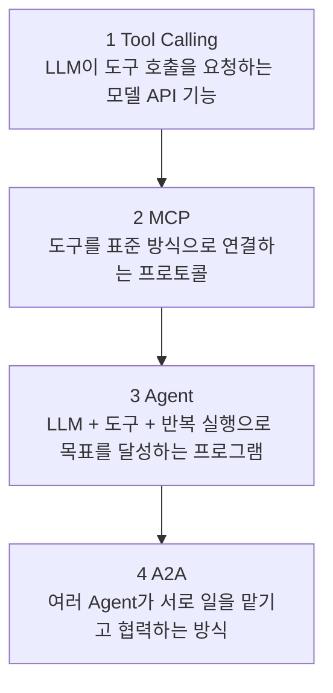
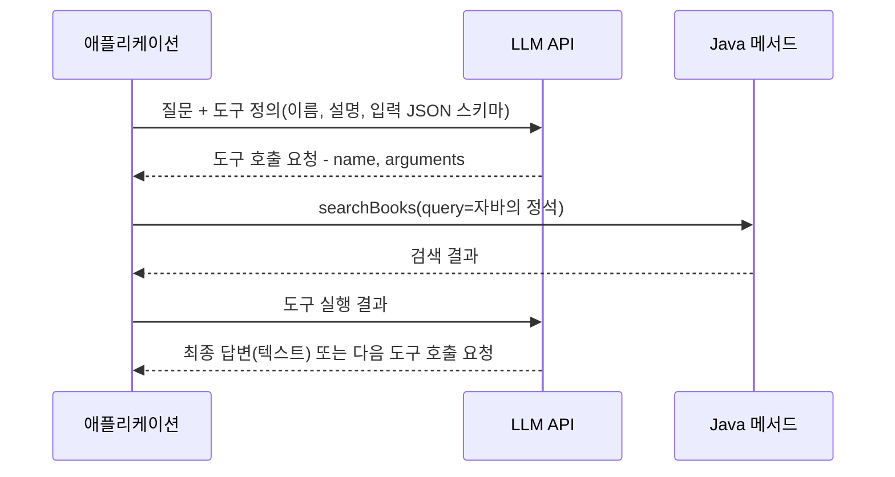
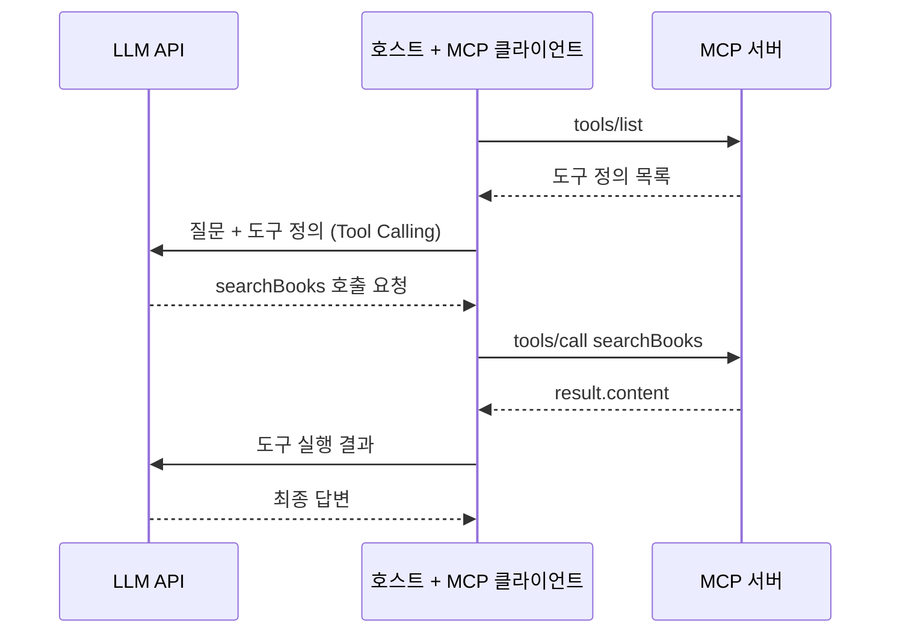
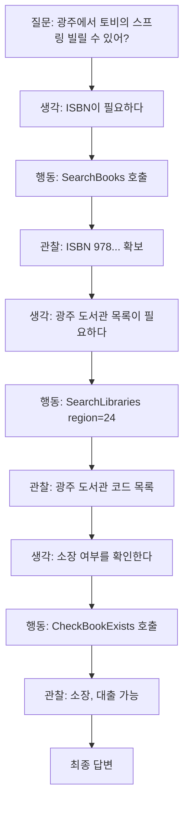
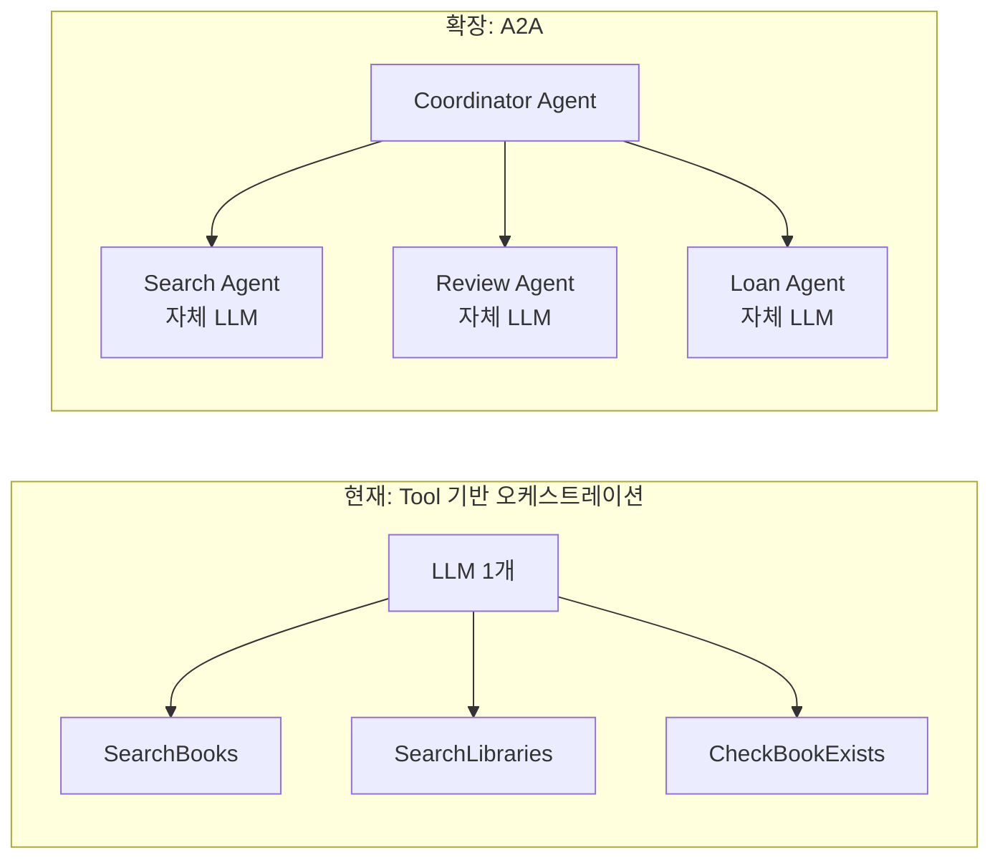
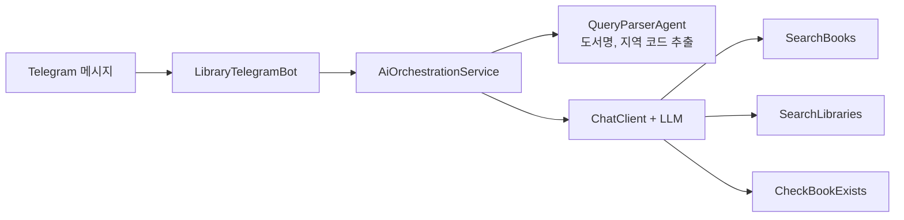

# 00. Tool Calling, MCP, Agent, A2A 이론

> LLM이 데이터베이스나 외부 API를 "쓰는" 원리를 Tool Calling → MCP → Agent → A2A 순서로 정리합니다. 네 개념이 각각 무엇을 해결하는지, 이 프로젝트가 그중 어디에 해당하는지 이해하는 것이 목표입니다.
>
> 예상 소요 시간: 1시간 · 난이도: 입문

## 학습 목표

- LLM이 혼자서는 할 수 없는 일과 Tool Calling이 그 한계를 푸는 방식을 설명할 수 있다
- Tool Calling(모델 API 기능)과 MCP(클라이언트-서버 프로토콜)의 차이를 구분할 수 있다
- MCP의 `tools/list`, `tools/call` 메시지가 어떤 역할을 하는지 설명할 수 있다
- Agent와 A2A가 무엇인지, 이 프로젝트의 Tool 기반 오케스트레이션과 어떻게 다른지 설명할 수 있다

## 시작하기 전에

- Step 3의 [LLM 연동](../step-3/03.llm-integration.md)에서 `ChatClient`로 LLM을 호출해 본 경험이 있으면 좋습니다.
- REST API와 JSON 형식을 알고 있어야 합니다.
- 모르는 용어는 [용어집](../glossary.md)을 참고합니다.

## 1. 왜 필요한가

LLM(Large Language Model, 대규모 언어 모델)은 입력 텍스트를 보고 다음에 올 텍스트를 만들어 내는 모델입니다. 학습한 지식으로 그럴듯한 문장을 쓰는 일은 잘하지만, 다음 일은 스스로 할 수 없습니다.

- 우리 서비스의 PostgreSQL에서 도서를 조회하는 일
- 도서관정보나루 API를 호출해 지금 대출 가능한 도서관을 확인하는 일
- 오늘 날짜, 실시간 재고처럼 학습 이후에 바뀐 정보를 아는 일

그래서 도구 없이 "광주에서 토비의 스프링 빌릴 수 있어?"라고 물으면 LLM은 모른다고 답하거나, 더 나쁘게는 그럴듯한 도서관 이름을 지어냅니다. 이것이 환각(Hallucination)입니다.

Step 3의 RAG(Retrieval-Augmented Generation, 검색 증강 생성)는 개발자가 미리 검색한 결과를 프롬프트에 넣어 이 문제를 일부 해결했습니다. 하지만 RAG는 "무엇을 검색할지"를 개발자가 코드로 정해 둡니다. 질문에 따라 도서 검색만 필요할 수도 있고, 검색 후 지역 도서관 조회까지 필요할 수도 있습니다. 이 판단을 질문마다 `if-else`로 짜는 대신 LLM에게 맡기는 방법이 Tool Calling입니다.

## 2. 핵심 개념

네 개념은 아래처럼 쌓아 올린 관계로 이해하면 쉽습니다.



이 프로젝트가 구현하는 범위는 1번 Tool Calling을 이용한 3번(단일 LLM이 여러 Tool을 조합하는 구조)까지입니다. 2번 MCP와 4번 A2A는 개념과 확장 방향으로만 다룹니다.

### 2.1. Tool Calling: LLM에게 도구 목록을 쥐여 주기

**비유.** 신입 사서에게 "도서 검색 단말기", "타 도서관 조회 전화번호"를 알려 주고 손님을 응대하게 하는 상황을 떠올려 봅시다. 신입 사서(LLM)는 손님 질문을 듣고 "단말기로 먼저 검색해야겠다"라고 판단해 요청만 하고, 실제 단말기 조작은 시스템(우리 애플리케이션)이 합니다.

**정의.** **Tool Calling**(Function Calling)은 LLM이 답변 대신 "이 도구를 이 인자로 호출해 달라"는 구조화된 요청(JSON)을 돌려주는 **모델 API의 기능**입니다. OpenAI·Gemini는 Function Calling, Anthropic은 Tool Use, Spring AI는 Tool Calling이라고 부르지만 같은 기능입니다.

핵심은 **LLM은 도구를 직접 실행하지 않는다**는 점입니다. LLM은 어떤 도구를 어떤 인자로 부를지 결정만 하고, 실행은 애플리케이션이 합니다.



LLM이 돌려주는 도구 호출 요청은 대략 다음 모양입니다(형식은 모델 제공자마다 조금씩 다릅니다).

```json
{
  "name": "BookSearch",
  "arguments": { "query": "자바의 정석", "limit": 5 }
}
```

LLM이 도구를 고르는 근거는 우리가 넘긴 **도구 정의** 세 가지뿐입니다.

| 항목 | 예시 | 역할 |
|---|---|---|
| 이름(name) | `BookSearch` | 호출 요청에서 도구를 가리키는 식별자 |
| 설명(description) | "도서관 시스템에서 도서를 검색합니다..." | LLM이 언제 이 도구를 쓸지 판단하는 근거 |
| 입력 스키마(input schema) | `{"query": string, "limit": integer}` | 인자를 어떤 JSON으로 만들지 알려 주는 명세 |

그래서 설명을 대충 쓰면 LLM이 도구를 쓰지 않거나 엉뚱한 도구를 고릅니다. 02 문서에서 실제로 확인합니다.

**모든 모델이 지원하지는 않습니다.** 도구 호출 형식으로 출력하도록 추가 학습된 모델만 Tool Calling을 쓸 수 있습니다. 이 프로젝트의 Ollama 모델 `qwen2.5:latest`와 Gemini 2.0 Flash는 지원합니다. 반면 쿼리 파싱용으로 검토했던 `llama3-korean-blossom`은 한국어 생성은 좋지만 Tool Calling을 지원하지 않아, 도구 호출에는 쓰지 않습니다.

**Spring AI에서는.** `ChatClient`에 도구를 등록하면 위 시퀀스의 "도구 호출 요청 받기 → 실행 → 결과 전달" 반복을 Spring AI가 자동으로 처리합니다. 개발자는 도구를 정의하고 등록만 하면 됩니다.

```java
// 전체 코드: src/main/java/net/java21/library/ai/service/AiLibraryAssistantService.java
FunctionToolCallback<BookSearchRequest, BookSearchResult> bookSearchTool =
    FunctionToolCallback.builder("BookSearch", bookSearchFunction::searchBooks)   // 이름 + 실행할 메서드
        .description("도서관 시스템에서 도서를 검색합니다. ...")                 // 설명
        .inputType(BookSearchRequest.class)                                      // 입력 스키마의 근거
        .build();

ChatClient chatClient = ChatClient.builder(chatModel)
    .defaultToolCallbacks(bookSearchTool)
    .build();

String answer = chatClient.prompt().user("자바 책 찾아줘").call().content();
```

### 2.2. MCP: 도구를 연결하는 표준 프로토콜

Tool Calling만으로도 도구를 쓸 수 있는데 왜 MCP가 나왔을까요? 도구가 **우리 애플리케이션 밖**에 있을 때 문제가 생깁니다. GitHub 조회 도구, 사내 위키 검색 도구를 여러 AI 애플리케이션(Claude Desktop, IDE, 우리 Spring 서비스)에서 쓰고 싶다면, 애플리케이션마다 각 도구를 따로 연동해야 합니다. 애플리케이션이 M개, 도구가 N개면 연동 코드가 M×N개 생깁니다.

**비유.** USB 규격 덕분에 어떤 노트북에든 어떤 마우스든 꽂을 수 있듯, MCP는 "AI 애플리케이션과 도구 제공자 사이의 공통 규격"입니다.

**정의.** **MCP**(Model Context Protocol)는 Anthropic이 2024년 11월 공개한 오픈 프로토콜로, AI 애플리케이션이 외부의 도구·데이터에 접근하는 방법을 정한 **클라이언트-서버 프로토콜**입니다. 메시지 형식은 **JSON-RPC 2.0**을 씁니다.

| 구성 요소 | 역할 | 예 |
|---|---|---|
| 호스트(Host) | 사용자가 쓰는 AI 애플리케이션 | Claude Desktop, IDE, Spring AI 애플리케이션 |
| MCP 클라이언트 | 호스트 안에서 MCP 서버 하나와 연결을 맺는 부분 | Spring AI MCP Client |
| MCP 서버 | 도구(tools), 데이터(resources), 프롬프트(prompts)를 제공하는 프로그램 | GitHub MCP 서버, 파일 시스템 MCP 서버 |

도구와 관련된 핵심 메서드는 두 개입니다.

- `tools/list`: 서버가 제공하는 도구 목록(이름, 설명, `inputSchema`)을 조회합니다.
- `tools/call`: 도구 하나를 이름과 인자로 실행합니다.

```json
// 1. 클라이언트 → 서버: 도구 목록 요청
{ "jsonrpc": "2.0", "id": 1, "method": "tools/list" }

// 2. 클라이언트 → 서버: 도구 실행 요청
{
  "jsonrpc": "2.0", "id": 2, "method": "tools/call",
  "params": { "name": "searchBooks", "arguments": { "query": "자바" } }
}

// 3. 서버 → 클라이언트: 실행 결과
{
  "jsonrpc": "2.0", "id": 2,
  "result": {
    "content": [ { "type": "text", "text": "[{\"title\": \"자바의 정석\"}]" } ],
    "isError": false
  }
}
```

MCP와 Tool Calling은 함께 동작합니다. MCP 클라이언트가 `tools/list`로 받아 온 도구 정의를 LLM에게 Tool Calling 형식으로 넘기고, LLM이 호출을 요청하면 MCP 클라이언트가 `tools/call`로 서버에 실행을 맡깁니다.



둘의 차이를 표로 정리하면 다음과 같습니다.

| 구분 | Tool Calling | MCP |
|---|---|---|
| 무엇인가 | LLM 모델 API의 기능 | 애플리케이션과 도구 서버 사이의 통신 프로토콜 |
| 누구와 누구 사이 | 애플리케이션 ↔ LLM | MCP 클라이언트 ↔ MCP 서버 |
| 해결하는 문제 | LLM이 도구 호출을 "결정"하게 함 | 도구를 "어디서 어떻게 가져와 실행할지" 표준화 |
| 메시지 형식 | 모델 제공자별 API 형식 | JSON-RPC 2.0 (`tools/list`, `tools/call`) |
| 이 프로젝트 | 사용함 (02~06의 실습 전부) | 사용하지 않음 (확장 방향) |

이 프로젝트의 도구는 모두 같은 Spring 애플리케이션 안의 Java 메서드라서 MCP 없이 Tool Calling만으로 충분합니다. Spring AI는 MCP 클라이언트·서버 스타터(`spring-ai-starter-mcp-client`, `spring-ai-starter-mcp-server-webmvc`)도 제공하므로, 나중에 이 도서 검색 도구를 다른 AI 애플리케이션에 공개하고 싶다면 MCP 서버로 감싸는 방식으로 확장할 수 있습니다.

### 2.3. Agent: 도구를 쓰며 목표를 향해 반복하는 프로그램

**정의.** **AI Agent**는 LLM이 목표를 달성할 때까지 "생각 → 도구 호출 → 결과 관찰"을 반복하도록 만든 프로그램입니다. 구성 요소는 보통 세 가지입니다.

- LLM: 다음 행동을 결정
- 도구(Tools): 실제 행동 수단
- 반복 루프: 도구 결과를 다시 LLM에게 보여 주고 다음 행동을 결정하게 하는 흐름

이 반복 방식은 2022년 논문 "ReAct: Synergizing Reasoning and Acting in Language Models"에서 정리된 패턴으로, 오늘날 대부분 Agent의 기본 구조입니다.

"광주에서 토비의 스프링 빌릴 수 있어?"를 예로 들면 다음과 같습니다.



Spring AI의 `ChatClient`에 도구를 등록하고 `call()`을 부르면 이 반복이 자동으로 일어납니다. 그래서 이 프로젝트의 서비스들도 넓은 의미에서 Agent입니다. 다만 LLM은 하나이고, 여러 도구를 골라 조합할 뿐입니다. 이 교재는 이 구조를 **Tool 기반 오케스트레이션**이라고 부릅니다.

### 2.4. A2A: 여러 Agent가 협력하는 구조

**정의.** **A2A**(Agent-to-Agent)는 여러 Agent가 서로 작업을 맡기고 결과를 주고받으며 협력하는 방식입니다. Google은 2025년에 Agent 간 통신 규격인 Agent2Agent Protocol을 공개했으며, 이 규격에서는 각 Agent가 자기 능력을 "Agent Card"로 공개하고 HTTP 위의 JSON-RPC로 작업(task)을 주고받습니다.

MCP와 비교하면 차이가 분명합니다. MCP는 Agent가 **도구**를 쓰는 규격이고, A2A는 Agent가 **다른 Agent**에게 일을 맡기는 규격입니다. 도구는 시킨 일만 하지만, 상대 Agent는 자기 LLM으로 스스로 판단하며 일을 처리합니다.



| 구분 | Tool 기반 오케스트레이션 (현재) | A2A (확장 방향) |
|---|---|---|
| LLM 수 | 1개 | Agent마다 1개 |
| 판단 주체 | 중앙 LLM 하나가 모든 도구를 고름 | 각 Agent가 자기 영역을 판단 |
| 장점 | 구조가 단순하고 디버깅이 쉬움, LLM 호출 비용이 적음 | 영역별 전문화, 팀·서비스 단위로 독립 개발 가능 |
| 단점 | 도구가 많아지면 LLM이 고르기 어려워짐 | Agent 간 통신 지연, 추적과 디버깅이 어려움 |

도구가 수십 개로 늘거나 영역마다 다른 팀이 Agent를 운영하게 되면 A2A가 의미를 갖습니다. Spring AI 1.1.2에서 A2A를 구현할 때의 검토 내용은 부록 [A2A 구현 가능성 분석](./A2A_FEASIBILITY_ANALYSIS.md)에 있습니다.

## 3. 예제로 이해하기: 이 프로젝트에 대입해 보기

Step 7의 코드를 네 개념에 대입하면 다음과 같습니다.

| 개념 | 이 프로젝트에서 해당하는 것 |
|---|---|
| Tool Calling | `FunctionToolCallback`, `@Tool`로 등록한 Java 메서드를 LLM이 호출 요청 |
| MCP | 사용하지 않음. 도구가 모두 같은 애플리케이션 안에 있음 |
| Agent | `AiOrchestrationService.ask()` 한 번 안에서 LLM이 도구를 여러 번 호출하는 흐름 |
| A2A | 사용하지 않음. `QueryParserAgent`는 이름에 Agent가 붙었지만 질문에서 도서명·지역을 뽑는 전처리 단계이고, Agent끼리 작업을 주고받지 않음 |

Telegram Bot에 실제로 연결된 흐름은 다음과 같습니다.



`QueryParserAgent`가 뽑은 지역 코드(예: 광주 `24`)는 시스템 프롬프트에 힌트로 들어갑니다. LLM이 `SearchLibraries`에 한글 "광주"를 넣으면 API가 실패하기 때문입니다. 이처럼 Tool Calling에서도 LLM이 실수하기 쉬운 부분은 코드로 미리 정리해 주는 것이 좋습니다.

## 4. 직접 해 보기

### 미션 1 (기본): 개념 분류하기

다음 설명이 Tool Calling, MCP, Agent, A2A 중 무엇에 해당하는지 고르세요.

1. JSON-RPC 2.0으로 `tools/call` 요청을 보낸다.
2. LLM 응답에 `{"name": "BookSearch", "arguments": {...}}`가 들어 있다.
3. 리뷰 담당 Agent가 자기 LLM으로 리뷰를 분석해 Coordinator에게 결과를 돌려준다.
4. LLM이 도구 결과를 보고 다음 도구를 고르는 일을 답이 나올 때까지 반복한다.

<details>
<summary>정답</summary>

1. MCP 2. Tool Calling 3. A2A 4. Agent

</details>

### 미션 2 (기본): 도구 정의 써 보기

"ISBN을 받아 그 책의 상세 정보(제목, 저자, 출판사, 책 소개)를 돌려주는 도구"의 이름, 설명, 입력 스키마를 직접 써 보세요. LLM이 "이 책 줄거리 알려줘"라는 질문에 이 도구를 고를 수 있도록 설명을 쓰는 것이 핵심입니다.

<details>
<summary>예시 답안</summary>

- 이름: `GetBookDetail`
- 설명: "ISBN으로 도서의 상세 정보(제목, 저자, 출판사, 책 소개)를 조회합니다. 사용자가 책의 내용, 줄거리, 소개를 물을 때 사용합니다. ISBN은 먼저 도서 검색으로 확보해야 합니다."
- 입력 스키마: `{"isbn": string}`

실제 구현은 `LibraryTools.getBookDetail()`의 `@Tool` 설명과 비교해 보세요.

</details>

### 미션 3 (도전): MCP 메시지 만들기

미션 2의 도구를 MCP 서버가 제공한다고 가정하고, ISBN `9788960777331`로 실행하는 `tools/call` 요청 JSON을 작성하세요.

<details>
<summary>정답</summary>

```json
{
  "jsonrpc": "2.0",
  "id": 3,
  "method": "tools/call",
  "params": { "name": "GetBookDetail", "arguments": { "isbn": "9788960777331" } }
}
```

</details>

## 5. 자주 하는 실수

**"LLM이 내 메서드를 직접 실행한다"고 생각한다**
- 증상: 도구 메서드 안에서 예외가 나면 LLM이 알아서 처리해 줄 것이라 기대합니다.
- 원인: LLM은 호출 요청만 만들고, 실행은 애플리케이션(Spring AI)이 합니다.
- 해결: 도구 메서드에서 예외를 잡아 빈 결과나 안내 메시지를 돌려주도록 직접 처리합니다(02 문서의 `BookSearchResult.empty()`).

**Tool Calling과 MCP를 같은 것으로 본다**
- 증상: "Spring AI로 Function Calling을 했으니 MCP를 구현했다"고 설명합니다.
- 원인: 둘 다 "LLM이 도구를 쓴다"는 같은 목적이라 혼동하기 쉽습니다.
- 해결: Tool Calling은 애플리케이션과 LLM 사이의 모델 API 기능, MCP는 애플리케이션과 도구 서버 사이의 JSON-RPC 프로토콜이라고 구분합니다.

**이 프로젝트를 A2A라고 부른다**
- 증상: 클래스 이름에 Agent가 여럿 있으니 다중 Agent 시스템이라고 소개합니다.
- 원인: `QueryParserAgent`, `AiOrchestrationService` 같은 이름 때문입니다.
- 해결: LLM 하나가 여러 Tool을 조합하는 Tool 기반 오케스트레이션이라고 설명합니다. 포트폴리오에서도 이 표현을 씁니다.

**Tool Calling을 지원하지 않는 모델을 쓴다**
- 증상: 도구를 등록했는데 로그에 도구 호출이 한 번도 찍히지 않거나 API 오류가 납니다.
- 원인: 모델이 도구 호출 형식을 학습하지 않았습니다.
- 해결: 모델 문서에서 tools 지원 여부를 확인합니다. Ollama에서는 `qwen2.5` 계열처럼 tools를 지원하는 모델을 씁니다.

## 6. 정리

- LLM은 텍스트만 만들 뿐 DB 조회나 API 호출을 하지 못합니다. Tool Calling은 LLM이 "이 도구를 이 인자로 불러 달라"고 요청하게 하는 모델 API 기능입니다.
- MCP는 도구를 애플리케이션 밖의 서버로 분리해 표준 방식(JSON-RPC 2.0, `tools/list`, `tools/call`)으로 연결하는 클라이언트-서버 프로토콜입니다.
- Agent는 LLM이 도구 호출과 결과 관찰을 반복하며 목표를 달성하는 프로그램이고, A2A는 여러 Agent가 서로 일을 맡기는 구조입니다.
- 이 프로젝트는 단일 LLM이 여러 Tool을 조합하는 Tool 기반 오케스트레이션이며, MCP와 A2A는 확장 방향입니다.

- [ ] Tool Calling에서 LLM과 애플리케이션이 각각 하는 일을 구분할 수 있다
- [ ] 도구 정의의 세 요소(이름, 설명, 입력 스키마)를 말할 수 있다
- [ ] MCP의 `tools/list`, `tools/call` 역할을 설명할 수 있다
- [ ] 이 프로젝트가 A2A가 아닌 이유를 설명할 수 있다

## 확인 문제

**1. Tool Calling에서 도구 메서드를 실제로 실행하는 주체는 무엇입니까?**

<details>
<summary>정답</summary>

애플리케이션(이 프로젝트에서는 Spring AI)입니다. LLM은 도구 이름과 인자를 담은 호출 요청만 만들고, Spring AI가 해당 Java 메서드를 실행한 뒤 결과를 다시 LLM에게 전달합니다.

</details>

**2. LLM이 여러 도구 중 무엇을 쓸지 고를 때 참고하는 정보는 무엇입니까?**

<details>
<summary>정답</summary>

사용자 질문, 시스템 프롬프트, 그리고 등록된 도구 정의(이름, 설명, 입력 스키마)입니다. 도구의 Java 코드 내용은 LLM에게 전달되지 않으므로 설명(description)을 구체적으로 써야 합니다.

</details>

**3. MCP에서 클라이언트가 서버의 도구 목록을 알아내는 메서드와 도구를 실행하는 메서드는 각각 무엇입니까?**

<details>
<summary>정답</summary>

`tools/list`로 목록(이름, 설명, `inputSchema`)을 조회하고, `tools/call`로 이름과 인자(`params.name`, `params.arguments`)를 보내 실행합니다. 메시지는 JSON-RPC 2.0 형식입니다.

</details>

**4. 이 프로젝트에서 MCP를 쓰지 않아도 되는 이유는 무엇입니까?**

<details>
<summary>정답</summary>

모든 도구가 같은 Spring 애플리케이션 안의 Java 메서드이기 때문입니다. Tool Calling만으로 LLM이 도구를 고르고 Spring AI가 실행할 수 있습니다. MCP는 도구를 별도 서버로 분리해 여러 AI 애플리케이션에서 재사용할 때 필요해집니다.

</details>

**5. Tool 기반 오케스트레이션과 A2A의 가장 큰 차이는 무엇입니까?**

<details>
<summary>정답</summary>

Tool 기반 오케스트레이션은 LLM 하나가 모든 도구를 고르고 조합합니다. A2A는 각자 LLM을 가진 여러 Agent가 서로 작업을 맡기고 결과를 주고받습니다.

</details>

## 다음 문서

[01. 개요 및 시나리오 →](01.overview.md)
