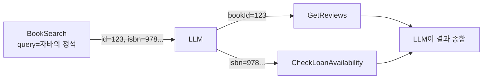
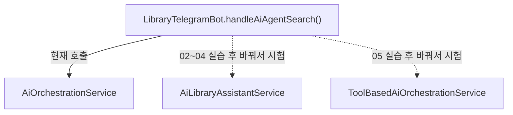
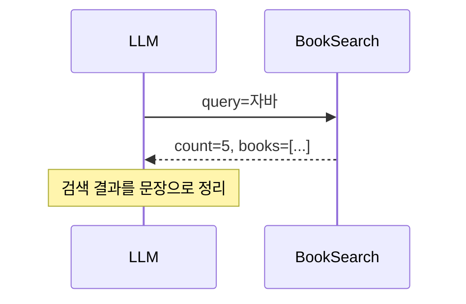
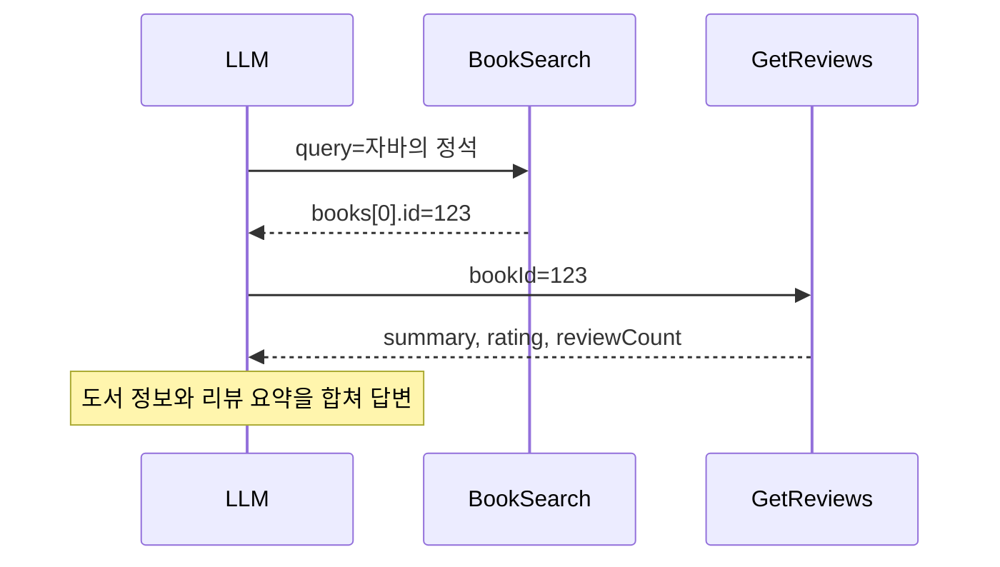
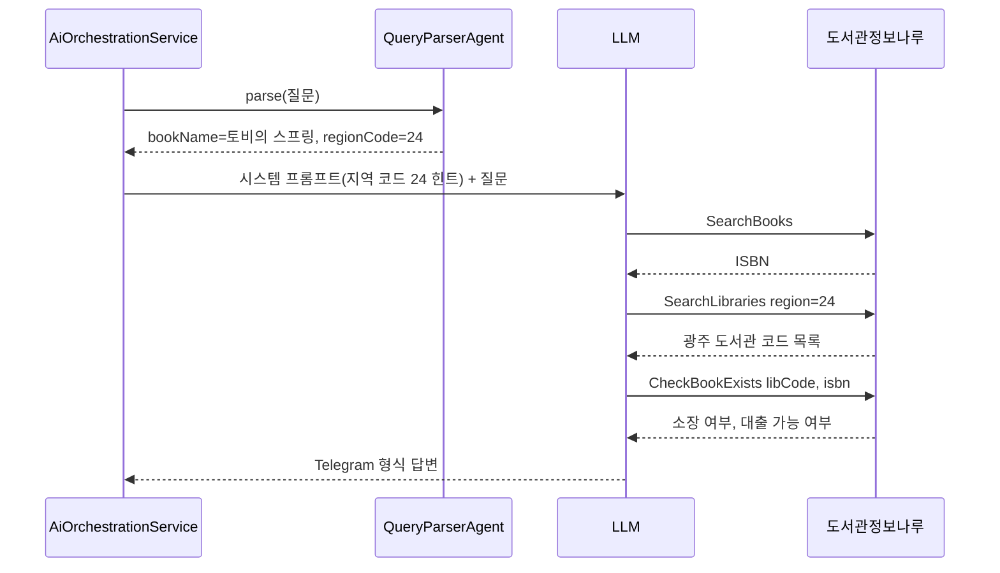

# 01. 개요 및 시나리오

> Step 7에서 만들 도서관 도우미 AI(Library Assistant)의 목표와 대표 시나리오를 살펴보고, 저장소에 있는 세 가지 구현이 각각 어떤 역할을 하는지 정리합니다.
>
> 예상 소요 시간: 30분 · 난이도: 입문

## 학습 목표

- 도서관 도우미 AI가 해결하려는 사용자 문제를 설명할 수 있다
- 대표 시나리오에서 LLM이 어떤 Tool을 어떤 순서로 호출하는지 예측할 수 있다
- `AiLibraryAssistantService`, `AiOrchestrationService`, `ToolBasedAiOrchestrationService`의 역할과 실제 연결 상태를 구분할 수 있다
- 02~05 문서의 학습 순서와 각 문서에서 만드는 결과물을 말할 수 있다

## 시작하기 전에

- [00. Tool Calling, MCP, Agent, A2A 이론](./00.theory.md)을 먼저 읽습니다.
- Step 2의 하이브리드 검색, Step 4의 리뷰 요약, Step 5의 Telegram Bot을 구현했거나 코드를 읽어 두면 좋습니다.
- 모르는 용어는 [용어집](../glossary.md)을 참고합니다.

## 1. 왜 필요한가

Step 5까지의 Telegram Bot은 기능별로 따로 동작했습니다.

```text
사용자: /search 자바의 정석
Bot:    [검색 결과 표시]

사용자: (리뷰를 보려면 웹 화면으로 이동)
사용자: (대출 가능한 도서관은 직접 도서관 사이트에서 확인)
```

사용자가 원하는 것은 "자바의 정석, 리뷰 괜찮아? 근처에서 빌릴 수 있어?"에 대한 한 번의 답입니다. 그러려면 검색 결과에서 도서 ID나 ISBN을 꺼내 리뷰 조회와 대출 조회에 넘기는 조합이 필요합니다.

이 조합을 개발자가 질문 유형마다 코드로 짜면 다음 문제가 생깁니다.

- 질문 유형이 늘 때마다 분기 코드가 늘어납니다("리뷰만", "대출만", "검색 + 리뷰", "검색 + 대출"...).
- 사용자가 예상하지 못한 표현으로 물으면 키워드 매칭이 실패합니다.
- 결과를 자연스러운 문장으로 합치는 코드도 따로 짜야 합니다.

Tool Calling을 쓰면 개발자는 검색, 리뷰, 대출 조회를 각각 Tool로 등록만 하고, 어떤 Tool을 어떤 순서로 부를지는 LLM이 질문을 보고 정합니다. 이미 만든 `BookSearchService`, `ReviewService`, `LibraryInfoNaruApiClient`를 그대로 재활용합니다.

## 2. 핵심 개념

### 2.1. 도서관 도우미 AI의 기능

| 기능 | 재사용하는 기존 코드 | Tool 이름 (02~04 실습 기준) |
|---|---|---|
| 도서 검색 | `BookSearchService` (Step 2 하이브리드 검색) | `BookSearch` |
| 리뷰 요약·평점 | `ReviewService`, `BookSearchService.getReviewSummary()` (Step 4) | `GetReviews` |
| 대출 가능 도서관 조회 | `LibraryInfoNaruApiClient` (도서관정보나루 API) | `CheckLoanAvailability` |

### 2.2. Tool 사이의 데이터 연결

Tool은 서로 직접 호출하지 않습니다. 한 Tool의 결과를 LLM이 읽고, 그 안의 값(도서 ID, ISBN)을 다음 Tool의 인자로 넣어 호출을 요청합니다.



그래서 Tool의 결과 DTO에 다음 단계에 필요한 값(`id`, `isbn`)을 빠짐없이 넣는 것이 설계의 핵심입니다.

### 2.3. 저장소의 세 가지 구현

Step 7 코드는 학습 단계에 따라 세 서비스로 나뉘어 있습니다. 문서를 따라가기 전에 각 서비스의 위치와 실제 연결 상태를 알아 둡니다.

| 서비스 | 다루는 문서 | 등록 방식 | Tool | Telegram 연결 |
|---|---|---|---|---|
| `AiLibraryAssistantService` | 02, 03, 04 | `FunctionToolCallback.builder()` | `BookSearch`, `GetReviews`, `CheckLoanAvailability` | 주입만 되어 있고 호출하지 않음 |
| `AiOrchestrationService` | 05(비교), 06 | `QueryParserAgent` + `FunctionToolCallback.builder()` | `SearchBooks`, `SearchLibraries`, `CheckBookExists` | 연결됨 (일반 메시지, `/ai`) |
| `ToolBasedAiOrchestrationService` | 05 | `@Tool` + `defaultTools()` | `LibraryTools` 8개 + `InternalBookTools` 3개 | 호출하는 곳 없음 |



02~04에서는 가장 단순한 `AiLibraryAssistantService`로 Tool 등록 원리를 익힙니다. Telegram에서 직접 확인하고 싶다면 실습용 로컬 코드에서 `handleAiAgentSearch()`의 호출 한 줄을 바꿔 시험합니다(02 문서에서 안내합니다).

## 3. 예제로 이해하기: 대표 시나리오

아래 응답 예시는 흐름을 보여 주기 위한 것이며, 실제 내용은 DB 데이터와 API 응답에 따라 달라집니다.

### 시나리오 1: 단순 검색 (Tool 1개)

```text
사용자: 자바 책 찾아줘
```



질문에 리뷰나 대출 이야기가 없으므로 LLM은 `BookSearch`만 호출합니다. 02 문서에서 구현합니다.

### 시나리오 2: 검색 + 리뷰 (Tool 2개 연쇄)

```text
사용자: 자바의 정석 책 정보랑 리뷰도 알려줘
```



`GetReviews`는 도서 ID가 필요하므로 LLM은 검색을 먼저 호출합니다. 03 문서에서 구현합니다.

### 시나리오 3: 지역 대출 가능 여부 (외부 API)

```text
사용자: 광주에서 토비의 스프링 빌릴 수 있어?
```

실제 Telegram에 연결된 `AiOrchestrationService`는 다음 순서로 처리합니다.



도서관정보나루 API는 지역을 숫자 코드로 받습니다(광주는 `24`, 전체 목록은 [행정구역 코드](./region-codes.md)). LLM이 한글 지역명을 넣는 실수를 막기 위해 `QueryParserAgent`가 미리 코드를 구해 프롬프트에 넣습니다. 04 문서에서 외부 API 연동을 다룹니다.

## 4. 직접 해 보기

### 미션 1 (기본): 호출 순서 예측하기

02~04의 Tool 3개(`BookSearch`, `GetReviews`, `CheckLoanAvailability`)가 등록되어 있을 때, 다음 질문에서 LLM이 호출할 Tool과 순서를 예측해 보세요.

1. "해리포터 평점 어때?"
2. "클린 코드 서울에서 빌릴 수 있는 곳"
3. "안녕하세요"

<details>
<summary>정답</summary>

1. `BookSearch`(도서 ID 확보) → `GetReviews`
2. `BookSearch`(ISBN 확보) → `CheckLoanAvailability`(region 서울)
3. Tool 호출 없이 인사로 답변

LLM의 판단이므로 실제로는 다를 수 있습니다. 06 실습에서 로그로 확인합니다.

</details>

### 미션 2 (도전): 실제 연결 상태 확인하기

`LibraryTelegramBot.java`를 열어 일반 텍스트 메시지와 `/search`, `/ai` 명령이 각각 어떤 메서드와 서비스로 가는지 표로 정리해 보세요.

<details>
<summary>정답</summary>

| 입력 | 처리 메서드 | 호출 서비스 |
|---|---|---|
| 일반 텍스트 | `handleAiAgentSearch()` | `AiOrchestrationService.ask()` |
| `/ai 메시지` | `handleAiAgentSearch()` | `AiOrchestrationService.ask()` |
| `/search 검색어` | `handleSearch()` | Step 5의 RAG 검색 |

`AiLibraryAssistantService`는 생성자로 주입받지만 호출하는 곳은 없습니다.

</details>

## 5. 자주 하는 실수

**문서 예제와 Telegram 동작이 다르다고 혼란스러워한다**
- 증상: 02 문서대로 `AiLibraryAssistantService`를 고쳤는데 Telegram 응답에 변화가 없습니다.
- 원인: Bot은 `AiOrchestrationService`를 호출합니다.
- 해결: 실습 중에는 `handleAiAgentSearch()`의 호출 대상을 바꿔 시험하거나, 단위 테스트로 서비스만 따로 확인합니다.

**Tool 결과에 다음 단계에 필요한 값을 빠뜨린다**
- 증상: LLM이 리뷰 조회를 하지 않거나 엉뚱한 ID로 호출합니다.
- 원인: 검색 결과 DTO에 `id`나 `isbn`이 없으면 LLM이 넘길 값이 없습니다.
- 해결: 결과 DTO에 연쇄 호출에 필요한 식별자를 꼭 포함합니다.

**지역명을 그대로 API에 넘긴다**
- 증상: 도서관 조회 API가 오류를 내거나 빈 결과를 돌려줍니다.
- 원인: 도서관정보나루 API는 `24` 같은 숫자 지역 코드를 받습니다.
- 해결: `RegionCodeMapper`나 `QueryParserAgent`로 코드를 미리 구하고, Tool 설명과 시스템 프롬프트에 코드 사용을 명시합니다.

## 6. 정리

- 도서관 도우미 AI는 검색, 리뷰, 대출 조회를 Tool로 등록하고, 조합은 LLM에게 맡깁니다.
- Tool끼리는 직접 호출하지 않으며, LLM이 앞 Tool 결과의 값을 다음 Tool 인자로 넘깁니다.
- 저장소에는 세 가지 구현이 있고, Telegram Bot에 연결된 것은 `AiOrchestrationService`(Tool 4개)뿐입니다.

- [ ] 세 가지 시나리오의 Tool 호출 순서를 설명할 수 있다
- [ ] Telegram Bot이 실제로 호출하는 서비스를 소스에서 확인했다
- [ ] 02~05에서 각각 무엇을 만드는지 알고 있다

## 확인 문제

**1. "자바의 정석 리뷰 알려줘"라는 질문에서 LLM이 `GetReviews`보다 `BookSearch`를 먼저 호출하는 이유는 무엇입니까?**

<details>
<summary>정답</summary>

`GetReviews`는 도서 ID를 입력으로 받는데, 사용자 질문에는 제목만 있습니다. 그래서 LLM은 먼저 `BookSearch`로 도서 ID를 얻은 뒤 그 값을 `GetReviews`에 넘깁니다.

</details>

**2. 현재 Telegram Bot의 일반 메시지를 처리하는 서비스와 그 서비스에 등록된 Tool은 무엇입니까?**

<details>
<summary>정답</summary>

`AiOrchestrationService`이며, `LibraryFunctions`의 메서드를 `FunctionToolCallback`으로 감싼 `SearchBooks`, `SearchLibraries`, `GetLibrariesWithBook`, `CheckBookExists` 4개가 등록됩니다.

</details>

**3. `QueryParserAgent`가 지역 코드를 미리 구해 시스템 프롬프트에 넣는 이유는 무엇입니까?**

<details>
<summary>정답</summary>

도서관정보나루 API는 숫자 지역 코드(광주는 `24`)만 받는데, LLM은 한글 지역명을 그대로 인자에 넣는 실수를 하기 쉽기 때문입니다. 코드로 미리 변환해 힌트로 주면 이 실수를 줄일 수 있습니다.

</details>

## 다음 문서

[02. 단일 Function 구현: 도서 검색 →](02.single-function.md)
