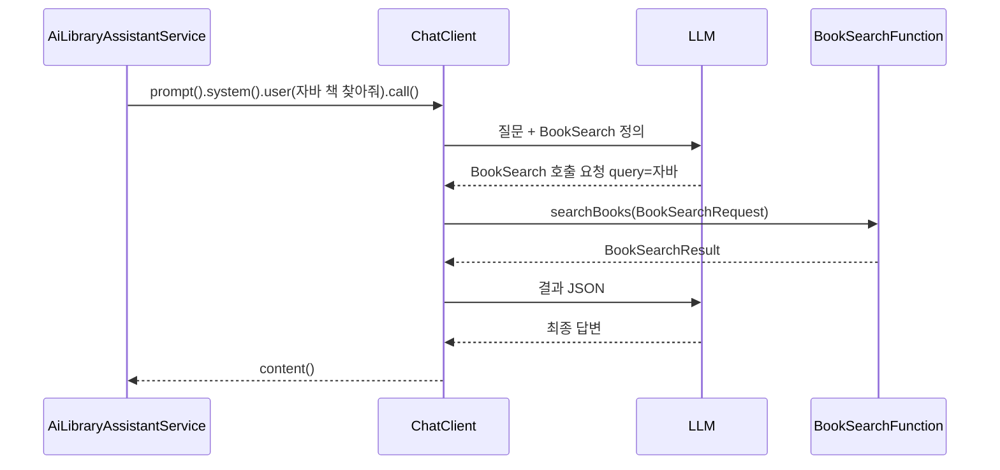

# 02. 단일 Function 구현: 도서 검색

> 내부 DB 도서 검색 기능을 Tool 하나로 만들어 `ChatClient`에 등록하고, LLM이 질문을 보고 이 Tool을 스스로 호출하는 과정을 확인합니다.
>
> 예상 소요 시간: 1.5시간 · 난이도: 기본

## 학습 목표

- Tool의 입력·출력 DTO를 record로 설계할 수 있다
- 기존 서비스(`BookSearchService`)를 감싸는 Tool 메서드를 구현할 수 있다
- `FunctionToolCallback.builder()`로 Tool을 만들고 `ChatClient`에 등록할 수 있다
- 로그로 LLM이 Tool을 호출했는지 확인할 수 있다

## 시작하기 전에

- [00. 이론](./00.theory.md)의 Tool Calling 절과 [01. 개요](./01.overview.md)를 읽습니다.
- Step 2의 [하이브리드 검색](../step-2/05.hybrid-search.md)으로 `BookSearchService`가 동작해야 합니다.
- `spring.ai.selected-model`에 맞는 LLM(기본 `ollama` + `qwen2.5:latest`, 또는 `gemini`)이 준비되어 있어야 합니다.
- 모르는 용어는 [용어집](../glossary.md)을 참고합니다.

## 1. 왜 필요한가

Step 3에서는 컨트롤러가 검색을 먼저 실행하고, 그 결과를 프롬프트에 넣어 LLM에게 넘겼습니다. 검색 여부를 개발자가 정한 셈입니다.

```java
// Step 3 방식: 개발자가 항상 검색을 먼저 실행
var books = bookSearchService.searchBooks(pageable, request);
String answer = chatClient.prompt().user(buildPrompt(books, question)).call().content();
```

이 방식은 "안녕하세요"처럼 검색이 필요 없는 질문에도 검색을 실행하고, "검색 후 리뷰까지" 같은 조합에는 대응하지 못합니다. 이번 문서에서는 검색을 Tool로 등록해 **LLM이 필요할 때만 호출**하도록 바꿉니다.

## 2. 핵심 개념

### 2.1. Tool = 이름 + 설명 + 입력 타입 + 실행할 메서드

Spring AI 1.1.2에서 Tool 하나는 `ToolCallback` 객체입니다. `FunctionToolCallback.builder()`는 Java 메서드(`Function<I, O>`)를 이 객체로 감싸 줍니다.

| 빌더 메서드 | 의미 | LLM에게 전달되는가 |
|---|---|---|
| `builder("BookSearch", 메서드)` | Tool 이름과 실제로 실행할 메서드 | 이름만 전달 |
| `.description("...")` | 언제 쓰는 Tool인지 설명 | 전달 |
| `.inputType(BookSearchRequest.class)` | 입력 타입. Spring AI가 이 타입으로 JSON 스키마를 만들고, LLM이 보낸 JSON 인자를 이 타입으로 변환 | 스키마로 전달 |

메서드의 반환값은 Spring AI가 JSON 문자열로 바꿔 LLM에게 돌려줍니다.

### 2.2. 호출 흐름



`ChatClient`가 가운데의 "호출 요청 받기 → 메서드 실행 → 결과 전달"을 자동으로 처리하므로, 서비스 코드에서는 `call().content()` 한 번만 부릅니다.

## 3. 따라 하기

만들 파일은 다음과 같습니다(모두 저장소에 이미 있으므로 읽으며 따라가도 됩니다).

```text
src/main/java/net/java21/library/ai/
├── function/
│   ├── dto/
│   │   ├── BookSearchRequest.java
│   │   └── BookSearchResult.java
│   └── BookSearchFunction.java
└── service/
    └── AiLibraryAssistantService.java
```

### STEP 1. 입력 DTO: BookSearchRequest

목표: LLM이 만들어 보낼 인자의 모양을 정합니다.

```java
// 전체 코드: src/main/java/net/java21/library/ai/function/dto/BookSearchRequest.java
public record BookSearchRequest(
    String query,
    int limit
) {
    private static final int DEFAULT_LIMIT = 10;

    public BookSearchRequest(String query, int limit) {
        this.query = query;
        this.limit = limit > 0 ? limit : DEFAULT_LIMIT;
    }

    public static BookSearchRequest of(String query) {
        return new BookSearchRequest(query, DEFAULT_LIMIT);
    }
}
```

- 필드 이름 `query`, `limit`이 그대로 JSON 스키마의 속성 이름이 됩니다. LLM은 `{"query": "자바", "limit": 5}` 같은 인자를 만듭니다.
- LLM이 `limit`을 빼먹으면 `0`이 들어오므로, 정규 생성자(canonical constructor)에서 기본값 10으로 보정합니다. LLM이 보내는 값은 항상 검증하고 보정한다고 생각해야 합니다.

### STEP 2. 출력 DTO: BookSearchResult

목표: LLM이 읽을 결과의 모양을 정합니다. 다음 Tool에 넘길 `id`, `isbn`을 꼭 포함합니다.

```java
// 전체 코드: src/main/java/net/java21/library/ai/function/dto/BookSearchResult.java
public record BookSearchResult(
    int count,
    List<BookItem> books
) {
    public record BookItem(
        long id,          // 03 문서의 GetReviews에 넘길 값
        String title,
        String author,
        String publisher,
        String isbn,      // 04 문서의 CheckLoanAvailability에 넘길 값
        String source     // "내부 DB" 또는 "도서관정보나루"
    ) {
        public static BookItem from(long id, String title, String author,
                                    String publisher, String isbn, String source) {
            return new BookItem(id, title, author, publisher, isbn, source);
        }
    }

    public static BookSearchResult empty() {
        return new BookSearchResult(0, List.of());
    }

    public static BookSearchResult from(List<BookItem> books) {
        return new BookSearchResult(books.size(), books);
    }
}
```

- 엔티티(`Book`)를 그대로 돌려주지 않고 필요한 필드만 담습니다. 결과 JSON이 길수록 LLM 처리 시간과 토큰 비용이 늘고, 임베딩 벡터 같은 값은 LLM에게 의미가 없습니다.
- 실제 소스에는 `fromInternalDb()`, `fromLibraryApi()` 팩토리 메서드도 있습니다. 04 문서에서 외부 API 결과를 담을 때 씁니다.

### STEP 3. Tool 메서드: BookSearchFunction

목표: 기존 `BookSearchService`를 호출하고 결과를 `BookSearchResult`로 바꿉니다.

```java
// 전체 코드: src/main/java/net/java21/library/ai/function/BookSearchFunction.java
@Component
@RequiredArgsConstructor
@Slf4j
public class BookSearchFunction {

    private final BookSearchService bookSearchService;

    public BookSearchResult searchBooks(BookSearchRequest request) {
        log.info("[AI Function] 도서 검색 시작: query={}", request.query());

        try {
            // 1. 내부 DB 하이브리드 검색 (core 패키지의 BookSearchRequest와 이름이 같아 전체 경로 사용)
            var coreRequest = new net.java21.library.core.book.dto.BookSearchRequest(
                request.query(), null, SearchType.HYBRID, null, false
            );
            var result = bookSearchService.searchBooks(
                PageRequest.of(0, request.limit()), coreRequest
            );

            // 2. LLM에게 넘길 DTO로 변환
            var bookItems = result.getBooks().getContent().stream()
                .map(this::toBookItem)
                .toList();

            log.info("[AI Function] 검색 완료: {}권", bookItems.size());
            return BookSearchResult.from(bookItems);

        } catch (Exception e) {
            log.error("[AI Function] 검색 실패: query={}", request.query(), e);
            return BookSearchResult.empty();
        }
    }

    private BookSearchResult.BookItem toBookItem(BookSearchResponse book) {
        return BookSearchResult.BookItem.from(
            book.getId(), book.getTitle(), book.getAuthorName(),
            book.getPublisherName(), book.getIsbn(), "내부 DB"
        );
    }
}
```

- Tool 메서드는 새 로직을 만들지 않고 기존 서비스를 감싸기만 합니다. 검색 품질은 Step 2에서 만든 하이브리드 검색이 그대로 책임집니다.
- 예외를 잡아 빈 결과를 돌려줍니다. 예외가 그대로 올라가면 대화 전체가 실패하지만, 빈 결과를 받으면 LLM이 "검색 결과가 없습니다"라고 답할 수 있습니다.
- `[AI Function]` 로그는 LLM이 이 Tool을 실제로 호출했는지 확인하는 유일한 단서입니다.

### STEP 4. Tool 등록: AiLibraryAssistantService

목표: `BookSearchFunction`을 Tool로 감싸 `ChatClient`에 등록하고 질문을 처리합니다.

아래는 Tool 1개만 등록한 학습용 버전입니다. 실제 소스는 04 문서까지 마친 상태라 Tool 3개(`BookSearch`, `GetReviews`, `CheckLoanAvailability`)를 등록합니다.

```java
// 학습용 단순화 버전. 실제 구현: src/main/java/net/java21/library/ai/service/AiLibraryAssistantService.java
@Service
@RequiredArgsConstructor
@Slf4j
public class AiLibraryAssistantService {

    private final ChatModel chatModel;
    private final BookSearchFunction bookSearchFunction;

    public String ask(String userMessage) {
        log.info("[AI Service] 사용자 요청: {}", userMessage);

        // 1. 메서드를 Tool로 감싸기
        FunctionToolCallback<BookSearchRequest, BookSearchResult> bookSearchTool =
            FunctionToolCallback.builder("BookSearch", bookSearchFunction::searchBooks)
                .description("도서관 시스템에서 도서를 검색합니다. " +
                            "제목, 저자명으로 검색할 수 있으며, 검색어를 받아 도서 목록을 반환합니다.")
                .inputType(BookSearchRequest.class)
                .build();

        // 2. Tool을 등록한 ChatClient 만들기
        ChatClient chatClient = ChatClient.builder(chatModel)
            .defaultToolCallbacks(bookSearchTool)
            .build();

        // 3. 시스템 프롬프트: 역할과 응답 규칙
        String systemPrompt = """
            당신은 도서관 도우미 AI입니다.

            **중요: 반드시 한국어로만 답변하세요.**

            사용자의 요청을 처리할 때:
            1. 필요한 도구(함수)를 호출하여 정보를 수집하세요
            2. 도구 호출 결과를 받으면 반드시 자연스러운 한국어로 답변하세요
            """;

        // 4. 호출: Tool 호출과 결과 전달은 ChatClient가 자동 처리
        return chatClient.prompt()
            .system(systemPrompt)
            .user(userMessage)
            .call()
            .content();
    }
}
```

코드 설명

- `bookSearchFunction::searchBooks`는 `Function<BookSearchRequest, BookSearchResult>`로 쓰입니다. `FunctionToolCallback.builder(String, Function)` 오버로드가 선택됩니다.
- 저장소의 서비스는 Tool을 Spring Bean으로 등록하지 않고 `ask()` 안에서 매번 만듭니다. 소스 주석에 따르면 Bean으로 등록했을 때 생긴 순환 의존성 문제를 피하기 위한 선택입니다. 요청마다 `ChatClient`를 새로 만드는 비용은 LLM 호출 시간에 비하면 작습니다.
- 시스템 프롬프트에는 실제로 등록한 Tool만 언급합니다. 등록하지 않은 Tool 이름을 적으면 LLM이 없는 Tool을 호출하려다 실패할 수 있습니다.

Tool 등록 방식은 세 가지가 있으며, 02~04는 두 번째를 씁니다.

| 방식 | 등록 | 이 교재 |
|---|---|---|
| `@Bean` + `@Description`이 붙은 `Function` Bean | `defaultToolNames("Bean 이름")` | 다루지 않음 |
| `FunctionToolCallback.builder()` | `defaultToolCallbacks(tool)` | 02~04 |
| 메서드에 `@Tool`, 파라미터에 `@ToolParam` | `defaultTools(객체)` | [05 문서](./05.tool-annotation.md) |

### STEP 5. 실행하고 확인하기

목표: LLM이 Tool을 호출하는 것을 로그로 확인합니다.

현재 저장소의 Telegram Bot은 일반 메시지를 `AiOrchestrationService`로 보냅니다(01 문서 참고). 이번 실습 결과를 Telegram에서 보려면 실습용 로컬 코드에서 `LibraryTelegramBot.handleAiAgentSearch()`의 호출 한 줄만 바꿉니다. `aiLibraryAssistantService` 필드는 이미 주입되어 있습니다.

```java
// external/telegram/bot/LibraryTelegramBot.java - handleAiAgentSearch() 안 (실습 중에만 변경)
// String aiResponse = aiOrchestrationService.ask(keyword);
String aiResponse = aiLibraryAssistantService.ask(keyword);
```

```bash
mvn spring-boot:run
```

Telegram에서 `자바 책 찾아줘`를 보내면 다음과 비슷한 로그가 찍힙니다.

```log
[Telegram] Received message from chatId 123456789: 자바 책 찾아줘
[AI Service] 사용자 요청: 자바 책 찾아줘
[AI Function] 도서 검색 시작: query=자바
[AI Function] 검색 완료: 5권
```

`[AI Function]` 로그가 있으면 LLM이 Tool을 호출한 것입니다. `query=자바`처럼 LLM이 질문에서 검색어만 골라 인자로 넣은 점도 확인해 보세요.

이번에는 `안녕하세요`를 보냅니다. `[AI Function]` 로그 없이 인사 답변만 온다면, LLM이 검색이 필요 없다고 판단한 것입니다. Step 3 방식과의 차이가 바로 이 부분입니다.

확인이 끝나면 Bot의 호출 대상을 원래대로(`aiOrchestrationService`) 되돌립니다.

## 4. 직접 해 보기

### 미션 1 (기본): 설명을 망가뜨려 보기

`description`을 `"책"`으로 바꾸고 `자바 관련 도서 추천해줘`를 보내 보세요. Tool 호출 여부가 어떻게 달라지는지 로그로 확인하고, 원래 설명으로 되돌립니다.

<details>
<summary>힌트</summary>

모델에 따라 결과가 다르지만, 설명이 짧고 모호할수록 Tool을 호출하지 않고 학습한 지식으로 답하거나, 다른 질문에서 엉뚱하게 호출하는 경우가 늘어납니다. "무엇을 하는지", "어떤 입력을 받는지", "무엇을 돌려주는지"를 모두 쓰는 것이 좋습니다.

</details>

### 미션 2 (기본): BookSearchFunction 단위 테스트

검색 서비스가 예외를 던질 때 `BookSearchFunction`이 빈 결과를 돌려주는지 Spring Context 없이 검증해 보세요.

<details>
<summary>정답 코드</summary>

```java
// src/test/java/net/java21/library/ai/function/BookSearchFunctionTest.java
@ExtendWith(MockitoExtension.class)
class BookSearchFunctionTest {

    @Mock
    private BookSearchService bookSearchService;

    @InjectMocks
    private BookSearchFunction bookSearchFunction;

    @Test
    @DisplayName("검색 중 예외가 발생하면 빈 결과를 반환한다")
    void returnsEmptyResultWhenSearchFails() {
        when(bookSearchService.searchBooks(any(Pageable.class),
                any(net.java21.library.core.book.dto.BookSearchRequest.class)))
            .thenThrow(new RuntimeException("DB 오류"));

        BookSearchResult result = bookSearchFunction.searchBooks(BookSearchRequest.of("자바"));

        assertThat(result.count()).isZero();
        assertThat(result.books()).isEmpty();
    }
}
```

`searchBooks`는 2개 인자와 3개 인자 오버로드가 있으므로 `any(Pageable.class)`처럼 타입을 지정해 2개 인자 버전을 고릅니다.

</details>

### 미션 3 (도전): limit 보정 확인

`BookSearchRequest`에 `limit`으로 `0`과 `-1`을 넣었을 때 10이 되는지 확인하는 테스트를 작성해 보세요. LLM이 인자를 빼먹는 상황을 흉내 낸 것입니다.

<details>
<summary>정답 코드</summary>

```java
@ParameterizedTest
@ValueSource(ints = {0, -1})
@DisplayName("limit이 0 이하이면 기본값 10을 사용한다")
void usesDefaultLimit(int limit) {
    assertThat(new BookSearchRequest("자바", limit).limit()).isEqualTo(10);
}
```

</details>

## 5. 자주 하는 실수

**Tool이 호출되지 않는다**
- 증상: `[AI Function]` 로그가 찍히지 않고 LLM이 일반 지식으로 답합니다.
- 원인: 설명이 모호하거나, Tool Calling을 지원하지 않는 모델을 쓰고 있습니다.
- 해결: 설명을 구체적으로 고치고, `spring.ai.ollama.chat.options.model`이 `qwen2.5:latest`처럼 tools를 지원하는 모델인지 확인합니다.

**Telegram 응답이 바뀌지 않는다**
- 증상: `AiLibraryAssistantService`를 고쳤는데 Telegram 답변과 로그가 그대로입니다. 로그에 `[MainAgent]`가 찍힙니다.
- 원인: Bot이 `AiOrchestrationService`를 호출하고 있습니다.
- 해결: STEP 5처럼 `handleAiAgentSearch()`의 호출 대상을 바꿉니다.

**Tool 예외로 대화 전체가 실패한다**
- 증상: DB나 임베딩 서버 오류 때 사용자에게 오류 메시지만 갑니다.
- 원인: Tool 메서드에서 예외를 잡지 않았습니다.
- 해결: Tool 메서드에서 예외를 잡아 `BookSearchResult.empty()`처럼 LLM이 해석할 수 있는 결과를 돌려줍니다.

**Ollama 응답이 타임아웃된다**
- 증상: Tool 호출 후 응답 대기 중 Read timeout이 납니다.
- 원인: Tool을 쓰면 LLM 호출이 두 번 이상 일어나 전체 시간이 길어집니다.
- 해결: `AiConfig.ollamaRestClientBuilder()`의 읽기 타임아웃(5분)이 적용되는지 확인합니다. 응답이 계속 느리면 `limit`을 줄여 결과 JSON을 작게 만듭니다.

## 6. 정리

- Tool은 이름, 설명, 입력 타입, 실행할 메서드로 이루어지며, `FunctionToolCallback.builder()`로 만들고 `defaultToolCallbacks()`로 등록합니다.
- Tool 메서드는 기존 서비스를 감싸고, 결과는 LLM이 읽기 좋은 작은 DTO로 바꾸며, 예외는 빈 결과로 처리합니다.
- LLM은 질문에 따라 Tool을 호출하기도, 하지 않기도 합니다. 로그로 확인하는 습관이 중요합니다.

- [ ] `BookSearchRequest`, `BookSearchResult`의 필드가 왜 그렇게 정해졌는지 설명할 수 있다
- [ ] `FunctionToolCallback.builder()`의 각 메서드 역할을 말할 수 있다
- [ ] 검색이 필요한 질문과 필요 없는 질문에서 Tool 호출 여부를 로그로 확인했다

## 확인 문제

**1. `FunctionToolCallback.builder()`에 넘긴 정보 중 LLM에게 전달되지 않는 것은 무엇입니까?**

<details>
<summary>정답</summary>

실행할 메서드(`bookSearchFunction::searchBooks`)의 코드입니다. LLM에게는 이름, 설명, 입력 타입에서 만든 JSON 스키마만 전달됩니다.

</details>

**2. `BookSearchResult.BookItem`에 `id`와 `isbn`을 포함하는 이유는 무엇입니까?**

<details>
<summary>정답</summary>

다음 Tool의 입력으로 쓰이기 때문입니다. LLM은 검색 결과의 `id`를 리뷰 조회에, `isbn`을 대출 조회에 넘깁니다. 결과에 없으면 LLM이 넘길 값이 없습니다.

</details>

**3. Tool 메서드에서 예외를 잡아 빈 결과를 돌려주면 어떤 점이 좋습니까?**

<details>
<summary>정답</summary>

대화 전체가 실패하지 않고, LLM이 빈 결과를 보고 "검색 결과가 없습니다"처럼 사용자에게 상황을 설명할 수 있습니다.

</details>

**4. "안녕하세요"라는 질문에 `[AI Function]` 로그가 찍히지 않은 것은 무엇을 뜻합니까?**

<details>
<summary>정답</summary>

LLM이 질문을 보고 도서 검색이 필요 없다고 판단해 Tool을 호출하지 않았다는 뜻입니다. 항상 검색을 먼저 실행하던 Step 3 방식과 달리, 호출 여부를 LLM이 정합니다.

</details>

## 다음 문서

[03. 복수 Function 조합: 검색 + 리뷰 →](03.multiple-functions.md)
