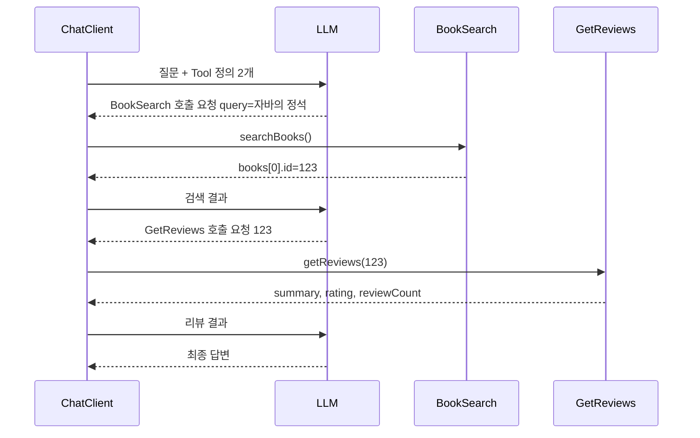

# 03. 복수 Function 조합: 검색 + 리뷰

> 리뷰 조회 Tool을 추가해 두 Tool을 함께 등록하고, LLM이 검색 결과의 도서 ID를 꺼내 리뷰 조회에 넘기는 연쇄 호출(Tool Chaining)을 확인합니다.
>
> 예상 소요 시간: 1.5시간 · 난이도: 기본

## 학습 목표

- 리뷰 조회 기능을 Tool로 구현할 수 있다
- `ChatClient`에 여러 Tool을 등록할 수 있다
- LLM이 한 Tool의 결과를 다음 Tool의 입력으로 쓰는 과정을 설명할 수 있다
- 로그로 Tool 호출 순서를 확인할 수 있다

## 시작하기 전에

- [02. 단일 Function 구현](./02.single-function.md)을 마쳐야 합니다.
- Step 4의 [리뷰 요약](../step-4/04.review-summarization.md)으로 리뷰와 요약 데이터가 있어야 결과를 확인할 수 있습니다.
- 모르는 용어는 [용어집](../glossary.md)을 참고합니다.

## 1. 왜 필요한가

02 문서의 서비스에 "자바의 정석 리뷰 어때?"라고 물으면 LLM은 검색까지만 할 수 있습니다. 리뷰를 조회할 Tool이 없으니 검색 결과만 보여 주거나, 리뷰 내용을 지어낼 위험이 있습니다.

리뷰 조회 Tool을 추가하면 새로운 문제가 생깁니다. 리뷰 조회는 도서 ID를 받는데, 사용자는 제목만 말합니다. 예전 방식이라면 개발자가 "검색 → 첫 번째 결과의 ID 꺼내기 → 리뷰 조회"를 코드로 이어 붙여야 합니다. Tool Calling에서는 이 연결을 LLM이 합니다. 개발자는 두 Tool을 등록하기만 하고, 순서와 값 전달은 LLM이 결정합니다.

## 2. 핵심 개념

### 2.1. Tool Chaining: 결과가 다음 입력이 된다



LLM 호출이 세 번 일어난다는 점에 주목하세요. 두 번은 Tool 호출 요청을 받기 위해, 마지막 한 번은 최종 답변을 받기 위해서입니다. Tool이 늘면 응답 시간도 늘어납니다.

### 2.2. LLM이 순서를 정하는 근거

LLM은 Tool 정의만 보고 순서를 추론합니다.

- `GetReviews`의 설명: "도서 ID를 받아 리뷰 요약, 평점, 주요 리뷰를 제공합니다."
- 사용자 질문에는 도서 ID가 없습니다.
- `BookSearch`의 결과 예시에는 `id`가 있습니다.

그래서 "먼저 검색해 ID를 얻는다"는 결론에 이릅니다. 설명에 입력값의 출처가 드러나도록 쓰면 LLM이 순서를 더 잘 잡습니다.

## 3. 따라 하기

### STEP 1. 출력 DTO: ReviewResult

목표: LLM에게 넘길 리뷰 정보의 모양을 정합니다.

```java
// 전체 코드: src/main/java/net/java21/library/ai/function/dto/ReviewResult.java
public record ReviewResult(
    long bookId,
    String summary,        // Step 4에서 만든 리뷰 요약
    double rating,         // 평균 평점
    int reviewCount,       // 전체 리뷰 수
    List<ReviewItem> reviews   // 상위 N개 리뷰
) {
    public record ReviewItem(String content, int rating) {
        public static ReviewItem of(String content, int rating) {
            return new ReviewItem(content, rating);
        }
    }

    public static ReviewResult of(long bookId, String summary, double rating,
                                  int reviewCount, List<ReviewItem> reviews) {
        return new ReviewResult(bookId, summary, rating, reviewCount, reviews);
    }

    public static ReviewResult empty(long bookId) {
        return new ReviewResult(bookId, "리뷰가 없습니다.", 0.0, 0, List.of());
    }
}
```

- 리뷰 전체가 아니라 요약과 상위 몇 개만 담습니다. 리뷰가 수백 개인 책의 리뷰를 모두 넘기면 LLM 입력이 지나치게 길어집니다.
- `empty()`의 요약 문구 "리뷰가 없습니다."는 LLM이 그대로 읽고 사용자에게 전달할 수 있는 문장입니다.

### STEP 2. Tool 메서드: ReviewFunction

목표: 기존 `ReviewService`와 리뷰 요약 조회를 묶어 `ReviewResult`로 돌려줍니다.

```java
// 전체 코드: src/main/java/net/java21/library/ai/function/ReviewFunction.java
@Component
@RequiredArgsConstructor
@Slf4j
public class ReviewFunction {

    private final ReviewService reviewService;
    private final BookSearchService bookSearchService;

    private static final int REVIEW_LIMIT = 5;

    public ReviewResult getReviews(Long bookId) {
        log.info("[AI Function] 리뷰 조회 시작: bookId={}", bookId);

        try {
            // 1. 리뷰 상위 5개
            var reviews = reviewService.getReviews(bookId, PageRequest.of(0, REVIEW_LIMIT));

            // 2. Step 4에서 만든 리뷰 요약
            String summary = bookSearchService.getReviewSummary(bookId);

            // 3. 평균 평점 (가져온 리뷰 기준)
            double avgRating = reviews.getContent().stream()
                .mapToInt(ReviewResponse::rating)
                .average()
                .orElse(0.0);

            List<ReviewResult.ReviewItem> reviewItems = reviews.getContent().stream()
                .map(review -> ReviewResult.ReviewItem.of(review.content(), review.rating()))
                .toList();

            log.info("[AI Function] 리뷰 조회 완료: bookId={}, reviewCount={}",
                bookId, reviewItems.size());

            return ReviewResult.of(bookId, summary, avgRating,
                (int) reviews.getTotalElements(), reviewItems);

        } catch (Exception e) {
            log.error("[AI Function] 리뷰 조회 실패: bookId={}", bookId, e);
            return ReviewResult.empty(bookId);
        }
    }
}
```

- 평균 평점은 가져온 상위 5개 리뷰로 계산합니다. 전체 평균이 필요하면 리포지토리에서 집계하도록 바꿀 수 있습니다(미션 3).
- `reviewCount`는 `getTotalElements()`로 전체 리뷰 수를 넣습니다. 평점 계산 대상(최대 5개)과 다르다는 점에 유의합니다.

### STEP 3. 두 Tool 등록하기

목표: `AiLibraryAssistantService`에 `GetReviews`를 추가합니다.

```java
// 학습용 단순화 버전. 실제 구현(Tool 3개): src/main/java/net/java21/library/ai/service/AiLibraryAssistantService.java
private final ChatModel chatModel;
private final BookSearchFunction bookSearchFunction;
private final ReviewFunction reviewFunction;   // 추가

public String ask(String userMessage) {
    FunctionToolCallback<BookSearchRequest, BookSearchResult> bookSearchTool =
        FunctionToolCallback.builder("BookSearch", bookSearchFunction::searchBooks)
            .description("도서관 시스템에서 도서를 검색합니다. " +
                        "제목, 저자명으로 검색할 수 있으며, 검색어를 받아 도서 목록을 반환합니다.")
            .inputType(BookSearchRequest.class)
            .build();

    FunctionToolCallback<Long, ReviewResult> reviewTool =
        FunctionToolCallback.builder("GetReviews", reviewFunction::getReviews)
            .description("도서의 리뷰 목록을 조회합니다. " +
                        "도서 ID를 받아 리뷰 요약, 평점, 주요 리뷰를 제공합니다.")
            .inputType(Long.class)
            .build();

    ChatClient chatClient = ChatClient.builder(chatModel)
        .defaultToolCallbacks(bookSearchTool, reviewTool)   // 여러 개를 나열
        .build();

    String systemPrompt = """
        당신은 도서관 도우미 AI입니다.

        **중요: 반드시 한국어로만 답변하세요.**

        사용자의 요청을 처리할 때:
        1. 필요한 도구(함수)를 호출하여 정보를 수집하세요
        2. 도구 호출 결과를 받으면 반드시 자연스러운 한국어로 답변하세요
        3. 검색 결과와 리뷰 정보를 종합해서 친절하게 설명하세요
        """;

    return chatClient.prompt().system(systemPrompt).user(userMessage).call().content();
}
```

코드 설명

- `defaultToolCallbacks()`는 가변 인자이므로 Tool을 나열하기만 하면 됩니다. 나열 순서는 호출 순서와 관계가 없습니다. 순서는 LLM이 정합니다.
- `GetReviews`의 입력 타입은 record가 아닌 `Long`입니다. 실제 소스가 이렇게 되어 있으며, 실행할 메서드 시그니처(`getReviews(Long)`)와 맞춘 것입니다. 모델 API에 따라 Tool 파라미터를 객체(`{"bookId": 123}`) 형태로 기대하는 경우가 있으므로, 새로 만드는 Tool은 02 문서처럼 record로 감싸는 편이 안전합니다. 05 문서의 `@Tool` 방식에서는 `@ToolParam`이 붙은 메서드 파라미터가 객체 속성으로 표현되어 이 문제가 없습니다.
- `LibraryTelegramBot`은 고칠 필요가 없습니다. 02 문서에서 실습용으로 호출 대상을 바꿔 두었다면, 등록 Tool이 늘어난 효과가 바로 나타납니다.

### STEP 4. 실행하고 확인하기

목표: 질문에 따라 Tool이 0개, 1개, 2개 호출되는 것을 확인합니다.

```bash
mvn spring-boot:run
```

| 보낼 메시지 | 기대하는 Tool 호출 |
|---|---|
| `자바의 정석 책 정보랑 리뷰도 알려줘` | `BookSearch` → `GetReviews` |
| `파이썬 책 찾아줘` | `BookSearch`만 |
| `고마워` | 없음 |

첫 번째 메시지의 로그는 다음과 비슷합니다.

```log
[AI Service] 사용자 요청: 자바의 정석 책 정보랑 리뷰도 알려줘
[AI Function] 도서 검색 시작: query=자바의 정석
[AI Function] 검색 완료: 3권
[AI Function] 리뷰 조회 시작: bookId=123
[AI Function] 리뷰 조회 완료: bookId=123, reviewCount=5
[AI Service] AI 응답 생성 완료
```

`리뷰 조회 시작: bookId=123`의 `123`이 바로 앞 검색 결과의 `id`와 같은지 확인하세요. 이 값은 개발자 코드가 아니라 LLM이 넘긴 것입니다.

검색 결과가 여러 권이면 LLM이 첫 번째 책만 리뷰를 조회하거나, 여러 권 모두 조회할 수도 있습니다. 모델과 질문 표현에 따라 달라지는 부분이므로, 원하는 동작이 있다면 시스템 프롬프트에 규칙을 적습니다(미션 2).

## 4. 직접 해 보기

### 미션 1 (기본): 설명에 입력 출처 적기

`GetReviews`의 설명을 다음처럼 바꾸고, 리뷰 질문에서 호출 순서가 더 안정적인지 비교해 보세요.

```java
.description("도서의 리뷰 요약, 평균 평점, 주요 리뷰를 조회합니다. " +
            "입력은 도서 ID(숫자)이며, 도서 ID는 BookSearch 결과의 id 값을 사용합니다.")
```

<details>
<summary>힌트</summary>

입력값을 어디서 얻는지 설명에 적으면 LLM이 검색을 먼저 호출해야 한다는 것을 추론하기 쉬워집니다. 제목 문자열을 `GetReviews`에 바로 넣는 실수도 줄어듭니다.

</details>

### 미션 2 (기본): 여러 권일 때 규칙 정하기

"자바 책 리뷰 좋은 거 알려줘"처럼 검색 결과가 여러 권인 질문에서, 상위 3권의 리뷰를 모두 비교해 답하도록 시스템 프롬프트에 규칙을 추가해 보세요. 로그에서 `GetReviews`가 몇 번 호출되는지 확인합니다.

<details>
<summary>예시 답안</summary>

```text
4. 사용자가 여러 도서의 리뷰를 비교하길 원하면, 검색 결과 상위 3권 각각에 대해 GetReviews를 호출하고 평점과 요약을 비교해 답하세요.
```

Tool 호출이 늘어나는 만큼 응답 시간도 길어진다는 점을 함께 관찰합니다.

</details>

### 미션 3 (도전): ReviewFunction 단위 테스트

리뷰가 하나도 없을 때 평점 0.0, 리뷰 수 0, 요약은 `getReviewSummary()`의 반환값이 되는지 검증하는 테스트를 작성해 보세요.

<details>
<summary>정답 코드</summary>

```java
// src/test/java/net/java21/library/ai/function/ReviewFunctionTest.java
@ExtendWith(MockitoExtension.class)
class ReviewFunctionTest {

    @Mock private ReviewService reviewService;
    @Mock private BookSearchService bookSearchService;
    @InjectMocks private ReviewFunction reviewFunction;

    @Test
    @DisplayName("리뷰가 없으면 평점 0.0과 리뷰 수 0을 반환한다")
    void returnsZeroWhenNoReviews() {
        when(reviewService.getReviews(eq(123L), any(Pageable.class))).thenReturn(Page.empty());
        when(bookSearchService.getReviewSummary(123L)).thenReturn("요약 없음");

        ReviewResult result = reviewFunction.getReviews(123L);

        assertThat(result.rating()).isZero();
        assertThat(result.reviewCount()).isZero();
        assertThat(result.summary()).isEqualTo("요약 없음");
    }
}
```

</details>

## 5. 자주 하는 실수

**LLM이 제목을 리뷰 Tool에 넣는다**
- 증상: `GetReviews` 호출 시 인자 변환 오류가 나거나 리뷰 Tool이 호출되지 않습니다.
- 원인: LLM이 검색 없이 바로 리뷰를 조회하려 했고, 숫자 ID 대신 제목을 넣었습니다.
- 해결: 설명에 "도서 ID는 BookSearch 결과의 id 값"이라고 입력 출처를 적습니다(미션 1).

**리뷰 Tool이 예외를 던져 대화가 끊긴다**
- 증상: 존재하지 않는 ID로 호출되면 사용자에게 오류 메시지만 갑니다.
- 원인: Tool 메서드에서 예외를 처리하지 않았습니다.
- 해결: `ReviewResult.empty(bookId)`처럼 LLM이 이해할 수 있는 빈 결과를 돌려줍니다.

**검색 결과에 ID가 0으로 나온다**
- 증상: `bookId=0`으로 리뷰를 조회합니다.
- 원인: 내부 DB에 없을 때 도서관정보나루 API로 대체 검색하는 Tool(Telegram에 연결된 `SearchBooks`의 `LibraryFunctions.searchBooks()`, 05 문서의 `LibraryTools.searchBooks`)은 API 결과를 `fromLibraryApi()`로 만들며, 이때 내부 DB ID가 없어 `0`이 됩니다. 이 문서의 `BookSearchFunction`은 내부 DB만 검색하므로 해당하지 않습니다.
- 해결: 리뷰는 내부 DB 도서에만 있으므로 `source`가 "내부 DB"인 결과만 리뷰 대상으로 삼으라고 설명이나 프롬프트에 적습니다.

**Tool을 너무 많이 등록한다**
- 증상: Tool이 늘수록 엉뚱한 Tool을 고르거나 응답이 느려집니다.
- 원인: 모든 Tool 정의가 매 요청의 LLM 입력에 들어가고, 비슷한 Tool이 많으면 선택이 어려워집니다.
- 해결: 질문 유형에 필요한 Tool만 등록하고, 이름과 설명이 겹치지 않게 합니다.

## 6. 정리

- `defaultToolCallbacks()`에 여러 Tool을 나열하면 LLM이 질문에 맞는 Tool을 골라 필요한 순서로 호출합니다.
- 한 Tool의 결과에 담긴 값(도서 ID)을 LLM이 다음 Tool의 인자로 넘기는 것이 Tool Chaining입니다.
- Tool 호출이 늘면 LLM 호출 횟수와 응답 시간도 늘어납니다.
- 설명에 입력값의 출처를 적으면 LLM이 호출 순서를 더 정확히 잡습니다.

- [ ] `ReviewFunction`이 어떤 기존 서비스를 감싸는지 설명할 수 있다
- [ ] 두 Tool을 등록하고 질문별 호출 개수 차이를 로그로 확인했다
- [ ] 로그에서 검색 결과의 `id`가 리뷰 조회 인자로 전달된 것을 확인했다

## 확인 문제

**1. "자바의 정석 리뷰 알려줘" 질문 하나를 처리하는 동안 LLM은 최소 몇 번 호출됩니까?**

<details>
<summary>정답</summary>

세 번입니다. `BookSearch` 호출 요청을 받을 때, `GetReviews` 호출 요청을 받을 때, 최종 답변을 받을 때입니다.

</details>

**2. `defaultToolCallbacks(bookSearchTool, reviewTool)`의 나열 순서를 바꾸면 호출 순서도 바뀝니까?**

<details>
<summary>정답</summary>

바뀌지 않습니다. 나열 순서는 등록 목록일 뿐이고, 호출 순서는 LLM이 질문과 Tool 정의를 보고 결정합니다.

</details>

**3. `ReviewResult`에 리뷰 전체가 아니라 요약과 상위 5개만 담는 이유는 무엇입니까?**

<details>
<summary>정답</summary>

Tool 결과는 LLM 입력에 그대로 들어가므로, 길수록 처리 시간과 토큰 비용이 늘고 핵심 정보가 묻힐 수 있기 때문입니다.

</details>

**4. 검색 결과에 `id`가 `0`인 도서가 있을 때 리뷰 조회를 하면 안 되는 이유는 무엇입니까?**

<details>
<summary>정답</summary>

`id`가 `0`인 항목은 도서관정보나루 API에서 가져온 결과라 내부 DB에 없는 도서입니다. 리뷰는 내부 DB 도서에만 있으므로 조회해도 결과가 없습니다.

</details>

## 다음 문서

[04. 외부 API 연동: 대출 가능 여부 조회 →](04.external-api.md)
