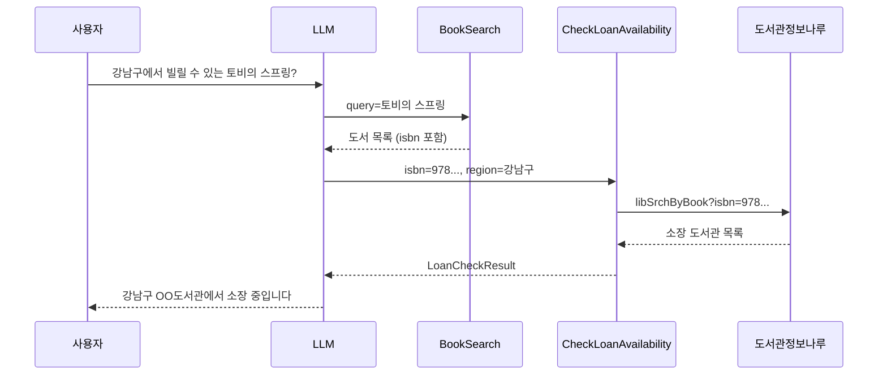

# 04. 외부 API 연동: 대출 가능 도서관 조회

> 도서관정보나루 Open API를 감싸는 `LoanCheckFunction`을 만들어, LLM이 "이 책을 어느 도서관에서 빌릴 수 있는지"까지 답하게 합니다. 외부 API를 Tool로 쓸 때 필요한 방어 코드(예외 처리, 빈 결과, 타임아웃)도 함께 다룹니다.
>
> 예상 소요 시간: 2시간 · 난이도: 기본

## 학습 목표

- 내부 DB 조회 Tool과 외부 API 호출 Tool의 차이(지연, 장애, 데이터 품질)를 설명할 수 있다.
- `LibraryInfoNaruApiClient`를 사용하는 `LoanCheckFunction`을 구현할 수 있다.
- 외부 API 실패가 LLM 응답 전체를 깨뜨리지 않도록 예외를 처리할 수 있다.
- `AiLibraryAssistantService`에 세 번째 Tool을 등록하고 검색 → 대출 조회 순서의 호출을 확인할 수 있다.

## 시작하기 전에

- [03. 복수 Function 조합](./03.multiple-functions.md)을 마쳐 `BookSearch`, `GetReviews` 두 Tool이 동작해야 합니다.
- 도서관정보나루 API 키(`LIBRARY_API_KEY`)를 `secrets.properties`에 넣어 둡니다. API 명세는 [도서관정보나루 API 매뉴얼](./도서관정보나루_API_Manual.md), 지역 코드는 [지역 코드 표](./region-codes.md)를 참고합니다.
- 모르는 용어는 [용어집](../glossary.md)에서 찾아봅니다.

## 1. 왜 필요한가

지금까지 만든 Tool은 모두 우리 DB 안에서 답을 찾았습니다. 그런데 사용자가 정말 궁금한 것은 종종 DB 밖에 있습니다.

```text
사용자: 강남구에서 빌릴 수 있는 토비의 스프링 있어?
```

우리 DB에는 "토비의 스프링"이라는 책 정보와 리뷰는 있지만, 전국 공공도서관 중 어디가 이 책을 소장하고 있는지는 없습니다. 이 정보는 도서관정보나루가 갖고 있습니다. 그래서 LLM에게 "외부 API를 호출하는 도구"를 하나 더 쥐여 주면, LLM은 다음처럼 두 단계로 답을 만들 수 있습니다.

1. `BookSearch`로 책을 찾아 ISBN을 얻는다.
2. 그 ISBN으로 `CheckLoanAvailability`를 호출해 소장 도서관을 얻는다.

LLM 입장에서는 내부 DB든 외부 API든 똑같은 "도구"입니다. 차이는 개발자 쪽에 있습니다. 외부 API는 느리고, 가끔 실패하고, 응답 형식이 우리 마음대로 되지 않습니다. 이 문서의 절반은 그 차이를 다루는 내용입니다.

## 2. 핵심 개념

### 2.1. Tool 체이닝: 앞 Tool의 출력이 다음 Tool의 입력이 됨

LLM은 한 번의 요청 안에서 Tool을 여러 번 호출할 수 있습니다. 이때 앞에서 얻은 값(ISBN)을 다음 호출의 인자로 넘기는 것을 **Tool 체이닝**이라고 부르겠습니다.



체이닝이 잘 되려면 앞 Tool의 결과에 다음 Tool이 필요한 값이 들어 있어야 합니다. `BookSearchResult.BookItem`에 `isbn` 필드가 있는 이유가 이것입니다.

### 2.2. 외부 API를 Tool로 쓸 때의 고려 사항

| 항목 | 문제 | 이 프로젝트의 대응 |
|---|---|---|
| 응답 시간 | 외부 서버가 느리면 LLM 응답 전체가 늦어짐 | `RestClient.Builder` 타임아웃, 결과 캐시(`@Cacheable`) |
| 장애 | API가 실패하면 Tool이 예외를 던짐 | 클라이언트와 Function 양쪽에서 예외를 잡고 빈 결과 반환 |
| 데이터 양 | 전국 도서관 목록이 길어 프롬프트가 커짐 | `limit`(기본 10)으로 상위 N개만 반환 |
| 데이터 품질 | 응답에 필요한 필드가 없을 수 있음 | 없는 값은 빈 값으로 두고 문서와 프롬프트에 한계를 밝힘 |

### 2.3. Tool은 예외를 던지기보다 "빈 결과"를 돌려준다

Tool 안에서 예외가 터지면 Spring AI 설정에 따라 예외 메시지가 LLM에게 그대로 전달되거나(`spring.ai.tools.throw-exception-on-error=false`, 기본값) 호출 전체가 실패합니다. 어느 쪽이든 LLM은 쓸 만한 데이터를 받지 못하고, 사용자는 스택 트레이스 문구나 "오류가 발생했습니다" 같은 응답을 보게 됩니다. 반대로 Tool이 "결과 0건"을 돌려주면 LLM은 "해당 지역에서 소장 도서관을 찾지 못했습니다"처럼 자연스럽게 답할 수 있습니다. 이 프로젝트의 Function 클래스가 모두 `try-catch`로 감싸고 `empty()`를 반환하는 이유입니다.

## 3. 따라 하기

### STEP 1. 요청·응답 DTO 정의

목표: LLM이 채울 입력(`LoanCheckRequest`)과 LLM에게 돌려줄 출력(`LoanCheckResult`)을 정합니다.

```java
// ai/function/dto/LoanCheckRequest.java
public record LoanCheckRequest(
    String isbn,        // 필수
    String region,      // 선택: 예) "서울", "강남구"
    Double latitude,    // 선택: 거리 계산용(현재 미사용)
    Double longitude,   // 선택: 거리 계산용(현재 미사용)
    int limit           // 0 이하이면 기본값 10
) {
    private static final int DEFAULT_LIMIT = 10;

    public LoanCheckRequest {
        if (limit <= 0) {
            limit = DEFAULT_LIMIT;
        }
    }
}
```

```java
// ai/function/dto/LoanCheckResult.java
public record LoanCheckResult(
    String isbn,
    int totalLibraries,          // 필터링 전 전체 도서관 수
    List<LibraryInfo> libraries  // 상위 limit개
) {
    public record LibraryInfo(String name, String address, Double distance,
                              String phone, boolean loanAvailable, String operatingHours) { ... }

    public static LoanCheckResult empty(String isbn) {
        return new LoanCheckResult(isbn, 0, List.of());
    }
}
```

코드 설명:
- `FunctionToolCallback`은 `inputType`의 필드로 JSON 스키마를 만들어 LLM에게 보냅니다. 필드 이름(`isbn`, `region`)이 곧 LLM이 채울 인자 이름이므로 의미가 분명한 이름을 씁니다.
- `limit`이 `int`라서 LLM이 값을 생략하면 0이 들어옵니다. compact 생성자에서 기본값으로 바꿔 줍니다.

전체 코드: [`LoanCheckRequest.java`](../../src/main/java/net/java21/library/ai/function/dto/LoanCheckRequest.java), [`LoanCheckResult.java`](../../src/main/java/net/java21/library/ai/function/dto/LoanCheckResult.java)

### STEP 2. LoanCheckFunction 구현

목표: ISBN을 받아 도서관정보나루를 호출하고, 지역 필터링과 개수 제한을 거쳐 결과를 돌려줍니다.

```java
@Component
@RequiredArgsConstructor
@Slf4j
public class LoanCheckFunction {

    private final LibraryInfoNaruApiClient libraryInfoNaruApiClient;

    public LoanCheckResult checkLoanAvailability(LoanCheckRequest request) {
        log.info("[AI Function] 대출 가능 여부 조회 시작: isbn={}", request.isbn());
        try {
            // 1. 도서관정보나루 API 호출 (전국)
            List<LoanItemInfo> loanItems =
                libraryInfoNaruApiClient.searchLoanItemsByIsbn(request.isbn());
            if (loanItems.isEmpty()) {
                return LoanCheckResult.empty(request.isbn());
            }

            // 2. 지역 필터링 (주소 문자열에 region이 포함되는지)
            List<LoanItemInfo> filteredItems = filterByRegion(loanItems, request.region());

            // 3. 상위 N개만 변환해서 반환
            List<LoanCheckResult.LibraryInfo> libraries = filteredItems.stream()
                .limit(request.limit())
                .map(this::toLibraryInfo)
                .toList();

            return LoanCheckResult.of(request.isbn(), loanItems.size(), libraries);
        } catch (Exception e) {
            log.error("[AI Function] 대출 가능 여부 조회 실패: isbn={}", request.isbn(), e);
            return LoanCheckResult.empty(request.isbn());
        }
    }

    private List<LoanItemInfo> filterByRegion(List<LoanItemInfo> loanItems, String region) {
        if (region == null || region.isBlank()) {
            return loanItems;
        }
        return loanItems.stream()
            .filter(item -> item.location() != null && item.location().contains(region))
            .collect(Collectors.toList());
    }
}
```

코드 설명:
- `searchLoanItemsByIsbn(isbn)`은 도서관정보나루의 `libSrchByBook` API(도서 소장 도서관 조회)를 호출합니다. 클라이언트가 응답의 도서관 주소를 `LoanItemInfo.location`에 넣어 주므로, `filterByRegion`은 주소에 "강남구" 같은 문자열이 포함되는지로 지역을 거릅니다.
- 실제 소스에는 위도·경도가 주어지면 거리순으로 정렬하는 `sortByDistance()`가 있지만, API 응답에 도서관 좌표가 없어 지금은 목록을 그대로 반환합니다(TODO). 그래서 `distance`, `phone`, `operatingHours`는 항상 비어 있습니다.
- `totalLibraries`에는 필터링 전 전체 개수를 넣습니다. LLM이 "전국 37곳 중 강남구 2곳"처럼 답할 수 있게 하려는 것입니다.

> 주의: `libSrchByBook`은 "소장 도서관" 목록을 돌려주는 API입니다. 클라이언트는 소장 = 대출 가능으로 가정하고 `loanAvailable`을 `"Y"`로 채웁니다. 실제 대출 중인지까지 확인하려면 도서관 코드와 ISBN으로 `bookExist` API를 호출해야 합니다(`LibraryTools.checkBookExists` 참고). 답변 문구에 "대출 가능"이라고 단정하지 않도록 프롬프트에서 안내하는 것이 안전합니다.

전체 코드: [`LoanCheckFunction.java`](../../src/main/java/net/java21/library/ai/function/LoanCheckFunction.java)

### STEP 3. AiLibraryAssistantService에 세 번째 Tool 등록

목표: 03 문서에서 만든 서비스에 `CheckLoanAvailability` Tool을 추가합니다.

```java
private final LoanCheckFunction loanCheckFunction;   // 필드 추가

public String ask(String userMessage) {
    // ... BookSearch, GetReviews Tool 생성은 03 문서와 같음

    FunctionToolCallback<LoanCheckRequest, LoanCheckResult> loanCheckTool =
        FunctionToolCallback.builder("CheckLoanAvailability", loanCheckFunction::checkLoanAvailability)
            .description("도서의 대출 가능 여부를 조회합니다. " +
                        "ISBN을 받아 전국 도서관의 대출 가능 현황을 제공합니다. " +
                        "지역, 위도, 경도를 제공하면 해당 지역의 가까운 도서관을 우선으로 보여줍니다.")
            .inputType(LoanCheckRequest.class)
            .build();

    ChatClient chatClient = ChatClient.builder(chatModel)
        .defaultToolCallbacks(bookSearchTool, reviewTool, loanCheckTool)
        .build();
    // ... 시스템 프롬프트와 호출
}
```

시스템 프롬프트에는 체이닝 순서를 예시로 적어 둡니다. 실제 소스의 해당 부분은 다음과 같습니다.

```text
**지역 기반 검색 예시:**
사용자: "강남구 근처 도서관에서 빌릴 수 있는 자바 책 알려줘"
1. BookSearch("자바") → 자바 도서 목록 확보 (ISBN)
2. CheckLoanAvailability(isbn, "강남구") → 강남구 도서관 대출 가능 확인
3. 종합 답변: "강남구 도서관에서 빌릴 수 있는 자바 책 5권을 찾았습니다..."
```

코드 설명:
- Tool 이름(`CheckLoanAvailability`)과 프롬프트 속 이름이 정확히 같아야 LLM이 헷갈리지 않습니다.
- Tool과 `ChatClient`를 Bean으로 등록하지 않고 `ask()` 안에서 매번 만드는 이유(순환 의존성 회피)는 [02 문서](./02.single-function.md)에서 설명했습니다.

전체 코드: [`AiLibraryAssistantService.java`](../../src/main/java/net/java21/library/ai/service/AiLibraryAssistantService.java)

### STEP 4. 실행과 확인

```bash
mvn spring-boot:run
```

현재 소스의 Telegram Bot은 일반 메시지와 `/ai` 명령을 `AiOrchestrationService`로 보냅니다(`LibraryTelegramBot.handleAiAgentSearch`). 이 문서에서 만든 `AiLibraryAssistantService`를 확인하려면 다음 중 하나를 고릅니다.

- 실습용으로 `handleAiAgentSearch()`의 호출을 `aiLibraryAssistantService.ask(keyword)`로 잠시 바꿉니다(두 서비스 모두 이미 생성자로 주입되어 있습니다).
- 또는 `ChatModel`과 Function을 Mockito로 대체한 단위 테스트에서 `ask()`를 호출해 봅니다.

Telegram에서 다음 메시지를 보냅니다.

```text
강남구에서 빌릴 수 있는 토비의 스프링 있어?
```

정상이라면 로그가 다음 순서로 찍힙니다(값은 예시).

```log
[AI Service] 사용자 요청: 강남구에서 빌릴 수 있는 토비의 스프링 있어?
[AI Function] 도서 검색 시작: query=토비의 스프링
[AI Function] 검색 완료: 3권
[AI Function] 대출 가능 여부 조회 시작: isbn=9788960773431
[도서관정보나루] 대출 가능 도서 조회: isbn13=9788960773431, region=null, dtlRegion=null
[AI Function] 대출 가능 도서관 조회 완료: isbn=9788960773431, count=2
[AI Service] AI 응답 생성 완료
```

확인할 점:
- `도서 검색` 로그가 `대출 가능 여부 조회`보다 먼저 나오는지(체이닝)
- `isbn=` 값이 검색 결과의 ISBN과 같은지
- ISBN만 보낸 질문("9788960773431 어디서 빌려?")에서는 `CheckLoanAvailability`만 호출되는지

## 4. 직접 해 보기

### 미션 1 (기본): 지역 필터 결과가 0건일 때의 안내

`region`으로 거른 결과가 0건이면 지금은 빈 목록만 돌아갑니다. 전국 소장 도서관이 있는데 해당 지역에만 없는 경우, LLM이 "강남구에는 없지만 전국 N곳에서 소장 중"이라고 답할 수 있게 만들어 보세요.

- 요구사항: `LoanCheckResult`의 기존 필드만 사용합니다.
- 힌트: `totalLibraries`와 `libraries.size()`를 비교할 수 있도록 Tool 설명이나 시스템 프롬프트에 의미를 적어 줍니다.

<details>
<summary>정답 예시</summary>

`totalLibraries`에는 이미 필터링 전 개수가 들어 있으므로 코드 변경 없이 설명만 보강하면 됩니다.

```java
.description("도서의 대출 가능 여부를 조회합니다. ISBN을 받아 전국 도서관의 소장 현황을 제공합니다. " +
             "totalLibraries는 전국 소장 도서관 수, libraries는 지역 필터를 적용한 목록입니다. " +
             "libraries가 비어 있고 totalLibraries가 0보다 크면 다른 지역에는 소장 도서관이 있다는 뜻입니다.")
```
</details>

### 미션 2 (도전): 지역 코드로 API 단계에서 거르기

지금은 전국 결과를 받은 뒤 문자열로 거릅니다. `LibraryInfoNaruApiClient`에는 지역 코드를 받는 `searchLoanItemsByIsbn(isbn13, region)`과 세부 지역 코드를 받는 `searchLoanItemsByIsbn(isbn13, region, dtlRegion)`도 있습니다. `region`에 숫자 코드(예: `11`, `11230`)가 들어오면 API 단계에서 거르도록 바꿔 보세요.

- 힌트: 지역 코드는 [region-codes.md](./region-codes.md)에 있습니다. 5자리 코드면 앞 2자리가 시·도 코드입니다.
- 힌트: `LibraryTools.getLibrariesWithBook()`이 같은 분기를 이미 구현하고 있습니다.

<details>
<summary>정답 예시</summary>

```java
private List<LoanItemInfo> fetch(String isbn, String region) {
    if (region == null || region.isBlank() || !region.chars().allMatch(Character::isDigit)) {
        return libraryInfoNaruApiClient.searchLoanItemsByIsbn(isbn);          // 전국
    }
    if (region.length() == 5) {
        return libraryInfoNaruApiClient.searchLoanItemsByIsbn(isbn, region.substring(0, 2), region);
    }
    return libraryInfoNaruApiClient.searchLoanItemsByIsbn(isbn, region);      // 시·도
}
```

숫자 코드가 아니면(예: "강남구") 전국 조회 후 기존 `filterByRegion()`을 그대로 적용합니다. `@ToolParam`이나 DTO 설명에 "숫자 지역 코드 또는 지역명"이라고 적어 LLM이 두 형식을 모두 쓸 수 있게 합니다.
</details>

## 5. 자주 하는 실수

| 증상 | 원인 | 해결 |
|---|---|---|
| 항상 "소장 도서관 없음" | `LIBRARY_API_KEY`가 비어 있거나 잘못됨. 클라이언트가 오류를 잡고 빈 목록을 반환해 겉으로는 0건처럼 보임 | 로그에서 `[도서관정보나루] API 에러 응답` 또는 `조회 실패`를 찾고 `secrets.properties`를 확인 |
| LLM이 ISBN 없이 `CheckLoanAvailability`를 호출하거나 책 제목을 ISBN 자리에 넣음 | Tool 설명이나 프롬프트에 체이닝 순서가 없음 | 시스템 프롬프트에 "ISBN이 없으면 먼저 BookSearch" 예시를 넣음 |
| 응답이 수십 초 걸림 | 외부 API 지연. Ollama 모드에서는 `AiConfig`의 `@Primary RestClient.Builder`(읽기 타임아웃 5분)가 클라이언트에도 주입됨 | 외부 API용 타임아웃을 별도로 짧게 두거나 결과 캐시를 활용 |
| 지역 필터가 전혀 안 걸림 | 사용자가 "서울시"처럼 주소에 없는 표기를 씀 | 주소에 실제로 쓰이는 표기("서울특별시", "강남구")를 쓰거나 미션 2처럼 지역 코드 사용 |
| "대출 가능"이라고 답했는데 실제로는 대출 중 | `libSrchByBook`은 소장 여부만 알려 줌 | 답변에 "소장" 표현을 쓰게 하거나 `bookExist` API로 재확인 |

참고로 `LibraryInfoNaruApiClient`의 조회 메서드에는 `@Cacheable(value = "libraryLoanItems", unless = "#result.isEmpty()")`가 붙어 있습니다. 같은 ISBN·지역 조합을 다시 물으면 외부 API를 호출하지 않으며, 빈 결과(실패 포함)는 캐시하지 않습니다.

> 실제 사례: [사례 7. 시스템 프롬프트가 등록하지 않은 Tool을 안내함](../troubleshooting.md#사례-7-시스템-프롬프트가-등록하지-않은-tool을-안내함)  
> 실제 사례: [사례 9. 도서 10권 중 4권에 표지가 없음](../troubleshooting.md#사례-9-도서-10권-중-4권에-표지가-없음)

## 6. 정리

- LLM에게 외부 API는 내부 DB와 똑같은 Tool입니다. 차이는 지연, 장애, 데이터 품질이며 이를 처리하는 것은 개발자의 몫입니다.
- Tool은 예외를 던지기보다 빈 결과를 돌려주어, LLM이 상황을 자연어로 설명할 수 있게 합니다.
- 앞 Tool 결과에 다음 Tool의 입력(ISBN)이 들어 있어야 체이닝이 됩니다.
- 현재 `LoanCheckFunction`은 주소 문자열로 지역을 거르고, 거리 정렬과 실시간 대출 상태는 지원하지 않습니다.

- [ ] `LoanCheckFunction`이 예외 상황에서 `LoanCheckResult.empty()`를 반환한다
- [ ] `AiLibraryAssistantService`에 Tool 3개가 등록되어 있다
- [ ] 로그에서 BookSearch → CheckLoanAvailability 순서의 호출을 확인했다
- [ ] "소장"과 "대출 가능"의 차이를 설명할 수 있다

## 확인 문제

1. Tool 내부에서 외부 API 예외를 잡지 않고 그대로 던지면 사용자 응답은 어떻게 달라집니까?

<details><summary>정답</summary>

설정에 따라 예외 메시지가 LLM에게 전달되거나 호출 전체가 실패합니다. 어느 경우든 LLM은 쓸 만한 데이터를 받지 못해 오류 문구나 엉뚱한 답을 내게 됩니다. 빈 결과를 돌려주면 LLM이 "찾지 못했습니다"처럼 상황에 맞는 답을 만들 수 있습니다.
</details>

2. `LoanCheckResult`에 `totalLibraries`를 따로 두는 이유는 무엇입니까?

<details><summary>정답</summary>

`libraries`는 지역 필터와 `limit`을 적용한 일부 목록입니다. 필터링 전 전체 수를 함께 주면 LLM이 "해당 지역엔 없지만 전국에는 있다", "총 N곳 중 상위 10곳"처럼 맥락 있는 답을 할 수 있습니다.
</details>

3. "강남구에서 빌릴 수 있는 토비의 스프링"이라는 질문에서 LLM이 `CheckLoanAvailability`보다 `BookSearch`를 먼저 호출해야 하는 이유는 무엇입니까?

<details><summary>정답</summary>

`CheckLoanAvailability`는 ISBN이 필수 입력인데 사용자 질문에는 책 제목만 있습니다. `BookSearch` 결과에서 ISBN을 얻어야 다음 Tool을 호출할 수 있습니다.
</details>

4. 현재 구현에서 `LibraryInfo.distance`가 항상 `null`인 이유는 무엇입니까?

<details><summary>정답</summary>

`libSrchByBook` 응답을 파싱한 `LoanItemInfo`에 도서관 좌표가 없어 거리를 계산할 수 없기 때문입니다. `sortByDistance()`는 TODO로 남아 있고 목록을 그대로 반환합니다.
</details>

## 다음 문서

[05. @Tool 애노테이션 방식 →](05.tool-annotation.md)
