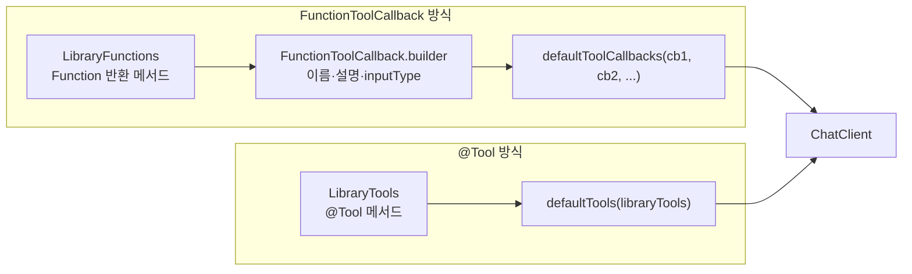
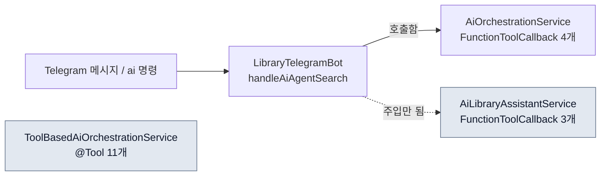

# 05. @Tool 애노테이션 방식

> 02~04 문서에서는 `FunctionToolCallback.builder()`로 Tool을 하나씩 조립했습니다. 이 문서에서는 같은 일을 `@Tool`, `@ToolParam` 애노테이션으로 하는 방법을 배우고, 두 방식을 표와 코드로 비교합니다. 또 프로젝트에 들어 있는 `@Tool` 기반 서비스(`ToolBasedAiOrchestrationService`)가 현재 어디에서도 호출되지 않는다는 점과 직접 연결해 보는 방법을 다룹니다.
>
> 예상 소요 시간: 1.5시간 · 난이도: 기본

## 학습 목표

- `@Tool`과 `@ToolParam`이 LLM에게 어떤 정보를 전달하는지 설명할 수 있다.
- 같은 기능을 `FunctionToolCallback` 방식과 `@Tool` 방식으로 각각 등록할 수 있다.
- `defaultToolCallbacks()`와 `defaultTools()`의 차이를 설명할 수 있다.
- 프로젝트의 두 오케스트레이션 서비스 중 실제로 Telegram Bot에 연결된 것이 무엇인지 소스로 확인할 수 있다.

## 시작하기 전에

- [02. 단일 Function 구현](./02.single-function.md)과 [03. 복수 Function 조합](./03.multiple-functions.md)의 `FunctionToolCallback.builder()` 코드를 이해하고 있어야 합니다.
- Java 애노테이션과 Spring `@Component` 스캔을 알고 있으면 충분합니다. 모르는 용어는 [용어집](../glossary.md)을 참고합니다.

## 1. 왜 필요한가

`AiOrchestrationService`는 Tool 4개를 등록하는 데에만 약 40줄을 씁니다. Tool 하나마다 이름, 설명, 입력 타입, 실행 함수를 따로 적고, 입력을 받기 위한 Request DTO도 하나씩 만들어야 합니다.

```java
FunctionToolCallback<BookSearchRequest, BookSearchResult> searchBooksTool =
    FunctionToolCallback.builder("SearchBooks", libraryFunctions.searchBooks())
        .description("도서관 시스템에서 도서를 검색합니다. ...")
        .inputType(BookSearchRequest.class)
        .build();
// SearchLibraries, CheckBookExists도 같은 모양으로 반복
```

`LibraryFunctions`에는 Function이 8개 있습니다. 모두 등록하려면 이 블록을 8번 반복해야 하고, Tool의 설명(서비스 쪽)과 실제 구현(Function 쪽)이 다른 파일에 흩어집니다. 설명을 고치려면 두 파일을 오가야 합니다.

Spring AI는 이 반복을 줄이기 위해 메서드에 애노테이션을 붙이는 방식을 제공합니다. 설명과 구현이 한곳에 모이고, 등록은 객체를 넘기는 한 줄로 끝납니다.

## 2. 핵심 개념

### 2.1. @Tool과 @ToolParam

비유하자면 `@Tool`은 메서드에 붙이는 "사용 설명서 라벨"입니다. LLM은 코드 본문을 보지 못하고 이 라벨만 읽고 도구를 고릅니다.

| 애노테이션 | 붙는 곳 | LLM에게 전달되는 것 |
|---|---|---|
| `@Tool(description = ...)` | 메서드 | Tool 이름(기본값은 메서드 이름), 용도 설명 |
| `@ToolParam(description = ..., required = ...)` | 파라미터 | 파라미터별 설명, 필수 여부 |

- `@Tool`의 `name` 속성을 생략하면 **메서드 이름이 Tool 이름**이 됩니다. `LibraryTools.searchBooks()`의 Tool 이름은 `searchBooks`입니다.
- 파라미터가 여러 개여도 Request DTO를 만들 필요가 없습니다. Spring AI가 메서드 시그니처에서 JSON 스키마를 만듭니다.

### 2.2. 등록 방식: 콜백 목록 vs 객체



`defaultTools(Object...)`에 객체를 넘기면 Spring AI가 그 객체의 `@Tool` 메서드를 모두 찾아 `MethodToolCallback`으로 바꿔 등록합니다. 결국 두 방식 모두 내부에서는 `ToolCallback`이 되고, LLM이 보는 정보(이름, 설명, 입력 스키마)도 같습니다. 차이는 개발자가 그 정보를 어디에 어떻게 적느냐입니다.

### 2.3. 두 방식 비교

| 항목 | `FunctionToolCallback.builder()` | `@Tool` 애노테이션 |
|---|---|---|
| 프로젝트 예시 | `BookSearchFunction` 등 + `AiLibraryAssistantService`, `LibraryFunctions` + `AiOrchestrationService` | `LibraryTools`(8개), `InternalBookTools`(3개) + `ToolBasedAiOrchestrationService` |
| Tool 이름 | `builder("SearchBooks", ...)`로 직접 지정 | 메서드 이름(`searchBooks`), `@Tool(name = ...)`로 변경 가능 |
| 설명 위치 | 서비스 쪽 builder의 `.description()` | 메서드 위 `@Tool(description = ...)` |
| 입력 | Request DTO 하나(`inputType`) | 메서드 파라미터 여러 개 + `@ToolParam` |
| 등록 코드 | Tool마다 builder 블록 | `defaultTools(객체)` 한 줄 |
| 동적 구성 | 조건에 따라 콜백을 골라 넣기 쉬움 | 객체 단위로 등록되므로 일부만 고르기 어려움 |
| 예외 처리(현재 소스) | Function 안에서 잡고 빈 결과 반환 | `LibraryTools`는 예외를 다시 던짐(`throw e`) → Spring AI가 메시지로 바꿔 LLM에 전달 |

어느 쪽이 정답이라기보다, Tool 수가 많고 고정적이면 `@Tool`, 요청마다 등록할 Tool을 바꿔야 하면 `FunctionToolCallback`이 편합니다. 두 방식은 한 `ChatClient`에 함께 등록할 수도 있습니다.

## 3. 따라 하기

### STEP 1. 같은 기능을 두 방식으로 비교하기

목표: "도서 검색(내부 DB → 도서관정보나루 Fallback)"이라는 같은 기능이 두 방식에서 어떻게 생겼는지 비교합니다.

**FunctionToolCallback 방식** (`LibraryFunctions` + `AiOrchestrationService`)

```java
// LibraryFunctions.java: Function 객체를 반환하는 메서드
public Function<BookSearchRequest, BookSearchResult> searchBooks() {
    return request -> {
        List<BookSearchResult.BookItem> items = searchInternalDb(request.query(), request.limit());
        if (items.isEmpty()) {
            // 도서관정보나루 API로 Fallback
        }
        return ...;
    };
}

// AiOrchestrationService.java: 이름·설명·입력 타입을 여기서 지정
FunctionToolCallback.builder("SearchBooks", libraryFunctions.searchBooks())
    .description("도서관 시스템에서 도서를 검색합니다. " +
                 "제목으로 검색할 수 있으며, 검색어를 받아 도서 목록과 ISBN을 반환합니다.")
    .inputType(BookSearchRequest.class)
    .build();
```

**@Tool 방식** (`LibraryTools`)

```java
import org.springframework.ai.tool.annotation.Tool;
import org.springframework.ai.tool.annotation.ToolParam;

@Component
@RequiredArgsConstructor
@Slf4j
public class LibraryTools {

    private final LibraryInfoNaruApiClient apiClient;
    private final BookSearchService bookSearchService;

    @Tool(description = "도서관 시스템에서 도서를 검색합니다. " +
                        "제목으로 검색할 수 있으며, 검색어를 받아 도서 목록과 ISBN을 반환합니다. " +
                        "먼저 내부 DB를 검색하고, 결과가 없으면 도서관정보나루 API를 호출합니다.")
    public List<BookSearchResult.BookItem> searchBooks(
        @ToolParam(description = "검색할 도서 제목 또는 검색어") String title,
        @ToolParam(description = "최대 결과 수 (기본값: 10, 최대: 100)", required = false) Integer limit
    ) {
        int actualLimit = (limit != null && limit > 0) ? Math.min(limit, 100) : 10;
        List<BookSearchResult.BookItem> items = searchInternalDb(title, actualLimit);
        if (items.isEmpty()) {
            items = apiClient.searchBooksByTitle(title).stream()
                .limit(actualLimit)
                .map(book -> BookSearchResult.BookItem.fromLibraryApi(
                    book.title(), book.authors(), book.publisher(), book.isbn13()))
                .toList();
        }
        return items;
    }
}
```

코드 설명:
- 실제 소스는 import 없이 `@org.springframework.ai.tool.annotation.Tool`처럼 전체 이름으로 적혀 있습니다. 위 코드는 읽기 쉽게 import로 바꾼 것입니다.
- `limit`은 `required = false`이고 타입이 `Integer`입니다. LLM이 생략하면 `null`이 들어오므로 기본값 처리를 메서드 안에서 합니다(FunctionToolCallback 방식에서는 Request DTO의 생성자가 이 일을 했습니다).
- 반환 타입이 DTO 래퍼(`BookSearchResult`)가 아니라 `List<BookItem>`입니다. 반환값은 Spring AI가 JSON으로 바꿔 LLM에게 전달하므로 어떤 타입이든 직렬화만 되면 됩니다.

전체 코드: [`LibraryTools.java`](../../src/main/java/net/java21/library/ai/function/LibraryTools.java), [`LibraryFunctions.java`](../../src/main/java/net/java21/library/ai/function/LibraryFunctions.java)

### STEP 2. 프로젝트의 @Tool 클래스 둘러보기

목표: 어떤 `@Tool` 메서드가 있는지 파악합니다.

| 클래스 | Tool 이름(메서드) | 하는 일 |
|---|---|---|
| `LibraryTools` | `searchBooks` | 내부 DB 검색, 없으면 도서관정보나루 Fallback |
| | `getLibrariesWithBook` | ISBN으로 소장 도서관 조회(2자리/5자리 지역 코드 지원) |
| | `searchLibraries` | 지역 코드로 도서관 검색 |
| | `getBookDetail` | ISBN으로 도서 상세 조회 |
| | `getPopularBooks` | 인기 대출 도서 |
| | `getHotTrendBooks` | 대출 급상승 도서 |
| | `getRecommendedBooks` | 연관 도서 추천 |
| | `checkBookExists` | 도서관 코드 + ISBN으로 소장·대출 여부 |
| `InternalBookTools` | `searchInternalBooks` | 내부 DB 하이브리드 검색 |
| | `getReviews` | 도서 ID로 리뷰 요약·평점 |
| | `checkLoanAvailability` | ISBN으로 소장 도서관 조회(지역 필터) |

`InternalBookTools`는 02~04 문서에서 만든 `BookSearchFunction`, `ReviewFunction`, `LoanCheckFunction`을 `@Tool` 방식으로 다시 쓴 클래스라고 보면 됩니다.

전체 코드: [`InternalBookTools.java`](../../src/main/java/net/java21/library/ai/function/InternalBookTools.java)

### STEP 3. ToolBasedAiOrchestrationService 읽기

목표: `@Tool` 객체를 `ChatClient`에 등록하는 서비스를 읽습니다.

```java
@Service
@RequiredArgsConstructor
@Slf4j
public class ToolBasedAiOrchestrationService {

    private final ChatModel chatModel;
    private final QueryParserAgent queryParserAgent;
    private final LibraryTools libraryTools;
    private final InternalBookTools internalBookTools;

    public String ask(String userMessage) {
        try {
            // 1. 질문에서 도서명·지역 추출
            ParsedQuery parsed = queryParserAgent.parse(userMessage);
            if (!parsed.isValid()) {
                return "질문을 이해하지 못했습니다. 도서 검색, 도서관 조회 등으로 질문해주세요.";
            }

            // 2. @Tool 객체 두 개를 통째로 등록 (Tool 11개)
            ChatClient chatClient = ChatClient.builder(chatModel)
                .defaultTools(libraryTools, internalBookTools)
                .build();

            // 3. 시스템 프롬프트 + 호출
            return chatClient.prompt()
                .system(buildSystemPrompt(parsed))
                .user(userMessage)
                .call()
                .content();
        } catch (Exception e) {
            log.error("[ToolBasedAgent] 요청 처리 실패", e);
            return "요청 처리 중 오류가 발생했습니다. 다시 시도해주세요.";
        }
    }
}
```

코드 설명:
- `AiOrchestrationService`와 흐름(쿼리 파싱 → `ChatClient` 생성 → 호출)은 같고, Tool 등록 부분만 `defaultToolCallbacks(...)` 4개에서 `defaultTools(...)` 2개 객체로 바뀌었습니다.
- 이 서비스도 `ChatClient`를 Bean으로 받지 않고 `ask()` 안에서 만듭니다. `@Primary ChatModel`만 주입받으면 되므로 Gemini/Ollama 전환에 그대로 따라갑니다.
- 클래스 Javadoc에는 "ChatMemory"라는 표현이 있지만 실제 코드에는 대화 기억(ChatMemory) 설정이 없습니다. 대화 기억은 4장의 도전 미션으로 남겨 둡니다.

전체 코드: [`ToolBasedAiOrchestrationService.java`](../../src/main/java/net/java21/library/ai/agent/orchestrator/ToolBasedAiOrchestrationService.java)

### STEP 4. 지금 실제로 호출되는 서비스는 무엇인가

목표: 소스를 검색해 런타임 연결 상태를 직접 확인합니다.

```bash
grep -rn "ToolBasedAiOrchestrationService" src/main/java
grep -rn "aiOrchestrationService.ask\|aiLibraryAssistantService.ask" src/main/java
```

예상 결과:

```text
src/main/java/net/java21/library/ai/agent/orchestrator/ToolBasedAiOrchestrationService.java:42:public class ToolBasedAiOrchestrationService {
src/main/java/net/java21/library/external/telegram/bot/LibraryTelegramBot.java:192:            String aiResponse = aiOrchestrationService.ask(keyword);
```

확인되는 사실은 다음과 같습니다.

- `ToolBasedAiOrchestrationService`는 클래스 선언 외에 등장하는 곳이 없습니다. `@Service`라서 Bean으로 생성은 되지만, 어떤 컨트롤러나 Bot도 주입받지 않으므로 **현재 런타임에서 호출되지 않습니다.** 따라서 `LibraryTools`, `InternalBookTools`의 `@Tool` 메서드도 실행되지 않습니다.
- Telegram의 일반 메시지와 `/ai` 명령은 `LibraryTelegramBot.handleAiAgentSearch()`를 거쳐 `AiOrchestrationService`(FunctionToolCallback 방식, Tool 4개)로 갑니다.
- `AiLibraryAssistantService`는 Bot 생성자에 주입되어 있지만 `ask()` 호출 코드는 없습니다.



즉 이 문서의 `@Tool` 코드는 "준비되어 있지만 연결되지 않은 대안 구현"입니다. 동작을 보려면 4장 미션 1처럼 직접 연결해야 합니다.

## 4. 직접 해 보기

### 미션 1 (기본): ToolBasedAiOrchestrationService를 Telegram에 연결하기

`/ai` 명령이 `@Tool` 방식 서비스를 쓰도록 바꾸고, 로그에서 `[@Tool: ...]` 줄을 확인합니다.

- 요구사항: `AiOrchestrationService`는 지우지 않습니다. 실습 후 되돌릴 수 있게 변경을 최소화합니다.
- 힌트: Bot은 `TelegramBotConfig`의 `@Bean` 메서드에서 생성자로 만들어집니다. 생성자 파라미터와 `@Bean` 메서드 파라미터를 함께 바꿔야 합니다.
- 힌트: 테스트(`LibraryTelegramBotTest`)도 생성자를 호출하므로 같이 고쳐야 컴파일됩니다.

<details>
<summary>정답 예시</summary>

가장 작은 변경은 호출부 한 줄과 주입 대상만 바꾸는 것입니다.

```java
// TelegramBotConfig.libraryTelegramBot(...) 파라미터
ToolBasedAiOrchestrationService toolBasedAiOrchestrationService   // AiOrchestrationService 대신

// LibraryTelegramBot 필드·생성자
private final ToolBasedAiOrchestrationService toolBasedAiOrchestrationService;

// handleAiAgentSearch()
String aiResponse = toolBasedAiOrchestrationService.ask(keyword);
```

실행 후 "광주에서 토비의 스프링 빌릴 수 있어?"를 보내면 다음과 같은 로그를 볼 수 있습니다(모델에 따라 호출 순서와 횟수는 달라질 수 있습니다. 실제 로그에는 이모지가 섞여 있습니다).

```log
[ToolBasedAgent] 사용자 요청 수신: 광주에서 토비의 스프링 빌릴 수 있어?
[ToolBasedAgent] 쿼리 파싱 완료 (...ms): bookName='토비의 스프링', region='광주', intent=...
│ [@Tool: SearchBooks] 도서 검색 시작               │
│ [@Tool: GetLibrariesWithBook] 대출 가능 도서관 조회 │
[ToolBasedAgent] 응답 생성 완료 (총 ...ms)
```

로그 문구의 `SearchBooks`는 로그용 표기이고, LLM에게 등록된 Tool 이름은 메서드 이름(`searchBooks`)입니다.
</details>

### 미션 2 (기본): 프롬프트와 Tool 이름 맞추기

`@Tool`의 기본 Tool 이름은 메서드 이름(`searchBooks`, `getLibrariesWithBook`)입니다. 예전 `ToolBasedAiOrchestrationService.buildSystemPrompt()`는 Tool을 `SearchBooks`처럼 대문자로 시작하는 이름으로 안내해서, 작은 모델에서 호출 실패가 날 수 있었습니다. 현재 저장소는 프롬프트를 메서드 이름에 맞춰 고쳐 두었습니다. 반대 방법인 `@Tool(name = ...)`으로 이름을 지정하는 방식을 직접 적용해 보고, 두 방법의 장단점을 비교해 보세요.

- 힌트: 방법은 두 가지입니다. 프롬프트를 메서드 이름으로 고치거나, `@Tool(name = "SearchBooks", ...)`처럼 이름을 지정합니다.

<details>
<summary>정답 예시</summary>

`@Tool`에 이름을 지정하면 로그·프롬프트·Tool 이름이 모두 같아집니다.

```java
@Tool(name = "SearchBooks", description = "도서관 시스템에서 도서를 검색합니다. ...")
public List<BookSearchResult.BookItem> searchBooks(...) { ... }
```

단, `defaultTools(libraryTools, internalBookTools)`처럼 여러 객체를 한꺼번에 등록할 때 Tool 이름이 겹치면 안 됩니다. 이름을 지정할 때 두 클래스 사이에 중복이 없는지 확인합니다.
</details>

### 미션 3 (도전): 대화 기억(ChatMemory) 붙이기

"그 책 광주에도 있어?"처럼 앞 대화를 가리키는 질문에 답하려면 이전 메시지를 기억해야 합니다. Spring AI 1.1.2는 `ChatMemory` Bean(최근 메시지 20개를 메모리에 보관하는 `MessageWindowChatMemory`)을 자동 등록합니다. 이를 `ToolBasedAiOrchestrationService`에 붙여 보세요.

- 힌트: `MessageChatMemoryAdvisor.builder(chatMemory).build()`를 `defaultAdvisors(...)`에 넣고, 호출할 때 `.advisors(a -> a.param(ChatMemory.CONVERSATION_ID, chatId))`로 사용자별 대화를 구분합니다.
- 힌트: 현재 `ask(String)`는 chatId를 받지 않습니다. 시그니처를 확장해야 합니다.

<details>
<summary>정답 예시</summary>

```java
private final ChatMemory chatMemory;   // 자동 구성 Bean 주입

public String ask(String userMessage, Long chatId) {
    ChatClient chatClient = ChatClient.builder(chatModel)
        .defaultTools(libraryTools, internalBookTools)
        .defaultAdvisors(MessageChatMemoryAdvisor.builder(chatMemory).build())
        .build();

    return chatClient.prompt()
        .system(buildSystemPrompt(queryParserAgent.parse(userMessage)))
        .user(userMessage)
        .advisors(a -> a.param(ChatMemory.CONVERSATION_ID, String.valueOf(chatId)))
        .call()
        .content();
}
```

대화 ID를 넘기지 않으면 모든 사용자가 같은 기본 대화를 공유하게 되므로 반드시 chatId 같은 식별자를 씁니다.
</details>

## 5. 자주 하는 실수

| 증상 | 원인 | 해결 |
|---|---|---|
| `defaultTools(...)`에 넘겼는데 Tool이 0개로 등록됨 | 메서드에 `@Tool`이 없거나, Spring AI가 아닌 다른 패키지의 `@Tool`을 import함 | `org.springframework.ai.tool.annotation.Tool`인지 확인 |
| 호출 시 Tool 이름 중복 오류 | 두 객체에 같은 이름의 `@Tool` 메서드가 있음(예: `@Tool(name=...)`을 같은 값으로 지정) | 이름을 고유하게 지정 |
| 선택 파라미터에서 `NullPointerException` | `required = false` 파라미터를 `int` 같은 기본형으로 선언했거나 `null` 처리 누락 | `Integer` 등 참조형으로 받고 기본값 처리 |
| `@Tool` 메서드의 로그가 전혀 안 찍힘 | `ToolBasedAiOrchestrationService`가 어디에도 연결되어 있지 않음 | 3장 STEP 4로 확인 후 미션 1처럼 연결 |
| 오류 시 LLM이 예외 메시지를 그대로 읊음 | `LibraryTools`는 예외를 다시 던지고, Spring AI 기본 설정(`spring.ai.tools.throw-exception-on-error=false`)이 예외 메시지를 LLM에게 전달 | Tool 안에서 잡고 빈 결과를 반환하거나 프롬프트에 오류 시 응답 방식을 지정 |

## 6. 정리

- `@Tool`은 메서드에 이름·설명을, `@ToolParam`은 파라미터에 설명·필수 여부를 붙여 LLM에게 전달합니다. 이름을 생략하면 메서드 이름이 Tool 이름입니다.
- `defaultToolCallbacks()`는 직접 만든 콜백을, `defaultTools()`는 `@Tool` 메서드를 가진 객체를 받습니다. 내부적으로는 둘 다 `ToolCallback`이 됩니다.
- Tool이 많고 고정적이면 `@Tool`, 요청마다 Tool 구성을 바꿔야 하면 `FunctionToolCallback`이 편합니다.
- 현재 Telegram은 `AiOrchestrationService`(FunctionToolCallback 방식)를 호출하며, `ToolBasedAiOrchestrationService`는 연결되어 있지 않습니다.

- [ ] 같은 기능을 두 방식으로 등록하는 코드를 비교해 설명할 수 있다
- [ ] `LibraryTools`의 Tool 이름이 무엇으로 정해지는지 안다
- [ ] grep으로 `ToolBasedAiOrchestrationService`의 호출처가 없음을 확인했다
- [ ] (선택) 미션 1로 `@Tool` 방식 서비스를 Telegram에 연결해 보았다

## 확인 문제

1. `@Tool(description = "...")`만 붙이고 `name`을 생략한 메서드 `getBookDetail(String isbn13)`의 Tool 이름은 무엇입니까?

<details><summary>정답</summary>

`getBookDetail`입니다. `name`을 생략하면 메서드 이름이 Tool 이름이 됩니다.
</details>

2. FunctionToolCallback 방식에서는 Request DTO가 필요했는데 `@Tool` 방식에서는 필요 없는 이유는 무엇입니까?

<details><summary>정답</summary>

`@Tool` 방식은 메서드 파라미터 목록(이름, 타입, `@ToolParam` 설명)으로 입력 스키마를 만들기 때문입니다. FunctionToolCallback은 `Function<I, O>` 하나의 입력 타입 `I`로 스키마를 만들므로 여러 값을 받으려면 DTO로 묶어야 합니다.
</details>

3. 요청마다 사용자 권한에 따라 등록할 Tool을 다르게 해야 한다면 어느 방식이 더 편합니까? 이유는 무엇입니까?

<details><summary>정답</summary>

`FunctionToolCallback` 방식입니다. 콜백을 하나씩 만들어 목록에 넣으므로 조건에 따라 일부만 골라 등록하기 쉽습니다. `@Tool` 방식은 객체 단위로 등록되어 그 객체의 Tool이 모두 함께 들어갑니다.
</details>

4. 현재 소스에서 Telegram에 "토비의 스프링 광주에서 빌릴 수 있어?"를 보내면 `LibraryTools.getLibrariesWithBook()`이 실행됩니까?

<details><summary>정답</summary>

실행되지 않습니다. 메시지는 `AiOrchestrationService`로 가며, 이 서비스는 `LibraryFunctions`의 `SearchBooks`, `SearchLibraries`, `CheckBookExists` 세 콜백만 등록합니다. `LibraryTools`를 쓰는 `ToolBasedAiOrchestrationService`는 어디에서도 호출되지 않습니다.
</details>

## 다음 문서

[06. 실습 가이드 →](06.practice-guide.md)
