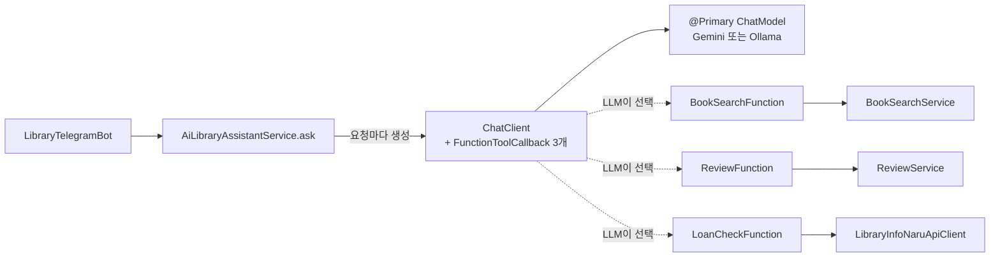
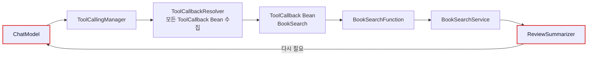

# 06. 실습 가이드

> 02~04 문서에서 읽은 내용을 직접 손으로 구현해 보는 미션 모음입니다. 각 미션은 "요구사항 + 힌트 + 확인 방법"으로 되어 있고, 정답은 접어 두었습니다. 코드를 먼저 써 본 뒤 정답과 실제 소스를 비교하세요.
>
> 예상 소요 시간: 5~6시간 · 난이도: 기본

## 학습 목표

- Function 클래스, Request/Result DTO, `FunctionToolCallback`을 직접 작성할 수 있다.
- 서비스 메서드 안에서 `ChatClient`와 Tool을 만드는 구조와 그 이유(순환 의존성)를 설명할 수 있다.
- Tool을 1개 → 2개 → 3개로 늘리며 LLM의 호출 순서를 로그로 확인할 수 있다.
- 시나리오별로 기대한 Tool이 호출되었는지 판단하고 원인을 찾을 수 있다.

## 시작하기 전에

- [02. 단일 Function 구현](./02.single-function.md), [03. 복수 Function 조합](./03.multiple-functions.md), [04. 외부 API 연동](./04.external-api.md)을 한 번 읽어 두면 힌트만으로 풀 수 있습니다. [05. @Tool 애노테이션](./05.tool-annotation.md)은 선택입니다.
- Step 1~6이 동작하는 상태(PostgreSQL, Redis, 임베딩 적재, Telegram Bot 토큰)여야 합니다.
- `secrets.properties`에 `GEMINI_API_KEY`(또는 Ollama 사용 시 `spring.ai.selected-model=ollama`), `LIBRARY_API_KEY`, `TELEGRAM_BOT_TOKEN`이 있어야 합니다.
- 모르는 용어는 [용어집](../glossary.md)을 참고합니다.

## 1. 실습 전에 알아 둘 구조

### 1.1. 완성 후 구조



만들 파일은 모두 실제 소스에 이미 있습니다. 실습할 때는 별도 브랜치를 만들어 해당 파일을 비우고 다시 작성하거나, 이름을 바꾼 새 클래스(예: `MyBookSearchFunction`)로 작성한 뒤 실제 소스와 비교하는 방식을 권장합니다.

| 파일 | 경로 |
|---|---|
| DTO 5개 | `src/main/java/net/java21/library/ai/function/dto/` (`BookSearchRequest`, `BookSearchResult`, `ReviewResult`, `LoanCheckRequest`, `LoanCheckResult`) |
| Function 3개 | `src/main/java/net/java21/library/ai/function/` (`BookSearchFunction`, `ReviewFunction`, `LoanCheckFunction`) |
| 서비스 | `src/main/java/net/java21/library/ai/service/AiLibraryAssistantService.java` |

### 1.2. 반드시 지킬 규칙: Tool과 ChatClient는 서비스 안에서 만든다

`FunctionToolCallback`과 `ChatClient`를 `@Bean`으로 등록하면 편해 보이지만, 이 프로젝트에서는 **순환 의존성**(Bean A를 만들려면 B가 필요하고, B를 만들려면 다시 A가 필요한 상태) 때문에 애플리케이션이 뜨지 않습니다. 실제 소스의 `AiLibraryAssistantService`와 `AiOrchestrationService` 주석에도 "순환 의존성 문제로 인해 FunctionToolCallback을 Bean으로 등록하지 않고, 서비스 내부에서 프로그래밍 방식으로 생성합니다"라고 적혀 있습니다.

고리가 생기는 경로는 다음과 같습니다. Spring AI 자동 구성은 컨텍스트의 모든 `ToolCallback` Bean을 모아 `ToolCallbackResolver`를 만들고, 이것이 `ChatModel` 생성에 쓰입니다. 그런데 Tool이 감싸는 Function은 다시 `ChatModel`을 쓰는 서비스에 의존합니다.



그래서 규칙은 다음과 같습니다.

- 서비스는 `ChatModel`(AiConfig가 `spring.ai.selected-model`로 고른 `@Primary` Bean)과 Function 컴포넌트만 주입받습니다.
- `ask()` 안에서 `FunctionToolCallback.builder(...)`로 Tool을 만들고, `ChatClient.builder(chatModel).defaultToolCallbacks(...)`로 `ChatClient`를 만듭니다.
- `AiConfig`에는 Tool 관련 Bean을 추가하지 않습니다.

## 2. 미션 목록

| 번호 | 미션 | 단계 | 예상 시간 | 참고 문서 |
|---|---|---|---|---|
| 0 | 환경과 기존 코드 확인 | 준비 | 20분 | - |
| 1 | 도서 검색 DTO와 `BookSearchFunction` | Level 1 | 40분 | 02 |
| 2 | `AiLibraryAssistantService` (Tool 1개) | Level 1 | 40분 | 02 |
| 3 | Telegram에 연결하고 확인 | Level 1 | 30분 | 02 |
| 4 | `ReviewFunction` 추가 (Tool 2개) | Level 2 | 50분 | 03 |
| 5 | `LoanCheckFunction` 추가 (Tool 3개) | Level 3 | 60분 | 04 |
| 6 | 시나리오 통합 테스트 | 마무리 | 40분 | - |
| 7 | Function 단위 테스트 작성 | 도전 | 40분 | - |

## 3. 미션

### 미션 0. 환경과 기존 코드 확인

요구사항:
- 애플리케이션이 뜨고, 웹 검색(`http://localhost:8080/`)이 동작하는지 확인합니다.
- Function이 감쌀 기존 서비스의 메서드 시그니처를 확인합니다.

```bash
grep -n "public .*searchBooks\|public .*getReviewSummary" src/main/java/net/java21/library/core/book/service/search/BookSearchService.java
grep -n "public .*getReviews" src/main/java/net/java21/library/core/review/service/ReviewService.java
grep -n "public List<LoanItemInfo> searchLoanItemsByIsbn" src/main/java/net/java21/library/external/opennaru/client/LibraryInfoNaruApiClient.java
grep -n "@Primary" -A 3 src/main/java/net/java21/library/core/config/AiConfig.java
```

확인 방법: 다음 메서드가 보이면 됩니다.
- `BookSearchService.searchBooks(Pageable, BookSearchRequest)`, `getReviewSummary(Long)`
- `ReviewService.getReviews(Long, Pageable)`
- `LibraryInfoNaruApiClient.searchLoanItemsByIsbn(String)` 외 오버로드 2개
- `AiConfig`의 `selectedGeminiChatModel`, `selectedOllamaChatModel`(`@Primary`)

### 미션 1. 도서 검색 DTO와 BookSearchFunction

요구사항:
- `ai.function.dto.BookSearchRequest(String query, int limit)`: `limit`이 0 이하이면 10으로 바꿉니다.
- `ai.function.dto.BookSearchResult(int count, List<BookItem> books)`: `BookItem`에는 `id`, `title`, `author`, `publisher`, `isbn`, `source`를 둡니다. `empty()`와 `from(List<BookItem>)` 정적 메서드를 만듭니다.
- `BookSearchFunction.searchBooks(BookSearchRequest)`: `BookSearchService`로 하이브리드 검색을 하고 `BookSearchResult`를 반환합니다. 예외가 나면 `empty()`를 반환합니다.

힌트:
- 코어 검색 요청은 `core.book.dto.BookSearchRequest`입니다. AI용 DTO와 이름이 같으므로 전체 패키지 이름으로 구분합니다. 생성자는 `(keyword, isbn, searchType, vector, isWarmUp)`입니다.
- `BookItem`에 `id`와 `isbn`을 꼭 넣으세요. 다음 미션들에서 LLM이 이 값을 `GetReviews`(bookId), `CheckLoanAvailability`(isbn)의 입력으로 씁니다.
- 로그 접두사는 `[AI Function]`으로 통일합니다.

확인 방법: 컴파일이 되면 다음 미션으로 넘어갑니다. 동작 확인은 미션 3에서 합니다.

<details>
<summary>정답 (핵심 부분)</summary>

```java
public BookSearchResult searchBooks(BookSearchRequest request) {
    log.info("[AI Function] 도서 검색 시작: query={}", request.query());
    try {
        var coreRequest = new net.java21.library.core.book.dto.BookSearchRequest(
            request.query(), null, SearchType.HYBRID, null, false);

        var result = bookSearchService.searchBooks(PageRequest.of(0, request.limit()), coreRequest);

        var bookItems = result.getBooks().getContent().stream()
            .map(book -> BookSearchResult.BookItem.from(
                book.getId(), book.getTitle(), book.getAuthorName(),
                book.getPublisherName(), book.getIsbn(), "내부 DB"))
            .toList();

        log.info("[AI Function] 검색 완료: {}권", bookItems.size());
        return BookSearchResult.from(bookItems);
    } catch (Exception e) {
        log.error("[AI Function] 검색 실패: query={}", request.query(), e);
        return BookSearchResult.empty();
    }
}
```

전체 코드: [`BookSearchFunction.java`](../../src/main/java/net/java21/library/ai/function/BookSearchFunction.java), [`BookSearchRequest.java`](../../src/main/java/net/java21/library/ai/function/dto/BookSearchRequest.java), [`BookSearchResult.java`](../../src/main/java/net/java21/library/ai/function/dto/BookSearchResult.java)
</details>

### 미션 2. AiLibraryAssistantService (Tool 1개)

요구사항:
- `ai.service.AiLibraryAssistantService`에 `String ask(String userMessage)`를 만듭니다.
- 주입받는 것은 `ChatModel`과 `BookSearchFunction`뿐입니다.
- `ask()` 안에서 Tool 이름 `BookSearch`로 `FunctionToolCallback`을 만들고, `ChatClient`에 등록해 호출합니다.
- 시스템 프롬프트로 "한국어로만 답변", "필요하면 도구를 호출해 정보를 수집" 두 가지를 지시합니다.

힌트:
- `FunctionToolCallback.builder(이름, 메서드 레퍼런스).description(...).inputType(...).build()`
- 설명(description)은 LLM이 Tool을 고르는 유일한 근거입니다. "언제 쓰는지"와 "무엇을 돌려주는지"를 한 문장씩 적습니다.
- 1.2절의 규칙을 다시 확인하세요. `@Bean`을 쓰지 않습니다.

확인 방법: 애플리케이션이 순환 의존성 오류 없이 시작되면 성공입니다.

<details>
<summary>정답</summary>

```java
@Service
@RequiredArgsConstructor
@Slf4j
public class AiLibraryAssistantService {

    private final ChatModel chatModel;               // AiConfig의 @Primary ChatModel
    private final BookSearchFunction bookSearchFunction;

    public String ask(String userMessage) {
        log.info("[AI Service] 사용자 요청: {}", userMessage);

        FunctionToolCallback<BookSearchRequest, BookSearchResult> bookSearchTool =
            FunctionToolCallback.builder("BookSearch", bookSearchFunction::searchBooks)
                .description("도서관 시스템에서 도서를 검색합니다. " +
                             "제목, 저자명으로 검색할 수 있으며, 검색어를 받아 도서 목록을 반환합니다.")
                .inputType(BookSearchRequest.class)
                .build();

        ChatClient chatClient = ChatClient.builder(chatModel)
            .defaultToolCallbacks(bookSearchTool)
            .build();

        String response = chatClient.prompt()
            .system("""
                당신은 도서관 도우미 AI입니다.
                **중요: 반드시 한국어로만 답변하세요.**
                1. 필요한 도구(함수)를 호출하여 정보를 수집하세요
                2. 도구 호출 결과를 받으면 반드시 자연스러운 한국어로 답변하세요
                """)
            .user(userMessage)
            .call()
            .content();

        log.info("[AI Service] AI 응답 생성 완료");
        return response;
    }
}
```
</details>

### 미션 3. Telegram에 연결하고 확인

현재 소스의 `LibraryTelegramBot`은 `AiLibraryAssistantService`와 `AiOrchestrationService`를 모두 생성자로 주입받지만, `handleAiAgentSearch()`에서는 `aiOrchestrationService.ask()`만 호출합니다. 실습 중에는 이 한 줄을 바꿔 여러분의 서비스를 호출하게 합니다.

요구사항:
- 일반 텍스트 메시지와 `/ai <메시지>`가 `AiLibraryAssistantService.ask()`로 가게 합니다.
- 실습을 마친 뒤 원래대로 되돌릴 수 있도록 변경은 한 줄로 제한합니다.

힌트: `LibraryTelegramBot.handleAiAgentSearch()`를 찾아보세요. 메시지 분기는 `onUpdateReceived()`에 이미 구현되어 있습니다.

확인 방법: Telegram에서 `자바 책 찾아줘`를 보내고 로그를 확인합니다.

```log
[Telegram] Received message from chatId 123456789: 자바 책 찾아줘
[AI Service] 사용자 요청: 자바 책 찾아줘
[AI Function] 도서 검색 시작: query=자바
[AI Function] 검색 완료: 10권
[AI Service] AI 응답 생성 완료
```

`안녕하세요`처럼 검색이 필요 없는 메시지에는 `[AI Function]` 로그 없이 응답만 와야 합니다.

<details>
<summary>정답</summary>

```java
// LibraryTelegramBot.handleAiAgentSearch()
String aiResponse = aiLibraryAssistantService.ask(keyword);   // 실습용 (원래: aiOrchestrationService.ask)
```
</details>

### 미션 4. ReviewFunction 추가 (Tool 2개)

요구사항:
- `ReviewFunction.getReviews(Long bookId)`: 리뷰 상위 5개, 리뷰 요약, 평균 평점, 전체 리뷰 수를 담은 `ReviewResult`를 반환합니다. 예외 시 `ReviewResult.empty(bookId)`.
- `AiLibraryAssistantService`에 Tool 이름 `GetReviews`, `inputType(Long.class)`로 두 번째 Tool을 추가합니다.

힌트:
- 리뷰 목록은 `ReviewService.getReviews(bookId, PageRequest.of(0, 5))`, 요약은 `BookSearchService.getReviewSummary(bookId)`에서 가져옵니다.
- 평균 평점은 받아 온 리뷰의 `rating()` 평균으로 계산합니다(`mapToInt(...).average().orElse(0.0)`).
- 입력이 `Long` 하나라서 Request DTO 없이 `inputType(Long.class)`로 충분합니다.
- 매직 넘버 5는 `REVIEW_LIMIT` 상수로 둡니다.

확인 방법: `이것이 자바다 리뷰 알려줘`를 보내면 검색 → 리뷰 순서로 로그가 찍혀야 합니다.

```log
[AI Function] 도서 검색 시작: query=이것이 자바다
[AI Function] 검색 완료: 3권
[AI Function] 리뷰 조회 시작: bookId=123
[AI Function] 리뷰 조회 완료: bookId=123, reviewCount=5
```

<details>
<summary>정답 (핵심 부분)</summary>

```java
public ReviewResult getReviews(Long bookId) {
    log.info("[AI Function] 리뷰 조회 시작: bookId={}", bookId);
    try {
        var reviews = reviewService.getReviews(bookId, PageRequest.of(0, REVIEW_LIMIT));
        String summary = bookSearchService.getReviewSummary(bookId);
        double avgRating = reviews.getContent().stream()
            .mapToInt(ReviewResponse::rating).average().orElse(0.0);

        List<ReviewResult.ReviewItem> items = reviews.getContent().stream()
            .map(r -> ReviewResult.ReviewItem.of(r.content(), r.rating()))
            .toList();

        log.info("[AI Function] 리뷰 조회 완료: bookId={}, reviewCount={}", bookId, items.size());
        return ReviewResult.of(bookId, summary, avgRating, (int) reviews.getTotalElements(), items);
    } catch (Exception e) {
        log.error("[AI Function] 리뷰 조회 실패: bookId={}", bookId, e);
        return ReviewResult.empty(bookId);
    }
}
```

서비스에는 다음을 추가합니다.

```java
FunctionToolCallback<Long, ReviewResult> reviewTool =
    FunctionToolCallback.builder("GetReviews", reviewFunction::getReviews)
        .description("도서의 리뷰 목록을 조회합니다. " +
                     "도서 ID를 받아 리뷰 요약, 평점, 주요 리뷰를 제공합니다.")
        .inputType(Long.class)
        .build();

ChatClient chatClient = ChatClient.builder(chatModel)
    .defaultToolCallbacks(bookSearchTool, reviewTool)
    .build();
```

전체 코드: [`ReviewFunction.java`](../../src/main/java/net/java21/library/ai/function/ReviewFunction.java), [`ReviewResult.java`](../../src/main/java/net/java21/library/ai/function/dto/ReviewResult.java)
</details>

### 미션 5. LoanCheckFunction 추가 (Tool 3개)

요구사항:
- `LoanCheckRequest(isbn, region, latitude, longitude, limit)`와 `LoanCheckResult(isbn, totalLibraries, libraries)`를 만듭니다.
- `LoanCheckFunction.checkLoanAvailability(LoanCheckRequest)`: `LibraryInfoNaruApiClient.searchLoanItemsByIsbn(isbn)`을 호출하고, `region`이 있으면 주소(`location`)에 포함되는 것만 남긴 뒤 상위 `limit`개를 반환합니다.
- 서비스에 Tool 이름 `CheckLoanAvailability`로 세 번째 Tool을 추가하고, 시스템 프롬프트에 "ISBN이 없으면 먼저 BookSearch로 찾는다"는 순서 예시를 넣습니다.

힌트:
- 외부 API 호출은 실패할 수 있습니다. 전체를 `try-catch`로 감싸고 `LoanCheckResult.empty(isbn)`을 반환합니다.
- `totalLibraries`에는 필터링 전 개수를 넣어 LLM이 "전국 N곳 중"이라고 말할 수 있게 합니다.
- 거리 정렬(`latitude`, `longitude`)은 API 응답에 좌표가 없어 구현하지 않아도 됩니다.

확인 방법: `강남구에서 빌릴 수 있는 토비의 스프링 있어?`를 보내면 `도서 검색` 다음에 `대출 가능 여부 조회 시작: isbn=...` 로그가 나와야 합니다. ISBN만 보낸 질문(`9788960773431 어디서 빌려?`)에는 `CheckLoanAvailability`만 호출되어야 합니다.

<details>
<summary>정답 (핵심 부분)</summary>

```java
public LoanCheckResult checkLoanAvailability(LoanCheckRequest request) {
    log.info("[AI Function] 대출 가능 여부 조회 시작: isbn={}", request.isbn());
    try {
        List<LoanItemInfo> loanItems = libraryInfoNaruApiClient.searchLoanItemsByIsbn(request.isbn());
        if (loanItems.isEmpty()) {
            return LoanCheckResult.empty(request.isbn());
        }
        List<LoanCheckResult.LibraryInfo> libraries = filterByRegion(loanItems, request.region()).stream()
            .limit(request.limit())
            .map(this::toLibraryInfo)
            .toList();
        log.info("[AI Function] 대출 가능 도서관 조회 완료: isbn={}, count={}", request.isbn(), libraries.size());
        return LoanCheckResult.of(request.isbn(), loanItems.size(), libraries);
    } catch (Exception e) {
        log.error("[AI Function] 대출 가능 여부 조회 실패: isbn={}", request.isbn(), e);
        return LoanCheckResult.empty(request.isbn());
    }
}
```

서비스의 Tool 등록과 프롬프트 예시는 [04 문서 STEP 3](./04.external-api.md#step-3-ailibraryassistantservice에-세-번째-tool-등록)과 같습니다.

전체 코드: [`LoanCheckFunction.java`](../../src/main/java/net/java21/library/ai/function/LoanCheckFunction.java), [`AiLibraryAssistantService.java`](../../src/main/java/net/java21/library/ai/service/AiLibraryAssistantService.java)
</details>

### 미션 6. 시나리오 통합 테스트

요구사항: 아래 다섯 메시지를 보내고, 실제로 호출된 Tool을 로그에서 확인해 표를 채웁니다.

| 번호 | 메시지 | 기대 Tool 호출 | 실제 호출 |
|---|---|---|---|
| 1 | 자바 책 5권 추천해줘 | BookSearch | |
| 2 | 이것이 자바다 책 리뷰도 알려줘 | BookSearch → GetReviews | |
| 3 | 9788960773431 ISBN 책 어디서 빌릴 수 있어? | CheckLoanAvailability | |
| 4 | 강남구에서 빌릴 수 있는 자바의 정석 책 정보랑 리뷰도 알려줘 | BookSearch → GetReviews, CheckLoanAvailability | |
| 5 | 도서관 운영 시간 알려줘 | 없음 | |

힌트:
- 4번에서 `GetReviews`와 `CheckLoanAvailability`의 순서는 모델에 따라 바뀔 수 있습니다. 둘 다 `BookSearch` 뒤에 오면 정상입니다.
- 5번에서 Tool이 호출되었다면 Tool 설명이 너무 넓은 것입니다. 기대와 다르면 설명이나 시스템 프롬프트를 고치고 다시 보냅니다.
- 같은 메시지라도 LLM 응답은 매번 조금씩 다릅니다. 문장이 아니라 "어떤 Tool이 어떤 인자로 호출되었는지"를 기준으로 판단합니다.

<details>
<summary>판단 기준</summary>

- 1~3번이 기대대로 나오면 Tool 설명이 제 역할을 하고 있습니다.
- 4번에서 `GetReviews`의 `bookId`와 `CheckLoanAvailability`의 `isbn`이 1단계 검색 결과의 값과 일치해야 체이닝이 제대로 된 것입니다.
- 5번은 Tool 없이 일반 답변이 나와야 합니다. 프로젝트에 운영 시간 데이터가 없으므로 "정확한 운영 시간은 해당 도서관에 확인해 주세요"처럼 근거 없는 추측을 하지 않는 답이 바람직합니다.
</details>

### 미션 7 (도전). Function 단위 테스트 작성

요구사항: Spring Context 없이 JUnit 5 + Mockito로 `LoanCheckFunction`의 행위를 테스트합니다.
- 외부 API가 예외를 던지면 `totalLibraries`가 0인 빈 결과를 반환한다.
- `region`을 주면 주소에 그 문자열이 있는 도서관만 남는다.

힌트: `LibraryInfoNaruApiClient`를 `@Mock`으로, `LoanCheckFunction`을 `@InjectMocks`로 만듭니다. `LoanItemInfo`는 `@Builder`가 있어 `LoanItemInfo.builder().libraryName(...).location(...).loanAvailable("Y").build()`로 만들 수 있습니다.

<details>
<summary>정답 예시</summary>

```java
@ExtendWith(MockitoExtension.class)
class LoanCheckFunctionTest {

    @Mock
    private LibraryInfoNaruApiClient libraryInfoNaruApiClient;

    @InjectMocks
    private LoanCheckFunction loanCheckFunction;

    @Test
    @DisplayName("외부 API 예외 시 빈 결과를 반환한다")
    void returnsEmptyWhenApiFails() {
        given(libraryInfoNaruApiClient.searchLoanItemsByIsbn("9788960773431"))
            .willThrow(new RuntimeException("timeout"));

        LoanCheckResult result = loanCheckFunction.checkLoanAvailability(LoanCheckRequest.of("9788960773431"));

        assertThat(result.totalLibraries()).isZero();
        assertThat(result.libraries()).isEmpty();
    }

    @Test
    @DisplayName("region이 주소에 포함된 도서관만 남긴다")
    void filtersByRegion() {
        given(libraryInfoNaruApiClient.searchLoanItemsByIsbn("9788960773431")).willReturn(List.of(
            LoanItemInfo.builder().libraryName("강남도서관").location("서울특별시 강남구 ...").loanAvailable("Y").build(),
            LoanItemInfo.builder().libraryName("마포도서관").location("서울특별시 마포구 ...").loanAvailable("Y").build()));

        LoanCheckResult result = loanCheckFunction.checkLoanAvailability(LoanCheckRequest.of("9788960773431", "강남구"));

        assertThat(result.totalLibraries()).isEqualTo(2);
        assertThat(result.libraries()).extracting(LoanCheckResult.LibraryInfo::name).containsExactly("강남도서관");
    }
}
```
</details>

## 4. 자주 하는 실수

| 증상 | 원인 | 해결 |
|---|---|---|
| 시작 시 `The dependencies of some of the beans in the application context form a cycle` | `FunctionToolCallback`이나 Tool을 등록한 `ChatClient`를 `@Bean`으로 만듦 | 1.2절대로 서비스 메서드 안에서 생성 |
| LLM이 Tool을 전혀 호출하지 않음 | 설명이 "책"처럼 너무 짧거나, 사용하는 모델이 Tool Calling을 지원하지 않음 | 설명에 용도와 반환값을 구체적으로 적고, Ollama라면 Tool Calling 지원 모델(qwen2.5 등)인지 확인 |
| `GetReviews`에 엉뚱한 bookId가 들어감 | 검색 결과 `BookItem`에 `id`가 빠졌거나 0 | `BookItem.from(book.getId(), ...)`로 ID를 채움 |
| 응답이 영어나 중국어로 옴 | 시스템 프롬프트에 언어 지시가 없음 | "반드시 한국어로만 답변" 지시를 맨 위에 둠 |
| 수정했는데 Telegram 응답이 그대로 | `handleAiAgentSearch()`가 여전히 `aiOrchestrationService.ask()`를 호출 | 미션 3의 한 줄 변경 확인 |
| 외부 API 조회만 항상 0건 | `LIBRARY_API_KEY` 누락. 클라이언트가 오류를 잡고 빈 목록을 반환 | 로그의 `[도서관정보나루]` 줄과 `secrets.properties` 확인 |

## 5. 정리

- Function(실제 일을 하는 메서드) + DTO(LLM과 주고받는 형식) + `FunctionToolCallback`(이름과 설명)이 Tool 하나를 이룹니다.
- 이 프로젝트에서는 순환 의존성 때문에 Tool과 `ChatClient`를 서비스 메서드 안에서 만듭니다.
- Tool이 늘어날수록 설명과 시스템 프롬프트의 순서 예시가 호출 정확도를 좌우합니다.
- 결과 DTO에 다음 Tool의 입력값(id, isbn)을 넣어야 체이닝이 됩니다.

- [ ] Function 3개와 DTO를 직접 작성했다
- [ ] `AiLibraryAssistantService.ask()` 안에서 Tool 3개와 `ChatClient`를 생성했다
- [ ] 미션 6의 표를 채우고 기대와 다른 경우 원인을 찾아 고쳤다
- [ ] 실습 후 `handleAiAgentSearch()`의 호출 대상을 원래대로 되돌렸다
- [ ] (도전) `LoanCheckFunction` 단위 테스트가 통과한다

## 확인 문제

1. `FunctionToolCallback`을 `@Bean`으로 등록하면 왜 순환 의존성이 생깁니까?

<details><summary>정답</summary>

Spring AI는 컨텍스트의 모든 `ToolCallback` Bean을 모아 `ToolCallbackResolver`를 만들고, 이것이 `ToolCallingManager`를 거쳐 `ChatModel` 생성에 쓰입니다. 그런데 Tool이 감싸는 Function은 `BookSearchService` → `ReviewSummarizer` → `ChatModel`로 다시 `ChatModel`에 의존하므로 고리가 생깁니다.
</details>

2. 미션 4에서 `GetReviews`는 Request DTO 없이 `inputType(Long.class)`를 썼습니다. 반대로 `CheckLoanAvailability`에 DTO가 필요한 이유는 무엇입니까?

<details><summary>정답</summary>

`Function<I, O>`는 입력을 하나만 받습니다. 리뷰 조회는 bookId 하나면 충분하지만, 대출 조회는 isbn, region, limit 등 여러 값을 받아야 하므로 하나의 record로 묶어야 합니다.
</details>

3. 미션 6의 5번 메시지에서 `BookSearch`가 호출되었다면 무엇을 먼저 의심해야 합니까?

<details><summary>정답</summary>

`BookSearch`의 설명이 "도서관과 관련된 모든 질문"처럼 넓게 읽히는지 확인합니다. 설명을 "도서 제목이나 저자로 책을 찾을 때"처럼 좁히고, 시스템 프롬프트에 "필요할 때만 도구를 호출"하도록 적습니다.
</details>

4. 실습 결과를 Telegram으로 확인하려면 왜 `handleAiAgentSearch()`를 고쳐야 합니까?

<details><summary>정답</summary>

현재 소스의 Bot은 `AiLibraryAssistantService`를 주입만 받고, 실제 호출은 `AiOrchestrationService.ask()`로 하기 때문입니다.
</details>

## 다음 문서

Step 7을 마쳤습니다. 다음 단계는 선택 과제입니다.

[Step 8. n8n 워크플로우 자동화 (보너스) →](../step-8/README.md)
