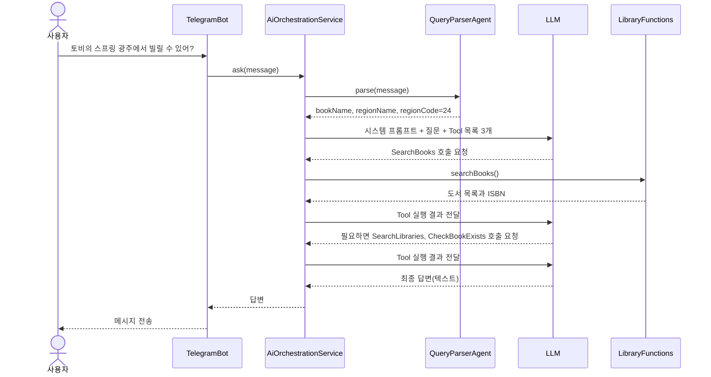
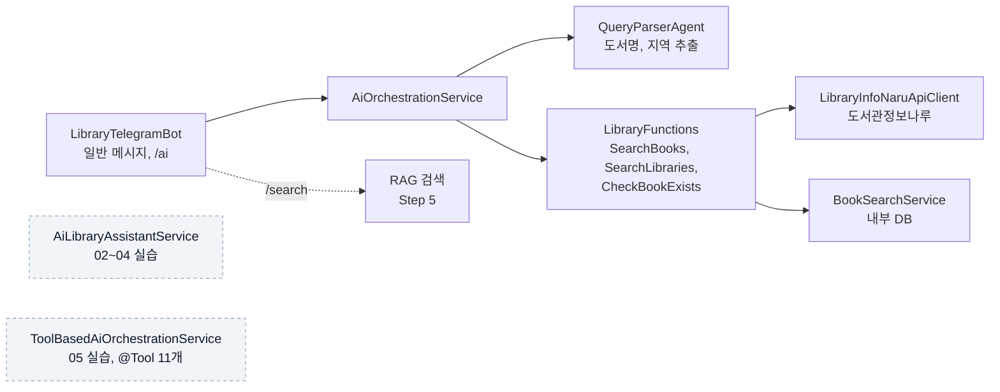

# Step 7. Tool Calling으로 만드는 도서관 도우미 AI

> LLM이 사용자의 질문을 읽고 도서 검색, 리뷰 조회, 대출 가능 도서관 조회 같은 Java 메서드를 스스로 골라 호출하게 만듭니다. Step 1~6에서 만든 기능을 하나의 대화형 도우미로 묶는 단계입니다.

## 이 단계에서 만드는 것

Telegram Bot에 자연어로 질문하면 LLM이 필요한 도구(Tool)를 골라 실행하고, 그 결과를 모아 한 번에 답합니다.

```text
사용자: 토비의 스프링 광주에서 빌릴 수 있어?

Bot:  *도서 검색 결과*

      1. *토비의 스프링 3.1* (ISBN: 978...)
      저자: 이일민 | 출판사: 에이콘출판
      대출 가능한 도서관:
      ✅ ○○도서관 (코드: xxxxx)
      ...
```

위 응답 형식은 `AiOrchestrationService`의 시스템 프롬프트가 정한 Telegram용 형식이고, 실제 도서관 목록은 도서관정보나루 API 응답에 따라 달라집니다.

동작 흐름은 다음과 같습니다.



## 왜 이 단계가 필요한가

Step 6까지 만든 기능은 각각 따로 동작합니다. 검색은 `/search`, 리뷰는 웹 화면, 대출 가능 여부는 별도 API 호출처럼 사용자가 기능을 하나씩 찾아 써야 했습니다. "토비의 스프링, 광주에서 빌릴 수 있어?" 같은 질문에 답하려면 검색 → ISBN 확보 → 지역 도서관 조회를 순서대로 엮어야 하는데, 이 조합을 질문마다 `if-else`로 짜는 것은 현실적이지 않습니다.

Step 7은 이 조합을 LLM에게 맡깁니다. 개발자는 "어떤 도구가 있고 각각 무엇을 하는지"만 알려 주고, 어떤 도구를 어떤 순서로 부를지는 LLM이 질문을 보고 결정합니다. 이 기능을 **Tool Calling**(Function Calling)이라고 합니다.

이 프로젝트의 구조는 하나의 LLM이 여러 Tool을 골라 조합하는 **Tool 기반 오케스트레이션**입니다. 여러 Agent가 서로 메시지를 주고받는 A2A(Agent-to-Agent)는 확장 방향으로 [00. 이론](./00.theory.md)에서 소개합니다.

## 문서 구성

| 순서 | 문서 | 내용 | 예상 시간 |
|---|---|---|---|
| 00 | [Tool Calling, MCP, Agent, A2A 이론](./00.theory.md) | 네 개념의 차이와 이 프로젝트의 위치 | 1시간 |
| 01 | [개요 및 시나리오](./01.overview.md) | 도서관 도우미 AI의 목표, 시나리오, 코드 구성 | 30분 |
| 02 | [단일 Function 구현: 도서 검색](./02.single-function.md) | `BookSearchFunction`과 `FunctionToolCallback`으로 첫 Tool 등록 | 1.5시간 |
| 03 | [복수 Function 조합: 검색 + 리뷰](./03.multiple-functions.md) | 두 Tool을 등록하고 LLM이 순서대로 호출하는 과정 이해 | 1.5시간 |
| 04 | [외부 API 연동: 대출 가능 여부 조회](./04.external-api.md) | 도서관정보나루 API를 Tool로 감싸기 | 2시간 |
| 05 | [@Tool 애노테이션 방식](./05.tool-annotation.md) | `@Tool`, `@ToolParam`과 `defaultTools()`로 간결하게 등록 | 1.5시간 |
| 06 | [실습 가이드](./06.practice-guide.md) | 단계별 실습 미션과 테스트 시나리오 | 2시간 |

부록

| 문서 | 내용 |
|---|---|
| [A2A 구현 가능성 분석](./A2A_FEASIBILITY_ANALYSIS.md) | Spring AI 1.1.2로 A2A 구조를 만들 때의 검토 내용 |
| [행정구역 코드 목록](./region-codes.md) | 도서관정보나루 API의 지역 코드(예: 11=서울, 24=광주) |
| [도서관정보나루 API 매뉴얼](./도서관정보나루_API_Manual.md) | 외부 API 요청·응답 명세 |

## 코드 구성: 세 가지 구현과 실제 연결 상태

이 단계의 코드는 학습 순서에 따라 세 가지 서비스로 나뉩니다. 세 서비스 모두 구현돼 있지만, **실제로 Telegram Bot에 연결된 것은 `AiOrchestrationService` 하나**입니다.

| 서비스 | Tool 등록 방식 | 등록된 Tool | 호출하는 곳 |
|---|---|---|---|
| `AiLibraryAssistantService` | `FunctionToolCallback.builder()` | `BookSearch`, `GetReviews`, `CheckLoanAvailability` (3개) | 없음 (Bot에 주입만 됨, 02~04 실습용) |
| `AiOrchestrationService` | `QueryParserAgent` + `FunctionToolCallback.builder()` | `SearchBooks`, `SearchLibraries`, `GetLibrariesWithBook`, `CheckBookExists` (4개, `LibraryFunctions`의 메서드를 감쌈) | `LibraryTelegramBot`의 일반 메시지와 `/ai` 명령 |
| `ToolBasedAiOrchestrationService` | `QueryParserAgent` + `@Tool` + `defaultTools()` | `LibraryTools` 8개 + `InternalBookTools` 3개 | 없음 (05 실습용, 구현만 됨) |



점선 박스는 구현은 돼 있지만 현재 어디서도 호출하지 않는 서비스입니다. 02~05의 실습을 마친 뒤 `LibraryTelegramBot.handleAiAgentSearch()`의 호출 대상을 바꾸면 각 방식을 Telegram에서 직접 비교할 수 있습니다.

LLM은 `spring.ai.selected-model`(기본 설정 파일 값은 `ollama`, 모델 `qwen2.5:latest`)로 고르며, `gemini`로 바꾸면 Gemini 2.0 Flash를 씁니다.

## 이 단계를 마치면

- [ ] Tool Calling, MCP, Agent, A2A의 차이를 한 문장씩 설명할 수 있다
- [ ] Java 메서드를 `FunctionToolCallback`으로 감싸 `ChatClient`에 등록할 수 있다
- [ ] LLM이 Tool을 연쇄 호출할 때 데이터(bookId, ISBN)가 어떻게 전달되는지 설명할 수 있다
- [ ] 외부 API를 Tool로 감싸고 실패 시 빈 결과를 돌려주도록 처리할 수 있다
- [ ] `@Tool` 애노테이션 방식과 `FunctionToolCallback` 방식의 장단점을 비교할 수 있다
- [ ] Telegram Bot이 실제로 어떤 서비스와 Tool을 쓰는지 소스에서 찾아 설명할 수 있다

## 관련 소스 코드

경로는 `src/main/java/net/java21/library/` 기준입니다.

| 클래스 | 역할 | 경로 |
|---|---|---|
| `BookSearchFunction` | 내부 DB 하이브리드 검색 Tool | `ai/function/BookSearchFunction.java` |
| `ReviewFunction` | 리뷰 요약·평점 조회 Tool | `ai/function/ReviewFunction.java` |
| `LoanCheckFunction` | 대출 가능 도서관 조회 Tool | `ai/function/LoanCheckFunction.java` |
| `AiLibraryAssistantService` | 위 3개 Tool을 등록한 실습용 서비스 | `ai/service/AiLibraryAssistantService.java` |
| `LibraryFunctions` | 도서관정보나루 API 8개를 `Function<Req, Res>`로 제공 | `ai/function/LibraryFunctions.java` |
| `QueryParserAgent` | 질문에서 도서명, 지역명, 의도 추출 | `ai/agent/QueryParserAgent.java` |
| `AiOrchestrationService` | Telegram에 연결된 Tool 기반 오케스트레이션 (Tool 4개) | `ai/agent/orchestrator/AiOrchestrationService.java` |
| `LibraryTools` | `@Tool` 메서드 8개 (도서관정보나루 API) | `ai/function/LibraryTools.java` |
| `InternalBookTools` | `@Tool` 메서드 3개 (내부 DB 검색, 리뷰, 대출 확인) | `ai/function/InternalBookTools.java` |
| `ToolBasedAiOrchestrationService` | `@Tool` 11개를 `defaultTools()`로 등록 (미연결) | `ai/agent/orchestrator/ToolBasedAiOrchestrationService.java` |
| `LibraryTelegramBot` | 일반 메시지를 `AiOrchestrationService.ask()`로 위임 | `external/telegram/bot/LibraryTelegramBot.java` |
| `AiConfig` | `spring.ai.selected-model`로 `@Primary ChatModel` 선택 | `core/config/AiConfig.java` |

## 다음 문서

[00. Tool Calling, MCP, Agent, A2A 이론 →](00.theory.md)
