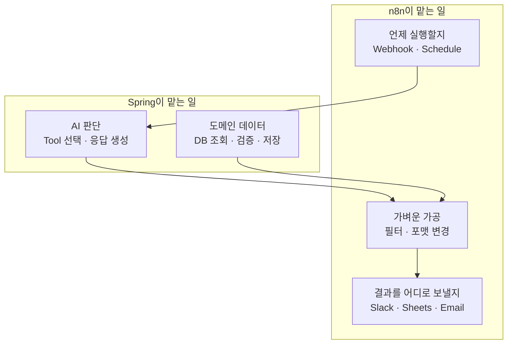
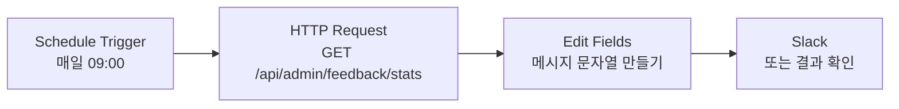
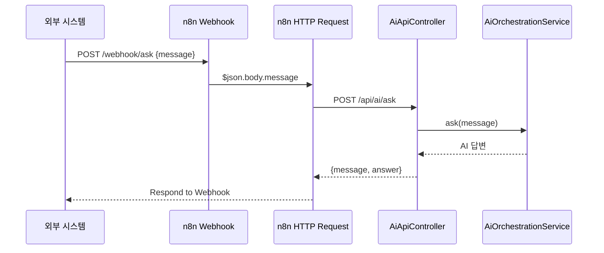
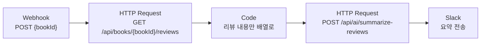

# 01. n8n 워크플로우 자동화 연동

> Docker로 n8n을 띄우고, Spring 애플리케이션의 AI 기능을 HTTP API로 열어 n8n 워크플로우에서 호출합니다. 기존 API만 쓰는 워크플로우부터 시작해, 새 컨트롤러를 만들어 AI 질의와 리뷰 요약을 자동화합니다.
>
> 예상 소요 시간: 4시간 · 난이도: 심화 · **보너스(선택) 과제**

## 학습 목표

- n8n의 워크플로우, 노드, 트리거, 표현식이 무엇인지 설명할 수 있다.
- Docker 컨테이너 안의 n8n에서 호스트의 Spring 애플리케이션을 호출할 수 있다.
- n8n이 호출할 REST 컨트롤러를 DTO와 Validation을 갖춰 작성할 수 있다.
- Webhook·Schedule 트리거와 HTTP Request, Code 노드를 이어 워크플로우를 만들 수 있다.

## 시작하기 전에

- [Step 8 개요](./README.md)를 먼저 읽습니다. 이 문서는 보너스 과제이므로 건너뛰어도 교재의 나머지 내용을 이해하는 데 문제가 없습니다.
- [Step 7](../step-7/README.md)을 마쳐 `AiOrchestrationService`가 동작해야 합니다(Telegram에서 `/ai` 명령으로 확인).
- REST API, JSON, Docker 기본 명령을 알고 있어야 합니다. 모르는 용어는 [용어집](../glossary.md)을 참고합니다.

## 1. 왜 필요한가

Step 7에서 만든 AI 기능은 Telegram Bot 안에 갇혀 있습니다. 다음과 같은 요구가 들어왔다고 해 봅시다.

- "매일 아침 9시에 지난 7일간 피드백 통계를 팀 Slack에 올려 주세요."
- "특정 책의 리뷰 요약을 운영자에게 메시지로 보내 주세요."
- "사내 다른 시스템에서도 우리 AI에게 질문할 수 있게 해 주세요."

이걸 모두 Spring 코드로 만들면 Slack 클라이언트, 스케줄러, 재시도, 외부 인증을 기능마다 새로 작성해야 합니다. 정작 AI 로직은 그대로인데 연결 코드만 계속 늘어납니다.

**n8n**은 이런 연결 작업을 화면에서 노드를 이어 붙여 만드는 오픈 소스 워크플로우 자동화 도구입니다. Slack, Google Sheets, Email 같은 서비스용 노드가 이미 준비되어 있어서, Spring 쪽은 "AI 판단과 데이터를 돌려주는 API"만 제공하면 됩니다.

## 2. 핵심 개념

### 2.1. n8n의 네 가지 용어

| 용어 | 뜻 | 이 문서에서의 예 |
|---|---|---|
| 워크플로우(Workflow) | 노드를 이어 만든 하나의 자동화 흐름 | "질문 받기 → AI 호출 → 응답" |
| 노드(Node) | 한 가지 일을 하는 블록 | HTTP Request, Code, Slack |
| 트리거(Trigger) | 워크플로우를 시작시키는 노드 | Webhook(외부 HTTP 요청), Schedule(정해진 시각) |
| 표현식(Expression) | 앞 노드의 출력 값을 꺼내 쓰는 문법 | `{{ $json.body.message }}` |

노드 사이에는 항상 JSON 배열(n8n에서는 "아이템" 목록)이 흐릅니다. 각 노드는 앞 노드의 출력 JSON을 `$json`으로 읽습니다.

### 2.2. 역할 분담: 무엇을 n8n에, 무엇을 Spring에 두는가



기준은 간단합니다. 비즈니스 규칙과 데이터 변경은 Spring에 두고 테스트로 보호합니다. n8n은 "부르고, 거르고, 보내는" 일만 맡깁니다. 예를 들어 n8n의 PostgreSQL 노드로 DB에 직접 쓰는 것은 가능하지만, 그러면 JPA 엔티티의 검증과 캐시 무효화를 건너뛰게 되므로 피합니다.

### 2.3. 호출할 API: 기존 API와 새로 만들 API

| 메서드·경로 | 상태 | 하는 일 | 사용하는 곳 |
|---|---|---|---|
| `GET /api/admin/feedback/stats?query=` | 기존 (`FeedbackAdminController`) | 검색어별 피드백 통계 | STEP 2 |
| `GET /api/admin/feedback/recent?days=` | 기존 (`FeedbackAdminController`) | 최근 N일 피드백 목록 | 미션 1 |
| `POST /api/ai/ask` | **새로 작성** (`AiApiController`) | `AiOrchestrationService.ask()` 호출 | STEP 4 |
| `POST /api/ai/summarize-reviews` | **새로 작성** (`AiApiController`) | `ReviewSummarizer.summarizeReviews()` 호출 | STEP 5 |
| `GET /api/books/{bookId}/reviews` | **새로 작성** (`ReviewApiController`) | `ReviewService.getReviews()`를 JSON으로 반환 | STEP 5 |
| `POST /api/ai/personalized-search` | **새로 작성** (미션 2) | `BookSearchService.searchBooks(..., chatId)` 호출 | 미션 2 |

현재 프로젝트에서 JSON을 돌려주는 REST 컨트롤러는 `FeedbackAdminController` 하나뿐입니다. 웹 화면용 `BookReviewController`(`/books/{bookId}/reviews`)는 폼 제출 후 페이지로 이동하는 Thymeleaf 컨트롤러라서 n8n에서 쓰기 어렵습니다.

## 3. 따라 하기

### STEP 1. Docker로 n8n 실행

목표: 브라우저에서 n8n 편집기를 열고, 컨테이너 안에서 호스트의 Spring 애플리케이션(8080 포트)에 접속할 수 있게 합니다.

프로젝트 밖의 작업 폴더에 `docker-compose.yml`을 만듭니다.

```yaml
services:
  n8n:
    image: docker.n8n.io/n8nio/n8n
    ports:
      - "5678:5678"
    environment:
      - GENERIC_TIMEZONE=Asia/Seoul
      - TZ=Asia/Seoul
    extra_hosts:
      - "host.docker.internal:host-gateway"   # Linux에서 호스트 접속용 (macOS·Windows는 기본 제공)
    volumes:
      - n8n_data:/home/node/.n8n
    restart: unless-stopped

volumes:
  n8n_data:
```

```bash
docker compose up -d
docker compose logs -f n8n     # "Editor is now accessible via" 문구 확인
```

`http://localhost:5678`에 접속하면 처음 한 번 관리자(owner) 계정을 만드는 화면이 나옵니다. 이메일과 비밀번호를 정해 로그인합니다.

코드 설명:
- `GENERIC_TIMEZONE`은 Schedule 트리거의 기준 시간대입니다. 지정하지 않으면 "매일 9시"가 한국 시간이 아닐 수 있습니다.
- 컨테이너 안에서 `localhost`는 컨테이너 자신입니다. 호스트에서 실행 중인 Spring 애플리케이션은 `http://host.docker.internal:8080`으로 불러야 합니다. 이 문서의 모든 URL은 이 주소를 씁니다.
- 실습에서는 이미지 태그를 생략했지만, 팀에서 쓸 때는 버전 태그를 고정하는 것이 좋습니다.

확인: n8n 편집기에서 새 워크플로우를 만들고 HTTP Request 노드 하나를 추가해 `GET http://host.docker.internal:8080/api/admin/feedback/stats?query=자바`를 실행(Execute step)했을 때 JSON이 보이면 연결이 된 것입니다.

### STEP 2. 기존 API로 첫 워크플로우: 아침 피드백 리포트

목표: 코드를 한 줄도 바꾸지 않고, Schedule → HTTP Request → 메시지 만들기 흐름을 완성합니다.



노드 설정:

| 노드 | 설정 |
|---|---|
| Schedule Trigger | Trigger Interval: Days, Hour: 9, Minute: 0 |
| HTTP Request | Method: GET, URL: `http://host.docker.internal:8080/api/admin/feedback/stats`, Query Parameters: `query` = `자바` |
| Edit Fields (Set) | 필드 `text`(String) = 아래 표현식 |
| Slack (선택) | Resource: Message, Operation: Send, Text: `{{ $json.text }}` |

`text` 필드에 넣을 표현식 예시입니다. 응답은 `FeedbackStats`(`goodCount`, `badCount`, `totalCount`, `goodRatio`, `feedbackScore`)입니다.

```text
'자바' 검색 피드백: 좋았음 {{ $json.goodCount }}건, 별로였음 {{ $json.badCount }}건 (총 {{ $json.totalCount }}건, 점수 {{ $json.feedbackScore }})
```

확인: 워크플로우 상단의 Execute workflow를 누르면 각 노드 아래에 입출력 JSON이 표시됩니다. Slack 계정이 없다면 Edit Fields 노드의 출력까지만 확인해도 됩니다. 시각에 맞춰 자동 실행되게 하려면 워크플로우를 Active로 바꿉니다.

### STEP 3. n8n이 호출할 새 컨트롤러 만들기

목표: AI 질의와 리뷰 요약, 리뷰 조회를 JSON API로 엽니다. 이 컨트롤러들은 **현재 소스에 없으므로 새로 작성**합니다.

패키지는 프로젝트 규칙(도메인별 상위 패키지)에 맞춰 AI 관련은 `ai.api`, 리뷰 조회는 `core.review.api`처럼 둡니다. 요청·응답은 DTO로 정의하고 Request DTO에는 Validation을 붙입니다.

```java
// ai/api/dto/AiAskRequest.java
public record AiAskRequest(
    @NotBlank @Size(max = 500) String message
) {}

// ai/api/dto/AiAskResponse.java
public record AiAskResponse(String message, String answer) {}

// ai/api/dto/ReviewSummaryRequest.java
public record ReviewSummaryRequest(
    @NotEmpty @Size(max = 200) List<@NotBlank String> reviews
) {}

// ai/api/dto/ReviewSummaryResponse.java
public record ReviewSummaryResponse(String summary, int reviewCount) {}
```

```java
@RestController
@RequestMapping("/api/ai")
@RequiredArgsConstructor
@Slf4j
public class AiApiController {

    private final AiOrchestrationService aiOrchestrationService;
    private final ReviewSummarizer reviewSummarizer;

    @PostMapping("/ask")
    public ResponseEntity<AiAskResponse> ask(@Valid @RequestBody AiAskRequest request) {
        log.info("[AI API] ask: {}", request.message());
        String answer = aiOrchestrationService.ask(request.message());
        return ResponseEntity.ok(new AiAskResponse(request.message(), answer));
    }

    @PostMapping("/summarize-reviews")
    public ResponseEntity<ReviewSummaryResponse> summarizeReviews(
            @Valid @RequestBody ReviewSummaryRequest request) {
        String summary = reviewSummarizer.summarizeReviews(request.reviews());
        return ResponseEntity.ok(new ReviewSummaryResponse(summary, request.reviews().size()));
    }
}
```

```java
@RestController
@RequestMapping("/api/books/{bookId}/reviews")
@RequiredArgsConstructor
@Validated
public class ReviewApiController {

    private static final int MAX_PAGE_SIZE = 50;

    private final ReviewService reviewService;

    @GetMapping
    public ResponseEntity<List<ReviewResponse>> getReviews(
            @PathVariable @Positive Long bookId,
            @RequestParam(defaultValue = "20") @Min(1) @Max(MAX_PAGE_SIZE) int size) {
        Page<ReviewResponse> page = reviewService.getReviews(bookId, PageRequest.of(0, size));
        return ResponseEntity.ok(page.getContent());
    }
}
```

코드 설명:
- `AiOrchestrationService.ask()`는 Telegram `/ai` 명령이 쓰는 바로 그 서비스입니다. 같은 AI 기능을 다른 입구(HTTP)로 여는 것뿐이라 새 서비스 계층을 만들지 않고 컨트롤러에서 직접 호출합니다.
- `ReviewSummarizer.summarizeReviews(List<String>)`는 Step 4에서 만든 Map-Reduce 요약기입니다. 리뷰 수가 많으면 내부에서 나눠 요약한 뒤 합칩니다.
- `Page`를 그대로 JSON으로 내보내면 Spring Data가 직렬화 구조가 안정적이지 않다고 경고하므로 `getContent()`만 돌려줍니다.
- 이 API에는 인증이 없습니다. 실습은 로컬에서만 하고, 외부에 열 때는 7장의 보안 항목을 반드시 적용합니다.

확인:

```bash
curl -s -X POST http://localhost:8080/api/ai/ask \
  -H "Content-Type: application/json" -d '{"message":"토비의 스프링 광주에서 빌릴 수 있어?"}'

curl -s http://localhost:8080/api/books/1/reviews?size=5

curl -s -X POST http://localhost:8080/api/ai/ask \
  -H "Content-Type: application/json" -d '{"message":""}'     # 400 Bad Request 이어야 함
```

새 코드에는 `@WebMvcTest`로 컨트롤러 테스트를 작성합니다. 서비스는 `@MockitoBean`으로 대체합니다(`@MockBean`은 쓰지 않습니다).

### STEP 4. 워크플로우: Webhook으로 받은 질문을 AI에게 묻기

목표: 다른 시스템이 n8n Webhook 주소로 질문을 보내면 AI 답변을 돌려받게 합니다.



노드 설정:

| 노드 | 설정 |
|---|---|
| Webhook | HTTP Method: POST, Path: `ask`, Respond: Using 'Respond to Webhook' Node |
| HTTP Request | Method: POST, URL: `http://host.docker.internal:8080/api/ai/ask`, Send Body: JSON, Body: `{ "message": "{{ $json.body.message }}" }`, Options > Timeout: 120000 |
| Respond to Webhook | Respond With: First Incoming Item |

코드 설명:
- Webhook 노드는 받은 요청 본문을 `body` 아래에 넣습니다. 그래서 `$json.message`가 아니라 `$json.body.message`로 꺼냅니다.
- LLM 호출은 Tool을 여러 번 부르면 수십 초가 걸릴 수 있습니다. HTTP Request 노드의 타임아웃을 넉넉히 늘려 둡니다.

확인: 편집기에서 Webhook 노드의 "Listen for test event"를 누른 뒤 테스트 URL로 요청합니다.

```bash
curl -s -X POST http://localhost:5678/webhook-test/ask \
  -H "Content-Type: application/json" -d '{"message":"자바 입문서 추천해줘"}'
```

`{"message":"...","answer":"..."}` 형태로 답이 오면 성공입니다. 워크플로우를 Active로 바꾼 뒤에는 운영 URL(`/webhook/ask`)을 씁니다.

### STEP 5. 워크플로우: 리뷰 요약을 Slack으로 보내기

목표: 도서 ID를 받아 리뷰를 가져오고, AI 요약을 만든 뒤 알림으로 보냅니다. 노드 사이에서 데이터 모양을 바꾸는 Code 노드를 연습합니다.



| 노드 | 설정 |
|---|---|
| Webhook | POST, Path: `review-summary` |
| HTTP Request (리뷰 조회) | GET `http://host.docker.internal:8080/api/books/{{ $json.body.bookId }}/reviews?size=20` |
| Code | 아래 코드, Mode: Run Once for All Items |
| HTTP Request (요약) | POST `http://host.docker.internal:8080/api/ai/summarize-reviews`, Body: `{{ JSON.stringify({ reviews: $json.reviews }) }}` (Body Content Type: JSON, Specify Body: Using JSON) |
| Slack | Text: `{{ $json.summary }}` |

리뷰 조회 API는 배열을 돌려주는데, n8n은 배열의 각 원소를 별도의 아이템으로 나눕니다. Code 노드에서 다시 하나로 모읍니다.

```javascript
// 모든 아이템의 content만 모아 하나의 아이템으로 만든다
const reviews = $input.all()
  .map(item => item.json.content)
  .filter(text => text && text.trim().length > 0);

return [{ json: { reviews } }];
```

확인: `{"bookId": 1}`로 테스트 요청을 보내 Slack(또는 요약 HTTP Request 노드의 출력)에 `[장점] ... [단점] ... [추천 대상] ... [총평] ...` 형식의 요약이 오면 성공입니다.

> 참고: 이 프로젝트는 Step 4에서 리뷰가 등록될 때 RabbitMQ로 요약을 자동 갱신합니다. 이 워크플로우는 요약을 DB에 저장하지 않고 "알림으로 공유"만 합니다. 같은 일을 두 곳에서 저장하면 어느 쪽이 최신인지 알 수 없게 되므로, 저장은 Spring에 맡깁니다.

## 4. 직접 해 보기 (보너스 챌린지)

### 미션 1 (기본): 주간 부정 피드백 알림

매주 월요일 오전 9시에 최근 7일 피드백을 조회해, 부정 피드백이 있으면 Slack으로 알리고 없으면 아무것도 보내지 않는 워크플로우를 만드세요.

- 요구사항: 기존 API `GET /api/admin/feedback/recent?days=7`만 사용합니다. Spring 코드는 수정하지 않습니다.
- 힌트: Schedule → HTTP Request → Filter → Code → Slack. 응답은 `SearchFeedback` 목록이며 각 항목에 `query`, `bookId`, `type`, `createdAt` 등이 있습니다.
- 힌트: 피드백 유형 값은 `FeedbackType` enum(`GOOD`, `BAD`)에 정의되어 있습니다.

<details>
<summary>정답 예시</summary>

| 노드 | 설정 |
|---|---|
| Schedule Trigger | Weeks, Weekday: Monday, Hour: 9 |
| HTTP Request | GET `http://host.docker.internal:8080/api/admin/feedback/recent`, Query `days=7` |
| Filter | 조건: `{{ $json.type }}` is equal to `BAD` |
| Code | `return [{ json: { count: $input.all().length, queries: $input.all().map(i => i.json.query) } }];` |
| Slack | `지난주 부정 피드백 {{ $json.count }}건: {{ $json.queries.join(', ') }}` |

Filter에서 아이템이 0개가 되면 이후 노드가 실행되지 않으므로 "없으면 보내지 않음"이 자연스럽게 처리됩니다. 엔티티를 그대로 JSON으로 내보내는 API이므로, 실행 결과에서 실제 필드 이름을 한 번 확인한 뒤 표현식을 맞춥니다.
</details>

### 미션 2 (도전): 개인화 검색 결과 중 평점 4.0 이상만 알림

Webhook으로 `{ "query": "자바", "chatId": 12345 }`를 받으면, Step 6의 개인화 검색 결과 중 평균 평점 4.0 이상인 책만 Slack으로 보내세요.

- 요구사항: `POST /api/ai/personalized-search` 엔드포인트를 **새로 작성**합니다. Request DTO에 Validation을 적용합니다.
- 힌트: `BookSearchService.searchBooks(Pageable, BookSearchRequest, Long chatId)`가 개인화 검색입니다. `BookSearchRequest`는 `core.book.dto` 패키지의 record이며, AI용 `ai.function.dto.BookSearchRequest`와 이름이 같으니 import에 주의합니다.
- 힌트: 응답의 도서(`BookSearchResponse`)에는 `averageRating`, `reviewCount` 필드가 있습니다. 필터링은 n8n Code 노드에서 합니다.

<details>
<summary>정답 예시</summary>

```java
public record PersonalizedSearchRequest(
    @NotBlank @Size(max = 100) String query,
    @NotNull @Positive Long chatId
) {}

// AiApiController에 추가 (BookSearchService 주입)
@PostMapping("/personalized-search")
public ResponseEntity<List<BookSearchResponse>> personalizedSearch(
        @Valid @RequestBody PersonalizedSearchRequest request) {
    var searchRequest = new net.java21.library.core.book.dto.BookSearchRequest(
        request.query(), null, SearchType.HYBRID, null);
    BookSearchResult result = bookSearchService.searchBooks(
        PageRequest.of(0, PERSONALIZED_PAGE_SIZE), searchRequest, request.chatId());
    return ResponseEntity.ok(result.getBooks().getContent());
}
```

`searchType`을 생략(null)하면 record 생성자가 RAG로 바꿉니다. RAG는 LLM 호출이 추가되어 느리므로, 목록만 필요한 이 미션에서는 `HYBRID`를 명시했습니다. `PERSONALIZED_PAGE_SIZE`는 상수(예: 10)로 둡니다.

n8n Code 노드:

```javascript
const books = $input.all().map(item => item.json);
const good = books.filter(b => (b.averageRating ?? 0) >= 4.0);
return good.map(b => ({ json: { text: `${b.title} (평점 ${b.averageRating}, 리뷰 ${b.reviewCount}개)` } }));
```

Slack 노드의 Text는 `{{ $json.text }}`입니다. 결과가 0건이면 Slack 노드가 실행되지 않습니다.
</details>

### 미션 3 (심화, 자유 과제): 신간 알림

매일 아침 도서관정보나루 API로 특정 키워드의 최근 도서를 조회해, 우리 DB에 없는 책만 운영자에게 알리는 워크플로우를 설계해 보세요. 정답은 제공하지 않습니다.

- 힌트: API 키를 n8n에 직접 넣기보다, Spring에 `LibraryInfoNaruApiClient`를 감싼 조회 API를 만들어 키를 서버에만 두는 편이 안전합니다.
- 힌트: "DB에 없는지" 판단은 ISBN으로 조회하는 Spring API를 만들어 맡기고, 도서 등록 자체는 사람이 검토한 뒤 하도록 알림까지만 자동화합니다.

## 5. 자주 하는 실수

| 증상 | 원인 | 해결 |
|---|---|---|
| HTTP Request 노드에서 `ECONNREFUSED 127.0.0.1:8080` | 컨테이너 안의 `localhost`는 n8n 자신 | `http://host.docker.internal:8080` 사용, Linux는 `extra_hosts` 설정 |
| Webhook 테스트 URL로 보냈는데 404 | 편집기에서 "Listen for test event"를 누르지 않았거나, Active 상태에서 테스트 URL 사용 | 테스트는 `/webhook-test/<path>` + 대기 상태, 운영은 Active 후 `/webhook/<path>` |
| `message`가 비어서 400 응답 | Webhook 출력에서 `$json.message`로 꺼냄 | `$json.body.message`로 꺼냄 |
| AI 호출 노드가 타임아웃 | LLM이 Tool을 여러 번 호출해 응답이 느림 | HTTP Request 노드 Options의 Timeout을 늘리고, Webhook은 Respond to Webhook으로 응답 시점을 제어 |
| Telegram Bot 응답이 갑자기 끊김 | Telegram Webhook을 n8n으로 설정해 Bot의 Long Polling(getUpdates)과 충돌 | 이 프로젝트의 Bot은 Long Polling을 쓰므로 Telegram Webhook을 설정하지 않음. n8n 테스트는 curl로 모의 요청 |

## 6. 정리

- n8n은 트리거와 노드를 이어 "언제 부르고, 어떻게 거르고, 어디로 보낼지"를 맡고, Spring은 AI 판단과 도메인 데이터를 API로 제공합니다.
- 컨테이너 안의 n8n에서 호스트 애플리케이션은 `host.docker.internal`로 접근합니다.
- n8n이 쓸 JSON API는 현재 `FeedbackAdminController`뿐이므로, AI 질의·리뷰 조회·요약 API는 새 컨트롤러로 작성합니다.
- 데이터 저장과 검증은 Spring에 두고, n8n에서 DB를 직접 바꾸지 않습니다.

- [ ] n8n을 Docker로 띄우고 관리자 계정을 만들었다
- [ ] 기존 피드백 통계 API를 Schedule 트리거로 호출했다
- [ ] `AiApiController`, `ReviewApiController`를 작성하고 Validation 실패 시 400을 확인했다
- [ ] Webhook → AI 질의 → 응답 워크플로우가 동작한다
- [ ] (선택) 보너스 챌린지 미션 1, 2를 완료했다

## 확인 문제

1. n8n 컨테이너의 HTTP Request 노드에 `http://localhost:8080/api/ai/ask`를 넣으면 왜 실패합니까?

<details><summary>정답</summary>

컨테이너 안에서 `localhost`는 n8n 컨테이너 자신을 가리키기 때문입니다. 호스트에서 실행 중인 Spring 애플리케이션은 `host.docker.internal`로 접근해야 합니다.
</details>

2. 리뷰 요약을 n8n의 PostgreSQL 노드로 `book_review_summary` 테이블에 직접 저장하지 않는 이유는 무엇입니까?

<details><summary>정답</summary>

DB 변경을 Spring 밖에서 하면 엔티티 검증, 트랜잭션, 캐시 무효화를 건너뛰고, 이미 RabbitMQ로 요약을 갱신하는 Step 4 로직과 충돌해 어느 값이 최신인지 알 수 없게 됩니다. 저장은 Spring에 두고 n8n은 조회와 알림만 맡깁니다.
</details>

3. Webhook 노드 다음 노드에서 요청 본문의 `message` 값을 꺼내는 표현식은 무엇입니까?

<details><summary>정답</summary>

`{{ $json.body.message }}`입니다. Webhook 노드는 요청 본문을 `body`, 헤더를 `headers`, 쿼리 문자열을 `query` 아래에 담아 출력합니다.
</details>

4. 이 문서에서 n8n이 호출하는 API 중 현재 소스에 이미 있는 것과 새로 만들어야 하는 것을 구분해 보세요.

<details><summary>정답</summary>

이미 있는 것은 `FeedbackAdminController`의 `/api/admin/feedback/**`(통계, 최근 피드백 등)입니다. 새로 만들어야 하는 것은 `AiApiController`의 `/api/ai/ask`, `/api/ai/summarize-reviews`, `/api/ai/personalized-search`와 `ReviewApiController`의 `/api/books/{bookId}/reviews`입니다.
</details>

## 다음 문서

교재의 모든 단계를 마쳤습니다. 전체 흐름을 다시 보려면 [교재 목차](../index.md)로 돌아갑니다.
