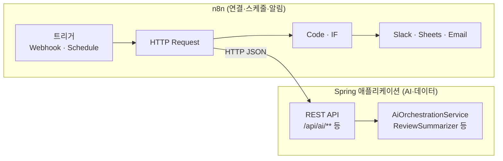

# Step 8. n8n 워크플로우 자동화 (보너스)

> Step 7까지 만든 Spring AI 기능을 HTTP API로 열고, 워크플로우 자동화 도구 n8n에서 불러 Slack 알림, 정기 리포트 같은 주변 업무를 코드 없이 엮어 봅니다.

이 단계는 **선택 과제(보너스)**입니다. Step 7까지 마치면 교재의 핵심 내용(검색 → 벡터 검색 → RAG → 개인화 → Tool Calling)은 모두 끝납니다. 시간이 남거나 "만든 AI 기능을 다른 서비스와 어떻게 연결하는가"가 궁금한 사람만 진행해도 됩니다.

## 이 단계에서 만드는 것

- Docker로 띄운 n8n에서 Spring 애플리케이션의 API를 호출하는 워크플로우 3개
  - 매일 아침 피드백 통계를 조회해 알림 보내기(기존 API만 사용)
  - Webhook으로 받은 질문을 AI에게 묻고 결과를 돌려주기
  - 특정 도서의 리뷰를 모아 AI 요약을 만들고 Slack으로 보내기
- n8n이 호출할 수 있는 새 REST 컨트롤러(`/api/ai/**`, `/api/books/{bookId}/reviews`)

완성하면 다음과 같이 동작합니다.

```text
$ curl -X POST http://localhost:5678/webhook/ask \
    -H "Content-Type: application/json" -d '{"message":"자바 입문서 추천해줘"}'
{"message":"자바 입문서 추천해줘","answer":"*도서 검색 결과*\n\n1. *이것이 자바다* ..."}
```

## 왜 이 단계가 필요한가

Step 7의 AI 기능은 Telegram Bot 안에서만 쓸 수 있습니다. 그런데 실제 서비스에서는 "검색 결과를 팀 Slack에도 알려 주기", "매일 아침 통계 리포트 보내기", "새 리뷰가 쌓이면 요약해서 공유하기"처럼 AI 기능 주변에 붙는 일이 많습니다. 이런 일을 모두 Java 코드로 만들면 외부 서비스마다 클라이언트, 스케줄러, 재시도 로직을 새로 짜야 합니다.

n8n은 이런 연결 작업을 노드를 이어 붙이는 방식으로 처리합니다. Spring 애플리케이션은 "AI 판단과 데이터"를 HTTP API로 제공하고, n8n은 "언제 부르고 결과를 어디로 보낼지"를 맡습니다.



## 문서 구성

| 순서 | 문서 | 내용 | 예상 시간 |
|---|---|---|---|
| 1 | [01. n8n 워크플로우 자동화 연동](./01.n8n-integration.md) | n8n 실행, 새 API 컨트롤러 작성, 워크플로우 3개 구축, 보너스 챌린지 | 4시간 |

## 시작하기 전에

- [Step 7](../step-7/README.md)을 마쳐 Telegram에서 AI 응답이 오는 상태
- Docker Desktop(또는 Docker Engine + Compose)
- curl 또는 Postman
- (선택) 알림을 받을 Slack 워크스페이스와 Incoming Webhook URL. 없으면 n8n 실행 화면에서 결과만 확인해도 됩니다.

## 이 단계를 마치면

- [ ] Docker로 n8n을 띄우고 컨테이너 안에서 Spring 애플리케이션에 접속할 수 있다
- [ ] 기존 API(`/api/admin/feedback/stats`)를 Schedule 트리거로 호출하는 워크플로우를 만들었다
- [ ] n8n이 호출할 새 컨트롤러를 만들고 Request DTO에 Validation을 적용했다
- [ ] Webhook → HTTP Request → 응답/알림으로 이어지는 워크플로우를 만들었다
- [ ] n8n에 맡길 일과 Spring에 둘 일을 구분해 설명할 수 있다

## 관련 소스 코드

n8n이 호출하는 API와 그 뒤의 서비스입니다. "새로 작성"으로 표시한 컨트롤러는 현재 소스에 없으며 01 문서에서 직접 만듭니다.

| 클래스 | 역할 | 경로 |
|---|---|---|
| `FeedbackAdminController` | 피드백 통계 조회 API (`/api/admin/feedback/**`), 기존 | `src/main/java/net/java21/library/external/telegram/api/FeedbackAdminController.java` |
| `AiApiController` | `/api/ai/ask`, `/api/ai/summarize-reviews` API, **새로 작성** | (예시) `src/main/java/net/java21/library/ai/api/AiApiController.java` |
| `ReviewApiController` | `/api/books/{bookId}/reviews` 리뷰 JSON 조회, **새로 작성** | (예시) `src/main/java/net/java21/library/core/review/api/ReviewApiController.java` |
| `AiOrchestrationService` | Tool 기반 오케스트레이션(Telegram `/ai`가 쓰는 서비스) | `src/main/java/net/java21/library/ai/agent/orchestrator/AiOrchestrationService.java` |
| `ReviewSummarizer` | 리뷰 목록을 Map-Reduce로 요약 | `src/main/java/net/java21/library/core/review/service/ReviewSummarizer.java` |
| `ReviewService` | 도서별 리뷰 페이지 조회 | `src/main/java/net/java21/library/core/review/service/ReviewService.java` |
| `BookSearchService` | 개인화 검색(`searchBooks(Pageable, BookSearchRequest, Long)`), 보너스 챌린지에서 사용 | `src/main/java/net/java21/library/core/book/service/search/BookSearchService.java` |

## 참고 자료

- [n8n 공식 문서](https://docs.n8n.io/)
- [n8n Docker 설치 안내](https://docs.n8n.io/hosting/installation/docker/)
- [n8n 워크플로우 예시 모음](https://n8n.io/workflows/)

## 다음 문서

[01. n8n 워크플로우 자동화 연동 →](01.n8n-integration.md)
