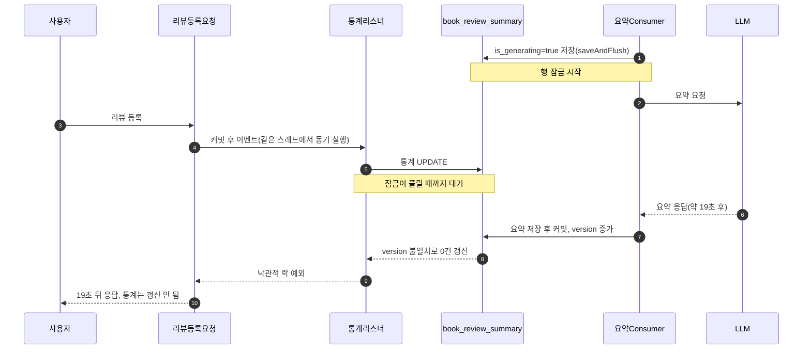
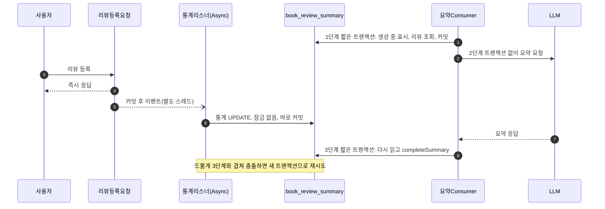
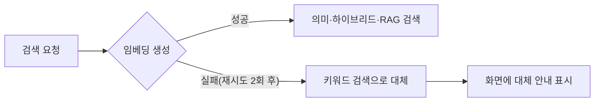

# 실전 트러블슈팅 사례집

> 이 프로젝트를 실제로 운영하면서 겪은 문제를 어떻게 진단하고 해결했는지 기록한 문서입니다. 교재 본문이 "어떻게 만드는가"를 다룬다면, 이 문서는 "만든 것이 운영 중에 어떻게 깨지고, 그때 무엇을 보고 고쳤는가"를 다룹니다.

## 이 문서를 읽는 방법

각 사례는 같은 순서로 정리되어 있습니다.

1. **증상**: 사용자나 개발자가 처음 본 현상
2. **원인 찾기**: 로그, 측정값, 코드 이력(`git log`, `git show`)으로 원인을 좁혀 간 과정
3. **해결**: 고친 방법과 핵심 코드 발췌(현재 소스 기준, 실제 파일 경로 포함)
4. **배운 점**: 다른 프로젝트에도 적용할 수 있는 원칙
5. **관련 문서**: 배경 개념을 설명하는 교재 문서

각 사례 끝에는 "생각해 볼 문제"가 하나씩 있습니다. 정답이 하나로 정해진 문제는 아니므로, 자신의 프로젝트라면 어떻게 할지 생각해 보는 데 씁니다.

해당 Step을 아직 공부하지 않았다면 먼저 관련 문서를 읽고 오는 편이 좋습니다. 처음 보는 용어는 [용어집](glossary.md)을 참고합니다.

## 사례 목차

| 사례 | 분류 | 관련 Step |
|---|---|---|
| [사례 1. 리뷰 요약에 Markdown 기호와 인사말이 그대로 보임](#사례-1-리뷰-요약에-markdown-기호와-인사말이-그대로-보임) | LLM 출력 형식 | Step 3, Step 4 |
| [사례 2. 리뷰 등록이 19초 멈춘 이유](#사례-2-리뷰-등록이-19초-멈춘-이유) | 트랜잭션·동시성 | Step 4 |
| [사례 3. 리뷰가 늘어도 AI 요약이 갱신되지 않음](#사례-3-리뷰가-늘어도-ai-요약이-갱신되지-않음) | 상태 관리 | Step 4 |
| [사례 4. 임베딩 서버 장애로 검색이 수십 초 지연됨](#사례-4-임베딩-서버-장애로-검색이-수십-초-지연됨) | 외부 의존성·장애 대응 | Step 2, Step 3 |
| [사례 5. 첫 화면 목록이 새로고침마다 바뀌고 5페이지에서 끝남](#사례-5-첫-화면-목록이-새로고침마다-바뀌고-5페이지에서-끝남) | 검색 설계 | Step 1, Step 2 |
| [사례 6. @Cacheable이 동작하지 않음](#사례-6-cacheable이-동작하지-않음) | Spring 프록시 | Step 6 |
| [사례 7. 시스템 프롬프트가 등록하지 않은 Tool을 안내함](#사례-7-시스템-프롬프트가-등록하지-않은-tool을-안내함) | Tool Calling | Step 7 |
| [사례 8. 테스트가 공용 개발 DB 스키마를 지움](#사례-8-테스트가-공용-개발-db-스키마를-지움) | 테스트 환경 | Step 0 |
| [사례 9. 도서 10권 중 4권에 표지가 없음](#사례-9-도서-10권-중-4권에-표지가-없음) | 데이터 품질·외부 API | Step 7 |
| [사례 10. 설정 파일에 API 키와 비밀번호가 커밋됨](#사례-10-설정-파일에-api-키와-비밀번호가-커밋됨) | 보안·배포 | Step 0 |
| [사례 11. 같은 하이브리드 검색인데 결과가 매번 다름](#사례-11-같은-하이브리드-검색인데-결과가-매번-다름) | 검색 결정성 | Step 2 |
| [사례 12. 개인화 점수가 검색할 때마다 커짐](#사례-12-개인화-점수가-검색할-때마다-커짐) | 캐시·공유 객체 | Step 6 |
| [사례 13. 운영 DB에 HNSW 인덱스를 만들다 공간 부족으로 실패함](#사례-13-운영-db에-hnsw-인덱스를-만들다-공간-부족으로-실패함) | 운영 DB·인덱스 | Step 2, Step 4 |

---

## 사례 1. 리뷰 요약에 Markdown 기호와 인사말이 그대로 보임

### 증상

도서 상세 화면의 AI 리뷰 요약에 다음과 같은 글이 그대로 표시되었습니다(형태를 보여 주기 위한 예시입니다).

```text
물론입니다! 최종 평판 요약을 작성해 드리겠습니다.

**[장점]** 문장이 쉽고 예제가 많습니다.
**[단점]** 후반부 내용이 얕습니다.
[추천대상] 입문자
```

`**`가 굵은 글씨가 아니라 별표 그대로 보이고, 사용자에게 필요 없는 인사말이 맨 위에 붙었습니다. 도서마다 항목 이름과 순서도 조금씩 달랐습니다.

### 원인 찾기

1. 화면은 Thymeleaf의 `th:text`로 요약을 출력합니다. `th:text`는 문자열을 그대로 보여 주므로 Markdown이 렌더링되지 않습니다. 화면의 문제가 아니라 LLM이 Markdown을 섞어 쓴 것이 원인입니다.
2. 수정 전 프롬프트를 `git show dd9c45e`로 확인하니, 출력 규칙이 거의 없었고 단계마다 형식이 달랐습니다.

| 단계 | 수정 전 지시 |
|---|---|
| Map(리뷰 청크 요약) | `[장점]`, `[단점]`, `[추천대상]`을 각각 한 문장씩 |
| Reduce(부분 요약 종합) | `[장점]`, `[단점]`, `[총평]` 형식 유지 |
| 병합(누적 요약) | `[장점]`, `[단점]`, `[총평]` 형식 유지 |

Map 결과에는 `[추천대상]`이 있는데 Reduce는 `[총평]`을 요구하니, 최종 결과에 어떤 항목이 남을지 LLM이 그때그때 정했습니다. 또 Markdown·인사말을 쓰지 말라는 지시가 없었으므로, 대화형으로 학습된 모델은 평소 습관대로 "물론입니다!"로 시작하고 `**`로 강조했습니다.

### 해결

두 겹으로 막았습니다. 첫째, 모든 요약 프롬프트가 같은 출력 형식 상수를 붙입니다.

```java
// ReviewSummarizer
private static final String OUTPUT_FORMAT = """
        [출력 형식]
        아래 네 줄만 출력하세요. 각 줄은 항목 이름으로 시작하고 1~2문장으로 작성합니다.
        [장점] ...
        [단점] ...
        [추천 대상] ...
        [총평] ...

        [규칙]
        - 인사말, 서두("물론입니다", "작성해 드리겠습니다" 등), 제목을 쓰지 마세요.
        - Markdown 기호(**, #, -, *)를 쓰지 마세요. 일반 텍스트만 출력하세요.
        - 리뷰에 근거가 없는 내용은 쓰지 마세요. 해당 항목에 근거가 없으면 "리뷰에서 언급이 없습니다."라고 쓰세요.
        - 공손한 합니다체(~입니다, ~합니다)를 사용하세요.
        """;
```

전체 코드: [`core/review/service/ReviewSummarizer.java`](../src/main/java/net/java21/library/core/review/service/ReviewSummarizer.java)

둘째, 지시를 어긴 출력에 대비해 후처리를 둡니다. `ReviewSummaryFormatter.clean()`은 `**`, 줄 앞의 `#`·`-`, 인사말 줄, "최종 요약" 같은 제목 줄을 지우고, `parse()`는 `[추천대상]`, `추천 대상:`처럼 흔들리는 머리말까지 인식해 네 항목으로 나눕니다.

```java
// ReviewSummarizer: LLM 응답은 저장 전에 항상 정리
String summary = ReviewSummaryFormatter.clean(chatModel.call(mapPrompt));

// BookSearchController: 이미 저장된 예전 요약도 표시 전에 다시 정리하고 항목별로 나눔
model.addAttribute("reviewSummary", ReviewSummaryFormatter.clean(reviewSummary));
model.addAttribute("reviewSummarySections", ReviewSummaryFormatter.parse(reviewSummary));
```

화면(`templates/index/book-detail.html`)은 `reviewSummarySections`가 있으면 장점·단점·추천 대상·총평을 항목별로 보여 주고, 항목을 나누지 못했을 때만 정리된 원문을 그대로 보여 줍니다.

전체 코드: [`core/review/service/ReviewSummaryFormatter.java`](../src/main/java/net/java21/library/core/review/service/ReviewSummaryFormatter.java)

### 배운 점

- LLM 출력은 형식을 구체적으로 명시합니다. "형식을 유지하세요"보다 "아래 네 줄만 출력하세요"와 금지 목록이 더 잘 지켜집니다.
- 여러 단계로 LLM을 부르는 파이프라인(Map-Reduce)은 모든 단계의 형식을 하나의 상수로 맞춥니다.
- 프롬프트만 믿지 않습니다. 모델은 지시를 어길 수 있으므로 코드로 정리하는 후처리를 함께 둡니다. 이미 저장된 데이터에도 적용되도록 표시 시점에도 정리합니다.

### 관련 문서

- [Step 3-02. 컨텍스트 구축](step-3/02.context-construction.md): 출력 형식을 프롬프트에 명시하는 방법
- [Step 4-04. 리뷰 요약 시스템](step-4/04.review-summarization.md): Map-Reduce 요약 구조

### 생각해 볼 문제

후처리 정규식이 정상적인 요약 문장까지 지울 위험은 없을까요? 예를 들어 리뷰 내용이 "다음은 ~입니다."로 시작한다면 어떻게 될지, 그리고 이를 테스트로 어떻게 확인할지 생각해 봅시다.

---

## 사례 2. 리뷰 등록이 19초 멈춘 이유

### 증상

리뷰가 7개인 도서에 8번째 리뷰를 등록하자 "등록" 버튼을 누른 뒤 화면이 약 19초 동안 멈췄습니다. 응답이 온 뒤 확인해 보니 리뷰는 저장되었지만 리뷰 수·평균 별점 같은 통계는 갱신되지 않았습니다.

### 원인 찾기

먼저 로그에서 해당 도서의 처리 시각을 따라갔습니다(필요한 줄만 줄여 옮겼습니다).

```text
21:01:17 INFO  ReviewEventListener : Handling ReviewCreatedEvent for book id: ...
21:01:17 DEBUG SQL                 : update book_review_summary set ... where book_id=? and version=?
          (19초 동안 아무 로그 없음)
21:01:36 ERROR ...                 : ObjectOptimisticLockingFailureException:
          Row was updated or deleted by another transaction ...
```

통계 UPDATE가 시작된 뒤 19초 동안 멈춰 있다가 낙관적 락 오류로 끝났습니다. UPDATE 한 줄이 19초 걸릴 이유는 없으므로, 다른 트랜잭션이 같은 행을 잠그고 있었다고 추정했습니다. 같은 시각 같은 도서의 AI 요약이 생성 중이었고, 수정 전 `ReviewAiSummaryService`는 다음과 같았습니다(`git show dd9c45e`).

```java
// 수정 전 (요약)
@Transactional(propagation = Propagation.REQUIRES_NEW)
public void generateSummary(Long bookId) {
    // ...
    summary.setGenerating(true);
    bookReviewSummaryRepository.saveAndFlush(summary);   // UPDATE 실행 → 행 잠금 시작
    // ...
    newSummary = reviewSummarizer.summarizeReviews(reviewContents);   // LLM 호출 10~20초
    summary.updateSummaryWithCount(newSummary, reviewCount);
    // ...
}   // 여기서 커밋되어야 잠금이 풀림
```

정리하면 다음과 같은 일이 일어났습니다.

1. 요약 Consumer가 트랜잭션 안에서 `is_generating=true`를 `saveAndFlush()`합니다. UPDATE가 실행되었으므로 PostgreSQL은 이 행을 트랜잭션이 끝날 때까지 잠급니다.
2. 같은 트랜잭션 안에서 LLM을 호출합니다. 응답까지 10~20초가 걸립니다.
3. 그사이 사용자가 리뷰를 등록합니다. 리뷰 저장이 커밋되면 `ReviewEventListener`가 통계를 갱신합니다. 이 리스너는 `@TransactionalEventListener(AFTER_COMMIT)`만 붙어 있어 **요청 스레드에서 동기로** 실행되었습니다. 그래서 HTTP 응답도 함께 기다렸습니다.
4. 통계 UPDATE는 잠긴 행을 만나 요약 트랜잭션이 끝날 때까지 대기합니다.
5. 요약 트랜잭션이 커밋되면서 `@Version` 값이 올라갑니다. 기다리던 UPDATE의 조건 `version=?`이 더 이상 맞지 않아 0건이 갱신되고, Hibernate가 `ObjectOptimisticLockingFailureException`을 던집니다.



### 해결

두 가지를 고쳤습니다.

첫째, LLM 호출을 DB 트랜잭션 밖으로 뺐습니다. 트랜잭션을 짧은 두 개로 나누고 그 사이에서 LLM을 부릅니다. 트랜잭션 경계를 메서드 안에서 나눠야 하므로 `@Transactional` 대신 `TransactionTemplate`을 씁니다.

```java
// ReviewAiSummaryService
public void generateSummary(Long bookId) {
    // 1단계: 생성 중 표시 후 바로 커밋 (행 잠금은 이 짧은 트랜잭션 동안만 유지)
    Optional<SummaryJob> job = transactionTemplate.execute(status -> prepare(bookId));
    if (job == null || job.isEmpty()) {
        return;
    }

    String newSummary;
    try {
        // 2단계: 트랜잭션 밖에서 LLM 호출
        SummaryJob summaryJob = job.get();
        newSummary = summaryJob.fullRebuild()
                ? reviewSummarizer.summarizeReviews(summaryJob.reviewContents())
                : reviewSummarizer.summarizeIncremental(summaryJob.reviewContents(), summaryJob.existingSummary());
    } catch (Exception e) {
        log.error("Failed to generate summary for book {}: {}", bookId, e.getMessage(), e);
        transactionTemplate.executeWithoutResult(status -> releaseGenerating(bookId));
        return;
    }

    // 3단계: 최신 엔티티를 다시 읽어 요약만 반영 (그사이 갱신된 통계는 덮어쓰지 않음)
    long summarizedCount = job.get().reviewCount();
    transactionTemplate.executeWithoutResult(status ->
            bookReviewSummaryRepository.findById(bookId).ifPresent(summary -> {
                summary.completeSummary(newSummary, summarizedCount);
                log.info("Successfully updated review summary for book {}.", bookId);
            }));
}
```

3단계에서 엔티티를 **다시 읽는** 점이 중요합니다. 1단계에서 읽은 엔티티를 그대로 저장하면, LLM을 기다리는 동안 다른 요청이 갱신한 리뷰 수·평점을 옛 값으로 덮어쓰게 됩니다.

전체 코드: [`core/review/service/ReviewAiSummaryService.java`](../src/main/java/net/java21/library/core/review/service/ReviewAiSummaryService.java)

둘째, 통계 갱신을 리뷰 등록 응답과 분리하고 충돌 시 다시 시도하게 했습니다. 통계는 매번 리뷰 테이블에서 다시 집계하므로 같은 작업을 반복해도 결과가 같습니다. 그래서 재시도가 안전합니다.

```java
// ReviewEventListener
@Async
@TransactionalEventListener(phase = TransactionPhase.AFTER_COMMIT)
public void handleReviewCreatedEvent(ReviewCreatedEvent event) {
    for (int attempt = 1; attempt <= MAX_STAT_UPDATE_ATTEMPTS; attempt++) {   // 최대 3회
        try {
            reviewService.updateReviewSummary(event.bookId());   // REQUIRES_NEW 트랜잭션
            return;
        } catch (ObjectOptimisticLockingFailureException e) {
            log.warn("Review stat update conflicted for book {} (attempt {}/{}). Retrying.",
                    event.bookId(), attempt, MAX_STAT_UPDATE_ATTEMPTS);
        }
    }
    log.error("Failed to update review stat for book {} after {} attempts.", event.bookId(), MAX_STAT_UPDATE_ATTEMPTS);
}
```

전체 코드: [`core/review/service/ReviewEventListener.java`](../src/main/java/net/java21/library/core/review/service/ReviewEventListener.java)

수정 후 흐름은 다음과 같습니다. 행 잠금은 1단계와 3단계의 짧은 순간에만 생기고, 리뷰 등록 응답은 통계 갱신을 기다리지 않습니다.



### 배운 점

- 외부 API·LLM 호출을 DB 트랜잭션 안에 두지 않습니다. 트랜잭션이 길어지면 그동안 잡은 잠금과 DB 커넥션이 다른 요청을 막습니다.
- `@TransactionalEventListener`는 기본적으로 이벤트를 발행한 스레드에서 실행됩니다. 사용자 응답과 무관한 후속 작업은 `@Async`로 분리합니다.
- 낙관적 락 충돌은 "다시 해도 결과가 같은 작업"일 때 재시도로 해결할 수 있습니다.
- "UPDATE 한 줄이 오래 걸린다"는 로그는 대개 쿼리 자체가 아니라 잠금 대기를 의심할 신호입니다.

### 관련 문서

- [Step 4-04. 리뷰 요약 시스템](step-4/04.review-summarization.md): 리뷰 이벤트, 요약 Consumer, 중복 실행 방지

### 생각해 볼 문제

1단계에서 `is_generating=true`를 커밋한 뒤 서버가 갑자기 종료되면 이 도서는 계속 "생성 중"으로 남습니다. 이런 상태를 어떻게 감지하고 복구할 수 있을까요?

---

## 사례 3. 리뷰가 늘어도 AI 요약이 갱신되지 않음

### 증상

리뷰가 5개가 되어 첫 AI 요약이 만들어진 뒤로는 리뷰가 10개, 20개로 늘어도 요약이 처음 그대로였습니다. 새 리뷰의 내용이 요약에 전혀 반영되지 않았습니다.

### 원인 찾기

요약 Consumer의 로그에 다음과 같은 메시지가 반복되었습니다(숫자는 예시입니다).

```text
Conditions not met for book ... Review count: 12, is_dirty: false, is_generating: false
```

요약 조건은 "리뷰 5개 이상 그리고 `isSummaryDirty == true`"입니다. 요약을 마치면 `isSummaryDirty`를 `false`로 바꾸는데, 리뷰가 새로 등록될 때 호출되는 `BookReviewSummary.updateStat()`은 리뷰 수와 평점만 바꾸고 이 값을 다시 `true`로 켜지 않았습니다. 첫 요약 이후로는 영원히 "요약할 필요 없음" 상태였습니다.

### 해결

`updateStat()`에서 아직 요약에 반영되지 않은 리뷰가 있으면 다음 요약 대상으로 표시합니다. 요약을 반영하는 `completeSummary()`도 같은 기준을 씁니다. LLM을 호출하는 동안 새 리뷰가 들어왔을 수 있으므로, 요약에 사용한 리뷰 수보다 현재 리뷰 수가 많으면 Dirty Flag를 켜 둔 채로 남깁니다.

```java
// BookReviewSummary
public void updateStat(Long reviewCount, BigDecimal averageRating, /* ... */ LocalDateTime lastReviewedAt) {
    this.reviewCount = reviewCount;
    // ... 평점, 별점별 개수 갱신
    // 아직 요약에 반영되지 않은 리뷰가 있으면 다음 요약 대상으로 표시
    if (reviewCount != null && reviewCount > currentLastSummarizedCount()) {
        this.isSummaryDirty = true;
    }
}

public void completeSummary(String summary, long summarizedCount) {
    this.reviewSummary = summary;
    this.lastSummarizedCount = summarizedCount;
    this.isGenerating = false;
    this.isSummaryDirty = this.reviewCount != null && this.reviewCount > summarizedCount;
    this.updatedAt = LocalDateTime.now();
}
```

전체 코드: [`core/review/domain/BookReviewSummary.java`](../src/main/java/net/java21/library/core/review/domain/BookReviewSummary.java)

### 배운 점

- 상태 플래그는 "누가 끄는가"와 함께 "누가 다시 켜는가"를 확인합니다. 끄는 코드만 있고 켜는 코드가 없으면 기능이 한 번만 동작합니다.
- 비동기 작업 도중 데이터가 바뀔 수 있다는 점을 상태 전이에 반영합니다. 결과를 저장할 때 "작업을 시작한 시점의 값"과 "지금 값"을 비교합니다.

### 관련 문서

- [Step 4-04. 리뷰 요약 시스템](step-4/04.review-summarization.md): Dirty Flag와 누적 요약

### 생각해 볼 문제

`isSummaryDirty`를 따로 저장하지 않고 `reviewCount > lastSummarizedCount`로 매번 계산한다면 어떤 장단점이 있을까요?

---

## 사례 4. 임베딩 서버 장애로 검색이 수십 초 지연됨

### 증상

로컬 PC에서 애플리케이션을 실행하고 의미 검색을 하자 화면이 수십 초 동안 응답하지 않다가 오류 화면이 나왔습니다. 키워드 검색은 정상이었습니다.

### 원인 찾기

로그에는 같은 오류가 간격을 두고 반복되었습니다(주소는 생략하고 줄여 옮겼습니다).

```text
WARN  ... Retry error. Retry count: 1, Exception: I/O error on POST request for ".../v1/embeddings": No route to host
WARN  ... Retry error. Retry count: 2, Exception: I/O error on POST request for ".../v1/embeddings": No route to host
...
```

두 가지를 확인했습니다.

1. **왜 실패하는가**: `No route to host`는 네트워크 경로가 없다는 뜻입니다. 임베딩 서버는 내부망 주소로 접근하는데, 이 PC의 hosts 파일에 그 주소를 등록하지 않았습니다. 서버 장애가 아니라 로컬 환경 문제였습니다.
2. **왜 이렇게 오래 걸리는가**: Spring AI는 모델 호출이 실패하면 자동으로 다시 시도합니다. 기본값은 최대 10회, 첫 대기 2초에서 5배씩 늘어나는 지수 대기(최대 3분)입니다. 2초, 10초, 50초 순으로 기다리므로 몇 번만 재시도해도 요청 하나가 수십 초를 넘깁니다. 게다가 임베딩 실패가 예외로 끝나 사용자는 오래 기다린 뒤 오류 화면을 봤습니다.

### 해결

환경 문제(hosts 등록)는 고치면 되지만, 운영 중에도 임베딩 서버는 언제든 멈출 수 있습니다. 그래서 장애 상황 자체에 대비했습니다.

첫째, 재시도를 짧게 줄였습니다. 이 설정은 임베딩뿐 아니라 LLM 호출에도 적용됩니다.

```properties
# application.properties
# 기본값(최대 10회, 2초부터 5배씩 대기)은 임베딩·LLM 서버가 응답하지 않을 때 요청을 수십 초 붙잡습니다.
spring.ai.retry.max-attempts=2
spring.ai.retry.backoff.initial-interval=500ms
spring.ai.retry.backoff.multiplier=2
spring.ai.retry.backoff.max-interval=2s
```

둘째, 임베딩을 만들 수 없으면 키워드 검색으로 대체합니다.

```java
// BookSearchService
private BookSearchResult executeSearch(Pageable pageable, BookSearchRequest request) {
    try {
        request = ensureEmbedding(request);
    } catch (RuntimeException e) {
        // 임베딩 서버에 연결할 수 없으면 의미·하이브리드·RAG 검색이 모두 불가능하므로
        // 오류 화면 대신 키워드 검색 결과로 대체합니다.
        log.warn("Embedding unavailable for '{}'. Falling back to keyword search: {}", request.keyword(), e.getMessage());
        BookSearchRequest keywordRequest = new BookSearchRequest(
                request.keyword(), request.isbn(), SearchType.KEYWORD, null, request.isWarmUp());
        return BookSearchResult.keywordFallback(keywordSearchStrategy.search(pageable, keywordRequest).getBooks());
    }

    SearchStrategy strategy = selectStrategy(request.searchType());
    return strategy.search(pageable, request);
}
```

`BookSearchResult.keywordFallback()`은 `keywordFallback=true`인 결과를 만들고, 화면은 이 값을 보고 "의미 검색(임베딩) 서버에 연결할 수 없어 키워드 검색 결과를 대신 보여 드립니다."라는 안내를 띄웁니다. 사용자는 결과가 왜 평소와 다른지 알 수 있습니다.



전체 코드: [`core/book/service/search/BookSearchService.java`](../src/main/java/net/java21/library/core/book/service/search/BookSearchService.java), [`core/book/dto/BookSearchResult.java`](../src/main/java/net/java21/library/core/book/dto/BookSearchResult.java)

### 배운 점

- 외부 의존성이 응답하지 않을 때는 **빠르게 실패**합니다. 긴 재시도는 일시적인 오류에는 도움이 되지만, 서버가 아예 없을 때는 사용자 대기 시간만 늘립니다.
- 핵심 기능을 잃더라도 서비스 전체를 멈추지 않고 **대체 경로**를 제공합니다(Graceful Degradation, 우아한 기능 저하). 대체했다는 사실은 사용자에게 알립니다.
- 라이브러리의 기본값(재시도 횟수, 타임아웃)을 확인합니다. 기본값은 모든 상황에 맞게 정해진 것이 아닙니다.

### 관련 문서

- [Step 2-04. 자연어 검색](step-2/04.natural-language-search.md): 검색어 임베딩과 벡터 검색
- [Step 3-03. LLM 연동](step-3/03.llm-integration.md): 모델 호출과 오류 처리

### 생각해 볼 문제

임베딩 서버가 계속 죽어 있다면, 요청마다 2번씩 시도하고 실패하는 것도 낭비입니다. 일정 횟수 이상 실패하면 한동안 임베딩 호출 자체를 건너뛰는 방법(서킷 브레이커)을 어디에 어떻게 넣을 수 있을까요?

---

## 사례 5. 첫 화면 목록이 새로고침마다 바뀌고 5페이지에서 끝남

### 증상

검색어 없이 첫 화면에 들어가면 도서 목록이 보이는데, 새로고침할 때마다 목록이 달라졌습니다. 또 15만 권이 넘는 도서가 있는데 페이지가 5페이지에서 끝났습니다.

### 원인 찾기

1. `BookSearchRequest`는 검색 방식이 비어 있으면 기본값으로 `SearchType.RAG`를 씁니다. 검색어가 없는 첫 화면도 RAG 검색, 즉 하이브리드 검색을 거쳤습니다.
2. `HybridSearchStrategy`는 키워드 검색과 벡터 검색에서 각각 상위 100건(`DEFAULT_BATCH_SIZE`)만 가져와 RRF로 합칩니다. 검색어가 없으면 임베딩을 만들지 않으므로 벡터 쪽은 비고, 키워드 쪽 100건만 남습니다. 한 페이지 24건이므로 5페이지에서 끝납니다.
3. 검색어가 없을 때 키워드 검색은 조건도 정렬(`ORDER BY`)도 없는 조회였습니다. SQL은 `ORDER BY`가 없으면 결과 순서를 보장하지 않으므로, 어떤 100건이 어떤 순서로 오는지가 실행마다 달라질 수 있습니다.

즉 하이브리드 검색은 "검색어와 관련 있는 상위 후보를 고르는" 도구인데, 순위를 매길 기준(검색어)이 없는 화면에 쓰고 있었습니다.

### 해결

검색어가 없으면 검색 전략을 쓰지 않고 **둘러보기**로 처리합니다. 둘러보기는 정렬 기준이 고정되어 있고 DB에서 페이징하므로 같은 페이지는 항상 같은 목록이며, 전체 도서를 끝까지 넘길 수 있습니다.

```java
// BookSearchController.index()
boolean browseMode = isBrowseMode(bookSearchRequest);   // 검색어와 ISBN이 모두 비어 있으면 true
if (browseMode) {
    books = bookSearchService.browseBooks(pageRequest, browseSort);
} else {
    BookSearchResult searchResult = bookSearchService.searchBooks(pageRequest, bookSearchRequest);
    // ...
}
```

```java
// BookRepositoryImpl: 최근 출간 순 (출간일이 같으면 id로 순서를 고정)
private List<BookSearchResponse> fetchRecent(Pageable pageable) {
    return queryFactory
            .select(bookResponseProjection())
            .from(book)
            .orderBy(book.editionPublishDate.desc().nullsLast(), book.id.desc())
            .offset(pageable.getOffset())
            .limit(pageable.getPageSize())
            .fetch();
}
```

정렬 기준은 `BrowseSort`의 `RECENT`(최근 출간 순)와 `POPULAR`(리뷰 많은 순) 두 가지입니다. 마지막 정렬 기준에 `book.id`를 두어 값이 같은 도서끼리도 순서가 흔들리지 않게 했습니다.

전체 코드: [`core/book/domain/BrowseSort.java`](../src/main/java/net/java21/library/core/book/domain/BrowseSort.java), [`core/book/repository/impl/BookRepositoryImpl.java`](../src/main/java/net/java21/library/core/book/repository/impl/BookRepositoryImpl.java), [`front/web/BookSearchController.java`](../src/main/java/net/java21/library/front/web/BookSearchController.java)

### 배운 점

- 순위 기반 검색(하이브리드, RAG)은 상위 N건만 다루는 구조입니다. "전체 목록 보기"와 "관련도 검색"은 다른 기능으로 설계합니다.
- 페이징하는 조회에는 반드시 고정된 정렬 기준을 두고, 마지막 기준은 id처럼 유일한 값으로 둡니다.
- 기본값(`searchType=RAG`)이 모든 화면에 맞는지 확인합니다.

### 관련 문서

- [Step 1-03. 검색 UI](step-1/03.search-ui.md): 검색 화면과 페이징
- [Step 2-05. 하이브리드 검색](step-2/05.hybrid-search.md): 상위 100건씩 가져와 RRF로 합치는 구조

### 생각해 볼 문제

`OFFSET` 기반 페이징은 뒤쪽 페이지(예: 5,000페이지)로 갈수록 느려집니다. 이유는 무엇이고, 어떤 대안(예: 마지막으로 본 값 기준 조회)이 있을까요?

---

## 사례 6. @Cacheable이 동작하지 않음

### 증상

개인화 검색에서 사용자 선호 벡터를 Caffeine 캐시에 담도록 `@Cacheable`을 붙였는데, 검색할 때마다 `Calculating preference vector` 로그가 찍히며 매번 다시 계산했습니다.

### 원인 찾기

`@Cacheable`은 Spring이 빈을 감싸 만든 프록시가 처리합니다. 수정 전에는 `PersonalizationServiceImpl` 안의 `calculateUserPreferenceVector()`에 `@Cacheable`이 붙어 있었고, 같은 클래스의 `personalizedSearch()`가 이 메서드를 직접(`this.`) 호출했습니다. 같은 객체 안의 호출은 프록시를 거치지 않으므로 캐시가 끼어들 수 없습니다. 이를 **self-invocation(자기 호출)**이라고 합니다. 자세한 원리는 Step 6-02에 그림과 함께 설명되어 있습니다.

### 해결

계산 로직과 `@Cacheable`을 별도 빈 `UserPreferenceVectorCalculator`로 옮기고, `PersonalizationServiceImpl`은 이 빈을 주입받아 호출합니다(커밋 `9174077`).

```java
// PersonalizationServiceImpl
private final UserPreferenceVectorCalculator userPreferenceVectorCalculator;   // 다른 빈 → 프록시를 거침
```

전체 코드: [`core/book/service/personalization/impl/UserPreferenceVectorCalculator.java`](../src/main/java/net/java21/library/core/book/service/personalization/impl/UserPreferenceVectorCalculator.java)

### 배운 점

- `@Cacheable`, `@Transactional`, `@Async`처럼 프록시로 동작하는 애노테이션은 같은 클래스 안에서 호출하면 적용되지 않습니다. 이런 메서드는 별도 빈으로 분리합니다. 이 프로젝트에서는 `BookCoverEventListener`(사례 9), `ReviewEventListener`(사례 2)도 같은 이유로 분리되어 있습니다.
- "캐시를 붙였다"에서 끝내지 않고, 로그나 테스트로 실제 적중(히트)을 확인합니다.

### 관련 문서

- [Step 6-02. 사용자 선호 벡터 계산하기: @Cacheable과 프록시, 그리고 self-invocation](step-6/02.user-preference-vector.md#22-cacheable과-프록시-그리고-self-invocation)

### 생각해 볼 문제

사례 2의 `ReviewAiSummaryService`는 `@Transactional` 대신 `TransactionTemplate`을 썼습니다. 한 메서드 안에서 트랜잭션을 여러 번 나눠야 할 때, `@Transactional`만으로 구현하려면 클래스를 어떻게 나눠야 할까요?

---

## 사례 7. 시스템 프롬프트가 등록하지 않은 Tool을 안내함

### 증상

Telegram Bot에 "광주에서 『채식주의자』 빌릴 수 있는 도서관 알려줘"처럼 대출 가능 도서관을 물으면, 도서는 찾지만 도서관 목록은 답하지 못하거나 "조회할 수 없습니다"라고 답했습니다.

### 원인 찾기

`AiOrchestrationService`의 시스템 프롬프트와 실제로 등록한 Tool 목록을 나란히 놓고 비교했습니다.

| 시스템 프롬프트에서 안내한 Tool | 실제 등록(`defaultToolCallbacks`) |
|---|---|
| `SearchBooks` | 등록됨 |
| `SearchLibraries` | 등록됨 |
| `GetLibrariesWithBook` | **등록 안 됨** |
| `CheckBookExists` | 등록됨 |

프롬프트는 "각 도서마다 `GetLibrariesWithBook`을 호출하라"고 지시하는데, 정작 그 Tool은 등록되어 있지 않았습니다. LLM은 존재하지 않는 Tool을 호출할 수 없으므로 대출 가능 도서관을 조회하지 못했습니다.

같은 점검을 `@Tool` 방식인 `ToolBasedAiOrchestrationService`에도 했더니, 이번에는 이름이 어긋나 있었습니다. 프롬프트는 `SearchBooks`, `GetLibrariesWithBook`처럼 PascalCase로 안내했지만, `@Tool`에 `name`을 지정하지 않으면 **메서드 이름**(`searchBooks`, `getLibrariesWithBook`)이 Tool 이름이 됩니다.

### 해결

빠진 Tool을 등록해 4개로 맞췄습니다.

```java
// AiOrchestrationService
FunctionToolCallback<LoanAvailabilityRequest, LoanAvailabilityResult> getLibrariesWithBookTool =
    FunctionToolCallback.builder("GetLibrariesWithBook", libraryFunctions.getLibrariesWithBook())
        .description("ISBN으로 특정 도서를 소장하고 대출 가능한 도서관 목록을 조회합니다. " +
                    "isbn13은 필수이고, region에 숫자 지역 코드(예: 서울=11, 광주=24)를 넣으면 해당 지역으로 좁힙니다.")
        .inputType(LoanAvailabilityRequest.class)
        .build();

ChatClient chatClient = ChatClient.builder(chatModel)
    .defaultToolCallbacks(searchBooksTool, searchLibrariesTool, getLibrariesWithBookTool, checkBookExistsTool)
    .build();
```

`ToolBasedAiOrchestrationService`의 프롬프트는 실제 `@Tool` 이름에 맞게 고쳤습니다.

```java
// ToolBasedAiOrchestrationService.buildSystemPrompt() 일부
prompt.append("- searchBooks: 도서 제목으로 검색하여 ISBN 확보 (내부 DB → 도서관정보나루 Fallback)\n");
prompt.append("- getLibrariesWithBook: ISBN으로 특정 도서의 대출 가능 도서관 조회\n");
```

전체 코드: [`ai/agent/orchestrator/AiOrchestrationService.java`](../src/main/java/net/java21/library/ai/agent/orchestrator/AiOrchestrationService.java), [`ai/agent/orchestrator/ToolBasedAiOrchestrationService.java`](../src/main/java/net/java21/library/ai/agent/orchestrator/ToolBasedAiOrchestrationService.java)

### 배운 점

- 시스템 프롬프트에는 실제로 등록한 Tool만 언급합니다. 프롬프트와 Tool 목록은 따로 고치다 보면 쉽게 어긋나므로 한 곳에서 관리합니다. 예를 들어 등록한 `ToolCallback`의 이름과 설명으로 프롬프트의 Tool 안내 부분을 만들면 둘이 어긋날 수 없습니다.
- `@Tool` 이름은 기본적으로 메서드 이름입니다. 프롬프트에서 다른 이름으로 부르려면 `@Tool(name = ...)`으로 명시합니다.
- Tool Calling이 기대대로 동작하지 않으면 LLM의 능력을 의심하기 전에, LLM에게 실제로 어떤 Tool이 전달되었는지부터 확인합니다.

### 관련 문서

- [Step 7-04. 외부 API 연동: 대출 가능 도서관 조회](step-7/04.external-api.md)
- [Step 7-05. @Tool 애노테이션 방식](step-7/05.tool-annotation.md)

### 생각해 볼 문제

프롬프트와 등록 Tool 목록이 어긋나지 않았는지 자동으로 확인하는 단위 테스트를 만든다면, 무엇을 입력으로 받고 무엇을 검증하게 할까요?

---

## 사례 8. 테스트가 공용 개발 DB 스키마를 지움

### 증상

`mvn test`를 실행한 뒤 팀이 함께 쓰는 원격 개발 DB `library_dev`에 접속하자 테이블이 하나도 없었습니다. 도서 데이터와 임베딩도 모두 사라졌습니다.

### 원인 찾기

테스트 설정 파일 `src/test/resources/application.properties`의 이력을 확인했습니다(`git show f2e8cdc`).

```properties
# 수정 전 (요약, 접속 정보는 생략)
spring.datasource.url=jdbc:postgresql://<원격 개발 DB 주소>/library_dev?stringtype=unspecified
spring.jpa.hibernate.ddl-auto=create-drop
spring.config.import=classpath:rabbitmq.properties,...
```

- 테스트가 원격 공용 DB에 연결되어 있었습니다.
- `ddl-auto=create-drop`은 테스트 컨텍스트가 시작할 때 스키마를 만들고 **끝날 때 테이블을 모두 삭제**합니다. 테스트가 끝나면서 공용 DB의 테이블이 지워졌습니다.
- 같은 이유로 테스트는 운영 RabbitMQ 설정(`rabbitmq.properties`)도 읽고 있었습니다. 테스트로 띄운 애플리케이션의 `@RabbitListener`가 운영 큐의 메시지를 가져가 처리해 버릴 위험도 있었습니다.

### 해결

Spring Context 테스트가 매번 일회용 컨테이너에 연결되도록 Testcontainers로 바꿨습니다.

```java
// support/TestcontainersInitializer (테스트 코드)
public class TestcontainersInitializer implements ApplicationContextInitializer<ConfigurableApplicationContext> {

    private static final PostgreSQLContainer<?> POSTGRES = new PostgreSQLContainer<>(PGVECTOR_IMAGE)   // pgvector/pgvector:pg16
            .withDatabaseName("library_test")
            .withUsername("test")
            .withPassword("test")
            .withInitScript("db/init-test.sql");

    private static final RabbitMQContainer RABBITMQ = new RabbitMQContainer(RABBITMQ_IMAGE);   // rabbitmq:3.13-alpine

    static {
        POSTGRES.start();   // JVM당 한 번만 띄우고 모든 테스트 컨텍스트가 공유
        RABBITMQ.start();
    }

    @Override
    public void initialize(ConfigurableApplicationContext context) {
        TestPropertyValues.of(
                "spring.datasource.url=" + POSTGRES.getJdbcUrl() + "&stringtype=unspecified",
                "spring.rabbitmq.host=" + RABBITMQ.getHost(),
                "spring.rabbitmq.port=" + RABBITMQ.getAmqpPort()
                // ... DB 사용자·비밀번호, RabbitMQ 계정도 같은 방식으로 덮어씀
        ).applyTo(context.getEnvironment());
    }
}
```

이 초기화기를 `src/test/resources/META-INF/spring.factories`에 등록했으므로 테스트 클래스를 하나도 고치지 않고 모든 `@SpringBootTest`에 적용됩니다.

```properties
# src/test/resources/META-INF/spring.factories
org.springframework.context.ApplicationContextInitializer=net.java21.library.support.TestcontainersInitializer
```

추가 안전장치도 두었습니다.

- 테스트 설정의 기본 DB 주소는 `jdbc:postgresql://localhost:1/not-configured`입니다. 초기화기가 어떤 이유로 적용되지 않으면 원격 DB로 가지 않고 바로 연결 실패로 끝납니다.
- 컨테이너 초기화 스크립트 `src/test/resources/db/init-test.sql`이 `vector` 확장과, 전문 검색 함수가 쓰는 `korean` 텍스트 검색 설정을 만듭니다. 운영 DB에 수동으로 만들어 둔 것들을 테스트 DB에도 재현해야 테스트가 통과합니다.

결과적으로 전체 195건의 테스트가 컨테이너에서 통과했고, 공용 DB와 운영 큐에는 더 이상 연결하지 않습니다.

전체 코드: [`support/TestcontainersInitializer.java`](../src/test/java/net/java21/library/support/TestcontainersInitializer.java), [`db/init-test.sql`](../src/test/resources/db/init-test.sql)

### 배운 점

- 테스트는 공유 자원(공용 DB, 운영 메시지 큐)에 연결하지 않습니다. 테스트가 무엇을 지우고 무엇을 소비하는지 통제할 수 없기 때문입니다.
- `ddl-auto`의 `create`, `create-drop`은 일회용 DB에서만 씁니다. 공용·운영 설정은 `validate`만 허용합니다.
- 설정이 빠졌을 때 "위험한 기본값"이 아니라 "실패하는 기본값"으로 떨어지게 만듭니다(`localhost:1`).

### 관련 문서

- [Step 0-02. 개발 환경 준비](step-0/02.environment-setup.md): Docker, 테스트 실행 환경

### 생각해 볼 문제

Testcontainers를 쓰면 Docker가 없는 환경에서는 Spring Context 테스트를 실행할 수 없습니다. CI(지속적 통합) 서버나 Docker를 쓸 수 없는 팀원을 위해 어떤 방법을 고려할 수 있을까요?

---

## 사례 9. 도서 10권 중 4권에 표지가 없음

### 증상

검색 결과 화면에 표지가 비어 있는 도서가 많았습니다. 표지가 있는 도서도 일부는 이미지가 깨져 보였습니다.

### 원인 찾기

DB에서 표지 URL(`image_url`)이 비어 있는 도서를 세었습니다.

| 항목 | 값 |
|---|---|
| 전체 도서 | 157,118권 |
| 표지 URL 없음 | 58,781권(약 37%) |

원본 공공 도서 CSV에 표지 정보가 없는 행이 많았습니다. 또 표지 URL이 있는 도서도 대부분 외부 온라인 서점의 이미지를 직접 링크(핫링크)하고 있어, 상대 서버가 외부 사이트의 요청을 막거나 이미지 주소가 바뀌면 깨졌습니다.

### 해결

스키마를 바꾸지 않고 세 가지를 조합했습니다.

1. **화면에 노출된 도서만 보강**: 15만 권을 한꺼번에 조회하면 외부 API 호출 한도를 넘습니다. 그래서 사용자가 실제로 본 도서 중 표지가 없는 것만 골라 비동기로 채웁니다.
2. **외부 API로 표지 조회**: 도서관 정보나루의 도서 상세 조회 API(`srchDtlList`)가 돌려주는 `bookImageURL`로 `image_url`을 채웁니다.
3. **생성 표지**: 끝내 표지를 찾지 못했거나 이미지가 깨지면 제목·저자로 만든 표지를 보여 줍니다.

```java
// BookCoverService.requestEnrichment(): 요청 스레드에서는 거르기와 이벤트 발행만 (DB·API 호출 없음)
List<BookCoverTarget> targets = candidates.stream()
        .filter(BookCoverTarget::isMissingCover)
        .filter(target -> lookedUpIsbns.getIfPresent(normalizeIsbn(target.isbn())) == null)
        .toList();
if (targets.isEmpty()) {
    return;
}
eventPublisher.publishEvent(new BookCoverMissingEvent(targets));
```

```java
// BookCoverService.enrichCovers(): BookCoverEventListener가 @Async 전용 스레드에서 호출
for (BookCoverTarget target : targets) {
    if (lookups >= MAX_LOOKUPS_PER_EVENT) {   // 이벤트당 최대 10건
        break;
    }
    // ...
    // 원자적으로 조회 이력을 남겨 동시 이벤트에서도 같은 ISBN을 한 번만 호출
    if (lookedUpIsbns.asMap().putIfAbsent(isbn, Boolean.TRUE) != null) {
        continue;
    }
    lookups++;
    String coverUrl = fetchCoverUrl(isbn);
    // ...
}
```

API 호출 한도를 지키는 장치는 두 가지입니다. 조회한 ISBN은 결과와 관계없이 Caffeine 캐시에 7일간 기록해(`cache.cover-lookup.ttl.days=7`) 다시 호출하지 않고, 이벤트 하나에서 최대 10건만 조회합니다. 외부 API를 기다리는 동안 DB 커넥션을 잡지 않도록 트랜잭션 없이 조회를 모두 마친 뒤 한 번에 저장합니다(사례 2와 같은 원칙).

생성 표지는 서버 템플릿과 JavaScript가 같은 규칙으로 그립니다. 제목의 해시값으로 8가지 색 중 하나를 골라 같은 책은 항상 같은 색이 나오게 하고, 이미지 로딩이 실패하면 `onerror`로 생성 표지로 바꿉니다.

```html
<!-- templates/fragments/book-cover.html (일부) -->

<div th:if="${#strings.isEmpty(imageUrl)}"
     class="book-cover-generated"
     th:classappend="'book-cover-p' + ${title != null ? (title.hashCode() % 8 + 8) % 8 : 0}">
    <div class="book-cover-title" th:text="${title}">도서 제목</div>
    <div class="book-cover-author" th:if="${!#strings.isEmpty(author)}" th:text="${author}">저자</div>
</div>
```

전체 코드: [`core/book/service/cover/BookCoverService.java`](../src/main/java/net/java21/library/core/book/service/cover/BookCoverService.java), [`core/book/event/BookCoverEventListener.java`](../src/main/java/net/java21/library/core/book/event/BookCoverEventListener.java), [`static/js/book-cover.js`](../src/main/resources/static/js/book-cover.js)

### 배운 점

- 데이터 품질 문제는 숫자로 먼저 확인합니다. "표지가 좀 없다"와 "37%가 없다"는 대응 방식이 다릅니다.
- 외부 API로 데이터를 보강할 때는 호출 한도를 먼저 설계합니다(필요한 것만, 한 번만, 조금씩).
- 사용자 응답 경로에서는 이벤트 발행만 하고, 느린 작업은 비동기로 넘깁니다.
- 외부 리소스는 언제든 실패할 수 있으므로 화면에도 대체 표시를 둡니다.

### 관련 문서

- [Step 7-04. 외부 API 연동](step-7/04.external-api.md): 도서관 정보나루 API 클라이언트

### 생각해 볼 문제

조회 이력을 Caffeine(메모리) 캐시에 두었기 때문에 애플리케이션을 재시작하면 이력이 사라집니다. 서버가 여러 대이거나 자주 재시작된다면 어떤 문제가 생기고, 어떻게 보완할 수 있을까요?

---

## 사례 10. 설정 파일에 API 키와 비밀번호가 커밋됨

### 증상

공개 저장소를 점검하던 중, `application.properties` 등 설정 파일과 일부 테스트 코드에 DB·Redis·RabbitMQ 비밀번호, Gemini·도서관 정보나루 API 키, Telegram Bot 토큰이 그대로 들어 있는 것을 발견했습니다. 과거 커밋 이력에도 같은 값이 남아 있었습니다.

### 원인 찾기

처음에는 혼자 쓰는 저장소라 설정 파일에 값을 직접 적었고, 그 상태로 계속 커밋했습니다. 파일에서 값을 지우는 것만으로는 부족합니다. Git은 모든 커밋을 보관하므로 이력을 거슬러 올라가면 누구나 예전 값을 볼 수 있습니다.

### 해결

**1. 설정 파일에는 플레이스홀더만 둡니다.**

```properties
# application.properties
spring.config.import=optional:file:./secrets.properties,optional:file:${user.home}/library/secrets.properties
spring.datasource.password=${DB_PASSWORD:}
spring.ai.google.genai.api-key=${GEMINI_API_KEY:}
library.api.key=${LIBRARY_API_KEY:}
```

`${DB_PASSWORD:}`는 환경 변수나 import한 파일에서 값을 찾고, 없으면 빈 문자열을 씁니다. 실제 값은 프로젝트 루트의 `secrets.properties`(`.gitignore`로 커밋 제외)에 두고, 저장소에는 값이 빈 템플릿 `secrets.properties.example`만 올립니다. `optional:`이므로 파일이 없어도 애플리케이션은 시작됩니다.

**2. 테스트 코드의 하드코딩도 없앱니다.** 실제 API를 호출하는 테스트는 `TestApiKeys`가 환경 변수 `LIBRARY_API_KEY` → `secrets.properties` → `"test-key"` 순으로 키를 찾습니다.

**3. 서버에는 배포 시점에 만듭니다.** GitHub Actions가 저장소의 Secrets에서 값을 받아 서버에 `~/library/secrets.properties`를 만들고 권한을 600(소유자만 읽기·쓰기)으로 제한합니다.

```yaml
# .github/workflows/maven.yml (run-script 단계 일부)
- name: run-script
  env:
    DB_PASSWORD: ${{ secrets.DB_PASSWORD }}
    # ... 나머지 키
  with:
    script: |
      umask 077
      {
        printf 'DB_PASSWORD=%s\n' "$DB_PASSWORD"
        # ...
      } > ~/library/secrets.properties
      chmod 600 ~/library/secrets.properties
```

**4. 이력에서 값을 지웁니다.** `git filter-repo`로 모든 커밋에서 비밀값을 치환한 뒤 원격 저장소에 강제 푸시(force push)했습니다.

**5. 노출된 키는 재발급합니다.** 이력을 지워도 그전에 누군가 복제(clone)했거나, 검색 엔진·자동 수집기가 이미 가져갔을 수 있습니다. 한 번이라도 공개 저장소에 올라간 값은 유출된 것으로 보고 새로 발급합니다.

전체 코드: [`secrets.properties.example`](../secrets.properties.example), [`.github/workflows/maven.yml`](../.github/workflows/maven.yml)

### 배운 점

- 비밀값은 처음부터 코드와 분리합니다. 나중에 분리하면 이력 정리와 재발급까지 해야 합니다.
- 이력을 지우는 것은 추가 노출을 줄일 뿐, 이미 노출된 키를 안전하게 만들지 못합니다. 노출된 키는 반드시 재발급합니다.
- 문서와 테스트 코드도 커밋 대상입니다. 예시에는 실제 값 대신 `...`이나 가짜 값을 씁니다.

### 관련 문서

- [Step 0-02. 개발 환경 준비](step-0/02.environment-setup.md): `secrets.properties` 설정

### 생각해 볼 문제

커밋하기 전에 비밀값이 섞였는지 자동으로 잡아내려면 어떤 장치(예: Git의 pre-commit 훅, CI 검사)를 둘 수 있을까요? 각각 어떤 상황을 놓칠 수 있는지도 생각해 봅시다.

---

## 사례 11. 같은 하이브리드 검색인데 결과가 매번 다름

### 증상

하이브리드 검색으로 "spring"을 몇 초 간격으로 반복해 검색했는데, 1페이지에 나오는 도서와 순서가 매번 조금씩 달랐습니다. 키워드가 일치하는 도서는 423건이었습니다.

### 원인 찾기

같은 입력에 다른 출력이 나온다면 어딘가에 "순서가 정해지지 않은" 단계가 있습니다. 하이브리드 검색의 단계를 하나씩 확인했습니다.

1. **키워드 후보 조회**: `HybridSearchStrategy`는 키워드 검색 상위 100건(`DEFAULT_BATCH_SIZE`)을 가져옵니다. 그런데 `BookRepositoryImpl.search()`의 쿼리에 `ORDER BY`가 없었습니다. SQL은 `ORDER BY`가 없으면 결과 순서를 보장하지 않으므로, 일치하는 423건 중 **어떤 100건이 어떤 순서로** 오는지가 실행 계획과 병렬 스캔 상황에 따라 달라집니다. RRF는 이 순서를 순위로 쓰므로 입력이 바뀌면 점수도 바뀝니다.
2. **벡터 후보 조회**: 유사도 내림차순으로 정렬했지만, 유사도가 같은 도서끼리의 순서는 정해져 있지 않았습니다.
3. **RRF 합치기**: `RrfService`는 RRF 점수로만 정렬했습니다. 점수가 같은 도서(예: 키워드 5위·벡터 없음인 도서와 벡터 5위·키워드 없음인 도서)의 순서는 `HashMap` 순회 순서와 스트림 처리 순서에 좌우되었습니다.

일치 건수가 100건 이하인 검색어에서는 1번 문제가 드러나지 않았습니다. 100건을 넘는 검색어에서만 재현되었기 때문에 원인을 찾는 데 시간이 걸렸습니다.

### 해결

모든 단계에 **결정적(deterministic) 정렬**을 두었습니다. 마지막 기준은 항상 도서 ID처럼 유일한 값(동점 처리, tie-breaker)입니다.

```java
// BookRepositoryImpl: 키워드 정렬 = 제목 일치 우선 → 출간일 최신순(없으면 뒤로) → ID 오름차순
private OrderSpecifier<?>[] keywordOrder(BookSearchRequest request) {
    OrderSpecifier<?> byDate = book.editionPublishDate.desc().nullsLast();
    OrderSpecifier<?> byId = book.id.asc();
    if (StringUtils.isEmpty(request.keyword())) {
        return new OrderSpecifier<?>[]{byDate, byId};
    }
    NumberExpression<Integer> titleMatchRank = new CaseBuilder()
            .when(book.title.containsIgnoreCase(request.keyword())).then(TITLE_MATCH_RANK)
            .otherwise(OTHER_MATCH_RANK);
    return new OrderSpecifier<?>[]{titleMatchRank.asc(), byDate, byId};
}
```

```java
// BookRepositoryImpl.fetchVector(): 거리(embedding <=> q) 오름차순, 거리가 같으면 ID로 순서 고정
.orderBy(distanceTemplate.asc(), book.id.asc())
```

```java
// RrfService: 최종 순위 = RRF 점수 내림차순 → 벡터 유사도 내림차순(없으면 뒤로) → 도서 ID 오름차순
private static final Comparator<BookSearchResponse> RANKING_ORDER =
        Comparator.comparing(BookSearchResponse::getRrfScore, Comparator.reverseOrder())
                .thenComparing(BookSearchResponse::getSimilarity,
                        Comparator.nullsLast(Comparator.reverseOrder()))
                .thenComparing(BookSearchResponse::getId);
```

벡터 정렬을 유사도(`1 - 거리`) 내림차순에서 거리 오름차순으로 바꾼 것은 순서가 같으면서 pgvector 인덱스를 쓸 수 있는 형태이기 때문입니다([사례 13](#사례-13-운영-db에-hnsw-인덱스를-만들다-공간-부족으로-실패함) 참고).

보조 수단으로 키워드·벡터·하이브리드 검색 결과를 5분간 보관하는 `SearchResultCache`도 추가했습니다. 같은 검색을 반복할 때 임베딩 생성과 DB 조회를 건너뛰기 위한 **성능용**입니다. RAG 결과(시맨틱 캐시가 따로 담당)와 키워드 대체 결과([사례 4](#사례-4-임베딩-서버-장애로-검색이-수십-초-지연됨))는 캐시하지 않습니다.

중요한 점은 **결정성을 캐시로 해결하지 않았다**는 것입니다. 캐시는 5분이 지나거나 서버가 재시작되면 사라지고, 서버가 여러 대면 서버마다 다릅니다. 캐시로 같은 결과를 "보여 주는" 것과 같은 입력에 같은 결과를 "계산하는" 것은 다릅니다.

검증은 테스트 두 개로 합니다.

| 테스트 | 확인 내용 |
|---|---|
| `SearchDeterminismTest` (Testcontainers) | 출간일·임베딩이 같은 도서 30권으로 동점을 일부러 만들고, 같은 하이브리드 검색을 두 번 실행해 순서와 점수가 같은지 확인. 테스트 설정은 결과 캐시를 즉시 만료(`cache.search-result.ttl.minutes=0`)시키므로 캐시 없이 검증됨 |
| `RrfServiceTest` | 동점이 많은 입력의 순서를 바꿔도 같은 결과가 나오는지, 동점일 때 유사도 → ID 순으로 정렬되는지 확인 |

전체 코드: [`core/book/repository/impl/BookRepositoryImpl.java`](../src/main/java/net/java21/library/core/book/repository/impl/BookRepositoryImpl.java), [`core/book/service/search/RrfService.java`](../src/main/java/net/java21/library/core/book/service/search/RrfService.java), [`core/book/service/cache/SearchResultCache.java`](../src/main/java/net/java21/library/core/book/service/cache/SearchResultCache.java), [`SearchDeterminismTest.java`](../src/test/java/net/java21/library/core/book/service/search/SearchDeterminismTest.java)

### 배운 점

- `LIMIT`(상위 N건)을 쓰는 쿼리에는 반드시 결정적인 `ORDER BY`를 둡니다. 마지막 정렬 기준은 ID처럼 유일한 값이어야 합니다.
- 메모리에서 정렬할 때도 동점 처리 기준을 명시합니다. `HashMap` 순회 순서는 기준이 아닙니다.
- 결정성은 캐시가 아니라 계산 규칙으로 보장합니다. 캐시는 성능 수단입니다.
- 재현 조건(일치 건수 100건 초과)을 찾으면 원인이 좁혀집니다.

### 관련 문서

- [Step 2-05. 하이브리드 검색](step-2/05.hybrid-search.md): 상위 100건씩 가져와 RRF로 합치는 구조

### 생각해 볼 문제

키워드 정렬의 첫 기준을 "제목 일치 우선"으로 정했습니다. 이 기준은 검색 품질에 대한 하나의 판단입니다. 다른 기준(예: 리뷰 수, 일치한 필드 수)을 쓴다면 하이브리드 결과가 어떻게 달라질지 생각해 봅시다.

---

## 사례 12. 개인화 점수가 검색할 때마다 커짐

### 증상

Telegram Bot에서 같은 사용자가 같은 검색어로 여러 번 검색하자, 검색할 때마다 도서의 최종 점수가 조금씩 커졌습니다. 검색을 반복할수록 개인화 점수가 큰 도서가 위로 몰리며 순위도 바뀌었습니다.

### 원인 찾기

개인화 점수는 `최종 점수 = RRF 점수 + (선호 벡터와의 코사인 유사도 × 0.3)`입니다. 같은 사용자, 같은 검색어라면 매번 같은 값이어야 합니다. 값이 계속 커진다는 것은 **이전 계산 결과가 다음 계산의 입력이 되고 있다**는 뜻입니다.

수정 전 `PersonalizationServiceImpl.personalizedSearch()`는 입력으로 받은 `BookSearchResponse`의 점수를 직접 바꿨습니다.

```java
// 수정 전 (요약)
double finalScore = rrfScore + (similarity * personalizationWeight);
response.setSimilarity(similarity);
response.setRrfScore(finalScore);   // 입력 객체를 직접 수정
return response;
```

그런데 RAG 검색 결과는 시맨틱 캐시(인메모리 저장소)에 보관되고, 캐시 적중 시 **같은 객체**가 그대로 반환됩니다. 결과적으로 다음 일이 반복되었습니다.

1. 첫 검색: 캐시의 객체 점수가 `RRF + 개인화`로 바뀝니다.
2. 두 번째 검색: 캐시에서 꺼낸 객체의 점수는 이미 `RRF + 개인화`입니다. 여기에 개인화 점수를 또 더합니다.
3. 검색할 때마다 개인화 점수가 한 번씩 누적됩니다.

### 해결

입력 객체를 바꾸지 않고 복사본에 점수를 적용합니다.

```java
// PersonalizationServiceImpl.personalizedSearch()
// 입력 객체는 시맨틱 캐시가 보관 중인 객체일 수 있으므로 직접 수정하지 않고 복사본에 점수를 적용
// (원본을 수정하면 같은 캐시 결과로 검색할 때마다 점수가 누적됨)
BookSearchResponse personalized = response.copy();
personalized.setSimilarity(similarity);
personalized.setRrfScore(finalScore);
return personalized;
```

`PersonalizationServiceImplTest`에 "같은 입력 객체로 두 번 호출해도 개인화 점수가 누적되지 않아야 한다", "입력 객체를 수정하지 않고 복사본에 적용해야 한다" 테스트를 추가했습니다.

함께 고친 것이 하나 더 있습니다. 피드백을 저장할 때 선호 벡터 캐시를 비우는데, 이를 트랜잭션 커밋 **전**에 하고 있었습니다. 그러면 커밋 직전에 들어온 검색이 아직 커밋되지 않은(옛) 피드백으로 선호 벡터를 다시 계산해 캐시에 넣을 수 있습니다. 그래서 커밋 후에 비우도록 바꿨습니다.

```java
// FeedbackServiceImpl
private void evictPreferenceCacheAfterCommit(Long chatId) {
    if (!TransactionSynchronizationManager.isSynchronizationActive()) {
        personalizationService.evictUserPreferenceCache(chatId);
        return;
    }
    TransactionSynchronizationManager.registerSynchronization(new TransactionSynchronization() {
        @Override
        public void afterCommit() {
            personalizationService.evictUserPreferenceCache(chatId);
        }
    });
}
```

전체 코드: [`core/book/service/personalization/impl/PersonalizationServiceImpl.java`](../src/main/java/net/java21/library/core/book/service/personalization/impl/PersonalizationServiceImpl.java), [`external/telegram/service/FeedbackServiceImpl.java`](../src/main/java/net/java21/library/external/telegram/service/FeedbackServiceImpl.java)

### 배운 점

- 인메모리 캐시에서 꺼낸 객체는 여러 요청이 함께 쓰는 **공유 객체**입니다. 꺼낸 쪽에서 수정하면 캐시 내용이 바뀝니다.
- 메서드는 입력을 바꾸지 않고 새 값을 반환하는 편이 안전합니다. 바꿔야 한다면 방어적 복사(defensive copy)를 하거나, DTO를 불변 객체(record 등)로 설계해 수정 자체를 막습니다.
- "같은 입력을 두 번 넣으면 같은 결과가 나오는가"는 간단하지만 효과적인 테스트입니다.
- 캐시 무효화는 데이터가 실제로 바뀐 뒤(커밋 후)에 합니다.

### 관련 문서

- [Step 6-03. 검색 결과 개인화 재정렬](step-6/03.personalized-ranking.md): 개인화 점수 계산
- [Step 6-02. 사용자 선호 벡터 계산하기](step-6/02.user-preference-vector.md): 선호 벡터 캐시와 무효화

### 생각해 볼 문제

Redis 같은 외부 캐시를 쓰면 꺼낼 때마다 역직렬화로 새 객체가 만들어지므로 이 문제가 드러나지 않습니다. 그렇다면 개발 환경은 인메모리 캐시, 운영 환경은 Redis를 쓰는 구성에서 어떤 위험이 생길까요?

---

## 사례 13. 운영 DB에 HNSW 인덱스를 만들다 공간 부족으로 실패함

### 상황

검색 성능을 개선하려고 운영 DB에 벡터 검색용 HNSW 인덱스와 키워드 검색용 trigram GIN 인덱스를 만들기로 했습니다. 스크립트는 `src/main/resources/db/search-indexes.sql`이고, 애플리케이션이 자동으로 실행하지 않고 사람이 `psql`로 한 번 적용합니다. 서비스를 멈추지 않도록 모든 인덱스를 `CREATE INDEX CONCURRENTLY`로 만듭니다.

### 증상과 원인 찾기

**첫 번째 실패: 권한**

애플리케이션 계정(`library`)으로 실행하자 바로 실패했습니다.

```text
ERROR:  must be owner of table books
```

PostgreSQL에서 인덱스를 만들려면 테이블 소유자여야 합니다. `CREATE INDEX`만 따로 허용하는 권한은 없습니다(PostgreSQL 17부터 생긴 `MAINTAIN` 권한도 `VACUUM`, `ANALYZE`, `REINDEX` 등을 허용할 뿐 새 인덱스 생성은 허용하지 않습니다). 애플리케이션 계정을 테이블 소유자로 바꾸는 것은 권한이 과하므로, 작업하는 동안만 소유자 역할을 임시로 부여하고 끝나면 회수했습니다.

```sql
-- 작업 전: 소유자 역할을 임시로 부여 (PostgreSQL 16 이상 문법)
GRANT <소유자 역할> TO library WITH INHERIT TRUE;
-- ... 인덱스 생성 ...
-- 작업 후: 반드시 회수
REVOKE <소유자 역할> FROM library;
```

**두 번째 실패: 공유 메모리 부족**

권한 문제를 해결하고 HNSW 인덱스를 만들자 이번에는 다음 오류가 났습니다.

```text
ERROR:  could not resize shared memory segment "/PostgreSQL.xxxx" to ... bytes: No space left on device
```

디스크가 아니라 **공유 메모리**가 부족하다는 뜻입니다. 스크립트는 HNSW 그래프를 메모리 안에서 만들도록 `maintenance_work_mem`을 512MB로 올립니다. PostgreSQL은 인덱스를 병렬로 만들 때 이 크기의 공유 메모리를 `/dev/shm`에 잡는데, Docker로 실행한 PostgreSQL 컨테이너의 `/dev/shm` 기본 한도는 64MB입니다. 512MB를 잡으려다 실패한 것입니다.

게다가 `CONCURRENTLY`로 만들다 실패하면 인덱스가 **사용할 수 없는(invalid) 상태로 남습니다**. 다음 쿼리로 확인할 수 있습니다.

```sql
SELECT indexrelid::regclass AS index_name, indisvalid
FROM pg_index
WHERE indrelid = 'books'::regclass AND NOT indisvalid;
```

invalid 인덱스는 검색에 쓰이지 않으면서 데이터를 쓸 때마다 갱신 비용만 듭니다. `IF NOT EXISTS`로 다시 실행해도 이름이 이미 있으므로 건너뛰어 버립니다.

### 해결

1. invalid 인덱스를 지웁니다. 서비스 중이므로 이것도 `CONCURRENTLY`로 지웁니다.

   ```sql
   DROP INDEX CONCURRENTLY IF EXISTS idx_books_embedding_hnsw;
   ```

2. 병렬 생성을 끄고 다시 실행합니다. 스크립트에 이 설정을 넣었습니다.

   ```sql
   -- src/main/resources/db/search-indexes.sql
   SET maintenance_work_mem = '512MB';
   -- 병렬 생성은 maintenance_work_mem 크기의 공유 메모리(/dev/shm)를 잡습니다.
   -- Docker로 실행한 PostgreSQL은 /dev/shm 기본 한도가 64MB라 "No space left on device"로 실패하므로 병렬 생성을 끕니다.
   SET max_parallel_maintenance_workers = 0;

   CREATE INDEX CONCURRENTLY IF NOT EXISTS idx_books_embedding_hnsw
       ON books USING hnsw (embedding vector_cosine_ops);
   ```

   다른 방법은 컨테이너를 `docker run --shm-size=1g ...`처럼 공유 메모리를 늘려 다시 띄우는 것입니다. 운영 DB 컨테이너를 재시작해야 하므로 이번에는 병렬 생성을 끄는 쪽을 택했습니다.

3. 생성에는 약 470초가 걸렸습니다. 도중에 다음 알림이 나왔지만 오류가 아닙니다. 그래프가 메모리 한도를 넘어 이후 생성 속도가 느려진다는 안내입니다.

   ```text
   NOTICE:  hnsw graph no longer fits into maintenance_work_mem after 111438 tuples
   ```

   오래 걸리는 인덱스 생성은 다른 세션에서 진행률을 확인할 수 있습니다.

   ```sql
   SELECT phase, blocks_done, blocks_total, tuples_done, tuples_total
   FROM pg_stat_progress_create_index;
   ```

결과적으로 HNSW 인덱스는 약 1.2GB, trigram GIN 인덱스 5개는 합계 약 93MB가 되었습니다. 작업 후 임시로 부여한 역할은 회수했습니다.

전체 스크립트: [`db/search-indexes.sql`](../src/main/resources/db/search-indexes.sql)

### 배운 점

- 운영 DB의 DDL은 `CONCURRENTLY`로 서비스 중단 없이 실행하고, 실패하면 invalid 인덱스가 남는다는 점을 기억해 확인·정리합니다.
- 권한은 필요한 만큼만, 필요한 동안만 부여하고 작업이 끝나면 회수합니다.
- 오류 메시지의 단어를 정확히 읽습니다. "No space left on device"는 디스크만 뜻하지 않습니다. 어떤 장치(`/dev/shm`)인지 메시지에서 확인합니다.
- 컨테이너로 실행한 DB는 호스트와 자원 한도가 다릅니다(`/dev/shm`, 메모리, CPU).

### 관련 문서

- [Step 2-02. pgvector 설정](step-2/02.pgvector-setup.md): pgvector와 벡터 컬럼
- [Step 4-01. 성능과 비용](step-4/01.performance-cost.md): 검색 성능 측정과 개선

### 생각해 볼 문제

HNSW 인덱스는 정확한 최근접 이웃이 아니라 근사(approximate) 결과를 돌려줍니다. 인덱스를 만들기 전과 후의 벡터 검색 결과가 조금 달라질 수 있다면, [사례 11](#사례-11-같은-하이브리드-검색인데-결과가-매번-다름)에서 지킨 결정성과는 어떻게 함께 생각해야 할까요?

---

## 사례 전체에서 반복된 원칙

| 원칙 | 해당 사례 |
|---|---|
| LLM·외부 API 호출을 DB 트랜잭션과 사용자 응답 경로에서 분리한다 | 2, 9 |
| 외부 의존성은 실패를 전제로 빠르게 실패하고 대체 경로를 둔다 | 4, 9 |
| 상위 N건을 고르는 조회와 정렬에는 유일한 값까지 포함한 결정적 순서를 둔다 | 5, 11 |
| 캐시에서 꺼낸 객체는 수정하지 않고, 캐시 무효화는 커밋 후에 한다 | 12 |
| LLM에게 주는 지시(출력 형식, Tool 목록)는 실제 코드와 일치시키고 후처리로 방어한다 | 1, 7 |
| 프록시 기반 애노테이션은 별도 빈에서 호출한다 | 2, 6, 9 |
| 공유 자원과 비밀값은 실수해도 안전한 기본값으로 보호하고, 권한은 최소·임시로 준다 | 8, 10, 13 |
| 로그의 시각·횟수·건수와 재현 조건으로 원인을 좁힌다 | 2, 4, 5, 9, 11, 13 |
